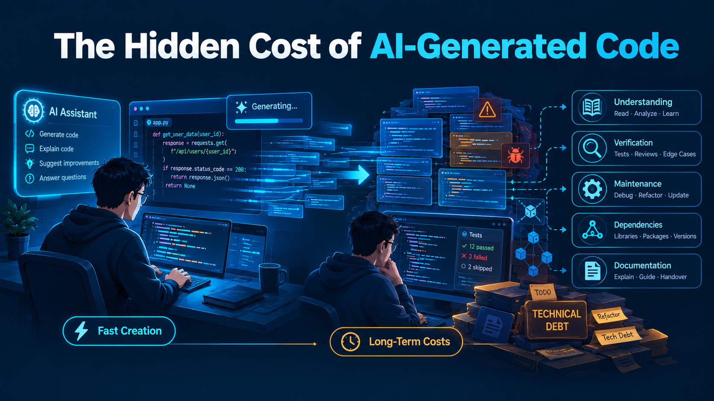

# The Hidden Cost of AI-Generated Code: Understanding and Managing Technical Debt

[🇬🇧 Read in English](hidden-cost-ai-generated-code-en.md)
[🇲🇾 Baca dalam Bahasa Melayu](hidden-cost-ai-generated-code-ms.md)
[🇵🇭 Basahin sa Tagalog](hidden-cost-ai-generated-code-tl.md)

Ini membahas **biaya tersembunyi dari kode yang dihasilkan AI**: Program AI bisa mempercepat pembuatan program, tetapi membuat program dan memelihara program adalah dua persoalan berbeda.

Tujuannya adalah memahami:
- Bagaimana AI mengubah biaya pembuatan software
- Perbedaan antara membuat kode dan memelihara kode
- Biaya pemahaman, verifikasi, pemeliharaan, dan perubahan
- Apa itu technical debt—dan apa yang bukan technical debt
- Bagaimana AI dapat mempercepat atau mengurangi technical debt
- Kapan technical debt layak diterima

## 1. AI Mempercepat Pembuatan Kode

AI (seperti GitHub Copilot, ChatGPT, Claude) bisa:

- Menulis fungsi atau modul lengkap dalam hitungan detik
- Menghasilkan boilerplate code
- Menyediakan contoh implementasi
- Mempercepat prototyping

Hasilnya: **creation cost turun drastis**. Kode yang sebelumnya butuh jam, sekarang butuh menit.

Namun, seperti yang ditekankan oleh **Google Cloud CTO** dalam artikel "When AI writes the code, who reviews it?": bottleneck bergeser dari menulis kode ke mereview, mengetes, dan mengintegrasikan output AI. [cloud.google](https://cloud.google.com/transform/when-ai-writes-the-code-who-reviews-it-cto-google-cloud)

## 2. Membuat Kode ≠ Memelihara Kode

Tetapi ada perbedaan besar:

- **Membuat kode**: menghasilkan sesuatu yang berjalan.
- **Memelihara kode**: memahami, mengubah, memverifikasi, dan menanggung konsekuensi jangka panjang.

Kode yang berhasil dijalankan belum tentu:

- **Correct** — benar untuk semua input dan kondisi.
- **Safe** — aman terhadap input berbahaya, error, dan penyalahgunaan.
- **Maintainable** — mudah dibaca, diubah, dan di-debug.
- **Testable** — mudah diverifikasi secara otomatis.
- **Aligned** — sesuai arsitektur dan kebutuhan sistem.
- **Owned** — ada orang yang paham dan bertanggung jawab atasnya.

AI dapat menyelesaikan masalah pembuatan kode, tetapi tidak otomatis menyelesaikan masalah tanggung jawab engineering.

## 3. Empat Biaya Tersembunyi

### Biaya pemahaman (Understanding cost)

- Berapa lama dibutuhkan untuk memahami alur kode yang dihasilkan AI?
- Apakah logika implementasinya masuk akal?
- Apakah keputusan desainnya bisa dijelaskan?

### Biaya verifikasi (Verification cost)

- Apakah kode benar?
- Apakah ada edge case yang tidak ditangani?
- Apakah ada kerentanan keamanan?

### Biaya pemeliharaan (Maintenance cost)

- Apa yang terjadi saat kebutuhan berubah?
- Bagaimana menangani bug?
- Bagaimana memperbarui dependency?

### Biaya perubahan (Change cost)

- Seberapa sulit mengubah kode tanpa merusak yang lain?
- Apakah ada abstraksi yang tidak perlu?

## 4. Apa Itu Technical Debt—dan Apa yang Bukan

Martin Fowler membedakan **technical debt** dari sekadar *mess*: debt muncul ketika seseorang membuat keputusan shortcut yang memberi manfaat jangka pendek, tetapi menimbulkan biaya perbaikan di masa depan. [martinfowler](https://martinfowler.com/bliki/TechnicalDebtQuadrant.html)

| Istilah | Arti | Contoh |
|---|---|---|
| **Technical debt** | Shortcut yang disadari atau tidak disadari, tetapi menambah biaya perubahan nanti | Pakai monolith sederhana dulu untuk rilis cepat, dengan rencana refactor |
| **Mess** | Kode berantakan tanpa pertimbangan desain dan tanpa rencana perbaikan | Copy-paste AI output berulang, nama variabel acak, tanpa test |
| **Debt yang sehat** | Shortcut terkendali, tercatat, dan punya rencana pelunasan | “Pakai SQLite untuk MVP, migrasi ke PostgreSQL saat traffic naik” |
| **Debt berbahaya** | Shortcut tanpa pemahaman, tanpa test, tanpa dokumentasi | Menerima kode AI hanya karena “sudah jalan” |

Fowler juga membedakan debt *prudent/reckless* dan *deliberate/inadvertent*, jadi kita bisa pakai kerangka itu untuk menjelaskan kapan AI mempercepat debt yang sehat atau berbahaya. [martinfowler](https://martinfowler.com/bliki/TechnicalDebtQuadrant.html)

## 5. Bagaimana AI Mempercepat Technical Debt

AI dapat mempercepat akumulasi debt secara mekanis:

- **Volume naik lebih cepat daripada pemahaman.** AI membuat lebih banyak kode dalam waktu singkat, sehingga review, test, dan integrasi menjadi bottleneck baru.
- **Kode terlihat benar, tetapi belum terbukti benar.** Program yang sukses dieksekusi belum berarti menangani edge case, error handling, concurrency, atau keamanan.
- **Abstraksi dan dependensi bertambah tanpa kebutuhan nyata.** AI kadang menambahkan library, layer, pattern, atau konfigurasi yang tidak dibutuhkan proyek.
- **Kepemilikan kode kabur.** Jika developer tidak paham kode yang ia commit, siapa yang bertanggung jawab saat kode itu gagal?
- **Konteks proyek hilang.** AI menulis kode dari prompt lokal, tetapi tidak selalu memahami arsitektur, konvensi tim, data nyata, dan batasan produksi.

Penelitian awal tentang *GenAI-induced self-admitted technical debt* mengidentifikasi contoh developer yang menunda testing, menyelesaikan adaptasi, dan mengakui keterbatasan pemahaman terhadap kode AI—artinya debt sering bergeser ke tahap verifikasi dan maintenance. Studi ini menganalisis 6.540 komentar kode yang menyebut LLM, dengan 81 komentar yang secara eksplisit mengakui technical debt. Temuan ini mendukung adanya pola masalah, tetapi tidak membuktikan bahwa mayoritas kode AI menghasilkan debt. [arxiv](https://arxiv.org/html/2601.07786)

## 6. Contoh Nyata: Kode yang Jalan tetapi Belum Layak Dipelihara

> AI menghasilkan fungsi upload file yang berhasil saat dicoba. Kode jalan, tetapi tidak memvalidasi tipe file, tidak membatasi ukuran, tidak menangani nama file berbahaya, dan tidak menulis test. Dari sudut pandang “membuat kode”, selesai dalam lima menit. Dari sudut pandang engineering, barulah pekerjaan dimulai: verifikasi, perbaikan, test, dokumentasi, dan pemeliharaan.

Atau contoh dependency:

> AI menyarankan library untuk fitur kecil. Developer memasangnya tanpa mengecek lisensi, maintenance, ukuran bundle, dan alternatif bawaan bahasa. Enam bulan kemudian library tersebut tidak lagi dirawat, dan tim harus menggantinya.

## 7. Kapan AI Justru Membantu Mengurangi Debt

AI juga bisa mengurangi technical debt jika dipakai dengan benar:

- Menjelaskan kode lama yang tidak dipahami.
- Menulis draft test.
- Menemukan duplikasi dan saran refactor.
- Membuat dokumentasi awal.
- Mempercepat migrasi kecil dan perbaikan boilerplate.
- Meninjau perubahan dari sudut pandang berbeda.

AI bukan penyebab debt; cara kita menerima, memverifikasi, dan mengelola output AI yang menentukan. Riset juga menunjukkan AI kadang justru membantu memperbaiki atau memvalidasi implementasi existing. [arxiv](https://arxiv.org/html/2601.07786)

## 8. Cara Mengelola Debt dari Kode AI

1. **Jangan langsung commit output AI.** Baca dulu alur utamanya: input, output, error handling, dan efek samping.
2. **Tanyakan “kenapa” sebelum menerima kode.** Kalau developer tidak bisa menjelaskan keputusan utamanya, kode itu belum siap masuk.
3. **Wajibkan test untuk perilaku penting.** Terutama edge case, error, permission, dan integrasi.
4. **Review berdasarkan risiko, bukan gaya.** Fokus pada arsitektur, security, data flow, dan dampak perubahan; bukan sekadar format kode.
5. **Catat keputusan.** Gunakan ADR singkat atau komentar desain untuk menjelaskan kenapa suatu pendekatan dipilih.
6. **Beri “repayment plan” untuk debt.** Misalnya: “kode prototipe ini boleh masuk, tetapi harus direfactor sebelum fitur production.”
7. **Ukur debt secara sederhana.** Misalnya jumlah TODO yang nyata, coverage test di area kritikal, waktu onboarding, jumlah bug pada modul tertentu, atau effort untuk mengubah fitur.

Google Cloud menyoroti guardrails seperti linter, test coverage, review berbasis arsitektur, dan risk assessment untuk mengelola percepatan yang dibawa AI. [cloud.google](https://cloud.google.com/transform/when-ai-writes-the-code-who-reviews-it-cto-google-cloud)

## 9. Kapan Debt Boleh Diterima

Tidak semua debt harus segera dilunasi. Ada debt yang murah “bunganya” karena jarang disentuh. Fowler secara eksplisit menyebut bahwa debt untuk rilis tertentu mungkin tidak layak dilunasi jika biaya bunganya kecil. [martinfowler](https://martinfowler.com/bliki/TechnicalDebtQuadrant.html)

Fokusnya adalah **keputusan yang sadar**: kenapa debt diambil, apa risikonya, dan kapan akan dibayar.

## 10. Kesimpulan

AI menurunkan biaya produksi kode, tetapi biaya pemahaman, verifikasi, dan tanggung jawab tetap ada—bahkan bisa naik jika output LLM diterima tanpa disiplin engineering. Nilai penghematan AI baru nyata jika kode tersebut tetap bisa dipahami, diverifikasi, dan diubah dengan biaya yang masuk akal.

Pertanyaan utamanya bukan “bisakah LLM menulis kode?”, melainkan “apakah kita masih memahami dan bertanggung jawab atas kode itu?”

> **Note:** Technical debt bukan musuh; technical debt yang tidak dikelola adalah masalah. Kode yang tidak dipahami adalah utang yang menumpuk. LLM dan tools AI adalah alat bantu, bukan pengganti engineering judgment.

## Referensi

- [IBM — Technical Debt](https://www.ibm.com/id-id/think/topics/technical-debt)
- [Martin Fowler — Technical Debt Quadrant](https://martinfowler.com/bliki/TechnicalDebtQuadrant.html)
- [Google Cloud — When AI Writes the Code, Who Reviews It?](https://cloud.google.com/transform/when-ai-writes-the-code-who-reviews-it-cto-google-cloud)
- [arXiv — GenAI-Induced Self-Admitted Technical Debt](https://arxiv.org/html/2601.07786)
- [OWASP — Secure Coding Practices](https://owasp.org/www-project-secure-coding-practices-quick-reference-guide/)
- [Google — Software Engineering at Google](https://abseil.io/resources/swe-book)