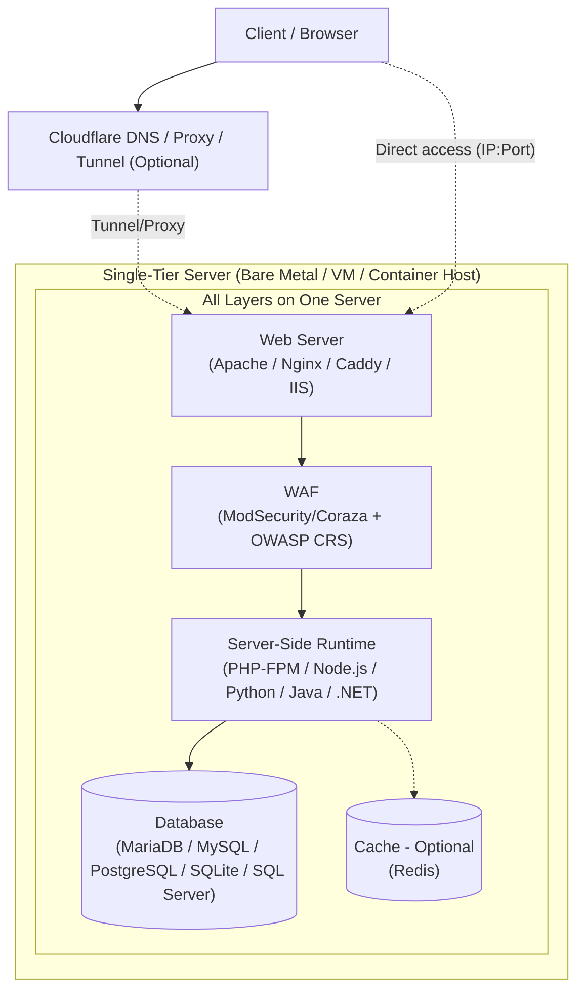

# Single-Tier Server Stack

[🇮🇩 Baca dalam Bahasa Indonesia](linux-exposure-network-experiment-id.md)

This is about a **Single-Tier Server for Web Apps**. It is a setup where the web server, server-side runtime, database, and optional cache are all on **one machine**.

![]

The goal is to understand:
- Which stack you can choose
- The good and bad points of each choice
- Security things to think about
- How to use this for practice

## 1. Deployment (Bare Metal, VM, Container)

| Method | What it does | Good points | Bad points | When to use it |
|---|---|---|---|---|
| **Bare Metal** | The operating system runs directly on real hardware. | Best CPU, disk, and input/output performance. You get full use of the hardware. | Hard to copy or restore quickly. Hardware costs more. Hard to move to another machine. If you have only one machine, it is a **Single Point of Failure (SPOF)**. | Use it for performance testing, or when you want to use all hardware power. |
| **Virtual Machine (KVM/QEMU, VirtualBox, VMware)** | It runs another operating system on top of a hypervisor. | Strong separation between the host and guest systems. You can make snapshots and restore them. You can run a different OS from the host. Good for labs and testing. | It uses more CPU, memory, and input/output because of the hypervisor. It needs more RAM and CPU from the host. Disk and network can be a little slower than bare metal. It is still an SPOF if the whole stack is on one VM with no backup system. | This is the most common choice for a single-tier lab. It is safe, flexible, and easy to copy. |
| **Container (Docker/Podman)** | The app runs in an isolated space, but it shares the host kernel. | Very light. It uses fewer resources. Starts and stops fast. Easy to recreate with images. Good for fast testing. | It shares the host kernel, so isolation is weaker than a VM. A kernel problem can affect all containers. It cannot run a different kernel. Some kernel modules or drivers cannot be isolated. Networking and storage can be harder to set up. It is still an SPOF if all parts are on one host. | Good for fast and repeatable labs. Not the best choice if you need very strong isolation or a different kernel. |

> **Note:** For a single-tier setup, a VM or container can hold the whole stack: web server, runtime, and database. Because everything is on one machine or host, this is a **Single Point of Failure (SPOF)**. If that machine stops, the website, app, and database all stop too.

## 2. Operating System

| OS | Package manager | Good points | Bad points | When to use it |
|---|---|---|---|---|
| **Windows Server** | MSI / Windows Update | Works very well with IIS, .NET, Active Directory, and Microsoft tools. | You need a license. It uses more RAM. Updates may force a restart. It is less common for open-source LAMP/LEMP stacks. | Use it only if your app must use .NET or IIS. |
| **Debian** | APT (.deb) | Very stable, simple, and clean dependency handling. Many other Linux systems are based on it. It is very common for web servers. | Packages are often older because Debian changes slowly. Advanced documentation can be more technical. | Very good for a single-tier lab, especially an open-source LAMP/LEMP stack. |
| **Ubuntu Server (LTS)** | APT (.deb) | Based on Debian. It has lots of documentation. Packages are new enough for normal needs. It is beginner-friendly. | It may have more default packages. Updates can be more frequent than pure Debian. | Great for beginners and intermediate learners who want many guides. |
| **Fedora Server** | DNF (.rpm) | It uses newer technology, such as newer SELinux, systemd, and modern tools. Good for learning modern ideas. | Support time is short, about 13 months. Not good if you want to set it up and leave it alone. | Good for trying new technology, not for long-term use without an update plan. |
| **RHEL** | DNF (.rpm) | Very stable. It has enterprise documentation, structured security updates, and long-term support. | Full support costs money. Official repositories need a subscription. | Better for production. For simple practice, it is often not efficient because of licensing. |
| **Rocky Linux / AlmaLinux** | DNF (.rpm) | Free and compatible with RHEL. Long support and a strong RPM system. | No direct vendor support like RHEL. Some special RHEL enterprise tools may act differently. | A good free RHEL-like choice for a single-tier lab. |
| **openSUSE Leap / SUSE Linux Enterprise** | Zypper (.rpm) | YaST makes setup easier. It is stable and has good admin tools. | The community is smaller than Debian/Ubuntu for web-stack topics. File paths and settings can be different from normal LAMP/LEMP guides. | Good to learn, but you may need to adapt common web-app guides. |
| **Alpine Linux** | APK (.apk) | Very small and light. It uses little memory and starts fast. Very common in containers. | It uses `musl` libc, not `glibc`. Some programs or PHP extensions may not work. Tools are very basic. You must be more careful with security settings. | Good for container-based single-tier setups or very small servers. Test your app first. |
| **Arch Linux** | Pacman (.pkg.tar.zst) | Rolling release. Packages are very new. AUR has many packages. It teaches deep troubleshooting. | Rolling release means things can break after updates. You need good system knowledge. | Use it only if your main goal is learning the system. It is not the safest or easiest choice for a simple lab. |
| **FreeBSD** | pkg / Ports | It has Jails, the built-in `pf` firewall, and good documentation in the Handbook. It is stable for services. It is not Linux. | Many web-app guides assume Linux. Some PHP modules or packages must be built with Ports, which can take longer. Some tools have a smaller ecosystem. | Good for exploring a BSD-based single-tier setup. It takes more work to follow Linux guides. |
| **OpenBSD** | pkg_add / Ports | Very focused on security. It is secure by default and uses tools like privsep, pledge, and unveil. It is very minimal. | Fewer packages are available. Many web apps need different setup steps. The web-stack community is much smaller than Linux. | Good for learning security hardening and minimal systems. Not the most practical choice for normal web apps. |

## 3. Web Server

| Web server | Type | Good points | Bad points | When to use it |
|---|---|---|---|---|
| **[Apache](https://httpd.apache.org/)** | Uses processes/threads and modules | Very flexible with `.htaccess`. It has many modules, such as mod_rewrite and ModSecurity connectors. Almost all PHP shared-hosting guides work with it. | It can use more memory per connection with default settings. You may need to adjust event or MPM settings. Too many virtual hosts or modules can make configuration messy. | Good for a single-tier setup that needs flexibility, especially if it uses `.htaccess`. |
| **[Nginx](https://nginx.org/)** | Event-driven and asynchronous | Very good with many connections at the same time. It uses less RAM. It is fast for static files. It works well with PHP-FPM. | It cannot use `.htaccess`. You must configure rules in the virtual host file. Some Apache modules have no Nginx replacement. Debugging can feel different if you know Apache. | Very efficient for a single-tier server with medium or high traffic, or limited resources. |
| **[Caddy](https://caddyserver.com/)** | Event-driven with a built-in reverse proxy | Very simple configuration. It can get HTTPS certificates automatically with ACME. The syntax is easy. Reverse proxy setup is simple. | It has fewer modules than Apache or Nginx. Some special uses need plugins. TLS depends on ACME and DNS. | Good for a fast lab with automatic HTTPS. You still need to understand its settings and limits. |
| **[IIS](https://www.iis.net/)** | Integrated with Windows | Works naturally with Windows. It has a graphical admin tool. It connects well with .NET and ASP.NET. | It only runs on Windows. It uses more resources. It is less flexible for non-.NET stacks. It is less common with Linux open-source tools. | Use it only if your stack is really based on Windows or .NET. |

## 4. Server-Side Runtime

| Runtime | What it does | Good points | Bad points | When to use it |
|---|---|---|---|---|
| **[PHP-FPM](https://www.php.net/manual/en/install.fpm.php)** | FastCGI service for PHP | Very common in LAMP/LEMP. It works with many apps. You can set pools, users, process limits, and other settings. | It only runs PHP. You must set socket or port permissions correctly. A wrong pool setup can waste resources. | Needed for PHP apps in a single-tier setup. |
| **[Node.js](https://nodejs.org/)** | JavaScript runtime, event-driven | Good for input/output work. Good for real-time APIs. You can use JavaScript for the whole app. npm has a very large ecosystem. | You must keep the process running, for example with systemd or PM2. Memory leaks can be serious on one server. You must handle errors carefully. | Good for JavaScript or TypeScript apps. You need process management because it may not start automatically like PHP-FPM. |
| **[Python](https://www.python.org/)** with Gunicorn or uWSGI | Python runtime | Strong frameworks such as Django, Flask, and FastAPI. Very flexible. | A web server cannot run Python directly. You need a WSGI or ASGI app server. You should use virtual environments and manage dependencies. | Good for Python apps. In a single-tier setup, you need a separate app server. |
| **[Java](https://openjdk.org/)** with Tomcat, Jetty, or Undertow | JVM runtime | Stable and strong for complex apps. Garbage collection can be tuned. | It uses more memory, especially on a small server. It starts more slowly. JVM settings need attention. | Good for Java or Jakarta EE apps. Not the best choice for a small VM or small resources. |
| **[.NET](https://dotnet.microsoft.com/)** with Kestrel and a reverse proxy | .NET runtime | Good performance. It works on Linux and Windows. It has modern integration. | The .NET runtime version must match the app. On Linux, people often put Nginx or Apache in front of Kestrel. Resource use needs attention. | Good if your app is built with .NET. It can still be used in a single-tier Linux setup. |

## 5. Database and Cache for Single-Tier

| Component | Type | Good points | Bad points | When to use it |
|---|---|---|---|---|
| **[MariaDB](https://mariadb.org/)** | Relational SQL database | Open source. It works like MySQL for most cases. It is common in LAMP. It has lots of documentation. | Some features differ from MySQL in certain versions. You may need tuning for special workloads. | Very relevant for single-tier, especially PHP stacks. |
| **[MySQL](https://www.mysql.com/)** | Relational SQL database | Very common. It has a large ecosystem and many tools. | Check the license and distribution because Oracle owns MySQL. Some features depend on the edition. | Relevant, but MariaDB is often recommended more for pure open-source learning. |
| **[PostgreSQL](https://www.postgresql.org/)** | Relational SQL database | Very strong for data correctness. It has many data types and advanced SQL features. It has solid ACID support. It is popular for modern apps. | It is stricter, so you need to understand schemas and permissions. It can use more resources than MySQL for simple projects. | Ideal for single-tier if your app needs more complex relational features. |
| **[SQLite](https://sqlite.org/)** | File-based relational database | No setup needed. It is only one file. It is light and does not need a separate service. Good for one user or low traffic. | It is not made for many processes writing at the same time. It is not good for heavy multi-connection work. It uses file locking. | Good for small apps, prototypes, or internal tools with low traffic. |
| **[SQL Server Express](https://www.microsoft.com/sql-server/sql-server-downloads)** | Relational SQL database | Strong and works well with .NET. The Express edition is free, but it has limits. | Express has limits for RAM and database size, depending on the version. It fits Windows best. On Linux, MariaDB and PostgreSQL are more common in labs. | Use it only for a .NET single-tier stack. |
| **[Redis](https://redis.io/)** | In-memory key-value store | Very fast for cache and sessions. It is light and easy to use. It can reduce database load. | Data is in RAM, so you need persistence if you want to save it. It is not a replacement for a relational database. You must set `maxmemory` and an eviction policy. Check the license for your version. | Optional. Very useful for apps with lots of reading, caching, or sessions. It is not required. |

## 6. Open-Source Security for Single-Tier

| Component | What it does | Good points | Bad points | When to use it |
|---|---|---|---|---|
| **[ModSecurity](https://github.com/owasp-modsecurity/ModSecurity)** | WAF engine, version 3 | It can check HTTP requests and responses. It connects to Apache or Nginx. It uses SecLang rules. | It needs tuning. It can block normal requests by mistake. Performance can go down if rules are too strong. Wrong settings can block real users. | Relevant if you want to learn application-layer filtering in a single-tier setup. |
| **[OWASP CRS](https://coreruleset.org/)** | Rules for ModSecurity or Coraza | It is an industry standard. It covers many common attacks. It is open source, can be checked, and is actively developed. | You must tune it for your app. It can create many false positives at first. It does not give 100% protection without configuration. | Almost required if you use ModSecurity for practice. Start with `DetectionOnly`. |
| **[Coraza](https://coraza.io/)** | Alternative WAF engine written in Go | Light and portable. It works with SecLang. It can connect to many proxies and apps. Good for modern setups. | Integration depends on your web server or proxy. There are fewer tutorials than for ModSecurity. | A good alternative for single-tier, especially if you want something other than ModSecurity. |
| **[OpenSSL](https://www.openssl.org/)** | TLS and cryptography | It is the base for TLS. It has many cipher options. It is available on almost every Linux distribution. | Bad TLS settings can be dangerous, such as weak protocols or ciphers. It is not secure automatically. You need modern hardening. New vulnerabilities can appear in each version. | Required for HTTPS. Configure it carefully. |
| **[Certbot with Let's Encrypt](https://certbot.eff.org/)** | Automatic TLS certificates | Free. It renews certificates automatically. It is very common. It helps you use HTTPS for free. | HTTP-01 validation needs access to port 80 or 443. DNS-01 needs DNS access. If renewal fails, the certificate can expire. It depends on Let's Encrypt being available. | Practical for a lab with a public domain. For local-only use, you can use a self-signed certificate. |
| **[Fail2ban](https://github.com/fail2ban/fail2ban)** | Blocks IPs using logs | It automatically blocks IPs after repeated failed logins in SSH, auth, or web logs. It is light and easy to set up. | It only helps with login or log-based attacks. It cannot find complex app exploits. It can block the wrong IP if logs are read incorrectly. It does not replace a WAF. | Good as a basic extra protection layer for SSH and service logins. |
| **Host firewall: [ufw](https://help.ubuntu.com/community/UFW), [firewalld](https://firewalld.org/), [nftables](https://wiki.nftables.org/), [pf](https://www.openbsd.org/faq/pf/)** | Network filtering | It controls incoming and outgoing ports. It reduces exposure. It is available on many operating systems. | A wrong rule can lock you out. It does not inspect HTTP content. Configuration is different for each firewall and OS. | Required. Open only the ports you really need. |
| **Hardening and monitoring: [auditd](https://linux.die.net/man/8/auditd), [journald](https://www.freedesktop.org/software/systemd/man/latest/systemd-journald.service.html), [logrotate](https://linux.die.net/man/8/logrotate)** | Logging and auditing | It helps you track changes, find strange activity early, stop logs from filling the disk, and investigate problems. | You need to read logs regularly. It uses a little more resources. You need a normal baseline to know what is strange. | Very relevant for practice like “find the cause,” which is the goal of this experiment. |

**Why open source is good for practice:**  
You can read the full configuration. You can check the rules. You can learn how it works line by line. You can recreate it without a license. It also makes you understand the process, not just click buttons in a UI.

This is good for learning security from the basics.

But **open source does not mean secure by default**. You still need to audit it, update it, and configure it correctly.

## 7. Online Access: Domain, DNS, Tunnel, Pros and Cons

| Access method | What you need | Good points | Bad points and risks | When to use it |
|---|---|---|---|---|
| **Direct public IP from home/ISP** | A public IP from your ISP, port forwarding on your router, and a firewall. CGNAT can block this. | You control everything from end to end. No third-party service is needed for routing. | Many home ISPs use CGNAT, so port forwarding may not work. Your IP can be scanned directly. It depends on your home power, internet, and router. ISP settings can change. | Use it only if your ISP gives you a real public IP and you understand the exposure risk. |
| **VPS with public IP** | A VPS account, an OS on the VPS, and firewall settings. A domain is optional. | Stable access from the internet. It does not depend on your home network. Easier for public access. It can run 24/7 if the provider is up. | A VPS costs money. The public IP can still be scanned. It depends on the provider and data center. You must harden SSH, firewall, and updates. | The most practical choice for medium- or long-term public access with full control of the origin server. |
| **Domain + DNS: A, AAAA, or CNAME records** | A registered domain and a DNS provider. You can use it with a public IP or VPS. | Easy for people to read. It makes TLS easier with Let's Encrypt. Flexible: you can point it to an IP, VPS, or proxy. | A domain costs money every year. You need to manage DNS records. If DNS is down, name resolution can fail. The origin server still needs to be online. | Almost required if you want HTTPS with a domain name or want to publish a website publicly. |
| **Reverse proxy: Nginx, Apache, or Caddy** | A web server and virtual-host configuration. Usually used with a public IP or domain. | You can host many sites on one IP. You can separate routing. You can add security headers. You can connect a WAF. | It adds configuration. A wrong setting can expose private paths. Without a tunnel, you still need open ports on the firewall or router. | Important to understand for a clean single-tier setup, whether you use a tunnel or not. |
| **Cloudflare Tunnel: cloudflared, formerly Argo Tunnel** | A Cloudflare account, usually a domain managed in Cloudflare, `cloudflared` on the server, and an outgoing connection to Cloudflare. | **No incoming ports need to be open.** Ports 80 and 443 can stay closed. You can expose a local home service to the internet. You can use Cloudflare rules. Good for labs without a public IP or with CGNAT. | **You usually need a domain** for a custom hostname. You depend fully on Cloudflare: the tunnel, DNS, and Cloudflare network. If your local server or internet stops, the tunnel stops. If Cloudflare has a problem, access can fail. Quick Tunnel can be used for testing without your own domain, but it is not ideal for a fixed domain name. The origin server still must be secure. A tunnel is not a replacement for hardening. Some features depend on your account or product plan. | Very good for a home lab, especially with CGNAT, or when you want fewer open incoming ports. It is only a publishing method, not full app security. |

**Important points about online access:**

- A **domain is not required** if you only access the server through a public IP and port.  
- A domain is **required** if you want a custom hostname through Cloudflare Tunnel with normal settings.  
- **Cloudflare Tunnel uses an outgoing connection** from your server to Cloudflare. Therefore, incoming ports can be fully closed.  
- **Cloudflare proxy can add network filtering**, but your origin server is still a target. If the origin is down, Cloudflare cannot make your app work.  
- **Dependencies:** Home lab + Tunnel depends on power, ISP, server, and Cloudflare. VPS + Tunnel or Proxy depends on the VPS, provider, and Cloudflare. More middle services mean more possible failure points.  
- **For practice,** it is more important to understand these trade-offs than simply to make the app reachable.

## Architecture: Single-Tier

## Conclusion

A **single-tier setup** is good for web-app experiments because you can learn all the main parts on one machine.

Your choices of operating system, web server, runtime, database, WAF, and publishing method affect:
- Performance
- Complexity
- Security

The main goal is not only to make the app run.  
The main goal is to understand how each part works, how the parts talk to each other, and how to make them secure.