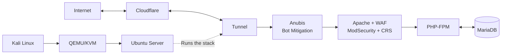

# LYNX — Linux eXposure & Network eXperiment

A single-layer stack for building a web application server using Linux, Apache, MariaDB, and PHP, with OWASP CRS and ModSecurity as the WAF, and Anubis for bot mitigation.

It uses QEMU-KVM as the virtualization platform to run my chosen Linux distribution, Ubuntu.

Next, we will use Cloudflare Argo Tunnel to make our services available through Cloudflare without opening public ports on the server.

As a reference, let me introduce these creatures to you, friends...

## Stack & Official Links

| Component | Function | Official Link |
|---|---|---|
| QEMU | Machine emulator and virtualization | [QEMU](https://www.qemu.org/) |
| KVM | Linux kernel virtualization | [KVM](https://www.linux-kvm.org/) |
| virt-manager | GUI to manage QEMU/KVM virtual machines | [virt-manager](https://virt-manager.org/) |
| Ubuntu Server | Server operating system | [Ubuntu Server](https://ubuntu.com/download/server) |
| Apache HTTP Server | Web server | [Apache](https://httpd.apache.org/) |
| PHP-FPM | Runs PHP code | [PHP](https://www.php.net/) |
| MariaDB | Database server | [MariaDB](https://mariadb.org/) |
| ModSecurity | Web Application Firewall (WAF) | [GitHub](https://github.com/owasp-modsecurity/ModSecurity) |
| OWASP CRS | WAF rules | [GitHub](https://github.com/coreruleset/coreruleset) |
| Anubis | Bot mitigation | [GitHub](https://github.com/TecharoHQ/anubis) |
| Cloudflare Tunnel | Makes services available without opening inbound ports | [cloudflared](https://github.com/cloudflare/cloudflared) |

Now, let me show you how they work in a simple diagram.

## Architecture

## Installation Methods

I will provide two installation methods: manual and automatic.

### 1. Manual Installation

The manual guide will explain each step from the beginning. This will help me understand how the stack works. If a problem happens, I can trace the cause.

**Manual guide:** [soon]

### 2. Automatic Installation

The automatic method will install the stack and set up the configuration without hardcoded values. I will try to make it simple and organized, including error tracing and other features.

**Automatic repository:** [Add repository link here]

## Review

Let's continue tomorrow. For now, we will focus on the manual installation from the beginning.