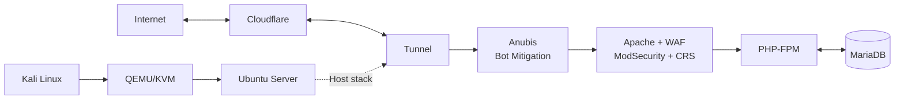

# LYNX — Linux eXposure & Network eXperiment

﷽

[🇬🇧 Read in English](linux-exposure-network-experiment-en.md)

Single-layer stack untuk kebutuhan Anda membangun server Web Application berbasis Linux, Apache, MariaDB, dan PHP, dengan bantuan external source OWASP CRS & ModSecurity sebagai WAF single stack, serta Anubis untuk Bot Mitigation.

Beralaskan QEMU-KVM sebagai platform virtualisasi yang akan menjalankan distro Linux pilihan saya, yaitu Ubuntu.

Lalu, kita akan menggunakan Cloudflare Argo Tunnel untuk publikasi layanan yang menggunakan IP dan port public milik Cloudflare.

Sebagai referensi, saya sertakan makhluk apakah mereka ini, sobat...

## Stack & Official Links

| Component | Function | Official Link |
|---|---|---|
| QEMU | Machine emulator and virtualization | [QEMU](https://www.qemu.org/) |
| KVM | Linux kernel-based virtualization | [KVM](https://www.linux-kvm.org/) |
| virt-manager | GUI for managing QEMU/KVM virtual machines | [virt-manager](https://virt-manager.org/) |
| Ubuntu Server | Server operating system | [Ubuntu Server](https://ubuntu.com/download/server) |
| Apache HTTP Server | Web server | [Apache](https://httpd.apache.org/) |
| PHP-FPM | PHP runtime process manager | [PHP](https://www.php.net/) |
| MariaDB | Database server | [MariaDB](https://mariadb.org/) |
| ModSecurity | Web Application Firewall (WAF) engine | [GitHub](https://github.com/owasp-modsecurity/ModSecurity) |
| OWASP CRS | WAF ruleset | [GitHub](https://github.com/coreruleset/coreruleset) |
| Anubis | Bot mitigation | [GitHub](https://github.com/TecharoHQ/anubis) |
| Cloudflare Tunnel | Publish services without inbound ports | [cloudflared](https://github.com/cloudflare/cloudflared) |

Lalu, bagaimana flow mereka? Saya akan menggambarkannya secara singkat.

## Architecture

## Installation Methods

Saya akan memberikan 2 metode instalasi: manual dan otomatis.

### 1. Manual Installation

Memberikan panduan secara komprehensif dari 0, memudahkan untuk menghafal flow. Jika stack mengalami masalah atau kendala, penyebabnya bisa ditelusuri (*trace*).

**Panduan manual:** [soon]

### 2. Automatic Installation

Memberikan panduan instalasi otomatis, termasuk setup configuration tanpa hardcoded. Saya mendesainnya serapi mungkin, termasuk untuk *error tracing* dan lainnya.

**Repository otomatis:** [Tambahkan link repository di sini]

## Review

Besok aja, kita fokus manual dulu dari 0.
