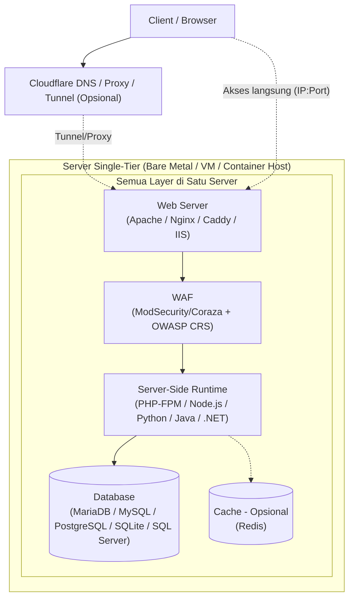

# Server Single-Tier Stack

[🇬🇧 Read in English](linux-exposure-network-experiment-en.md)
[🇲🇾 Baca dalam Bahasa Melayu](linux-exposure-network-experiment-ms.md)
[🇵🇭 Basahin sa Tagalog](linux-exposure-network-experiment-tl.md)

Ini membahas **Server Single-Tier untuk Web Apps**. Artinya, web server, server-side runtime, database, dan cache opsional semuanya berada di **satu mesin**.

Tujuannya adalah memahami:
- Stack apa saja yang bisa dipilih
- Kelebihan dan kekurangan setiap pilihan
- Hal keamanan yang perlu dipikirkan
- Cara memakainya untuk latihan

## 1. Deployment: Bare Metal, VM, Container

| Metode | Fungsinya | Kelebihan | Kekurangan | Kapan dipakai |
|---|---|---|---|---|
| **Bare Metal** | Sistem operasi berjalan langsung di hardware fisik. | Performa CPU, disk, dan input/output paling baik. Kamu bisa memakai seluruh kemampuan hardware. | Sulit dicopy atau dipulihkan dengan cepat. Biaya hardware lebih mahal. Sulit dipindah ke mesin lain. Kalau hanya ada satu mesin, ini menjadi **Single Point of Failure (SPOF)**. | Untuk tes performa, atau saat kamu ingin memakai seluruh tenaga hardware. |
| **Virtual Machine: KVM/QEMU, VirtualBox, VMware** | Menjalankan sistem operasi lain di atas hypervisor. | Pemisahan antara host dan guest kuat. Bisa membuat snapshot dan mengembalikannya. Bisa menjalankan OS yang berbeda dari host. Bagus untuk lab dan testing. | Memakai lebih banyak CPU, memory, dan input/output karena ada hypervisor. Butuh RAM dan CPU lebih besar dari host. Disk dan network bisa sedikit lebih lambat daripada bare metal. Tetap SPOF jika seluruh stack ada di satu VM tanpa sistem cadangan. | Pilihan paling umum untuk lab single-tier. Aman, fleksibel, dan mudah dicopy. |
| **Container: Docker/Podman** | Aplikasi berjalan di ruang terisolasi, tetapi memakai kernel host yang sama. | Sangat ringan. Memakai resource lebih sedikit. Start dan stop cepat. Mudah dibuat ulang dengan image. Bagus untuk testing cepat. | Karena memakai kernel host, isolasinya lebih lemah daripada VM. Masalah kernel bisa memengaruhi semua container. Tidak bisa menjalankan kernel berbeda. Beberapa kernel module atau driver tidak bisa diisolasi. Networking dan storage bisa lebih sulit disetel. Tetap SPOF jika semua bagian ada di satu host. | Bagus untuk lab yang cepat dan bisa dibuat ulang. Kurang ideal jika kamu butuh isolasi sangat kuat atau kernel berbeda. |

> **Catatan:** Untuk single-tier, VM atau container bisa menampung seluruh stack: web server, runtime, dan database. Karena semuanya ada di satu mesin atau host, ini menjadi **Single Point of Failure (SPOF)**. Kalau mesin itu mati, website, aplikasi, dan database juga ikut mati.

## 2. Sistem Operasi

| OS | Package manager | Kelebihan | Kekurangan | Kapan dipakai |
|---|---|---|---|---|
| **Windows Server** | MSI / Windows Update | Sangat cocok dengan IIS, .NET, Active Directory, dan tools Microsoft. | Butuh lisensi. Memakai RAM lebih besar. Update kadang memaksa restart. Kurang umum untuk stack LAMP/LEMP open-source. | Pakai hanya jika aplikasimu wajib memakai .NET atau IIS. |
| **Debian** | APT (.deb) | Sangat stabil, sederhana, dan penanganan dependency rapi. Banyak distro Linux berbasis Debian. Sangat umum untuk web server. | Paket sering lebih lama karena Debian berubah perlahan. Dokumentasi tingkat lanjut kadang lebih teknis. | Sangat bagus untuk lab single-tier, terutama stack LAMP/LEMP open-source. |
| **Ubuntu Server (LTS)** | APT (.deb) | Berbasis Debian. Punya dokumentasi sangat banyak. Paket cukup baru untuk kebutuhan normal. Ramah untuk pemula. | Bisa punya lebih banyak paket bawaan. Update bisa lebih sering daripada Debian murni. | Sangat bagus untuk pemula sampai menengah yang ingin banyak panduan. |
| **Fedora Server** | DNF (.rpm) | Memakai teknologi lebih baru, seperti SELinux terbaru, systemd, dan tools modern. Bagus untuk belajar konsep modern. | Masa dukungannya pendek, sekitar 13 bulan. Kurang cocok jika ingin disetel sekali lalu dibiarkan. | Bagus untuk mencoba teknologi baru, bukan untuk pemakaian jangka panjang tanpa rencana update. |
| **RHEL** | DNF (.rpm) | Sangat stabil. Punya dokumentasi enterprise, update keamanan yang teratur, dan dukungan jangka panjang. | Dukungan penuh berbayar. Repository resmi butuh subscription. | Lebih cocok untuk production. Untuk latihan biasa, sering kurang efisien karena lisensi. |
| **Rocky Linux / AlmaLinux** | DNF (.rpm) | Gratis dan kompatibel dengan RHEL. Dukungan panjang dan ekosistem RPM kuat. | Tidak ada dukungan vendor langsung seperti RHEL. Beberapa tools enterprise khusus RHEL bisa berperilaku berbeda. | Pilihan gratis mirip RHEL yang bagus untuk lab single-tier. |
| **openSUSE Leap / SUSE Linux Enterprise** | Zypper (.rpm) | YaST memudahkan konfigurasi. Stabil dan punya tools administrasi bagus. | Komunitasnya lebih kecil daripada Debian/Ubuntu untuk topik web stack. Lokasi file dan konfigurasi bisa berbeda dari panduan LAMP/LEMP biasa. | Bagus untuk dipelajari, tetapi kamu mungkin perlu menyesuaikan panduan web app umum. |
| **Alpine Linux** | APK (.apk) | Sangat kecil dan ringan. Memakai memory sedikit dan start cepat. Sangat umum di container. | Memakai `musl` libc, bukan `glibc`. Beberapa program atau PHP extension mungkin tidak jalan. Toolsnya sangat dasar. Kamu harus lebih hati-hati dengan pengaturan keamanan. | Bagus untuk single-tier berbasis container atau server sangat kecil. Tes aplikasimu dulu. |
| **Arch Linux** | Pacman (.pkg.tar.zst) | Rolling release. Paket sangat baru. AUR punya banyak paket. Melatih troubleshooting secara mendalam. | Rolling release berarti ada kemungkinan sistem rusak setelah update. Kamu butuh pemahaman sistem yang baik. | Pakai hanya jika tujuan utamamu belajar sistem. Bukan pilihan paling aman atau mudah untuk lab sederhana. |
| **FreeBSD** | pkg / Ports | Punya Jails, firewall `pf` bawaan, dan dokumentasi bagus di Handbook. Stabil untuk service. Bukan Linux. | Banyak panduan web app menganggap sistemnya Linux. Beberapa PHP module atau package harus dibangun lewat Ports, jadi bisa lebih lama. Ekosistem beberapa tools lebih kecil. | Bagus untuk menjelajahi single-tier berbasis BSD. Butuh usaha lebih untuk mengikuti panduan Linux. |
| **OpenBSD** | pkg_add / Ports | Sangat fokus pada keamanan. Aman secara default dan memakai tools seperti privsep, pledge, dan unveil. Sangat minimal. | Paket yang tersedia lebih sedikit. Banyak web app butuh langkah konfigurasi berbeda. Komunitas web stack jauh lebih kecil daripada Linux. | Bagus untuk belajar hardening keamanan dan sistem minimal. Bukan pilihan paling praktis untuk web app biasa. |

## 3. Web Server

| Web server | Tipe | Kelebihan | Kekurangan | Kapan dipakai |
|---|---|---|---|---|
| **[Apache](https://httpd.apache.org/)** | Berbasis process/thread dan module | Sangat fleksibel dengan `.htaccess`. Punya banyak module, seperti mod_rewrite dan connector ModSecurity. Hampir semua panduan PHP shared hosting cocok dengannya. | Dengan pengaturan default, bisa memakai memory lebih besar per koneksi. Kamu mungkin perlu menyetel event atau MPM. Terlalu banyak virtual host atau module bisa membuat konfigurasi berantakan. | Bagus untuk single-tier yang butuh fleksibilitas, terutama jika memakai `.htaccess`. |
| **[Nginx](https://nginx.org/)** | Event-driven dan asynchronous | Sangat bagus untuk banyak koneksi bersamaan. Memakai RAM lebih sedikit. Cepat untuk file statis. Cocok dengan PHP-FPM. | Tidak bisa memakai `.htaccess`. Kamu harus menyetel aturan di file virtual host. Beberapa module Apache tidak punya pengganti di Nginx. Debugging bisa terasa berbeda jika kamu terbiasa dengan Apache. | Sangat efisien untuk server single-tier dengan trafik sedang atau tinggi, atau resource terbatas. |
| **[Caddy](https://caddyserver.com/)** | Event-driven dengan reverse proxy bawaan | Konfigurasi sangat sederhana. Bisa mendapatkan sertifikat HTTPS otomatis dengan ACME. Sintaksnya mudah. Reverse proxy mudah disetel. | Module lebih sedikit daripada Apache atau Nginx. Beberapa kebutuhan khusus butuh plugin. TLS bergantung pada ACME dan DNS. | Bagus untuk lab cepat dengan HTTPS otomatis. Kamu tetap perlu memahami pengaturan dan batasannya. |
| **[IIS](https://www.iis.net/)** | Terintegrasi dengan Windows | Bekerja natural dengan Windows. Punya tools administrasi grafis. Cocok dengan .NET dan ASP.NET. | Hanya jalan di Windows. Memakai resource lebih besar. Kurang fleksibel untuk stack non-.NET. Kurang umum dengan tools open-source Linux. | Pakai hanya jika stack-mu memang berbasis Windows atau .NET. |

## 4. Server-Side Runtime

| Runtime | Fungsinya | Kelebihan | Kekurangan | Kapan dipakai |
|---|---|---|---|---|
| **[PHP-FPM](https://www.php.net/manual/en/install.fpm.php)** | Service FastCGI untuk PHP | Sangat umum di LAMP/LEMP. Cocok dengan banyak aplikasi. Kamu bisa mengatur pool, user, batas process, dan pengaturan lain. | Hanya untuk PHP. Kamu harus mengatur permission socket atau port dengan benar. Pool yang salah bisa membuang resource. | Dibutuhkan untuk aplikasi PHP pada single-tier. |
| **[Node.js](https://nodejs.org/)** | JavaScript runtime, event-driven | Bagus untuk pekerjaan input/output. Cocok untuk API real-time. Bisa memakai JavaScript untuk seluruh aplikasi. Ekosistem npm sangat besar. | Kamu harus menjaga proses tetap berjalan, misalnya dengan systemd atau PM2. Memory leak bisa serius di satu server. Error handling harus rapi. | Bagus untuk aplikasi JavaScript atau TypeScript. Butuh process management karena tidak selalu auto-start seperti PHP-FPM. |
| **[Python](https://www.python.org/)** dengan Gunicorn atau uWSGI | Python runtime | Punya framework kuat seperti Django, Flask, dan FastAPI. Sangat fleksibel. | Web server tidak bisa menjalankan Python langsung. Kamu butuh app server WSGI atau ASGI. Sebaiknya pakai virtual environment dan kelola dependency dengan rapi. | Bagus untuk aplikasi Python. Di single-tier, kamu butuh app server terpisah. |
| **[Java](https://openjdk.org/)** dengan Tomcat, Jetty, atau Undertow | JVM runtime | Stabil dan kuat untuk aplikasi kompleks. Garbage collection bisa disetel. | Memakai memory lebih besar, terutama di server kecil. Start lebih lambat. Pengaturan JVM perlu diperhatikan. | Bagus untuk aplikasi Java atau Jakarta EE. Kurang efisien untuk VM kecil atau resource kecil. |
| **[.NET](https://dotnet.microsoft.com/)** dengan Kestrel dan reverse proxy | .NET runtime | Performa bagus. Bisa jalan di Linux dan Windows. Integrasi modern. | Versi .NET runtime harus cocok dengan aplikasi. Di Linux, biasanya Nginx atau Apache diletakkan di depan Kestrel. Penggunaan resource perlu diperhatikan. | Bagus jika aplikasimu dibuat dengan .NET. Tetap bisa dipakai untuk single-tier Linux. |

## 5. Database dan Cache untuk Single-Tier

| Komponen | Tipe | Kelebihan | Kekurangan | Kapan dipakai |
|---|---|---|---|---|
| **[MariaDB](https://mariadb.org/)** | Database relasional SQL | Open source. Untuk kebanyakan kasus, cara kerjanya mirip MySQL. Umum di LAMP. Dokumentasinya banyak. | Beberapa fitur berbeda dari MySQL di versi tertentu. Kamu mungkin perlu tuning untuk beban kerja khusus. | Sangat relevan untuk single-tier, terutama stack PHP. |
| **[MySQL](https://www.mysql.com/)** | Database relasional SQL | Sangat umum. Ekosistem besar dan banyak tools. | Periksa lisensi dan distribusinya karena MySQL dimiliki Oracle. Beberapa fitur bergantung pada edisinya. | Relevan, tetapi MariaDB lebih sering disarankan untuk belajar open-source murni. |
| **[PostgreSQL](https://www.postgresql.org/)** | Database relasional SQL | Sangat kuat untuk kebenaran data. Punya banyak tipe data dan fitur SQL lanjutan. Dukungan ACID kuat. Populer untuk aplikasi modern. | Lebih ketat, jadi kamu perlu memahami schema dan permission. Bisa memakai resource lebih besar daripada MySQL untuk proyek sederhana. | Ideal untuk single-tier jika aplikasimu butuh fitur relasional yang lebih kompleks. |
| **[SQLite](https://sqlite.org/)** | Database relasional berbasis file | Tidak perlu setup. Hanya satu file. Ringan dan tidak butuh service terpisah. Bagus untuk satu user atau trafik rendah. | Tidak dibuat untuk banyak process yang menulis bersamaan. Kurang cocok untuk banyak koneksi berat. Memakai file locking. | Bagus untuk aplikasi kecil, prototype, atau tools internal dengan trafik rendah. |
| **[SQL Server Express](https://www.microsoft.com/sql-server/sql-server-downloads)** | Database relasional SQL | Kuat dan cocok dengan .NET. Edisi Express gratis, tetapi ada batasan. | Express punya batasan RAM dan ukuran database, tergantung versinya. Paling cocok untuk Windows. Di Linux, MariaDB dan PostgreSQL lebih umum di lab. | Pakai hanya untuk stack single-tier berbasis .NET. |
| **[Redis](https://redis.io/)** | Key-value store di memory | Sangat cepat untuk cache dan session. Ringan dan mudah dipakai. Bisa mengurangi beban database. | Data ada di RAM, jadi butuh persistence jika ingin disimpan. Bukan pengganti database relasional. Kamu harus menyetel `maxmemory` dan eviction policy. Periksa lisensi versi yang kamu pakai. | Opsional. Sangat berguna untuk aplikasi dengan banyak pembacaan, cache, atau session. Tidak wajib. |

## 6. Open Source untuk Production: Keunggulan, Risiko, dan Tanggung Jawab

**Keunggulan utama:**
1. **Transparansi/audit** — bisa periksa implementasi autentikasi, permission, enkripsi, secret handling; memudahkan security review & compliance.
2. **Portabilitas** — bisa pindah penyedia tanpa rewrite; fleksibilitas migrasi.
3. **Kustomisasi** — patch, integrasi, fitur tambahan sesuai kebutuhan.
4. **Ekosistem** — dokumentasi, laporan bug, komunitas; masalah umum mungkin sudah diperbaiki orang lain.
5. **Kontrol data/infra** — self-hosted: lokasi data, akses, retensi log, backup sesuai kebijakan.
6. **Biaya** — tanpa lisensi per core/user/instance; tapi biaya engineer, infra, support, audit tetap ada.
7. **Reproducibility** — kunci versi dependency, otomatisasi build, staging mendekati production.

**Risiko nyata:**
- **Tidak otomatis aman** — Snyk 2023: 40% responden belum pakai SCA/SAST, 96% penanganan supply chain ad hoc. Source code terbuka ≠ audited.
- **Maintainer dependency** — proyek bisa bergantung pada sedikit maintainer; cek riwayat rilis, aktivitas, responsible disclosure, jumlah maintainer.
- **Supply chain** — event-stream (2018), ua-parser-js (2021), XZ Utils (2024) menunjukkan dependency bisa disusupi. Gunakan lockfile, verifikasi artefak, SBOM, build isolation.
- **PHP CVE 2026** — CVE-2026-109618/109619 (RCE tanpa auth) di PHP 8.5.12/8.4.27/8.3.36/8.2.35. Patch wajib; dampak bergantung konfigurasi process. Referensi: [PHP Security Advisory](https://www.php.net/archive/2026.php), [NCSC UK](https://www.ncsc.gov.uk/news/critical-security-issue-affecting-php).
- **Patch vs downtime** — menunda patch = tetap rentan; update tanpa uji = error/downtime. Butuh patch management: identifikasi → penilaian risiko → uji → deploy bertahap → verifikasi → rollback.
- **Kompatibilitas** — musl (Alpine) vs glibc; extension PHP/Python native/Node.js bisa gagal. Pilih OS berdasarkan kebutuhan app, kunci versi, uji di lingkungan mendekati production.
- **Lisensi** — GPL/AGPL tidak otomatis memaksa open source seluruh codebase; bergantung cara penggunaan/distribusi. Black Duck 2026: 87% codebase punya ≥1 vulnerability (sampel audit, bukan universal). Inventaris lisensi + review hukum untuk commercial.
- **Dokumentasi/dukungan** — proyek kecil: sedikit maintainer, respons lambat. Untuk sistem kritis, pertimbangkan support komersial.

**Risiko vs pengendalian:**

| Risiko | Pengendalian |
|---|---|
| Vulnerability | SCA, advisori resmi, patch management, pengujian |
| Supply-chain | Lockfile, provenance, verifikasi artefak, build isolation |
| Proyek tidak terpelihara | Evaluasi kesehatan proyek, support plan, alternatif migrasi |
| Downtime akibat upgrade | Staging, integration test, deploy bertahap, recovery plan |
| Ketidakpatuhan lisensi | SBOM, license scanning, review hukum |
| Kebocoran data | Least privilege, secret management, enkripsi, monitoring |
| Kegagalan recovery | Backup terpisah, uji restore, dokumentasi recovery |

Sebagian besar risiko ini juga ada di proprietary software. Yang berbeda: model akses, distribusi, dukungan, dan pembagian tanggung jawab.

**Checklist production readiness:**
- Keamanan: ada security advisory, mekanisme pelaporan vulnerability, proses pembaruan yang dapat ditelusuri.
- Maintenance: bukti pemeliharaan memadai, maintainer bertanggung jawab, jalur perbaikan.
- Dependency: langsung & transitif dapat diinventarisasi, dipindai, dikunci versinya.
- Integritas distribusi: signature, checksum, atau provenance yang sesuai.
- Kompatibilitas: versi OS, runtime, extension, library sesuai lingkungan target.
- Lisensi: lisensi seluruh komponen diketahui dan kewajibannya ditinjau.
- Operasional: monitoring, logging, backup, dokumentasi deployment, prosedur recovery.
- Keberlanjutan: biaya pemeliharaan, kebutuhan support, opsi migrasi dapat diterima.

Referensi: [OpenSSF Concise Guide](https://best.openssf.org/Concise-Guide-for-Evaluating-Open-Source-Software.html), [OpenSSF Project Security Baseline](https://baseline.openssf.org/versions/2026-08-28).

**Strategi penerapan (single-tier):**
1. **Seleksi & inventaris** — pilih software, inventarisasikan versi & lisensi, identifikasi dependency, tentukan penanggung jawab.
2. **Hardening & pengujian** — konfigurasi minimum, least privilege, pembatasan ingress/egress, perlindungan secret, uji kompatibilitas sebelum deploy.
3. **Monitoring & patch management** — pantau vulnerability baru, proses, perubahan file, autentikasi, koneksi, kesehatan layanan. Prioritaskan patch berdasarkan risiko.
4. **Recovery & respons insiden** — backup terpisah, uji restore, dokumentasikan cara ganti credential, siapkan prosedur isolasi & rebuild.

Pada single-tier, seluruh komponen berada di satu mesin. Kompromi terhadap satu runtime/proses dengan privilege tinggi dapat mengancam komponen lain. Open source tidak menghilangkan risiko ini; pembatasan privilege, kontrol jaringan, dan pemisahan backup tetap diperlukan.

**Kesimpulan:** Open source sangat layak untuk production ketika organisasi membutuhkan transparansi, fleksibilitas, portabilitas, kontrol infrastruktur, dan kemampuan menyesuaikan sistem. Keunggulan utamanya: pilihan dan kendali lebih besar — dapat memeriksa implementasi, memilih cara deployment, mengaudit dependency, menyesuaikan konfigurasi, merencanakan migrasi. Tetapi kendali itu datang bersama tanggung jawab: memastikan software dipelihara, vulnerability ditangani, dependency dipercaya, lisensi dipatuhi, pembaruan diuji, sistem dapat dipulihkan.

- Open source tanpa pengelolaan = sumber risiko yang tidak terlihat.
- Open source dengan pengelolaan yang baik = transparansi dan kontrol bernilai tinggi.
- Proprietary software pun tetap memerlukan pengelolaan keamanan; dukungan vendor tidak menghapus tanggung jawab organisasi.

Tujuannya bukan memilih open source karena dianggap selalu lebih baik, melainkan memilih software berdasarkan kebutuhan, risiko, kemampuan operasional, dan tingkat kendali yang diperlukan.

## 7. Akses Online: Domain, DNS, Tunnel, Kelebihan dan Kekurangan

| Metode akses | Yang dibutuhkan | Kelebihan | Kekurangan dan risiko | Kapan dipakai |
|---|---|---|---|---|
| **IP publik langsung dari rumah/ISP** | IP publik dari ISP, port forwarding di router, dan firewall. CGNAT bisa menghalanginya. | Kamu mengontrol semuanya dari awal sampai akhir. Tidak butuh service pihak ketiga untuk routing. | Banyak ISP rumahan memakai CGNAT, jadi port forwarding mungkin tidak bisa. IP-mu bisa langsung discan. Bergantung pada listrik, internet, dan router rumah. Pengaturan ISP bisa berubah. | Pakai hanya jika ISP memberimu IP publik asli dan kamu paham risiko exposure-nya. |
| **VPS dengan IP publik** | Akun VPS, OS di VPS, dan pengaturan firewall. Domain opsional. | Akses stabil dari internet. Tidak bergantung pada jaringan rumah. Lebih mudah diakses publik. Bisa jalan 24/7 selama provider aktif. | VPS berbayar. IP publik tetap bisa discan. Bergantung pada provider dan data center. Kamu harus hardening SSH, firewall, dan update. | Pilihan paling praktis untuk akses publik jangka menengah atau panjang dengan kontrol penuh pada origin server. |
| **Domain + DNS: record A, AAAA, atau CNAME** | Domain terdaftar dan DNS provider. Bisa dipakai dengan IP publik atau VPS. | Mudah dibaca manusia. Memudahkan TLS dengan Let's Encrypt. Fleksibel: bisa diarahkan ke IP, VPS, atau proxy. | Domain berbayar setiap tahun. Kamu perlu mengelola DNS record. Jika DNS mati, resolusi nama bisa gagal. Origin server tetap harus online. | Hampir wajib jika kamu ingin HTTPS dengan nama domain atau ingin menerbitkan website secara publik. |
| **Reverse proxy: Nginx, Apache, atau Caddy** | Web server dan konfigurasi virtual host. Biasanya dipakai dengan IP publik atau domain. | Bisa menampung banyak site di satu IP. Bisa memisahkan routing. Bisa menambah security header. Bisa menyambungkan WAF. | Menambah konfigurasi. Kesalahan setting bisa membuka path privat. Tanpa tunnel, kamu tetap butuh port terbuka di firewall atau router. | Penting dipahami untuk single-tier yang rapi, baik kamu memakai tunnel atau tidak. |
| **Cloudflare Tunnel: cloudflared, dulu bernama Argo Tunnel** | Akun Cloudflare, biasanya domain yang dikelola di Cloudflare, `cloudflared` di server, dan koneksi keluar ke Cloudflare. | **Tidak perlu membuka port masuk.** Port 80 dan 443 bisa tetap tertutup. Bisa mengekspos service lokal di rumah ke internet. Bisa memakai aturan Cloudflare. Bagus untuk lab tanpa IP publik atau dengan CGNAT. | **Biasanya butuh domain** untuk custom hostname. Kamu bergantung penuh pada Cloudflare: tunnel, DNS, dan jaringan Cloudflare. Jika server lokal atau internet mati, tunnel mati. Jika Cloudflare bermasalah, akses bisa gagal. Quick Tunnel bisa dipakai untuk testing tanpa domain sendiri, tetapi tidak ideal untuk nama domain tetap. Origin server tetap harus aman. Tunnel bukan pengganti hardening. Beberapa fitur bergantung pada akun atau paket produk. | Sangat bagus untuk home lab, terutama dengan CGNAT, atau saat ingin lebih sedikit port masuk yang terbuka. Ini hanya metode publikasi, bukan keamanan aplikasi penuh. |

**Poin penting tentang akses online:**

- **Domain tidak wajib** jika kamu hanya mengakses server lewat IP publik dan port.  
- Domain **wajib** jika kamu ingin custom hostname melalui Cloudflare Tunnel dengan pengaturan normal.  
- **Cloudflare Tunnel memakai koneksi keluar** dari server ke Cloudflare. Karena itu, port masuk bisa ditutup sepenuhnya.  
- **Proxy Cloudflare bisa menambah filtering jaringan**, tetapi origin server tetap menjadi target. Jika origin mati, Cloudflare tidak bisa membuat aplikasimu jalan.  
- **Ketergantungan:** Home lab + Tunnel bergantung pada listrik, ISP, server, dan Cloudflare. VPS + Tunnel atau Proxy bergantung pada VPS, provider, dan Cloudflare. Semakin banyak service perantara, semakin banyak titik kegagalan.  
- **Untuk latihan,** lebih penting memahami trade-off ini daripada hanya membuat aplikasi bisa diakses.

## 8. Operasional & Pemeliharaan (Single-Tier)

| Aspek | Yang dilakukan | Kenapa |
|---|---|---|
| Monitoring lokal | Pantau CPU, RAM, disk, service status (systemd), log error (journald) | Deteksi masalah sebelum user sadar |
| Uptime check | Gunakan Uptime Kuma atau Healthchecks untuk ping endpoint berkala | Tahu jika server down |
| Alert sederhana | Kirim notifikasi (email/Telegram) jika service mati atau disk penuh | Respons cepat tanpa dashboard kompleks |
| Backup | pg_dump/mysqldump rutin, restic/borg ke storage offsite (S3/R2/B2) | Pulih dari kerusakan disk atau kesalahan manusia |
| Restore test | Uji restore di VM/container terpisah secara berkala | Backup yang belum dites belum terbukti bisa dipakai |
| Log management | journald persisten + logrotate, retensi sesuai kebutuhan | Investigasi insiden & hemat disk |
| Sizing & cost | Pilih VPS spec minimal (RAM/CPU/disk) sesuai stack; upgrade jika bottleneck | Hemat biaya, scale saat perlu |
| Kapan pindah dari single-tier | Indikator: traffic tinggi, DB besar, SPOF risk, kebutuhan scaling horizontal | Tahu kapan single-tier tidak cukup |

**Praktik sederhana:**
- Cron untuk backup harian, kirim ke offsite.
- Systemd untuk auto-restart service.
- `df -h` dan `free -h` rutin cek resource.
- Dokumentasikan credential dan langkah rebuild.

## Arsitektur: Single-Tier

## Kesimpulan

**Single-tier** cocok untuk eksperimen web app karena kamu bisa belajar semua bagian utamanya di satu mesin.

Pilihan sistem operasi, web server, runtime, database, WAF, dan metode publikasi memengaruhi:
- Performa
- Tingkat kerumitan
- Keamanan

Tujuan utamanya bukan hanya membuat aplikasi berjalan.  
Tujuan utamanya adalah memahami cara kerja setiap bagian, cara bagian-bagian itu saling berhubungan, dan cara mengamankannya.