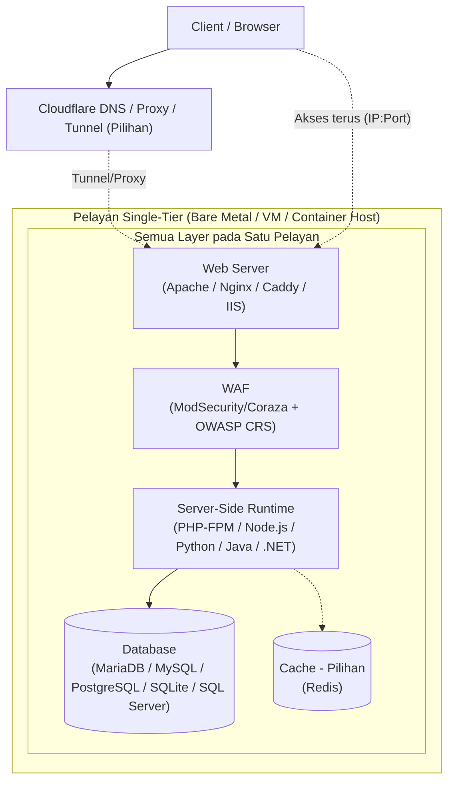

# Server Single-Tier Stack

[🇬🇧 Read in English](linux-exposure-network-experiment-en.md)  
[🇮🇩 Baca dalam Bahasa Indonesia](linux-exposure-network-experiment-id.md)  
[🇵🇭 Basahin sa Tagalog](linux-exposure-network-experiment-tl.md)

Artikel ini membincangkan **Single-Tier Server untuk Web Apps**. Maksudnya, web server, server-side runtime, database, dan cache pilihan semuanya berada pada **satu server**.

Tujuannya adalah memahami:
- Stack apa yang boleh dipilih
- Kelebihan dan kekurangan setiap pilihan
- Perkara keselamatan yang perlu dipertimbangkan
- Cara menggunakannya untuk latihan

## 1. Deployment: Bare Metal, VM, Container

| Kaedah | Fungsinya | Kelebihan | Kekurangan | Bila digunakan |
|---|---|---|---|---|
| **Bare Metal** | Sistem operasi berjalan terus pada perkakasan fizikal. | Prestasi CPU, disk, dan input/output paling baik. Anda boleh menggunakan sepenuhnya keupayaan hardware. | Sukar disalin atau dipulihkan dengan pantas. Kos hardware lebih tinggi. Sukar dipindahkan ke server lain. Jika hanya ada satu server, ia menjadi **Single Point of Failure (SPOF)**. | Untuk ujian prestasi, atau apabila anda mahu menggunakan sepenuhnya tenaga hardware. |
| **Virtual Machine: KVM/QEMU, VirtualBox, VMware** | Menjalankan sistem operasi lain di atas hypervisor. | Pemisahan antara host dan guest kukuh. Boleh membuat snapshot dan memulihkannya. Boleh menjalankan OS berbeza daripada host. Bagus untuk makmal dan testing. | Menggunakan lebih banyak CPU, memory, dan input/output kerana ada hypervisor. Memerlukan RAM dan CPU lebih besar daripada host. Disk dan network mungkin sedikit lebih lambat berbanding bare metal. Masih SPOF jika keseluruhan stack berada pada satu VM tanpa sistem sandaran. | Pilihan paling umum untuk makmal single-tier. Selamat, fleksibel, dan mudah disalin. |
| **Container: Docker/Podman** | Aplikasi berjalan dalam ruang terasing, tetapi menggunakan kernel host yang sama. | Sangat ringan. Menggunakan resource lebih sedikit. Mula dan berhenti dengan pantas. Mudah dicipta semula menggunakan image. Bagus untuk testing pantas. | Kerana menggunakan kernel host, pengasingannya lebih lemah berbanding VM. Masalah kernel boleh menjejaskan semua container. Tidak boleh menjalankan kernel berbeza. Beberapa kernel module atau driver tidak boleh diasingkan. Networking dan storage mungkin lebih sukar ditetapkan. Masih SPOF jika semua bahagian berada pada satu host. | Bagus untuk makmal yang pantas dan boleh dicipta semula. Kurang ideal jika anda memerlukan pengasingan yang sangat kukuh atau kernel berbeza. |

> **Nota:** Untuk single-tier, VM atau container boleh menampung keseluruhan stack: web server, runtime, dan database. Kerana semuanya berada pada satu server atau host, ia menjadi **Single Point of Failure (SPOF)**. Jika server itu mati, website, aplikasi, dan database turut mati.

## 2. Sistem Operasi

| OS | Package manager | Kelebihan | Kekurangan | Bila digunakan |
|---|---|---|---|---|
| **Windows Server** | MSI / Windows Update | Sangat sesuai dengan IIS, .NET, Active Directory, dan tools Microsoft. | Perlukan lesen. Menggunakan RAM lebih besar. Kemas kini kadangkala memaksa restart. Kurang umum untuk stack LAMP/LEMP open-source. | Gunakan hanya jika aplikasi anda wajib menggunakan .NET atau IIS. |
| **Debian** | APT (.deb) | Sangat stabil, ringkas, dan pengendalian dependency kemas. Banyak distro Linux berasaskan Debian. Sangat umum untuk web server. | Package kerap lebih lama kerana Debian berubah perlahan. Dokumentasi lanjutan kadangkala lebih teknikal. | Sangat bagus untuk makmal single-tier, terutamanya stack LAMP/LEMP open-source. |
| **Ubuntu Server (LTS)** | APT (.deb) | Berasaskan Debian. Mempunyai dokumentasi yang sangat banyak. Package cukup baharu untuk keperluan biasa. Mesra pengguna baharu. | Boleh mempunyai lebih banyak package lalai. Kemas kini mungkin lebih kerap berbanding Debian tulen. | Sangat bagus untuk pengguna baharu hingga pertengahan yang mahu banyak panduan. |
| **Fedora Server** | DNF (.rpm) | Menggunakan teknologi lebih baharu, seperti SELinux terkini, systemd, dan tools moden. Bagus untuk mempelajari konsep moden. | Tempoh sokongan pendek, sekitar 13 bulan. Kurang sesuai jika mahu disediakan sekali dan dibiarkan. | Bagus untuk mencuba teknologi baharu, bukan untuk penggunaan jangka panjang tanpa rancangan kemas kini. |
| **RHEL** | DNF (.rpm) | Sangat stabil. Mempunyai dokumentasi enterprise, kemas kini keselamatan yang teratur, dan sokongan jangka panjang. | Sokongan penuh berbayar. Repository rasmi memerlukan langganan. | Lebih sesuai untuk production. Untuk latihan biasa, kerap kurang efisien kerana lesen. |
| **Rocky Linux / AlmaLinux** | DNF (.rpm) | Percuma dan serasi dengan RHEL. Sokongan panjang dan ekosistem RPM yang kukuh. | Tiada sokongan vendor terus seperti RHEL. Beberapa tools enterprise khusus RHEL mungkin berkelakuan berbeza. | Pilihan percuma serupa RHEL yang bagus untuk makmal single-tier. |
| **openSUSE Leap / SUSE Linux Enterprise** | Zypper (.rpm) | YaST memudahkan konfigurasi. Stabil dan mempunyai tools pentadbiran yang baik. | Komunitinya lebih kecil berbanding Debian/Ubuntu untuk topik web stack. Lokasi fail dan konfigurasi mungkin berbeza daripada panduan LAMP/LEMP biasa. | Bagus untuk dipelajari, tetapi anda mungkin perlu menyesuaikan panduan web app umum. |
| **Alpine Linux** | APK (.apk) | Sangat kecil dan ringan. Menggunakan memory sedikit dan mula dengan pantas. Sangat umum dalam container. | Menggunakan `musl` libc, bukan `glibc`. Beberapa program atau PHP extension mungkin tidak berfungsi. Toolsnya sangat asas. Anda perlu lebih berhati-hati dengan tetapan keselamatan. | Bagus untuk single-tier berasaskan container atau server yang sangat kecil. Uji aplikasi anda dahulu. |
| **Arch Linux** | Pacman (.pkg.tar.zst) | Rolling release. Package sangat baharu. AUR mempunyai banyak package. Melatih troubleshooting secara mendalam. | Rolling release bermakna sistem mungkin rosak selepas kemas kini. Anda memerlukan pemahaman sistem yang baik. | Gunakan hanya jika matlamat utama anda ialah mempelajari sistem. Bukan pilihan paling selamat atau mudah untuk makmal ringkas. |
| **FreeBSD** | pkg / Ports | Mempunyai Jails, firewall `pf` terbina dalam, dan dokumentasi yang baik dalam Handbook. Stabil untuk service. Bukan Linux. | Banyak panduan web app mengandaikan sistem ialah Linux. Beberapa PHP module atau package perlu dibina melalui Ports, jadi mungkin mengambil masa lebih lama. Ekosistem beberapa tools lebih kecil. | Bagus untuk meneroka single-tier berasaskan BSD. Memerlukan usaha lebih untuk mengikuti panduan Linux. |
| **OpenBSD** | pkg_add / Ports | Sangat fokus kepada keselamatan. Selamat secara lalai dan menggunakan tools seperti privsep, pledge, dan unveil. Sangat minimum. | Package yang tersedia lebih sedikit. Banyak web app memerlukan langkah konfigurasi berbeza. Komuniti web stack jauh lebih kecil berbanding Linux. | Bagus untuk mempelajari hardening keselamatan dan sistem minimum. Bukan pilihan paling praktikal untuk web app biasa. |

## 3. Web Server

| Web server | Jenis | Kelebihan | Kekurangan | Bila digunakan |
|---|---|---|---|---|
| **[Apache](https://httpd.apache.org/)** | Berasaskan process/thread dan module | Sangat fleksibel dengan `.htaccess`. Mempunyai banyak module, seperti mod_rewrite dan connector ModSecurity. Hampir semua panduan PHP shared hosting serasi dengannya. | Dengan tetapan lalai, boleh menggunakan memory lebih besar bagi setiap sambungan. Anda mungkin perlu menetapkan event atau MPM. Terlalu banyak virtual host atau module boleh membuat konfigurasi bercampur aduk. | Bagus untuk single-tier yang memerlukan fleksibiliti, terutamanya jika menggunakan `.htaccess`. |
| **[Nginx](https://nginx.org/)** | Event-driven dan asynchronous | Sangat baik untuk banyak sambungan serentak. Menggunakan RAM lebih sedikit. Pantas untuk fail statik. Serasi dengan PHP-FPM. | Tidak boleh menggunakan `.htaccess`. Anda perlu menetapkan peraturan dalam fail virtual host. Beberapa module Apache tiada pengganti dalam Nginx. Debugging mungkin terasa berbeza jika anda biasa dengan Apache. | Sangat cekap untuk server single-tier dengan trafik sederhana atau tinggi, atau resource terhad. |
| **[Caddy](https://caddyserver.com/)** | Event-driven dengan reverse proxy terbina dalam | Konfigurasi sangat ringkas. Boleh mendapatkan sertifikat HTTPS secara automatik dengan ACME. Sintaksnya mudah. Reverse proxy mudah disediakan. | Module lebih sedikit berbanding Apache atau Nginx. Beberapa keperluan khas memerlukan plugin. TLS bergantung pada ACME dan DNS. | Bagus untuk makmal pantas dengan HTTPS automatik. Anda masih perlu memahami tetapan dan hadnya. |
| **[IIS](https://www.iis.net/)** | Terintegrasi dengan Windows | Berfungsi secara semula jadi dengan Windows. Mempunyai tools pentadbiran grafik. Serasi dengan .NET dan ASP.NET. | Hanya berjalan pada Windows. Menggunakan resource lebih besar. Kurang fleksibel untuk stack bukan .NET. Kurang umum dengan tools open-source Linux. | Gunakan hanya jika stack anda memang berasaskan Windows atau .NET. |

## 4. Server-Side Runtime

| Runtime | Fungsinya | Kelebihan | Kekurangan | Bila digunakan |
|---|---|---|---|---|
| **[PHP-FPM](https://www.php.net/manual/en/install.fpm.php)** | Service FastCGI untuk PHP | Sangat umum dalam LAMP/LEMP. Serasi dengan banyak aplikasi. Anda boleh menetapkan pool, user, had process, dan tetapan lain. | Hanya untuk PHP. Anda perlu menetapkan kebenaran socket atau port dengan betul. Pool yang salah boleh membazirkan resource. | Diperlukan untuk aplikasi PHP dalam single-tier. |
| **[Node.js](https://nodejs.org/)** | JavaScript runtime, event-driven | Bagus untuk kerja input/output. Sesuai untuk API masa nyata. Boleh menggunakan JavaScript untuk keseluruhan aplikasi. Ekosistem npm sangat besar. | Anda perlu memastikan process terus berjalan, contohnya dengan systemd atau PM2. Memory leak boleh menjadi serius pada satu server. Pengendalian ralat perlu kemas. | Bagus untuk aplikasi JavaScript atau TypeScript. Memerlukan process management kerana tidak selalu bermula secara automatik seperti PHP-FPM. |
| **[Python](https://www.python.org/)** dengan Gunicorn atau uWSGI | Python runtime | Mempunyai framework yang kukuh seperti Django, Flask, dan FastAPI. Sangat fleksibel. | Web server tidak boleh menjalankan Python secara langsung. Anda memerlukan app server WSGI atau ASGI. Sebaiknya gunakan virtual environment dan urus dependency dengan kemas. | Bagus untuk aplikasi Python. Dalam single-tier, anda memerlukan app server berasingan. |
| **[Java](https://openjdk.org/)** dengan Tomcat, Jetty, atau Undertow | JVM runtime | Stabil dan kukuh untuk aplikasi kompleks. Garbage collection boleh ditetapkan. | Menggunakan memory lebih besar, terutamanya pada server kecil. Permulaan lebih lambat. Tetapan JVM perlu diberi perhatian. | Bagus untuk aplikasi Java atau Jakarta EE. Kurang cekap untuk VM kecil atau resource kecil. |
| **[.NET](https://dotnet.microsoft.com/)** dengan Kestrel dan reverse proxy | .NET runtime | Prestasi baik. Boleh berjalan pada Linux dan Windows. Integrasi moden. | Versi .NET runtime mesti sepadan dengan aplikasi. Di Linux, biasanya Nginx atau Apache diletakkan di hadapan Kestrel. Penggunaan resource perlu diberi perhatian. | Bagus jika aplikasi anda dibina dengan .NET. Masih boleh digunakan untuk single-tier Linux. |

## 5. Database dan Cache untuk Single-Tier

| Komponen | Jenis | Kelebihan | Kekurangan | Bila digunakan |
|---|---|---|---|---|
| **[MariaDB](https://mariadb.org/)** | Database hubungan SQL | Open source. Bagi kebanyakan kes, cara kerjanya serupa MySQL. Umum dalam LAMP. Dokumentasinya banyak. | Beberapa ciri berbeza daripada MySQL dalam versi tertentu. Anda mungkin perlu tuning untuk beban kerja khas. | Sangat relevan untuk single-tier, terutamanya stack PHP. |
| **[MySQL](https://www.mysql.com/)** | Database hubungan SQL | Sangat umum. Ekosistem besar dan banyak tools. | Semak lesen dan pengedarannya kerana MySQL dimiliki Oracle. Beberapa ciri bergantung pada edisi. | Relevan, tetapi MariaDB lebih kerap disarankan untuk pembelajaran open-source tulen. |
| **[PostgreSQL](https://www.postgresql.org/)** | Database hubungan SQL | Sangat kukuh untuk ketepatan data. Mempunyai banyak jenis data dan ciri SQL lanjutan. Sokongan ACID kukuh. Popular untuk aplikasi moden. | Lebih ketat, jadi anda perlu memahami schema dan kebenaran. Boleh menggunakan resource lebih besar berbanding MySQL untuk projek ringkas. | Ideal untuk single-tier jika aplikasi anda memerlukan ciri hubungan yang lebih kompleks. |
| **[SQLite](https://sqlite.org/)** | Database hubungan berasaskan fail | Tiada persediaan diperlukan. Hanya satu fail. Ringan dan tidak memerlukan service berasingan. Bagus untuk satu pengguna atau trafik rendah. | Tidak dibina untuk banyak process yang menulis pada masa yang sama. Kurang sesuai untuk banyak sambungan berat. Menggunakan file locking. | Bagus untuk aplikasi kecil, prototaip, atau tools dalaman dengan trafik rendah. |
| **[SQL Server Express](https://www.microsoft.com/sql-server/sql-server-downloads)** | Database hubungan SQL | Kukuh dan serasi dengan .NET. Edisi Express percuma, tetapi ada had. | Express mempunyai had RAM dan saiz database, bergantung pada versi. Paling sesuai untuk Windows. Di Linux, MariaDB dan PostgreSQL lebih umum dalam makmal. | Gunakan hanya untuk stack single-tier berasaskan .NET. |
| **[Redis](https://redis.io/)** | Key-value store dalam memory | Sangat pantas untuk cache dan session. Ringan dan mudah digunakan. Boleh mengurangkan beban database. | Data berada dalam RAM, jadi perlukan persistence jika mahu disimpan. Bukan pengganti database hubungan. Anda perlu menetapkan `maxmemory` dan eviction policy. Semak lesen versi yang digunakan. | Pilihan. Sangat berguna untuk aplikasi dengan banyak pembacaan, cache, atau session. Tidak wajib. |

## 6. Keselamatan Open-Source untuk Single-Tier

| Komponen | Fungsinya | Kelebihan | Kekurangan | Bila digunakan |
|---|---|---|---|---|
| **[ModSecurity](https://github.com/owasp-modsecurity/ModSecurity)** | WAF engine versi 3 | Boleh memeriksa HTTP request dan response. Boleh disambungkan ke Apache atau Nginx. Menggunakan peraturan SecLang. | Perlu tuning. Boleh menyekat request normal secara salah. Prestasi boleh menurun jika peraturan terlalu ketat. Konfigurasi salah boleh menyekat pengguna sebenar. | Relevan jika anda mahu mempelajari penapisan pada layer aplikasi dalam single-tier. |
| **[OWASP CRS](https://coreruleset.org/)** | Peraturan untuk ModSecurity atau Coraza | Standard industri. Meliputi banyak jenis serangan biasa. Open source, boleh diaudit, dan terus dibangunkan. | Perlu disetel untuk aplikasi anda. Pada awalnya boleh menghasilkan banyak false positive. Tidak memberi perlindungan 100% tanpa konfigurasi. | Hampir wajib jika anda menggunakan ModSecurity untuk latihan. Mulakan dengan `DetectionOnly`. |
| **[Coraza](https://coraza.io/)** | WAF engine alternatif yang ditulis menggunakan Go | Ringan dan mudah alih. Serasi dengan SecLang. Boleh disambungkan ke banyak proxy dan aplikasi. Bagus untuk setup moden. | Integrasi bergantung pada web server atau proxy yang digunakan. Tutorial lebih sedikit berbanding ModSecurity. | Alternatif baik untuk single-tier, terutamanya jika mahu mencuba selain ModSecurity. |
| **[OpenSSL](https://www.openssl.org/)** | TLS dan kriptografi | Asas kepada TLS. Mempunyai banyak pilihan cipher. Tersedia di hampir semua distro Linux. | Tetapan TLS yang lemah boleh berbahaya, contohnya protocol atau cipher lemah. Tidak selamat secara automatik. Perlu hardening moden. Kerentanan baharu boleh muncul pada setiap versi. | Wajib untuk HTTPS. Konfigurasikan dengan berhati-hati. |
| **[Certbot dengan Let's Encrypt](https://certbot.eff.org/)** | Sertifikat TLS automatik | Percuma. Memperbaharui sertifikat secara automatik. Sangat umum digunakan. Membantu anda menggunakan HTTPS tanpa kos. | Validasi HTTP-01 memerlukan akses ke port 80 atau 443. DNS-01 memerlukan akses DNS. Jika pembaharuan gagal, sertifikat boleh tamat tempoh. Bergantung pada ketersediaan Let's Encrypt. | Praktikal untuk makmal dengan domain awam. Untuk penggunaan setempat, anda boleh menggunakan self-signed certificate. |
| **[Fail2ban](https://github.com/fail2ban/fail2ban)** | Menyekat IP berdasarkan log | Menyekat IP secara automatik selepas kegagalan log masuk berulang dalam log SSH, auth, atau web. Ringan dan mudah disediakan. | Hanya membantu serangan berasaskan log masuk atau log. Tidak dapat mengesan exploit aplikasi yang kompleks. Boleh menyekat IP yang salah jika log dibaca secara salah. Tidak menggantikan WAF. | Bagus sebagai lapisan perlindungan asas tambahan untuk SSH dan log masuk service. |
| **Firewall host: [ufw](https://help.ubuntu.com/community/UFW), [firewalld](https://firewalld.org/), [nftables](https://wiki.nftables.org/), [pf](https://www.openbsd.org/faq/pf/)** | Penapisan rangkaian | Mengawal port masuk dan keluar. Mengurangkan exposure. Tersedia pada banyak sistem operasi. | Peraturan yang salah boleh mengunci diri sendiri. Tidak memeriksa kandungan HTTP. Konfigurasi berbeza bagi setiap firewall dan OS. | Wajib. Buka hanya port yang benar-benar diperlukan. |
| **Hardening dan monitoring: [auditd](https://linux.die.net/man/8/auditd), [journald](https://www.freedesktop.org/software/systemd/man/latest/systemd-journald.service.html), [logrotate](https://linux.die.net/man/8/logrotate)** | Logging dan audit | Membantu menjejak perubahan, mengesan aktiviti pelik lebih awal, menghalang log memenuhi disk, dan menyiasat masalah. | Anda perlu membaca log secara berkala. Menggunakan sedikit resource tambahan. Memerlukan baseline normal untuk mengetahui mana yang pelik. | Sangat relevan untuk latihan seperti “mencari punca masalah,” selaras dengan matlamat eksperimen ini. |

**Kenapa open source bagus untuk latihan:**  
Anda boleh membaca keseluruhan konfigurasi. Anda boleh menyemak peraturannya. Anda boleh mempelajari cara kerjanya baris demi baris. Anda boleh menciptanya semula tanpa lesen. Ia juga membuat anda memahami prosesnya, bukan hanya menekan butang dalam UI.

Ini bagus untuk mempelajari keselamatan daripada asas.

Tetapi **open source tidak bermakna automatik selamat**. Anda masih perlu melakukan audit, kemas kini, dan konfigurasi dengan betul.

## 7. Akses Dalam Talian: Domain, DNS, Tunnel, Kelebihan dan Kekurangan

| Kaedah akses | Yang diperlukan | Kelebihan | Kekurangan dan risiko | Bila digunakan |
|---|---|---|---|---|
| **IP awam terus dari rumah/ISP** | IP awam daripada ISP, port forwarding pada router, dan firewall. CGNAT boleh menghalangnya. | Anda mengawal segalanya dari hujung ke hujung. Tiada service pihak ketiga diperlukan untuk routing. | Banyak ISP rumah menggunakan CGNAT, jadi port forwarding mungkin tidak dapat dilakukan. IP anda boleh diimbas terus. Bergantung pada bekalan elektrik, internet, dan router rumah. Tetapan ISP boleh berubah. | Gunakan hanya jika ISP memberi anda IP awam sebenar dan anda memahami risiko exposure-nya. |
| **VPS dengan IP awam** | Akaun VPS, OS pada VPS, dan tetapan firewall. Domain pilihan. | Akses stabil dari internet. Tidak bergantung pada rangkaian rumah. Lebih mudah diakses secara awam. Boleh berjalan 24/7 selagi provider aktif. | VPS berbayar. IP awam masih boleh diimbas. Bergantung pada provider dan data center. Anda perlu hardening SSH, firewall, dan kemas kini. | Pilihan paling praktikal untuk akses awam jangka sederhana atau panjang dengan kawalan penuh pada origin server. |
| **Domain + DNS: rekod A, AAAA, atau CNAME** | Domain berdaftar dan DNS provider. Boleh digunakan dengan IP awam atau VPS. | Mudah dibaca manusia. Memudahkan TLS dengan Let's Encrypt. Fleksibel: boleh diarahkan ke IP, VPS, atau proxy. | Domain berbayar setiap tahun. Anda perlu mengurus rekod DNS. Jika DNS mati, resolusi nama mungkin gagal. Origin server masih perlu dalam talian. | Hampir wajib jika anda mahu HTTPS dengan nama domain atau mahu menerbitkan website secara awam. |
| **Reverse proxy: Nginx, Apache, atau Caddy** | Web server dan konfigurasi virtual host. Biasanya digunakan dengan IP awam atau domain. | Boleh menampung banyak laman pada satu IP. Boleh memisahkan routing. Boleh menambah security header. Boleh menyambungkan WAF. | Menambah konfigurasi. Kesilapan tetapan boleh mendedahkan path peribadi. Tanpa tunnel, anda masih memerlukan port terbuka pada firewall atau router. | Penting difahami untuk single-tier yang kemas, sama ada anda menggunakan tunnel atau tidak. |
| **Cloudflare Tunnel: cloudflared, dahulu dikenali sebagai Argo Tunnel** | Akaun Cloudflare, biasanya domain yang diuruskan dalam Cloudflare, `cloudflared` pada server, dan sambungan keluar ke Cloudflare. | **Tiada port masuk perlu dibuka.** Port 80 dan 443 boleh kekal tertutup. Boleh mendedahkan service tempatan di rumah kepada internet. Boleh menggunakan peraturan Cloudflare. Bagus untuk makmal tanpa IP awam atau dengan CGNAT. | **Biasanya memerlukan domain** untuk custom hostname. Anda bergantung sepenuhnya pada Cloudflare: tunnel, DNS, dan rangkaian Cloudflare. Jika server tempatan atau internet mati, tunnel mati. Jika Cloudflare bermasalah, akses mungkin gagal. Quick Tunnel boleh digunakan untuk pengujian tanpa domain sendiri, tetapi tidak ideal untuk nama domain tetap. Origin server masih perlu selamat. Tunnel bukan pengganti hardening. Beberapa ciri bergantung pada akaun atau pelan produk. | Sangat bagus untuk home lab, terutamanya dengan CGNAT, atau apabila anda mahu lebih sedikit port masuk terbuka. Ia hanya kaedah penerbitan, bukan keselamatan aplikasi penuh. |

**Perkara penting tentang akses dalam talian:**

- **Domain tidak wajib** jika anda hanya mengakses server melalui IP awam dan port.  
- Domain **wajib** jika anda mahu custom hostname melalui Cloudflare Tunnel dengan tetapan biasa.  
- **Cloudflare Tunnel menggunakan sambungan keluar** dari server ke Cloudflare. Oleh itu, port masuk boleh ditutup sepenuhnya.  
- **Proxy Cloudflare boleh menambah penapisan rangkaian**, tetapi origin server masih menjadi sasaran. Jika origin mati, Cloudflare tidak boleh membuat aplikasi anda berfungsi.  
- **Kebergantungan:** Home lab + Tunnel bergantung pada elektrik, ISP, server, dan Cloudflare. VPS + Tunnel atau Proxy bergantung pada VPS, provider, dan Cloudflare. Semakin banyak service perantara, semakin banyak titik kegagalan.  
- **Untuk latihan,** lebih penting memahami trade-off ini daripada hanya memastikan aplikasi boleh diakses.

## Seni Bina: Single-Tier

## Kesimpulan

**Single-tier** sesuai untuk eksperimen web app kerana anda boleh mempelajari semua bahagian utamanya pada satu server.

Pilihan sistem operasi, web server, runtime, database, WAF, dan kaedah penerbitan mempengaruhi:
- Prestasi
- Tahap kerumitan
- Keselamatan

Matlamat utamanya bukan hanya membuat aplikasi berjalan.  
Matlamat utamanya ialah memahami cara kerja setiap bahagian, cara bahagian-bahagian itu saling berhubung, dan cara mengamankannya.