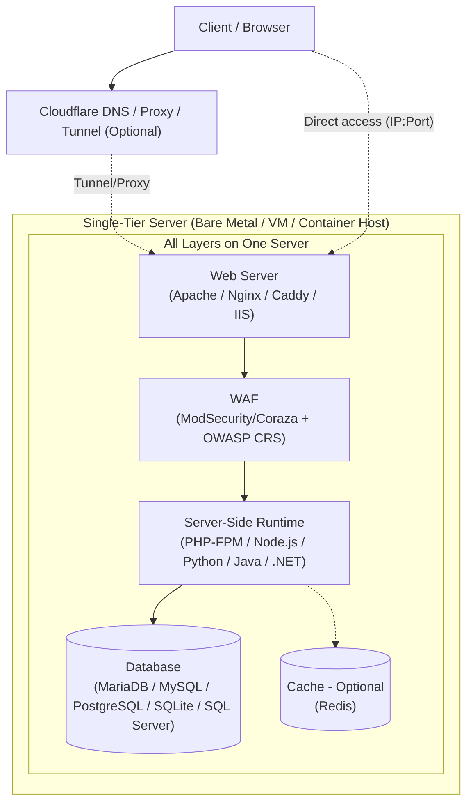

# Server Single-Tier Stack

[🇬🇧 Read in English](linux-exposure-network-experiment-en.md)  
[🇮🇩 Baca dalam Bahasa Indonesia](linux-exposure-network-experiment-id.md)  
[🇲🇾 Baca dalam Bahasa Melayu](linux-exposure-network-experiment-ms.md)

Tinalakay sa artikulong ito ang **Single-Tier Server para sa Web Apps**. Ibig sabihin, ang web server, server-side runtime, database, at optional cache ay nasa **iisang makina** lamang.

Ang layunin ay maunawaan:
- Kung anong mga stack ang maaaring piliin
- Ang mga bentahe at disbentahe ng bawat pagpipilian
- Mga bagay sa seguridad na kailangang isaalang-alang
- Kung paano ito gagamitin para sa pagsasanay

## 1. Deployment: Bare Metal, VM, Container

| Paraan | Ano ang ginagawa nito | Mga bentahe | Mga disbentahe | Kailan gagamitin |
|---|---|---|---|---|
| **Bare Metal** | Tumatakbo nang direkta ang operating system sa physical hardware. | Pinakamahusay na CPU, disk, at input/output performance. Magagamit mo nang buo ang hardware. | Mahirap mabilisang i-copy o i-restore. Mas mahal ang hardware. Mahirap ilipat sa ibang machine. Kung iisa lang ang machine, ito ay **Single Point of Failure (SPOF)**. | Para sa performance testing, o kapag gusto mong gamitin nang buo ang hardware. |
| **Virtual Machine: KVM/QEMU, VirtualBox, VMware** | Nagpapatakbo ng ibang operating system sa ibabaw ng hypervisor. | Malakas ang separation sa pagitan ng host at guest. Maaaring gumawa ng snapshots at i-restore ang mga ito. Maaaring magpatakbo ng ibang OS mula sa host. Maganda para sa labs at testing. | Gumagamit ng mas maraming CPU, memory, at input/output dahil sa hypervisor. Kailangan ng mas malaking RAM at CPU mula sa host. Maaaring bahagyang mas mabagal ang disk at network kumpara sa bare metal. SPOF pa rin kung nasa iisang VM ang buong stack nang walang backup system. | Pinakakaraniwang pagpipilian para sa single-tier lab. Ligtas, flexible, at madaling kopyahin. |
| **Container: Docker/Podman** | Tumatakbo ang application sa isolated space, pero shared ang host kernel. | Napakagaan. Gumagamit ng mas kaunting resources. Mabilis mag-start at mag-stop. Madaling gawing muli gamit ang images. Maganda para sa mabilis na testing. | Dahil shared ang host kernel, mas mahina ang isolation kaysa VM. Maaaring maapektuhan ng kernel issue ang lahat ng containers. Hindi maaaring magpatakbo ng ibang kernel. Hindi lahat ng kernel modules o drivers ay pwedeng i-isolate. Mas kumplikado ang networking at storage setup. SPOF pa rin kung nasa iisang host ang lahat. | Maganda para sa mabilis at reproducible na labs. Hindi ideal kung kailangan mo ng napakalakas na isolation o ibang kernel. |

> **Note:** Para sa single-tier, maaaring ilagay ng VM o container ang buong stack: web server, runtime, at database. Dahil nasa iisang machine o host ang lahat, ito ay **Single Point of Failure (SPOF)**. Kapag namatay ang machine na iyon, mamamatay din ang website, application, at database.

## 2. Operating System

| OS | Package manager | Mga bentahe | Mga disbentahe | Kailan gagamitin |
|---|---|---|---|---|
| **Windows Server** | MSI / Windows Update | Napakahusay na gumagana sa IIS, .NET, Active Directory, at Microsoft tools. | Kailangan ng license. Mas malaki ang RAM usage. Minsan nagpaparestart ang updates. Hindi karaniwan sa open-source LAMP/LEMP stacks. | Gamitin lang kung kailangan talaga ng application ang .NET o IIS. |
| **Debian** | APT (.deb) | Napakastable, simple, at malinis ang dependency handling. Maraming Linux distributions ang batay dito. Napakakaraniwan para sa web servers. | Madalas mas luma ang packages dahil mabagal magbago ang Debian. Mas technical minsan ang advanced documentation. | Napakaganda para sa single-tier lab, lalo na sa open-source LAMP/LEMP stack. |
| **Ubuntu Server (LTS)** | APT (.deb) | Batay sa Debian. Napakaraming documentation. Sapat na bago ang packages para sa normal na pangangailangan. Beginner-friendly. | Maaaring mas marami ang default packages. Mas madalas ang updates kumpara sa pure Debian. | Maganda para sa beginners hanggang intermediate learners na gusto ng maraming guides. |
| **Fedora Server** | DNF (.rpm) | Gumagamit ng mas bagong technology, tulad ng newer SELinux, systemd, at modern tools. Maganda para sa pag-aaral ng modern concepts. | Maikli ang support period, humigit-kumulang 13 buwan. Hindi ideal kung gusto mong i-set up at iwanan na. | Maganda para sa pagsubok ng bagong technology, hindi para sa long-term use nang walang update plan. |
| **RHEL** | DNF (.rpm) | Napakastable. May enterprise documentation, structured security updates, at long-term support. | Bayad ang full support. Kailangan ng subscription para sa official repositories. | Mas angkop para sa production. Para sa simpleng practice, madalas hindi efficient dahil sa licensing. |
| **Rocky Linux / AlmaLinux** | DNF (.rpm) | Libre at compatible sa RHEL. Mahabang support at malakas na RPM ecosystem. | Walang direct vendor support tulad ng RHEL. Maaaring magkaiba ang behavior ng ilang RHEL-specific enterprise tools. | Magandang libreng RHEL-like option para sa single-tier lab. |
| **openSUSE Leap / SUSE Linux Enterprise** | Zypper (.rpm) | Pinapadali ng YaST ang configuration. Stable at may magagandang admin tools. | Mas maliit ang community kumpara sa Debian/Ubuntu para sa web-stack topics. Maaaring magkaiba ang file paths at settings sa karaniwang LAMP/LEMP guides. | Maganda para pag-aralan, pero maaaring kailanganin mong i-adjust ang common web-app guides. |
| **Alpine Linux** | APK (.apk) | Napakaliit at magaan. Kaunti ang memory usage at mabilis mag-start. Napakakaraniwan sa containers. | Gumagamit ito ng `musl` libc, hindi `glibc`. Maaaring hindi gumana ang ilang programs o PHP extensions. Napakabasic ng tools. Mas kailangang mag-ingat sa security settings. | Maganda para sa container-based single-tier setups o napakaliit na servers. Test your app first. |
| **Arch Linux** | Pacman (.pkg.tar.zst) | Rolling release. Napakabago ng packages. Napakarami sa AUR. Nagtuturo ng deep troubleshooting. | Ang rolling release ay maaaring magdulot ng breakage pagkatapos ng updates. Kailangan ng malalim na system knowledge. | Gamitin lang kung pangunahing layunin mo ay pag-aaral ng system. Hindi ito ang pinakasafe o pinakamadaling choice para sa simpleng lab. |
| **FreeBSD** | pkg / Ports | May Jails, built-in `pf` firewall, at magandang documentation sa Handbook. Stable para sa services. Hindi ito Linux. | Maraming web-app guides ang nag-aassume na Linux ang system. Kailangang i-build sa Ports ang ilang PHP modules o packages, kaya mas matagal. Mas maliit ang ecosystem ng ilang tools. | Maganda para sa pag-explore ng BSD-based single-tier setup. Mas maraming effort ang kailangan para sundan ang Linux guides. |
| **OpenBSD** | pkg_add / Ports | Napakafocus sa security. Secure by default at gumagamit ng tools tulad ng privsep, pledge, at unveil. Napakaminimal. | Mas kaunti ang available packages. Kailangan ng ibang configuration steps ang maraming web apps. Mas maliit ang web-stack community kumpara sa Linux. | Maganda para sa pag-aaral ng security hardening at minimal systems. Hindi ang pinakapraktikal na choice para sa ordinary web apps. |

## 3. Web Server

| Web server | Type | Mga bentahe | Mga disbentahe | Kailan gagamitin |
|---|---|---|---|---|
| **[Apache](https://httpd.apache.org/)** | Process/thread-based at module-based | Napakaflexible sa `.htaccess`. Maraming modules, tulad ng mod_rewrite at ModSecurity connectors. Tugma sa halos lahat ng PHP shared-hosting guides. | Maaaring mas malaki ang memory usage per connection sa default settings. Maaaring kailanganin mong i-adjust ang event o MPM settings. Kapag sobrang dami ng virtual hosts o modules, magulo ang configuration. | Maganda para sa single-tier setup na nangangailangan ng flexibility, lalo na kung gumagamit ng `.htaccess`. |
| **[Nginx](https://nginx.org/)** | Event-driven at asynchronous | Napakahusay sa maraming sabay-sabay na connections. Mas kaunti ang RAM usage. Mabilis para sa static files. Maganda ang compatibility sa PHP-FPM. | Hindi maaaring gumamit ng `.htaccess`. Kailangang i-configure ang rules sa virtual host file. Walang katumbas ang ilang Apache modules sa Nginx. Maaaring magkaiba ang debugging kung sanay ka sa Apache. | Napaka-efficient para sa single-tier server na may medium o high traffic, o limited resources. |
| **[Caddy](https://caddyserver.com/)** | Event-driven na may built-in reverse proxy | Napakasimple ng configuration. Maaaring kumuha ng HTTPS certificates automatically gamit ang ACME. Madali ang syntax. Simple ang reverse proxy setup. | Mas kaunti ang modules kumpara sa Apache o Nginx. Kailangan ng plugins ang ilang special use cases. Nakadepende sa ACME at DNS ang TLS. | Maganda para sa mabilis na lab na may automatic HTTPS. Kailangan mo pa ring maunawaan ang settings at limitations nito. |
| **[IIS](https://www.iis.net/)** | Integrated sa Windows | Natural na gumagana sa Windows. May graphical admin tool. Maganda ang integration sa .NET at ASP.NET. | Windows lang ang kayang patakbuhin. Mas malaki ang resource usage. Mas hindi flexible para sa non-.NET stacks. Hindi karaniwan sa Linux open-source tools. | Gamitin lang kung talagang Windows o .NET-based ang stack mo. |

## 4. Server-Side Runtime

| Runtime | Ano ang ginagawa nito | Mga bentahe | Mga disbentahe | Kailan gagamitin |
|---|---|---|---|---|
| **[PHP-FPM](https://www.php.net/manual/en/install.fpm.php)** | FastCGI service para sa PHP | Napakakaraniwan sa LAMP/LEMP. Tugma sa maraming applications. Maaaring i-configure ang pools, users, process limits, at iba pang settings. | Para lang sa PHP. Kailangang i-set nang tama ang socket o port permissions. Maaaring magsayang ng resources ang maling pool configuration. | Kailangan para sa PHP applications sa single-tier setup. |
| **[Node.js](https://nodejs.org/)** | JavaScript runtime, event-driven | Maganda para sa input/output work. Angkop para sa real-time APIs. Maaaring gamitin ang JavaScript para sa buong application. Napakalaki ng npm ecosystem. | Kailangang panatilihing tumatakbo ang process, halimbawa gamit ang systemd o PM2. Maaaring maging seryoso ang memory leaks sa iisang server. Kailangang maayos ang error handling. | Maganda para sa JavaScript o TypeScript applications. Kailangan ng process management dahil hindi laging auto-start tulad ng PHP-FPM. |
| **[Python](https://www.python.org/)** gamit ang Gunicorn o uWSGI | Python runtime | Malalakas na frameworks tulad ng Django, Flask, at FastAPI. Napakaflexible. | Hindi maaaring direktang patakbuhin ng web server ang Python. Kailangan ng WSGI o ASGI app server. Dapat gumamit ng virtual environments at maayos na dependency management. | Maganda para sa Python applications. Sa single-tier setup, kailangan mo ng separate app server. |
| **[Java](https://openjdk.org/)** gamit ang Tomcat, Jetty, o Undertow | JVM runtime | Stable at malakas para sa complex applications. Maaaring i-tune ang garbage collection. | Mas malaki ang memory usage, lalo na sa maliit na server. Mas mabagal ang startup. Kailangang pansinin ang JVM settings. | Maganda para sa Java o Jakarta EE applications. Hindi pinaka-efficient para sa maliit na VM o resources. |
| **[.NET](https://dotnet.microsoft.com/)** gamit ang Kestrel at reverse proxy | .NET runtime | Magandang performance. Gumagana sa Linux at Windows. Modern integration. | Kailangang tugma ang .NET runtime version sa application. Sa Linux, karaniwang nilalagyan ng Nginx o Apache ang harap ng Kestrel. Kailangang pansinin ang resource usage. | Maganda kung .NET ang ginamit sa application. Pwede pa ring gamitin sa single-tier Linux setup. |

## 5. Database at Cache para sa Single-Tier

| Komponent | Type | Mga bentahe | Mga disbentahe | Kailan gagamitin |
|---|---|---|---|---|
| **[MariaDB](https://mariadb.org/)** | Relational SQL database | Open source. Para sa karamihan ng cases, katulad ng paggana ng MySQL. Karaniwan sa LAMP. Maraming documentation. | May pagkakaiba ang ilang features mula sa MySQL sa certain versions. Maaaring kailanganin ang tuning para sa special workloads. | Napaka-relevant para sa single-tier, lalo na sa PHP stacks. |
| **[MySQL](https://www.mysql.com/)** | Relational SQL database | Napakakaraniwan. Malaking ecosystem at maraming tools. | Tingnan ang license at distribution dahil Oracle ang may-ari ng MySQL. Nakadepende sa edition ang ilang features. | Relevant, pero mas madalas irekomenda ang MariaDB para sa pure open-source learning. |
| **[PostgreSQL](https://www.postgresql.org/)** | Relational SQL database | Napakalakas para sa data integrity. Maraming data types at advanced SQL features. Solid ang ACID support. Popular sa modern applications. | Mas strict, kaya kailangang maunawaan ang schemas at permissions. Maaaring mas malaki ang resource usage kumpara sa MySQL para sa simpleng projects. | Ideal para sa single-tier kung kailangan ng application ang mas complex relational features. |
| **[SQLite](https://sqlite.org/)** | File-based relational database | Walang setup na kailangan. Isang file lamang. Magaan at hindi kailangan ng separate service. Maganda para sa isang user o low traffic. | Hindi dinisenyo para sa maraming processes na sabay-sabay na nagsusulat. Hindi angkop para sa heavy multi-connection work. Gumagamit ng file locking. | Maganda para sa maliliit na applications, prototypes, o internal tools na may low traffic. |
| **[SQL Server Express](https://www.microsoft.com/sql-server/sql-server-downloads)** | Relational SQL database | Malakas at tugma sa .NET. Libre ang Express edition, pero may limits. | May limits ang Express sa RAM at database size, depende sa version. Pinakaangkop sa Windows. Sa Linux, mas karaniwan ang MariaDB at PostgreSQL sa labs. | Gamitin lang para sa .NET single-tier stack. |
| **[Redis](https://redis.io/)** | In-memory key-value store | Napakabilis para sa cache at sessions. Magaan at madaling gamitin. Maaaring bawasan ang database load. | Nasa RAM ang data, kaya kailangan ng persistence kung gusto mong i-save. Hindi replacement para sa relational database. Kailangang i-set ang `maxmemory` at eviction policy. Tingnan ang license ng version na ginamit. | Optional. Napak useful para sa applications na maraming reads, caching, o sessions. Hindi required. |

## 6. Open-Source Security para sa Single-Tier

| Komponent | Ano ang ginagawa nito | Mga bentahe | Mga disbentahe | Kailan gagamitin |
|---|---|---|---|---|
| **[ModSecurity](https://github.com/owasp-modsecurity/ModSecurity)** | WAF engine, version 3 | Kayang i-inspect ang HTTP requests at responses. Maaaring ikonekta sa Apache o Nginx. Gumagamit ng SecLang rules. | Kailangan ng tuning. Maaaring mag-block ng normal requests nang mali. Bumababa ang performance kapag masyadong aggressive ang rules. Maaaring ma-block ang totoong users dahil sa maling configuration. | Relevant kung gusto mong matutunan ang application-layer filtering sa single-tier setup. |
| **[OWASP CRS](https://coreruleset.org/)** | Rules para sa ModSecurity o Coraza | Industry standard. Sakop ang maraming common attacks. Open source, auditable, at actively developed. | Kailangang i-tune para sa application mo. Maraming false positives sa simula. Walang 100% protection nang walang configuration. | Halos required kung gagamit ka ng ModSecurity para sa practice. Magsimula sa `DetectionOnly`. |
| **[Coraza](https://coraza.io/)** | Alternative WAF engine na nakasulat sa Go | Magaan at portable. Compatible sa SecLang. Maaaring ikonekta sa maraming proxies at applications. Maganda para sa modern setups. | Nakadepende sa web server o proxy ang integration. Mas kaunti ang tutorials kumpara sa ModSecurity. | Magandang alternative para sa single-tier, lalo na kung gusto mong subukan ang iba maliban sa ModSecurity. |
| **[OpenSSL](https://www.openssl.org/)** | TLS at cryptography | Foundation ng TLS. Maraming cipher options. Available sa halos lahat ng Linux distributions. | Delikado ang bad TLS configuration, tulad ng weak protocols o ciphers. Hindi automatic ang security. Kailangan ng modern hardening. Maaaring may bagong vulnerabilities sa bawat version. | Required para sa HTTPS. I-configure nang maingat. |
| **[Certbot with Let's Encrypt](https://certbot.eff.org/)** | Automatic TLS certificates | Libre. Automatic ang certificate renewal. Napakakaraniwan. Tumutulong gumamit ng HTTPS nang libre. | Kailangan ng access sa port 80 o 443 para sa HTTP-01 validation. Kailangan ng DNS access para sa DNS-01. Maaaring mag-expire ang certificate kapag nabigo ang renewal. Nakadepende sa availability ng Let's Encrypt. | Practical para sa lab na may public domain. Para sa local-only use, maaaring gumamit ng self-signed certificate. |
| **[Fail2ban](https://github.com/fail2ban/fail2ban)** | Nagba-block ng IPs gamit ang logs | Awtomatikong nagba-block ng IPs pagkatapos ng repeated failed logins sa SSH, auth, o web logs. Magaan at madaling i-set up. | Tumutulong lang sa login o log-based attacks. Hindi kayang makahanap ng complex application exploits. Maaaring mag-block ng maling IP kung mali ang pagbasa ng logs. Hindi replacement para sa WAF. | Maganda bilang basic extra protection layer para sa SSH at service logins. |
| **Host firewall: [ufw](https://help.ubuntu.com/community/UFW), [firewalld](https://firewalld.org/), [nftables](https://wiki.nftables.org/), [pf](https://www.openbsd.org/faq/pf/)** | Network filtering | Kinokontrol ang incoming at outgoing ports. Binabawasan ang exposure. Available sa maraming operating systems. | Maaaring ma-lock out ka dahil sa maling rule. Hindi nito ini-inspect ang HTTP content. Magkaiba ang configuration sa bawat firewall at OS. | Required. Buksan lamang ang mga port na talagang kailangan mo. |
| **Hardening at monitoring: [auditd](https://linux.die.net/man/8/auditd), [journald](https://www.freedesktop.org/software/systemd/man/latest/systemd-journald.service.html), [logrotate](https://linux.die.net/man/8/logrotate)** | Logging at auditing | Tumutulong i-track ang changes, makadetect ng unusual activity nang maaga, maiwasan ang punong disk dahil sa logs, at mag-investigate ng problems. | Kailangang regular na basahin ang logs. Medyo dagdag na resources. Kailangan ng normal baseline para malaman kung ano ang kakaiba. | Napaka-relevant para sa practice tulad ng “find the cause,” na layunin ng experiment na ito. |

**Bakit maganda ang open source para sa practice:**  
Mababasa mo ang buong configuration. Mache-check mo ang rules. Matututuhan mo kung paano ito gumagana line by line. Maaari mo itong gawing muli nang walang license. Ginagawa rin nitong nauunawaan mo ang proseso, hindi lang ang pag-click ng buttons sa UI.

Maganda ito para sa pag-aaral ng security mula sa basics.

Pero **ang open source ay hindi awtomatikong secure**. Kailangan mo pa ring mag-audit, mag-update, at mag-configure nang tama.

## 7. Online Access: Domain, DNS, Tunnel, Mga Bentahe at Disbentahe

| Access method | Mga kailangan | Mga bentahe | Mga disbentahe at risks | Kailan gagamitin |
|---|---|---|---|---|
| **Direct public IP mula sa home/ISP** | Public IP mula sa ISP, port forwarding sa router, at firewall. Maaaring humadlang ang CGNAT. | Ikaw ang may kontrol mula simula hanggang dulo. Walang third-party service na kailangan para sa routing. | Maraming home ISPs ang gumagamit ng CGNAT, kaya maaaring hindi gumana ang port forwarding. Maaaring i-scan nang direkta ang IP mo. Nakadepende sa home power, internet, at router. Maaaring magbago ang ISP settings. | Gamitin lang kung totoong public IP ang binibigay ng ISP at naiintindihan mo ang exposure risk. |
| **VPS na may public IP** | VPS account, OS sa VPS, at firewall settings. Optional ang domain. | Stable na access mula sa internet. Hindi nakadepende sa home network. Mas madaling i-access publicly. Maaaring tumakbo 24/7 habang up ang provider. | May bayad ang VPS. Maaari pa ring i-scan ang public IP. Nakadepende sa provider at data center. Kailangang i-harden ang SSH, firewall, at updates. | Pinakapraktikal na choice para sa medium- o long-term public access na may full control sa origin server. |
| **Domain + DNS: A, AAAA, o CNAME records** | Registered domain at DNS provider. Maaaring gamitin kasama ang public IP o VPS. | Madaling basahin ng tao. Pinapadali ang TLS gamit ang Let's Encrypt. Flexible: pwedeng i-point sa IP, VPS, o proxy. | May taunang bayad ang domain. Kailangang i-manage ang DNS records. Kapag down ang DNS, maaaring mag-fail ang name resolution. Kailangan pa ring online ang origin server. | Halos required kung gusto mo ng HTTPS na may domain name o gusto mong mag-publish ng website publicly. |
| **Reverse proxy: Nginx, Apache, o Caddy** | Web server at virtual-host configuration. Karaniwang ginagamit kasama ang public IP o domain. | Maaaring mag-host ng maraming sites sa iisang IP. Maaaring paghiwalayin ang routing. Maaaring magdagdag ng security headers. Maaaring ikonekta ang WAF. | Nagdaragdag ng configuration. Maaaring ma-expose ang private paths dahil sa maling setting. Kailangan pa rin ng open ports sa firewall o router kung walang tunnel. | Mahalagang maunawaan para sa malinis na single-tier setup, whether gumagamit ka ng tunnel o hindi. |
| **Cloudflare Tunnel: cloudflared, dating Argo Tunnel** | Cloudflare account, kadalasang domain na naka-manage sa Cloudflare, `cloudflared` sa server, at outgoing connection papunta sa Cloudflare. | **Hindi na kailangang buksan ang incoming ports.** Maaaring manatiling sarado ang ports 80 at 443. Maaaring i-expose ang local home service sa internet. Maaaring gamitin ang Cloudflare rules. Maganda para sa labs na walang public IP o may CGNAT. | **Karaniwang kailangan ng domain** para sa custom hostname. Full dependency ka sa Cloudflare: tunnel, DNS, at Cloudflare network. Kapag namatay ang local server o internet, mamamatay ang tunnel. Kapag may problema ang Cloudflare, maaaring mag-fail ang access. Pwedeng gamitin ang Quick Tunnel para sa testing nang walang sariling domain, pero hindi ideal para sa fixed domain name. Dapat pa ring secure ang origin server. Hindi replacement ang tunnel para sa hardening. Nakadepende sa account o product plan ang ilang features. | Napakaganda para sa home lab, lalo na kapag may CGNAT, o kapag gusto mong mas kaunti ang open incoming ports. Publishing method lang ito, hindi full application security. |

**Mahahalagang punto tungkol sa online access:**

- **Hindi required ang domain** kung ipapasok mo lang ang server gamit ang public IP at port.  
- **Required ang domain** kung gusto mo ng custom hostname sa pamamagitan ng Cloudflare Tunnel gamit ang normal settings.  
- **Gumagamit ng outgoing connection ang Cloudflare Tunnel** mula sa server papunta sa Cloudflare. Kaya maaaring isara nang buo ang incoming ports.  
- **Maaaring magdagdag ng network filtering ang Cloudflare proxy**, pero target pa rin ang origin server. Kapag down ang origin, hindi kayang gawing gumana ng Cloudflare ang application mo.  
- **Dependencies:** Home lab + Tunnel ay nakadepende sa power, ISP, server, at Cloudflare. VPS + Tunnel o Proxy ay nakadepende sa VPS, provider, at Cloudflare. Mas maraming middle services, mas maraming possible failure points.  
- **Para sa practice,** mas mahalagang maunawaan ang trade-offs na ito kaysa simply gawing reachable ang app.

## Architecture: Single-Tier

## Konklusyon

Ang **single-tier setup** ay maganda para sa web-app experiments dahil maaari mong pag-aralan ang lahat ng pangunahing bahagi sa iisang machine.

Ang pagpili mo ng operating system, web server, runtime, database, WAF, at publishing method ay nakakaapekto sa:
- Performance
- Complexity
- Security

Ang pangunahing layunin ay hindi lamang ang pagpapatakbo ng application.  
Ang pangunahing layunin ay maunawaan kung paano gumagana ang bawat bahagi, kung paano nag-uusap ang mga bahaging ito, at kung paano sila gawing secure.