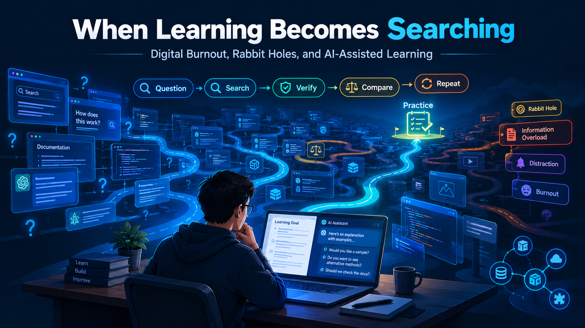

# When Learning Becomes Searching: Digital Burnout, Rabbit Holes, and AI-Assisted Learning

[🇮🇩 Baca dalam Bahasa Indonesia](when-learning-becomes-searching-id.md)
[🇬🇧 Read in English](when-learning-becomes-searching-en.md)
[🇲🇾 Baca dalam Bahasa Melayu](when-learning-becomes-searching-ms.md)

﷽

**When learning becomes searching** ay ang kondisyon kung saan ang layunin ng pag-aaral ay nagiging paghabol ng katiyakan: ang isang tanong ay nagbubukas ng isa pang tanong, ang isang pinagmulan ay pumapalit sa isa pa, at ang proseso ng pag-aaral ay humihinto bago ito mapraktis.

Ito ay tungkol sa **nakatagong gastos ng digital na pag-aaral**: ang digital learning ay hindi awtomatikong produktibo. Maaari itong pabilisin ang pag-aaral, ngunit maaari ring magdulot ng digital burnout, rabbit hole, oververification, at distraksiyon—lalo na kung ginagamit ang LLM nang walang konteksto, direksyon, at sistema ng beripikasyon.

Layunin:
- Bakit maaaring magdulot ng burnout ang digital learning
- Paano lumilitaw ang rabbit hole kapag nag-aaral gamit ang AI
- Bakit malusog ang pagtatanong at pag-beripika, ngunit maaaring maging problema
- Paano lumilikha ng ilusyon ng pag-unawa ang jargon ng LLM
- Paano inaabala ng digital na distraksiyon ang pokus
- Paano gamitin ang LLM nang may malinaw na hangganan

##  Hindi Awtomatikong Produktibo ang Digital Learning

Maaaring pabilisin ng digital learning ang pag-access ng impormasyon, ngunit ang bilis ng input ay hindi kapareho ng pag-unawa. Kapag madali ang impormasyon, ang panganib ay hindi kakulangan ng impormasyon, kundi **sobra-sobrang impormasyon** at **kalituhan**.

Kadalasang lumilitaw ang digital burnout mula sa information overload at patuloy na kognitibong pangangailangan. Natuklasan ng isang pag-aaral sa 566 na mag-aaral na ang pagkakalantad sa impormasyon ng AI ay positibong nauugnay sa digital burnout; lumilitaw ang emosyonal at kognitibong pagkapagod kapag sobra ang impormasyon at patuloy ang kognitibong pangangailangan. [Frontiers in Psychology](https://www.frontiersin.org/journals/psychology/articles/10.3389/fpsyg.2026.1897395/pdf)

##  Rabbit Holes at Burnout

Kadalasang nangyayari ang rabbit hole dahil ang isang tanong ay nagbubukas ng isa pa:

> "Tama ba ito?" → "Bakit?" → "May ibang paraan ba?" → "Alin ang pinakaligtas?" → "Ano sabi ng iba?" → "Mas mabuti ba ang tool na ito?" → nakalimutan ang orihinal na layunin ng pag-aaral.

Maaari itong maging kapaki-pakinabang para sa imbestigasyon, ngunit mapanganib kung walang **stopping rule**. Ang pag-aaral ay hindi paghabol ng 100% katiyakan bago magsimula; ang pag-aaral ay paggawa ng pinakamahusay na desisyon gamit ang sapat na ebidensya, pagkatapos ay subukan at pagbutihin ito.

##  Kapag ang Pagpapabuti ay Nagiging Pag-uulit

Hindi laging nagsisimula ang rabbit hole mula sa paghahanap ng bagong impormasyon. Minsan, lumilitaw ito mula sa pagnanais na ayusin ang isang bagay na sapat na ang ganda.

Halimbawa, ang isang write-up ay nagpapaliwanag na ng problema, mga hakbang ng eksploitasyon, ebidensya, at konklusyon nang tama. Ngunit pagkatapos matapos, lumilitaw ang pagnanais na baguhin ang istruktura, ayusin ang pagpili ng salita, muling ayusin ang mga bahagi, o humanap ng format na tila mas ideal.

Ang isang refactor ay maaaring magpabuti ng kakayahang basahin. Ngunit ang susunod na pagbabago ay hindi nangangahulugang nagdaragdag ng halaga na proporsyonal sa ginugol na oras.

Dito nagiging mahalaga ang hangganan sa pagitan ng *improvement* at *rework*.

- **Improvement:** mga pagbabago na nagpapabuti ng katumpakan, kalinawan, kakayahang basahin, seguridad, o kakayahang panatilihin.
- **Rework:** paulit-ulit na pagbabago na nagbubunga ng kaunti o walang tunay na pagpapabuti, halimbawa ang pagpalit ng istruktura dahil lamang sa mas kasiya-siya ang bagong bersyon.

Ang problema ay hindi ang pagnanais na gumawa ng de-kalidad na trabaho. Lumilitaw ang problema kapag ang pamantayan ng "sapat na" ay patuloy na gumagalaw, kaya ang trabahong tunay na natutugunan ang layunin ay palaging tila hindi pa tapos.

Maaaring palakasin ng AI ang pattern na ito. Maaari tayong humiling ng isa pang bersyon, ihambing ang ilang istruktura, humiling ng kritika, pagkatapos ay ulitin ang proseso. Bawat rebisyon ay tila produktibo, ngunit hindi nangangahulugang mas malapit ang trabaho sa orihinal na layunin.

Bago mag-refactor, magtanong:

1. Ano ang konkretong kakulangan na nais kong ayusin?
2. Pinalalakas ba ng pagbabagong ito ang resulta, o tila iba lamang ito?
3. Paano ko malalaman na ang susunod na bersyon ay tunay na mas mabuti?

Kung walang malinaw na kakulangan, hindi lahat ng posibleng pagpapabuti ang kailangang habulin. Ang trabahong tumpak na, maunawaan, at natutugunan ang layunin nito ay maaaring ituring na tapos.

**Ang layunin ay hindi ang huminto sa pagpapabuti, kundi huminto kapag ang benepisyo ng pagbabago ay hindi na katumbas ng gastos nito.**

##  Kapag ang Pagduda ay Nagiging Rabbit Hole

Natuklasan ng pananaliksik ng Microsoft Research at Carnegie Mellon University sa 319 na knowledge worker at 936 na halimbawa ng paggamit ng AI na ang mas mataas na tiwala sa GenAI ay nauugnay sa mas mababang pagsisikap ng critical thinking na inulat. Sa kabilang banda, ang mga mas nagtitiwala sa sariling kakayahan ay mas kritikal sa pagsuri ng output ng AI. [Microsoft Research](https://www.microsoft.com/en-us/research/wp-content/uploads/2025/01/lee_2025_ai_critical_thinking_survey.pdf)

Binanggit din ng parehong pag-aaral ang isang mahalagang pagbabago: ang trabaho ay nagbabago mula *information gathering* tungo *information verification*, mula paglutas ng problema nang mag-isa tungo sa pagsasama ng mga sagot ng AI, at mula pagpapatupad ng gawain tungo sa pangangasiwa ng AI. [The Register](https://www.theregister.com/software/2025/02/11/some-workers-are-already-outsourcing-their-brains-to-ai/1094150)

Sa pag-aaral, maaari itong lumitaw bilang confidence mismatch: ang mga tama ring sagot ay tila kailangan pang itanong, habang ang mga maling sagot ay minsan ginagamit dahil tila kapani-paniwala.

Tatlong karaniwang trigger:

1. **Confidence mismatch** — mas pinagkakatiwalaan ang AI kaysa sa sariling paghuhusga.
2. **Jargon ng LLM ay lumilikha ng ilusyon ng pag-unawa** — ang mga termino tulad ng *context window*, *RAG*, *agent*, o *hallucination* ay tila mahalaga, ngunit hindi nangangahulugang tumutugon sa problema ng pag-aaral.
3. **Digital na distraksiyon** — ang multitasking, mind-wandering, at paggamit ng device ay maaaring magpababa ng performans ng pag-aaral. [Wiley Online Library](https://onlinelibrary.wiley.com/doi/abs/10.1155/2022/1483531)

Kapag ang beripikasyon ay hindi na nakakatulong sa paggawa ng desisyon, ang proseso ay maaari pang magdagdag ng pagduda. Maaari tayong patuloy na tanungin ang impormasyong sinusuportahan na ng ebidensya, habang ang mga maling sagot ay nakakalusot dahil tila makatuwiran o tumutugma sa paunang palagay.

##  Paano Ito Haharapin

Gumamit ng simpleng prinsipyo: **isang layunin, isang pangunahing pinagmulan, isang hangganan ng beripikasyon.**

- **Tukuyin ang output ng pag-aaral**, hindi lamang ang paksa. Halimbawa: "Ngayon kailangan kong maipaliwanag kung paano gumagana ang DNS at subukan ito," hindi "mag-aral ng networking ngayon."
- **Magtakda ng hangganan ng oras para sa beripikasyon.** Halimbawa: maximum na 20 minuto para suriin ang isang pahayag. Kung hindi pa malinaw, itala bilang open question at magpatuloy.
- **Ihiwalay ang pag-aaral mula sa research.** Pag-aaral: unawain ang isang konsepto at praktisin ito. Research: humanap ng alternatibo, ihambing ang mga tool, magbasa ng papel. Huwag pagsamahin nang patuloy.
- **Gamitin ang LLM bilang tutor, hindi bilang oracle.** Hilingin sa AI na magpaliwanag, lumikha ng pagsasanay, hamunin ang pag-unawa, o ipakita ang mga pagkakamali—hindi lamang magbigay ng panghuling sagot.
- **Itala ang mga desisyon.** Isulat: "Ginagamit ko ang X dahil Y; ang panganib ay Z; ire-review kung A mangyari." Pinipigilan nito ang pagbubukas muli ng mga tanong na nalutas na.
- **Kilalanin ang mga tanda ng pagkapagod.** Kung nagsisimula ka nang makaramdam ng pagkapagod, iritasyon, o pagkawala ng direksyon, huminto sa pagdagdag ng input. Huwag magdagdag ng bagong tab; bumalik sa isang layunin ng pag-aaral.
- **Magtakda ng hangganan para sa rebisyon.** Mag-rebisyon lamang kung may konkretong problema: malabo ang pangungusap, mali ang katotohanan, nakakalito ang istruktura, o nagbago ang layunin ng mambabasa. Huwag mag-rebisyon dahil lamang "tila hindi pa maximum."

Magsimula sa isang layunin ng pag-aaral, pumili ng isang pinagkakatiwalaang pangunahing pinagmulan, pagkatapos ay tukuyin ang hangganan ng beripikasyon ayon sa antas ng panganib ng pahayag. Magdagdag ng independiyenteng pinagmulan kung ang pahayag ay mahalaga, kontrobersyal, o hindi pa malinaw.

##  Mga Limitasyon ng Data

Ang mga pahayag ay dapat kasing lakas ng kanilang pamamaraan ng data:

| Ligtas na pahayag | Labis na pahayag |
|---|---|
| "Natuklasan ng pag-aaral ang korelasyon sa pagitan ng tiwala sa AI at nabawasan na inulat na critical thinking." | "Napatunayan ng AI na bobo ang tao." |
| "Ang pagkakalantad sa impormasyon ng AI ay nauugnay sa digital burnout sa mga mag-aaral." | "Ang AI ang sanhi ng burnout." |
| "Inilipat ng AI ang bahagi ng kognitibong pagsisikap sa beripikasyon at pangangasiwa ng output." | "Inaalis ng AI ang kakayahang mag-isip ng tao." |

- Ang pag-aaral ng Microsoft/CMU ay self-reported at correlational, hindi ebidensya ng sanhi-bunga.
- Ang pag-aaral ng Frontiers ay cross-sectional, hindi causal.
- Ang isa sa mga eksperimentong sinuri ay nag-ulat ng mga iskor ng post-test na 15–30% mas mababa sa ilalim ng ilang kondisyon ng distraksiyon kumpara sa kontrol.

##  Konklusyon

Ang pagduda at beripikasyon ay malusog; ang hindi malusog ay ang beripikasyon nang walang hangganan at pag-aaral nang walang layunin. Ang AI ay dapat bigyan ng konteksto at direksyon, habang dapat mayroon kang sistema para matukoy kung kailan titigil sa paghahanap at magsimulang magpraktis.

Hindi awtomatikong nagdudulot ng burnout o kahangalan ang AI sa mga nag-aaral. Ngunit nang walang konteksto, direksyon, at mga hangganan ng beripikasyon, maaaring pabilisin ng AI ang information overload, rabbit holes, at pagdepender sa mga sagot na hindi pa beripikado.

Ang parehong nalalapat sa pagsusulat, pag-aaral, at paggawa ng desisyon: malusog ang pagpapabuti, ngunit ang pagpapabuti nang walang hangganan ay maaaring gawing walang katapusang loop ang proseso ng pag-aaral.

> **Tandaan:** Ang digital learning ay hindi nabibigo dahil sa sobrang impormasyon. Ito ay nabibigo kapag nawala sa nag-aaral ang hangganan sa pagitan ng pag-aaral, pag-beripika, at pagkaligaw sa paghahanap ng katiyakan.

## Mga Sanggunian

- [Microsoft Research & Carnegie Mellon — AI and Critical Thinking](https://www.microsoft.com/en-us/research/wp-content/uploads/2025/01/lee_2025_ai_critical_thinking_survey.pdf)
- [The Register — Outsourcing Brains to AI](https://www.theregister.com/software/2025/02/11/some-workers-are-already-outsourcing-their-brains-to-ai/1094150)
- [Frontiers in Psychology — AI Information Exposure and Digital Burnout](https://www.frontiersin.org/journals/psychology/articles/10.3389/fpsyg.2026.1897395/pdf)
- [Wiley Online Library — Distraction in Online Learning](https://onlinelibrary.wiley.com/doi/abs/10.1155/2022/1483531)