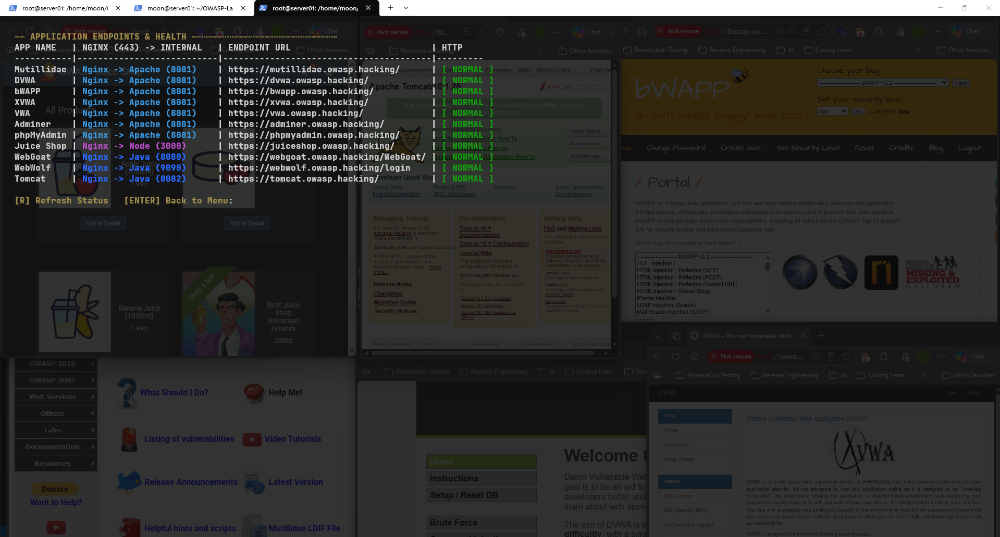
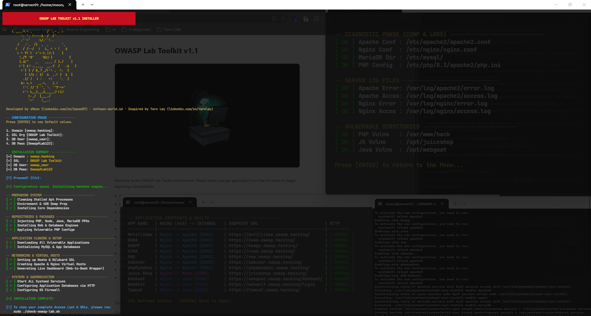

# Build Your Own Hacking Dojo: OWASP Lab Toolkit

[🇮🇩 Baca dalam Bahasa Indonesia](owasp-lab-toolkit-id.md)

﷽

This is the first post on my blog, where I document my explorations, experiments, and projects in cybersecurity.


Today, I'm introducing **OWASP Lab Toolkit**, a Bash-based toolkit that automates the setup of a web application security testing lab. It brings together multiple intentionally vulnerable web applications in one environment, making installation and lab management more straightforward.

## Lab Components

The toolkit brings together several applications and services for web security testing:

- [OWASP Juice Shop](https://owasp.org/www-project-juice-shop/)
- [OWASP Mutillidae II](https://owasp.org/www-project-mutillidae-ii/)
- [OWASP WebGoat & WebWolf](https://owasp.org/www-project-webgoat/)
- [DVWA](https://github.com/digininja/DVWA)
- [bWAPP](http://www.itsecgames.com/)
- [XVWA](https://github.com/s4n7h0/xvwa)
- [VWA](https://github.com/hummingbirdscyber/Vulnerable-Web-Application)

The toolkit also provides supporting services, including a web server, database, and database administration interfaces, depending on the installation configuration.

## Requirements

- **Virtualization:** VMware Workstation Pro or VirtualBox.
- **Operating system:** Ubuntu Server 24.04 LTS.
- **Target minimum specifications:** 2 GB RAM, 1 vCPU, and 20 GB of disk space.
- **Lab access:** A browser on the client machine and appropriate `hosts` file entries.
- **Toolkit:** [OWASP Lab Toolkit](https://github.com/iMoon07/OWASP-Lab-Toolkit).

Currently, the toolkit focuses on Ubuntu-based Linux environments.

## Installation and Configuration

### 1. Clone the Repository

Open a terminal on your Ubuntu Server and run:

```bash
git clone https://github.com/iMoon07/OWASP-Lab-Toolkit.git
cd OWASP-Lab-Toolkit
chmod +x *.sh
```

### 2. Run the Installer

```bash
sudo ./install-owasp-lab.sh
```

The installer sets up the required components and downloads the applications defined in the toolkit's configuration. Installation time depends on your internet connection and available system resources.

### 3. Configure the `hosts` File

To access each application through a local domain, map the lab domains to your Ubuntu Server's IP address.

In this example, the server uses `10.10.10.2`. Make sure this address is assigned to your server and reachable from the client machine.

**Linux**

Open the hosts file:

```bash
sudo nano /etc/hosts
```

Add the following entries:

```text
10.10.10.2 owasp.hacking
10.10.10.2 mutillidae.owasp.hacking
10.10.10.2 dvwa.owasp.hacking
10.10.10.2 bwapp.owasp.hacking
10.10.10.2 xvwa.owasp.hacking
10.10.10.2 vwa.owasp.hacking
10.10.10.2 adminer.owasp.hacking
10.10.10.2 phpmyadmin.owasp.hacking
10.10.10.2 juiceshop.owasp.hacking
10.10.10.2 webgoat.owasp.hacking
10.10.10.2 webwolf.owasp.hacking
10.10.10.2 tomcat.owasp.hacking
10.10.10.2 upload.owasp.hacking
10.10.10.2 example.owasp.hacking
```

Save with `Ctrl + O`, press `Enter`, then exit with `Ctrl + X`.

**Windows 10**

1. Search for Notepad and select **Run as administrator**.
2. Open the following file:

   `C:\Windows\System32\drivers\etc\hosts`

3. Change the file filter to *All Files* if the `hosts` file is not visible.
4. Add the same domain entries listed above.
5. Save the file without adding a file extension.


**Adding New Domains**

If you add another application to the lab, use this format:

```text
10.10.10.2 app-name.owasp.hacking
```

For example, to add `newlab.owasp.hacking`:

```text
10.10.10.2 newlab.owasp.hacking
```

Save the changes to the `hosts` file. You don't need to add another entry if the domain is already listed.

> **Note:** The `hosts` file only maps domain names to IP addresses. Each domain must also be configured on the server through a virtual host, reverse proxy, or another appropriate routing mechanism. The relevant application ports must be configured as well. Adding a domain to the `hosts` file alone does not make an application available.

### 4. Verify the Lab

Once installation is complete, run the built-in health checker:

```bash
sudo ./check-owasp-lab.sh
```

Select option `1` to check HTTP connectivity. Make sure the expected endpoints report a healthy status.



## Start Exploring



Once the services are running, open a browser on your client machine and access the applications through their configured domains. Each application provides its own environment for exploring web vulnerabilities and testing security concepts.

Keep your testing within environments you own or have explicit permission to assess.

## Closing Notes

I built OWASP Lab Toolkit to simplify the process of setting up a web application security testing environment. Feedback, bug reports, and suggestions for additional applications are always welcome.

Repository: [iMoon07/OWASP-Lab-Toolkit](https://github.com/iMoon07/OWASP-Lab-Toolkit)

If you run into installation issues or have ideas for future improvements, feel free to open an issue or join the discussion in the comments.

Happy hacking!
