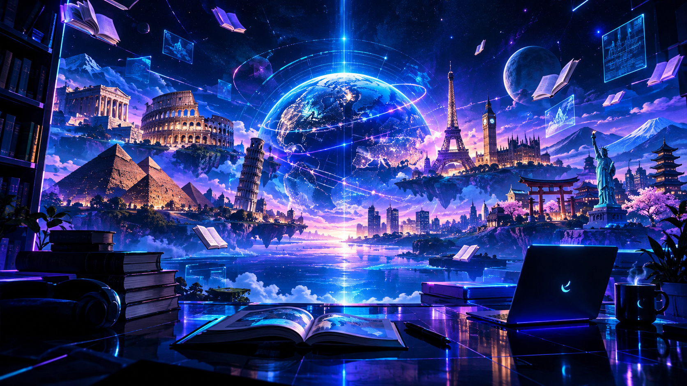

# Daftar Literasi dan Sumber Belajar Gratis

🇬🇧 [Read in English](literasi-dan-sumber-belajar-gratis-en.md)

﷽

Kumpulan sumber belajar gratis untuk mendukung pembelajaran mandiri dalam berbagai bidang ilmu, bahasa, dan literasi melalui referensi terbuka yang dapat diakses secara daring.

## 1. Matematika, Fisika, dan Kimia

| Bidang | Urutan Materi | Referensi Gratis |
| --- | --- | --- |
| Matematika | Aritmetika, pecahan, desimal, persen, aljabar, geometri, kalkulus | [Khan Academy](https://www.khanacademy.org/math) · [OpenStax Mathematics](https://openstax.org/subjects/math) |
| Fisika | Pengukuran, satuan, gerak, gaya, energi, listrik, gelombang | [OpenStax Science](https://openstax.org/subjects/science) |
| Kimia | Materi, atom, unsur, molekul, tabel periodik, ikatan, reaksi kimia | [OpenStax Science](https://openstax.org/subjects/science) |

*Sumber:* [Khan Academy](https://www.khanacademy.org) dan [OpenStax](https://openstax.org). Buku digital OpenStax gratis, sedangkan edisi cetaknya berbayar.

## 2. Literasi Bahasa Asing

| Bahasa | Fokus Literasi | Referensi Gratis |
| --- | --- | --- |
| 🇬🇧 Inggris | Reading, listening, speaking, pronunciation, grammar | [BBC Learning English](https://www.bbc.co.uk/learningenglish) |
| 🇫🇷 Prancis | Pengucapan, kosakata, tata bahasa, pemahaman audio | [TV5MONDE Apprendre](https://apprendre.tv5monde.com/) |
| 🇮🇹 Italia | Kosakata, tata bahasa, percakapan, pemahaman bacaan | [One World Italiano](https://oneworlditaliano.com/en/italian-courses/) |
| 🇩🇪 Jerman | Pengucapan, tata bahasa, membaca, mendengar | [Deutsche Welle – Learn German](https://learngerman.dw.com/) |
| 🇪🇸 Spanyol | Pengucapan, kosakata, tata bahasa, percakapan | [SpanishDict](https://www.spanishdict.com/) |
| 🇸🇦 Arab | Huruf Arab, harakat, kosakata, tata bahasa, membaca | [Madinah Arabic](https://www.madinaharabic.com/) |
| 🇷🇺 Rusia | Alfabet Kiril, pengucapan, kosakata, tata bahasa | [RT Learn Russian](https://learnrussian.rt.com/) |
| 🇨🇳 Mandarin | Pinyin, nada, Hanzi (汉字), kosakata, menulis karakter | [Mandarin.ac.cn](https://www.mandarin.ac.cn/) |
| 🇯🇵 Jepang | Hiragana, Katakana, Kanji (漢字), tata bahasa, percakapan | [NHK World – Learn Japanese](https://www.nhk.or.jp/lesson/) |
| 🇰🇷 Korea | Hangeul (한글), kosakata, tata bahasa, membaca, menulis | [King Sejong Institute](https://www.iksi.or.kr/) |

Semua tautan di tabel ini mengarah ke sumber dengan materi belajar gratis.

## 3. Literasi Tulisan dan Karakter

| Bahasa | Sistem Tulisan | Referensi Latihan |
| --- | --- | --- |
| 🇪🇸 Spanyol | Alfabet Latin, aksen dan tanda baca | [SpanishDict](https://www.spanishdict.com/) |
| 🇸🇦 Arab | Huruf Arab, harakat, penyambungan huruf | [Madinah Arabic](https://www.madinaharabic.com/) |
| 🇷🇺 Rusia | Alfabet Kiril (Кириллица) | [RT Learn Russian](https://learnrussian.rt.com/) |
| 🇨🇳 Mandarin | Hanzi (汉字) | [Mandarin.ac.cn](https://www.mandarin.ac.cn/) |
| 🇯🇵 Jepang | Hiragana, Katakana, Kanji (漢字) | [NHK World – Learn Japanese](https://www.nhk.or.jp/lesson/) |
| 🇰🇷 Korea | Hangeul (한글) | [King Sejong Institute](https://www.iksi.or.kr/) |

## 4. Sastra, Sejarah, Puisi, dan Filsafat

| Bidang Literasi | Referensi Gratis |
| --- | --- |
| Sastra Inggris | [Project Gutenberg](https://www.gutenberg.org/) |
| Sastra Prancis | [TV5MONDE – Langue Française](https://langue-francaise.tv5monde.com/) |
| Sastra Italia | [Wikisource Italiano](https://it.wikisource.org/) |
| Sastra Jerman | [Wikisource Deutsch](https://de.wikisource.org/) |
| Sastra Spanyol | [Wikisource Español](https://es.wikisource.org/) |
| Sastra Arab | [Wikisource العربية](https://ar.wikisource.org/) |
| Sastra Rusia | [Wikisource Русский](https://ru.wikisource.org/) |
| Sastra Mandarin | [Wikisource 中文](https://zh.wikisource.org/) |
| Sastra Jepang | [Wikisource 日本語](https://ja.wikisource.org/) |
| Sastra Korea | [Wikisource 한국어](https://ko.wikisource.org/) |
| Literatur Multibahasa | [Wikisource](https://wikisource.org/) |

[Project Gutenberg](https://www.gutenberg.org/) menyediakan buku elektronik gratis tanpa biaya atau registrasi. [Wikisource](https://wikisource.org/) merupakan perpustakaan teks gratis dalam berbagai bahasa. Ketersediaan karya berbeda-beda menurut bahasa dan hak cipta.
