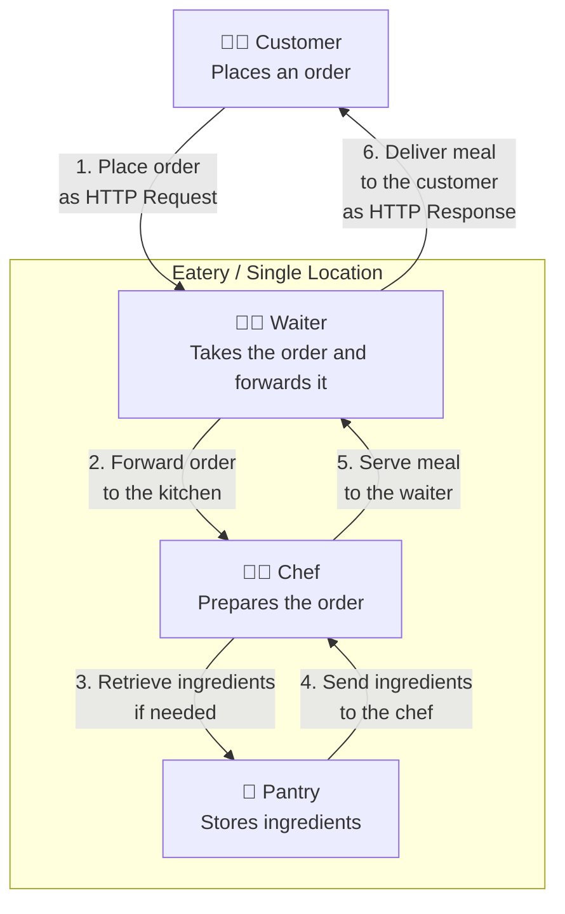
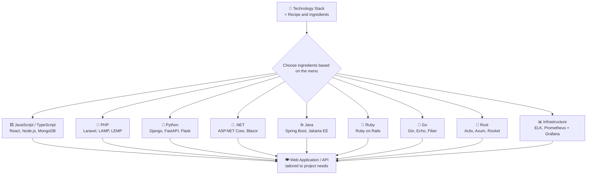
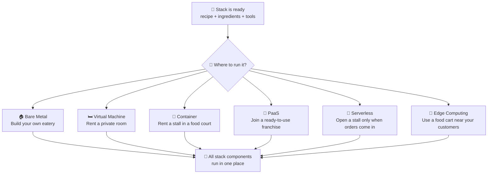

# Server Single-Tier Stack: Understanding Components, Technologies, and Deployment

[🇮🇩 Baca dalam Bahasa Indonesia](server-single-tier-stack-id.md)
[🇲🇾 Baca dalam Bahasa Melayu](server-single-tier-stack-ms.md)
[🇵🇭 Basahin sa Tagalog](server-single-tier-stack-tl.md)

## One Server, One Stack

﷽

A **server single-tier stack** refers to an architecture in which the [web server](https://developer.mozilla.org/en-US/docs/Learn_web_development/Howto/Web_mechanics/What_is_a_web_server), [application runtime](https://en.wikipedia.org/wiki/Runtime_system), and [database](https://en.wikipedia.org/wiki/Database) all run on a **single machine**.

Imagine a small eatery where the kitchen, dining area, and storage are all in one place. A customer places an order, the chef prepares it, and the meal is served on the spot. Everything takes place in the same location.

This concept is much like a **single-tier stack**: the core components of an application—namely the web server, application runtime, and database—are prepared together and served to the user, much like a meal being served from that kitchen.

But how does this work when a visitor accesses a website built on a single-tier stack?

## The Flow

## Core Components

Let us get acquainted with the key components and their roles in a server environment. 

Much like an eatery, not every establishment openly reveals the full details of its preparations. Yet, through firsthand experience or by learning the craft in that very kitchen, one comes to know precisely what goes into each dish.

The same holds true in server architecture. The following are the core components commonly found in a single-tier stack:

| Component | Function |
| --- | --- |
| Operating System (OS) | The foundation. Manages hardware, memory, processes, and server resources. |
| Web Client | The user-side application (e.g., a web browser) that sends HTTP requests to the server and renders HTTP responses. |
| TLS (Transport Layer Security) | A cryptographic protocol that secures communication between a web client and server via encryption, server authentication, and data integrity. SSL is its deprecated predecessor; modern sites use TLS over HTTPS (typically port 443), preferably TLS 1.2 or TLS 1.3. |
| TLS Certificate | A digital certificate from a trusted Certificate Authority (CA) that proves the server's identity. The browser verifies the chain of trust, domain match, and validity; if valid, HTTPS is trusted and shown with a padlock icon. |
| Application Runtime | Executes application code so that it can be processed by the server. |
| Application Framework | Provides structure and built-in features to build applications without having to construct everything from scratch. |
| Database | Stores, organizes, and retrieves the data required by the application. |
| Cache (optional) | Temporarily stores frequently accessed data to improve performance. |

> *Note:* Each application may employ a different combination of components depending on its needs. Elements such as the operating system, TLS, web server, application runtime, framework, database, and cache may be selected or replaced with suitable alternatives in accordance with the chosen architecture.

## Technology Stack Combinations

A technology stack is akin to a recipe and its ingredients. In computing, the choice of operating system, web server, programming language, framework, and database forms a distinct arrangement known as a [solution stack](https://en.wikipedia.org/wiki/Solution_stack).

Each stack carries its own composition and purpose, tailored to the requirements of the application at hand. Below are some of the most widely used technology stacks, along with their components and use cases.

### 1. JavaScript & TypeScript Stack

This stack leverages JavaScript or TypeScript to build both the user interface (frontend) and server logic (backend). With Node.js, Bun, or Deno, JavaScript can run on the server, allowing a single language to cover the entire application stack.

| Stack | Core Components | Description |
| --- | --- | --- |
| [MEAN](https://www.mongodb.com/resources/languages/mean-stack) | [MongoDB](https://www.mongodb.com/), [Express.js](https://expressjs.com/), [Angular](https://angular.dev/), [Node.js](https://nodejs.org/) | Uses Angular for a SPA frontend, Express.js as the backend framework, Node.js as the runtime, and MongoDB as a NoSQL database. Well-suited for enterprise applications requiring a strong structure and built-in TypeScript support via Angular. |
| [MERN](https://www.mongodb.com/resources/languages/mern-stack) | [MongoDB](https://www.mongodb.com/), [Express.js](https://expressjs.com/), [React](https://react.dev/), [Node.js](https://nodejs.org/) | Uses React for a component-based frontend, Express.js for the API backend, Node.js as the runtime, and MongoDB as the database. Highly popular for modern web and mobile backends due to React's flexibility and the vast npm ecosystem. |
| [MEVN](https://www.mongodb.com/resources/languages/mern-stack) | [MongoDB](https://www.mongodb.com/), [Express.js](https://expressjs.com/), [Vue.js](https://vuejs.org/), [Node.js](https://nodejs.org/) | Uses Vue.js as a progressive frontend framework, Express.js for the backend, Node.js as the runtime, and MongoDB as the database. Known for its lightweight nature, ease of learning, and reactivity, making it well-suited to medium-scale applications. |
| [PERN](https://www.digitalocean.com/community/tutorials/how-to-build-a-pern-stack-application) | [PostgreSQL](https://www.postgresql.org/), [Express.js](https://expressjs.com/), [React](https://react.dev/), [Node.js](https://nodejs.org/) | Replaces MongoDB with PostgreSQL, a relational (ACID-compliant) database, while retaining React, Express.js, and Node.js. Ideal for applications that demand data integrity, complex queries, and strict relationships between tables. |
| [Next.js Stack](https://nextjs.org/) | [Next.js](https://nextjs.org/), [React](https://react.dev/), [Node.js](https://nodejs.org/), PostgreSQL or MySQL | A React framework supporting Server-Side Rendering (SSR), Static Site Generation (SSG), and API routes within a single project. Well-suited for SEO-driven applications, fast page loads, and full-stack development in a unified repository. |
| [T3 Stack](https://create.t3.gg/) | [TypeScript](https://www.typescriptlang.org/), [Tailwind CSS](https://tailwindcss.com/), [tRPC](https://trpc.io/), [Next.js](https://nextjs.org/), [Prisma](https://www.prisma.io/), [PostgreSQL](https://www.postgresql.org/) | A full-stack TypeScript stack that enforces end-to-end type safety from database to frontend. tRPC eliminates the need for manual REST APIs, Prisma provides a type-safe ORM, and Tailwind handles styling. Ideal for teams prioritizing type safety and rapid development. |
| [JAMstack](https://jamstack.org/what-is-jamstack/) | JavaScript, API, Markup | An architectural approach that decouples frontend markup from the backend. JavaScript runs on the client, data is fetched via APIs, and markup is pre-built at build time. Ideal for content sites, static e-commerce, and applications requiring high security and scalability without a traditional server. |
| [Bun Stack](https://bun.sh/) | [Bun](https://bun.sh/), [Elysia](https://elysiajs.com/) or [Hono](https://hono.dev/), SQLite or PostgreSQL, React or Vue | Uses Bun as a JavaScript runtime that replaces Node.js with faster startup and lower memory usage. Paired with lightweight frameworks like Elysia or Hono and a relational database. Suitable for microservices, serverless, and latency- or resource-sensitive applications. The ecosystem remains younger than Node.js. |

### 2. PHP Stack

A PHP-centric stack is commonly used for web development, typically run on the server alongside a web server and a relational database.

| Stack | Core Components | Description |
| --- | --- | --- |
| [Laravel](https://laravel.com/) | [PHP](https://www.php.net/), [Laravel](https://laravel.com/docs), MySQL or PostgreSQL, Nginx or Apache | A modern PHP framework offering routing, authentication, Eloquent ORM, Blade templating, and more. Ideal for web applications ranging from small projects to large-scale systems, with extensive documentation and a structured approach to development. |
| [Symfony](https://symfony.com/) | [PHP](https://www.php.net/), [Symfony](https://symfony.com/doc/current/index.html), various databases, Nginx or Apache | A modular, reusable set of PHP components widely used as the foundation for many frameworks, including Laravel. Highly flexible and well-suited for large-scale enterprise applications that require full control over architecture. |
| [LAMP](https://cloud.google.com/mysql/lamp) | [Linux](https://www.kernel.org/), [Apache](https://httpd.apache.org/), [MySQL](https://mariadb.org/) or [MariaDB](https://mariadb.org/), [PHP](https://www.php.net/) | The classic stack for dynamic web applications. Linux serves as the OS, Apache as the web server, MySQL/MariaDB as the database, and PHP as the programming language. Widely supported by hosting providers and easy to deploy. |
| [LEMP](https://www.digitalocean.com/community/tutorials/how-to-install-linux-nginx-mysql-php-lemp-stack-ubuntu-22-04) | [Linux](https://www.kernel.org/), [Nginx](https://nginx.org/), [MySQL](https://mariadb.org/) or [MariaDB](https://mariadb.org/), [PHP](https://www.php.net/) | A LAMP variant that replaces Apache with Nginx. Nginx is more efficient at handling concurrent connections and serving static content, making it ideal for high-traffic applications or those requiring greater web server performance. |
| [WAMP](https://en.wikipedia.org/wiki/WAMP) | [Windows](https://www.microsoft.com/windows), [Apache](https://httpd.apache.org/), [MySQL](https://mariadb.org/) or [MariaDB](https://mariadb.org/), [PHP](https://www.php.net/) | A Windows-based PHP stack designed for local development and hosting. Suitable for environments rooted in Microsoft infrastructure. |
| [WIMP](https://learn.microsoft.com/en-us/iis/) | [Windows](https://www.microsoft.com/windows), [IIS](https://www.iis.net/), [MySQL](https://mariadb.org/) or [MariaDB](https://mariadb.org/), [PHP](https://www.php.net/) | A Windows-based stack using IIS (Internet Information Services) in place of Apache. Well-suited for organizations integrated with the Microsoft ecosystem running PHP on Windows Server. |
| [FAMP](https://en.wikipedia.org/wiki/FAMP) | [FreeBSD](https://www.freebsd.org/), [Apache](https://httpd.apache.org/), [MySQL](https://mariadb.org/) or [MariaDB](https://mariadb.org/), [PHP](https://www.php.net/) | A LAMP variant using FreeBSD as the operating system. Known for its stability, security, and efficiency in networking, making it ideal for servers where OS robustness is a priority. |
| [XAMPP](https://www.apachefriends.org/) | Cross-platform, [Apache](https://httpd.apache.org/), [MariaDB](https://mariadb.org/) or [MySQL](https://mariadb.org/), [PHP](https://www.php.net/), [Perl](https://www.perl.org/) | An all-in-one, easy-to-install web development package for Windows, Linux, and macOS. Primarily used for learning and local prototyping before deployment to production. |

### 3. Python Stack

A Python-based stack for web development, ranging from micro-frameworks to full-stack frameworks rich with built-in functionality.

| Stack | Core Components | Description |
| --- | --- | --- |
| [Django](https://www.djangoproject.com/) | [Python](https://www.python.org/), [Django](https://www.djangoproject.com/), PostgreSQL or MySQL, Nginx or Apache, Gunicorn | A "batteries included" framework offering an admin panel, authentication, ORM, and robust security features out of the box. Ideal for large-scale web applications requiring rapid development and high security standards. |
| [FastAPI](https://fastapi.tiangolo.com/) | [Python](https://www.python.org/), [FastAPI](https://fastapi.tiangolo.com/), PostgreSQL or MySQL, Nginx, Uvicorn | A modern API framework with automatic data validation via Pydantic and interactive documentation through Swagger/OpenAPI. Highly performant with async support, making it ideal for microservices and machine learning APIs. |
| [Flask](https://flask.palletsprojects.com/) | [Python](https://www.python.org/), [Flask](https://flask.palletsprojects.com/), various databases, Nginx or Apache, Gunicorn | A lightweight, flexible micro-framework that grants developers full control without imposing a rigid structure. Ideal for small applications, prototypes, or services requiring maximum customization. |
| [Pyramid](https://trypyramid.com/) | [Python](https://www.python.org/), [Pyramid](https://trypyramid.com/), various databases | A flexible framework that scales from minimal applications to large systems. It allows developers to choose components as needed and is well-suited for projects that evolve gradually over time. |

### 4. .NET Stack

Built upon C# and the .NET ecosystem, this stack is used to construct web applications, APIs, and backend services.

| Stack | Core Components | Description |
| --- | --- | --- |
| [ASP.NET Core](https://learn.microsoft.com/en-us/aspnet/core/) | [C#](https://learn.microsoft.com/en-us/dotnet/csharp/), [ASP.NET Core](https://learn.microsoft.com/en-us/aspnet/core/), SQL Server or PostgreSQL, IIS or Nginx | A high-performance, cross-platform framework from Microsoft for building web apps, REST APIs, and backend services. Runs on Windows, Linux, and macOS, making it ideal for enterprise environments within the Microsoft ecosystem. |
| [Blazor Stack](https://dotnet.microsoft.com/apps/aspnet/web-apps/blazor) | [C#](https://learn.microsoft.com/en-us/dotnet/csharp/), [Blazor](https://dotnet.microsoft.com/apps/aspnet/web-apps/blazor), [.NET](https://dotnet.microsoft.com/), SQL Server or PostgreSQL | Enables interactive web UIs using C# instead of JavaScript, via Blazor WebAssembly (client-side) or Blazor Server (server-side). Ideal for .NET teams looking to build rich frontends without relying heavily on JavaScript. |

### 5. Java Stack

A stack built on Java, commonly used for scalable backend systems and enterprise-grade applications.

| Stack | Core Components | Description |
| --- | --- | --- |
| [Java-Spring](https://spring.io/projects/spring-boot) | [Java](https://dev.java/), [Spring Boot](https://spring.io/projects/spring-boot), various databases, Tomcat | The most widely adopted Java framework for building backends and microservices. Spring Boot simplifies configuration and provides production-ready features such as health checks, metrics, and externalized configuration. |
| [Jakarta EE](https://jakarta.ee/) | [Java](https://dev.java/), [Jakarta EE](https://jakarta.ee/), various databases, application server | An open enterprise Java standard for large-scale applications, covering web, enterprise beans, and messaging. Commonly used in banking, telecommunications, and the public sector where open standards are essential. |
| [Quarkus](https://quarkus.io/) | [Java](https://dev.java/), [Quarkus](https://quarkus.io/), various databases | A Java framework optimized for Kubernetes and serverless environments, offering fast startup times and low memory consumption. Ideal for cloud-native microservices, particularly when compiled to GraalVM native images. |

### 6. Ruby Stack

A stack centered around Ruby, known for its strong conventions and emphasis on rapid web development.

| Stack | Core Components | Description |
| --- | --- | --- |
| [Ruby on Rails](https://rubyonrails.org/) | [Ruby](https://www.ruby-lang.org/), [Rails](https://guides.rubyonrails.org/getting_started.html), PostgreSQL or MySQL, Puma or Unicorn | A full-stack framework that follows "Convention over Configuration". It provides migrations, scaffolding, asset pipelines, and more out of the box. Ideal for startups and MVPs that require development at high velocity. |
| [Sinatra](https://sinatrarb.com/) | [Ruby](https://www.ruby-lang.org/), [Sinatra](https://sinatrarb.com/), various databases | A minimal, lightweight Ruby micro-framework. Ideal for building simple services, small APIs, or applications that don't require the full structure of Rails. |

### 7. Go Stack

A stack built with Go (Golang), designed for high-performance backends, APIs, and microservices.

| Stack | Core Components | Description |
| --- | --- | --- |
| [Gin](https://gin-gonic.com/) | [Go](https://go.dev/), [Gin](https://gin-gonic.com/), various databases | A fast, lightweight web framework reminiscent of Express.js. Ideal for building REST APIs and microservices with high performance and quick compilation. |
| [Echo](https://echo.labstack.com/) | [Go](https://go.dev/), [Echo](https://echo.labstack.com/), various databases | A high-performance framework with robust features such as middleware, routing, and validation. Known for its efficient memory usage and suitability for high-throughput applications. |
| [Fiber](https://docs.gofiber.io/) | [Go](https://go.dev/), [Fiber](https://docs.gofiber.io/), various databases | Inspired by Express.js and built on top of Fasthttp, Fiber is extremely fast and lightweight. Ideal for microservices and applications where low latency and minimal resource usage are critical. |
| [Go Standard Library](https://go.dev/) | [Go](https://go.dev/), `net/http`, various databases | A framework-free approach using Go's built-in standard library. Offers maximum control, minimal dependencies, and is ideal for lightweight applications with no unnecessary overhead. |

### 8. Rust Stack

A stack built with Rust, prioritizing memory safety, concurrency, and system-level performance.

| Stack | Core Components | Description |
| --- | --- | --- |
| [Actix Web](https://actix.rs/) | [Rust](https://www.rust-lang.org/), [Actix Web](https://actix.rs/), various databases | One of Rust's fastest web frameworks, built on an actor model. Ideal for applications requiring memory safety, high concurrency, and maximum performance without a garbage collector. |
| [Axum](https://github.com/tokio-rs/axum) | [Rust](https://www.rust-lang.org/), [Axum](https://github.com/tokio-rs/axum), [Tokio](https://tokio.rs/), various databases | A modular, type-safe web framework from the Tokio ecosystem. Leverages Rust's async/await and is well-suited for building efficient, maintainable asynchronous APIs. |
| [Rocket](https://rocket.rs/) | [Rust](https://www.rust-lang.org/), [Rocket](https://rocket.rs/), various databases | A developer-friendly Rust framework that emphasizes ergonomics. Offers features such as templating, form handling, and database integration with a clean, declarative syntax. |

### 9. Infrastructure and Observability

Stacks that combine operating systems, web servers, databases, or supporting tools for infrastructure management and application observability.

| Stack | Core Components | Description |
| --- | --- | --- |
| [Wazuh](https://wazuh.com/) | [Wazuh Server](https://documentation.wazuh.com/current/) (manager, indexer, dashboard), [Wazuh Agent](https://documentation.wazuh.com/current/), [Elasticsearch](https://www.elastic.co/elasticsearch) or [OpenSearch](https://opensearch.org/) (optional), [Kibana](https://www.elastic.co/kibana) or [Wazuh Dashboard](https://documentation.wazuh.com/current/) (optional) | An open-source platform for intrusion detection, security monitoring (XDR/SIEM), log analysis, file integrity monitoring, and threat response. Ideal for centralized security monitoring across servers and endpoints. |
| [Elastic Stack (ELK)](https://www.elastic.co/elastic-stack) | [Elasticsearch](https://www.elastic.co/elasticsearch), [Logstash](https://www.elastic.co/logstash), [Kibana](https://www.elastic.co/kibana) | Used to collect, search, analyze, and visualize logs and system metrics. Ideal for monitoring, troubleshooting, and Security Information and Event Management (SIEM). |
| [Prometheus + Grafana](https://prometheus.io/) | [Prometheus](https://prometheus.io/), [Grafana](https://grafana.com/), various exporters | An open-source monitoring stack that collects time-series metrics from systems and applications and visualizes them through Grafana dashboards. Ideal for infrastructure monitoring and alerting. |
| [TICK Stack](https://docs.influxdata.com/influxdb/v2/get-started/) | [Telegraf](https://docs.influxdata.com/telegraf/), [InfluxDB](https://www.influxdata.com/products/influxdb/), [Chronograf](https://docs.influxdata.com/chronograf/), [Kapacitor](https://docs.influxdata.com/kapacitor/) | A stack for collecting, storing, visualizing, and processing time-series data. Commonly used for infrastructure monitoring, IoT, and tracking application metrics over time. |

> *Note:* Choosing the right ingredients makes for a delicious meal that keeps customers coming back. However, every choice involves trade-offs—just as with technology stacks. This is not an exhaustive or prescriptive list; components within a stack may be substituted to suit specific needs.

## Where to Run the Stack?

Once a technology stack has been chosen, the next consideration is *where* it will run and how its infrastructure will be managed. This is known as the **deployment environment**.

Imagine you've gathered your recipe, ingredients, and tools to open an eatery. You must now decide where to operate: build your own premises, rent a space, share facilities with others, or open a temporary stall as needed.

In server terms, these choices are analogous:

| Environment | Eatery Analogy | Description | Examples |
| --- | --- | --- | --- |
| **Bare Metal / Dedicated Server** | Build an eatery on your own land. You have full control over everything, from walls to stoves. | The OS and applications run directly on physical hardware with no hypervisor. | [IBM Bare Metal Servers](https://www.ibm.com/think/topics/bare-metal-servers), [OVHcloud Dedicated Server](https://www.ovhcloud.com/en/bare-metal/) |
| **Virtual Machine (VM) - Desktop** | Rent a private room in a boarding house. Yours alone, and you can reset it anytime if something goes wrong. | A virtual computer with its own OS running on your personal machine. | [VirtualBox](https://www.virtualbox.org/), [VMware Workstation](https://www.vmware.com/products/workstation-pro.html), [VMware Fusion](https://www.vmware.com/products/fusion.html) |
| **Server Virtualization Platform** | The boarding house owner manages dozens of rooms from a central office. | Manages multiple VMs on a production server through a centralized interface. | [VMware vSphere / ESXi](https://www.vmware.com/products/vsphere.html), [Proxmox VE](https://www.proxmox.com/en/products/proxmox-virtual-environment/overview) |
| **Container** | Rent a stall in a food court. You share kitchen facilities, but your stall is isolated and easy to move. | Applications run in isolated packages that share the host OS kernel. | [Docker](https://www.docker.com/), [Podman](https://podman.io/) |
| **PaaS (Platform as a Service)** | Open a ready-to-use franchise. Bring your recipe; the shop, utilities, and infrastructure are provided. | The provider manages infrastructure; you only need to upload your code. | [Heroku](https://www.heroku.com/), [Render](https://render.com/), [Railway](https://railway.app/) |
| **Serverless / FaaS** | A pop-up stall at an event. Open only when customers arrive, close when quiet, and pay per order. | Code runs on demand with no permanently managed server. | [AWS Lambda](https://aws.amazon.com/lambda/), [Azure Functions](https://learn.microsoft.com/azure/azure-functions/), [Cloudflare Workers](https://workers.cloudflare.com/) |
| **Shared Hosting** | A street-side stall shared by many vendors. Affordable, but crowded and limited in control. | Multiple users share the same server resources. | [cPanel](https://cpanel.net/), [Hostinger](https://www.hostinger.com/) |
| **Managed Hosting** | Rent a shop with a manager who handles day-to-day operations. | The provider takes care of most server management and operations. | [AWS Elastic Beanstalk](https://aws.amazon.com/elasticbeanstalk/), [DigitalOcean App Platform](https://www.digitalocean.com/products/app-platform) |
| **Edge Computing** | A food cart parked near customers to serve food faster. | Processing is done closer to users to reduce latency. | [Cloudflare Workers](https://workers.cloudflare.com/), [AWS Wavelength](https://aws.amazon.com/wavelength/) |

### Key Distinctions

- **VMware Workstation and Fusion** are for local desktop virtualization, ideal for learning at home.
- **VMware ESXi/vSphere and Proxmox VE** are for production server virtualization, ideal for managing many VMs at scale.
- **Bare Metal** refers to software running directly on physical hardware. A **Dedicated Server** refers to a physical server rented to a single customer. The terms are often used together but are not synonymous.

### Relation to Single-Tier Stack

A **single-tier** architecture means all stack components (web server, application runtime, and database) reside in **the same place**—for example, within a single VM, a single container, or a single physical server.

However, single-tier does **not** require using a VM or container. The stack can also run on bare metal, a dedicated server, or even PaaS, as long as all components remain within a single deployment environment.

It is important to distinguish:

- **Deployment environment** = where the stack runs (VM, container, bare metal, etc.).
- **Tier architecture** = how application components are divided (single-tier, multi-tier, etc.).

The choice of deployment environment affects operational costs, flexibility, scalability, security, and maintainability. There is no universally optimal choice—everything depends on the needs of the project.

## Tips to Get Started

1. **Understand the application flow.** Learn how a request travels from the browser to the web server, is forwarded to the application runtime, and interacts with the database. This helps when troubleshooting failures. Reference: [MDN — How the Web Works](https://developer.mozilla.org/en-US/docs/Learn_web_development/Getting_started/Your_first_website/How_the_web_works).
2. **Choose a stack based on your goals.** For learning, pick a technology you enjoy to stay consistent. For example, LAMP/LEMP for PHP, or MERN for JavaScript. For serious projects, consider application needs, team expertise, documentation, security, performance, cost, and long-term support.
3. **Start in a local environment.** Use [VirtualBox](https://www.virtualbox.org/) for VMs or [Docker](https://www.docker.com/) for containers. VMs have their own guest OS, while containers share the host kernel. Both make experimentation easier before deploying to production.
4. **Test each component.** Ensure the web server receives requests, the runtime executes the application, and the database can read and write data. Gradual testing makes it easier to isolate issues. Reference: [Docker — Get Started](https://docs.docker.com/get-started/).
5. **Monitor before optimizing.** Track CPU, RAM, disk usage, response times, and logs to identify bottlenecks before adding resources or changing technologies. References: [Prometheus](https://prometheus.io/) and [Grafana](https://grafana.com/).
6. **Prioritize security from the outset.** Restrict access permissions, protect credentials, keep dependencies updated, and only open necessary ports. A misconfiguration on a single machine can affect the entire application. Reference: [OWASP Cheat Sheet Series](https://cheatsheetseries.owasp.org/).
7. **Prepare backups and test recovery.** Back up your database, application files, and critical configurations. Test restoration periodically to ensure data can be recovered in the event of failure. Reference: [PostgreSQL — Backup and Restore](https://www.postgresql.org/docs/current/backup.html).
8. **Document your changes.** Record software versions, configurations, dependencies, and deployment steps. Use [Git](https://git-scm.com/) to track code changes for easier debugging and collaboration.
9. **Know the limits of single-tier.** If a single machine becomes overwhelmed or high availability is required, evaluate optimization, redundancy, or splitting components across tiers. A single machine is a Single Point of Failure (SPOF)—a failure point that can bring down the entire application. Reference: [Red Hat — What Is High Availability?](https://www.redhat.com/en/topics/linux/what-is-high-availability).

## Formula for Choosing a Stack and Deployment Environment

- **For learning:** personal interest + ease of use + documentation + availability of learning resources.
- **For a new project:** application requirements + user count and usage patterns + team expertise + security + performance testing + operational costs.
- **For migrating a stack or deployment:** issues with the current system + measurable benefits of migration + costs and risks + compatibility + user impact + long-term support.

**In essence:** Choose your stack and deployment environment based on application needs, user scale, team capabilities, security, cost, and testing results. To learn from real-world practice, study engineering case studies from companies that have faced similar challenges.

### Real-World Stack References

Choosing a technology stack can be overwhelming given the vast array of languages, frameworks, databases, and tools. Beyond feature comparisons, learning from companies that have built and operated systems at scale is invaluable:

- [Uber Engineering](https://www.uber.com/us/en/blog/engineering/) — Backend architecture and scalability
- [Shopify Engineering](https://shopify.engineering/) — Monoliths and database scalability
- [Cloudflare Blog](https://blog.cloudflare.com/) — Server infrastructure and networking
- [Netflix TechBlog](https://netflixtechblog.medium.com/) — Distributed systems and reliability
- [Stripe Engineering](https://stripe.com/blog/engineering) — Backend, APIs, and data consistency
- [Discord Blog](https://discord.com/category/engineering) — Real-time systems and performance optimization
- [AWS Architecture Blog](https://aws.amazon.com/blogs/architecture/) — Cloud architecture and deployment

**Tip:** Pay attention to the rationale behind technology choices, the problems encountered, and the trade-offs considered. Treat their experience as guidance, and adapt it to fit your own project's needs.

## Conclusion

A server single-tier stack is an architecture where the core application components—web server, application runtime, and database—run on a single machine. The browser sends an HTTP request to the server, the application processes it and accesses the database if needed, and the result is returned as an HTTP response.

Understanding this concept helps in recognizing the role of each component, selecting an appropriate technology stack, and choosing a suitable deployment environment. However, a single machine comes with resource limitations and carries the risk of being a Single Point of Failure (SPOF).

**Ultimately:** Choose your stack and deployment based on application needs, team capabilities, security, cost, and test results. Start simple, and as your application grows, evaluate the need for optimization or splitting components across multiple tiers.
