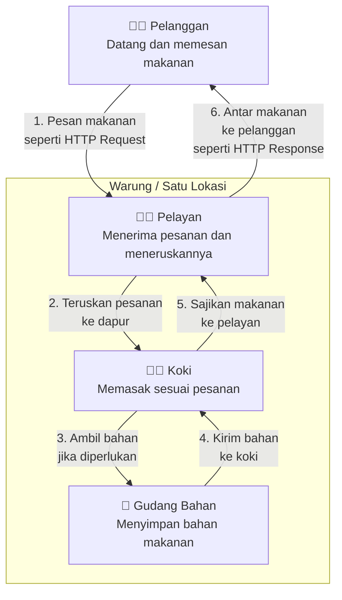
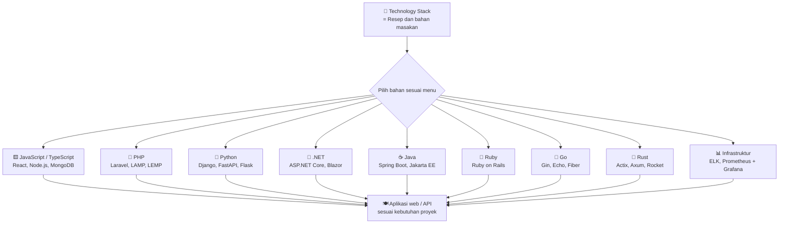
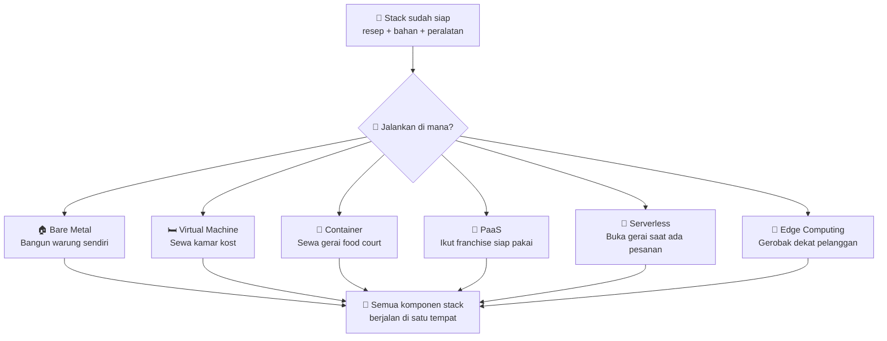

# Server Single-Tier Stack: Memahami Komponen, Teknologi, dan Deployment

[🇬🇧 Read in English](server-single-tier-stack-en.md)
[🇲🇾 Baca dalam Bahasa Melayu](server-single-tier-stack-ms.md)
[🇵🇭 Basahin sa Tagalog](server-single-tier-stack-tl.md)

﷽

## Satu Server, Satu Tumpukan

**Server Single-Tier Stack** artinya [web server](https://developer.mozilla.org/en-US/docs/Learn\_web\_development/Howto/Web_mechanics/What_is_a\_web\_server), [runtime aplikasi](https://en.wikipedia.org/wiki/Runtime_system), dan [database](https://en.wikipedia.org/wiki/Database) semua berjalan di **satu mesin yang sama**.

Bayangkan sebuah warung makan yang memiliki dapur, meja makan, dan tempat penyimpanan piring dalam satu lokasi. Pelanggan memesan makanan, Ibu koki memasaknya, lalu makanan disajikan kepada pelanggan. Semua aktivitas berlangsung di tempat yang sama.

Konsep ini bisa dimiripkan dengan yang kita bahas yaitu **Single-Tier Stack**, ketika komponen utama aplikasi, seperti web server, runtime aplikasi, dan database, dimasak lalu disajikan ke kita sebagai makanan atau halaman.

Lalu, bagaimana prosesnya ketika pengunjung membuka website yang menggunakan Single-Tier Stack?

## Alurnya

## Komponen Inti

Mari mengenal beberapa variasi.

Jarang warung makan memberikan detail tentang bahan penyajian yang kita bisa tau apa yang ada di balik dapur mereka.

Akan tetapi jika kita mengetahui-nya dari pengalaman kita pernah merasakan makan langsung di sana atau pernah dan bisa membuat nya sendiri didapur itu akan membuat kita tau apa saja yang di gunakan oleh warung tersebut.

Konteks ini sama seperti di dunia server.

Misalnya, berikut beberapa komponen inti beserta fungsinya dalam dunia server.

| Komponen | Fungsi |
| --- | --- |
| Operating System (OS) | Fondasi. Mengelola perangkat keras, memori, proses, dan sumber daya server. |
| Web Client | Aplikasi di sisi pengguna, seperti browser, yang mengirim HTTP request ke server dan menampilkan HTTP response. |
| Web Server | Menerima permintaan HTTP, menyajikan konten, atau meneruskan permintaan ke aplikasi. |
| Runtime Aplikasi | Menjalankan kode aplikasi agar dapat diproses oleh server. |
| Application Framework | Menyediakan struktur dan fitur untuk membangun aplikasi tanpa harus membuat semuanya dari awal. |
| Database | Menyimpan, mengatur, dan mengambil data yang dibutuhkan aplikasi. |
| Cache (opsional) | Menyimpan data sementara untuk mempercepat akses ke data yang sering digunakan. |

> Catatan: Setiap aplikasi bisa menggunakan kombinasi komponen yang berbeda sesuai kebutuhan. Komponen seperti Operating System, Web Server, Runtime Aplikasi, Framework, Database, dan Cache dapat dipilih atau diganti dengan alternatif lain sesuai arsitektur yang digunakan.

## Kombinasi Stack

Kombinasi stack ini seperti bahan makanan dasar yang digunakan oleh warung tersebut. Dalam konteks teknologi seperti sistem operasi, web server, bahasa pemrograman, framework, dan database, membentuk sebuah variasi yang disebut [solution stack](https://en.wikipedia.org/wiki/Solution_stack). 

Setiap stack memiliki susunan teknologi dan tujuan yang berbeda sesuai kebutuhan aplikasi.

Beberapa contoh technology stack beserta komponen dan kegunaannya.

### 1. JavaScript & TypeScript Stack

Stack yang menggunakan JavaScript atau TypeScript untuk membangun antarmuka pengguna (frontend) dan logika server (backend). Dengan Node.js, Bun, atau Deno, JavaScript dapat dijalankan di sisi server sehingga satu bahasa dapat mencakup seluruh tumpukan aplikasi.

| Stack | Komponen utama | Keterangan |
| --- | --- | --- |
| [MEAN](https://www.mongodb.com/resources/languages/mean-stack) | [MongoDB](https://www.mongodb.com/), [Express.js](https://expressjs.com/), [Angular](https://angular.dev/), [Node.js](https://nodejs.org/) | Menggunakan Angular untuk frontend SPA, Express.js sebagai backend framework, Node.js sebagai runtime server, dan MongoDB sebagai database NoSQL. Cocok untuk aplikasi enterprise yang membutuhkan struktur kuat dan TypeScript support bawaan melalui Angular. |
| [MERN](https://www.mongodb.com/resources/languages/mern-stack) | [MongoDB](https://www.mongodb.com/), [Express.js](https://expressjs.com/), [React](https://react.dev/), [Node.js](https://nodejs.org/) | Menggunakan React untuk frontend berbasis komponen, Express.js untuk API backend, Node.js untuk runtime, dan MongoDB sebagai database. Sangat populer untuk aplikasi web modern dan mobile backend karena fleksibilitas React dan ekosistem npm yang luas. |
| [MEVN](https://www.mongodb.com/resources/languages/mern-stack) | [MongoDB](https://www.mongodb.com/), [Express.js](https://expressjs.com/), [Vue.js](https://vuejs.org/), [Node.js](https://nodejs.org/) | Menggunakan Vue.js sebagai frontend framework progresif, Express.js untuk backend, Node.js untuk runtime, dan MongoDB untuk database. Dikenal ringan, mudah dipelajari, dan cocok untuk aplikasi skala menengah yang membutuhkan reactivity yang cepat. |
| [PERN](https://www.digitalocean.com/community/tutorials/how-to-build-a-pern-stack-application) | [PostgreSQL](https://www.postgresql.org/), [Express.js](https://expressjs.com/), [React](https://react.dev/), [Node.js](https://nodejs.org/) | Mengganti MongoDB dengan PostgreSQL sebagai database relasional (ACID compliant), sambil tetap menggunakan React, Express.js, dan Node.js. Ideal untuk aplikasi yang membutuhkan integritas data, query kompleks, dan relasi antar tabel yang ketat. |
| [Next.js Stack](https://nextjs.org/) | [Next.js](https://nextjs.org/), [React](https://react.dev/), [Node.js](https://nodejs.org/), PostgreSQL atau MySQL | Framework React yang mendukung Server-Side Rendering (SSR), Static Site Generation (SSG), dan API routes dalam satu proyek. Cocok untuk aplikasi yang membutuhkan SEO baik, performa muat halaman cepat, dan full-stack dalam satu repository. |
| [T3 Stack](https://create.t3.gg/) | [TypeScript](https://www.typescriptlang.org/), [Tailwind CSS](https://tailwindcss.com/), [tRPC](https://trpc.io/), [Next.js](https://nextjs.org/), [Prisma](https://www.prisma.io/), [PostgreSQL](https://www.postgresql.org/) | Stack full-stack TypeScript yang menegaskan type safety dari database sampai frontend. tRPC menghilangkan perlu REST API manual, Prisma sebagai ORM type-safe, dan Tailwind untuk styling. Sangat cocok untuk tim yang mengutamakan keamanan tipe dan pengembangan cepat. |
| [JAMstack](https://jamstack.org/what-is-jamstack/) | JavaScript, API, Markup | Pendekatan arsitektur yang memisahkan frontend markup dari backend. JavaScript dijalankan di sisi klien, data diambil melalui API, dan markup difoto statis pada waktu build. Cocok untuk situs konten, e-commerce statis, dan aplikasi yang memerlukan keamanan serta skalabilitas tinggi tanpa server konvensional. |
| [Bun Stack](https://bun.sh/) | [Bun](https://bun.sh/), [Elysia](https://elysiajs.com/) atau [Hono](https://hono.dev/), SQLite atau PostgreSQL, React atau Vue | Menggunakan Bun sebagai runtime JavaScript yang menggantikan Node.js dengan startup lebih cepat dan penggunaan memori lebih hemat. Elysia atau Hono sebagai web framework yang ringan, dan database relasional untuk penyimpanan data. Cocok untuk microservices, serverless, dan aplikasi yang sensitif terhadap latensi serta resource. Perlu diperhatikan ekosistemnya masih lebih muda dibanding Node.js. |

### 2. PHP Stack

Stack yang berpusat pada bahasa PHP untuk pengembangan web, biasanya dijalankan di sisi server dengan web server dan database relasional.

| Stack | Komponen utama | Keterangan |
| --- | --- | --- |
| [Laravel](https://laravel.com/) | [PHP](https://www.php.net/), [Laravel](https://laravel.com/docs), MySQL atau PostgreSQL, Nginx atau Apache | Framework PHP modern yang menyediakan fitur lengkap seperti routing, autentikasi, Eloquent ORM, dan blade templating. Cocok untuk aplikasi web skala kecil hingga besar dengan pengembangan yang terstruktur dan dokumentasi yang luas. |
| [Symfony](https://symfony.com/) | [PHP](https://www.php.net/), [Symfony](https://symfony.com/doc/current/index.html), berbagai database, Nginx atau Apache | Komponen modular dan reusable untuk aplikasi PHP enterprise. Digunakan sebagai fondasi banyak framework lain termasuk Laravel. Sangat fleksibel untuk aplikasi skala besar yang membutuhkan kontrol penuh atas arsitektur. |
| [LAMP](https://cloud.google.com/mysql/lamp) | [Linux](https://www.kernel.org/), [Apache](https://httpd.apache.org/), [MySQL](https://mariadb.org/) atau [MariaDB](https://mariadb.org/), [PHP](https://www.php.net/) | Stack klasik dan paling terkenal untuk aplikasi web dinamis. Linux sebagai sistem operasi, Apache sebagai web server, MySQL/MariaDB sebagai database, dan PHP sebagai bahasa pemrograman. Mudah dihosting dan banyak didukung penyedia hosting. |
| [LEMP](https://www.digitalocean.com/community/tutorials/how-to-install-linux-nginx-mysql-php-lemp-stack-ubuntu-22-04) | [Linux](https://www.kernel.org/), [Nginx](https://nginx.org/), [MySQL](https://mariadb.org/) atau [MariaDB](https://mariadb.org/), [PHP](https://www.php.net/) | Variasi LAMP yang mengganti Apache dengan Nginx. Nginx lebih efisien dalam menangani koneksi bersamaan dan konten statis, sehingga cocok untuk aplikasi dengan trafik tinggi atau yang membutuhkan performa web server lebih baik. |
| [WAMP](https://en.wikipedia.org/wiki/WAMP) | [Windows](https://www.microsoft.com/windows), [Apache](https://httpd.apache.org/), [MySQL](https://mariadb.org/) atau [MariaDB](https://mariadb.org/), [PHP](https://www.php.net/) | Stack berbasis Windows untuk pengembangan dan hosting aplikasi web PHP. Cocok untuk lingkungan yang sudah menggunakan infrastruktur Microsoft dan memerlukan kompatibilitas dengan aplikasi Windows. |
| [WIMP](https://learn.microsoft.com/en-us/iis/) | [Windows](https://www.microsoft.com/windows), [IIS](https://www.iis.net/), [MySQL](https://mariadb.org/) atau [MariaDB](https://mariadb.org/), [PHP](https://www.php.net/) | Stack berbasis Windows yang menggunakan IIS (Internet Information Services) sebagai web server menggantikan Apache. Cocok untuk organisasi yang sudah terintegrasi dengan ekosistem Microsoft dan ingin menjalankan PHP di atas Windows Server. |
| [FAMP](https://en.wikipedia.org/wiki/FAMP) | [FreeBSD](https://www.freebsd.org/), [Apache](https://httpd.apache.org/), [MySQL](https://mariadb.org/) atau [MariaDB](https://mariadb.org/), [PHP](https://www.php.net/) | Variasi LAMP yang menggunakan FreeBSD sebagai sistem operasi. Dikenal stabil, aman, dan efisien untuk networking serta networking stack. Cocok untuk server yang memprioritaskan stabilitas sistem operasi berbasis BSD. |
| [XAMPP](https://www.apachefriends.org/) | Lintas platform, [Apache](https://httpd.apache.org/), [MariaDB](https://mariadb.org/) atau [MySQL](https://mariadb.org/), [PHP](https://www.php.net/), [Perl](https://www.perl.org/) | Paket pengembangan web all-in-one yang mudah diinstal di Windows, Linux, dan macOS. Digunakan terutama untuk pembelajaran dan prototipe lokal sebelum deploy ke server produksi. |

### 3. Python Stack

Stack yang menggunakan bahasa Python untuk pengembangan web, dari mikro framework hingga full-stack framework dengan banyak fitur bawaan.

| Stack | Komponen utama | Keterangan |
| --- | --- | --- |
| [Python-Django](https://www.djangoproject.com/) | [Python](https://www.python.org/), [Django](https://www.djangoproject.com/), PostgreSQL atau MySQL, Nginx atau Apache, Gunicorn | Framework "batteries included" yang menyediakan admin panel, autentikasi, ORM, dan fitur keamanan bawaan. Cocok untuk aplikasi web skala besar yang membutuhkan pengembangan cepat dengan standar keamanan yang tinggi. |
| [FastAPI](https://fastapi.tiangolo.com/) | [Python](https://www.python.org/), [FastAPI](https://fastapi.tiangolo.com/), PostgreSQL atau MySQL, Nginx, Uvicorn | Framework modern untuk membangun API dengan validasi data otomatis menggunakan Pydantic dan dokumentasi Swagger/OpenAPI. Tinggi performa karena asynchronous dan cocok untuk microservices serta machine learning API. |
| [Flask](https://flask.palletsprojects.com/) | [Python](https://www.python.org/), [Flask](https://flask.palletsprojects.com/), berbagai database, Nginx atau Apache, Gunicorn | Micro framework yang ringan dan fleksibel. Memberikan kontrol penuh kepada pengembang tanpa memaksa struktur tertentu. Cocok untuk aplikasi kecil, prototipe, atau layanan yang membutuhkan kustomisasi maksimal. |
| [Pyramid](https://trypyramid.com/) | [Python](https://www.python.org/), [Pyramid](https://trypyramid.com/), berbagai database | Framework fleksibel yang dapat digunakan untuk aplikasi kecil hingga besar. Memungkinkan pengembang memilih komponen sesuai kebutuhan dan cocok untuk aplikasi yang perlu berkembang secara bertahap. |

### 4. .NET Stack

Stack yang menggunakan bahasa C# dan ekosistem .NET untuk membangun aplikasi web, API, dan layanan backend.

| Stack | Komponen utama | Keterangan |
| --- | --- | --- |
| [ASP.NET Core](https://learn.microsoft.com/en-us/aspnet/core/) | [C#](https://learn.microsoft.com/en-us/dotnet/csharp/), [ASP.NET Core](https://learn.microsoft.com/en-us/aspnet/core/), SQL Server atau PostgreSQL, IIS atau Nginx | Framework buatan Microsoft untuk membangun aplikasi web, REST API, dan layanan backend yang performa tinggi. Kompatibel lintas platform (Windows, Linux, macOS) dan cocok untuk enterprise yang sudah menggunakan teknologi Microsoft. |
| [Blazor Stack](https://dotnet.microsoft.com/apps/aspnet/web-apps/blazor) | [C#](https://learn.microsoft.com/en-us/dotnet/csharp/), [Blazor](https://dotnet.microsoft.com/apps/aspnet/web-apps/blazor), [.NET](https://dotnet.microsoft.com/), SQL Server atau PostgreSQL | Memungkinkan pembuatan antarmuka web interaktif menggunakan C# alih-alih JavaScript, melalui WebAssembly (Blazor WebAssembly) atau hosting server (Blazor Server). Cocok untuk tim yang mahir di .NET dan ingin menghindari JavaScript di frontend. |

### 5. Java Stack

Stack yang menggunakan bahasa Java untuk membangun aplikasi backend dan enterprise yang skalabel.

| Stack | Komponen utama | Keterangan |
| --- | --- | --- |
| [Java-Spring](https://spring.io/projects/spring-boot) | [Java](https://dev.java/), [Spring Boot](https://spring.io/projects/spring-boot), berbagai database, Tomcat | Framework paling populer di ekosistem Java untuk membangun aplikasi backend dan microservices. Spring Boot menyederhanakan konfigurasi dan menyediakan fitur produksi seperti health check, metrics, dan externalized configuration. |
| [Jakarta EE](https://jakarta.ee/) | [Java](https://dev.java/), [Jakarta EE](https://jakarta.ee/), berbagai database, application server | Standar enterprise Java untuk aplikasi skala besar dengan spesifikasi resmi untuk web, enterprise beans, dan messaging. Digunakan di industri perbankan, telekomunikasi, dan sektor publik yang memerlukan standar terbuka. |
| [Quarkus](https://quarkus.io/) | [Java](https://dev.java/), [Quarkus](https://quarkus.io/), berbagai database | Framework Java yang dioptimalkan untuk Kubernetes dan serverless dengan startup cepat serta memori rendah. Cocok untuk microservices cloud-native yang menggunakan GraalVM native image. |

### 6. Ruby Stack

Stack yang menggunakan bahasa Ruby dengan konvensi yang kuat untuk pengembangan web cepat.

| Stack | Komponen utama | Keterangan |
| --- | --- | --- |
| [Ruby on Rails](https://rubyonrails.org/) | [Ruby](https://www.ruby-lang.org/), [Rails](https://guides.rubyonrails.org/getting_started.html), PostgreSQL atau MySQL, Puma atau Unicorn | Framework full-stack yang mengikuti konvensi atas konfigurasi (Convention over Configuration). Menyediakan fitur lengkap seperti database migration, scaffolding, dan asset pipeline. Cocok untuk startup dan MVP yang membutuhkan pengembangan sangat cepat. |
| [Sinatra](https://sinatrarb.com/) | [Ruby](https://www.ruby-lang.org/), [Sinatra](https://sinatrarb.com/), berbagai database | Micro framework Ruby yang ringan dan minimalis. Cocok untuk membangun layanan sederhana, API kecil, atau aplikasi yang tidak membutuhkan struktur lengkap Rails. |

### 7. Go Stack

Stack yang menggunakan bahasa Go (Golang) untuk membangun aplikasi backend, API, dan microservices dengan performa tinggi.

| Stack | Komponen utama | Keterangan |
| --- | --- | --- |
| [Gin](https://gin-gonic.com/) | [Go](https://go.dev/), [Gin](https://gin-gonic.com/), berbagai database | Web framework Go yang mirip dengan Express.js, cepat, dan mudah digunakan. Cocok untuk membangun REST API dan microservices dengan performa tinggi serta kompilasi yang cepat. |
| [Echo](https://echo.labstack.com/) | [Go](https://go.dev/), [Echo](https://echo.labstack.com/), berbagai database | Framework Go dengan performa tinggi, fitur lengkap seperti middleware, routing, dan validasi. Dikenal efisien dalam penggunaan memori dan cocok untuk aplikasi yang membutuhkan throughput tinggi. |
| [Fiber](https://docs.gofiber.io/) | [Go](https://go.dev/), [Fiber](https://docs.gofiber.io/), berbagai database | Framework Go yang terinspirasi Express.js, dibangun di atas Fasthttp. Sangat ringan dan cepat, cocok untuk microservices serta aplikasi yang sensitif terhadap latensi dan penggunaan resource. |
| [Go Standard](https://go.dev/) | [Go](https://go.dev/), `net/http`, berbagai database | Pendekatan tanpa framework eksternal, menggunakan standar library bawaan Go. Memberikan kontrol maksimal, dependensi minimal, dan cocok untuk aplikasi yang ingin tetap ringan tanpa overhead framework. |

### 8. Rust Stack

Stack yang menggunakan bahasa Rust untuk membangun aplikasi web dengan keamanan memori dan performa tingkat sistem.

| Stack | Komponen utama | Keterangan |
| --- | --- | --- |
| [Actix Web](https://actix.rs/) | [Rust](https://www.rust-lang.org/), [Actix Web](https://actix.rs/), berbagai database | Web framework Rust yang diklaim sebagai salah satu yang tercepat dengan model aktornya. Cocok untuk aplikasi yang membutuhkan keamanan memori, konkurensi tinggi, dan performa maksimal tanpa garbage collector. |
| [Axum](https://github.com/tokio-rs/axum) | [Rust](https://www.rust-lang.org/), [Axum](https://github.com/tokio-rs/axum), [Tokio](https://tokio.rs/), berbagai database | Framework web dari ekosistem Tokio yang modular dan type-safe. Menggunakan async/await bawaan Rust dan cocok untuk membangun API asynchronous yang efisien serta mudah dirawat. |
| [Rocket](https://rocket.rs/) | [Rust](https://www.rust-lang.org/), [Rocket](https://rocket.rs/), berbagai database | Web framework Rust dengan kemudahan penggunaan sebagai prioritas. Menyediakan fitur seperti templating, form handling, dan database integration dengan sintaks yang deklaratif. |

### 9. Infrastruktur dan Observability

Stack yang menggabungkan sistem operasi, web server, database, atau teknologi pendukung untuk kebutuhan infrastruktur dan pengamatan aplikasi.

| Stack | Komponen utama | Keterangan |
| --- | --- | --- |
| [Wazuh](https://wazuh.com/) | [Wazuh Server](https://documentation.wazuh.com/current/) (manager, indexer, dashboard), [Wazuh Agent](https://documentation.wazuh.com/current/), [Elasticsearch](https://www.elastic.co/elasticsearch) atau [OpenSearch](https://opensearch.org/) (opsional), [Kibana](https://www.elastic.co/kibana) atau [Wazuh Dashboard](https://documentation.wazuh.com/current/) (opsional) | Platform open-source untuk deteksi intrusi, pemantauan keamanan (XDR/SIEM), analisis log, file integrity monitoring, dan respons terhadap ancaman. Cocok untuk keamanan server dan endpoint terpusat. |
| [Elastic Stack (ELK)](https://www.elastic.co/elastic-stack) | [Elasticsearch](https://www.elastic.co/elasticsearch), [Logstash](https://www.elastic.co/logstash), [Kibana](https://www.elastic.co/kibana) | Digunakan untuk mengumpulkan, mencari, menganalisis, dan memvisualisasikan data log serta metrik sistem. Cocok untuk monitoring, troubleshooting, dan security information and event management (SIEM). |
| [Prometheus + Grafana](https://prometheus.io/) | [Prometheus](https://prometheus.io/), [Grafana](https://grafana.com/), berbagai exporter | Stack monitoring open-source yang mengumpulkan metrik time-series dari sistem dan aplikasi, kemudian memvisualisasikannya melalui dashboard Grafana. Cocok untuk monitoring infrastruktur dan alerting. |
| [TICK Stack](https://docs.influxdata.com/influxdb/v2/get-started/) | [Telegraf](https://docs.influxdata.com/telegraf/), [InfluxDB](https://www.influxdata.com/products/influxdb/), [Chronograf](https://docs.influxdata.com/chronograf/), [Kapacitor](https://docs.influxdata.com/kapacitor/) | Stack untuk pengumpulan, penyimpanan, visualisasi, dan pemrosesan data time-series. Digunakan untuk monitoring infrastruktur, IoT, dan metrik aplikasi yang berubah seiring waktu. |

> Catatan: Memilih bahan yang pas makanan yang kita buat akan sedap dan enak membuat pelanggan nyaman untuk bisa datang ke tempat kita. Tapi ada trade off jika asal memilih bahan makanan begitupun technology stack, disini bukan daftar lengkap atau standar wajib. Komponen dalam satu stack dapat memiliki alternatif sesuai kebutuhan.

## Di Mana Menjalankan Stack?

Setelah memilih technology stack yang akan digunakan, langkah berikutnya adalah menentukan **di mana stack itu akan berjalan** dan bagaimana infrastrukturnya dikelola. Proses ini disebut **deployment environment** atau **lingkungan deployment**.

Bayangkan kamu sudah punya resep, bahan, dan peralatan untuk membuka warung makan. Sekarang, kamu perlu menentukan tempat untuk menjalankan usaha tersebut. Kamu bisa membangun warung sendiri, menyewa tempat, berbagi fasilitas dengan pedagang lain, atau membuka gerai sementara sesuai kebutuhan.

Dalam dunia server, pilihan tersebut punya konsep yang serupa:

| Lingkungan | Analogi Warung Makan | Apa Itu (Singkat) | Contoh Alat / Penyedia |
| --- | --- | --- | --- |
| **Bare Metal / Dedicated Server** | Membangun warung di tanah milik sendiri. Kamu mengontrol semua, dari dinding sampai kompor. | Sistem operasi dan aplikasi berjalan langsung di hardware fisik tanpa hypervisor. | [IBM Bare Metal Servers](https://www.ibm.com/think/topics/bare-metal-servers), [OVHcloud Dedicated Server](https://www.ovhcloud.com/en/bare-metal/) |
| **Virtual Machine (VM) Desktop** | Sewa kamar di kost. Punya kamar sendiri, boleh di-reset kapan mau jika ada masalah. | Komputer virtual dengan sistem operasi sendiri di atas komputer pribadi. | [VirtualBox](https://www.virtualbox.org/), [VMware Workstation](https://www.vmware.com/products/workstation-pro.html), [VMware Fusion](https://www.vmware.com/products/fusion.html) |
| **Platform Virtualisasi Server** | Pemilik gedung kost yang mengelola banyak kamar dari satu kantor pusat. | Mengelola banyak VM di server produksi melalui antarmuka terpusat. | [VMware vSphere / ESXi](https://www.vmware.com/products/vsphere.html), [Proxmox VE](https://www.proxmox.com/en/products/proxmox-virtual-environment/overview) |
| **Container** | Sewa tempat di food court. Share fasilitas dapur bersama, tapi gerai kamu terpisah dan ringan dipindah. | Aplikasi berjalan dalam paket terisolasi yang berbagi kernel sistem operasi host. | [Docker](https://www.docker.com/), [Podman](https://podman.io/) |
| **PaaS (Platform as a Service)** | Buka warung franchise siap pakai. Bawa resep saja, toko dan listrik sudah disediakan. | Platform yang menangani infrastruktur, kamu hanya mengunggah kode. | [Heroku](https://www.heroku.com/), [Render](https://render.com/), [Railway](https://railway.app/) |
| **Serverless / FaaS** | Gerai di acara harian. Hanya buka saat ada pelanggan, tutup saat sepi, bayar sesuai pesanan. | Kode berjalan saat dipanggil, tidak ada server permanen yang dikelola. | [AWS Lambda](https://aws.amazon.com/lambda/), [Azure Functions](https://learn.microsoft.com/azure/azure-functions/), [Cloudflare Workers](https://workers.cloudflare.com/) |
| **Shared Hosting** | Warung di pinggir jalan yang dibagi banyak pedagang. Murah, tapi ramai dan terbatas. | Beberapa pengguna berbagi sumber daya server yang sama. | [cPanel](https://cpanel.net/), [Hostinger](https://www.hostinger.com/) |
| **Managed Hosting** | Sewa toko dengan manajer yang mengurus operasional sehari-hari. | Penyedia menangani sebagian besar pengelolaan server dan operasionalnya. | [AWS Elastic Beanstalk](https://aws.amazon.com/elasticbeanstalk/), [DigitalOcean App Platform](https://www.digitalocean.com/products/app-platform) |
| **Edge Computing** | Gerobak makanan yang diparkir dekat pelanggan agar makanan cepat disajikan. | Pemrosesan dijalankan lebih dekat dengan pengguna untuk mengurangi latensi. | [Cloudflare Workers](https://workers.cloudflare.com/), [AWS Wavelength](https://aws.amazon.com/wavelength/) |

### Perbedaan Penting

- **VMware Workstation dan Fusion** = virtualisasi untuk komputer pribadi (lokal), cocok buat belajar di rumah.
- **VMware ESXi / vSphere dan Proxmox VE** = virtualisasi untuk server produksi, cocok buat kelola banyak VM sekaligus.
- **Bare Metal** merujuk pada cara sistem berjalan langsung di hardware. **Dedicated Server** merujuk pada server fisik yang disewa untuk satu pelanggan. Keduanya sering digunakan bersama, tapi bukan hal yang sama.

### Hubungannya dengan Single-Tier Stack

**Single-tier** berarti semua komponen stack (web server, runtime aplikasi, dan database) berada di **satu tempat yang sama** — misal dalam satu VM, satu container, atau satu server fisik.

Tapi single-tier **tidak berarti harus pakai VM atau container**. Kamu juga bisa menjalankannya di bare metal, dedicated server, atau bahkan PaaS, asalkan semua komponen tetap berada dalam satu lingkungan deployment.

Penting untuk membedakan:
- **Lingkungan deployment** = tempat stack dijalankan (VM, container, bare metal, dll).
- **Arsitektur tier** = bagaimana komponen aplikasi dibagi (single-tier, multi-tier, dll).

Pilihan deployment ini akan sangat memengaruhi biaya operasional, fleksibilitas, skalabilitas, keamanan, dan cara aplikasi dipelihara. Tidak ada satu pilihan yang selalu paling baik semuanya bergantung pada kebutuhan proyek.

## Tips Buat Mulai

1. Pahami alur aplikasi. Pelajari bagaimana request bergerak dari browser ke web server, diteruskan ke runtime aplikasi, lalu berinteraksi dengan database. Ini membantu kamu menemukan sumber masalah ketika aplikasi gagal berjalan. Referensi: [MDN — How the Web Works](https://developer.mozilla.org/en-US/docs/Learn_web_development/Getting_started/Your_first_website/How_the_web_works).

2. Pilih stack sesuai tujuan. Untuk belajar, pilih teknologi yang kamu sukai agar lebih mudah konsisten berlatih. Contohnya, LAMP atau LEMP untuk PHP, maupun MERN untuk JavaScript. Untuk proyek serius, pertimbangkan kebutuhan aplikasi, pengalaman tim, dokumentasi, keamanan, performa, biaya, dan dukungan jangka panjang.

3. Mulai dari lingkungan lokal. Gunakan [VirtualBox](https://www.virtualbox.org/) untuk menjalankan VM atau [Docker](https://www.docker.com/) untuk menjalankan container. VM memiliki sistem operasi tamu sendiri, sedangkan container berbagi kernel host. Keduanya memudahkan eksperimen sebelum aplikasi diterapkan ke server produksi.

4. Uji setiap komponen. Pastikan web server menerima request, runtime menjalankan aplikasi, dan database dapat menyimpan serta membaca data. Pengujian bertahap mempermudah identifikasi komponen yang bermasalah. Referensi: [Docker — Get Started](https://docs.docker.com/get-started/).

5. Pantau sebelum mengoptimalkan. Periksa penggunaan CPU, RAM, disk, waktu respons, dan log untuk menemukan penyebab kelambatan sebelum menambah resource atau mengganti teknologi. Referensi: [Prometheus](https://prometheus.io/) dan [Grafana](https://grafana.com/).

6. Terapkan keamanan sejak awal. Batasi hak akses, lindungi kredensial, perbarui dependensi, dan buka hanya port yang diperlukan. Kesalahan konfigurasi pada satu mesin dapat memengaruhi seluruh aplikasi. Referensi: [OWASP Cheat Sheet Series](https://cheatsheetseries.owasp.org/).

7. Siapkan backup dan uji pemulihan. Cadangkan database, file aplikasi, serta konfigurasi penting. Uji pemulihan secara berkala agar kamu mengetahui apakah data benar-benar dapat dikembalikan saat terjadi kerusakan. Referensi: [PostgreSQL — Backup and Restore](https://www.postgresql.org/docs/current/backup.html).

8. Dokumentasikan perubahan. Catat versi perangkat lunak, konfigurasi, dependensi, dan langkah deployment. Gunakan [Git](https://git-scm.com/) untuk melacak perubahan kode sehingga proses perbaikan dan pengembangan lebih mudah ditelusuri.

9. Kenali batas single-tier. Jika satu mesin mulai kewalahan atau aplikasi membutuhkan ketersediaan tinggi, evaluasi optimasi, redundansi, dan pemisahan komponen. Satu mesin dapat menjadi Single Point of Failure (SPOF), yaitu titik kegagalan yang berpotensi menghentikan seluruh aplikasi. Referensi: [Red Hat — What Is High Availability?](https://www.redhat.com/en/topics/linux/what-is-high-availability).

## Rumus Memilih Stack dan Deployment Environment

- **Untuk belajar:** minat pribadi + kemudahan penggunaan + dokumentasi + ketersediaan materi belajar.
- **Untuk proyek baru:** kebutuhan aplikasi + jumlah dan pola pengguna + kompetensi tim + keamanan + hasil uji performa + biaya operasional.
- **Untuk migrasi stack atau deployment:** masalah sistem lama + manfaat migrasi yang terukur + biaya dan risiko migrasi + kompatibilitas + dampak terhadap pengguna + dukungan jangka panjang.

**Intinya:** Pilih stack dan deployment environment berdasarkan kebutuhan aplikasi, skala pengguna, kemampuan tim, dan hasil pengujian. Untuk memahami keputusan teknis di dunia nyata, pelajari studi kasus engineering dari perusahaan yang menghadapi tantangan serupa.

### Referensi Stack di Dunia Nyata

Memilih technology stack bisa membingungkan karena banyaknya bahasa pemrograman, framework, database, dan teknologi yang tersedia. Selain membandingkan fitur setiap teknologi, kita juga bisa belajar dari perusahaan yang telah membangun dan mengoperasikan sistem di dunia nyata.

Artikel engineering berikut dapat menjadi referensi untuk memahami alasan pemilihan teknologi, tantangan arsitektur, serta solusi yang diterapkan berdasarkan kebutuhan mereka.

- [Uber Engineering](https://www.uber.com/us/en/blog/engineering/) — Arsitektur backend dan skalabilitas.
- [Shopify Engineering](https://shopify.engineering/) — Monolith dan skalabilitas database.
- [Cloudflare Blog](https://blog.cloudflare.com/) — Infrastruktur server dan networking.
- [Netflix TechBlog](https://netflixtechblog.medium.com/) — Distributed systems dan reliability.
- [Stripe Engineering](https://stripe.com/blog/engineering) — Backend, API, dan konsistensi data.
- [Discord Blog](https://discord.com/category/engineering) — Sistem real-time dan optimasi performa.
- [AWS Architecture Blog](https://aws.amazon.com/blogs/architecture/) — Arsitektur cloud dan deployment.

**Tips:** Pelajari alasan pemilihan teknologi, masalah yang dihadapi, dan trade-off yang dipertimbangkan. Jadikan pengalaman mereka sebagai referensi, lalu sesuaikan dengan kebutuhan proyekmu.

## Kesimpulan

Server Single-Tier Stack adalah arsitektur yang menjalankan komponen utama aplikasi, seperti web server, runtime aplikasi, dan database, pada satu mesin yang sama. Browser mengirim HTTP request ke server, aplikasi memproses permintaan dan mengakses database jika diperlukan, lalu hasilnya dikembalikan sebagai HTTP response.

Memahami konsep ini membantu kita mengenali fungsi setiap komponen, memilih technology stack, dan menentukan deployment environment sesuai kebutuhan. Namun, satu mesin juga memiliki keterbatasan sumber daya dan berpotensi menjadi Single Point of Failure (SPOF).

Intinya: Pilih stack dan deployment berdasarkan kebutuhan aplikasi, kemampuan tim, keamanan, biaya, dan hasil pengujian. Mulai dari arsitektur sederhana, lalu evaluasi kebutuhan optimasi atau pemisahan komponen seiring perkembangan aplikasi.