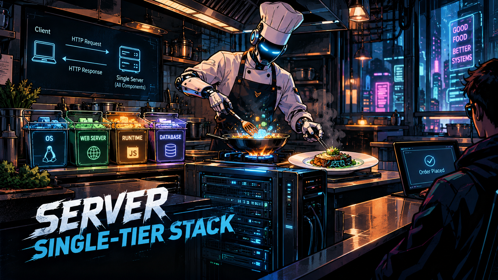
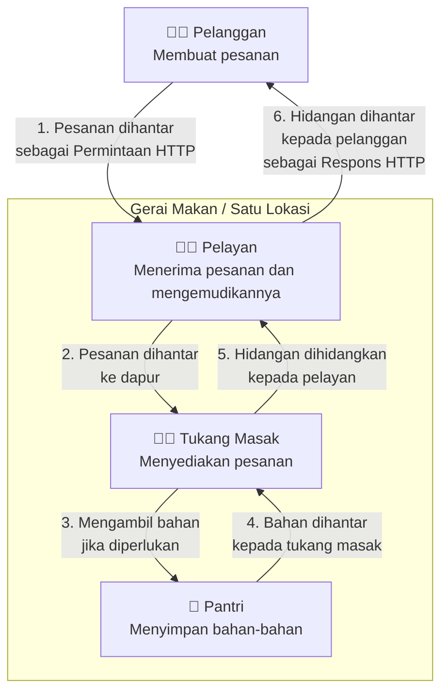
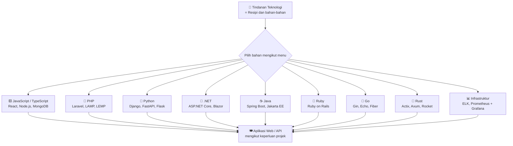
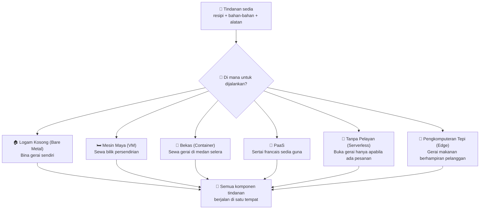

# Tindanan Pelayan Satu-Tingkat: Memahami Komponen, Teknologi, dan Pelaksanaan

[🇮🇩 Baca dalam Bahasa Indonesia](server-single-tier-stack-id.md)
[🇬🇧 Read in English](server-single-tier-stack-en.md)
[🇵🇭 Basahin sa Tagalog](server-single-tier-stack-tl.md)

## Satu Pelayan, Satu Tindanan

﷽

**Tindanan pelayan satu-tingkat** merujuk kepada seni bina di mana [pelayan web](https://developer.mozilla.org/en-US/docs/Learn_web_development/Howto/Web_mechanics/What_is_a_web_server), [masa jalan aplikasi](https://en.wikipedia.org/wiki/Runtime_system), dan [pangkalan data](https://en.wikipedia.org/wiki/Database) kesemuanya dijalankan pada **satu mesin yang sama**.

Bayangkan sebuah gerai makan kecil di mana dapur, ruang makan, dan tempat penyimpanan kesemuanya terletak di satu lokasi. Pelanggan membuat pesanan, tukang masak menyediakan hidangan, dan makanan terus dihidangkan. Segala urusan berlaku di tempat yang sama.

Konsep ini serupa dengan **tindanan satu-tingkat**: komponen utama sesebuah aplikasi—iaitu pelayan web, masa jalan aplikasi, dan pangkalan data—disediakan bersama dan dihidangkan kepada pengguna, sama seperti hidangan disediakan dari dapur tersebut.

Namun, bagaimanakah proses ini berlaku apabila pelawat mengakses laman web yang dibina menggunakan tindanan satu-tingkat?

## Aliran Kerja

## Komponen Teras

| Komponen | Analogi Gerai Makan | Fungsi |
| --- | --- | --- |
| [Sistem Pengendalian (OS)](https://ms.wikipedia.org/wiki/Sistem_pengendalian) | Bangunan gerai | Asas sistem. Mengurus perkakasan, ingatan, proses, dan sumber pelayan. |
| [Pelayan Web](https://developer.mozilla.org/en-US/docs/Learn_web_development/Howto/Web_mechanics/What_is_a_web_server) | Pelayan | Menerima permintaan HTTP/HTTPS, mengemudikannya ke aplikasi, lalu menghantar respons kembali kepada klien. |
| [Masa Jalan Aplikasi](https://ms.wikipedia.org/wiki/Masa_jalan_sistem) | Tukang masak | Melaksanakan kod aplikasi agar logika program dapat diproses menjadi hidangan yang sedia dihidang. |
| [Pangkalan Data](https://ms.wikipedia.org/wiki/Pangkalan_data) | Stor / Pantri | Menyimpan, menyusun, dan mendapatkan semula data yang diperlukan oleh aplikasi. Tidak semestinya diperlukan jika aplikasi tidak memerlukan penyimpanan data kekal. |

## Komponen Pelengkap

| Komponen | Analogi Gerai Makan | Fungsi |
| --- | --- | --- |
| [Klien Web](https://ms.wikipedia.org/wiki/Pelayar_web) | Pelanggan | Aplikasi di pihak pengguna (cth., pelayar web) yang menghantar permintaan HTTP kepada pelayan dan memaparkan respons HTTP. |
| [TLS (Transport Layer Security) & Sijil TLS](https://ms.wikipedia.org/wiki/Keselamatan_lapisan_pengangkutan) | Pembungkus bertutup & sijil keaslian gerai | Melindungi komunikasi melalui HTTPS dengan penyulitan, pengesahan pelayan, dan integriti data. SSL ialah pendahulu TLS yang kini tidak lagi disyorkan. Sijil membantu pelayar mengesahkan identiti pelayan. Untuk laman web awam, penggunaan HTTPS dengan TLS 1.2 atau TLS 1.3 telah menjadi piawaian. |
| [Cache (pilihan)](https://ms.wikipedia.org/wiki/Cache) | Makanan sedia di kaunter pameran | Menyimpan data yang kerap diakses secara sementara bagi mempercepat capaian dan mengurangkan beban pelayan. |

> *Nota:* Komponen pelengkap tidak semestinya wajib agar aplikasi dapat berjalan. Keperluannya bergantung kepada tujuan aplikasi, pengalaman pengguna yang ingin dicapai, keperluan keselamatan, serta persekitaran pelaksanaan (*deployment*). Ada yang hampir wajib (cth., HTTPS untuk laman web awam), ada pula yang hanya ditambah apabila benar-benar diperlukan (cth., *cache* bagi meningkatkan prestasi).

Rujukan: [MDN — Bagaimana Web Berfungsi](https://developer.mozilla.org/en-US/docs/Learn_web_development/Getting_started/Web_standards/How_the_web_works)

## Gabungan Tindanan Teknologi

Tindanan teknologi ibarat resipi beserta bahan-bahannya. Dalam bidang pengkomputeran, pilihan sistem pengendalian, pelayan web, bahasa pengaturcaraan, rangka kerja, dan pangkalan data membentuk susunan tersendiri yang dikenali sebagai [tindanan penyelesaian](https://en.wikipedia.org/wiki/Solution_stack).

Setiap tindanan mempunyai komposisi dan tujuan tersendiri, disesuaikan dengan keperluan aplikasi berkenaan. Berikut adalah beberapa tindanan teknologi yang paling lazim digunakan beserta komponen dan kegunaannya.

### 1. Tindanan JavaScript & TypeScript

Tindanan ini menggunakan JavaScript atau TypeScript bagi membina antara muka pengguna (bahagian hadapan) dan logik pelayan (bahagian belakang). Dengan Node.js, Bun, atau Deno, JavaScript boleh dijalankan di pelayan, justeru membolehkan satu bahasa merangkumi keseluruhan tindanan aplikasi.

| Tindanan | Komponen Utama | Keterangan |
| --- | --- | --- |
| [MEAN](https://www.mongodb.com/resources/languages/mean-stack) | [MongoDB](https://www.mongodb.com/), [Express.js](https://expressjs.com/), [Angular](https://angular.dev/), [Node.js](https://nodejs.org/) | Menggunakan Angular untuk bahagian hadapan SPA, Express.js sebagai rangka kerja bahagian belakang, Node.js sebagai masa jalan, dan MongoDB sebagai pangkalan data NoSQL. Sesuai untuk aplikasi perusahaan yang memerlukan struktur kukuh dan sokongan TypeScript terbina melalui Angular. |
| [MERN](https://www.mongodb.com/resources/languages/mern-stack) | [MongoDB](https://www.mongodb.com/), [Express.js](https://expressjs.com/), [React](https://react.dev/), [Node.js](https://nodejs.org/) | Menggunakan React untuk bahagian hadapan berasaskan komponen, Express.js untuk API bahagian belakang, Node.js sebagai masa jalan, dan MongoDB sebagai pangkalan data. Sangat popular untuk aplikasi web dan bahagian belakang mudah alih kerana fleksibiliti React serta ekosistem npm yang luas. |
| [MEVN](https://www.mongodb.com/resources/languages/mern-stack) | [MongoDB](https://www.mongodb.com/), [Express.js](https://expressjs.com/), [Vue.js](https://vuejs.org/), [Node.js](https://nodejs.org/) | Menggunakan Vue.js sebagai rangka kerja hadapan progresif, Express.js untuk bahagian belakang, Node.js sebagai masa jalan, dan MongoDB sebagai pangkalan data. Dikenali ringan, mudah dipelajari, dan mempunyai kereaktifan yang sesuai untuk aplikasi berskala sederhana. |
| [PERN](https://www.digitalocean.com/community/tutorials/how-to-build-a-pern-stack-application) | [PostgreSQL](https://www.postgresql.org/), [Express.js](https://expressjs.com/), [React](https://react.dev/), [Node.js](https://nodejs.org/) | Menggantikan MongoDB dengan PostgreSQL sebagai pangkalan data hubungan (mematuhi ACID), sambil mengekalkan React, Express.js, dan Node.js. Sesuai untuk aplikasi yang menuntut integriti data, pertanyaan kompleks, dan hubungan jadual yang ketat. |
| [Next.js Stack](https://nextjs.org/) | [Next.js](https://nextjs.org/), [React](https://react.dev/), [Node.js](https://nodejs.org/), PostgreSQL atau MySQL | Rangka kerja React yang menyokong Penjanaan Laman Secara Pelayan (SSR), Penjanaan Laman Statik (SSG), dan laluan API dalam satu projek. Sesuai untuk aplikasi berorientasikan SEO, muat turun halaman pantas, dan pembangunan penuh tindanan dalam repositori tunggal. |
| [T3 Stack](https://create.t3.gg/) | [TypeScript](https://www.typescriptlang.org/), [Tailwind CSS](https://tailwindcss.com/), [tRPC](https://trpc.io/), [Next.js](https://nextjs.org/), [Prisma](https://www.prisma.io/), [PostgreSQL](https://www.postgresql.org/) | Tindanan TypeScript penuh yang menguatkuasakan keselamatan jenis hujung ke hujung dari pangkalan data hingga bahagian hadapan. tRPC menghapuskan keperluan untuk membina API REST secara manual, Prisma menyediakan ORM berkeselamatan jenis, dan Tailwind mengendalikan penggayaan. Sesuai untuk pasukan yang mengutamakan keselamatan jenis dan pembangunan pantas. |
| [JAMstack](https://jamstack.org/what-is-jamstack/) | JavaScript, API, Penanda | Pendekatan seni bina yang memisahkan penanda bahagian hadapan daripada bahagian belakang. JavaScript dijalankan di klien, data diperoleh melalui API, dan penanda dibina terlebih dahulu semasa masa binaan. Sesuai untuk laman kandungan, e-dagang statik, serta aplikasi yang memerlukan keselamatan dan kebolehskalaan tinggi tanpa pelayan tradisional. |
| [Bun Stack](https://bun.sh/) | [Bun](https://bun.sh/), [Elysia](https://elysiajs.com/) atau [Hono](https://hono.dev/), SQLite atau PostgreSQL, React atau Vue | Menggunakan Bun sebagai masa jalan JavaScript bagi menggantikan Node.js dengan permulaan lebih pantas dan penggunaan ingatan lebih rendah. Digandingkan dengan rangka kerja ringan seperti Elysia atau Hono serta pangkalan data hubungan. Sesuai untuk mikroperkhidmatan, tanpa pelayan, dan aplikasi sensitif terhadap kependaman atau sumber. Ekosistemnya masih lebih muda berbanding Node.js. |

### 2. Tindanan PHP

Tindanan berasaskan PHP lazim digunakan untuk pembangunan web, biasanya dijalankan di pelayan bersama pelayan web dan pangkalan data hubungan.

| Tindanan | Komponen Utama | Keterangan |
| --- | --- | --- |
| [Laravel](https://laravel.com/) | [PHP](https://www.php.net/), [Laravel](https://laravel.com/docs), MySQL atau PostgreSQL, Nginx atau Apache | Rangka kerja PHP moden yang menawarkan penghalaan, pengesahan, Eloquent ORM, templat Blade, dan pelbagai ciri lain. Sesuai untuk aplikasi web berskala kecil hingga besar dengan pembangunan tersusun dan dokumentasi luas. |
| [Symfony](https://symfony.com/) | [PHP](https://www.php.net/), [Symfony](https://symfony.com/doc/current/index.html), pelbagai pangkalan data, Nginx atau Apache | Set komponen PHP modular dan boleh digunakan semula, serta menjadi asas kepada banyak rangka kerja lain termasuk Laravel. Sangat fleksibel untuk aplikasi perusahaan berskala besar yang memerlukan kawalan penuh terhadap seni bina. |
| [LAMP](https://cloud.google.com/mysql/lamp) | [Linux](https://www.kernel.org/), [Apache](https://httpd.apache.org/), [MySQL](https://mariadb.org/) or [MariaDB](https://mariadb.org/), [PHP](https://www.php.net/) | Tindanan klasik untuk aplikasi web dinamik. Linux sebagai sistem pengendalian, Apache sebagai pelayan web, MySQL/MariaDB sebagai pangkalan data, dan PHP sebagai bahasa pengaturcaraan. Banyak disokong oleh pembekal pengehosan dan mudah dilaksanakan. |
| [LEMP](https://www.digitalocean.com/community/tutorials/how-to-install-linux-nginx-mysql-php-lemp-stack-ubuntu-22-04) | [Linux](https://www.kernel.org/), [Nginx](https://nginx.org/), [MySQL](https://mariadb.org/) or [MariaDB](https://mariadb.org/), [PHP](https://www.php.net/) | Varian LAMP yang menggantikan Apache dengan Nginx. Nginx lebih cekap dalam menangani sambungan serentak dan kandungan statik, menjadikannya sesuai untuk aplikasi bertrafik tinggi atau yang memerlukan prestasi pelayan web lebih baik. |
| [WAMP](https://en.wikipedia.org/wiki/WAMP) | [Windows](https://www.microsoft.com/windows), [Apache](https://httpd.apache.org/), [MySQL](https://mariadb.org/) or [MariaDB](https://mariadb.org/), [PHP](https://www.php.net/) | Tindanan berasaskan Windows untuk pembangunan dan pengehosan aplikasi web PHP. Sesuai untuk persekitaran yang menggunakan infrastruktur Microsoft. |
| [WIMP](https://learn.microsoft.com/en-us/iis/) | [Windows](https://www.microsoft.com/windows), [IIS](https://www.iis.net/), [MySQL](https://mariadb.org/) or [MariaDB](https://mariadb.org/), [PHP](https://www.php.net/) | Tindanan berasaskan Windows menggunakan IIS sebagai pelayan web menggantikan Apache. Sesuai untuk organisasi yang berintegrasi dengan ekosistem Microsoft dan ingin menjalankan PHP di Windows Server. |
| [FAMP](https://en.wikipedia.org/wiki/FAMP) | [FreeBSD](https://www.freebsd.org/), [Apache](https://httpd.apache.org/), [MySQL](https://mariadb.org/) or [MariaDB](https://mariadb.org/), [PHP](https://www.php.net/) | Varian LAMP menggunakan FreeBSD sebagai sistem pengendalian. Dikenali stabil, selamat, dan cekap dalam rangkaian, sesuai untuk pelayan yang mengutamakan keteguhan sistem pengendalian berasaskan BSD. |
| [XAMPP](https://www.apachefriends.org/) | Pelbagai platform, [Apache](https://httpd.apache.org/), [MariaDB](https://mariadb.org/) or [MySQL](https://mariadb.org/), [PHP](https://www.php.net/), [Perl](https://www.perl.org/) | Pakej pembangunan web serba lengkap yang mudah dipasang di Windows, Linux, dan macOS. Utamanya digunakan untuk pembelajaran dan prototaip tempatan sebelum dilaksanakan ke pelayan pengeluaran. |

### 3. Tindanan Python

Tindanan berasaskan Python untuk pembangunan web, dari rangka kerja mikro hingga rangka kerja penuh yang kaya dengan ciri terbina.

| Tindanan | Komponen Utama | Keterangan |
| --- | --- | --- |
| [Django](https://www.djangoproject.com/) | [Python](https://www.python.org/), [Django](https://www.djangoproject.com/), PostgreSQL atau MySQL, Nginx atau Apache, Gunicorn | Rangka kerja "lengkap terbina" yang menawarkan panel pentadbir, pengesahan, ORM, dan ciri keselamatan kukuh secara lalai. Sesuai untuk aplikasi web berskala besar yang memerlukan pembangunan pantas dan piawaian keselamatan tinggi. |
| [FastAPI](https://fastapi.tiangolo.com/) | [Python](https://www.python.org/), [FastAPI](https://fastapi.tiangolo.com/), PostgreSQL atau MySQL, Nginx, Uvicorn | Rangka kerja API moden dengan pengesahan data automatik melalui Pydantic dan dokumentasi interaktif Swagger/OpenAPI. Berprestasi tinggi dengan sokongan async, sesuai untuk mikroperkhidmatan dan API pembelajaran mesin. |
| [Flask](https://flask.palletsprojects.com/) | [Python](https://www.python.org/), [Flask](https://flask.palletsprojects.com/), pelbagai pangkalan data, Nginx atau Apache, Gunicorn | Rangka kerja mikro ringan dan fleksibel yang memberi kawalan penuh kepada pembangun tanpa mengenakan struktur tetap. Sesuai untuk aplikasi kecil, prototaip, atau perkhidmatan yang memerlukan penyesuaian maksimum. |
| [Pyramid](https://trypyramid.com/) | [Python](https://www.python.org/), [Pyramid](https://trypyramid.com/), pelbagai pangkalan data | Rangka kerja fleksibel yang boleh diskalakan dari aplikasi kecil hingga besar. Membolehkan pembangun memilih komponen mengikut keperluan dan sesuai untuk projek yang berkembang secara beransur-ansur. |

### 4. Tindanan .NET

Berasaskan bahasa C# dan ekosistem .NET, tindanan ini digunakan untuk membina aplikasi web, API, dan perkhidmatan bahagian belakang.

| Tindanan | Komponen Utama | Keterangan |
| --- | --- | --- |
| [ASP.NET Core](https://learn.microsoft.com/en-us/aspnet/core/) | [C#](https://learn.microsoft.com/en-us/dotnet/csharp/), [ASP.NET Core](https://learn.microsoft.com/en-us/aspnet/core/), SQL Server atau PostgreSQL, IIS atau Nginx | Rangka kerja berprestasi tinggi dan merentas platform dari Microsoft untuk membina aplikasi web, API REST, dan perkhidmatan bahagian belakang. Berjalan pada Windows, Linux, dan macOS, sesuai untuk persekitaran perusahaan dalam ekosistem Microsoft. |
| [Blazor Stack](https://dotnet.microsoft.com/apps/aspnet/web-apps/blazor) | [C#](https://learn.microsoft.com/en-us/dotnet/csharp/), [Blazor](https://dotnet.microsoft.com/apps/aspnet/web-apps/blazor), [.NET](https://dotnet.microsoft.com/), SQL Server atau PostgreSQL | Membolehkan antara muka web interaktif menggunakan C# berbanding JavaScript, melalui Blazor WebAssembly (sebelah klien) atau Blazor Server (sebelah pelayan). Sesuai untuk pasukan .NET yang ingin membina bahagian hadapan kaya tanpa bergantung sepenuhnya kepada JavaScript. |

### 5. Tindanan Java

Tindanan berasaskan Java, lazim digunakan untuk sistem bahagian belakang berskala dan aplikasi bertaraf perusahaan.

| Tindanan | Komponen Utama | Keterangan |
| --- | --- | --- |
| [Java-Spring](https://spring.io/projects/spring-boot) | [Java](https://dev.java/), [Spring Boot](https://spring.io/projects/spring-boot), pelbagai pangkalan data, Tomcat | Rangka kerja Java paling popular untuk membina bahagian belakang dan mikroperkhidmatan. Spring Boot memudahkan konfigurasi serta menyediakan ciri sedia pengeluaran seperti semakan kesihatan, metrik, dan konfigurasi luaran. |
| [Jakarta EE](https://jakarta.ee/) | [Java](https://dev.java/), [Jakarta EE](https://jakarta.ee/), pelbagai pangkalan data, pelayan aplikasi | Piawaian Java perusahaan terbuka untuk aplikasi berskala besar, merangkumi web, Enterprise Bean, dan pemesejan. Lazim digunakan dalam sektor perbankan, telekomunikasi, dan sektor awam yang memerlukan piawaian terbuka. |
| [Quarkus](https://quarkus.io/) | [Java](https://dev.java/), [Quarkus](https://quarkus.io/), pelbagai pangkalan data | Rangka kerja Java dioptimumkan untuk Kubernetes dan persekitaran tanpa pelayan, menawarkan permulaan pantas dan penggunaan ingatan rendah. Sesuai untuk mikroperkhidmatan asli awan, terutamanya apabila dikompilasi ke imej asli GraalVM. |

### 6. Tindanan Ruby

Tindanan berpusatkan Ruby, dikenali dengan konvensyen kuat dan penekanan terhadap pembangunan web pantas.

| Tindanan | Komponen Utama | Keterangan |
| --- | --- | --- |
| [Ruby on Rails](https://rubyonrails.org/) | [Ruby](https://www.ruby-lang.org/), [Rails](https://guides.rubyonrails.org/getting_started.html), PostgreSQL atau MySQL, Puma atau Unicorn | Rangka kerja penuh tindanan yang mengikut prinsip "Konvensyen berbanding Konfigurasi". Menyediakan migrasi pangkalan data, pembinaan rangka, saluran aset, dan pelbagai ciri lain secara lalai. Sesuai untuk syarikat pemula dan MVP yang memerlukan pembangunan pada kelajuan tinggi. |
| [Sinatra](https://sinatrarb.com/) | [Ruby](https://www.ruby-lang.org/), [Sinatra](https://sinatrarb.com/), pelbagai pangkalan data | Rangka kerja mikro Ruby yang minimal dan ringan. Sesuai untuk membina perkhidmatan ringkas, API kecil, atau aplikasi yang tidak memerlukan struktur penuh Rails. |

### 7. Tindanan Go

Tindanan berasaskan Go (Golang), direka untuk bahagian belakang, API, dan mikroperkhidmatan berprestasi tinggi.

| Tindanan | Komponen Utama | Keterangan |
| --- | --- | --- |
| [Gin](https://gin-gonic.com/) | [Go](https://go.dev/), [Gin](https://gin-gonic.com/), pelbagai pangkalan data | Rangka kerja web Go yang pantas dan ringan, serupa dengan Express.js. Sesuai untuk membina API REST dan mikroperkhidmatan dengan prestasi tinggi serta kompilasi pantas. |
| [Echo](https://echo.labstack.com/) | [Go](https://go.dev/), [Echo](https://echo.labstack.com/), pelbagai pangkalan data | Rangka kerja Go berprestasi tinggi dengan ciri lengkap seperti perantara, penghalaan, dan pengesahan. Dikenali cekap dari segi penggunaan ingatan dan sesuai untuk aplikasi berkelajuan tinggi. |
| [Fiber](https://docs.gofiber.io/) | [Go](https://go.dev/), [Fiber](https://docs.gofiber.io/), pelbagai pangkalan data | Diilhamkan oleh Express.js dan dibina di atas Fasthttp, Fiber sangat pantas dan ringan. Sesuai untuk mikroperkhidmatan dan aplikasi yang memerlukan kependaman rendah serta penggunaan sumber minimum. |
| [Perpustakaan Piawai Go](https://go.dev/) | [Go](https://go.dev/), `net/http`, pelbagai pangkalan data | Pendekatan tanpa rangka kerja luaran menggunakan perpustakaan piawai terbina dalam Go. Menawarkan kawalan maksimum, pergantungan minimum, dan sesuai untuk aplikasi ringan tanpa beban rangka kerja. |

### 8. Tindanan Rust

Tindanan berasaskan Rust, mengutamakan keselamatan ingatan, keserentakan, dan prestasi peringkat sistem.

| Tindanan | Komponen Utama | Keterangan |
| --- | --- | --- |
| [Actix Web](https://actix.rs/) | [Rust](https://www.rust-lang.org/), [Actix Web](https://actix.rs/), pelbagai pangkalan data | Salah satu rangka kerja web Rust terpantas, dibina berdasarkan model pelakon. Sesuai untuk aplikasi yang memerlukan keselamatan ingatan, keserentakan tinggi, dan prestasi maksimum tanpa pengumpul sampah. |
| [Axum](https://github.com/tokio-rs/axum) | [Rust](https://www.rust-lang.org/), [Axum](https://github.com/tokio-rs/axum), [Tokio](https://tokio.rs/), pelbagai pangkalan data | Rangka kerja web modular dan berkeselamatan jenis dari ekosistem Tokio. Memanfaatkan async/await terbina dalam Rust dan sesuai untuk membina API async yang cekap serta mudah diselenggara. |
| [Rocket](https://rocket.rs/) | [Rust](https://www.rust-lang.org/), [Rocket](https://rocket.rs/), pelbagai pangkalan data | Rangka kerja Rust mesra pembangun yang mengutamakan kebolehgunaan. Menawarkan ciri seperti templat, pengendalian borang, dan integrasi pangkalan data dengan sintaks deklaratif yang bersih. |

### 9. Infrastruktur dan Kebolehcerapan

Tindanan yang menggabungkan sistem pengendalian, pelayan web, pangkalan data, atau alatan sokongan untuk pengurusan infrastruktur dan kebolehcerapan aplikasi.

| Tindanan | Komponen Utama | Keterangan |
| --- | --- | --- |
| [Wazuh](https://wazuh.com/) | [Wazuh Server](https://documentation.wazuh.com/current/) (pengurus, pengindeks, papan pemuka), [Wazuh Agent](https://documentation.wazuh.com/current/), [Elasticsearch](https://www.elastic.co/elasticsearch) atau [OpenSearch](https://opensearch.org/) (pilihan), [Kibana](https://www.elastic.co/kibana) atau [Wazuh Dashboard](https://documentation.wazuh.com/current/) (pilihan) | Platform sumber terbuka untuk pengesanan pencerobohan, pemantauan keselamatan (XDR/SIEM), analisis log, pemantauan integriti fail, dan tindak balas terhadap ancaman. Sesuai untuk pemantauan keselamatan berpusat merentas pelayan dan titik akhir. |
| [Tindanan Elastic (ELK)](https://www.elastic.co/elastic-stack) | [Elasticsearch](https://www.elastic.co/elasticsearch), [Logstash](https://www.elastic.co/logstash), [Kibana](https://www.elastic.co/kibana) | Digunakan untuk mengumpul, mencari, menganalisis, dan memvisualisasikan log serta metrik sistem. Sesuai untuk pemantauan, penyelesaian masalah, dan Pengurusan Maklumat Keselamatan dan Acara (SIEM). |
| [Prometheus + Grafana](https://prometheus.io/) | [Prometheus](https://prometheus.io/), [Grafana](https://grafana.com/), pengeksport pelbagai | Tindanan pemantauan sumber terbuka yang mengumpul metrik siri masa dari sistem dan aplikasi, kemudian memvisualisasikannya melalui papan pemuka Grafana. Sesuai untuk pemantauan infrastruktur dan amaran. |
| [Tindanan TICK](https://docs.influxdata.com/influxdb/v2/get-started/) | [Telegraf](https://docs.influxdata.com/telegraf/), [InfluxDB](https://www.influxdata.com/products/influxdb/), [Chronograf](https://docs.influxdata.com/chronograf/), [Kapacitor](https://docs.influxdata.com/kapacitor/) | Tindanan untuk mengumpul, menyimpan, memvisualisasikan, dan memproses data siri masa. Lazim digunakan untuk pemantauan infrastruktur, IoT, dan penjejakan metrik aplikasi dari semasa ke semasa. |

> *Nota:* Memilih bahan yang betul menghasilkan hidangan lazat yang menarik pelanggan kembali. Namun, setiap pilihan melibatkan pertukaran—begitu juga dengan tindanan teknologi. Senarai ini bukanlah lengkap atau wajib; komponen dalam sesuatu tindanan boleh digantikan bagi memenuhi keperluan tertentu.

## Memilih Platform untuk Menjalankan Tindanan

Setelah memilih tindanan teknologi, langkah seterusnya ialah menentukan **platform tempat tindanan tersebut dijalankan**. Pilihannya meliputi pelayan fizikal (_bare metal_), _mesin maya_ (VM), _bekas_ (_container_), serta perkhidmatan awan seperti PaaS dan _tanpa pelayan_ (_serverless_).

Dari sudut pelayan, pilihan ini menentukan cara aplikasi dijalankan, cara sumber komputasi disediakan, dan cara infrastruktur diurus. Rujukan: [Wikipedia — Computing platform](https://en.wikipedia.org/wiki/Computing_platform).

Bayangkan anda telah mengumpul resipi, bahan-bahan, dan alatan untuk membuka gerai makan. Kini anda perlu menentukan lokasi operasi: bina premis sendiri, sewa ruang, kongsi kemudahan bersama peniaga lain, atau buka gerai sementara mengikut keperluan.

Dari sudut pelayan, pilihan ini mempunyai analogi yang serupa:

| Persekitaran | Analogi Gerai Makan | Keterangan | Contoh |
| --- | --- | --- | --- |
| **Logam Kosong / Pelayan Berdedikasi** | Bina gerai di atas tanah milik sendiri. Anda mempunyai kawalan penuh ke atas segala-galanya, dari dinding hingga dapur. | Sistem pengendalian dan aplikasi berjalan terus pada perkakasan fizikal tanpa hipervisor. | [IBM Bare Metal Servers](https://www.ibm.com/think/topics/bare-metal-servers), [OVHcloud Dedicated Server](https://www.ovhcloud.com/en/bare-metal/) |
| **Mesin Maya (VM) - Desktop** | Sewa bilik persendirian di rumah tumpangan. Bilik anda sahaja, boleh ditetapkan semula bila-bila masa jika berlaku masalah. | Komputer maya dengan sistem pengendalian sendiri berjalan pada mesin peribadi anda. | [VirtualBox](https://www.virtualbox.org/), [VMware Workstation](https://www.vmware.com/products/workstation-pro.html), [VMware Fusion](https://www.vmware.com/products/fusion.html) |
| **Platform Virtualisasi Pelayan** | Pemilik rumah tumpangan mengurus berpuluh bilik dari pejabat pusat. | Mengurus pelbagai VM pada pelayan pengeluaran melalui antara muka berpusat. | [VMware vSphere / ESXi](https://www.vmware.com/products/vsphere.html), [Proxmox VE](https://www.proxmox.com/en/products/proxmox-virtual-environment/overview) |
| **Bekas (Container)** | Sewa gerai di medan selera. Kongsi kemudahan dapur, tetapi gerai anda diasingkan dan mudah dipindahkan. | Aplikasi berjalan dalam pakej terasing yang berkongsi inti sistem pengendalian hos. | [Docker](https://www.docker.com/), [Podman](https://podman.io/) |
| **PaaS (Platform sebagai Perkhidmatan)** | Buka gerai francais sedia guna. Bawa resipi sahaja, kedai dan utiliti telah disediakan. | Pembekal mengurus infrastruktur; anda hanya perlu muat naik kod. | [Heroku](https://www.heroku.com/), [Render](https://render.com/), [Railway](https://railway.app/) |
| **Tanpa Pelayan / FaaS** | Gerai pop-up di acara. Hanya buka apabila ada pelanggan, tutup apabila sepi, dan bayar mengikut pesanan. | Kod berjalan mengikut permintaan tanpa pelayan yang diurus secara tetap. | [AWS Lambda](https://aws.amazon.com/lambda/), [Azure Functions](https://learn.microsoft.com/azure/azure-functions/), [Cloudflare Workers](https://workers.cloudflare.com/) |
| **Pengehosan Dikongsi** | Gerai di tepi jalan yang dikongsi ramai peniaga. Murah, tetapi sesak dan kawalan terhad. | Berbilang pengguna berkongsi sumber pelayan yang sama. | [cPanel](https://cpanel.net/), [Hostinger](https://www.hostinger.com/) |
| **Pengehosan Diurus** | Sewa kedai dengan pengurus yang mengendalikan operasi harian. | Pembekal mengurus sebahagian besar pengurusan pelayan dan operasinya. | [AWS Elastic Beanstalk](https://aws.amazon.com/elasticbeanstalk/), [DigitalOcean App Platform](https://www.digitalocean.com/products/app-platform) |
| **Pengkomputeran Tepi** | Gerai makanan bergerak berhampiran pelanggan bagi hidangan lebih pantas. | Pemprosesan dijalankan lebih dekat dengan pengguna bagi mengurangkan kependaman. | [Cloudflare Workers](https://workers.cloudflare.com/), [AWS Wavelength](https://aws.amazon.com/wavelength/) |

### Perbezaan Utama

- **VMware Workstation dan Fusion** adalah untuk virtualisasi desktop tempatan, sesuai untuk pembelajaran di rumah.
- **VMware ESXi/vSphere dan Proxmox VE** adalah untuk virtualisasi pelayan pengeluaran, sesuai untuk mengurus berbilang VM pada skala besar.
- **Logam Kosong (_Bare Metal_)** merujuk kepada sistem yang berjalan terus pada perkakasan fizikal. **Pelayan Berdedikasi (_Dedicated Server_)** merujuk kepada pelayan fizikal yang disewa khusus untuk seorang pelanggan sahaja. Kedua-duanya berkaitan, tetapi tidak sinonim.

### Hubungan dengan Tindanan Satu-Tingkat

Tindanan **satu-tingkat** bermaksud semua komponen tindanan ([pelayan web](https://developer.mozilla.org/en-US/docs/Learn_web_development/Howto/Web_mechanics/What_is_a_web_server), [masa jalan aplikasi](https://ms.wikipedia.org/wiki/Masa_jalan_sistem), dan [pangkalan data](https://ms.wikipedia.org/wiki/Pangkalan_data)) berada di **tempat yang sama** — contohnya, dalam satu VM, satu _bekas_ (_container_), atau satu pelayan fizikal.

Namun, satu-tingkat **tidak semestinya** menggunakan VM atau _bekas_. Ia juga boleh dijalankan pada _bare metal_, pelayan berdedikasi, atau PaaS, asalkan semua komponen kekal pada platform yang sama.

Penting untuk membezakan:

- **Platform** = tempat tindanan dijalankan (_bare metal_, VM, _bekas_, PaaS, _tanpa pelayan_, dll.).
- **Seni bina tingkat** = cara komponen aplikasi dibahagikan (_satu-tingkat_, _pelbagai-tingkat_, dll.).

Pilihan platform mempengaruhi kos operasi, fleksibiliti, kebolehskalaan, keselamatan, dan kebolehselenggaraan. Tiada pilihan yang optimum untuk semua kes — bergantung kepada keperluan projek.

## Panduan Memulakan

1. **Fahami alur aplikasi**  
   Pelajari bagaimana [permintaan HTTP](https://developer.mozilla.org/en-US/docs/Web/HTTP/Methods) dihantar dari pelayar ke [pelayan web](https://developer.mozilla.org/en-US/docs/Learn_web_development/Howto/Web_mechanics/What_is_a_web_server), diproses oleh aplikasi, berinteraksi dengan [pangkalan data](https://ms.wikipedia.org/wiki/Pangkalan_data) jika perlu, dan kembali sebagai [respons HTTP](https://developer.mozilla.org/en-US/docs/Web/HTTP/Status) ke pelayar. Cuba jalankan aplikasi ringkas dan perhatikan kod status seperti `200 OK`, `404 Not Found`, dan `500 Internal Server Error` untuk membezakan permintaan yang berjaya dan yang gagal.  
   Rujukan: [MDN — Bagaimana Web Berfungsi](https://developer.mozilla.org/en-US/docs/Learn_web_development/Getting_started/Web_standards/How_the_web_works)

2. **Pilih *technology stack* yang sesuai**  
   Pilih *stack* berdasarkan keperluan aplikasi, kepakaran pasukan, dokumentasi, keselamatan, prestasi, dan kos. Untuk pembelajaran, mulakan dengan *stack* yang ringkas seperti [LAMP](https://ms.wikipedia.org/wiki/LAMP_(perisian)) atau [LEMP](https://ms.wikipedia.org/wiki/LAMP_(perisian)#LEMP) untuk PHP, atau [MERN](https://www.mongodb.com/resources/languages/mern-stack) untuk JavaScript. Fahami fungsi setiap komponen terlebih dahulu sebelum menambah teknologi lain.

3. **Mulakan di persekitaran tempatan**  
   Sebelum melaksanakan ke pelayan awam, bina dan jalankan *stack* anda di komputer sendiri menggunakan pemasangan tempatan, [VirtualBox](https://www.virtualbox.org/) untuk *mesin maya* (VM), atau [Docker](https://www.docker.com/) untuk *bekas* (*container*). Cuba jalankan, hentikan, dan jalankan semula aplikasi untuk memahami konfigurasi, pergantungan, dan keperluan sumber.  
   Perhatikan perbezaan: VM mempunyai sistem pengendalian tetamu sendiri, manakala *bekas* berkongsi inti *hos*.  
   Rujukan: [Docker — Apakah Itu Container?](https://www.docker.com/resources/what-container/)

4. **Uji aplikasi selepas dijalankan**  
   Aplikasi yang boleh dijalankan belum semestinya berfungsi dengan betul. Akses melalui pelayar, semak respons HTTP, pastikan permintaan diproses dengan baik, dan uji operasi baca-tulis ke pangkalan data jika digunakan.  
   Untuk berlatih menyelesaikan masalah, hentikan salah satu komponen dalam persekitaran ujian, perhatikan kesan dan log yang terhasil, kemudian jalankan semula komponen tersebut bagi memastikan aplikasi pulih dengan normal.  
   Rujukan: [Docker — Jalankan Container Pertama Anda](https://docs.docker.com/get-started/)

5. **Fahami HTTP dan HTTPS sebelum melaksanakan TLS**  
   Mulakan dengan mempelajari perbezaan HTTP dan HTTPS. Dalam persekitaran ujian, bandingkan capaian melalui HTTP dan HTTPS menggunakan sijil ujian. Perhatikan perbezaan protokol, pengesahan sijil, serta amaran pelayar apabila sijil tidak dipercayai atau tidak sah.  
   Setelah memahaminya, laksanakan HTTPS dengan sijil yang sah sebelum mendedahkan laman web kepada pengguna awam. [TLS](https://ms.wikipedia.org/wiki/Keselamatan_lapisan_pengangkutan) melindungi komunikasi melalui penyulitan, pengesahan pelayan, dan integriti data, tetapi tidak secara automatik mengamankan kod aplikasi, pengesahan, atau pangkalan data.  
   Rujukan: [OWASP — Transport Layer Security Cheat Sheet](https://cheatsheetseries.owasp.org/cheatsheets/Transport_Layer_Security_Cheat_Sheet.html)

6. **Pantau prestasi sebelum mengoptimumkan**  
   Catat penggunaan CPU, RAM, ruang cakera, masa tindak balas, dan log semasa aplikasi berjalan dalam keadaan biasa. Jalankan ujian beban secara berperingkat dan bandingkan keputusannya bagi mengenal pasti *bottleneck*.  
   Jika terdapat masalah, ubah satu perkara pada satu masa, ukur semula, dan hanya pertimbangkan penambahan *cache* atau sumber baharu selepas melihat kesan yang nyata.  
   Rujukan: [Prometheus — Overview](https://prometheus.io/docs/introduction/overview/)

7. **Uji *cache* dan pemulihan sandaran**  
   Jika aplikasi kerap membaca data yang sama, bandingkan masa tindak balas dan beban pangkalan data sebelum dan selepas menggunakan [*cache*](https://ms.wikipedia.org/wiki/Cache). Pastikan data yang disimpan sementara kekal konsisten apabila data asal berubah.  
   Bagi data penting, buat sandaran pangkalan data dan fail aplikasi, kemudian cuba pulihkannya ke persekitaran ujian. Pastikan data hasil pemulihan boleh dibaca dan digunakan. Berjaya mencipta sandaran sahaja tidak menjamin pemulihan akan berjaya.  
   Rujukan: [PostgreSQL — Backup and Restore](https://www.postgresql.org/docs/current/backup.html)

8. **Dokumentasikan konfigurasi dan perubahan**  
   Catat versi perisian, pergantungan, konfigurasi penting, serta langkah untuk menjalankan aplikasi. Gunakan [Git](https://git-scm.com/) bagi menjejak perubahan kod supaya mudah dilihat atau dikembalikan jika diperlukan.  
   Sebagai latihan, cuba bina semula persekitaran hanya berdasarkan dokumentasi yang anda sediakan. Jika ia boleh diulangi tanpa bergantung sepenuhnya pada ingatan, dokumentasi tersebut sudah memadai.  
   Rujukan: [Pro Git — About Version Control](https://git-scm.com/book/en/v2/Getting-Started-About-Version-Control)

9. **Kenali had tindanan satu-tingkat**  
   Dalam seni bina satu-tingkat, [pelayan web](https://developer.mozilla.org/en-US/docs/Learn_web_development/Howto/Web_mechanics/What_is_a_web_server), [masa jalan aplikasi](https://ms.wikipedia.org/wiki/Masa_jalan_sistem), dan [pangkalan data](https://ms.wikipedia.org/wiki/Pangkalan_data) berjalan pada satu mesin yang sama. Kegagalan atau kehabisan sumber pada mesin ini boleh menjejaskan keseluruhan aplikasi.  
   Cuba hentikan salah satu komponen dalam persekitaran ujian untuk melihat risikonya, atau simulasikan kehabisan sumber dan kegagalan capaian mesin.  
   Jika keperluan aplikasi bertambah, nilaikan pilihan seperti pengoptimuman, penambahan kapasiti, redundansi, atau pemisahan komponen berdasarkan masalah yang boleh diukur, keperluan kebolehsediaan, dan kos operasi.  
   Rujukan: [Red Hat — What Is High Availability?](https://www.redhat.com/en/topics/availability/what-is-high-availability)

## Formula Memilih Tindanan dan Persekitaran Pelaksanaan

- **Untuk pembelajaran:** minat peribadi + kemudahan penggunaan + dokumentasi + ketersediaan sumber pembelajaran.
- **Untuk projek baru:** keperluan aplikasi + bilangan dan corak pengguna + kepakaran pasukan + keselamatan + ujian prestasi + kos operasi.
- **Untuk pemindahan tindanan atau pelaksanaan:** isu sistem semasa + faedah pemindahan yang boleh diukur + kos dan risiko + keserasian + impak kepada pengguna + sokongan jangka panjang.

**Intipati:** Pilih tindanan dan persekitaran pelaksanaan berdasarkan keperluan aplikasi, skala pengguna, keupayaan pasukan, keselamatan, kos, dan keputusan ujian. Untuk belajar daripada amalan dunia sebenar, kaji kajian kes kejuruteraan syarikat yang menghadapi cabaran serupa.

### Rujukan Tindanan Dunia Sebenar

Memilih tindanan teknologi boleh membingungkan memandangkan kepelbagaian bahasa, rangka kerja, pangkalan data, dan alatan yang ada. Selain perbandingan ciri, pembelajaran daripada syarikat yang telah membina dan mengendalikan sistem pada skala besar adalah amat berharga:

- [Uber Engineering](https://www.uber.com/blog/tag/engineering/) — Seni bina bahagian belakang dan kebolehskalaan
- [Shopify Engineering](https://shopify.engineering/) — Monolit dan kebolehskalaan pangkalan data
- [Cloudflare Blog](https://blog.cloudflare.com/) — Infrastruktur pelayan dan rangkaian
- [Netflix TechBlog](https://netflixtechblog.medium.com/) — Sistem teragih dan kebolehpercayaan
- [Stripe Engineering](https://stripe.com/blog/engineering) — Bahagian belakang, API, dan konsistensi data
- [Discord Blog](https://discord.com/blog) — Sistem masa nyata dan pengoptimuman prestasi
- [AWS Architecture Blog](https://aws.amazon.com/blogs/architecture/) — Seni bina awan dan pelaksanaan

**Petua:** Perhatikan rasional di sebalik pilihan teknologi, masalah yang dihadapi, dan pertukaran yang dipertimbangkan. Jadikan pengalaman mereka sebagai panduan, lalu sesuaikan mengikut keperluan projek anda sendiri.

## Kesimpulan

**Tindanan Pelayan Satu-Tingkat** ialah seni bina di mana komponen utama aplikasi—[pelayan web](https://developer.mozilla.org/en-US/docs/Learn_web_development/Howto/Web_mechanics/What_is_a_web_server), [masa jalan aplikasi](https://ms.wikipedia.org/wiki/Masa_jalan_sistem), dan [pangkalan data](https://ms.wikipedia.org/wiki/Pangkalan_data)—berjalan pada satu mesin yang sama.

Prosesnya adalah seperti gerai makan di satu lokasi: pelayar menghantar [permintaan HTTP](https://developer.mozilla.org/en-US/docs/Web/HTTP/Methods) kepada pelayan, aplikasi memproses permintaan tersebut (serta mengakses pangkalan data jika perlu), lalu mengembalikannya sebagai [respons HTTP](https://developer.mozilla.org/en-US/docs/Web/HTTP/Status) kepada pengguna.

Dengan membezakan antara *komponen teras* (sistem pengendalian, pelayan web, masa jalan aplikasi, dan pangkalan data) serta *komponen pelengkap* (klien web, TLS & sijil TLS, dan cache), kita dapat mengenal pasti komponen yang wajib bagi membolehkan aplikasi berjalan, serta komponen tambahan bagi meningkatkan keselamatan, prestasi dan pengalaman pengguna.

Terdapat pelbagai *tindanan teknologi* seperti LAMP, MERN, Django, Spring Boot dan lain-lain yang boleh dipilih mengikut keperluan. Ia juga boleh dijalankan pada pelbagai *platform* termasuk *bare metal*, VM, *bekas*, PaaS dan *tanpa pelayan*.

Walaupun ringkas, mudah dipelajari, dikonfigurasi dan diuji, seni bina ini mempunyai had sumber dan berpotensi menjadi *Titik Kegagalan Tunggal* (SPOF) kerana semua komponen bergantung kepada satu mesin yang sama.

**Intipati:** Mulakan dengan seni bina satu-tingkat bagi membina asas pemahaman tentang cara pelayan berfungsi. Pilih *tindanan* dan *platform* yang bersesuaian, utamakan keselamatan, laksanakan ujian dan dokumentasi dengan baik. Apabila aplikasi berkembang serta memerlukan kebolehskalaan dan kebolehsediaan yang lebih tinggi, barulah pertimbangkan untuk beralih kepada seni bina pelbagai tingkat.
