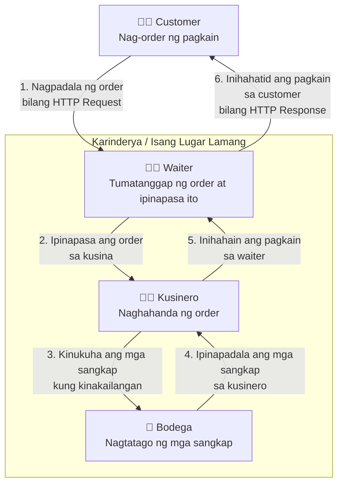
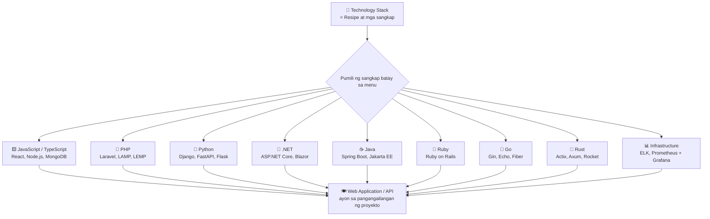
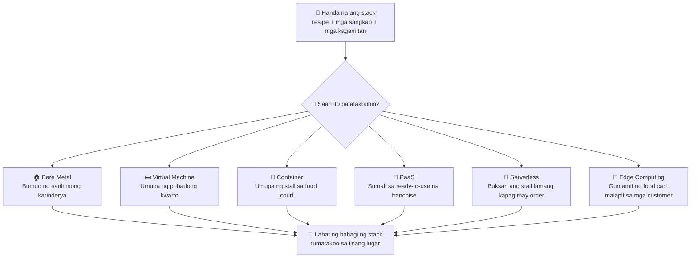

# Server Single-Tier Stack: Pag-unawa sa Mga Bahagi, Teknolohiya, at Pag-deploy

[🇮🇩 Baca dalam Bahasa Indonesia](server-single-tier-stack-id.md)
[🇬🇧 Read in English](server-single-tier-stack-en.md)
[🇲🇾 Baca dalam Bahasa Melayu](server-single-tier-stack-ms.md)

## Isang Server, Isang Stack

﷽

Ang **server single-tier stack** ay isang arkitektura kung saan ang [web server](https://developer.mozilla.org/en-US/docs/Learn_web_development/Howto/Web_mechanics/What_is_a_web_server), [application runtime](https://en.wikipedia.org/wiki/Runtime_system), at [database](https://en.wikipedia.org/wiki/Database) ay sabay-sabay na tumatakbo sa **isang computer lamang**.

Isipin mo ang isang maliit na karinderya kung saan ang kusina, bulwagan ng kainan, at bodega ay nasa iisang lugar lamang. Nag-order ang customer, naghahanda ang kusinero ng pagkain, at agad itong inihahain. Ang lahat ng gawain ay nagaganap sa parehong lugar.

Ang konseptong ito ay katulad ng **single-tier stack**: ang mga pangunahing bahagi ng isang aplikasyon—ang web server, application runtime, at database—ay sabay-sabay na inihahanda at inihahain sa gumagamit, katulad ng pagkain na inilalabas mula sa kusina.

Ngunit paano nga ba ito gumagana kapag ang isang bisita ay bumisita sa isang website na gawa gamit ang single-tier stack?

## Daloy ng Proseso

## Mga Pangunahing Bahagi

Kilalanin natin ang mga pangunahing bahagi at ang kanilang tungkulin sa isang server environment.

Katulad ng karinderya, hindi lahat ng establisyimento ay hayagang nagpapahayag ng buong detalye ng kanilang paghahanda sa kusina. Gayunpaman, sa pamamagitan ng direktang karanasan o sa pagkatuto ng pagluluto sa mismong kusina na iyon, malalaman ng isa nang eksakto kung ano ang mga sangkap at pamamaraan na ginagamit.

Ganun din ang nangyayari sa arkitektura ng server. Narito ang mga pangunahing bahagi na karaniwang makikita sa isang single-tier stack:

| Bahagi | Tungkulin |
| --- | --- |
| Operating System (OS) | Ang pundasyon. Pinamamahalaan nito ang hardware, memory, proseso, at mga resource ng server. |
| Web Client | Ang application sa panig ng gumagamit (halimbawa, web browser) na nagpapadala ng HTTP request sa server at nagpapakita ng HTTP response. |
| TLS (Transport Layer Security) | Isang cryptographic protocol na nagse-secure ng komunikasyon sa pagitan ng web client at server sa pamamagitan ng encryption, server authentication, at data integrity. Ang SSL ang na-deprecate nang predecessor nito; ang mga modernong site ay gumagamit ng TLS sa HTTPS (karaniwang port 443), mas mainam ang TLS 1.2 o TLS 1.3. |
| TLS Certificate | Isang digital certificate mula sa pinagkakatiwalaang Certificate Authority (CA) na nagpapatunay ng identidad ng server. Sinusuri ng browser ang chain of trust, pagtutugma ng domain, at validity; kung wasto, ang HTTPS ay pinagkakatiwalaan at may padlock icon. |
| Application Runtime | Isinasagawa ang application code upang ma-process ito ng server. |
| Application Framework | Nagbibigay ng estruktura at mga built-in na feature upang makabuo ng aplikasyon nang hindi kinakailangan na buuin ang lahat mula sa simula. |
| Database | Nagtatago, nag-oorganisa, at kumukuha ng datos na kinakailangan ng aplikasyon. |
| Cache (opsyonal) | Pansamantalang nagtatago ng mga madalas na binibisitang datos upang mapabilis ang performance. |

> *Tala:* Maaaring gumamit ang bawat aplikasyon ng iba't ibang kombinasyon ng mga bahagi depende sa pangangailangan nito. Ang mga bahagi tulad ng operating system, TLS, web server, application runtime, framework, database, at cache ay maaaring piliin o palitan ng mga angkop na alternatibo alinsunod sa napiling arkitektura.

## Mga Kombinasyon ng Technology Stack

Ang technology stack ay katulad ng resipe at mga sangkap nito. Sa larangan ng computing, ang pagpili ng operating system, web server, programming language, framework, at database ay bumubuo ng isang natatanging kaayusan na tinatawag na [solution stack](https://en.wikipedia.org/wiki/Solution_stack).

Ang bawat stack ay may sariling komposisyon at layunin na iniangkop sa pangangailangan ng aplikasyon. Narito ang ilan sa mga pinakakaraniwang ginagamit na technology stack, kasama ang kanilang mga bahagi at paggamit:

### 1. JavaScript & TypeScript Stack

Ang stack na ito ay gumagamit ng JavaScript o TypeScript upang bumuo ng parehong user interface (frontend) at server logic (backend). Sa tulong ng Node.js, Bun, o Deno, ang JavaScript ay maaaring tumakbo sa server, na nagpapahintulot sa isang wika na masakop ang kabuuang stack ng aplikasyon.

| Stack | Mga Pangunahing Bahagi | Paglalarawan |
| --- | --- | --- |
| [MEAN](https://www.mongodb.com/resources/languages/mean-stack) | [MongoDB](https://www.mongodb.com/), [Express.js](https://expressjs.com/), [Angular](https://angular.dev/), [Node.js](https://nodejs.org/) | Gumagamit ng Angular para sa SPA frontend, Express.js bilang backend framework, Node.js bilang runtime, at MongoDB bilang NoSQL database. Angkop para sa enterprise applications na nangangailangan ng matibay na estruktura at built-in na suporta sa TypeScript sa pamamagitan ng Angular. |
| [MERN](https://www.mongodb.com/resources/languages/mern-stack) | [MongoDB](https://www.mongodb.com/), [Express.js](https://expressjs.com/), [React](https://react.dev/), [Node.js](https://nodejs.org/) | Gumagamit ng React para sa component-based na frontend, Express.js para sa API backend, Node.js bilang runtime, at MongoDB bilang database. Lubos na popular para sa modernong web at mobile backends dahil sa flexibility ng React at malawak na npm ecosystem. |
| [MEVN](https://www.mongodb.com/resources/languages/mern-stack) | [MongoDB](https://www.mongodb.com/), [Express.js](https://expressjs.com/), [Vue.js](https://vuejs.org/), [Node.js](https://nodejs.org/) | Gumagamit ng Vue.js bilang progressive frontend framework, Express.js para sa backend, Node.js bilang runtime, at MongoDB bilang database. Kilala sa pagiging magaan, madaling matutunan, at reaktibo na angkop para sa medium-scale na mga aplikasyon. |
| [PERN](https://www.digitalocean.com/community/tutorials/how-to-build-a-pern-stack-application) | [PostgreSQL](https://www.postgresql.org/), [Express.js](https://expressjs.com/), [React](https://react.dev/), [Node.js](https://nodejs.org/) | Pinapalitan ang MongoDB ng PostgreSQL na relational (ACID-compliant) na database, habang pinapanatili ang React, Express.js, at Node.js. Angkop para sa mga aplikasyon na nangangailangan ng integridad ng datos, masalimuot na queries, at mahigpit na relasyon sa pagitan ng mga talahanayan. |
| [Next.js Stack](https://nextjs.org/) | [Next.js](https://nextjs.org/), [React](https://react.dev/), [Node.js](https://nodejs.org/), PostgreSQL o MySQL | Isang React framework na sumusuporta sa Server-Side Rendering (SSR), Static Site Generation (SSG), at API routes sa isang proyekto lamang. Angkop para sa SEO-driven na mga aplikasyon, mabilis na pag-load ng pahina, at full-stack na pag-develop sa iisang repository. |
| [T3 Stack](https://create.t3.gg/) | [TypeScript](https://www.typescriptlang.org/), [Tailwind CSS](https://tailwindcss.com/), [tRPC](https://trpc.io/), [Next.js](https://nextjs.org/), [Prisma](https://www.prisma.io/), [PostgreSQL](https://www.postgresql.org/) | Isang full-stack TypeScript stack na nagpapatupad ng end-to-end na type safety mula database hanggang frontend. Inaalis ng tRPC ang pangangailangan na manu-manong bumuo ng REST APIs, ang Prisma ay nagbibigay ng type-safe na ORM, at ang Tailwind ay humahawak sa styling. Angkop para sa mga koponan na binibigyang-priyoridad ang type safety at mabilis na pag-develop. |
| [JAMstack](https://jamstack.org/what-is-jamstack/) | JavaScript, API, Markup | Isang architectural approach na naghihiwalay sa frontend markup sa backend. Ang JavaScript ay tumatakbo sa client, ang datos ay kinukuha sa pamamagitan ng APIs, at ang markup ay pre-built sa panahon ng build. Angkop para sa content sites, static e-commerce, at mga aplikasyon na nangangailangan ng mataas na seguridad at scalability nang walang tradisyonal na server. |
| [Bun Stack](https://bun.sh/) | [Bun](https://bun.sh/), [Elysia](https://elysiajs.com/) o [Hono](https://hono.dev/), SQLite o PostgreSQL, React o Vue | Gumagamit ng Bun bilang JavaScript runtime na pumapalit sa Node.js na may mas mabilis na startup at mas mababang memory usage. Pinagsasama sa mga lightweight na framework tulad ng Elysia o Hono at relational database. Angkop para sa microservices, serverless, at mga aplikasyon na sensitibo sa latency o resources. Ang ecosystem nito ay mas bata pa kumpara sa Node.js. |

### 2. PHP Stack

Ang PHP-centric na stack ay karaniwang ginagamit sa web development, kadalasang pinapatakbo sa server kasama ang web server at relational database.

| Stack | Mga Pangunahing Bahagi | Paglalarawan |
| --- | --- | --- |
| [Laravel](https://laravel.com/) | [PHP](https://www.php.net/), [Laravel](https://laravel.com/docs), MySQL o PostgreSQL, Nginx o Apache | Isang modernong PHP framework na nag-aalok ng routing, authentication, Eloquent ORM, Blade templating, at iba pa. Angkop para sa web applications mula sa maliliit na proyekto hanggang sa malalaking sistema, na may malawak na dokumentasyon at organisadong paraan ng pag-develop. |
| [Symfony](https://symfony.com/) | [PHP](https://www.php.net/), [Symfony](https://symfony.com/doc/current/index.html), iba't ibang database, Nginx o Apache | Isang modular at reusable na set ng PHP components na malawakang ginagamit bilang pundasyon ng maraming framework, kabilang ang Laravel. Lubos na flexible at angkop para sa malalaking enterprise applications na nangangailangan ng ganap na kontrol sa arkitektura. |
| [LAMP](https://cloud.google.com/mysql/lamp) | [Linux](https://www.kernel.org/), [Apache](https://httpd.apache.org/), [MySQL](https://mariadb.org/) o [MariaDB](https://mariadb.org/), [PHP](https://www.php.net/) | Ang klasikong stack para sa dynamic na web applications. Ang Linux ang OS, Apache ang web server, MySQL/MariaDB ang database, at PHP ang programming language. Malawak na suportado ng mga hosting provider at madaling i-deploy. |
| [LEMP](https://www.digitalocean.com/community/tutorials/how-to-install-linux-nginx-mysql-php-lemp-stack-ubuntu-22-04) | [Linux](https://www.kernel.org/), [Nginx](https://nginx.org/), [MySQL](https://mariadb.org/) o [MariaDB](https://mariadb.org/), [PHP](https://www.php.net/) | Isang variant ng LAMP na pumapalit sa Apache ng Nginx. Ang Nginx ay mas mahusay sa pag-handle ng concurrent connections at paglingkod ng static content, kaya angkop ito para sa high-traffic na mga aplikasyon o mga nangangailangan ng mas mahusay na performance ng web server. |
| [WAMP](https://en.wikipedia.org/wiki/WAMP) | [Windows](https://www.microsoft.com/windows), [Apache](https://httpd.apache.org/), [MySQL](https://mariadb.org/) o [MariaDB](https://mariadb.org/), [PHP](https://www.php.net/) | Isang Windows-based na PHP stack na dinisenyo para sa local na pag-develop at pag-host. Angkop para sa mga environment na nakabatay sa Microsoft infrastructure. |
| [WIMP](https://learn.microsoft.com/en-us/iis/) | [Windows](https://www.microsoft.com/windows), [IIS](https://www.iis.net/), [MySQL](https://mariadb.org/) o [MariaDB](https://mariadb.org/), [PHP](https://www.php.net/) | Isang Windows-based na stack na gumagamit ng IIS (Internet Information Services) bilang kapalit ng Apache. Angkop para sa mga organisasyon na integrated sa Microsoft ecosystem na gustong patakbuhin ang PHP sa Windows Server. |
| [FAMP](https://en.wikipedia.org/wiki/FAMP) | [FreeBSD](https://www.freebsd.org/), [Apache](https://httpd.apache.org/), [MySQL](https://mariadb.org/) o [MariaDB](https://mariadb.org/), [PHP](https://www.php.net/) | Isang variant ng LAMP na gumagamit ng FreeBSD bilang operating system. Kilala sa stability, seguridad, at efficiency sa networking, kaya angkop ito para sa mga server kung saan priority ang robustness ng OS na nakabatay sa BSD. |
| [XAMPP](https://www.apachefriends.org/) | Cross-platform, [Apache](https://httpd.apache.org/), [MariaDB](https://mariadb.org/) o [MySQL](https://mariadb.org/), [PHP](https://www.php.net/), [Perl](https://www.perl.org/) | Isang all-in-one, madaling i-install na web development package para sa Windows, Linux, at macOS. Pangunahing ginagamit para sa pag-aaral at local na prototyping bago i-deploy sa production. |

### 3. Python Stack

Isang Python-based na stack para sa web development, mula sa micro-framework hanggang sa full-stack framework na mayaman sa built-in na functionality.

| Stack | Mga Pangunahing Bahagi | Paglalarawan |
| --- | --- | --- |
| [Django](https://www.djangoproject.com/) | [Python](https://www.python.org/), [Django](https://www.djangoproject.com/), PostgreSQL o MySQL, Nginx o Apache, Gunicorn | Isang "batteries included" na framework na nag-aalok ng admin panel, authentication, ORM, at matibay na seguridad na feature sa labas ng kahon. Angkop para sa malalaking web applications na nangangailangan ng mabilis na pag-develop at mataas na pamantayan ng seguridad. |
| [FastAPI](https://fastapi.tiangolo.com/) | [Python](https://www.python.org/), [FastAPI](https://fastapi.tiangolo.com/), PostgreSQL o MySQL, Nginx, Uvicorn | Isang modernong API framework na may automatic na data validation sa pamamagitan ng Pydantic at interactive na dokumentasyon gamit ang Swagger/OpenAPI. Napakataas ng performance nito sa async support, kaya angkop ito para sa microservices at machine learning APIs. |
| [Flask](https://flask.palletsprojects.com/) | [Python](https://www.python.org/), [Flask](https://flask.palletsprojects.com/), iba't ibang database, Nginx o Apache, Gunicorn | Isang lightweight, flexible na micro-framework na nagbibigay ng ganap na kontrol sa mga developer nang hindi nagpapataw ng rigid na estruktura. Angkop para sa maliliit na aplikasyon, prototypes, o mga serbisyo na nangangailangan ng maximum na customization. |
| [Pyramid](https://trypyramid.com/) | [Python](https://www.python.org/), [Pyramid](https://trypyramid.com/), iba't ibang database | Isang flexible na framework na maaaring mag-scale mula sa minimal na aplikasyon hanggang sa malalaking sistema. Pinapayagan nito ang mga developer na pumili ng mga bahagi ayon sa pangangailangan at angkop ito para sa mga proyekto na unti-unting lumalaki sa paglipas ng panahon. |

### 4. .NET Stack

Binuo sa C# at sa .NET ecosystem, ang stack na ito ay ginagamit upang bumuo ng web applications, APIs, at backend services.

| Stack | Mga Pangunahing Bahagi | Paglalarawan |
| --- | --- | --- |
| [ASP.NET Core](https://learn.microsoft.com/en-us/aspnet/core/) | [C#](https://learn.microsoft.com/en-us/dotnet/csharp/), [ASP.NET Core](https://learn.microsoft.com/en-us/aspnet/core/), SQL Server o PostgreSQL, IIS o Nginx | Isang high-performance, cross-platform na framework mula sa Microsoft para sa pagbuo ng web apps, REST APIs, at backend services. Tumatakbo sa Windows, Linux, at macOS, kaya angkop ito para sa mga enterprise environment sa loob ng Microsoft ecosystem. |
| [Blazor Stack](https://dotnet.microsoft.com/apps/aspnet/web-apps/blazor) | [C#](https://learn.microsoft.com/en-us/dotnet/csharp/), [Blazor](https://dotnet.microsoft.com/apps/aspnet/web-apps/blazor), [.NET](https://dotnet.microsoft.com/), SQL Server o PostgreSQL | Nagbibigay-daan sa interactive na web UI gamit ang C# sa halip na JavaScript, sa pamamagitan ng Blazor WebAssembly (client-side) o Blazor Server (server-side). Angkop para sa .NET teams na gustong bumuo ng rich na frontend nang hindi masyadong umaasa sa JavaScript. |

### 5. Java Stack

Isang stack na binuo sa Java, karaniwang ginagamit para sa scalable na backend systems at enterprise-grade na mga aplikasyon.

| Stack | Mga Pangunahing Bahagi | Paglalarawan |
| --- | --- | --- |
| [Java-Spring](https://spring.io/projects/spring-boot) | [Java](https://dev.java/), [Spring Boot](https://spring.io/projects/spring-boot), iba't ibang database, Tomcat | Ang pinakakaraniwang ginagamit na Java framework para sa pagbuo ng backends at microservices. Pinapadali ng Spring Boot ang configuration at nagbibigay ng production-ready na mga feature tulad ng health checks, metrics, at externalized configuration. |
| [Jakarta EE](https://jakarta.ee/) | [Java](https://dev.java/), [Jakarta EE](https://jakarta.ee/), iba't ibang database, application server | Isang open enterprise Java standard para sa malalaking aplikasyon, na sumasakop sa web, enterprise beans, at messaging. Karaniwang ginagamit sa banking, telecommunications, at public sector kung saan mahalaga ang open standards. |
| [Quarkus](https://quarkus.io/) | [Java](https://dev.java/), [Quarkus](https://quarkus.io/), iba't ibang database | Isang Java framework na na-optimize para sa Kubernetes at serverless environment, na nag-aalok ng mabilis na startup time at mababang memory consumption. Angkop para sa cloud-native na microservices, lalo na kapag na-compile sa GraalVM native images. |

### 6. Ruby Stack

Isang stack na nakasentro sa Ruby, kilala sa matibay na konvensyon at pagbibigay-diin sa mabilis na web development.

| Stack | Mga Pangunahing Bahagi | Paglalarawan |
| --- | --- | --- |
| [Ruby on Rails](https://rubyonrails.org/) | [Ruby](https://www.ruby-lang.org/), [Rails](https://guides.rubyonrails.org/getting_started.html), PostgreSQL o MySQL, Puma o Unicorn | Isang full-stack na framework na sumusunod sa "Convention over Configuration". Nagbibigay ito ng migrations, scaffolding, asset pipelines, at iba pa sa labas ng kahon. Angkop para sa startups at MVPs na nangangailangan ng pag-develop sa napakataas na bilis. |
| [Sinatra](https://sinatrarb.com/) | [Ruby](https://www.ruby-lang.org/), [Sinatra](https://sinatrarb.com/), iba't ibang database | Isang minimal, lightweight na Ruby micro-framework. Angkop para sa pagbuo ng mga simpleng serbisyo, maliliit na APIs, o mga aplikasyon na hindi nangangailangan ng buong estruktura ng Rails. |

### 7. Go Stack

Isang stack na binuo sa Go (Golang), dinisenyo para sa high-performance na backends, APIs, at microservices.

| Stack | Mga Pangunahing Bahagi | Paglalarawan |
| --- | --- | --- |
| [Gin](https://gin-gonic.com/) | [Go](https://go.dev/), [Gin](https://gin-gonic.com/), iba't ibang database | Isang mabilis, lightweight na web framework na katulad ng Express.js. Angkop para sa pagbuo ng REST APIs at microservices na may mataas na performance at mabilis na compilation. |
| [Echo](https://echo.labstack.com/) | [Go](https://go.dev/), [Echo](https://echo.labstack.com/), iba't ibang database | Isang high-performance na framework na may mga malalaking feature tulad ng middleware, routing, and validation. Kilala sa mahusay na memory usage at angkop para sa high-throughput na mga aplikasyon. |
| [Fiber](https://docs.gofiber.io/) | [Go](https://go.dev/), [Fiber](https://docs.gofiber.io/), iba't ibang database | Inspired ng Express.js at binuo sa ibabaw ng Fasthttp, ang Fiber ay napakabilis at napakagaan. Angkop para sa microservices at mga aplikasyon na kritikal sa low latency at minimal na resource usage. |
| [Go Standard Library](https://go.dev/) | [Go](https://go.dev/), `net/http`, iba't ibang database | Isang framework-free na paraan gamit ang built-in na standard library ng Go. Nagbibigay ng maximum na kontrol, minimal na dependencies, at angkop para sa lightweight na mga aplikasyon nang walang unnecessary overhead. |

### 8. Rust Stack

Isang stack na binuo sa Rust, na binibigyang-priyoridad ang memory safety, concurrency, at system-level na performance.

| Stack | Mga Pangunahing Bahagi | Paglalarawan |
| --- | --- | --- |
| [Actix Web](https://actix.rs/) | [Rust](https://www.rust-lang.org/), [Actix Web](https://actix.rs/), iba't ibang database | Isa sa mga pinakamabilis na web framework ng Rust, binuo sa actor model. Angkop para sa mga aplikasyon na nangangailangan ng memory safety, mataas na concurrency, at maximum na performance nang walang garbage collector. |
| [Axum](https://github.com/tokio-rs/axum) | [Rust](https://www.rust-lang.org/), [Axum](https://github.com/tokio-rs/axum), [Tokio](https://tokio.rs/), iba't ibang database | Isang modular, type-safe na web framework mula sa Tokio ecosystem. Sinusuri nito ang async/await ng Rust at angkop para sa pagbuo ng mahusay at maayos na maipamamalas na asynchronous APIs. |
| [Rocket](https://rocket.rs/) | [Rust](https://www.rust-lang.org/), [Rocket](https://rocket.rs/), iba't ibang database | Isang developer-friendly na Rust framework na binibigyang-diin ang ergonomics. Nagbibigay ng mga feature tulad ng templating, form handling, at database integration na may malinis at declarative na syntax. |

### 9. Infrastructure at Observability

Ang mga stack na ito ay nagsasama ng operating system, web server, database, o mga supporting tools para sa infrastructure management at application observability.

| Stack | Mga Pangunahing Bahagi | Paglalarawan |
| --- | --- | --- |
| [Wazuh](https://wazuh.com/) | [Wazuh Server](https://documentation.wazuh.com/current/) (manager, indexer, dashboard), [Wazuh Agent](https://documentation.wazuh.com/current/), [Elasticsearch](https://www.elastic.co/elasticsearch) o [OpenSearch](https://opensearch.org/) (opsyonal), [Kibana](https://www.elastic.co/kibana) o [Wazuh Dashboard](https://documentation.wazuh.com/current/) (opsyonal) | Isang open-source na platform para sa intrusion detection, security monitoring (XDR/SIEM), log analysis, file integrity monitoring, at threat response. Angkop para sa centralized na security monitoring sa mga server at endpoints. |
| [Elastic Stack (ELK)](https://www.elastic.co/elastic-stack) | [Elasticsearch](https://www.elastic.co/elasticsearch), [Logstash](https://www.elastic.co/logstash), [Kibana](https://www.elastic.co/kibana) | Ginagamit upang mangolekta, maghanap, magsuri, at mag-visualize ng mga log at system metrics. Angkop para sa monitoring, troubleshooting, at Security Information and Event Management (SIEM). |
| [Prometheus + Grafana](https://prometheus.io/) | [Prometheus](https://prometheus.io/), [Grafana](https://grafana.com/), iba't ibang exporter | Isang open-source na monitoring stack na nangongolekta ng time-series metrics mula sa mga sistema at aplikasyon at nag-visualize nito sa pamamagitan ng Grafana dashboards. Angkop para sa infrastructure monitoring at alerting. |
| [TICK Stack](https://docs.influxdata.com/influxdb/v2/get-started/) | [Telegraf](https://docs.influxdata.com/telegraf/), [InfluxDB](https://www.influxdata.com/products/influxdb/), [Chronograf](https://docs.influxdata.com/chronograf/), [Kapacitor](https://docs.influxdata.com/kapacitor/) | Isang stack para sa pagkolekta, pag-iimbak, pag-visualize, at pagproseso ng time-series data. Karaniwang ginagamit sa infrastructure monitoring, IoT, at pagsubaybay sa application metrics sa paglipas ng panahon. |

> *Tala:* Ang pagpili ng tamang mga sangkap ay nagreresulta sa masarap na pagkain na nagpapanatili sa mga customer na bumalik. Gayunpaman, ang bawat pagpili ay may trade-off—ganun din sa technology stacks. Hindi ito isang kumpleto o obligatoryong listahan; ang mga bahagi sa loob ng isang stack ay maaaring palitan upang umangkop sa mga partikular na pangangailangan.

## Saan Patatakbuhin ang Stack?

Matapos pumili ng technology stack, ang susunod na pagsasaalang-alang ay *saan* ito tatakbo at paano pamamahalaan ang infrastructure nito. Ito ay tinatawag na **deployment environment**.

Isipin mo na nakakuha ka na ng resipe, mga sangkap, at mga kagamitan upang magbukas ng karinderya. Ngayon, kailangan mong magpasya kung saan ito mag-ooperate: bumuo ng sarili mong lugar, umupa ng puwang, makipag-share ng mga pasilidad sa iba pang mga vendor, o magbukas ng pansamantala lamang ayon sa pangangailangan.

Sa mundo ng server, ang mga pagpipilian na ito ay may katumbas na pagkakatulad:

| Environment | Analohiya sa Karinderya | Paglalarawan | Mga Halimbawa |
| --- | --- | --- | --- |
| **Bare Metal / Dedicated Server** | Bumuo ng karinderya sa sariling lupa. May ganap kang kontrol sa lahat, mula sa dingding hanggang sa kalan. | Ang OS at mga aplikasyon ay direktang tumatakbo sa pisikal na hardware nang walang hypervisor. | [IBM Bare Metal Servers](https://www.ibm.com/think/topics/bare-metal-servers), [OVHcloud Dedicated Server](https://www.ovhcloud.com/en/bare-metal/) |
| **Virtual Machine (VM) - Desktop** | Umupa ng pribadong kwarto sa boarding house. Sarili mo lamang ito, at maaari mo itong i-reset anumang oras kung may mangyari. | Isang virtual na computer na may sariling OS na tumatakbo sa personal mong makina. | [VirtualBox](https://www.virtualbox.org/), [VMware Workstation](https://www.vmware.com/products/workstation-pro.html), [VMware Fusion](https://www.vmware.com/products/fusion.html) |
| **Server Virtualization Platform** | Ang may-ari ng boarding house ay namamahala ng dose-dosenang kwarto mula sa isang central office. | Namamahala ng maramihang VM sa production server sa pamamagitan ng centralized na interface. | [VMware vSphere / ESXi](https://www.vmware.com/products/vsphere.html), [Proxmox VE](https://www.proxmox.com/en/products/proxmox-virtual-environment/overview) |
| **Container** | Umupa ng stall sa food court. Nagbabahagi ka ng mga pasilidad sa kusina, ngunit ang iyong stall ay hiwalay at madaling ilipat. | Ang mga aplikasyon ay tumatakbo sa mga hiwalay na package na nagbabahagi ng host OS kernel. | [Docker](https://www.docker.com/), [Podman](https://podman.io/) |
| **PaaS (Platform as a Service)** | Magbukas ng ready-to-use na franchise. Dalhin lamang ang iyong resipe; ang tindahan, kuryente, at infrastructure ay ibinibigay na. | Pinamamahalaan ng provider ang infrastructure; kailangan mo lamang na i-upload ang iyong code. | [Heroku](https://www.heroku.com/), [Render](https://render.com/), [Railway](https://railway.app/) |
| **Serverless / FaaS** | Isang pop-up stall sa isang event. Buksan lamang kapag may customer, isara kapag wala, at bayaran ayon sa order. | Ang code ay tumatakbo on demand nang walang permanenteng server na pinamamahalaan. | [AWS Lambda](https://aws.amazon.com/lambda/), [Azure Functions](https://learn.microsoft.com/azure/azure-functions/), [Cloudflare Workers](https://workers.cloudflare.com/) |
| **Shared Hosting** | Isang stall sa gilid ng kalsada na pinagsasaluhan ng maraming vendor. Mura, ngunit siksikan at limitado ang kontrol. | Maramihang user ang nagbabahagi ng parehong server resources. | [cPanel](https://cpanel.net/), [Hostinger](https://www.hostinger.com/) |
| **Managed Hosting** | Umupa ng tindahan na may manager na humahawak sa pang-araw-araw na operasyon. | Karamihan ng server management at operasyon ay pinamamahalaan ng provider. | [AWS Elastic Beanstalk](https://aws.amazon.com/elasticbeanstalk/), [DigitalOcean App Platform](https://www.digitalocean.com/products/app-platform) |
| **Edge Computing** | Isang food cart na nakaparada malapit sa mga customer upang mas mabilis na maihain ang pagkain. | Ang pagproseso ay isinasagawa nang mas malapit sa mga user upang mabawasan ang latency. | [Cloudflare Workers](https://workers.cloudflare.com/), [AWS Wavelength](https://aws.amazon.com/wavelength/) |

### Mga Pangunahing Pagkakaiba

- **VMware Workstation at Fusion** ay para sa lokal na desktop virtualization, angkop para sa pag-aaral sa bahay.
- **VMware ESXi/vSphere at Proxmox VE** ay para sa production server virtualization, angkop para sa pamamahala ng maraming VM sa malaking sukat.
- **Bare Metal** ay tumutukoy sa software na direktang tumatakbo sa pisikal na hardware. Ang **Dedicated Server** ay tumutukoy sa pisikal na server na inuupahan sa isang customer lamang. Ang mga termino ay madalas na magkasama ngunit hindi magkapareho.

### Kaugnayan sa Single-Tier Stack

Ang **single-tier** na arkitektura ay nangangahulugan na ang lahat ng bahagi ng stack (web server, application runtime, at database) ay nasa **iisang lugar**—halimbawa, sa loob ng isang VM, isang container, o isang pisikal na server.

Gayunpaman, ang single-tier ay **hindi nangangailangan** ng VM o container. Maaari rin itong patakbuhin sa bare metal, dedicated server, o kahit sa PaaS, hangga't ang lahat ng bahagi ay nananatili sa loob ng iisang deployment environment.

Mahalaga na pag-iba-ibahin ang mga sumusunod:

- **Deployment environment** = kung saan tumatakbo ang stack (VM, container, bare metal, atbp.).
- **Tier architecture** = kung paano nahahati ang mga bahagi ng aplikasyon (single-tier, multi-tier, atbp.).

Ang pagpili ng deployment environment ay nakakaapekto sa operational costs, flexibility, scalability, seguridad, at maintainability. Walang solong pinakamainam na pagpipilian para sa lahat—depende ito sa pangangailangan ng proyekto.

## Mga Tip para sa Pagsisimula

1. **Unawain ang daloy ng aplikasyon.** Alamin kung paano gumagalaw ang request mula sa browser papunta sa web server, ipinapasa sa application runtime, at nakikipag-ugnayan sa database. Nakakatulong ito sa pag-troubleshoot ng mga pagkakamali. Sanggunian: [MDN — Paano Gumagana ang Web](https://developer.mozilla.org/en-US/docs/Learn_web_development/Getting_started/Your_first_website/How_the_web_works).
2. **Pumili ng stack batay sa layunin.** Para sa pag-aaral, pumili ng teknolohiya na gusto mo upang mapanatili ang pagkakapare-pareho sa pagsasanay. Halimbawa, LAMP/LEMP para sa PHP, o MERN para sa JavaScript. Para sa seryosong mga proyekto, isaalang-alang ang pangangailangan ng aplikasyon, kakayahan ng koponan, dokumentasyon, seguridad, performance, gastos, at long-term na suporta.
3. **Magsimula sa lokal na environment.** Gumamit ng [VirtualBox](https://www.virtualbox.org/) para sa mga VM o [Docker](https://www.docker.com/) para sa mga container. Ang mga VM ay may sariling guest OS, samantalang ang mga container ay nagbabahagi ng host kernel. Pareho itong nagpapadali sa eksperimento bago i-deploy sa production.
4. **Subukan ang bawat bahagi.** Tiyakin na ang web server ay tumatanggap ng mga request, ang runtime ay nagsasagawa ng aplikasyon, at ang database ay maaaring magbasa at magsulat ng datos. Ang unti-unting pagsubok ay nagpapadali sa paghiwalay ng mga suliranin. Sanggunian: [Docker — Magsimula](https://docs.docker.com/get-started/).
5. **Subaybayan bago mag-optimize.** Bantayan ang CPU, RAM, disk usage, response times, at mga log upang matukoy ang mga bottleneck bago magdagdag ng resources o magpalit ng teknolohiya. Mga sanggunian: [Prometheus](https://prometheus.io/) at [Grafana](https://grafana.com/).
6. **Unahin ang seguridad mula sa simula.** Limitahan ang mga access permission, protektahan ang mga credentials, panatilihing updated ang mga dependencies, at buksan lamang ang mga kinakailangang port. Ang maling configuration sa iisang makina ay maaaring makaapekto sa kabuuang aplikasyon. Sanggunian: [OWASP Cheat Sheet Series](https://cheatsheetseries.owasp.org/).
7. **Maghanda ng mga backup at subukan ang recovery.** I-backup ang database, mga application files, at mga kritikal na configuration. Subukan ang restoration nang pana-panahon upang matiyak na ang datos ay mababalikan sa kaso ng pagkasira. Sanggunian: [PostgreSQL — Backup at Restore](https://www.postgresql.org/docs/current/backup.html).
8. **Idokumento ang mga pagbabago.** Itala ang mga bersyon ng software, configuration, dependencies, at mga hakbang sa pag-deploy. Gumamit ng [Git](https://git-scm.com/) upang subaybayan ang mga pagbabago sa code para sa mas madaling pag-debug at pakikipagtulungan.
9. **Alamin ang mga limitasyon ng single-tier.** Kung ang isang makina ay nagsisimula nang maging sobra sa kapasidad o kinakailangan ang high availability, suriin ang optimization, redundancy, o paghihiwalay ng mga bahagi sa iba't ibang tiers. Ang iisang makina ay isang Single Point of Failure (SPOF)—isang punto ng pagkasira na maaaring magpahinto sa kabuuang aplikasyon. Sanggunian: [Red Hat — Ano ang High Availability?](https://www.redhat.com/en/topics/linux/what-is-high-availability).

## Formula sa Pagpili ng Stack at Deployment Environment

- **Para sa pag-aaral:** personal na interes + kadalian ng paggamit + dokumentasyon + availability ng mga learning resources.
- **Para sa bagong proyekto:** pangangailangan ng aplikasyon + dami at pattern ng mga user + kakayahan ng koponan + seguridad + performance testing + operational costs.
- **Para sa paglipat ng stack o deployment:** mga isyu sa kasalukuyang sistema + nasusukat na benepisyo ng paglipat + gastos at panganib + compatibility + epekto sa mga user + long-term na suporta.

**Sa esensya:** Pumili ng iyong stack at deployment environment batay sa pangangailangan ng aplikasyon, sukat ng mga user, kakayahan ng koponan, seguridad, gastos, at mga resulta ng pagsubok. Upang matuto mula sa real-world na praktika, pag-aralan ang mga engineering case studies mula sa mga kumpanya na nakaharap sa mga katulad na hamon.

### Mga Sanggunian sa Stack sa Tunay na Mundo

Ang pagpili ng technology stack ay maaaring nakakalito dahil sa napakaraming wika, framework, database, at mga tool na magagamit. Higit pa sa paghahambing ng mga feature, ang pagkatuto mula sa mga kumpanya na nakabuo at nagpatakbo ng mga sistema sa malakiang sukat ay napakahalaga:

- [Uber Engineering](https://www.uber.com/us/en/blog/engineering/) — Arkitektura ng backend at scalability
- [Shopify Engineering](https://shopify.engineering/) — Monoliths at database scalability
- [Cloudflare Blog](https://blog.cloudflare.com/) — Infrastructure ng server at networking
- [Netflix TechBlog](https://netflixtechblog.medium.com/) — Distributed systems at reliability
- [Stripe Engineering](https://stripe.com/blog/engineering) — Backend, APIs, at data consistency
- [Discord Blog](https://discord.com/category/engineering) — Real-time systems at performance optimization
- [AWS Architecture Blog](https://aws.amazon.com/blogs/architecture/) — Cloud architecture at pag-deploy

**Tip:** Bigyang-pansin ang dahilan sa likod ng mga pagpili ng teknolohiya, ang mga problemang naranasan, at ang mga trade-off na isinasaalang-alang. Gawing gabay ang kanilang karanasan, at i-adjust ito upang umangkop sa pangangailangan ng iyong sariling proyekto.

## Konklusyon

Ang server single-tier stack ay isang arkitektura kung saan ang mga pangunahing bahagi ng aplikasyon—web server, application runtime, at database—ay tumatakbo sa iisang makina lamang. Ang browser ay nagpapadala ng HTTP request sa server, pinoproseso ito ng aplikasyon at kumukuha ng datos mula sa database kung kinakailangan, at ang resulta ay ibinabalik bilang HTTP response.

Ang pag-unawa sa konseptong ito ay nakakatulong sa pagkilala sa tungkulin ng bawat bahagi, pagpili ng angkop na technology stack, at pagpili ng angkop na deployment environment. Gayunpaman, ang iisang makina ay may mga limitasyon sa resources at nagdadala ng panganib na maging Single Point of Failure (SPOF).

**Sa huli:** Pumili ng iyong stack at deployment batay sa pangangailangan ng aplikasyon, kakayahan ng koponan, seguridad, gastos, at mga resulta ng pagsubok. Magsimula nang simple, at sa paglaki ng iyong aplikasyon, suriin ang pangangailangan para sa optimization o paghihiwalay ng mga bahagi sa iba't ibang tiers.
