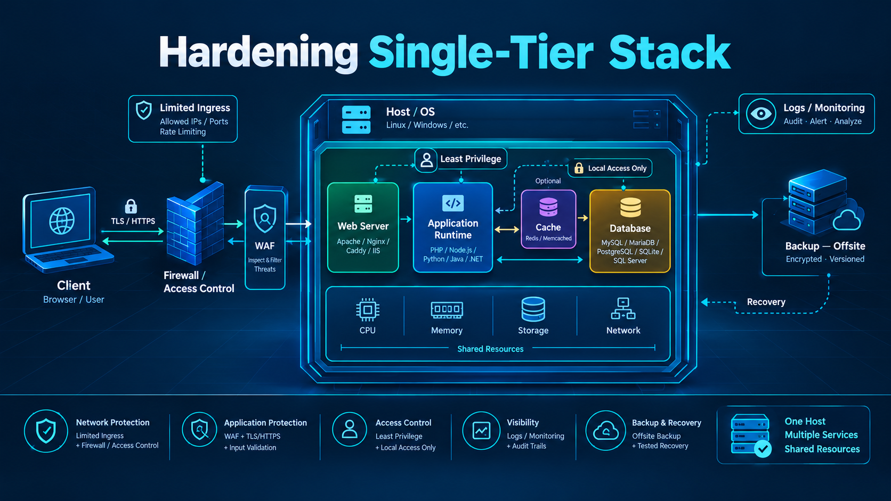

# Hardening Single-Tier Stack

[🇬🇧 Read in English](hardening-single-tier-stack-en.md)
[🇲🇾 Baca dalam Bahasa Melayu](hardening-single-tier-stack-ms.md)
[🇵🇭 Basahin sa Tagalog](hardening-single-tier-stack-tl.md)

﷽

## Mengapa Perlu Dihardening?

Konfigurasi default dibuat agar aplikasi bisa langsung berjalan, bukan agar aman. Di arsitektur *single-tier*, semua komponen — web server, runtime, database, dan file sistem — berada di **satu mesin yang sama**. Artinya, celah kecil di satu lapisan bisa membuka jalan ke lapisan lain tanpa harus menembus banyak perbatasan.

Tujuan *hardening* di sini bukan "mengunci segalanya", tapi **mengurangi ruang gerak penyerang** jika suatu saat salah satu lapisan dikompromikan. Fokusnya adalah membatasi akses, memisahkan hak, mendeteksi perubahan, dan memastikan kita bisa memulihkan sistem tanpa membawa kompromi kembali.

## Threat Model

Sebelum menerapkan pengaturan, kita perlu paham apa yang kita lindungi dan apa batasannya.

| Aspek | Penjelasan |
|---|---|
| **Aset yang dilindungi** | Layanan web, data aplikasi, kredensial, file konfigurasi, log, dan salinan *backup*. |
| **Ancaman utama** | Eksploitasi celah aplikasi, brute force login, kebocoran kredensial, penyalahgunaan izin lokal, serta upaya eksfiltrasi data dari mesin yang sama. |
| **Asumsi** | Layanan web bisa diakses dari internet. Di *single-tier*, aplikasi, runtime, dan database berbagi OS yang sama. |
| **Batas perlindungan** | Kita bisa mengurangi *attack surface*, membatasi pergerakan lateral, dan memperkuat deteksi. Namun, jika seluruh mesin benar-benar dikuasai dengan hak *root*, tidak ada pengaturan host tunggal yang bisa menjamin keamanan mutlak. |
| **Di luar cakupan** | Keamanan jaringan perimetral di luar host, serangan tingkat vendor hypervisor, atau kompromi terhadap akun *provider* tempat mesin berjalan. |

## Attack Surface & Alur Akses

Di *single-tier*, pergerakan penyerang bisa mengikuti jalur yang saling berkaitan.

| Jalur | Penjelasan | Catatan Hardening |
|---|---|---|
| **Ingress (dari luar)** | Masuk melalui port yang terbuka, umumnya `80`/`443`. SSH hanya dibuka jika benar-benar dibutuhkan. | *Default deny*, hanya izinkan port yang diperlukan. Batasi SSH ke jaringan/admin yang tepercaya. |
| **East-West (antar komponen)** | Komunikasi antar proses di mesin yang sama, biasanya lewat `127.0.0.1` atau *Unix socket*. | Jangan biarkan database mendengarkan `0.0.0.0`. Pisahkan user/service per komponen. Terapkan *least privilege*. |
| **Egress (keluar)** | Koneksi dari server ke luar (update, DNS, API, dll). | Amati pola normal terlebih dahulu, baru terapkan pembatasan bertahap. Jangan abaikan karena "server butuh keluar". |

> **Penting:** Port `443` boleh terbuka karena dibutuhkan, tapi justru karena wajib dibuka, kita harus memastikan aplikasi yang berjalan di baliknya aman, dibatasi izinnya, dan diawasi.

## Prinsip Dasar Hardening

Setiap kontrol harus bisa dijawab dengan tiga pertanyaan: *Apa yang dilakukan? Mengapa risikonya berkurang? Apa batasannya?*

| Prinsip | Penerapan | Batasan |
|---|---|---|
| **Kurangi *attack surface*** | Matikan service tak terpakai, buka hanya port yang dibutuhkan. | Tidak bisa menutup port yang memang wajib dipakai aplikasi. |
| **Least Privilege** | Jalankan tiap service dengan user terpisah, berikan izin minimal. | Izin minimal harus tetap cukup agar aplikasi bisa berfungsi. Perlu diuji. |
| **Isolasi** | Pisahkan hak proses, kepemilikan file, dan batasan *systemd*. | Di satu mesin, isolasi bersifat logis. Kompromi dengan akses yang cukup bisa tetap melintas antar komponen. |
| **Defense in Depth** | Gabungkan firewall, izin, validasi aplikasi, logging, dan backup. | Satu lapisan gagal, lapisan lain bisa melambatkan atau mendeteksi. Bukan jaminan. |
| **Deteksi & Verifikasi** | Buat baseline, awasi perubahan, uji kontrol secara berkala. | Tanpa tindak lanjut, log cuma jadi arsip. |
| **Siap Pulih** | Pisahkan backup, uji *restore*, dokumentasikan respons insiden. | *Backup* yang belum diuji *restore*, sama saja dengan belum ada *backup*. |

## Standar Acuan: CIS

[CIS Benchmarks](https://www.cisecurity.org/cis-benchmarks) bisa jadi acuan, bukan target mutlak. 

- **Level 1**: Baseline praktis, cocok diterapkan bertahap di sebagian besar *single-tier*.
- **Level 2**: Lebih ketat, hanya dipakai jika benar-benar dibutuhkan dan diuji di lab.
- **Kepatuhan ≠ Keamanan**: Skor bergantung pada profil, versi *benchmark*, dan pengecualian yang terdokumentasi. Yang penting adalah memahami *alasan* tiap kontrol, bukan sekadar mencentang semua poin.

## OS, Attack Surface & Jaringan

| Kontrol | Apa / Mengapa / Batasnya | Catatan |
|---|---|---|
| **Update & Patch** | *Apa:* Terapkan pembaruan keamanan. *Mengapa:* Menutup celah yang diketahui. *Batas:* Patch butuh pengujian; celah *zero-day* belum tertangani. | Update rutin, prioritaskan yang berdampak pada service yang terekspos. |
| **Firewall Host** | *Apa:* *Default deny incoming*, hanya izinkan port yang dibutuhkan. *Mengapa:* Mengurangi jalur *ingress*. *Batas:* Tidak melindungi dari eksploitasi lewat port yang wajib dibuka (80/443). | SSH bisa dibatasi ke VPN/jaringan admin. HTTP bisa diarahkan ke HTTPS. |
| **SSH Hardening** | *Apa:* Pakai kunci, nonaktifkan `root login` & *password auth*. *Mengapa:* Mengurangi serangan *brute force*. *Batas:* Kunci yang bocor tetap bisa dipakai jika tidak dicabut. | Batasi `AllowUsers` bila memungkinkan. |
| **Kernel & Mount Options** | *Apa:* Terapkan `sysctl` relevan, pertimbangkan `noexec/nosuid/nodev` pada partisi sensitif. *Mengapa:* Membatasi eksekusi/pergerakan berbahaya. *Batas:* Bisa merusak aplikasi jika diterapkan tanpa uji. Sesuaikan dengan fungsi *mount*. | Uji di lab sebelum diterapkan. |

## Service, File, Permission & Secret

Di *single-tier*, isolasi antar service sangat penting karena semua berbagi OS yang sama.

| Kontrol | Apa / Mengapa / Batasnya | Catatan |
|---|---|---|
| **Minimasi Service** | *Apa:* Matikan service yang tidak dipakai. *Mengapa:* Semakin sedikit service aktif, semakin kecil *attack surface*. *Batas:* Ada service pendukung yang kadang dibutuhkan untuk fungsi tertentu. | Inventarisasi dulu, jangan matikan asal. |
| **Least Privilege Per Service** | *Apa:* Jalankan tiap service dengan user/grup terpisah. *Mengapa:* Membatasi dampak jika satu service dikompromikan. *Batas:* Jika aplikasi butuh akses luas untuk berfungsi, pembatasan harus tetap realistis dan diuji. | Gunakan aturan [systemd sandboxing](https://www.freedesktop.org/software/systemd/man/latest/systemd.exec.html): `User=`, `Group=`, `NoNewPrivileges=`, `ProtectSystem=`, `ProtectHome=`, `ReadOnlyPaths=`, `PrivateTmp=`. |
| **File Permission & Ownership** | *Apa:* Atur kepemilikan & izin ketat (`600/640`, `chown` tepat). *Mengapa:* Mencegah akses lintas-user yang tidak perlu. *Batas:* Salah pengaturan bisa bikin aplikasi gagal. | Fokus ke config, kunci, log, dan direktori upload. |
| **Manajemen Secret** | *Apa:* Jangan taruh kredensial di repo. Simpan di file berizin ketat atau *secret manager*. *Mengapa:* Mengurangi risiko kebocoran. *Batas:* Jika runtime sudah dikompromikan dan bisa membaca secret yang bisa diaksesnya, secret bisa tetap diambil. | Rotasi, batasi akses, audit, dan pastikan `.env` masuk `.gitignore`. |

## Web Server, Browser, TLS & WAF

| Kontrol | Apa / Mengapa / Batasnya | Catatan |
|---|---|---|
| **Web Server Hardening** | *Apa:* `server_tokens off`, batasi *method*, nonaktifkan *autoindex*, terapkan *header* di sisi server. *Mengapa:* Mengurangi informasi & risiko tertentu. *Batas:* Header membantu, tapi bukan pengganti validasi aplikasi. | Pisahkan tanggung jawab: *server* atur *header*, aplikasi tetap wajib validasi input, autentikasi, otorisasi & anti-CSRF. |
| **TLS/HTTPS** | *Apa:* Pakai TLS modern, *HSTS*, redirect HTTP->HTTPS, *OCSP stapling*. *Mengapa:* Mengenkripsi trafik & mencegah *downgrade*. *Batas:* TLS melindungi kanal, bukan logika aplikasi atau izin akses. | Verifikasi dengan `testssl.sh`/SSL Labs. Lindungi *private key* dengan izin ketat. |
| **WAF** | *Apa:* Filter pola berbahaya (SQLi/XSS). Mulai dari *DetectionOnly*, lalu *Blocking* bertahap. *Mengapa:* Menambah lapisan deteksi/filter. *Batas:* Bisa *false positive*, tidak melihat pergerakan lokal/lateral, dan bisa dilewati. Harus disesuaikan dengan aplikasi. | WAF mengurangi peluang eksploitasi, tapi **bukan pengganti** perbaikan kode yang aman. |

## Database & Runtime

| Kontrol | Apa / Mengapa / Batasnya | Catatan |
|---|---|---|
| **Database Hardening** | *Apa:* Bind ke `127.0.0.1`/Unix socket, *least privilege* per user aplikasi, nonaktifkan akses root remote. *Mengapa:* Membatasi akses jaringan. *Batas:* Jika aplikasi dikompromikan, aplikasi bisa tetap mengakses DB dengan hak user aplikasinya. | Pisahkan user per aplikasi. Jangan pakai user `root` untuk koneksi aplikasi. |
| **Enkripsi Database** | *Apa:* Pertimbangkan enkripsi *at-rest* (dukungan TDE berbeda per engine/versi/edisi) atau enkripsi volume (*LUKS*). *Mengapa:* Melindungi data jika disk dicuri. *Batas:* Tidak melindungi jika mesin hidup & aplikasi/DB bisa diakses oleh penyerang yang sudah masuk. | Enkripsi *backup* sama pentingnya, kadang lebih krusial. |
| **Runtime Hardening** | *Apa:* Jalankan runtime sebagai non-root, batasi resource, minimal fungsi berbahaya. *Mengapa:* Membatasi dampak *RCE*. *Batas:* Kompromi runtime dengan akses lokal masih bisa mencoba memanfaatkan hak lokal/service lain di mesin yang sama. | Fokus ke isolasi per service, bukan hanya "non-root". |

## Logging, Monitoring & Deteksi

Yang penting bukan "mencatat sebanyak mungkin", tapi **mencatat yang bisa ditindaklanjuti**.

| Kontrol | Apa / Mengapa / Batasnya | Catatan |
|---|---|---|
| **Audit & FIM** | *Apa:* `auditd` untuk perubahan kritis, *File Integrity Monitoring* untuk file penting. *Mengapa:* Mendeteksi perubahan yang tidak sah. *Batas:* Butuh *baseline* yang dirawat. Perubahan sah (deploy) bisa menimbulkan noise kalau tidak dikelola. | Fokus ke `/etc`, config web/DB, kunci, dan direktori kritis. |
| **Log Terpusat & Proteksi Log** | *Apa:* Kumpulkan log relevan, jaga integritas log. *Mengapa:* Jika penyerang dapat akses *root*, log lokal bisa dihapus. *Batas:* Butuh kanal terpisah yang lebih terlindungi. | Pertimbangkan pengiriman log ke sistem terpisah dengan hak akses berbeda. |
| **Deteksi Berbasis Anomali** | *Apa:* Pantau login mencurigakan, user baru, proses tak biasa, koneksi keluar tak wajar, perubahan privilege. *Mengapa:* Banyak serangan tidak meninggalkan tanda "exploit" yang jelas. *Batas:* Butuh waktu buat kenal pola normal. Alert tanpa pemilik & alur tindak lanjut sia-sia. | Tetapkan pemilik *alert* dan cara eskalasi sederhana. |

## Backup, Recovery & Incident Response

Di *single-tier*, pemisahan *backup* jauh lebih penting dari yang kebanyakan orang pikir.

| Kontrol | Apa / Mengapa / Batasnya | Catatan |
|---|---|---|
| **Backup Terpisah** | *Apa:* Simpan salinan di luar mesin (berbeda lokasi/kredensial). *Mengapa:* Akun produksi bisa dipakai buat menghapus backup lokal. *Batas:* Kalau kunci enkripsi backup disimpan di mesin yang sama, bisa ikut terkunci/dicuri. | Pisahkan manajemen kunci. Gunakan akun *backup* khusus dengan izin minimal. |
| **Restore Test** | *Apa:* Uji *restore* ke lingkungan terisolasi secara berkala. *Mengapa:* Membuktikan backup benar-benar bisa dipulihkan. *Batas:* Lingkungan uji harus cukup mirip agar bisa mengungkap masalah kompatibilitas. | **Aturan praktis:** *Backup yang belum pernah diuji restore, sama saja dengan belum ada backup*. |
| **Incident Response Sederhana** | *Apa:* Alur *Deteksi → Pembendungan → Investigasi → Pemulihan → Evaluasi*. *Mengapa:* Menghindari panik & mencegah re-kompromi. *Batas:* Saat *root compromise*, jangan percaya output lokal. Prioritaskan isolasi, lindungi bukti terpusat, dan putuskan rebuild dari sumber terpercaya. | Fokus ke rotasi kredensial, penutupan jalur masuk, verifikasi baseline, dan dokumentasi kronologi. |

## Verifikasi Hardening

Pisahkan berdasarkan fungsinya agar lebih realistis.

### Preventif (mencegah)
| Check | Verify |
|---|---|
| Hanya port yang dibutuhkan terbuka | `ss -tulnp` / status firewall |
| DB hanya di `127.0.0.1` atau *Unix socket* | Konfigurasi DB + uji koneksi dari luar host |
| SSH pakai kunci, root/password auth dinonaktifkan | `sshd_config` + uji login |
| Service berjalan dengan user terpisah | `ps aux` / unit `systemd` |
| Secret tidak di-repo & berizin ketat | Audit file & `.gitignore` |

### Detektif (mendeteksi)
| Check | Verify |
|---|---|
| `auditd` aktif untuk file/konfigurasi kritis | Aturan audit & log muncul |
| *File Integrity Monitoring* berjalan | *Baseline* ada & perubahan terdeteksi |
| Logging relevan aktif & bisa diakses terpusat | Alur log berjalan, retensi cukup |
| *Alert* punya pemilik & jalur tindak lanjut | Ada daftar pemilik *alert* sederhana |

### Recovery (memulihkan)
| Check | Verify |
|---|---|
| Backup terpisah dari mesin produksi | Lokasi, kredensial, & izin terpisah |
| *Restore test* pernah berhasil | Tercatat tanggal + hasil uji di lingkungan terisolasi |
| Ada rencana isolasi & rotasi kredensial | Dokumen singkat bisa dipakai saat panik |
| Bisa kembali ke baseline terpercaya | Rencana rebuild/jalur pemulihan terdokumentasi |

## Kesalahan Umum & Batas Hardening Single-Tier

| Kesalahan Umum | Kenapa Berbahaya | Cara Menghindari |
|---|---|---|
| **Membuka port DB ke publik** | Langsung memperluas *attack surface* | Hanya `127.0.0.1`/Unix socket + firewall ketat |
| **SSH root + password auth** | Target favorit *brute force* | Kunci SSH, nonaktifkan keduanya, batasi akses |
| **Mengandalkan header/WAF saja** | Mengira lapisan pelindung sudah cukup | Header & WAF bantu, tapi validasi, auth, otorisasi tetap wajib di aplikasi |
| **"Tertutup dari luar" = aman** | Mengabaikan akses lokal & *east-west* | Ingat: jika runtime/aplikasi dikompromikan, bisa memanfaatkan akses lokal |
| **Backup tidak diuji** | Gagal saat benar-benar dibutuhkan | Jadwalkan *restore test* berkala, pisahkan salinan & kuncinya |
| **Terlalu umum di `noexec/nosuid/nodev`** | Bisa merusak aplikasi tanpa alasan | Terapkan per partisi sesuai fungsi, selalu uji di lab |
| **Log cuma disimpan, tak ditindaklanjuti** | Deteksi jadi sia-sia | Tetapkan pemilik *alert* + alur eskalasi |

**Batas hardening single-tier:** Kamu bisa memperlambat, membatasi, dan mendeteksi serangan. Kamu **tidak bisa** menghilangkan risiko *SPOF* hanya dengan konfigurasi. Kalau satu mesin sepenuhnya dikompromikan, yang bisa kamu lakukan adalah *membatasi kerugian, melindungi bukti, dan memulihkan dari sumber terpercaya*.

## Kesimpulan

Hardening single-tier adalah soal **mengurangi ruang gerak, bukan membuat sistem kebal**. Mulailah dari pemahaman *threat model* & *attack surface*, terapkan *least privilege* + isolasi, pisahkan *preventif/detektif/recovery*, dan yang paling penting: **uji apa yang kamu terapkan**.

Konfigurasi bisa benar, tapi tetap punya batas. Yang membedakan hardening yang matang adalah kemampuan menjawab: *"Kalau ini gagal, apa yang masih bisa dicegah, dideteksi, atau dipulihkan?"*

## Referensi

- [CIS Benchmarks](https://www.cisecurity.org/cis-benchmarks) — Acuan konfigurasi aman per produk
- [CIS Controls v8.1](https://www.cisecurity.org/controls/cis-controls-list) — Prioritas kontrol keamanan
- [NIST SP 800-61 Rev. 3](https://csrc.nist.gov/pubs/sp/800/61/r3/final) — Panduan *Incident Response*
- [CISA — Use Logging on Business Systems](https://www.cisa.gov/resources-tools/resources/use-logging-business-systems) — Pengelolaan log, deteksi & perlindungan log
- [CISA — Stop Ransomware Guide](https://www.cisa.gov/stopransomware) — Backup terpisah, proteksi salinan & pemulihan
- [systemd.exec Manual](https://www.freedesktop.org/software/systemd/man/latest/systemd.exec.html) — Opsi sandboxing per unit service
