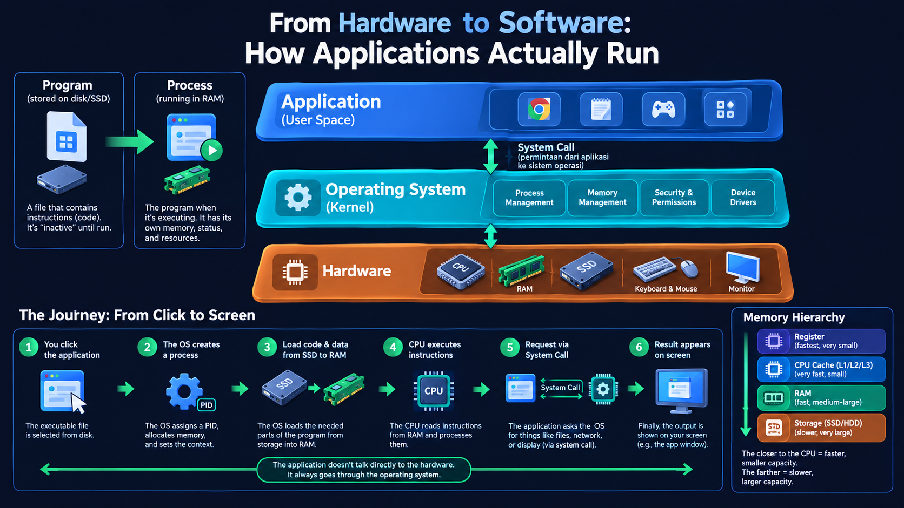

# Daripada Perkakasan ke Perisian: Bagaimana Aplikasi Benar-Benar Berjalan

[🇮🇩 Baca dalam Bahasa Indonesia](from-hardware-to-software-how-applications-actually-run-id.md)  
[🇬🇧 Read in English](from-hardware-to-software-how-applications-actually-run-en.md)  
[🇵🇭 Basahin sa Tagalog](from-hardware-to-software-how-applications-actually-run-tl.md)

﷽

## Soalan Mudah: Bagaimana Sesuatu Fail Boleh Berjalan?

Pernah terfikir tak, macam mana bila kita klik aplikasi, tiba-tiba tetingkap muncul di skrin?

Kita klik ikon. Beberapa saat kemudian, butang boleh ditekan, teks boleh ditaip, imej boleh dipaparkan. Yang kita nampak hanyalah antara muka. Sebenarnya, banyak perkara berlaku di sebalik tabir.

Artikel ini akan menerangkan alirannya secara konsep. Bukan untuk menjadi jurutera perkakasan, tetapi untuk membina gambaran besar tentang bagaimana aplikasi benar-benar berjalan.

## Program vs Proses: Apa Bezanya?

Sebelum kita teruskan, dua istilah ini perlu dibezakan:

- **Program** — Fail yang disimpan di cakera (contoh: `firefox`, `chrome.exe`, atau binari aplikasi). Ia hanyalah koleksi arahan dalam bentuk data. Jika belum dilancarkan, program itu "tidak aktif", hanya mengandungi kod.
- **Proses** — Program yang sedang dilaksanakan. Apabila kita klik untuk melancarkannya, sistem pengendalian akan menukar program itu menjadi proses. Setiap proses mempunyai ruang memori tersendiri, keadaan semasa, fail yang dibuka, dan sumber yang diperuntukkan.

**Analogi mudah:** Program ibarat resipi yang tertulis dalam buku masakan. Proses ibarat hidangan yang sedang dimasak di dapur. Resipi boleh berada di rak selama-lamanya, tetapi hidangan hanya wujud apabila kita mula memasak.

## Lapisan Komputer: Perkakasan, Sistem Pengendalian dan Aplikasi

Agar sesuatu aplikasi dapat berjalan, tiga lapisan utama perlu bekerjasama:

| Lapisan | Peranan | Analogi |
| --- | --- | --- |
| **Perkakasan (Hardware)** | Bahagian fizikal: CPU, RAM, storan (SSD/HDD), GPU dan peranti input/output. | Peralatan dapur: dapur, meja kerja, periuk dan pisau. |
| **Sistem Pengendalian (OS)** | Pengurus dan pengantara. Mengurus sumber, memberi akses kepada perkakasan, menjadualkan proses, serta mengasingkan aplikasi antara satu sama lain. | Ketua chef. Menentukan siapa boleh guna dapur, mengatur turutan kerja, dan mengelak kekeliruan. |
| **Aplikasi (Ruang Pengguna)** | Yang kita guna terus: pelayar web, editor teks, permainan dan lain-lain. Aplikasi tidak berkomunikasi terus dengan perkakasan, ia berkomunikasi melalui sistem pengendalian. | Resipi dan hidangan yang ingin kita hasilkan. |

Perkara penting: **Aplikasi jarang berhubung terus dengan perkakasan.** Ia membuat permintaan kepada sistem pengendalian melalui *system call*.

## Perjalanan Aplikasi: Dari Klik Hingga Paparan di Skrin

Mari ikuti alirannya langkah demi langkah.

### Langkah 1: Permintaan untuk Menjalankan Program
Kita klik ikon aplikasi. Fail boleh laku yang tersimpan di cakera (contoh: `/usr/bin/` atau `Program Files/`) akan dipilih untuk dilancarkan.

### Langkah 2: Sistem Pengendalian Mencipta Proses
Sistem pengendalian membaca fail program tersebut dan akan:

- **Mencipta proses baharu** — Memberikan ID unik (PID) kepada proses ini.
- **Memperuntukkan memori** — Menyediakan ruang dalam RAM untuk kod, data dan keperluan proses.
- **Menyediakan konteks** — Menentukan pengguna yang menjalankannya, kebenaran akses serta sumber yang dibenarkan.

### Langkah 3: Memuatkan dari Cakera ke RAM
Program disimpan pada media yang lebih perlahan (SSD/HDD). Untuk kelajuan yang lebih baik, sistem pengendalian memuatkan bahagian yang diperlukan ke dalam **RAM**.

Mengapa RAM? Kerana CPU boleh mengakses RAM jauh lebih pantas berbanding terus dari cakera. Inilah sebabnya aplikasi menjadi lebih perlahan apabila RAM hampir penuh dan sistem terpaksa menggunakan ruang swap.

### Langkah 4: CPU Melaksanakan Arahan
Kini, **CPU** mula bekerja. Ia akan mengambil arahan satu persatu dari memori, mentafsir dan melaksanakannya.

Bayangkan CPU sebagai chef yang hanya bekerja di atas "meja kerja" (RAM). Ia tidak perlu berulang-alik ke "pantri" (cakera) untuk setiap bahan. Pantri digunakan untuk simpanan jangka panjang, manakala meja kerja untuk proses aktif.

### Langkah 5: Berinteraksi Melalui System Call
Apabila aplikasi memerlukan sesuatu di luar kawalannya, seperti membuka fail, menyambung ke internet atau melukis ke skrin, ia akan meminta bantuan sistem pengendalian melalui *system call*.

Contoh:
- **Membuka fail** → Aplikasi meminta sistem pengendalian membaca fail dari cakera.
- **Melukis tetingkap** → Aplikasi meminta sistem pengendalian (melalui *window manager*) untuk memaparkan sesuatu di skrin.
- **Menyimpan data** → Aplikasi meminta sistem pengendalian menulis data ke storan.

Sistem pengendalian akan menyemak kebenaran dan menghala permintaan tersebut kepada perkakasan yang betul.

### Langkah 6: Hasil Muncul di Skrin
Setelah melalui semua langkah di atas, apa yang diminta akhirnya dipaparkan. Butang muncul, laman web dirender, atau mesej ralat ditunjukkan.

Semua ini boleh berlaku dalam milisaat, walaupun terdapat berpuluh-puluh hinggalah ratusan langkah kecil yang dilalui.

## Mengapa Kita Perlukan Sistem Pengendalian?

Jika aplikasi boleh berhubung terus dengan perkakasan, nampaknya lebih cekap. Namun, dalam realiti ia akan menjadi huru-hara.

Sistem pengendalian wujud atas sebab-sebab berikut:

- **Abstraksi** — Aplikasi tidak perlu tahu spesifikasi tepat RAM, jenis SSD atau pemacu GPU anda. Sistem pengendalian menyediakan antara muka yang seragam.
- **Pengurusan sumber** — Jika sepuluh aplikasi memerlukan masa CPU serentak, sistem pengendalian akan berkongsi masa tersebut supaya semua dapat berjalan dengan lancar.
- **Pengasingan** — Proses satu aplikasi tidak boleh membaca memori aplikasi lain sesuka hati. Ini penting untuk kestabilan dan keselamatan.
- **Keselamatan & kebenaran** — Sistem pengendalian menentukan fail yang boleh diakses, ke mana aplikasi boleh bersambung, dan apa yang tidak dibenarkan.
- **Kecekapan** — Sistem pengendalian bijak mengatur apa yang perlu dimuat, apa yang boleh ditangguhkan, dan cara menggunakan sumber dengan optimum.

Tanpa sistem pengendalian, setiap aplikasi perlu mengenali semua perkakasan di dunia. Dengan sistem pengendalian, aplikasi hanya perlu mengenali sistem pengendalian itu sendiri.

## Panduan Ringkas: Hierarki Memori

Sebelum beralih ke artikel seterusnya, ini gambaran ringkas hierarki memori:

| Komponen | Kelajuan | Kapasiti | Fungsi |
| --- | --- | --- | --- |
| **Daftar (Register)** | Paling pantas | Sangat kecil (bait) | Menyimpan data yang sedang diproses terus oleh CPU. |
| **Cache CPU (L1/L2/L3)** | Sangat pantas | Kecil | Menyimpan data/arahan yang kerap digunakan agar CPU tidak perlu sentiasa ke RAM. |
| **RAM (Memori Utama)** | Pantas | Sederhana–Besar (GB) | Menyimpan kod, pembolehubah dan data untuk proses yang sedang aktif. |
| **Storan (SSD/HDD)** | Lebih perlahan | Sangat besar (GB–TB) | Simpanan kekal untuk program, fail dan data anda. |

Peraturannya mudah: **Semakin dekat dengan CPU, semakin pantas dan semakin kecil. Semakin jauh, semakin perlahan tetapi semakin besar.**

## Kesimpulan

Ringkasnya: **Program bukan proses.** Program ialah fail yang terletak di cakera. Proses ialah program yang dihidupkan di dalam RAM dan dilaksanakan oleh CPU.

Alirannya lebih kurang begini: *klik → sistem pengendalian cipta proses → muat ke RAM → CPU laksanakan arahan → minta bantuan sistem pengendalian jika perlu → hasil dipaparkan di skrin*.

Yang paling penting di sini bukan butiran cip, tetapi gambaran besar: aplikasi tidak menyentuh perkakasan secara terus. Sistem pengendalian bertindak sebagai jambatan, RAM sebagai "meja kerja", dan CPU sebagai "pelaksana".

Memahami model mental ini akan memudahkan anda memahami topik fundamental seterusnya seperti memori, *system call*, dan prestasi aplikasi.

## Rujukan

- Silberschatz, A., Galvin, P. B., & Gagne, G. *Operating System Concepts* (Edisi ke-10) — Membincangkan proses, pengurusan memori dan peranan sistem pengendalian. [Laman Rasmi Buku](https://www.wiley.com/en-us/shop/general-end-user-computing/operating-system-concepts-10th-edition-p-9781119800361) · [Bahan Tambahan](https://codex.cs.yale.edu/avi/os-book/OS10/index.html)

- Bryant, R. E., & O'Hallaron, D. R. *Computer Systems: A Programmer's Perspective (CS:APP)* (Edisi ke-3) — Sumber yang sangat baik untuk memahami hubungan antara perkakasan dengan perisian, termasuk pelaksanaan program dan hierarki memori. [Laman Rasmi Buku](https://csapp.cs.cmu.edu/)

- Tanenbaum, A. S., & Bos, H. *Modern Operating Systems* (Edisi ke-5) — Menerangkan konsep sistem pengendalian, pengurusan proses, pengurusan memori dan cara sistem pengendalian menjadi perantara antara aplikasi dengan perkakasan.
