# Linux Pivoting: Exploring Internal Network Access with AdaptixC2 SOCKS5 Tunnel and Proxychains

[🇮🇩 Baca dalam Bahasa Indonesia](post-exploitation-pivoting-id.md)

﷽

Hello everyone,

After establishing a foothold with AdaptixC2, the next step was exploring the internal network that was not directly accessible from the attacker's machine.

This technique is known as **pivoting**, where a compromised host is used as an intermediary to reach other network segments. Instead of communicating directly with internal systems, all traffic is routed through the compromised host.

In this experiment, Ubuntu Server acts as the **pivot host** because it has access to both the attacker network and the internal network. The objective is to understand how **AdaptixC2 SOCKS5 Tunnel** and **Proxychains** can be used together to enumerate assets inside an isolated internal environment.

---

# What is Pivoting?

Pivoting is a post-exploitation technique that uses a compromised system as a bridge to access networks that are otherwise unreachable.

Rather than attacking an internal host directly, the attacker routes traffic through a machine that already has access to the target network.

This approach is widely used during internal penetration testing, red team engagements, and adversary simulations.

---

# Lab Environment

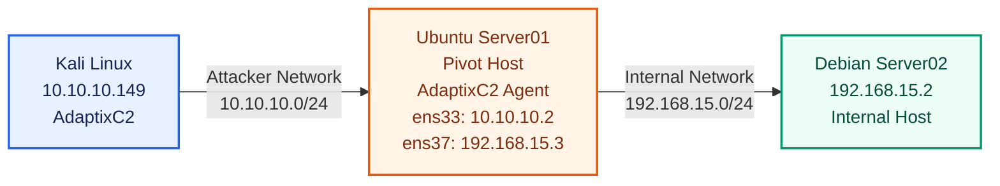

Ubuntu Server is connected to both networks, allowing it to act as the communication bridge between the attacker and the internal environment.

---

# Attack Flow

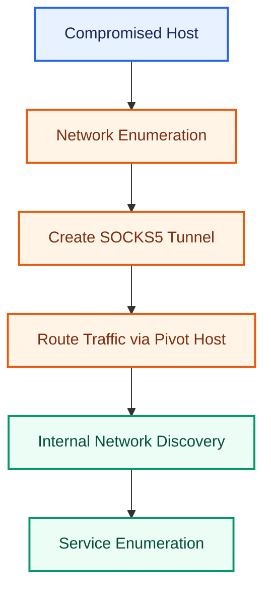

This workflow keeps the assessment structured while ensuring all traffic to the internal network passes through the compromised host.

---

# 1. Verify Network Segmentation

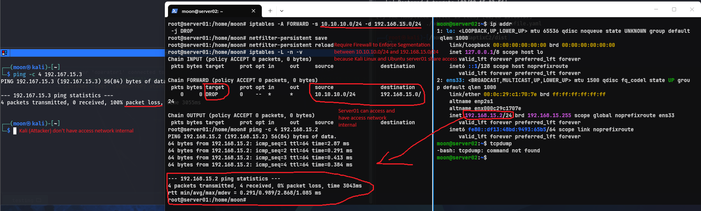

Before creating the tunnel, I verified that Kali Linux had **no direct access** to the internal subnet.

Ubuntu Server was connected to two different networks, allowing it to communicate with both the attacker network and the isolated internal network.

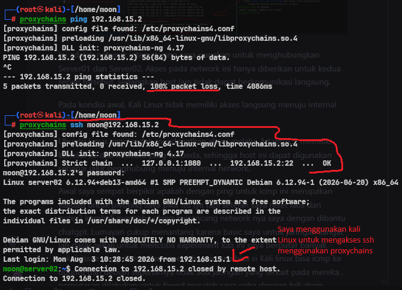

Initially, I assumed that successful pivoting could simply be verified using **ICMP ping**.

After rebuilding the lab several times, I realized that pivoting is not about making hosts respond to ping requests. The real objective is enabling access to **internal services** through a compromised host.

This understanding became the foundation for the remainder of the experiment.

---

# 2. Create the SOCKS5 Tunnel

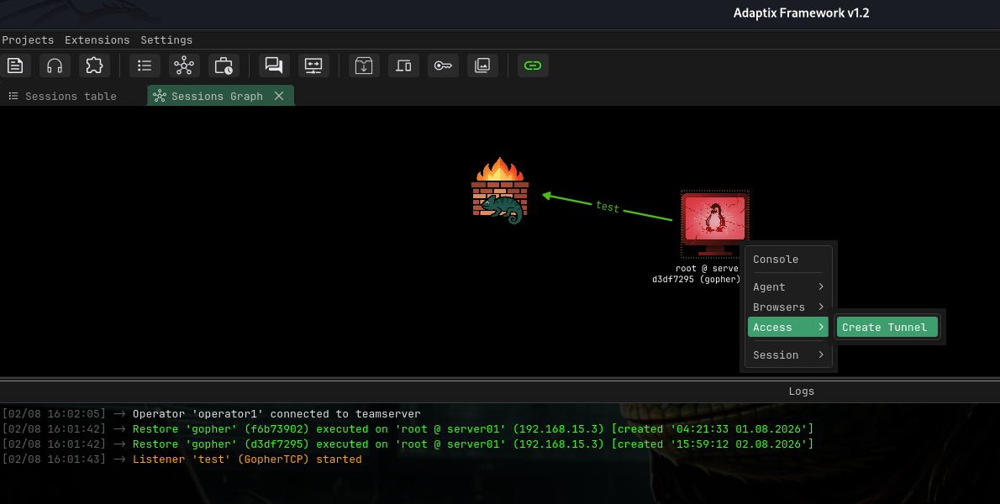

After confirming that Ubuntu could reach the internal network, I created a SOCKS5 tunnel using the AdaptixC2 Agent.

The tunnel established a communication path between Kali Linux and the isolated network through Ubuntu.

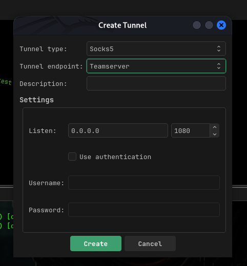

AdaptixC2 automatically handled traffic forwarding, allowing requests from Kali Linux to be transparently routed through the pivot host.

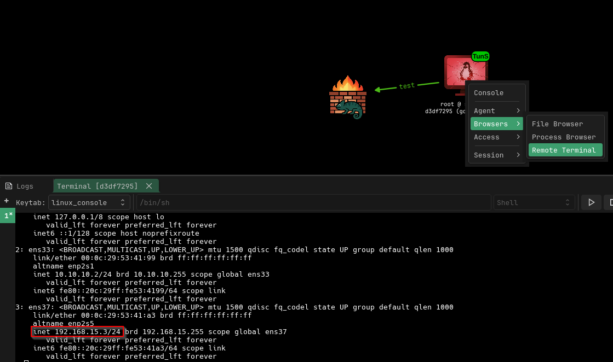

Once the connection was established, I verified that the internal network information was accessible through the tunnel.

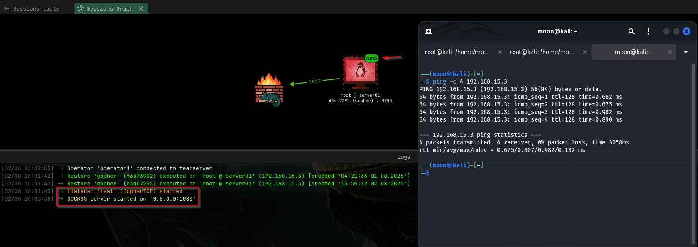

At this stage, Kali Linux could communicate with internal systems without having a direct network connection to the internal subnet.

---

# 3. Internal Network Discovery

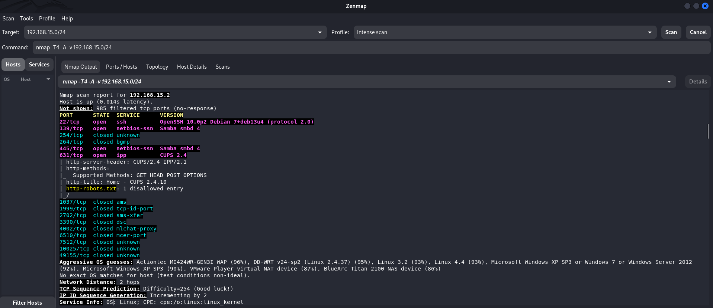

With the tunnel established, I performed network enumeration against the internal subnet.

Enumeration workflow:

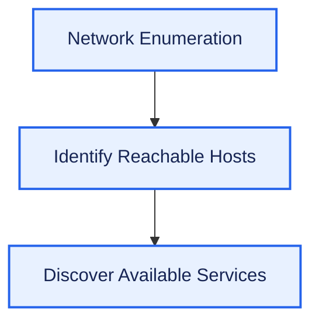

Target:

```text
192.168.15.0/24
```

The scan identified the following host:

```text
192.168.15.2
```

Discovered services included:

- SSH (22/tcp)
- Samba (139/tcp, 445/tcp)
- CUPS (631/tcp)

These results confirmed that internal network enumeration was successfully performed through the pivot host.

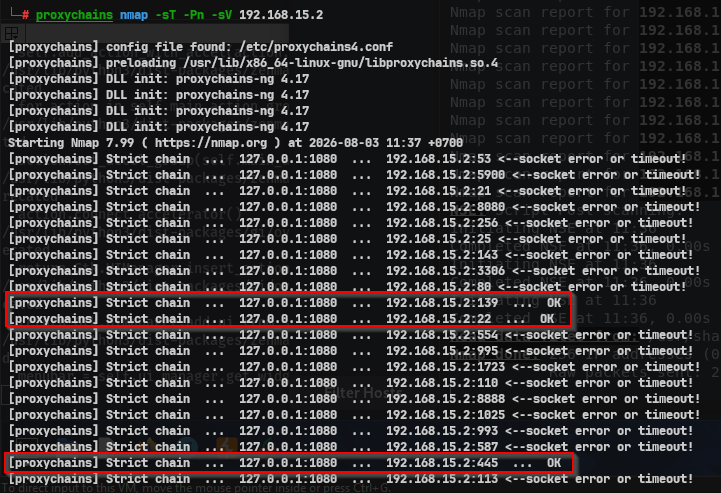

By combining **Proxychains** with the AdaptixC2 SOCKS5 tunnel, standard tools such as **Nmap** could enumerate internal services without requiring Kali Linux to join the internal network directly.

---

# Summary

This experiment followed a structured pivoting workflow:

1. Verify the compromised host.
2. Validate network segmentation.
3. Create a SOCKS5 tunnel using AdaptixC2.
4. Route traffic through the pivot host.
5. Enumerate hosts and services inside the internal network.

This process demonstrates how an initial compromise can evolve into broader visibility of an isolated environment.

---

# Next Step

Once internal hosts have been identified, the assessment can continue with more detailed service analysis, including:

- SSH Enumeration
- SMB Assessment
- Web Service Enumeration
- Vulnerability Validation
- Lateral Movement

Each phase builds upon the information gathered during the pivoting process.

---

# Conclusion

Pivoting is not simply about making an internal host reachable—it is about leveraging a compromised system to access resources that would otherwise remain isolated.

By using the AdaptixC2 SOCKS5 tunnel together with Proxychains, Kali Linux successfully routed traffic through Ubuntu as the pivot host and performed enumeration against services within the internal network.

This experiment provides a practical introduction to how internal network exploration is commonly performed during post-exploitation and highlights the importance of network segmentation when assessing enterprise environments.

---

# References

## Official Documentation

- Adaptix Framework Documentation  
  https://adaptix-framework.gitbook.io/adaptix-framework/

- AdaptixC2 — Tunnels and Forwarding  
  https://adaptix-framework.gitbook.io/adaptix-framework/adaptix-c2/tunnels-and-forwarding

## Network Pivoting

- Proxychains-ng Documentation  
  https://github.com/rofl0r/proxychains-ng

- SOCKS Protocol Version 5 (RFC 1928)  
  https://datatracker.ietf.org/doc/html/rfc1928

- Nmap Documentation  
  https://nmap.org/docs.html

## MITRE ATT&CK

- T1090 — Proxy  
  https://attack.mitre.org/techniques/T1090/

- T1046 — Network Service Discovery  
  https://attack.mitre.org/techniques/T1046/

- T1021 — Remote Services  
  https://attack.mitre.org/techniques/T1021/

---

Thank you for reading!

Happy learning! 🔥