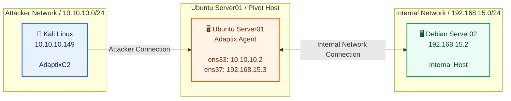
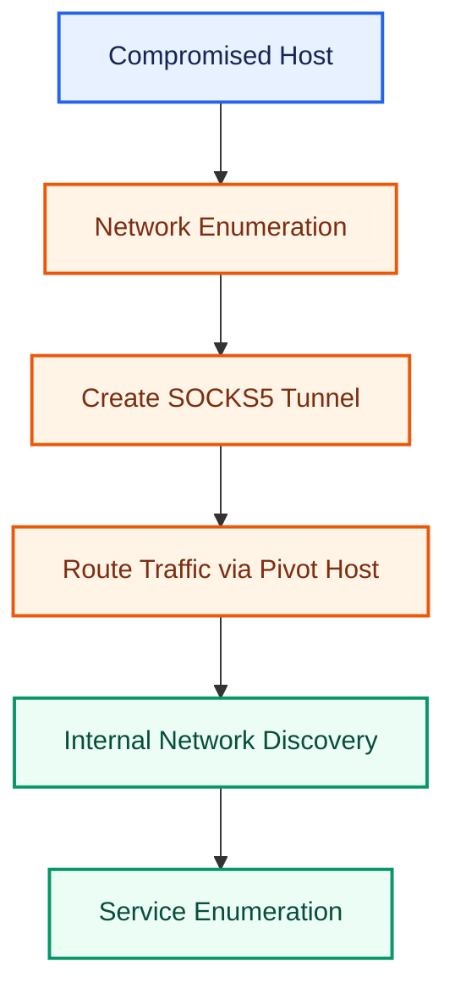
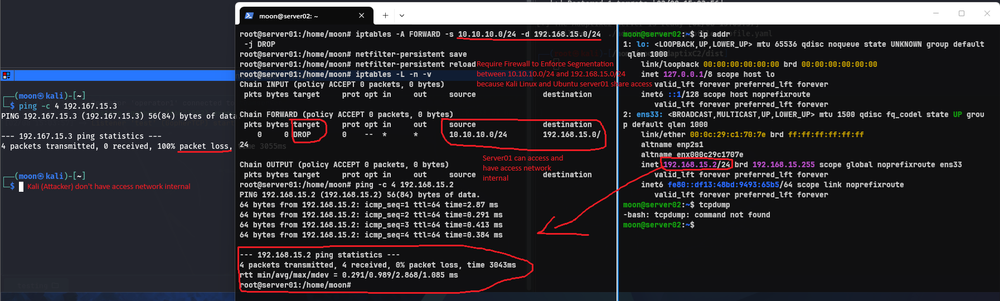
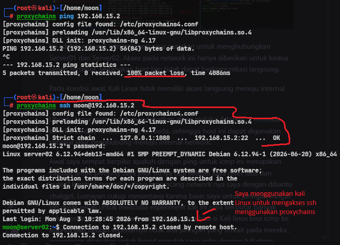
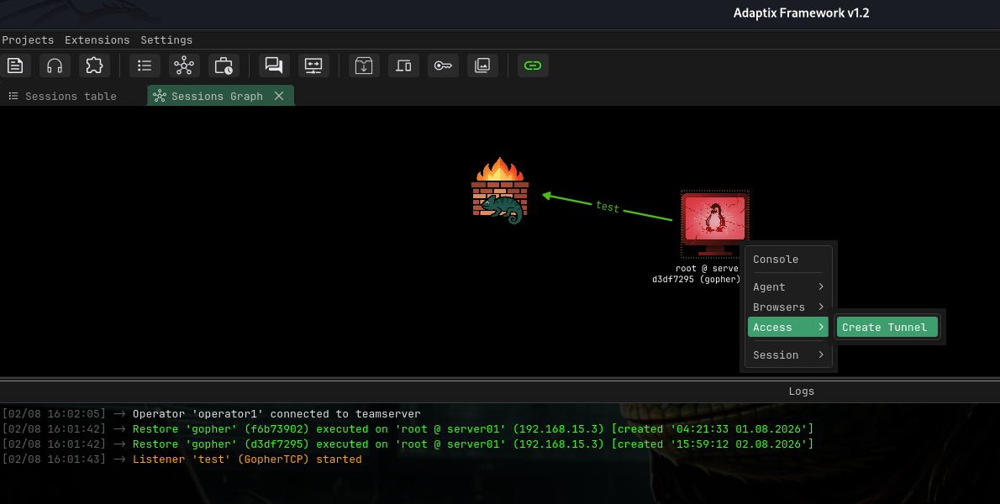
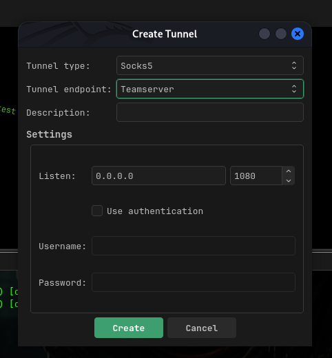
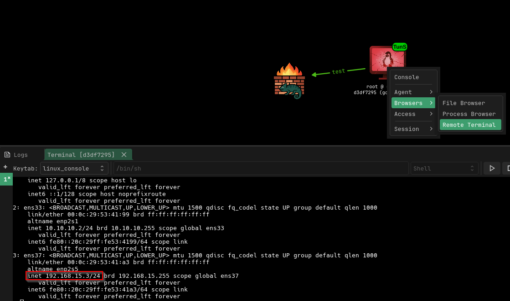
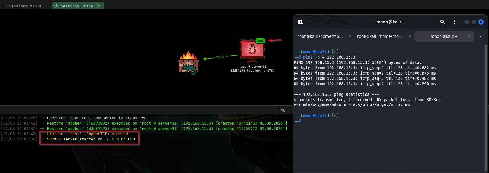
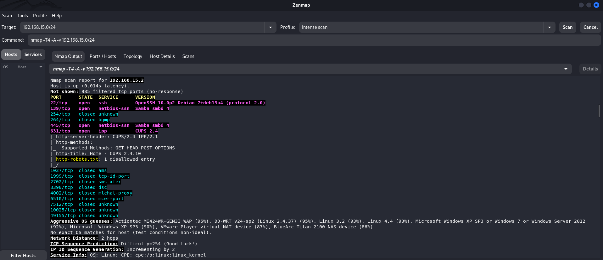
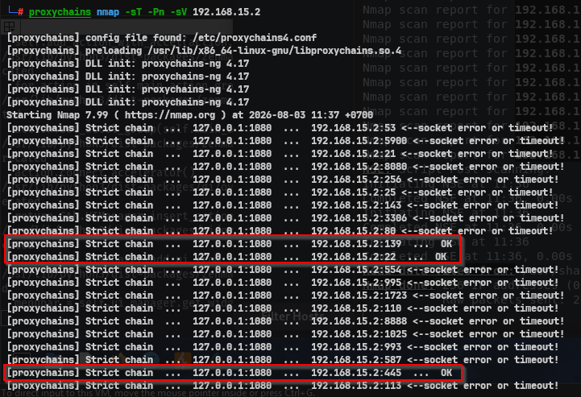

# Linux Pivoting: Exploring Internal Network Access with AdaptixC2 SOCKS5 Tunnel and Proxychains

[🇬🇧 Read in English](post-exploitation-pivoting-en.md)

﷽


Setelah memperoleh foothold melalui AdaptixC2, langkah berikutnya adalah mengeksplorasi jaringan internal yang sebelumnya tidak dapat diakses secara langsung.

Teknik ini dikenal sebagai **pivoting**, yaitu memanfaatkan host yang telah berhasil dikompromikan sebagai perantara untuk mengakses segmen jaringan lain. Pada lab ini, Ubuntu Server berperan sebagai **pivot host** karena terhubung ke dua jaringan yang berbeda.

Tujuan eksperimen ini adalah memahami bagaimana **SOCKS5 Tunnel** pada AdaptixC2 dapat digunakan bersama **Proxychains** untuk melakukan enumerasi terhadap aset yang berada di dalam jaringan internal.

---

# Apa itu Pivoting?

Pivoting adalah teknik post-exploitation yang memanfaatkan host yang telah dikompromikan sebagai jalur untuk menjangkau sistem lain yang sebelumnya tidak dapat diakses secara langsung.

Alih-alih menyerang target dari internet, seluruh komunikasi diarahkan melalui host yang telah memiliki akses ke jaringan internal.

Pendekatan ini umum digunakan saat melakukan internal assessment maupun adversary simulation.

---

# Lab Environment



Ubuntu memiliki akses ke kedua jaringan sehingga dapat digunakan sebagai penghubung antara attacker dan internal network.

---

# Attack Flow



Workflow ini memastikan seluruh traffic menuju jaringan internal melewati host yang telah dikompromikan.

---

# 1. Validasi Network Segmentation



Sebelum membuat tunnel, saya memastikan bahwa Kali Linux memang **tidak memiliki akses langsung** ke jaringan internal.

Ubuntu Server memiliki dua interface jaringan sehingga dapat berkomunikasi dengan kedua subnet dan berfungsi sebagai pivot host.



Selama proses membangun lab ini saya sempat beranggapan bahwa keberhasilan pivoting cukup dibuktikan dengan **ICMP ping**.

Namun setelah beberapa kali melakukan redesign jaringan, saya memahami bahwa tujuan utama pivoting bukan sekadar membuat host dapat di-*ping*, melainkan memungkinkan akses terhadap **service internal** melalui host yang telah dikompromikan.

---

# 2. Membuat SOCKS5 Tunnel



Setelah memastikan Ubuntu dapat menjangkau jaringan internal, saya membuat SOCKS5 Tunnel melalui AdaptixC2 Agent.

Tunnel ini menjadi jalur komunikasi antara Kali Linux dan jaringan internal.



Semua traffic dari attacker kemudian diteruskan melalui Ubuntu sebelum mencapai target di jaringan internal.



Informasi koneksi dapat diverifikasi langsung melalui AdaptixC2.



Setelah tunnel aktif, Kali Linux berhasil mengakses subnet internal tanpa harus terhubung langsung ke jaringan tersebut.

---

# 3. Internal Network Discovery



Tahap berikutnya adalah melakukan enumerasi terhadap host dan service yang tersedia pada jaringan internal.

Target:

```text
192.168.15.0/24
```

Host yang berhasil ditemukan:

```text
192.168.15.2
```

Service yang teridentifikasi:

- SSH (22/tcp)
- Samba (139/tcp, 445/tcp)
- CUPS (631/tcp)

Seluruh proses discovery dilakukan melalui jalur pivot yang telah dibuat sebelumnya.



Dengan mengombinasikan **Proxychains** dan **SOCKS5 Tunnel**, tool seperti Nmap dapat mengirimkan traffic melalui Ubuntu sehingga proses enumerasi tetap dapat dilakukan walaupun target berada pada jaringan yang terisolasi.

---

# Ringkasan

Pada eksperimen ini proses pivoting dilakukan melalui beberapa tahapan:

1. Memastikan host telah dikompromikan.
2. Memvalidasi segmentasi jaringan.
3. Membuat SOCKS5 Tunnel menggunakan AdaptixC2.
4. Mengarahkan traffic melalui Proxychains.
5. Melakukan enumerasi terhadap host dan service pada jaringan internal.

Pendekatan ini menunjukkan bagaimana akses awal dapat berkembang menjadi kemampuan untuk mengeksplorasi jaringan internal secara terstruktur.

---

# Tahap Selanjutnya

Setelah berhasil memperoleh akses ke jaringan internal, langkah berikutnya adalah melakukan assessment terhadap service yang ditemukan.

Fokus dapat meliputi:

- Service Enumeration
- SMB Assessment
- SSH Assessment
- Web Service Enumeration
- Vulnerability Validation
- Lateral Movement

Tahap ini bertujuan menentukan apakah terdapat jalur lanjutan untuk memperluas akses ke sistem lain di dalam lingkungan tersebut.

---

# Kesimpulan

Pivoting bukan sekadar membuat host internal dapat dijangkau, tetapi memanfaatkan sistem yang telah dikompromikan sebagai jalur komunikasi menuju jaringan yang sebelumnya terisolasi.

Melalui AdaptixC2 SOCKS5 Tunnel dan Proxychains, seluruh traffic berhasil diteruskan melalui Ubuntu sebagai pivot host sehingga proses enumerasi terhadap host dan service internal dapat dilakukan tanpa koneksi langsung ke subnet tersebut.

Eksperimen ini memberikan gambaran yang lebih jelas mengenai bagaimana akses awal dapat berkembang menjadi eksplorasi jaringan internal dalam skenario post-exploitation.

---

# References

- Adaptix Framework Documentation  
  https://adaptix-framework.gitbook.io/adaptix-framework/

- AdaptixC2 — Tunnels and Forwarding  
  https://adaptix-framework.gitbook.io/adaptix-framework/adaptix-c2/tunnels-and-forwarding

- Proxychains-ng  
  https://github.com/rofl0r/proxychains-ng

- Nmap Documentation  
  https://nmap.org/docs.html

- MITRE ATT&CK — T1090 (Proxy)  
  https://attack.mitre.org/techniques/T1090/

- MITRE ATT&CK — T1046 (Network Service Discovery)  
  https://attack.mitre.org/techniques/T1046/
