# Access Control — PortSwigger Web Security Academy

[🇮🇩 Read in Bahasa Indonesia](access-control-id.md)

﷽

## What is access control?

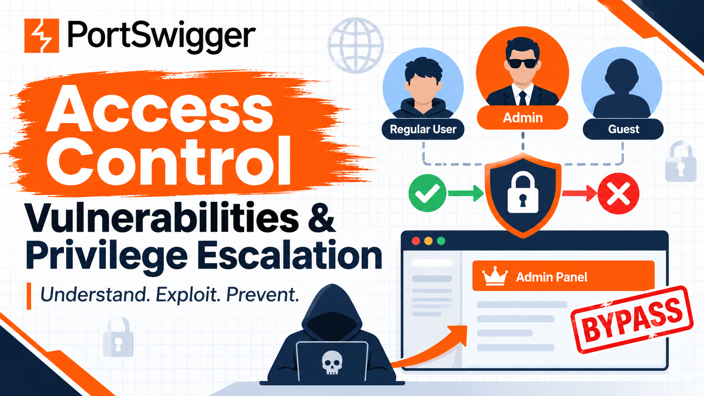

What is access control?
Access control is the application of constraints on who or what is authorized to perform actions or access resources. In the context of web applications, access control is dependent on authentication and session management:

- **Authentication** confirms that the user is who they say they are.
- **Session management** identifies which subsequent HTTP requests are being made by that same user.
- **Access control** determines whether the user is allowed to carry out the action that they are attempting to perform.

Broken access controls are common and often present a critical security vulnerability. Design and management of access controls is a complex and dynamic problem that applies business, organizational, and legal constraints to a technical implementation. Access control design decisions have to be made by humans so the potential for errors is high.

### Access control security models

In this section we explain what access control security models are and we discuss the most commonly encountered models.

### What are access control security models?

An access control security model is a formally defined definition of a set of access control rules that is independent of technology or implementation platform. Access control security models are implemented within operating systems, networks, database management systems and back office, application and web server software. Various access control security models have been devised over the years to match access control policies to business or organizational rules and changes in technology.

### Programmatic access control

With programmatic access control, a matrix of user privileges is stored in a database similar and access controls are applied programmatically with reference to this matrix. This approach to access control can include roles or groups or individual users, collections or workflows of processes and can be highly granular.

### Discretionary access control (DAC)

With discretionary access control, access to resources or functions is constrained based upon users or names groups of users. Owners of resources or functions have the ability to asign or delegate access permissions to users. This model is highly granular with access rights defined to an individual resource or function and user. Consequently the model can become very complex to design and manage.

### Mandatory access control (MAC)

Mandatory access control is a centrally controlled system of access control in which access to some object (a file or other resource) by a subject is constrained. Significantly, unlike DAC the users and owners of resources have no capability to delegate or modify access rights for their resources. This model is often associated with military clearance-based systems.

### Role-based access control (RBAC)

With role-based access control, named roles are defined to which access control privileges are assigned. Users are then assigned to single or multiple roles. RBAC provides enhanced management over other access control models and if properly designed sufficient granularity to provide manageable access control in complex applications. For example, the purchase clerk might be defined as a role with access permissions for a subset of purchases clerk role. RBAC is most effective when ther are sufficient roles to properly invoke access controls but not so many as to make the model excessively complex and unwieldy to manage.

### Vertical access controls

Vertical access controls are mechanisms that restrict access to sensitive functionality to specific types of users.

With vertical access controls, different types of users have access to different application functions. For example, an administrator might be able to modify or delete any user's account, while an ordinary user has no access to these actions. Vertical access controls can be more fine-grained implementations of security models designed to enforce business policies such as separation of duties and least privilege.

### Horizontal access controls

Horizontal access controls are mechanisms that restrict to resources to specific users.

With horizontal access controls, different users have access to a subset of resources of the same type. For example, a banking application will allow a user to view transactions and make payments from their own accounts, but not accounts of any other user.

### Context-dependent access controls

Context-dependent access control restrict access to functionality and resources based upon the state of the application or the user's interaction with it.

Context-dependent access controls prevent a user performing actions in the wrong order. For example, a retail website might prevent users from modifying the contents of their shopping cart after they have made payment.

## Examples of broken access controls

Broken access control vulnerabilities exist when a user can access resources or perform actions that they are not supposed to be able to.

### Vertical privilege escalation

If a user can gain access to functionality that they are not permitted to access then this is vertical privilege escalation. For example, if a non-administrative user can gain access to an admin page where they can delete user accounts, then this is vertical privilege escalation.

#### Unprotected functionality

At its most basic, vertical privilege escalation arises where an application does not enforce any protection for sensitive functionality. For example, adminsitrative functions might be linked from an administrator's welcome page but not from a user's welcome page. However, a user might be able to access the administrative functions by browsing to the relevant admin URL.

For example, a website might host sensitive functionality at the following URL:

```
https://insecure-website.com/admin
```
This might be accessible by any user, not only administrative users who have a link to the functionality in their user interface. In some cases, the administrative URL might be disclosed in other locations, such as the `robots.txt` file:

```
https://insecure-website.com/robots.txt
```
Even if the URL isn't disclosed anywhere, an attacker may be able to use a wordlists to brute-force the location of the sensitive functionality.

##### Lab: Unprotected admin functionality

This lab has an unprotected admin panel.

<details>
<summary>Lab details, screenshots & walkthrough 0.1</summary>

Solve the lab by deleting the user `carlos`.

**Screenshots:**

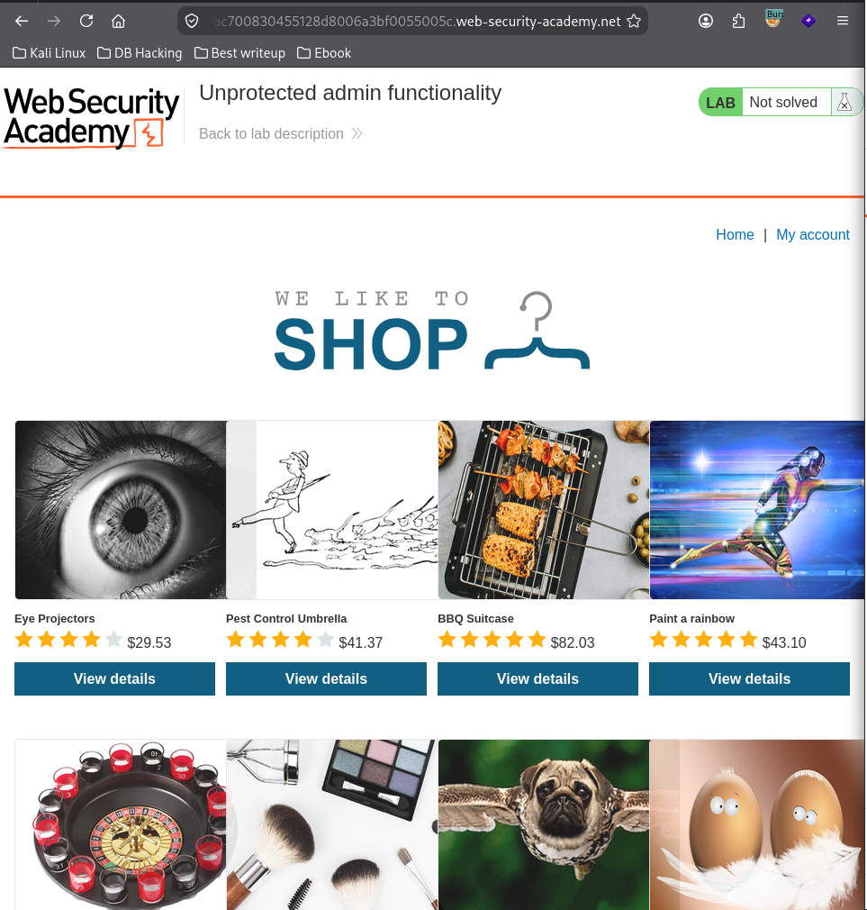

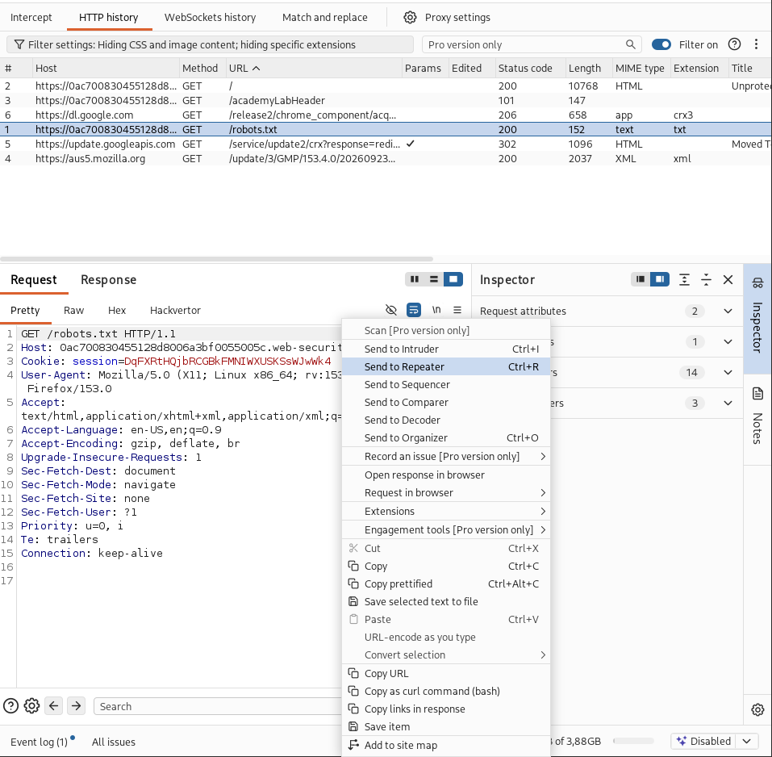

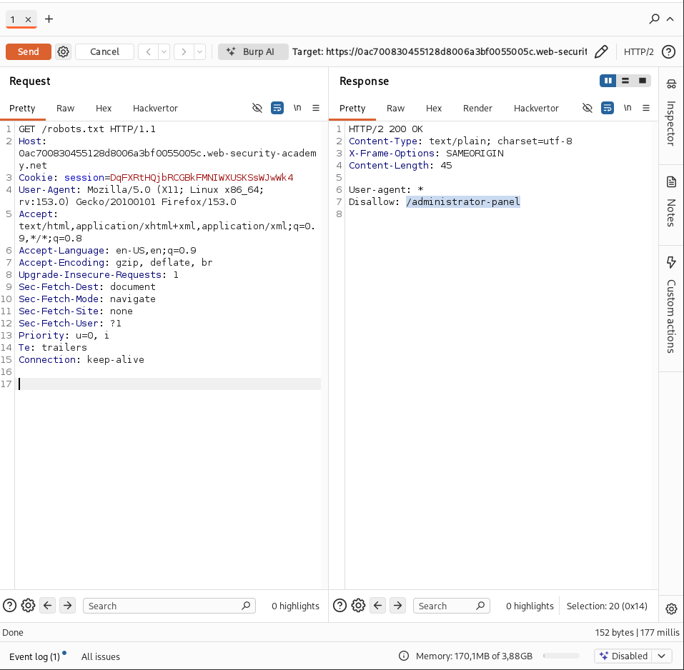

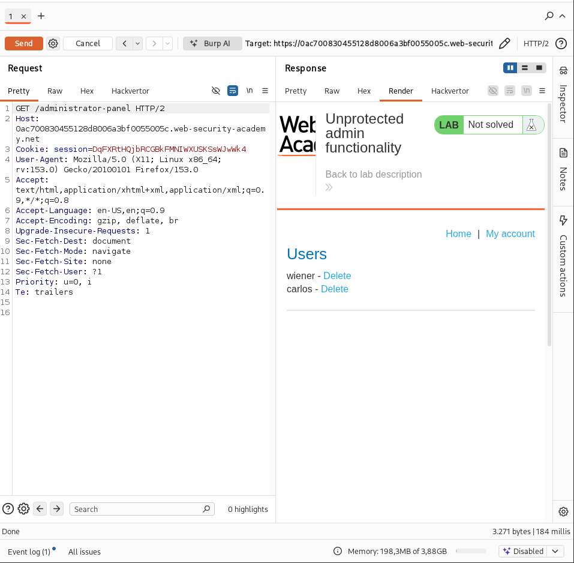

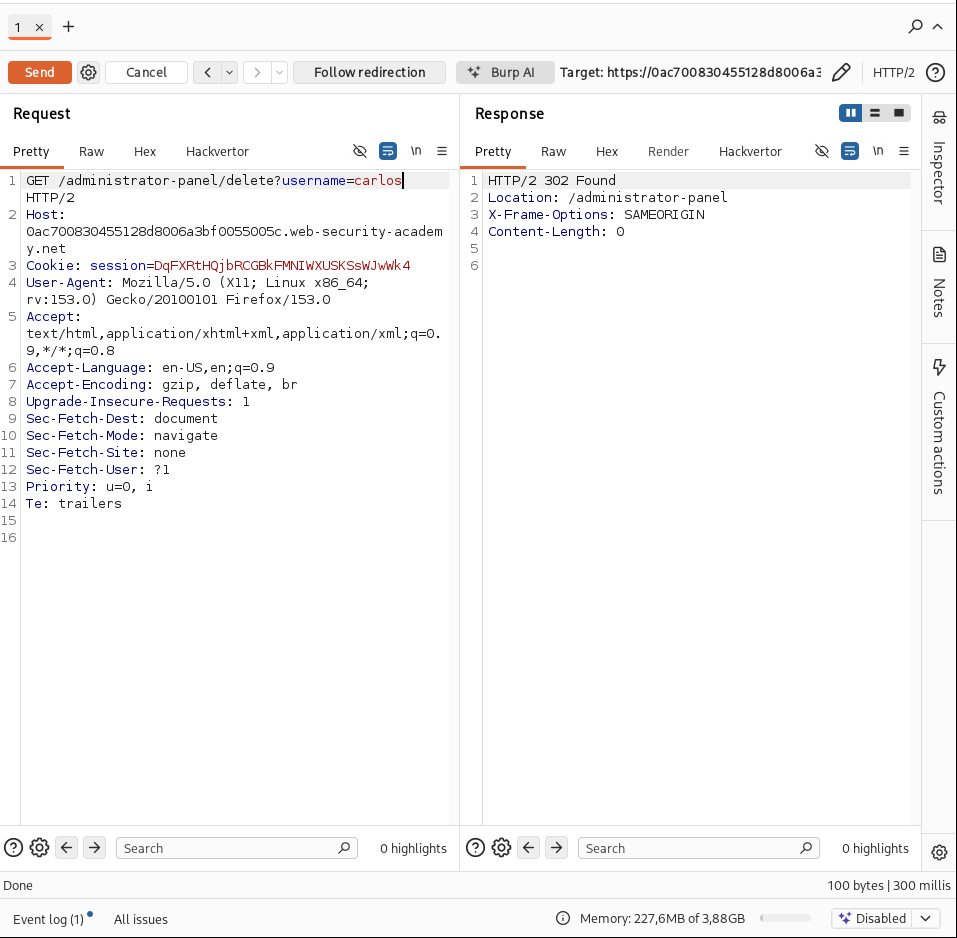

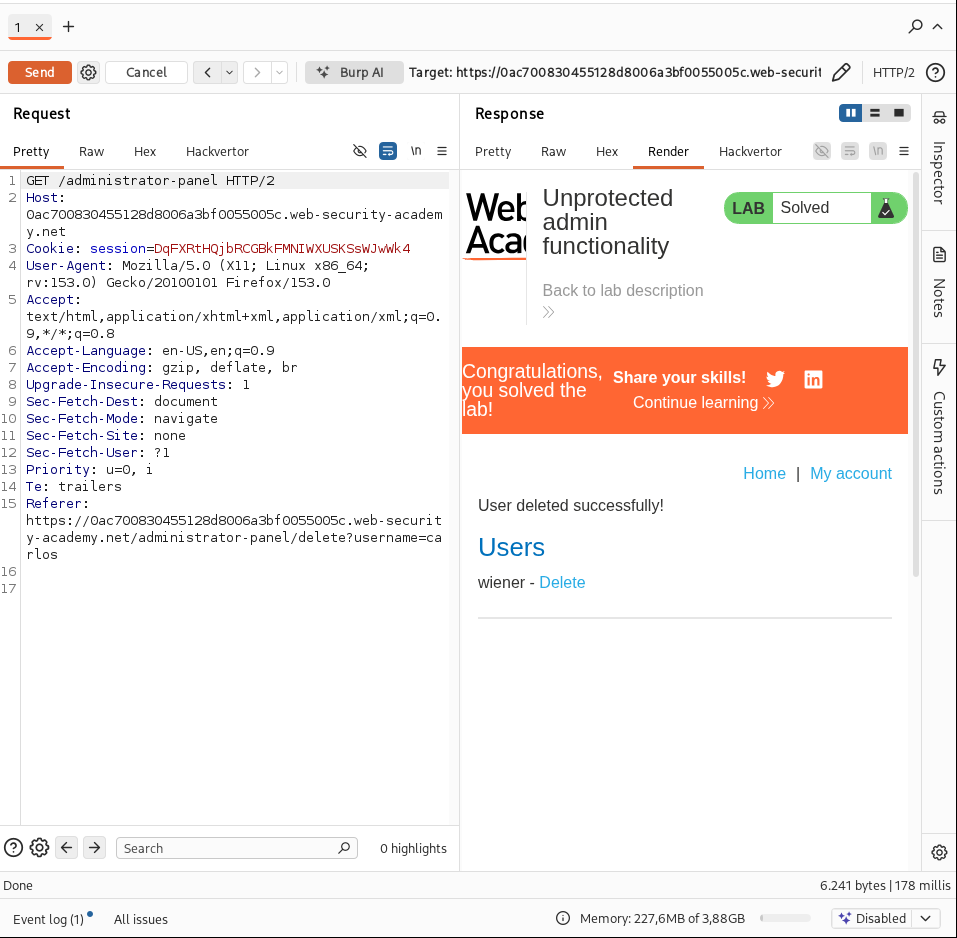

##### Tutorial

1. Open robots.txt
2. See response and get administrator-panel
3. Panel open try delete users `carlos`
4. Success solved labs

##### Reference

<details>
<summary>1. Broken Access Control - Lab #1 Unprotected admin functionality — Rana Khalil</summary>

Platform: YouTube
Video: https://www.youtube.com/watch?v=qJ8mtm_G40E
Purpose: This lab has an unprotected admin panel. To solve the lab, we exploit the access control vulnerability to access the admin panel and delete the user carlos user.

</details>

<details>
<summary>2. Portswigger - Access Control - Lab #1 Unprotected admin functionality — Popo Hack</summary>

Platform: YouTube
Video: https://www.youtube.com/watch?v=XF-SNuSyVNo
Purpose: Hello Hackers, in this video of Unprotected admin functionality you will see how to exploit, discover and find senstive information based on application logic flow to leak for potential attacks from Burp Suite in a lab from Web Security Academy powered by Portswigger 

</details>

</details>

#### Unprotected functionality - Continue

In some cases, sensitive functionality is concealed by giving it a less predictable URL. This is an example of so-called "security by obscurity". However, hiding sensitive functionality does not provide effective access control because users might discover the obfuscated URL in a number of ways.

Imagine an application that hosts administrative functions at the following URL:

```
https://insecure-website.com/administrator-panel-yb556
```
This might not be directly guessable by an attacker. However, the application might still leak the URL to users. The URL might be disclosed in JavaScript that constructs the user interface based on the user's role:

```html
<script>
	var isAdmin = false;
	if (isAdmin) {
		...
		var adminPanelTag = document.createElement('a');
		adminPanelTag.setAttribute('href', 'https://insecure-website.com/administrator-panel-yb556');
		adminPanelTag.innerText = 'Admin panel';
		...
	}
</script>
```
This script adds a link to the user's UI if they are an admin user. However, the script containing the URL is visible to all users regardless of their role.

##### Lab: Unprotected admin functionality with unpredictable URL

This lab has an unprotected admin panel. It's located at an unpredictable location, but the location is disclosed somewhere in the application.

<details>
<summary>Lab details, screenshots & walkthrough 0.2</summary>

Solve the lab by accessing the admin panel, and using it to delete the user `carlos`.

**Screenshots:**

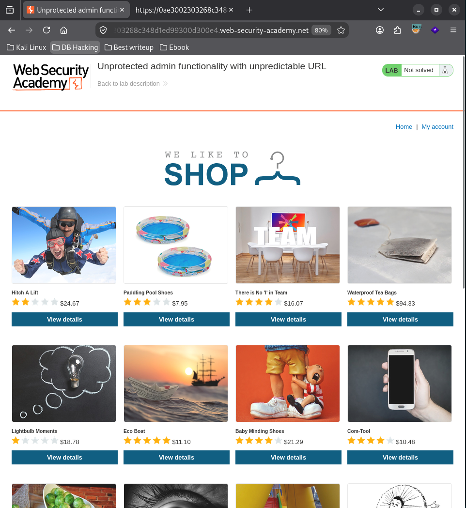

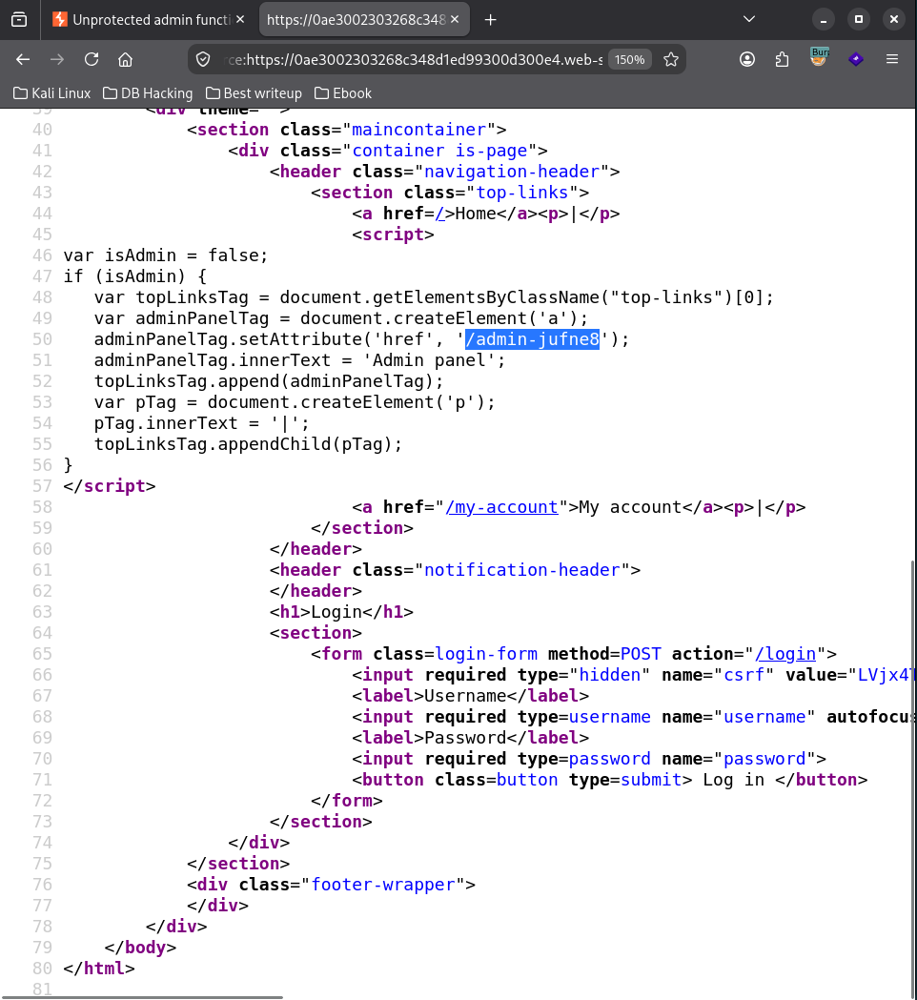

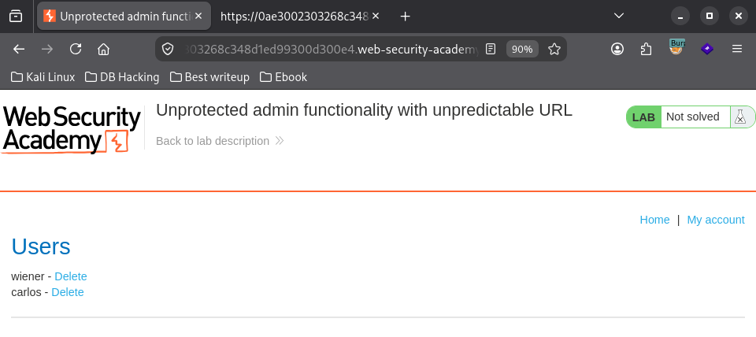

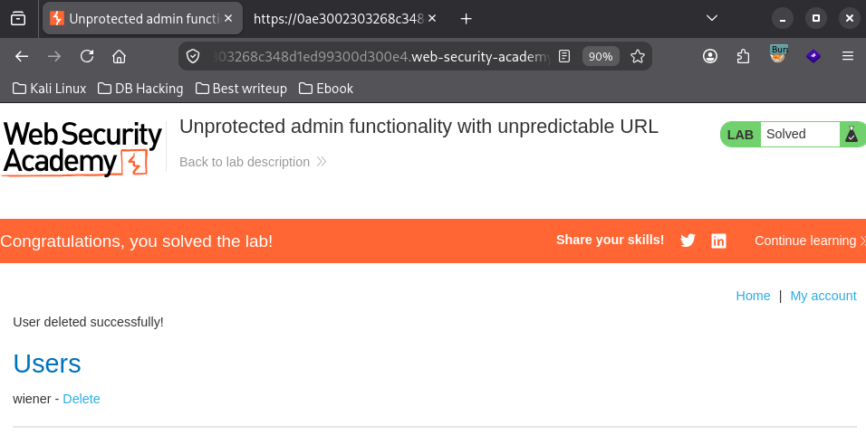

##### Tutorial

1. Open /login view source code
2. See javascript code

```javascript
<!--LAB_HEADER_END-->
        <div theme="">
            <section class="maincontainer">
                <div class="container is-page">
                    <header class="navigation-header">
                        <section class="top-links">
                            <a href=/>Home</a><p>|</p>
                            <script>
var isAdmin = false;
if (isAdmin) {
   var topLinksTag = document.getElementsByClassName("top-links")[0];
   var adminPanelTag = document.createElement('a');
   adminPanelTag.setAttribute('href', '/admin-jufne8');
   adminPanelTag.innerText = 'Admin panel';
   topLinksTag.append(adminPanelTag);
   var pTag = document.createElement('p');
   pTag.innerText = '|';
   topLinksTag.appendChild(pTag);
}
</script>
```
3. Open /admin-*

##### Reference

<details>
<summary>3. Broken Access Control - Lab#2 Unprotected admin functionality with unpredictable URL | Short Version — Rana Khalil</summary>

Platform: YouTube
Video: https://www.youtube.com/watch?v=7Jve11VySNU
Purpose: This lab has an unprotected admin panel. It's located at an unpredictable location, but the location is disclosed somewhere in the application. To solve the lab, we access the admin panel, and use it to delete the user carlos.

</details>

<details>
<summary>4. Unprotected admin functionality with unpredictable URL — Rana Khalil</summary>

Platform: YouTube
Video: https://www.youtube.com/watch?v=mml8SlN2Or4
Purpose: This video shows the lab solution of "Unprotected admin functionality with unpredictable URL" from Web Security Academy (Portswigger)

</details>

</details>

#### Parameter-based access control methods

Some applications determine the user's access rights or role at login, and then store this information in a user-controllable localtion.

This could be:

- A hidden field.
- A cookie.
- A preset query string parameter.

The application makes access control decisions based on the submitted value. For example:

```
https://insecure-website.com/login/home.jsp?admin=true
https://insecure-website.com/login/home.jsp?role=1
```
This approach is insecure because a user can modify the value and access functionality they're not authorized to, such as administrative functions.

##### Lab: User role controlled by request parameter

This lab has an admins panel at /admin, which identifies administrators using a forgeable cookie.

<details>
<summary>Lab details, screenshots & walkthrough 0.3</summary>

Solve the lab by accessing the admin panel and using it to delete the user `carlos`.

You can log in to your own account using the following credentials:
`wiener:peter`

**Screenshots:**

##### Tutorial

1. Login users as `wiener:peter`
2. Try see parameter `admin=false`
3. Change value in `admin=true`
4. Open admin panel
5. Delete users `carlos`
6. Success solve lab

##### Reference

<details>
<summary>5. Broken Access Control - Lab #3 User role controlled by request parameter — Rana Khalil</summary>

Platform: YouTube
Video: https://www.youtube.com/watch?v=e_jsPdEeSto
Purpose: This lab has an admin panel at /admin, which identifies administrators using a forgeable cookie. To solve the lab, we access the admin panel and use it to delete the user carlos.
</details>

</details>

##### Lab: User role can be modified in user profile

This lab has an admin panel at `/admin`. It's only accessible to logged-in users with a `roleid` of 2.

<details>
<summary>Lab details, screenshots & walkthrough 0.4</summary>

Solve the lab by accessing the admin panel and using it to delete the user `carlos`.
You can log in to your own account using the following credentials:
`wiener:peter`

**Screenshots:**

##### Tutorial

1. Login users as `wiener:peter`
2. Try find my-account
4. Change email to see parameter
3. Try Open parameter json in my-account profiles
4. see response and add `roleId=1` and change administrative `roleId=2`
5. Open admin panel
6. Delete carlos users
7. Success solve Labs

##### Reference

<details>
<summary>6. Broken Access Control - Lab #4 User role can be modified in user profile — Rana Khalil</summary>

Platform: YouTube
Video: https://www.youtube.com/watch?v=jjfe7WRN76o
Purpose: This lab has an admin panel at /admin. It's only accessible to logged-in users with a roleid of 2. To solve the lab, we access the admin panel and use it to delete the user carlos.
</details>

<details>
<summary>7. User role can be modified in user profile — Michael Sommer</summary>

Platform: YouTube
Video: https://www.youtube.com/watch?v=4AXJpx7F9YY
Purpose: This video shows the lab solution of "User role can be modified in user profile" from Web Security Academy (Portswigger)
</details>

</details>

#### Broken access control resulting from platform misconfiguration

Some applications enforce access controls at the platform layer. they do this by restricting access to specific URLs and HTTP methods based on the user's role. For example, an application might configure a rule as follows:

```
DENY: POST, /admin/deleteUser, managers
```
This rule denies access to the `POST` method on the URL `/admin/deleteUser`, for users in the managers group. Various things can go wrong in this situation, leading to access control bypasses.

Some application frameworks support various non-standard HTTP headers that can be used to override the URL in the original request, such as `X-Original-URL` and `X-Rewrite-URL`. If a website uses rigorous front-end controls to restrict access based on the URL, but the application allows the URL to be overriden via a request header, then it might be possible to bypass the access controls using a request like the following:

```
POST / HTTP/1.1
X-Original-URL: /admin/deleteUser
```
##### Lab: URL-based access control can be circumvented

This website has an unauthentication admin panel at `/admin`, but a front-end system has been configured to block external access to that path. However, the back-end application is built on a framework that supports the `X-Original-URL` header.

<details>
<summary>Lab details, screenshots & walkthrough 0.5</summary>

To solve the lab, access the admin panel and delete the user `carlos`.

##### Tutorial

1. Open admin panel
2. Put `X-Original-Url: /admin
3. If success try delete `carlos` users. 

```
GET /?username=carlos
X-Original-Url= /admin/delete
```
4. Users success delete
5. Success solve labs. 

##### Reference

<details>
<summary>7. Broken Access Control - Lab #5 URL-based access control can be circumvented — Rana Khalil</summary>

Platform: YouTube
Video: https://www.youtube.com/watch?v=AwvQrdE1Wtc
Purpose: In this video, we cover Lab #5 in the Access Control Vulnerabilities module of the Web Security Academy. This website has an unauthenticated admin panel at /admin, but a front-end system has been configured to block external access to that path. However, the back-end application is built on a framework that supports the X-Original-URL header. To solve the lab, we access the admin panel and delete the user carlos.
</details>

<details>
<summary>8. URL based access control can be circumvented  — Michael Sommer</summary>

Platform: YouTube
Video: https://www.youtube.com/watch?v=Rj0B12Vsh_E
Purpose: This video shows the lab solution of "URL based access control can be circumvented" from Web Security Academy (Portswigger)
</details>

</details>

#### Broken access control resulting from platform misconfiguration- Continued

An alternative attack relates to the HTTP method used in the request. The front-end controls described in the previous sections restrict access based on the URL and HTTP method. Some websites tolerate different HTTP request methods when performing an action. If an attacker can use the `GET` (or another) method to perform actions on a restricted URL, they can bypass the access control that is implemented at the platform layer.

##### Lab: Method-based access control can be circumvented

This lab implements access controls based partly on the HTTP method of requests. You can familiarize yourself with the admin panel by logging in using the credentials `administrator:admin`.

<details>
<summary>Lab details, screenshots & walkthrough 0.6</summary>

To solve the lab, log in using the credentials `wiener:peter` and exploit the flawed access controls to promote yourself to become an administrator.

##### Tutorial

##### Reference

</details>

#### Broken access control resulting from URL-matching discrepancies

### Horizontal privilege escalation

##### Lab: User ID controlled by request parameter

##### Lab: User ID controlled by request parameter, with unpredictable user IDs

##### Lab: User ID controlled by request parameter with data leakage in redirect

#### Horizontal to vertical privilege escalation

##### Lab: User ID controlled by request parameter with password disclosure

### Insecure direct object references

##### Lab: Insecure direct object references

### Access control vulnerabilities in multi-step processes

##### Lab: Multi-step process with no access control on one step

### Referer-based access control

##### Lab: Referer-based access control

### Location-based access control

## How to prevent access control vulnerabilities