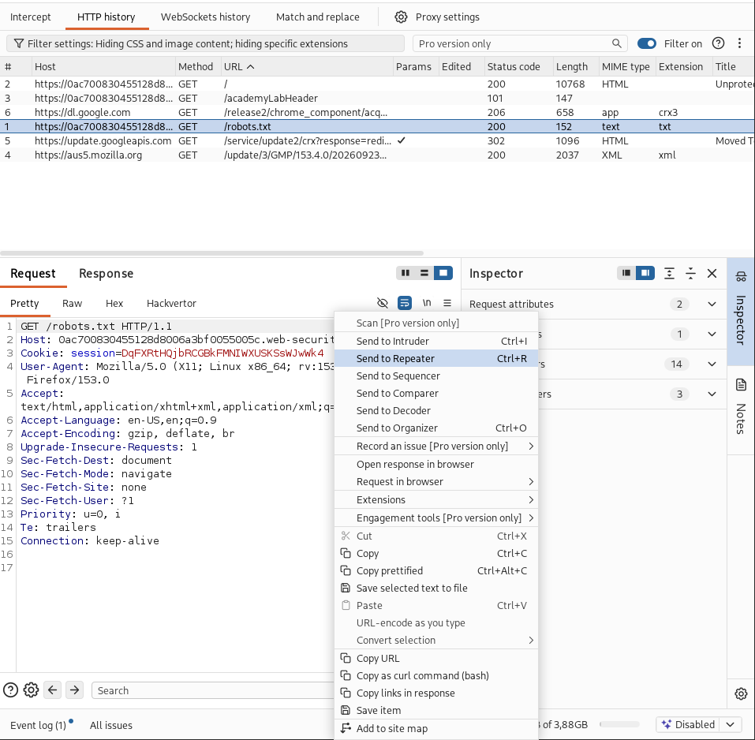
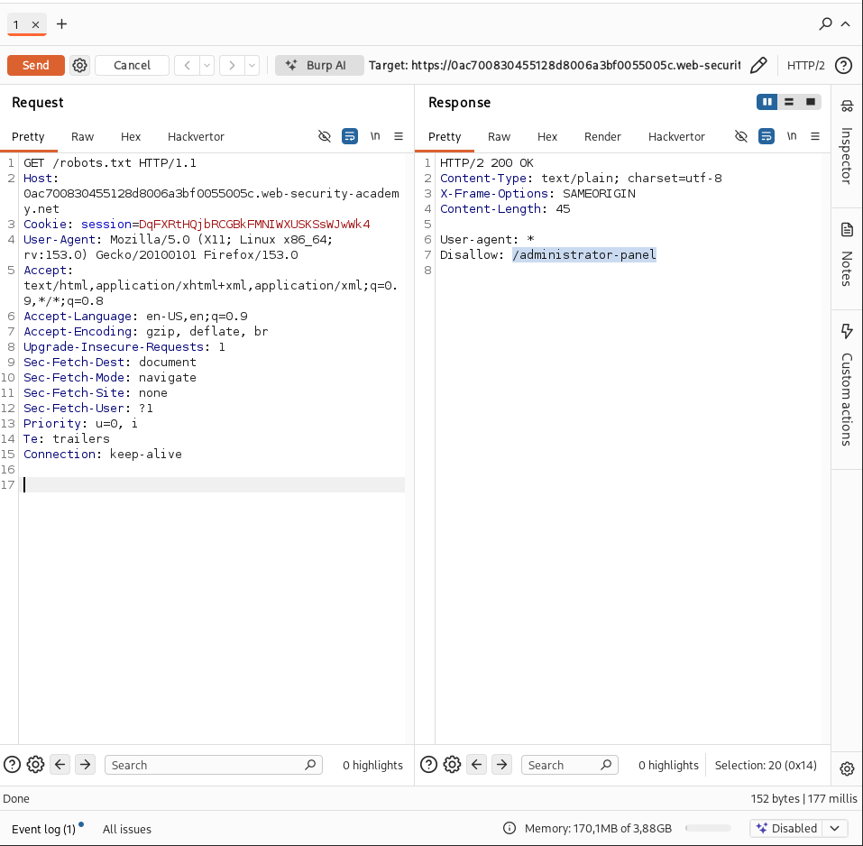
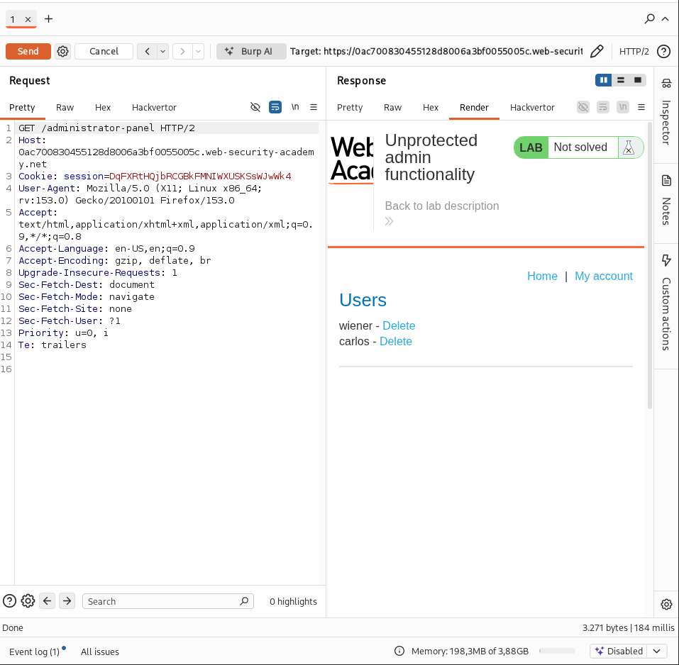

# Access Control — PortSwigger Web Security Academy

[🇬🇧 Read in English](access-control-en.md)

﷽

## Apa itu access control?


Apa itu access control?
Access control adalah penerapan batasan atas siapa atau apa yang berwenang melakukan aksi atau mengakses sumber daya. Dalam konteks aplikasi web, access control bergantung pada autentikasi dan manajemen sesi:

- **Autentikasi** memastikan pengguna adalah orang yang mengklaim dirinya.
- **Manajemen sesi** mengidentifikasi request HTTP berikutnya yang dibuat oleh pengguna yang sama.
- **Access control** menentukan apakah pengguna diizinkan melakukan aksi yang sedang dia coba lakukan.

Broken access control umum terjadi dan seringkali menimbulkan kerentanan keamanan yang kritis. Desain dan manajemen access control adalah masalah yang kompleks dan dinamis, yang menerapkan batasan bisnis, organisasi, dan hukum ke sebuah implementasi teknis. Keputusan desain access control harus dibuat oleh manusia, sehingga potensi kesalahan tinggi.

### Model keamanan access control

Di bagian ini kami menjelaskan apa itu model keamanan access control dan membahas model-model yang paling umum ditemui.

### Apa itu model keamanan access control?

Model keamanan access control adalah definisi formal dari seperangkat aturan access control yang independen dari teknologi atau platform implementasi. Model keamanan access control diimplementasikan di dalam sistem operasi, jaringan, sistem manajemen basis data, serta perangkat lunak back office, aplikasi, dan server web. Berbagai model keamanan access control telah dirancang selama bertahun-tahun untuk mencocokkan kebijakan access control dengan aturan bisnis atau organisasi serta perubahan teknologi.

### Programmatic access control

Dengan programmatic access control, sebuah matriks hak istimewa pengguna disimpan di basis data dan access control diterapkan secara programatik dengan merujuk ke matriks ini. Pendekatan ini dapat mencakup role atau grup atau pengguna individual, koleksi atau workflow proses, dan bisa sangat granular.

### Discretionary access control (DAC)

Dengan discretionary access control, akses ke sumber daya atau fungsi dibatasi berdasarkan pengguna atau kelompok pengguna. Pemilik sumber daya atau fungsi memiliki kemampuan untuk menetapkan atau mendelegasikan izin akses ke pengguna. Model ini sangat granular dengan hak akses yang didefinisikan ke sumber daya atau fungsi individual dan pengguna. Akibatnya model ini bisa menjadi sangat kompleks untuk dirancang dan dikelola.

### Mandatory access control (MAC)

Mandatory access control adalah sistem access control yang dikendalikan secara terpusat, di mana akses ke suatu objek (file atau sumber daya lain) oleh suatu subjek dibatasi. Secara signifikan, berbeda dengan DAC, pengguna dan pemilik sumber daya tidak memiliki kemampuan untuk mendelegasikan atau memodifikasi hak akses atas sumber daya mereka. Model ini sering dikaitkan dengan sistem berbasis clearance militer.

### Role-based access control (RBAC)

Dengan role-based access control, role bernama didefinisikan yang kepadanya hak istimewa access control ditetapkan. Pengguna kemudian ditetapkan ke satu atau beberapa role. RBAC memberikan manajemen yang lebih baik dibanding model access control lain, dan jika dirancang dengan benar, cukup granular untuk memberikan access control yang dapat dikelola di aplikasi kompleks. Contohnya, purchase clerk mungkin didefinisikan sebagai role dengan izin akses untuk sebagian tugas purchase clerk. RBAC paling efektif ketika ada cukup role untuk menerapkan access control dengan benar, tetapi tidak terlalu banyak sampai membuat model terlalu kompleks dan sulit dikelola.

### Vertical access controls

Vertical access controls adalah mekanisme yang membatasi akses ke fungsi sensitif hanya untuk tipe pengguna tertentu.

Dengan vertical access controls, tipe pengguna berbeda memiliki akses ke fungsi aplikasi yang berbeda. Contohnya, administrator mungkin bisa memodifikasi atau menghapus akun pengguna mana pun, sedangkan pengguna biasa tidak punya akses ke aksi tersebut. Vertical access controls bisa jadi implementasi yang lebih halus dari model keamanan yang dirancang untuk menegakkan kebijakan bisnis seperti separation of duties dan least privilege.

### Horizontal access controls

Horizontal access controls adalah mekanisme yang membatasi akses ke sumber daya hanya untuk pengguna tertentu.

Dengan horizontal access controls, pengguna berbeda memiliki akses ke sebagian sumber daya dari tipe yang sama. Contohnya, aplikasi perbankan akan mengizinkan pengguna melihat transaksi dan melakukan pembayaran dari akun mereka sendiri, tetapi bukan akun pengguna lain.

### Context-dependent access controls

Context-dependent access control membatasi akses ke fungsi dan sumber daya berdasarkan keadaan aplikasi atau interaksi pengguna dengannya.

Context-dependent access controls mencegah pengguna melakukan aksi dalam urutan yang salah. Contohnya, situs ritel mungkin mencegah pengguna memodifikasi isi keranjang belanja mereka setelah mereka melakukan pembayaran.

## Contoh broken access controls

Kerentanan broken access control ada ketika pengguna bisa mengakses sumber daya atau melakukan aksi yang seharusnya tidak bisa mereka lakukan.

### Vertical privilege escalation

Jika pengguna bisa mendapatkan akses ke fungsi yang tidak diizinkan untuk mereka akses, maka ini adalah vertical privilege escalation. Contohnya, jika pengguna non-administratif bisa mendapatkan akses ke halaman admin di mana mereka bisa menghapus akun pengguna, maka ini adalah vertical privilege escalation.

#### Unprotected functionality

Pada tingkat paling dasar, vertical privilege escalation muncul ketika aplikasi tidak menerapkan perlindungan apa pun untuk fungsi sensitif. Contohnya, fungsi administratif mungkin ditautkan dari halaman sambutan administrator tetapi tidak dari halaman sambutan pengguna. Namun, pengguna mungkin bisa mengakses fungsi administratif dengan menjelajah ke URL admin yang relevan.

Contohnya, sebuah situs mungkin menempatkan fungsi sensitif di URL berikut:

```
https://insecure-website.com/admin
```
Ini mungkin bisa diakses oleh pengguna mana pun, bukan hanya pengguna administratif yang punya tautan ke fungsi itu di antarmuka pengguna mereka. Dalam beberapa kasus, URL administratif mungkin diungkap di lokasi lain, seperti file `robots.txt`:

```
https://insecure-website.com/robots.txt
```
Bahkan jika URL tidak diungkap di mana pun, penyerang mungkin bisa memakai wordlist untuk brute-force lokasi fungsi sensitif.

##### Lab: Unprotected admin functionality

Lab ini punya admin panel yang tidak terlindungi.

<details>
<summary>Lab details, screenshots & walkthrough 0.1</summary>

Selesaikan lab dengan menghapus pengguna `carlos`.

**Screenshots:**









##### Tutorial

1. Buka robots.txt
2. Lihat respons dan dapatkan administrator-panel
3. Buka panel, coba hapus pengguna `carlos`
4. Berhasil, lab solved

##### Reference

<details>
<summary>1. Broken Access Control - Lab #1 Unprotected admin functionality — Rana Khalil</summary>

Platform: YouTube
Video: https://www.youtube.com/watch?v=qJ8mtm_G40E
Purpose: Lab ini punya admin panel yang tidak terlindungi. Untuk menyelesaikan lab, kami mengeksploitasi kerentanan access control untuk mengakses admin panel dan menghapus pengguna carlos.

</details>

<details>
<summary>2. Portswigger - Access Control - Lab #1 Unprotected admin functionality — Popo Hack</summary>

Platform: YouTube
Video: https://www.youtube.com/watch?v=XF-SNuSyVNo
Purpose: Halo Hackers, di video Unprotected admin functionality ini kamu akan melihat cara mengeksploitasi, menemukan, dan mencari informasi sensitif berdasarkan alur logika aplikasi untuk bocor yang berpotensi jadi serangan dari Burp Suite di lab dari Web Security Academy powered by Portswigger.

</details>

</details>

#### Unprotected functionality - Lanjutan

Dalam beberapa kasus, fungsi sensitif disembunyikan dengan memberinya URL yang kurang dapat diprediksi. Ini contoh dari yang disebut "security by obscurity". Namun, menyembunyikan fungsi sensitif tidak memberikan access control yang efektif karena pengguna mungkin menemukan URL yang diobfuskasi itu dengan berbagai cara.

Bayangkan aplikasi yang menempatkan fungsi administratif di URL berikut:

```
https://insecure-website.com/administrator-panel-yb556
```
Ini mungkin tidak langsung bisa ditebak penyerang. Namun, aplikasi mungkin tetap membocorkan URL itu ke pengguna. URL mungkin diungkap di JavaScript yang membangun antarmuka pengguna berdasarkan role pengguna:

```html
<script>
	var isAdmin = false;
	if (isAdmin) {
		...
		var adminPanelTag = document.createElement('a');
		adminPanelTag.setAttribute('href', 'https://insecure-website.com/administrator-panel-yb556');
		adminPanelTag.innerText = 'Admin panel';
		...
	}
</script>
```
Script ini menambahkan tautan ke UI pengguna jika mereka admin. Namun, script yang berisi URL itu terlihat oleh semua pengguna terlepas dari role mereka.

##### Lab: Unprotected admin functionality with unpredictable URL

Lab ini punya admin panel yang tidak terlindungi. Lokasinya tidak dapat diprediksi, tetapi lokasinya diungkap di suatu tempat dalam aplikasi.

<details>
<summary>Lab details, screenshots & walkthrough 0.2</summary>

Selesaikan lab dengan mengakses admin panel, lalu menggunakannya untuk menghapus pengguna `carlos`.

**Screenshots:**


##### Tutorial

1. Buka /login, lihat source code
2. Lihat kode javascript

```javascript
<!--LAB_HEADER_END-->
        <div theme="">
            <section class="maincontainer">
                <div class="container is-page">
                    <header class="navigation-header">
                        <section class="top-links">
                            <a href=/>Home</a><p>|</p>
                            <script>
var isAdmin = false;
if (isAdmin) {
   var topLinksTag = document.getElementsByClassName("top-links")[0];
   var adminPanelTag = document.createElement('a');
   adminPanelTag.setAttribute('href', '/admin-jufne8');
   adminPanelTag.innerText = 'Admin panel';
   topLinksTag.append(adminPanelTag);
   var pTag = document.createElement('p');
   pTag.innerText = '|';
   topLinksTag.appendChild(pTag);
}
</script>
```
3. Buka /admin-*

##### Reference

<details>
<summary>3. Broken Access Control - Lab#2 Unprotected admin functionality with unpredictable URL | Short Version — Rana Khalil</summary>

Platform: YouTube
Video: https://www.youtube.com/watch?v=7Jve11VySNU
Purpose: Lab ini punya admin panel yang tidak terlindungi. Lokasinya tidak dapat diprediksi, tetapi lokasinya diungkap di suatu tempat dalam aplikasi. Untuk menyelesaikan lab, kami mengakses admin panel dan menggunakannya untuk menghapus pengguna carlos.

</details>

<details>
<summary>4. Unprotected admin functionality with unpredictable URL — Rana Khalil</summary>

Platform: YouTube
Video: https://www.youtube.com/watch?v=mml8SlN2Or4
Purpose: Video ini menunjukkan solusi lab "Unprotected admin functionality with unpredictable URL" dari Web Security Academy (Portswigger)

</details>

</details>

#### Parameter-based access control methods

Sebagian aplikasi menentukan hak akses atau role pengguna saat login, lalu menyimpan informasi itu di lokasi yang dapat dikontrol pengguna.

Ini bisa berupa:

- Hidden field.
- Cookie.
- Parameter query string yang telah ditetapkan.

Aplikasi membuat keputusan access control berdasarkan nilai yang dikirim. Contohnya:

```
https://insecure-website.com/login/home.jsp?admin=true
https://insecure-website.com/login/home.jsp?role=1
```
Pendekatan ini tidak aman karena pengguna bisa memodifikasi nilai dan mengakses fungsi yang tidak berwenang mereka akses, seperti fungsi administratif.

##### Lab: User role controlled by request parameter

##### Lab: User role can be modified in user profile

#### Broken access control resulting from platform misconfiguration

##### Lab: URL-based access control can be circumvented

##### Lab: Method-based access control can be circumvented

#### Broken access control resulting from URL-matching discrepancies

### Horizontal privilege escalation

##### Lab: User ID controlled by request parameter

##### Lab: User ID controlled by request parameter, with unpredictable user IDs

##### Lab: User ID controlled by request parameter with data leakage in redirect

#### Horizontal to vertical privilege escalation

##### Lab: User ID controlled by request parameter with password disclosure

### Insecure direct object references

##### Lab: Insecure direct object references

### Access control vulnerabilities in multi-step processes

##### Lab: Multi-step process with no access control on one step

### Referer-based access control

##### Lab: Referer-based access control

### Location-based access control

## Cara mencegah kerentanan access control