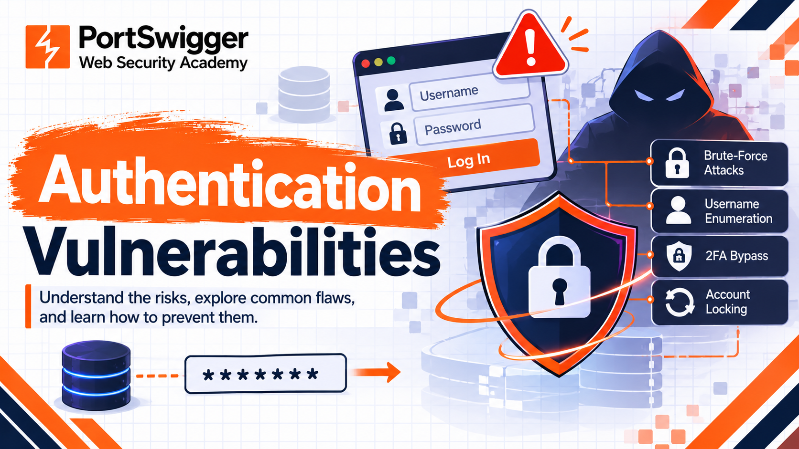

# Authentication Vulnerabilities — PortSwigger Web Security Academy

[🇬🇧 Read in English](authentication-vulnerabilities-en.md)

﷽

## Apa Ini?

## Apa itu autentikasi?

## Apa perbedaan antara autentikasi dan otorisasi?

## Bagaimana kerentanan autentikasi muncul?

## Apa dampak dari autentikasi yang rentan?

## Kerentanan pada login berbasis password

### Serangan brute-force

### Brute-force username

### Brute-force password

### Enumerasi username

##### Lab: Username enumeration via different responses

##### Lab: Username enumeration via subtly different responses

##### Lab: Username enumeration via response timing

### Proteksi brute-force yang cacat

##### Lab: Broken brute-force protection, IP block

### Penguncian akun (Account locking)

##### Lab: Username enumeration via account lock

### Pembatasan laju pengguna (User rate limiting)

### HTTP basic authentication

## Kerentanan pada multi-factor authentication

### Token two-factor authentication

### Melewati (bypassing) two-factor authentication

##### Lab: 2FA simple bypass

### Logika verifikasi two-factor yang cacat

##### Lab: 2FA broken logic

### Brute-force kode verifikasi 2FA

## Kerentanan pada mekanisme autentikasi lainnya

### Menjaga pengguna tetap login

##### Lab: Brute-forcing a stay-logged-in cookie

##### Lab: Offline password cracking

### Reset password pengguna

### Mengirim password melalui email

### Reset password menggunakan URL

##### Lab: Password reset broken logic

##### Lab: Password reset poisoning via middleware

### Mengubah password pengguna

##### Lab: Password brute-force via password change

## Mencegah serangan pada mekanisme autentikasi kamu sendiri
