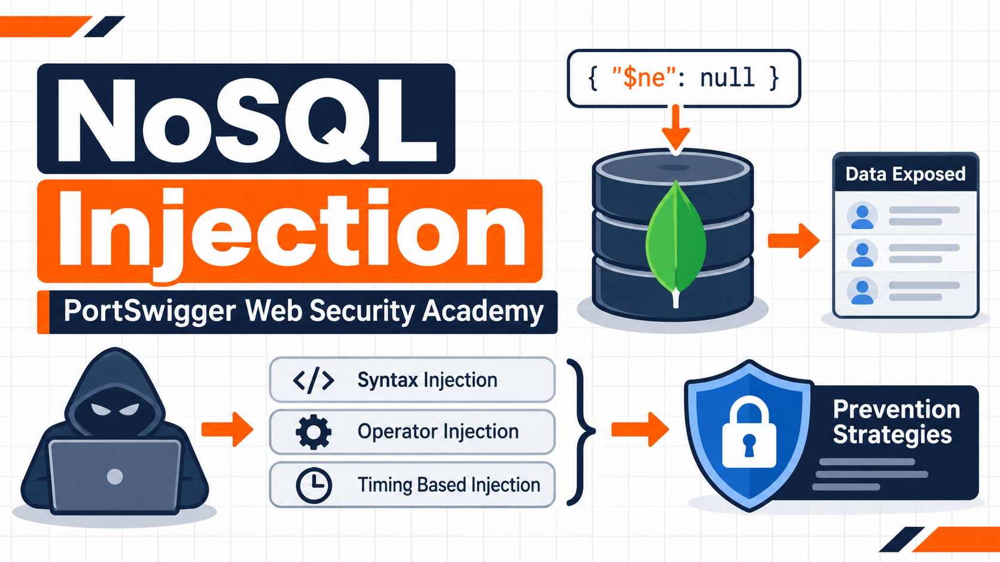

# NoSQL Injection — PortSwigger Web Security Academy

[🇮🇩 Read in Bahasa Indonesia](nosql-injection-id.md)

﷽

## What is that?

## What is NoSQL Injection?

NoSQL injection is a vulnerability where is able to interfere with the queries that an application makes to a NoSQL database. NoSQL injection may enable an attacker to:

- Bypass authentication or protection mechanisms.
- Extract or edit data.
- Cause a denial of service.
- Execute code on the server.

NoSQL databases store and retrieve data in a format other than traditional SQL relational tables. They use a wide range of query languanges instead of a universal standard like SQL, and have fewer relational constraints.

## Types of NoSQL Injection

### NoSQL Syntax Injection

#### Detecting Syntax Injection in MongoDB

#### Determining Which Characters Are Processed

#### Confirming Conditional Behavior

#### Overriding Existing Conditions

#### Overriding Existing Conditions - Continued

##### Lab: Detecting NoSQL Injection

### NoSQL Operator Injection

#### Submitting Query Operators

#### Detecting Operator Injection in MongoDB

##### Lab: Exploiting NoSQL Operator Injection to Bypass Authentication

### Exploiting Syntax Injection to Extract Data

#### Exfiltrating Data in MongoDB

#### Identifying Field Names

#### Identifying Field Names - Continued

##### Lab: Exploiting NoSQL Injection to Extract Data

### Exploiting NoSQL Operator Injection to Extract Data

#### Injecting Operators in MongoDB

#### Extracting Field Names

#### Exfiltrating Data Using Operators

##### Lab: Exploiting NoSQL Operator Injection to Extract Unknown Fields

### Timing Based Injection

#### Timing Based Injection

### Preventing NoSQL Injection

#### Prevention Strategies