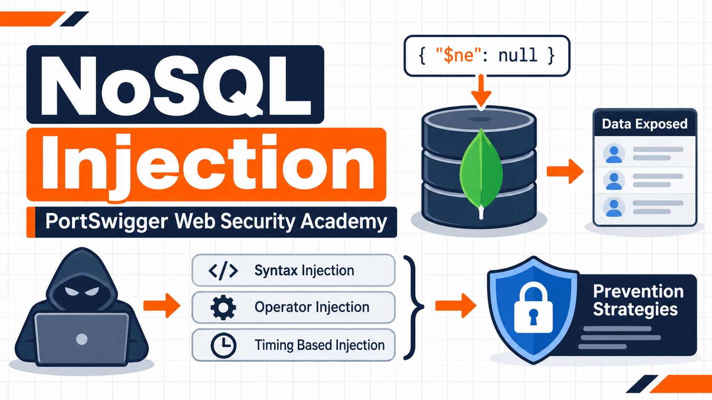

# NoSQL Injection — PortSwigger Web Security Academy

[🇮🇩 Baca dalam Bahasa Indonesia](nosql-injection-en.md)

﷽

## Apa ini?

## Apa Itu NoSQL Injection?

NoSQL injection is a vulnerability where is able to interfere with the queries that an application makes to a NoSQL database. NoSQL injection may enable an attacker to:

- Bypass authentication or protection mechanisms.
- Extract or edit data.
- Cause a denial of service.
- Execute code on the server.

NoSQL databases store and retrieve data in a format other than traditional SQL relational tables. They use a wide range of query languanges instead of a universal standard like SQL, and have fewer relational constraints.

## Jenis-Jenis NoSQL Injection

### NoSQL Syntax Injection

#### Mendeteksi Syntax Injection di MongoDB

#### Menentukan Karakter Mana yang Diproses

#### Mengonfirmasi Perilaku Kondisional

#### Menimpa Kondisi Existing

#### Menimpa Kondisi Existing - Lanjutan

##### Lab: Mendeteksi NoSQL Injection

### NoSQL Operator Injection

#### Mengirimkan Query Operators

#### Mendeteksi Operator Injection di MongoDB

##### Lab: Mengeksploitasi NoSQL Operator Injection untuk Bypass Autentikasi

### Mengeksploitasi Syntax Injection untuk Ekstrak Data

#### Mengekfiltrasi Data di MongoDB

#### Mengidentifikasi Nama Field

#### Mengidentifikasi Nama Field - Lanjutan

##### Lab: Mengeksploitasi NoSQL Injection untuk Ekstrak Data

### Mengeksploitasi NoSQL Operator Injection untuk Ekstrak Data

#### Menyuntikkan Operator di MongoDB

#### Ekstrak Nama Field

#### Mengekfiltrasi Data Menggunakan Operator

##### Lab: Mengeksploitasi NoSQL Operator Injection untuk Ekstrak Field Unknown

### Injeksi Berbasis Timing

#### Injeksi Berbasis Timing

### Mencegah NoSQL Injection

#### Strategi Pencegahan