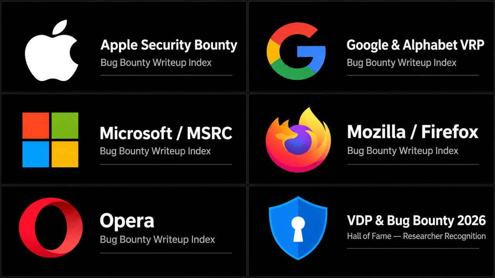

# Apple Security Bounty — Indeks Writeup Bug Bounty (ID)

[🇬🇧 Read in English](apple-vrp-en.md)

﷽

<b>Details — Apple Security Bounty</b>

- **Program**: Apple Security Bounty (product-security@apple.com).
- **Scope**: iOS, iPadOS, macOS, tvOS, watchOS, visionOS, Safari/WebKit, iCloud, layanan Apple.
- **Reward maksimum**: hingga $2.000.000 (zero-click kernel RCE chain); bonus bisa >$5M total.
- **Tidak eligible**: aplikasi pihak ketiga, web app, isu pada software/hardware non-terbaru.
- **Submit**: Apple Security Research portal.
- **In scope**: kernel RCE, sandbox escape, UXSS, Gatekeeper bypass, TCC bypass, iCloud access.

> Kumpulan writeup untuk Apple Security Bounty. Kolom: judul, tanggal publikasi, penulis, reward yang **dilaporkan**, jenis (blog/video), dan tautan langsung ke laporan asli. Nominal adalah yang dilaporkan penulis/kurator, bukan jaminan untuk temuan serupa.

## 1. Ringkasan

| Item | Nilai |
|---|---|
| Total entri unik | 14 |
| Entri dengan reward dilaporkan | 9 |
| Reward tertinggi | $288.500 |
| Rentang tanggal | 2020-04-03 s/d 2026-07-10 |

## 2. 5 Reward Tertinggi (Dilaporkan)

| # | Reward | Tulisan | Penulis | Tanggal | Jenis | Tautan |
|---|---|---|---|---|---|---|
| 1 | **$288.500** | We Hacked Apple for 3 Months: Here's What We Found | Sam Curry et al. | 2020-10-07 | blog | [buka](https://samcurry.net/hacking-apple) |
| 2 | **$100.500** | Safari UXSS + iCloud ShareBear exploit chain | Ryan Pickren | 2022-01-26 | blog | [buka](https://www.ryanpickren.com/safari-uxss) |
| 3 | **$100.000** | Zero-day in Sign in with Apple | Bhavuk Jain | 2020-05-30 | blog | [buka](https://bhavukjain.com/blog/2020/05/30/zeroday-signin-with-apple/) |
| 4 | **$100.000** | Safari to Kernel Zero-day at Pwn2Own 2021 | Jack Dates | 2021-04-08 | blog | [buka](https://www.macrumors.com/2021/04/08/pwn2own-safari-exploit-demonstrated/) |
| 5 | **$75.000** | iPhone Camera Hack - Safari zero-click exploit chain | Ryan Pickren | 2020-04-03 | blog | [buka](https://www.ryanpickren.com/webcam-hacking-overview) |

## 3. Semua Entri (terbaru dulu)

### 3.1 Dengan reward dilaporkan

| Tanggal | Reward | Tulisan | Penulis | Jenis | Tautan |
|---|---|---|---|---|---|
| 2026-03-27 | $1.000 | Abusing the Admin Framework for fun and profit | Ryan Dowd | blog | [buka](https://rdowd.com/abusing-system-administration-for-fun-and-profit-part-1-of-3/) |
| 2025-09-05 | $1.000 | When the Back Button Becomes Dangerous: My Safari Bug Bounty Journey | Syarif Sajjad | blog | [buka](https://medium.com/@syarifsajjad07/when-the-back-button-becomes-dangerous-my-safari-bug-bounty-journey-8b7dee70debb) |
| 2025-07-31 | $1.000 | CVE-2025-30466 UXSS in Safari (RenwaX23) | RenwaX23 | blog | [buka](https://www.macworld.com/article/2863434/bounty-hunter-got-1000-from-apple.html) |
| 2024-05-14 | $60.000 | CVE-2024-27834 PAC Bypass in Safari (Pwn2Own) | Manfred Paul | blog | [buka](https://www.bleepingcomputer.com/news/apple/apple-fixes-safari-webkit-zero-day-flaw-exploited-at-pwn2own/) |
| 2022-01-26 | $100.500 | Safari UXSS + iCloud ShareBear exploit chain | Ryan Pickren | blog | [buka](https://www.ryanpickren.com/safari-uxss) |
| 2021-04-15 | $9.000 | My First Critical Bug in Bug Bounty Hunting: iCloud | Fernale | blog | [buka](https://fernale.blogspot.com/p/an-interesting-xss-exploit-that-i-found.html) |
| 2021-04-08 | $100.000 | Safari to Kernel Zero-day at Pwn2Own 2021 | Jack Dates | blog | [buka](https://www.macrumors.com/2021/04/08/pwn2own-safari-exploit-demonstrated/) |
| 2020-10-07 | $288.500 | We Hacked Apple for 3 Months: Here's What We Found | Sam Curry et al. | blog | [buka](https://samcurry.net/hacking-apple) |
| 2020-05-30 | $100.000 | Zero-day in Sign in with Apple | Bhavuk Jain | blog | [buka](https://bhavukjain.com/blog/2020/05/30/zeroday-signin-with-apple/) |
| 2020-04-03 | $75.000 | iPhone Camera Hack - Safari zero-click exploit chain | Ryan Pickren | blog | [buka](https://www.ryanpickren.com/webcam-hacking-overview) |

### 3.2 Tanpa reward

| Tanggal | Reward | Tulisan | Penulis | Jenis | Tautan |
|---|---|---|---|---|---|
| 2026-07-10 | — | State of the Apple Security Bounty program | Gergely Kalman | blog | [buka](https://gergelykalman.com/state-of-the-apple-security-bounty-program.html) |
| 2024-11-28 | — | Some Experience In Apple Security Bug Program | Zhongquan Li | blog | [buka](https://imlzq.com/experience/2024/11/28/Some-Experience-In-ASB.html) |
| 2020-04-03 | — | Bugs that let sites hijack Mac and iPhone cameras | Dan Goodin | blog | [buka](https://arstechnica.com/information-technology/2020/04/bugs-that-let-sites-hijack-mac-and-iphone-cameras-fetches-75k-bounty/) |
| 2021-04-06 | — | Safari to Kernel RCE at Pwn2Own 2021 (video) | Jack Dates | video | [buka](https://www.youtube.com/watch?v=cfbT1IdAt) |

## 4. Catatan

- `n/a` = tanggal tidak dicantumkan di sumber.
- Reward = nominal yang **dilaporkan** penulis/kurator, bukan angka resmi program.
- Entri video adalah rekaman konferensi/meetup, bukan tulisan.
- Tautan mengarah ke tulisan asli, bukan halaman program.