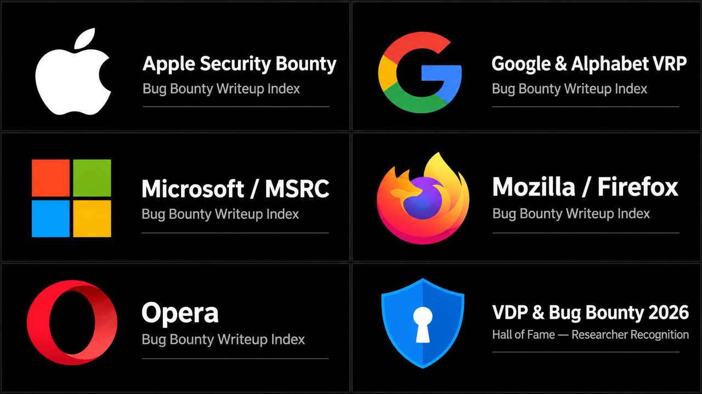

# Opera — Bug Bounty Writeup Index (EN)

[🇮🇩 Read in Bahasa Indonesia](opera-vrp-id.md)

﷽

<b>Details — Opera Bug Bounty</b>

- **Program**: Opera Bug Bounty (Bugcrowd, public).
- **Scope**: Opera browsers (PC, GX, Neon, Air), Opera Android/iOS, web services (auth/accounts/flow).
- **Max reward**: up to $5,000 for critical (P1).
- **Not eligible**: Chromium/WebKit upstream bugs.
- **Submit**: Bugcrowd (security.opera.com).

> Curated writeups for Opera. Fields: title, publication date, author, reported reward, type (blog/video), and a direct link to the original report. Rewards are as reported by the researcher/curator and are not a guarantee for similar findings.

## 1. Summary

| Item | Value |
|---|---|
| Total unique entries | 4 |
| Entries with reported reward | 3 |
| Highest reported reward | $10,000 |
| Date range | 2022 s/d 2026-07-03 |

## 2. Top 3 Highest Reported Rewards

| # | Reward | Writeup | Author | Date | Type | Link |
|---|---|---|---|---|---|---|
| 1 | **$10,000** | CVE-2022-0337 system environment variables leak | Maciej Pulikowski | 2022 | blog | [open](https://github.com/Puliczek/CVE-2022-0337-PoC-Google-Chrome-Microsoft-Edge-Opera) |
| 2 | **$5,000** | Opera GX Mods universal CSS injection and XS-Leak | zhero_ and inzo_ | 2026-07-03 | blog | [open](https://blogs.opera.com/security/2026/07/security-fix-gx-mods-vulnerability/) |
| 3 | **$5,000** | One Trigram at a Time: XSLeak via Universal CSS Injection and DoS in Opera GX | zhero_ and inzo_ | 2026-07-03 | blog | [open](https://zhero-web-sec.github.io/research-and-things/one-trigram-at-a-time-xsleak-via-universal-css-injection-and-dos-in-opera-(gx)) |

## 3. All Entries (newest first)

### 3.1 With reported reward

| Date | Reward | Writeup | Author | Type | Link |
|---|---|---|---|---|---|
| 2026-07-03 | $5,000 | Opera GX Mods universal CSS injection and XS-Leak | zhero_ and inzo_ | blog | [open](https://blogs.opera.com/security/2026/07/security-fix-gx-mods-vulnerability/) |
| 2026-07-03 | $5,000 | One Trigram at a Time: XSLeak via Universal CSS Injection and DoS in Opera GX | zhero_ and inzo_ | blog | [open](https://zhero-web-sec.github.io/research-and-things/one-trigram-at-a-time-xsleak-via-universal-css-injection-and-dos-in-opera-(gx)) |
| 2022 | $10,000 | CVE-2022-0337 system environment variables leak | Maciej Pulikowski | blog | [open](https://github.com/Puliczek/CVE-2022-0337-PoC-Google-Chrome-Microsoft-Edge-Opera) |

### 3.2 Without reported reward

| Date | Reward | Writeup | Author | Type | Link |
|---|---|---|---|---|---|
| 2024 | — | Opera My Flow MyFlaw | External reporter | blog | [open](https://thehackernews.com/search/label/Opera) |

## 4. Notes

- `n/a` = date not stated in the source.
- Reward = amount **reported** by the author/curator, not an official program figure.
- Video entries are conference/meetup recordings, not written reports.
- Links point to the original writeup, not to the program page.
