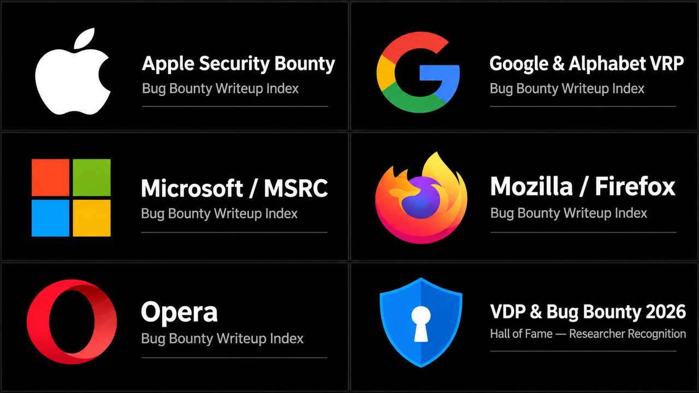

# Opera — Indeks Writeup Bug Bounty (ID)

[🇬🇧 Read in English](opera-vrp-en.md)

﷽

<b>Details — Opera Bug Bounty</b>

- **Program**: Opera Bug Bounty (Bugcrowd, publik).
- **Scope**: browser Opera (PC, GX, Neon, Air), Opera Android/iOS, layanan web (auth/akun/flow).
- **Reward maksimum**: hingga $5.000 untuk critical (P1).
- **Tidak eligible**: bug upstream Chromium/WebKit.
- **Submit**: Bugcrowd (security.opera.com).

> Kumpulan writeup untuk Opera. Kolom: judul, tanggal publikasi, penulis, reward yang **dilaporkan**, jenis (blog/video), dan tautan langsung ke laporan asli. Nominal adalah yang dilaporkan penulis/kurator, bukan jaminan untuk temuan serupa.

## 1. Ringkasan

| Item | Nilai |
|---|---|
| Total entri unik | 4 |
| Entri dengan reward dilaporkan | 3 |
| Reward tertinggi | $10,000 |
| Rentang tanggal | 2022 s/d 2026-07-03 |

## 2. 3 Reward Tertinggi (Dilaporkan)

| # | Reward | Tulisan | Penulis | Tanggal | Jenis | Tautan |
|---|---|---|---|---|---|---|
| 1 | **$10,000** | CVE-2022-0337 system environment variables leak | Maciej Pulikowski | 2022 | blog | [buka](https://github.com/Puliczek/CVE-2022-0337-PoC-Google-Chrome-Microsoft-Edge-Opera) |
| 2 | **$5,000** | Opera GX Mods universal CSS injection and XS-Leak | zhero_ and inzo_ | 2026-07-03 | blog | [buka](https://blogs.opera.com/security/2026/07/security-fix-gx-mods-vulnerability/) |
| 3 | **$5,000** | One Trigram at a Time: XSLeak via Universal CSS Injection and DoS in Opera GX | zhero_ and inzo_ | 2026-07-03 | blog | [buka](https://zhero-web-sec.github.io/research-and-things/one-trigram-at-a-time-xsleak-via-universal-css-injection-and-dos-in-opera-(gx)) |

## 3. Semua Entri (terbaru dulu)

### 3.1 Dengan reward dilaporkan

| Tanggal | Reward | Tulisan | Penulis | Jenis | Tautan |
|---|---|---|---|---|---|
| 2026-07-03 | $5,000 | Opera GX Mods universal CSS injection and XS-Leak | zhero_ and inzo_ | blog | [buka](https://blogs.opera.com/security/2026/07/security-fix-gx-mods-vulnerability/) |
| 2026-07-03 | $5,000 | One Trigram at a Time: XSLeak via Universal CSS Injection and DoS in Opera GX | zhero_ and inzo_ | blog | [buka](https://zhero-web-sec.github.io/research-and-things/one-trigram-at-a-time-xsleak-via-universal-css-injection-and-dos-in-opera-(gx)) |
| 2022 | $10,000 | CVE-2022-0337 system environment variables leak | Maciej Pulikowski | blog | [buka](https://github.com/Puliczek/CVE-2022-0337-PoC-Google-Chrome-Microsoft-Edge-Opera) |

### 3.2 Tanpa reward

| Tanggal | Reward | Tulisan | Penulis | Jenis | Tautan |
|---|---|---|---|---|---|
| 2024 | — | Opera My Flow MyFlaw | External reporter | blog | [buka](https://thehackernews.com/search/label/Opera) |

## 4. Catatan

- `n/a` = tanggal tidak dicantumkan di sumber.
- Reward = nominal yang **dilaporkan** penulis/kurator, bukan angka resmi program.
- Entri video adalah rekaman konferensi/meetup, bukan tulisan.
- Tautan mengarah ke tulisan asli, bukan halaman program.
