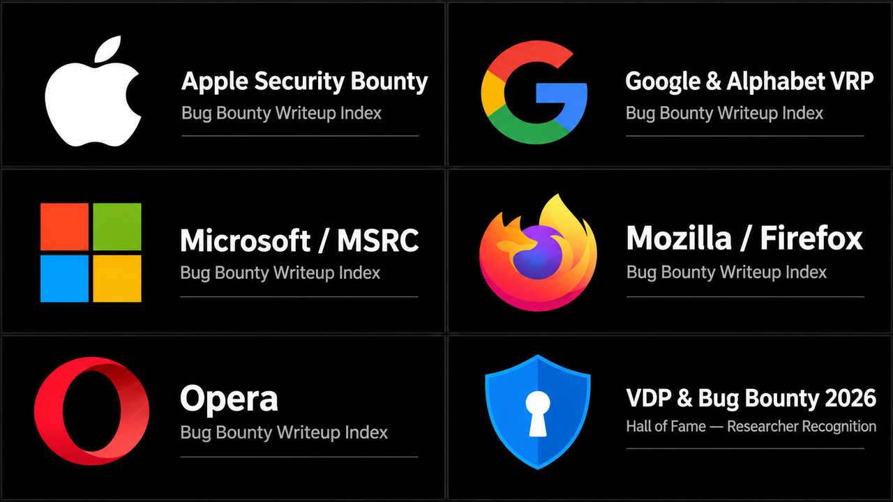

# Program VDP & Bug Bounty Aktif (2026)

[🇬🇧 Read in English](vdp-programs-en.md)

﷽

<b>Details — VDP &amp; Bug Bounty 2026</b>

- **Apa**: indeks program vulnerability disclosure (VDP) dan bug bounty aktif.
- **Kategori**: Bug Bounty (uang), University & Higher Education, Research Institute, Education & Research Network, Government & International Organizations, Commercial & Enterprise.
- **Cakupan**: web, cloud, browser, OS, OSS, pemerintahan, universitas, lembaga riset, non-profit.
- **Reward**: maksimum yang dipublikasikan; bisa berubah.
- **Aturan**: jangan tes di luar scope program.

> Bug Bounty = ada uang. VDP = Hall of Fame (nama researcher dipublikasikan). Kategori dipisah, jangan dicampur.

## Ringkasan

| Kategori | Jumlah |
|---|---|
| Bug Bounty (berbayar) | 5 |
| University & Higher Education | 18 |
| Research Institute | 1 |
| Education & Research Network | 2 |
| Government & International Organizations | 9 |
| Commercial & Enterprise | 21 |
| **Total** | **56** |

---

<b>1. Bug Bounty — Ada Reward Uang</b>

| # | Program | Perusahaan | Cakupan | Reward | Tautan |
|---|---|---|---|---|---|
| 1 | Opera Bug Bounty | Opera | Opera Browser, Opera GX, services | Tidak dipublikasikan | [buka](https://security.opera.com/en/bug-bounty/) |
| 2 | Microsoft Bounty Programs | Microsoft | Windows, Azure, Hyper-V, Identity, Edge, Copilot | Up to $250,000 | [buka](https://www.microsoft.com/en-us/msrc/bounty-programs) |
| 3 | Google & Alphabet VRP | Google | Web, Android, Chrome, Cloud, AI | Bervariasi per kategori (contoh $101,010 untuk RCE tertentu) | [buka](https://bughunters.google.com/about/rules/google-friends/google-and-alphabet-vulnerability-reward-program-vrp-rules) |
| 4 | Mozilla Client Bug Bounty | Mozilla | Firefox, Firefox for Android/iOS | Up to $20,000 | [buka](https://www.mozilla.org/en-US/security/client-bug-bounty/) |
| 5 | Apple Security Bounty | Apple | iOS, iPadOS, macOS, Safari, iCloud, hardware | Up to $2,000,000 (bonus bisa >$5M total) | [buka](https://security.apple.com/bounty/) |

<b>2. Hall of Fame — Universitas &amp; Pendidikan Tinggi</b>

| # | Institusi | Negara | Tipe | Researcher | Tautan |
|---|---|---|---|---|---|
| 1 | University of Nebraska | USA | Public University | 70+ | [buka](https://nebraska.edu/offices/information-technology-services/vulnerability-disclosure-program/vdp-hall-of-fame) |
| 2 | UT Austin | USA | Public University | 90+ | [buka](https://security.utexas.edu/hall-of-fame) |
| 3 | Drexel University | USA | Private University | 100+ | [buka](https://drexel.edu/it/security/services-processes/bug-bounty/) |
| 4 | UNLV | USA | Public University | 5+ | [buka](https://www.it.unlv.edu/cybersecurity/vulnerability-disclosure) |
| 5 | Bournemouth University | UK | Public University | 106 | [buka](https://cert.bournemouth.ac.uk/hall-of-fame/) |
| 6 | Utrecht University | Netherlands | Research University | 199 | [buka](https://www.uu.nl/en/organisation/information-and-technology-services-its/hall-of-fame-responsible-disclosure) |
| 7 | University of Twente | Netherlands | Technical University | 199 | [buka](https://www.utwente.nl/en/cyber-safety/responsible/hall-of-fame/) |
| 8 | Wageningen University & Research | Netherlands | Research University | 199 | [buka](https://www.wur.nl/en/about-wur/organisation-profile/good-governance/information-security/hall-fame-responsible-disclosure) |
| 9 | TU Braunschweig | Germany | Technical University | 17 | [buka](https://www.tu-braunschweig.de/en/ciso/cert/responsible-disclosure/hall-of-fame) |
| 10 | University of Groningen | Netherlands | Research University | 55 | [buka](https://www.rug.nl/about-ug/policy-and-strategy/privacy-and-security-at-the-ug/responsible-disclosure?lang=en) |
| 11 | Saxion University of Applied Sciences | Netherlands | Applied Sciences | 4 | [buka](https://www.saxion.edu/about-saxion/our-organisation/hall-of-fame) |
| 12 | Delft University of Technology | Netherlands | Technical University | 117 | [buka](https://www.tudelft.nl/en/hall-of-fame) |
| 13 | Eindhoven University of Technology | Netherlands | Technical University | 16 | [buka](https://www.tue.nl/en/our-university/about-the-university/support-services/library-and-information-services/ict-security/hall-of-fame-responsible-disclosure) |
| 14 | Erasmus University Rotterdam | Netherlands | Research University | 46 | [buka](https://www.eur.nl/campus/locaties/campus-woudestein/beveiliging-veiligheid/informatiebeveiliging/hall-fame) |
| 15 | Radboud University | Netherlands | Research University | 64 | [buka](https://www.ru.nl/en/about-us/policies-and-regulations/privacy-and-security/report-vulnerability) |
| 16 | University of Duisburg-Essen | Germany | Public University | 12 | [buka](https://www.uni-due.de/ciso/hall-of-fame.php) |
| 17 | Zuyd University of Applied Sciences | Netherlands | Applied Sciences | 13 | [buka](https://www.zuyd.nl/en/responsible-disclosure) |
| 18 | Masaryk University | Czech Republic | Public University | 7 | [buka](https://security.muni.cz/en/responsible_disclosure) |

<b>3. Hall of Fame — Lembaga Riset</b>

| # | Institusi | Negara | Tipe | Researcher | Tautan |
|---|---|---|---|---|---|
| 1 | EMBL-EBI | UK / International | Bioinformatics Research Institute | 31 | [buka](https://www.ebi.ac.uk/security/hall-of-fame/) |

<b>4. Hall of Fame — Jaringan Pendidikan &amp; Riset</b>

| # | Institusi | Negara | Tipe | Researcher | Tautan |
|---|---|---|---|---|---|
| 1 | Jisc | UK | Education & Research Network | 55+ | [buka](https://www.jisc.ac.uk/about-us/vulnerability-disclosure-policy) |
| 2 | RENATER | France | National Research & Education Network | 5+ | [buka](https://www.renater.fr/hall-of-fame.html) |

<b>5. Hall of Fame — Pemerintahan &amp; Organisasi Internasional</b>

| # | Institusi | Negara | Tipe | Researcher | Tautan |
|---|---|---|---|---|---|
| 1 | WHO (World Health Organization) | International | UN Specialized Agency | 100+ | [buka](https://www.who.int/about/cybersecurity/vulnerability-hall-of-fame/ethical-hacker-list) |
| 2 | United Nations (UN) | International | Intergovernmental Organization | 100+ | [buka](https://unite.un.org/en/ict-security/hall-fame) |
| 3 | UN Women | International | UN Entity for Gender Equality | 112 | [buka](https://www.unwomen.org/en/information-security/reporting-a-cyber-security-issue) |
| 4 | BSI (Federal Office for Information Security) | Germany | Federal Cyber Security Authority | 84 | [buka](https://www.bsi.bund.de/DE/IT-Sicherheitsvorfall/IT-Schwachstellen/Hall_of_Fame/Hall_of_Fame_node.html) |
| 5 | NCSC Netherlands | Netherlands | National Cyber Security Centre | 29 | [buka](https://www.ncsc.nl/en/producten-en-diensten/wall-of-fame) |
| 6 | HHS (Dept of Health and Human Services) | USA | Federal Department | 129 | [buka](https://hhs.responsibledisclosure.com/hc/en-us/articles/1500000280921-Acknowledgments) |
| 7 | Berlin.de (State of Berlin) | Germany | State Government Portal | 42 | [buka](https://www.berlin.de/wir-ueber-uns/7470384-4219174-danksagungen.html) |
| 8 | CERT-EU | EU | EU CERT | 200 | [buka](https://cert.europa.eu/hall-of-fame) |
| 9 | CERN | Switzerland | European Research Organization | 40+ | [buka](https://security.web.cern.ch/home/en/kudos.shtml) |

<b>6. Hall of Fame — Perusahaan &amp; Enterprise</b>

| # | Institusi | Negara | Tipe | Researcher | Tautan |
|---|---|---|---|---|---|
| 1 | WSO2 (Choreo Labs) | Sri Lanka / USA | Software Company | 71 | [buka](https://security.docs.wso2.com/en/latest/security-reporting/reward-and-acknowledgement-program/hall-of-fame/) |
| 2 | Heroku (Salesforce) | USA | Cloud Platform | 42 | [buka](https://www.heroku.com/policy/security-hall-of-fame/) |
| 3 | Seibert Group | Germany | Software Company | 33 | [buka](https://en.seibert.group/security/report-vulnerability) |
| 4 | ShellOrbit | International | SaaS Platform | 17 | [buka](https://shellorbit.com/legal/hall-of-fame/) |
| 5 | Safeguard.sh | International | SaaS Platform | 5+ | [buka](https://safeguard.sh/legal/hall-of-fame) |
| 6 | SOCRadar | Turkey | Cybersecurity Company | 3 | [buka](https://socradar.io/security/hall-of-fame/) |
| 7 | SiteConnect.io | Ireland | SaaS Platform | 4 | [buka](https://siteconnect.io/security-hall-of-fame/) |
| 8 | BidBolt | International | Auction Platform | 18 | [buka](https://bidbolt.app/legal/bug-bounty) |
| 9 | usezn | International | AI Security Platform | 7 | [buka](https://usezn.com/security/) |
| 10 | Pipefy | Brazil | SaaS Platform | 5 | [buka](https://www.pipefy.com/security-hall-of-fame/) |
| 11 | ista | Germany | Energy Services | 8 | [buka](https://www.ista.com/corporate/hall-of-fame/) |
| 12 | Phenom | USA | HR Tech Company | 15 | [buka](https://www.phenom.com/hall_of_fame) |
| 13 | Nokia | Finland | Telecommunications | 200+ | [buka](https://www.nokia.com/we-are-nokia/security/products/cvd/hall-of-fame/) |
| 14 | Grafana Labs | USA | Software / Observability | 24 | [buka](https://grafana.com/security/hall-of-fame/) |
| 15 | BT Group | UK | Telecommunications | 50+ | [buka](https://www.bt.com/about/contact-bt/responsible-disclosure/hall-of-fame) |
| 16 | Niko | Belgium | Smart Home / Electronics | 6 | [buka](https://www.niko.eu/en/security/coordinated-vulnerability-disclosure-hall-of-fame) |
| 17 | Bluescape | USA | Collaboration Software | 22 | [buka](https://www.bluescape.com/security-hall-of-fame) |
| 18 | GEA Group | Germany | Industrial Technology | 60+ | [buka](https://www.gea.com/en/about-us/information-security/products/responsible-disclosure-of-security-issues/hall-of-fame/) |
| 19 | Bosch | Germany | Engineering & Technology | 20+ | [buka](https://psirt.bosch.com/hall-of-fame/) |
| 20 | IBS Software | India | Enterprise Software | 1 | [buka](https://www.ibsplc.com/security/security-hall-of-fame) |
| 21 | Glints | Singapore | Recruitment Technology | 15 | [buka](https://security.glints.com/hof/) |

<b>7. Hall of Fame — Organisasi Mahasiswa &amp; Komunitas</b>

| # | Institusi | Negara | Tipe | Researcher | Tautan |
|---|---|---|---|---|---|
| 1 | S.A. Proto (UTwente) | Netherlands | Student Association | 8 | [buka](https://wiki.proto.utwente.nl/ict/responsible-disclosure) |
| 2 | GSMA Mobile Security | International | Industry Association | 7+ | [buka](https://www.gsma.com/solutions-and-impact/technologies/security/gsma-mobile-security-research-acknowledgements/) |

## Catatan

- Bug Bounty = ada uang. VDP = Hall of Fame / pengakuan.
- Semua kategori dipisah. Jangan campur universitas dengan komersial atau pemerintahan.
- Jumlah researcher = minimum terverifikasi; bisa lebih banyak.
- Reward = maksimum yang dipublikasikan; bisa berubah.
- Jangan tes di luar scope. Hukum lokal berlaku.