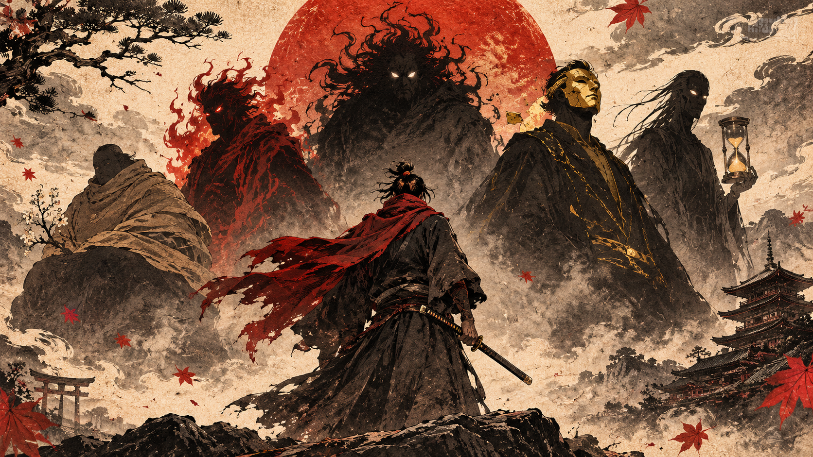

# Know Thyself — Five Enemies

[🇮🇩 Read in Bahasa Indonesia](five-enemies-id.md)

﷽

> Reminder. Every person fights five enemies; most lose to the first.
> Find yours.

## Summary

Every man fights five enemies — most lose to the first. Find yours.

## 1. Comfort

Comfort never attacks. It waits.
It has beaten more men than pain ever will.

## 2. Temper

The angry man is already beaten.
Whoever controls your mood controls you.

## 3. Fear

Fear is loudest right before you move.
Go anyway. It goes quiet after the first step.

## 4. Ego

Ego would rather lose than learn.
Bow first — every master was once a student.

## 5. Time

Time is the one enemy that never rests.
You can't beat it. You can only stop wasting it.

## Closing

Win the fight inside, and the rest gets easier.