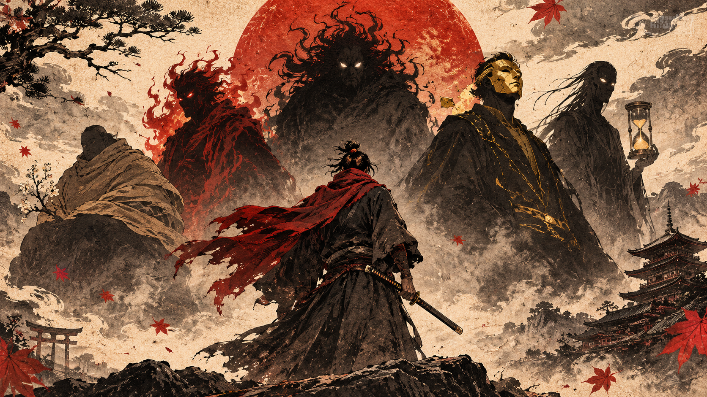

# Kenali Dirimu — Lima Musuh

[🇬🇧 Read in English](five-enemies-en.md)

﷽

> Pengingat. Setiap orang berperang melawan lima musuh; kebanyakan kalah di musuh pertama.
> Temukan milikmu.

## Ringkasan

Setiap orang berperang melawan lima musuh — kebanyakan kalah di yang pertama. Temukan milikmu.

## 1. Kenyamanan

Kenyamanan tidak pernah menyerang. Ia menunggu.
Ia sudah mengalahkan lebih banyak orang daripada rasa sakit.

## 2. Amarah

Orang yang marah sudah kalah.
Siapa pun yang mengendalikan suasana hatimu, dialah yang mengendalikanmu.

## 3. Rasa Takut

Rasa takut paling keras justru tepat sebelum kamu bergerak.
Tetap jalan. Ia akan mereda setelah langkah pertama.

## 4. Ego

Ego lebih memilih kalah daripada belajar.
Tunduklah lebih dulu — setiap master pernah menjadi murid.

## 5. Waktu

Waktu adalah satu-satunya musuh yang tidak pernah beristirahat.
Kamu tidak bisa mengalahkannya. Kamu hanya bisa berhenti menyia-nyiakannya.

## Penutup

Menangkan pertempuran di dalam diri, maka sisanya akan menjadi lebih mudah.