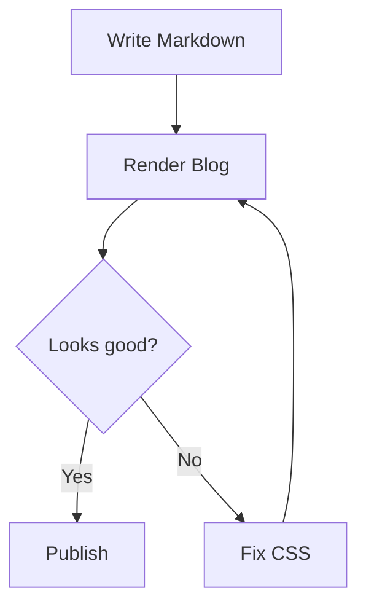

# Write for Fun, Build for Enjoy


[🇮🇩 Baca dalam Bahasa Indonesia](template-for-you-id.md)
[🇲🇾 Baca dalam Bahasa Melayu](template-for-you-ms.md)
[🇵🇭 Basahin sa Tagalog](template-for-you-tl.md)

> Render test template for [imoon07.github.io](https://imoon07.github.io/) — *Built portofolio to success.*

﷽

Hello, and welcome to my blog.

This blog is my space for exploration. It is where I write about things I am learning, try new ideas, save my experiments, and build things simply because it feels enjoyable.

I do not know everything yet, and I do not want to pretend that I do. I prefer to start from curiosity: try something, make a mistake, get confused, search online, make another mistake, and eventually make it work.

Think of this as my mantra:

> **Explore. Write. Build. Enjoy. Repeat.**

In a freer translation: explore, write, build, enjoy, repeat. In its more honest version: open the laptop, get confused, drink some water, and try again.

## Why this article exists

This is a **testing post** for my blog.

I recently redesigned the look of my blog, especially the typography, spacing, headings, lists, tables, images, links, and code blocks. Then I realized something: designing the layout is one thing, but making sure every type of content still renders properly is another story.

So this article is basically a practice ground. I throw almost every Markdown syntax at it, then see what looks good and what makes me think, “wait, why does it look like that?”

This article is written for two kinds of content:

- **Non-technical writing**, such as daily notes, opinions, reflections, and exploration stories.
- **Technical writing**, such as tutorials, learning notes, documentation, and experiments.

Think of it as a visual checklist:

- Is the heading hierarchy comfortable to read?
- Are paragraphs comfortable for long reading sessions?
- Do lists, tables, and callouts look clean?
- Do code blocks have syntax highlighting, line numbers, and a copy button?
- Do images, captions, and links work properly?
- Can YouTube appear as interactive media?
- Do footnotes, math, diagrams, and HTML elements remain safe?
- Does everything still make sense on mobile?

So yes, this is not a super serious article. It is a place for me to test my blog while still writing in a relaxed way.

> **Note:** If something looks strange, that means it is probably being tested. It is not necessarily your fault; I probably just have not found the bug yet.

## What is being tested?

- Reading comfort and typography for long-form content.
- Heading hierarchy and table of contents.
- Bold, italic, strikethrough, and inline code.
- Ordered lists, unordered lists, nested lists, and checklists.
- Blockquotes, nested blockquotes, and callouts.
- Inline technical content and special characters.
- Code blocks with syntax highlighting, line numbers, hover, selection, and copy.
- Long lines, whitespace, and source integrity.
- Reading progress.
- Local images, external images, captions, and fallbacks.
- Regular tables and wide tables.
- External links, internal anchors, autolinks, and reference links.
- Regular media and YouTube media.
- Footnotes, math, diagrams, and basic HTML.
- Responsive behavior across desktop, tablet, and mobile.
- Accessibility and keyboard/touch interactions.
- Long-form content integrity.

---

## 01 — Reading Experience

### A comfortable reading rhythm

Technical writing often alternates between explanation, commands, output, and interpretation. The transition between these elements should feel natural, not like riding a roller coaster without a seatbelt.

The body text should have a readable line length, generous but controlled line-height, and clear paragraph spacing. Headings should help readers understand the structure, not make the page feel like a corporate meeting.

Ideally, a reader can scan the article quickly, stop at an important paragraph, inspect a code block, and return to the explanation without losing their place.

Consider these common terms: `Content-Security-Policy`, `X-Forwarded-For`, `application/json`, `0xDEADBEEF`, `snake_case`, `camelCase`, `__init__()`, and `user_id`.

They should remain legible within normal sentences and wrap correctly when the viewport becomes narrow.

### Text formatting

This is **bold text**, *italic text*, and ~~strikethrough text~~.

You can also combine **bold emphasis** with `inline code`, reference an [external resource](https://example.com), or use an ordinary internal article anchor.

The styling should preserve readability without making every sentence look like a collection of colorful cards.

### Heading hierarchy

#### Third-level heading

##### Fourth-level heading

###### Sixth-level heading

These headings exist to test hierarchy and anchor generation. The table of contents should follow the renderer's configured heading-depth rules, avoid duplicate IDs, and maintain stable links.

## 02 — Article Metadata and Editorial Layout

The article header should accommodate:

- A prominent title and optional subtitle.
- Author avatar, name, and profile link.
- Publication date and optional update date.
- Estimated reading time.
- Categories, tags, and language selection.
- A short introduction or summary.
- Optional cover image.

Metadata should remain visually secondary to the article title. Long titles, multiple tags, missing avatars, and translated titles must not break the layout.

On mobile, metadata should wrap naturally rather than overflow horizontally, forcing readers to scroll sideways like they are reading a newspaper from 1998.

## 03 — Lists, Steps, and Technical Notes

### Investigation workflow

1. Establish the scope and objectives.
2. Prepare the testing environment.
3. Identify the relevant application components.
4. Execute the planned checks.
5. Record observations and supporting evidence.
6. Verify the findings.
7. Document conclusions and limitations.

### Nested procedures

1. **Environment preparation**
   - Verify system requirements.
   - Confirm network connectivity.
   - Check application dependencies.

2. **Testing**
   - Capture requests and responses.
   - Inspect relevant application behavior.
   - Compare observations with expected results.

3. **Reporting**
   - Summarize the evidence.
   - Explain the impact.
   - Document remediation options.

### Checklist

- [ ] Test environment documented.
- [ ] Application endpoints identified.
- [ ] All observations independently verified.
- [ ] Final report reviewed.

### Editorial callouts

> **Note:** Use callouts to provide supporting context without interrupting the main explanation.

> **Warning:** A warning should communicate a genuine risk. Do not use warning styling for ordinary information.

> **Important:** This article is only a rendering test. Nothing here needs to be taken too seriously.

These elements use standard Markdown blockquotes. If the renderer supports richer callouts, their presentation should be derived from a documented convention or existing metadata, not from fragile visual guesses.

## 04 — Inline Technical Content

Inline code should work inside paragraphs, lists, tables, and links.

For example, the command `sudo ./check-blog.sh` can be discussed in the same sentence as the expected HTTP status, an `application/json` response, or a configuration value such as `timeout_ms`.

Identifiers that differ only in capitalization must remain distinguishable: `ContentType`, `contentType`, `content_type`, and `CONTENT_TYPE`.

Special characters should survive parsing and rendering: `<`, `>`, `&`, quotes, backslashes, dollar signs, braces, brackets, and Unicode characters.

International text: Indonesia, 日本語, العربية, Español, Ελληνικά, and 🔐.

The renderer must not confuse literal code characters with HTML markup or Markdown syntax.

## 05 — Interactive Code Playground

This section tests the article renderer's primary code presentation feature.

The desired interface is one interactive playground with a language selector, rather than a separate UI card for every programming language. The reader should be able to choose a supported language and inspect its syntax highlighting while keeping the code panel, line numbers, controls, and reading position consistent.

### Playground requirements

- A searchable language selector when the number of available languages warrants it.
- Broad grammar support, including aliases and less common languages.
- Extensible language registration.
- Accurate line numbers and syntax highlighting.
- Line hover and a distinct active or selected line.
- Copy code without copying line numbers.
- Optional line wrapping.
- Horizontal scrolling for long source lines.
- Keyboard-accessible controls.
- A mobile-friendly selector and touch interactions.
- A readable plain-text fallback for unknown languages.
- No loss or mutation of the original source.

The language selector must not be presented as a built-in Markdown feature. Standard fenced Markdown identifies a code block and may identify its language, but a multi-language playground requires renderer-level functionality.

### Primary source fixture

The following is the single canonical code sample in this document. It deliberately contains enough lines, indentation, comments, strings, and nested structures to test the main code presentation.

```javascript
/**
 * Blog Renderer Test
 *
 * Inspect line numbers, syntax colors, indentation,
 * hover behavior, selection, copy, and scrolling.
 */

const configuration = {
  project: "My Personal Blog",
  environment: "local",
  features: {
    syntaxHighlighting: true,
    lineNumbers: true,
    copyButton: true,
    lineHighlighting: true,
  },
};

function summarizeNotes(notes) {
  return notes
    .filter((note) => note.published)
    .map((note, index) => ({
      number: index + 1,
      title: note.title,
      status: note.status,
    }));
}

async function loadArticle(url, options = {}) {
  if (!url) {
    throw new Error("An article URL is required");
  }

  const response = await fetch(url, {
    ...options,
    headers: {
      Accept: "application/json",
      ...options.headers,
    },
  });

  if (!response.ok) {
    throw new Error(`Request failed: HTTP ${response.status}`);
  }

  return response.json();
}

const exampleNotes = [
  {
    title: "Testing typography",
    status: "published",
    published: true,
  },
  {
    title: "Draft experiment",
    status: "draft",
    published: false,
  },
];

console.log(summarizeNotes(exampleNotes));
```

### Code interaction behavior

When the pointer moves across the source, the current line should receive a subtle highlight. The line-number gutter should remain aligned with the code, including when the code panel scrolls horizontally.

A selected line or range should have a separate visual state from hover. The interaction must not prevent ordinary text selection, keyboard navigation, or copying.

The copy button should provide visible and accessible feedback. If clipboard access fails, the reader should receive an appropriate fallback instead of a false “Copied!” state.

For large snippets, the interface may offer expand and collapse controls. Collapsing must never destroy the source content, and all hidden content must remain accessible through a clear interaction.

### Language support policy

The selector should expose the languages available through the chosen syntax-highlighting engine and any registered extensions.

The implementation must not rely on a hardcoded short list as its permanent language boundary. It should support language aliases, optional grammar loading, and graceful fallback when a grammar is unavailable.

A new language should be addable without redesigning the article page. Unknown languages must remain readable as plain text.

The source sample above is the canonical Markdown code fixture. Testing actual syntax across every supported grammar should be automated using a separate language corpus, rather than duplicating dozens of code blocks in this article.

## 06 — Long Lines, Whitespace, and Source Integrity

Long source lines should remain accessible without forcing the entire page to become wider than the viewport.

The renderer should offer horizontal scrolling by default for code where wrapping would damage alignment or meaning. If soft wrapping is available, line numbers must remain understandable even when one source line occupies several visual rows.

Whitespace matters. Indentation, blank lines, tabs, trailing newlines, and Unicode characters should be preserved according to the source and renderer's documented behavior.

A source line such as `if (response.status !== 200) {` must remain intact. Operators such as `===`, `!==`, `=>`, `->`, `::`, and `&&` must not be replaced by typographic lookalikes.

Line highlighting and line-number anchors should reference source lines, not merely the current visual rows.

## 07 — Reading Progress

The reading progress indicator should reflect the reader's actual position in the article.

It should:

- Update smoothly during scrolling.
- Remain unobtrusive.
- Handle short and long articles.
- Account for the article's actual content boundaries.
- Remain accurate when images finish loading.
- Avoid reporting completion while substantial article content remains unread.
- Respect reduced-motion preferences.

The progress indicator should complement the reading experience, not become an animation more interesting than the article itself.

## 08 — Table of Contents

The table of contents should be generated from eligible headings in the rendered Markdown.

Expected behavior:

- Nested heading structure.
- Stable heading anchors.
- An active section indicator.
- Smooth navigation when appropriate.
- Sticky navigation on desktop where space permits.
- A compact drawer, dropdown, or equivalent on mobile.
- Correct behavior for duplicate headings.
- No overlap with fixed headers or reading progress.
- No broken navigation when media changes document height.

TOC generation must use the same heading IDs as the actual rendered article.

## 09 — Images and External Media

### Local cover image


*Caption: local image test for cover rendering, responsive sizing, and fallback behavior.*

### Landscape image


*Caption: test image for responsive sizing, loading behavior, aspect ratio, and caption typography.*

### Additional image


*Caption: a second image for testing repeated media, spacing, and gallery transitions.*

### Media behavior

Test the following through ordinary Markdown images and supported links:

- Local images and externally hosted images.
- Portrait, landscape, and square aspect ratios.
- Alt text and captions.
- Lazy loading and reserved image dimensions.
- Image zoom or lightbox where supported.
- Broken URLs and unavailable media.
- Redirects, slow responses, and unsupported formats.
- Video and third-party embeds where the renderer explicitly supports them.

External image URLs should not be assumed to be universally fetchable. Browser restrictions, CORS, authentication, hotlink protection, and remote server failures can prevent access.

A failed image must not remove neighboring text, shift the reader unexpectedly, or break the TOC.

## 10 — Tables and Structured Data

| Feature | Expected behavior | Priority |
| --- | --- | --- |
| Syntax highlighting | Clear language-specific colors | Critical |
| Line numbers | Stable source-line alignment | Critical |
| Copy action | Copies source without the gutter | Critical |
| Reading progress | Accurate article position | High |
| Table of contents | Stable navigation and active section | High |
| Image lightbox | Accessible media enlargement | Medium |
| Related articles | Relevant navigation after the article | Medium |

### Wide technical table

| Endpoint | Method | Authentication | Content type | Expected response | Purpose |
| --- | --- | --- | --- | --- | --- |
| `/api/health` | `GET` | Optional | `application/json` | `200 OK` | Health check |
| `/api/notes` | `GET` | Required | `application/json` | `200 OK` | Retrieve notes |
| `/api/notes/export` | `POST` | Required | `application/json` | `202 Accepted` | Start export |
| `/api/notes/status` | `GET` | Required | `application/json` | `200 OK` | Check export status |

On narrow screens, a wide table should use a deliberate responsive strategy. Local horizontal scrolling is preferable to shrinking text until readers need a magnifying glass.

## 11 — Links and References

### External links

- [My GitHub Pages blog](https://github.com/iMoon07/imoon07.github.io/)
- [Example Domain](https://example.com)
- [GitHub](https://github.com)
- [MDN Web Docs](https://developer.mozilla.org)
- [Shiki documentation](https://shiki.style)
- [Rehype Pretty Code](https://rehype-pretty.pages.dev/)

External links should have recognizable styling, usable focus states, and appropriate handling for links that open a new tab.

### Link with title

[GitHub with title](https://github.com "Visit GitHub")

### Autolinks

https://example.com

<https://example.com>

### Reference links

This is a [reference link][gh].

[gh]: https://github.com "GitHub"

### Internal anchor

Jump back to [Reading Experience](#01--reading-experience).

Internal links should navigate to the correct article heading. Anchor generation must remain stable for repeated headings and headings containing punctuation or non-English characters.

## 12 — Regular Media and YouTube

Some articles need more than images and source code. The renderer should be able to distinguish between **regular media** and **YouTube media**.

There are two media behaviors to test:

1. **Regular media** — normal external links that remain regular links.
2. **YouTube media** — YouTube links that can be detected, fetched, and rendered as an interactive video card.

### Regular media

Regular media links should remain simple, accessible, and predictable. The renderer does not need to turn every external URL into an embed.

- [Example website](https://example.com)
- [GitHub repository](https://github.com)
- [MDN Web Docs](https://developer.mozilla.org)
- [Shiki documentation](https://shiki.style)

External links should have recognizable styling, usable focus states, and appropriate handling for links that open a new tab.

A regular link should not automatically become an embed. It should remain a normal link unless the renderer has an explicit rule for that domain.

### YouTube media

YouTube links are a special case. The renderer should be able to detect a YouTube URL, extract the video ID, fetch public metadata, and display an interactive video card.

The following link should be recognized as a YouTube video:

[Watch on YouTube](https://www.youtube.com/watch?v=8rkiwXkEA8M&list=PLsOgFqR0cppAEuYATcmAxyHeSTkWM4ZWj)

Expected renderer behavior:

- Detect the YouTube URL.
- Extract the video ID: `8rkiwXkEA8M`.
- Fetch public metadata through a safe backend endpoint.
- Display the video title, channel name, and high-quality thumbnail.
- Show a play button or interactive preview.
- Load the YouTube iframe only after the reader clicks play.
- Provide a direct fallback link if fetching or embedding fails.

The renderer should cache the fetched metadata so it does not request YouTube on every page load.

### YouTube thumbnail with play button

If interactive fetching is not available yet, this version should still render well: a YouTube thumbnail with a play button in the center.

<a
  href="https://www.youtube.com/watch?v=8rkiwXkEA8M&list=PLsOgFqR0cppAEuYATcmAxyHeSTkWM4ZWj"
  target="_blank"
  rel="noopener noreferrer"
  style="position: relative; display: block; max-width: 800px; margin: 0 auto;"
>
  

  <span
    style="
      position: absolute;
      top: 50%;
      left: 50%;
      transform: translate(-50%, -50%);
      width: 72px;
      height: 72px;
      background: rgba(0, 0, 0, 0.65);
      border-radius: 50%;
      display: flex;
      align-items: center;
      justify-content: center;
      color: white;
      font-size: 28px;
    "
  >
    ▶
  </span>
</a>

*Caption: YouTube thumbnail with a play button. Click the image to open the video.*

### YouTube embed fallback

If the renderer supports YouTube iframes, the video should render directly.

<iframe
  width="100%"
  height="480"
  src="https://www.youtube.com/embed/8rkiwXkEA8M"
  title="YouTube video player"
  frameborder="0"
  allow="accelerometer; autoplay; clipboard-write; encrypted-media; gyroscope; picture-in-picture; web-share"
  allowfullscreen>
</iframe>

Each media type should have a clear fallback. If an external embed cannot load, the reader should still have access to the surrounding explanation and a direct link where available.

Do not execute arbitrary scripts from Markdown. HTML, embeds, SVG, and externally supplied content must follow the application's sanitization and security policy.

External metadata should be fetched through a controlled backend, with request timeouts, response-size limits, caching, and validation for allowed domains.

## 13 — Responsive Reading

Evaluate the same article at desktop, tablet, and mobile widths.

### Desktop

The article should have a comfortable prose column, with wider code panels where appropriate. A sticky TOC may occupy the side column if sufficient space exists.

### Tablet

The article should retain readable text and code. Secondary navigation may become more compact, and code controls should not compete for horizontal space.

### Mobile

The article should prioritize the text and keep interactive controls usable with touch. Code blocks may scroll horizontally within their own boundaries. Tables should remain accessible, images should scale correctly, and sticky elements must not obscure the content.

Test both portrait and landscape orientation, browser zoom, and increased text size.

## 14 — Accessibility and Interaction

All essential interactions must work without a mouse.

- Keyboard-accessible language selection.
- Clear focus indicators.
- Accessible copy feedback.
- Screen-reader-friendly line-number behavior.
- Sufficient contrast in light and dark themes.
- Reduced-motion support.
- Touch alternatives to hover interactions.
- Meaningful image alt text.
- Semantic headings, lists, tables, and links.

Syntax colors must not be the only way to communicate important information. Hover effects should remain subtle and must not interfere with text selection.

## 15 — Long-Form Content Integrity

This fixture should also be combined with generated stress-test documents.

Test progressively larger Markdown documents, for example 10 KB, 100 KB, 1 MB, and larger sizes appropriate to the application.

Include repeated paragraphs, nested headings, large lists, wide tables, remote images, and code samples containing thousands of lines.

Verify that:

- Every source paragraph remains accessible.
- No source lines disappear.
- Character encoding and indentation remain correct.
- Headings and anchors remain valid.
- Copy actions return the intended source.
- Rendering does not duplicate content.
- Media failures do not erase unrelated sections.
- The page does not acquire unwanted horizontal overflow.
- Memory usage and rendering latency are measured.
- Resource limits are handled explicitly rather than through silent truncation.

Do not claim mathematical unlimitedness. The requirement is to avoid arbitrary content-length limits and ensure that large documents have a defined, tested performance strategy.

If progressive rendering or virtualization is needed, preserve search, selection, source-line numbering, anchor navigation, and access to the complete article.

## 16 — Extended Markdown Coverage

This section tests additional syntax that is often useful for both technical and non-technical writing.

### Line breaks

This is the first line.  
This is the second line using two trailing spaces.

This is another line using a backslash.\
This should also break.

### Escaping

\*This should not become italic.\*

\# This should not become a heading.

\`This should not become inline code.\`

### Nested blockquote

> First level
>
> > Second level
> >
> > > Third level

### Footnotes

This sentence has a footnote.[^1]

[^1]: This is the footnote content.

### Ordered list with custom start

3. Third item
4. Fourth item
5. Fifth item

### Emphasis nesting

***Bold italic text***

**Bold with *nested italic* text**

*Italic with **nested bold** text*

### Code block without language

```
This is plain text.
No syntax highlighting expected.
```

### HTML-based elements

<details>
  <summary>Click to expand</summary>

  This content is inside a collapsible section.

</details>

Press <kbd>Ctrl</kbd> + <kbd>C</kbd> to copy.

<mark>Highlighted text</mark>

### Math

Inline math: $E = mc^2$

Block math:

$$
\int_{a}^{b} f(x)\,dx
$$

### Mermaid diagram



### Definition list

Term
: Definition of the term.

Another term
: Another definition.

### Highlight, subscript, and superscript

This is ==highlighted text==.

Water is H~2~O.

This is x^2^.

> **Note:** `footnotes`, `math`, `mermaid`, `==highlight==`, `~subscript~`, and `^superscript^` depend on renderer extensions. If they do not render, it does not necessarily mean the base Markdown is wrong.

## 17 — Final Verification Checklist

- [ ] Markdown content remains intact.
- [ ] Typography is comfortable for long reading sessions.
- [ ] Heading hierarchy and TOC agree.
- [ ] Reading progress follows the actual article.
- [ ] The code playground supports all registered grammars.
- [ ] Unknown languages fall back gracefully.
- [ ] Line numbers correspond to source lines.
- [ ] Hover does not interfere with selection.
- [ ] Copy excludes presentation-only line numbers.
- [ ] Long code lines do not overflow the entire page.
- [ ] Whitespace and Unicode characters are preserved.
- [ ] Wide tables remain usable on mobile.
- [ ] Images have appropriate fallbacks.
- [ ] External links, internal anchors, autolinks, and reference links work.
- [ ] Regular media links remain regular links.
- [ ] YouTube thumbnails with play buttons render correctly.
- [ ] YouTube embeds or metadata fetching work according to renderer capability.
- [ ] Footnotes, math, diagrams, and HTML elements render safely.
- [ ] Keyboard and touch interactions work.
- [ ] Browser zoom does not hide content.
- [ ] Large documents are tested for performance.
- [ ] No arbitrary character limit silently truncates the article.
- [ ] The existing Discuss feature remains functional.

## 18 — Alur Visual Lab

> **Note:** This section is a live render test for the Alur engine. Every block below is a fenced ` ```alur ` diagram. The engine source lives in `imoon07.github.io/js/alur/`. **Preview/playground:** `http://localhost:8000/imoon07.github.io/preview.html` (or `https://iMoon07.github.io/preview.html`) — switch module, template, cable, motion, speed, and pick from all 575 logos.

### 18.1 Flow with logos

A layered request path. Nodes carry real logos from the full local library (575 logos from `iMoon07/logo-svg`), including security tools.

```alur
{
  "module": "flow",
  "title": "Request path with logos",
  "cable": "neon",
  "motion": "comet",
  "columns": [
    [
      "client"
    ],
    [
      "edge"
    ],
    [
      "app1",
      "app2"
    ],
    [
      "db"
    ],
    [
      "sec1",
      "sec2"
    ]
  ],
  "nodes": {
    "client": {
      "label": "Client",
      "sub": "browser",
      "logo": "stack:github",
      "color": "blue"
    },
    "edge": {
      "label": "Edge",
      "sub": "nginx",
      "logo": "stack:nginx",
      "color": "cyan"
    },
    "app1": {
      "label": "App A",
      "sub": "node",
      "logo": "programming:nodejs",
      "color": "green"
    },
    "app2": {
      "label": "App B",
      "sub": "python",
      "logo": "programming:python",
      "color": "amber"
    },
    "db": {
      "label": "Data",
      "sub": "postgres + redis",
      "logos": [
        "stack:postgresql",
        "stack:redis"
      ],
      "color": "purple"
    },
    "sec1": {
      "label": "Wireshark",
      "sub": "capture",
      "logo": "security:wireshark",
      "color": "lime"
    },
    "sec2": {
      "label": "Nmap",
      "sub": "scan",
      "logo": "security:nmap",
      "color": "amber"
    }
  },
  "edges": [
    {
      "from": "client",
      "to": "edge",
      "label": "TLS"
    },
    {
      "from": "edge",
      "to": "app1"
    },
    {
      "from": "edge",
      "to": "app2"
    },
    {
      "from": "app1",
      "to": "db"
    },
    {
      "from": "app2",
      "to": "db"
    },
    {
      "from": "app1",
      "to": "sec1"
    },
    {
      "from": "app2",
      "to": "sec2"
    }
  ]
}
```

### 18.2 Reverse proxy — one front, many backends

TLS termination, routing, caching, and load-balancing at the edge layer.

```alur
{
  "module": "reverse-proxy",
  "title": "Reverse Proxy: Single Front, Many Backends",
  "speed": 1
}
```

### 18.3 Pipeline — ordered stages with logos

Covers producer/consumer, CPU scheduling, CDN cache layers, and request pipelines.

```alur
{
  "module": "pipeline",
  "title": "Request pipeline",
  "stages": [
    {
      "label": "Client",
      "logo": "stack:github"
    },
    {
      "label": "Edge",
      "logo": "stack:nginx"
    },
    {
      "label": "App",
      "logo": "programming:nodejs"
    },
    {
      "label": "DB",
      "logo": "stack:postgresql"
    }
  ],
  "color": "cyan",
  "items": 4
}
```

### 18.4 Graph — BFS frontier

Nodes, edges, and an animated frontier. Covers BFS, topological order, and MST-style demos.

```alur
{
  "module": "graph",
  "title": "BFS traversal",
  "color": "green",
  "start": "a",
  "nodes": [
    {
      "id": "a",
      "x": 140,
      "y": 90,
      "label": "A",
      "logo": "stack:docker"
    },
    {
      "id": "b",
      "x": 330,
      "y": 60,
      "label": "B"
    },
    {
      "id": "c",
      "x": 330,
      "y": 150,
      "label": "C"
    },
    {
      "id": "d",
      "x": 520,
      "y": 40,
      "label": "D"
    },
    {
      "id": "e",
      "x": 520,
      "y": 120,
      "label": "E",
      "logo": "stack:kubernetes"
    },
    {
      "id": "f",
      "x": 520,
      "y": 200,
      "label": "F"
    },
    {
      "id": "g",
      "x": 710,
      "y": 80,
      "label": "G",
      "logo": "stack:prometheus"
    },
    {
      "id": "h",
      "x": 710,
      "y": 170,
      "label": "H",
      "logo": "stack:grafana"
    }
  ],
  "edges": [
    {
      "from": "a",
      "to": "b",
      "w": 4
    },
    {
      "from": "a",
      "to": "c",
      "w": 2
    },
    {
      "from": "b",
      "to": "d",
      "w": 5
    },
    {
      "from": "b",
      "to": "e",
      "w": 3
    },
    {
      "from": "c",
      "to": "e",
      "w": 2
    },
    {
      "from": "c",
      "to": "f",
      "w": 6
    },
    {
      "from": "d",
      "to": "g",
      "w": 4
    },
    {
      "from": "e",
      "to": "g",
      "w": 2
    },
    {
      "from": "e",
      "to": "h",
      "w": 5
    },
    {
      "from": "f",
      "to": "h",
      "w": 3
    }
  ]
}
```

### 18.5 Cable styles

One path, many looks: neon, bundle, relay, ribbon, dashed, circuit. Set `cable` per edge or per diagram.

```alur
{
  "module": "flow",
  "title": "Cable styles",
  "cable": "solid",
  "columns": [
    [
      "a",
      "b",
      "c"
    ],
    [
      "d",
      "e",
      "f"
    ]
  ],
  "nodes": {
    "a": {
      "label": "Alpha",
      "color": "blue"
    },
    "b": {
      "label": "Beta",
      "color": "green"
    },
    "c": {
      "label": "Gamma",
      "color": "amber"
    },
    "d": {
      "label": "Delta",
      "color": "purple"
    },
    "e": {
      "label": "Epsilon",
      "color": "cyan"
    },
    "f": {
      "label": "Zeta",
      "color": "pink"
    }
  },
  "edges": [
    {
      "from": "a",
      "to": "d",
      "cable": "neon",
      "motion": "none"
    },
    {
      "from": "b",
      "to": "e",
      "cable": "bundle",
      "motion": "none"
    },
    {
      "from": "c",
      "to": "f",
      "cable": "relay",
      "motion": "none"
    },
    {
      "from": "a",
      "to": "d",
      "cable": "ribbon",
      "motion": "none"
    },
    {
      "from": "b",
      "to": "e",
      "cable": "dashed",
      "motion": "none"
    },
    {
      "from": "c",
      "to": "f",
      "cable": "circuit",
      "motion": "none"
    }
  ]
}
```

### 18.6 Motion effects

Data movement: comet, packets, flowMany, dash, draw, relay. Set `motion` per edge.

```alur
{
  "module": "flow",
  "title": "Motion effects",
  "cable": "solid",
  "columns": [
    [
      "a",
      "b",
      "c"
    ],
    [
      "d",
      "e",
      "f"
    ]
  ],
  "nodes": {
    "a": {
      "label": "Alpha",
      "color": "blue"
    },
    "b": {
      "label": "Beta",
      "color": "green"
    },
    "c": {
      "label": "Gamma",
      "color": "amber"
    },
    "d": {
      "label": "Delta",
      "color": "purple"
    },
    "e": {
      "label": "Epsilon",
      "color": "cyan"
    },
    "f": {
      "label": "Zeta",
      "color": "pink"
    }
  },
  "edges": [
    {
      "from": "a",
      "to": "d",
      "motion": "comet"
    },
    {
      "from": "b",
      "to": "e",
      "motion": "packets"
    },
    {
      "from": "c",
      "to": "f",
      "motion": "flowMany"
    },
    {
      "from": "a",
      "to": "d",
      "motion": "dash"
    },
    {
      "from": "b",
      "to": "e",
      "motion": "draw"
    },
    {
      "from": "c",
      "to": "f",
      "motion": "relay"
    }
  ]
}
```

### 18.7 Charts

The chart module covers the usual analytics set. Each block is a live SVG.

#### 18.7.1 Bar

```alur
{
  "module": "chart",
  "type": "bar",
  "title": "Bar",
  "labels": [
    "Jan",
    "Feb",
    "Mar",
    "Apr",
    "May"
  ],
  "data": [
    12,
    18,
    15,
    22,
    28
  ],
  "color": "blue"
}
```

#### 18.7.2 Horizontal bar ranking

```alur
{
  "module": "chart",
  "type": "hbar",
  "title": "Horizontal bar ranking",
  "labels": [
    "Nginx",
    "Postgres",
    "Redis",
    "PHP",
    "Go"
  ],
  "data": [
    42,
    31,
    24,
    18,
    12
  ],
  "color": "cyan"
}
```

#### 18.7.3 Multi-series line

```alur
{
  "module": "chart",
  "type": "line",
  "title": "Multi-series line",
  "labels": [
    "Mon",
    "Tue",
    "Wed",
    "Thu",
    "Fri"
  ],
  "series": [
    {
      "name": "web",
      "data": [
        12,
        18,
        15,
        22,
        28
      ],
      "color": "blue"
    },
    {
      "name": "api",
      "data": [
        8,
        11,
        14,
        12,
        18
      ],
      "color": "green"
    }
  ]
}
```

#### 18.7.4 Area

```alur
{
  "module": "chart",
  "type": "area",
  "title": "Area",
  "labels": [
    "Mon",
    "Tue",
    "Wed",
    "Thu",
    "Fri"
  ],
  "data": [
    8,
    12,
    10,
    16,
    20
  ],
  "color": "cyan"
}
```

#### 18.7.5 Stacked bar composition

```alur
{
  "module": "chart",
  "type": "stacked",
  "title": "Stacked bar composition",
  "labels": [
    "Mon",
    "Tue",
    "Wed",
    "Thu"
  ],
  "series": [
    {
      "name": "web",
      "data": [
        12,
        14,
        10,
        16
      ],
      "color": "blue"
    },
    {
      "name": "api",
      "data": [
        8,
        9,
        12,
        11
      ],
      "color": "green"
    },
    {
      "name": "job",
      "data": [
        5,
        6,
        4,
        7
      ],
      "color": "amber"
    }
  ]
}
```

#### 18.7.6 Donut percent breakdown

```alur
{
  "module": "chart",
  "type": "donut",
  "title": "Donut percent breakdown",
  "labels": [
    "Web",
    "API",
    "DB",
    "Cache"
  ],
  "data": [
    38,
    27,
    21,
    14
  ],
  "colors": [
    "blue",
    "green",
    "amber",
    "purple"
  ],
  "centerLabel": "requests"
}
```

#### 18.7.7 Single-value percent gauge

```alur
{
  "module": "chart",
  "type": "gauge",
  "title": "Single-value percent gauge",
  "data": [
    68
  ],
  "max": 100,
  "unit": "%",
  "label": "cache hit",
  "color": "cyan"
}
```

#### 18.7.8 Spark line

```alur
{
  "module": "chart",
  "type": "spark",
  "title": "Spark line",
  "data": [
    3,
    5,
    4,
    7,
    6,
    9,
    8,
    11
  ],
  "color": "green"
}
```

#### 18.7.9 KPI callout

```alur
{
  "module": "chart",
  "type": "kpi",
  "title": "KPI callout",
  "data": [
    128
  ],
  "label": "requests / sec",
  "delta": "+12.4%"
}
```

#### 18.7.10 Scatter plot

```alur
{
  "module": "chart",
  "type": "scatter",
  "title": "Scatter plot",
  "data": [
    [
      3,
      5
    ],
    [
      5,
      8
    ],
    [
      8,
      7
    ],
    [
      11,
      12
    ],
    [
      14,
      13
    ],
    [
      17,
      18
    ],
    [
      20,
      17
    ]
  ],
  "color": "purple"
}
```

#### 18.7.11 Waterfall

```alur
{
  "module": "chart",
  "type": "waterfall",
  "title": "Waterfall",
  "labels": [
    "Start",
    "Add",
    "Cache",
    "Drop",
    "End"
  ],
  "data": [
    40,
    18,
    12,
    -9,
    21
  ],
  "color": "blue"
}
```

#### 18.7.12 Funnel conversion

```alur
{
  "module": "chart",
  "type": "funnel",
  "title": "Funnel conversion",
  "labels": [
    "Visit",
    "Signup",
    "Active",
    "Paid"
  ],
  "data": [
    100,
    62,
    38,
    17
  ],
  "colors": [
    "blue",
    "cyan",
    "green",
    "amber"
  ]
}
```

#### 18.7.13 Bell curve with marker

```alur
{
  "module": "chart",
  "type": "bell",
  "title": "Bell curve with marker",
  "mean": 0,
  "sigma": 1,
  "marker": 0.6,
  "markerLabel": "p95",
  "color": "blue"
}
```

#### 18.7.14 Histogram

```alur
{
  "module": "chart",
  "type": "histogram",
  "title": "Histogram",
  "bins": 8,
  "data": [
    1,
    2,
    2,
    3,
    3,
    3,
    4,
    4,
    4,
    5,
    5,
    6
  ],
  "color": "cyan"
}
```

#### 18.7.15 Stacked area trend

```alur
{
  "module": "chart",
  "type": "stackedArea",
  "title": "Stacked area trend",
  "labels": [
    "Mon",
    "Tue",
    "Wed",
    "Thu",
    "Fri"
  ],
  "series": [
    {
      "name": "web",
      "data": [
        8,
        10,
        9,
        12,
        14
      ],
      "color": "blue"
    },
    {
      "name": "api",
      "data": [
        5,
        6,
        7,
        6,
        9
      ],
      "color": "green"
    },
    {
      "name": "job",
      "data": [
        3,
        4,
        3,
        5,
        6
      ],
      "color": "amber"
    }
  ]
}
```

#### 18.7.16 Treemap

```alur
{
  "module": "chart",
  "type": "treemap",
  "title": "Treemap",
  "labels": [
    "Web",
    "API",
    "DB",
    "Cache",
    "Queue"
  ],
  "data": [
    38,
    27,
    18,
    11,
    6
  ],
  "colors": [
    "blue",
    "green",
    "amber",
    "purple",
    "pink"
  ]
}
```

#### 18.7.17 Box plot

```alur
{
  "module": "chart",
  "type": "box",
  "title": "Box plot",
  "boxes": [
    {
      "label": "Web",
      "min": 2,
      "q1": 5,
      "median": 8,
      "q3": 11,
      "max": 14
    },
    {
      "label": "API",
      "min": 3,
      "q1": 6,
      "median": 9,
      "q3": 12,
      "max": 16
    },
    {
      "label": "DB",
      "min": 1,
      "q1": 4,
      "median": 7,
      "q3": 10,
      "max": 13
    }
  ]
}
```

#### 18.7.18 Range bar with thresholds

```alur
{
  "module": "chart",
  "type": "range",
  "title": "Range bar with thresholds",
  "items": [
    {
      "label": "p50",
      "from": 20,
      "to": 60
    },
    {
      "label": "p95",
      "from": 70,
      "to": 140
    },
    {
      "label": "p99",
      "from": 150,
      "to": 260
    }
  ],
  "color": "amber"
}
```

#### 18.7.19 Density curve

```alur
{
  "module": "chart",
  "type": "density",
  "title": "Density curve",
  "series": [
    {
      "name": "web",
      "data": [
        0.05,
        0.2,
        0.6,
        0.9,
        0.6,
        0.2,
        0.05
      ],
      "color": "blue"
    },
    {
      "name": "api",
      "data": [
        0.1,
        0.3,
        0.5,
        0.7,
        0.5,
        0.3,
        0.1
      ],
      "color": "amber"
    }
  ]
}
```

#### 18.7.20 Slope chart

```alur
{
  "module": "chart",
  "type": "slope",
  "title": "Slope chart",
  "items": [
    {
      "label": "Web",
      "before": 20,
      "after": 48
    },
    {
      "label": "API",
      "before": 35,
      "after": 28
    },
    {
      "label": "DB",
      "before": 12,
      "after": 26
    }
  ],
  "color": "cyan"
}
```

#### 18.7.21 Two-axis combo

```alur
{
  "module": "chart",
  "type": "combo",
  "title": "Two-axis combo",
  "labels": [
    "Mon",
    "Tue",
    "Wed",
    "Thu",
    "Fri"
  ],
  "bars": [
    120,
    140,
    130,
    160,
    180
  ],
  "line": [
    3,
    4,
    3.5,
    5,
    6
  ],
  "color": "blue"
}
```

#### 18.7.22 Annotated timeline

```alur
{
  "module": "chart",
  "type": "timeline",
  "title": "Annotated timeline",
  "events": [
    {
      "label": "deploy",
      "at": 0.1
    },
    {
      "label": "cache warm",
      "at": 0.35
    },
    {
      "label": "peak",
      "at": 0.6
    },
    {
      "label": "rollback drill",
      "at": 0.85
    }
  ],
  "color": "green"
}
```

#### 18.7.23 Bubble chart

```alur
{
  "module": "chart",
  "type": "bubble",
  "title": "Bubble chart",
  "data": [
    [
      3,
      4,
      2
    ],
    [
      5,
      7,
      4
    ],
    [
      8,
      6,
      3
    ],
    [
      11,
      9,
      5
    ],
    [
      14,
      12,
      6
    ],
    [
      17,
      11,
      4
    ]
  ],
  "color": "purple"
}
```

#### 18.7.24 Dumbbell plot

```alur
{
  "module": "chart",
  "type": "dumbbell",
  "title": "Dumbbell plot",
  "items": [
    {
      "label": "Web",
      "a": 20,
      "b": 48
    },
    {
      "label": "API",
      "a": 35,
      "b": 28
    },
    {
      "label": "DB",
      "a": 12,
      "b": 26
    }
  ]
}
```

#### 18.7.25 Quadrant matrix

```alur
{
  "module": "chart",
  "type": "quadrant",
  "title": "Quadrant matrix",
  "q1": "scale",
  "q2": "invest",
  "q3": "fix",
  "q4": "watch",
  "data": [
    [
      2,
      8
    ],
    [
      5,
      6
    ],
    [
      7,
      3
    ],
    [
      9,
      7
    ],
    [
      4,
      4
    ]
  ],
  "color": "cyan"
}
```

#### 18.7.26 Process flow steps

```alur
{
  "module": "chart",
  "type": "process",
  "title": "Process flow steps",
  "steps": [
    "plan",
    "build",
    "test",
    "ship"
  ],
  "color": "green"
}
```

#### 18.7.27 Cycle loop stages

```alur
{
  "module": "chart",
  "type": "cycle",
  "title": "Cycle loop stages",
  "steps": [
    "plan",
    "build",
    "test",
    "ship"
  ],
  "color": "purple"
}
```

#### 18.7.28 Progress bar stack

```alur
{
  "module": "chart",
  "type": "progress",
  "title": "Progress bar stack",
  "items": [
    {
      "label": "Web",
      "parts": [
        {
          "value": 60,
          "color": "blue"
        },
        {
          "value": 25,
          "color": "green"
        },
        {
          "value": 15,
          "color": "amber"
        }
      ]
    },
    {
      "label": "API",
      "parts": [
        {
          "value": 40,
          "color": "cyan"
        },
        {
          "value": 35,
          "color": "purple"
        },
        {
          "value": 25,
          "color": "pink"
        }
      ]
    }
  ]
}
```

#### 18.7.29 Comparison table

```alur
{
  "module": "chart",
  "type": "table",
  "title": "Comparison table",
  "columns": [
    "Tool",
    "Speed",
    "Cost",
    "Use"
  ],
  "rows": [
    [
      "Nginx",
      "fast",
      "low",
      "edge"
    ],
    [
      "Postgres",
      "medium",
      "medium",
      "data"
    ],
    [
      "Redis",
      "fast",
      "high",
      "cache"
    ]
  ]
}
```


### 18.8 Logo library — security tools

All 575 logos from `iMoon07/logo-svg` are available to every node (`"logo": "security:nmap"`). This section groups the security catalogue by hacking phase: recon, exploitation, post-exploitation, and forensics. Every node is a tool; the logo is the catalogue entry.

#### Recon & enumeration

```topology
{
  "title": "Recon & enumeration",
  "columns": [
    [
      "nmap",
      "masscan",
      "netdiscover",
      "arping",
      "unicornscan",
      "hping3",
      "thcping6",
      "nbtscan"
    ],
    [
      "amass",
      "dnsrecon",
      "dnsenum",
      "dnsmap",
      "fierce",
      "dmitry",
      "theharvester"
    ],
    [
      "spiderfoot",
      "maltego",
      "recon-ng",
      "metagoofil",
      "cewl",
      "wordlists",
      "eyewitness",
      "hashid"
    ],
    [
      "whatweb",
      "wafw00f",
      "dirsearch",
      "gobuster",
      "ffuf",
      "wfuzz",
      "dirb"
    ]
  ],
  "nodes": {
    "nmap": [
      "Nmap",
      "Port scanner",
      "security:nmap",
      "tech"
    ],
    "masscan": [
      "Masscan",
      "Fast scanner",
      "security:masscan",
      "tech"
    ],
    "netdiscover": [
      "Netdiscover",
      "ARP sweep",
      "security:netdiscover",
      "tech"
    ],
    "arping": [
      "Arping",
      "ARP ping",
      "security:arping",
      "tech"
    ],
    "unicornscan": [
      "Unicornscan",
      "Async scanner",
      "security:unicornscan",
      "tech"
    ],
    "hping3": [
      "Hping3",
      "Packet crafter",
      "security:hping3",
      "tech"
    ],
    "thcping6": [
      "THC-ping6",
      "IPv6 ping",
      "security:thcping6",
      "tech"
    ],
    "nbtscan": [
      "NBTscan",
      "NetBIOS scan",
      "security:nbtscan",
      "tech"
    ],
    "amass": [
      "Amass",
      "Subdomain enum",
      "security:amass",
      "tech"
    ],
    "dnsrecon": [
      "DNSRecon",
      "DNS enum",
      "security:dnsrecon",
      "tech"
    ],
    "dnsenum": [
      "DNSEnum",
      "DNS brute",
      "security:dnsenum",
      "tech"
    ],
    "dnsmap": [
      "DNSmap",
      "DNS brute",
      "security:dnsmap",
      "tech"
    ],
    "fierce": [
      "Fierce",
      "DNS recon",
      "security:fierce",
      "tech"
    ],
    "dmitry": [
      "Dmitry",
      "Host info",
      "security:dmitry",
      "tech"
    ],
    "theharvester": [
      "theHarvester",
      "Email OSINT",
      "security:theharvester",
      "tech"
    ],
    "spiderfoot": [
      "SpiderFoot",
      "OSINT automation",
      "security:spiderfoot",
      "tech"
    ],
    "maltego": [
      "Maltego",
      "Link analysis",
      "security:maltego",
      "tech"
    ],
    "recon-ng": [
      "recon-ng",
      "OSINT framework",
      "security:recon-ng",
      "tech"
    ],
    "metagoofil": [
      "Metagoofil",
      "Metadata OSINT",
      "security:metagoofil",
      "tech"
    ],
    "cewl": [
      "CeWL",
      "Wordlist gen",
      "security:cewl",
      "tech"
    ],
    "wordlists": [
      "Wordlists",
      "Payload lists",
      "security:wordlists",
      "tech"
    ],
    "eyewitness": [
      "EyeWitness",
      "Screenshot",
      "security:eyewitness",
      "tech"
    ],
    "hashid": [
      "HashID",
      "Hash ID",
      "security:hashid",
      "tech"
    ],
    "whatweb": [
      "WhatWeb",
      "Web fingerprint",
      "security:whatweb",
      "tech"
    ],
    "wafw00f": [
      "WAFW00F",
      "WAF detect",
      "security:wafw00f",
      "tech"
    ],
    "dirsearch": [
      "Dirsearch",
      "Path brute",
      "security:dirsearch",
      "tech"
    ],
    "gobuster": [
      "Gobuster",
      "Path brute",
      "security:gobuster",
      "tech"
    ],
    "ffuf": [
      "FFUF",
      "Fuzzer",
      "security:ffuf",
      "tech"
    ],
    "wfuzz": [
      "WFuzz",
      "Fuzzer",
      "security:wfuzz",
      "tech"
    ],
    "dirb": [
      "DirB",
      "Path brute",
      "security:dirb",
      "tech"
    ]
  },
  "groups": [
    [
      "Discovery",
      [
        "nmap",
        "masscan",
        "netdiscover",
        "arping",
        "unicornscan",
        "hping3",
        "thcping6",
        "nbtscan"
      ],
      "crosshair"
    ],
    [
      "DNS & OSINT",
      [
        "amass",
        "dnsrecon",
        "dnsenum",
        "dnsmap",
        "fierce",
        "dmitry",
        "theharvester"
      ],
      "globe"
    ],
    [
      "OSINT & web",
      [
        "spiderfoot",
        "maltego",
        "recon-ng",
        "metagoofil",
        "cewl",
        "wordlists",
        "eyewitness",
        "hashid"
      ],
      "scan"
    ],
    [
      "Web enumeration",
      [
        "whatweb",
        "wafw00f",
        "dirsearch",
        "gobuster",
        "ffuf",
        "wfuzz",
        "dirb"
      ],
      "terminal"
    ]
  ],
  "facilities": [
    "Security",
    [
      "shield",
      "Hacking toolkit"
    ],
    [
      "terminal",
      "CLI first"
    ]
  ]
}
```

How to read: each column is a recon phase. Top to bottom, the tools move from network discovery to DNS/OSINT to web enumeration. Every node is a tool; the logo is from the local security catalogue.

#### Exploitation

```topology
{
  "title": "Exploitation",
  "columns": [
    [
      "metasploit",
      "msfpc",
      "armitage",
      "covenant",
      "havoc",
      "starkiller",
      "exploit-db",
      "setoolkit"
    ],
    [
      "sqlmap",
      "sqlninja",
      "sqlsus",
      "commix",
      "w3af",
      "wapiti",
      "zaproxy",
      "webscarab"
    ],
    [
      "burp",
      "burp-suite",
      "nikto",
      "skipfish",
      "wpscan",
      "jboss-autopwn",
      "davtest",
      "parsero"
    ],
    [
      "shellter",
      "veil",
      "backdoor-factory",
      "laudanum",
      "weevely",
      "webshells",
      "nishang",
      "powersploit",
      "powershell-empire",
      "king-phisher-icon",
      "beef-xss"
    ]
  ],
  "nodes": {
    "metasploit": [
      "Metasploit",
      "Exploit framework",
      "security:metasploit",
      "tech"
    ],
    "msfpc": [
      "MSFPC",
      "Payload maker",
      "security:msfpc",
      "tech"
    ],
    "armitage": [
      "Armitage",
      "GUI framework",
      "security:armitage",
      "tech"
    ],
    "covenant": [
      "Covenant",
      "C2 framework",
      "security:covenant",
      "tech"
    ],
    "havoc": [
      "Havoc",
      "C2 framework",
      "security:havoc",
      "tech"
    ],
    "starkiller": [
      "Starkiller",
      "C2 GUI",
      "security:starkiller",
      "tech"
    ],
    "exploit-db": [
      "Exploit-DB",
      "Exploit index",
      "security:exploit-db",
      "tech"
    ],
    "setoolkit": [
      "SET",
      "Social toolkit",
      "security:setoolkit",
      "tech"
    ],
    "sqlmap": [
      "SQLMap",
      "SQL injection",
      "security:sqlmap",
      "tech"
    ],
    "sqlninja": [
      "SQLNinja",
      "SQL injection",
      "security:sqlninja",
      "tech"
    ],
    "sqlsus": [
      "SQLSUS",
      "SQL injection",
      "security:sqlsus",
      "tech"
    ],
    "commix": [
      "Commix",
      "Command injection",
      "security:commix",
      "tech"
    ],
    "w3af": [
      "W3AF",
      "Web auditor",
      "security:w3af",
      "tech"
    ],
    "wapiti": [
      "Wapiti",
      "Web scanner",
      "security:wapiti",
      "tech"
    ],
    "zaproxy": [
      "ZAP",
      "Web proxy",
      "security:zaproxy",
      "tech"
    ],
    "webscarab": [
      "WebScarab",
      "Web proxy",
      "security:webscarab",
      "tech"
    ],
    "burp": [
      "Burp",
      "Web proxy",
      "security:burp",
      "tech"
    ],
    "burp-suite": [
      "Burp Suite",
      "Web proxy",
      "security:burp-suite",
      "tech"
    ],
    "nikto": [
      "Nikto",
      "Web scanner",
      "security:nikto",
      "tech"
    ],
    "skipfish": [
      "Skipfish",
      "Web scanner",
      "security:skipfish",
      "tech"
    ],
    "wpscan": [
      "WPScan",
      "WordPress scan",
      "security:wpscan",
      "tech"
    ],
    "jboss-autopwn": [
      "JBoss Autopwn",
      "JBoss exploit",
      "security:jboss-autopwn",
      "tech"
    ],
    "davtest": [
      "DAVTest",
      "WebDAV test",
      "security:davtest",
      "tech"
    ],
    "parsero": [
      "Parsero",
      "Robots parser",
      "security:parsero",
      "tech"
    ],
    "shellter": [
      "Shellter",
      "AV evasion",
      "security:shellter",
      "tech"
    ],
    "veil": [
      "Veil",
      "Payload evasion",
      "security:veil",
      "tech"
    ],
    "backdoor-factory": [
      "Backdoor Factory",
      "Backdoor",
      "security:backdoor-factory",
      "tech"
    ],
    "laudanum": [
      "Laudanum",
      "Web shell",
      "security:laudanum",
      "tech"
    ],
    "weevely": [
      "Weevely",
      "Web shell",
      "security:weevely",
      "tech"
    ],
    "webshells": [
      "WebShells",
      "Shell collection",
      "security:webshells",
      "tech"
    ],
    "nishang": [
      "Nishang",
      "PowerShell",
      "security:nishang",
      "tech"
    ],
    "powersploit": [
      "PowerSploit",
      "PowerShell",
      "security:powersploit",
      "tech"
    ],
    "powershell-empire": [
      "Empire",
      "PowerShell C2",
      "security:powershell-empire",
      "tech"
    ],
    "king-phisher-icon": [
      "King Phisher",
      "Phishing",
      "security:king-phisher-icon",
      "tech"
    ],
    "beef-xss": [
      "Beef-XSS",
      "Browser hook",
      "security:beef-xss",
      "tech"
    ]
  },
  "groups": [
    [
      "Frameworks",
      [
        "metasploit",
        "msfpc",
        "armitage",
        "covenant",
        "havoc",
        "starkiller",
        "exploit-db",
        "setoolkit"
      ],
      "bug"
    ],
    [
      "Web attacks",
      [
        "sqlmap",
        "sqlninja",
        "sqlsus",
        "commix",
        "w3af",
        "wapiti",
        "zaproxy",
        "webscarab"
      ],
      "globe"
    ],
    [
      "Web scanners",
      [
        "burp",
        "burp-suite",
        "nikto",
        "skipfish",
        "wpscan",
        "jboss-autopwn",
        "davtest",
        "parsero"
      ],
      "scan"
    ],
    [
      "Payloads",
      [
        "shellter",
        "veil",
        "backdoor-factory",
        "laudanum",
        "weevely",
        "webshells",
        "nishang",
        "powersploit",
        "powershell-empire",
        "king-phisher-icon",
        "beef-xss"
      ],
      "terminal"
    ]
  ],
  "facilities": [
    "Security",
    [
      "shield",
      "Hacking toolkit"
    ],
    [
      "terminal",
      "CLI first"
    ]
  ]
}
```

How to read: each column is an exploitation phase. Frameworks launch, web tools attack web targets, scanners find issues, and payloads deliver. The groups label the phase; the footer repeats the security context.

#### Post-exploitation

```topology
{
  "title": "Post-exploitation",
  "columns": [
    [
      "mimikatz",
      "hashcat",
      "john",
      "hydra",
      "medusa",
      "ncrack",
      "patator",
      "ophcrack"
    ],
    [
      "impacket",
      "responder",
      "crackmapexec",
      "evil-winrm",
      "bloodhound",
      "peass",
      "unix-privesc-check",
      "chntpw"
    ],
    [
      "rainbowcrack",
      "rcracki-mt",
      "pyrit",
      "cowpatty",
      "samdump2",
      "hash-identifier",
      "hashit"
    ]
  ],
  "nodes": {
    "mimikatz": [
      "Mimikatz",
      "Credential dump",
      "security:mimikatz",
      "tech"
    ],
    "hashcat": [
      "Hashcat",
      "Password cracker",
      "security:hashcat",
      "tech"
    ],
    "john": [
      "John",
      "Password cracker",
      "security:john",
      "tech"
    ],
    "hydra": [
      "Hydra",
      "Login brute",
      "security:hydra",
      "tech"
    ],
    "medusa": [
      "Medusa",
      "Login brute",
      "security:medusa",
      "tech"
    ],
    "ncrack": [
      "Ncrack",
      "Login brute",
      "security:ncrack",
      "tech"
    ],
    "patator": [
      "Patator",
      "Login brute",
      "security:patator",
      "tech"
    ],
    "ophcrack": [
      "Ophcrack",
      "LM cracker",
      "security:ophcrack",
      "tech"
    ],
    "impacket": [
      "Impacket",
      "Protocol toolkit",
      "security:impacket",
      "tech"
    ],
    "responder": [
      "Responder",
      "LLMNR poison",
      "security:responder",
      "tech"
    ],
    "crackmapexec": [
      "CrackMapExec",
      "Network exec",
      "security:crackmapexec",
      "tech"
    ],
    "evil-winrm": [
      "Evil-WinRM",
      "WinRM shell",
      "security:evil-winrm",
      "tech"
    ],
    "bloodhound": [
      "BloodHound",
      "AD graph",
      "security:bloodhound",
      "tech"
    ],
    "peass": [
      "PEASS",
      "Privesc scripts",
      "security:peass",
      "tech"
    ],
    "unix-privesc-check": [
      "Unix Privesc",
      "Privesc check",
      "security:unix-privesc-check",
      "tech"
    ],
    "chntpw": [
      "Chntpw",
      "Windows registry",
      "security:chntpw",
      "tech"
    ],
    "rainbowcrack": [
      "RainbowCrack",
      "Rainbow tables",
      "security:rainbowcrack",
      "tech"
    ],
    "rcracki-mt": [
      "Rcracki",
      "Rainbow tables",
      "security:rcracki-mt",
      "tech"
    ],
    "pyrit": [
      "Pyrit",
      "WPA GPU",
      "security:pyrit",
      "tech"
    ],
    "cowpatty": [
      "Cowpatty",
      "WPA capture",
      "security:cowpatty",
      "tech"
    ],
    "samdump2": [
      "Samdump2",
      "SAM dump",
      "security:samdump2",
      "tech"
    ],
    "hash-identifier": [
      "Hash Identifier",
      "Hash ID",
      "security:hash-identifier",
      "tech"
    ],
    "hashit": [
      "Hashit",
      "Hash tool",
      "security:hashit",
      "tech"
    ]
  },
  "groups": [
    [
      "Credentials",
      [
        "mimikatz",
        "hashcat",
        "john",
        "hydra",
        "medusa",
        "ncrack",
        "patator",
        "ophcrack"
      ],
      "lock-keyhole"
    ],
    [
      "Lateral movement",
      [
        "impacket",
        "responder",
        "crackmapexec",
        "evil-winrm",
        "bloodhound",
        "peass",
        "unix-privesc-check",
        "chntpw"
      ],
      "network"
    ],
    [
      "Password attacks",
      [
        "rainbowcrack",
        "rcracki-mt",
        "pyrit",
        "cowpatty",
        "samdump2",
        "hash-identifier",
        "hashit"
      ],
      "lock-keyhole"
    ]
  ],
  "facilities": [
    "Security",
    [
      "shield",
      "Hacking toolkit"
    ],
    [
      "terminal",
      "CLI first"
    ]
  ]
}
```

How to read: each column is a post-exploitation phase. Credentials first, then lateral movement, password attacks, and wireless/MITM. Follow the group labels to keep the phases straight.

#### Forensics & reverse engineering

```topology
{
  "title": "Forensics & reverse engineering",
  "columns": [
    [
      "autopsy",
      "volatility",
      "binwalk",
      "foremost",
      "scalpel",
      "bulk-extractor",
      "guymager",
      "fls"
    ],
    [
      "icat",
      "mmls",
      "mmstat",
      "fsstat",
      "blkls",
      "blkcat",
      "blkcalc",
      "istat"
    ],
    [
      "radare2",
      "cutter",
      "ghidra",
      "jadx",
      "jd-gui",
      "dex2jar",
      "bytecode-viewer",
      "ollydbg",
      "apktool"
    ],
    [
      "clamav",
      "chkrootkit",
      "rkhunter",
      "yara",
      "virustotal",
      "malwarebytes",
      "snort",
      "wazuh"
    ]
  ],
  "nodes": {
    "autopsy": [
      "Autopsy",
      "Disk forensics",
      "security:autopsy",
      "tech"
    ],
    "volatility": [
      "Volatility",
      "Memory forensics",
      "security:volatility",
      "tech"
    ],
    "binwalk": [
      "Binwalk",
      "Firmware analysis",
      "security:binwalk",
      "tech"
    ],
    "foremost": [
      "Foremost",
      "File carving",
      "security:foremost",
      "tech"
    ],
    "scalpel": [
      "Scalpel",
      "File carving",
      "security:scalpel",
      "tech"
    ],
    "bulk-extractor": [
      "Bulk Extractor",
      "Artifact scan",
      "security:bulk-extractor",
      "tech"
    ],
    "guymager": [
      "Guymager",
      "Disk imaging",
      "security:guymager",
      "tech"
    ],
    "fls": [
      "FLS",
      "File listing",
      "security:fls",
      "tech"
    ],
    "icat": [
      "ICAT",
      "File extract",
      "security:icat",
      "tech"
    ],
    "mmls": [
      "MMLS",
      "Partition map",
      "security:mmls",
      "tech"
    ],
    "mmstat": [
      "MMStat",
      "Partition stats",
      "security:mmstat",
      "tech"
    ],
    "fsstat": [
      "FSStat",
      "FS stats",
      "security:fsstat",
      "tech"
    ],
    "blkls": [
      "BLKLS",
      "Block listing",
      "security:blkls",
      "tech"
    ],
    "blkcat": [
      "BLKCAT",
      "Block extract",
      "security:blkcat",
      "tech"
    ],
    "blkcalc": [
      "BLKCALC",
      "Block calc",
      "security:blkcalc",
      "tech"
    ],
    "istat": [
      "ISTAT",
      "Inode stats",
      "security:istat",
      "tech"
    ],
    "radare2": [
      "Radare2",
      "RE framework",
      "security:radare2",
      "tech"
    ],
    "cutter": [
      "Cutter",
      "RE GUI",
      "security:cutter",
      "tech"
    ],
    "ghidra": [
      "Ghidra",
      "RE suite",
      "security:ghidra",
      "tech"
    ],
    "jadx": [
      "JADX",
      "APK decompiler",
      "security:jadx",
      "tech"
    ],
    "jd-gui": [
      "JD-GUI",
      "Java decompiler",
      "security:jd-gui",
      "tech"
    ],
    "dex2jar": [
      "Dex2Jar",
      "APK converter",
      "security:dex2jar",
      "tech"
    ],
    "bytecode-viewer": [
      "Bytecode Viewer",
      "APK analysis",
      "security:bytecode-viewer",
      "tech"
    ],
    "ollydbg": [
      "OllyDbg",
      "Debugger",
      "security:ollydbg",
      "tech"
    ],
    "apktool": [
      "APKTool",
      "APK reverse",
      "security:apktool",
      "tech"
    ],
    "clamav": [
      "ClamAV",
      "AV scanner",
      "security:clamav",
      "tech"
    ],
    "chkrootkit": [
      "Chkrootkit",
      "Rootkit check",
      "security:chkrootkit",
      "tech"
    ],
    "rkhunter": [
      "RKHunter",
      "Rootkit check",
      "security:rkhunter",
      "tech"
    ],
    "yara": [
      "YARA",
      "Pattern matching",
      "security:yara",
      "tech"
    ],
    "virustotal": [
      "VirusTotal",
      "Malware scan",
      "security:virustotal",
      "tech"
    ],
    "malwarebytes": [
      "Malwarebytes",
      "Malware scan",
      "security:malwarebytes",
      "tech"
    ],
    "snort": [
      "Snort",
      "Network IDS",
      "security:snort",
      "tech"
    ],
    "wazuh": [
      "Wazuh",
      "Security platform",
      "security:wazuh",
      "tech"
    ]
  },
  "groups": [
    [
      "Disk & memory",
      [
        "autopsy",
        "volatility",
        "binwalk",
        "foremost",
        "scalpel",
        "bulk-extractor",
        "guymager",
        "fls"
      ],
      "hard-drive"
    ],
    [
      "File carving",
      [
        "icat",
        "mmls",
        "mmstat",
        "fsstat",
        "blkls",
        "blkcat",
        "blkcalc",
        "istat"
      ],
      "layers"
    ],
    [
      "Reverse engineering",
      [
        "radare2",
        "cutter",
        "ghidra",
        "jadx",
        "jd-gui",
        "dex2jar",
        "bytecode-viewer",
        "ollydbg",
        "apktool"
      ],
      "code"
    ],
    [
      "Malware triage",
      [
        "clamav",
        "chkrootkit",
        "rkhunter",
        "yara",
        "virustotal",
        "malwarebytes",
        "snort",
        "wazuh"
      ],
      "bug"
    ]
  ],
  "facilities": [
    "Security",
    [
      "shield",
      "Hacking toolkit"
    ],
    [
      "terminal",
      "CLI first"
    ]
  ]
}
```

How to read: each column is an analysis phase. Disk artifacts, file carving, reverse engineering, and malware triage. Use the group labels to see which phase a tool belongs to.

#### Network & wireless

```topology
{
  "title": "Network & wireless",
  "columns": [
    [
      "wireshark",
      "tcpdump",
      "ncat",
      "netcat",
      "dsniff",
      "ettercap",
      "bettercap",
      "mitmproxy"
    ],
    [
      "sslscan",
      "sslyze",
      "sslsplit",
      "stunnel4",
      "sslh"
    ],
    [
      "iodine",
      "dns2tcp",
      "ptunnel",
      "udptunnel",
      "proxychains",
      "proxytunnel",
      "tor-browser",
      "openvpn",
      "wireguard"
    ],
    [
      "aircrack-ng",
      "reaver",
      "pixiewps",
      "wifite",
      "fern-wifi-cracker",
      "bully",
      "mdk3",
      "kismet",
      "sparrow-wifi",
      "airgeddon"
    ]
  ],
  "nodes": {
    "wireshark": [
      "Wireshark",
      "Packet capture",
      "security:wireshark",
      "tech"
    ],
    "tcpdump": [
      "Tcpdump",
      "Packet capture",
      "security:tcpdump",
      "tech"
    ],
    "ncat": [
      "Ncat",
      "Netcat",
      "security:ncat",
      "tech"
    ],
    "netcat": [
      "Netcat",
      "Netcat",
      "security:netcat",
      "tech"
    ],
    "dsniff": [
      "Dsniff",
      "Sniffing",
      "security:dsniff",
      "tech"
    ],
    "ettercap": [
      "Ettercap",
      "MITM",
      "security:ettercap",
      "tech"
    ],
    "bettercap": [
      "Bettercap",
      "MITM",
      "security:bettercap",
      "tech"
    ],
    "mitmproxy": [
      "MITM Proxy",
      "Intercept",
      "security:mitmproxy",
      "tech"
    ],
    "sslscan": [
      "SSLScan",
      "TLS scan",
      "security:sslscan",
      "tech"
    ],
    "sslyze": [
      "SSLyze",
      "TLS scan",
      "security:sslyze",
      "tech"
    ],
    "sslsplit": [
      "Sslsplit",
      "TLS MITM",
      "security:sslsplit",
      "tech"
    ],
    "stunnel4": [
      "Stunnel",
      "TLS tunnel",
      "security:stunnel4",
      "tech"
    ],
    "sslh": [
      "Sslh",
      "TLS demux",
      "security:sslh",
      "tech"
    ],
    "iodine": [
      "Iodine",
      "DNS tunnel",
      "security:iodine",
      "tech"
    ],
    "dns2tcp": [
      "Dns2tcp",
      "DNS tunnel",
      "security:dns2tcp",
      "tech"
    ],
    "ptunnel": [
      "Ptunnel",
      "ICMP tunnel",
      "security:ptunnel",
      "tech"
    ],
    "udptunnel": [
      "UDPTunnel",
      "UDP tunnel",
      "security:udptunnel",
      "tech"
    ],
    "proxychains": [
      "Proxychains",
      "Proxy chain",
      "security:proxychains",
      "tech"
    ],
    "proxytunnel": [
      "Proxytunnel",
      "Proxy tunnel",
      "security:proxytunnel",
      "tech"
    ],
    "tor-browser": [
      "Tor Browser",
      "Anonymity",
      "security:tor-browser",
      "tech"
    ],
    "openvpn": [
      "OpenVPN",
      "VPN",
      "security:openvpn",
      "tech"
    ],
    "wireguard": [
      "WireGuard",
      "VPN",
      "security:wireguard",
      "tech"
    ],
    "aircrack-ng": [
      "Aircrack-ng",
      "WiFi cracker",
      "security:aircrack-ng",
      "tech"
    ],
    "reaver": [
      "Reaver",
      "WPS attack",
      "security:reaver",
      "tech"
    ],
    "pixiewps": [
      "PixieWPS",
      "WPS attack",
      "security:pixiewps",
      "tech"
    ],
    "wifite": [
      "Wifite",
      "WiFi automation",
      "security:wifite",
      "tech"
    ],
    "fern-wifi-cracker": [
      "Fern",
      "WiFi cracker",
      "security:fern-wifi-cracker",
      "tech"
    ],
    "bully": [
      "Bully",
      "WPS attack",
      "security:bully",
      "tech"
    ],
    "mdk3": [
      "MDK3",
      "WiFi attack",
      "security:mdk3",
      "tech"
    ],
    "kismet": [
      "Kismet",
      "WiFi IDS",
      "security:kismet",
      "tech"
    ],
    "sparrow-wifi": [
      "Sparrow WiFi",
      "WiFi audit",
      "security:sparrow-wifi",
      "tech"
    ],
    "airgeddon": [
      "Airgeddon",
      "WiFi framework",
      "security:airgeddon",
      "tech"
    ]
  },
  "groups": [
    [
      "Capture & MITM",
      [
        "wireshark",
        "tcpdump",
        "ncat",
        "netcat",
        "dsniff",
        "ettercap",
        "bettercap",
        "mitmproxy"
      ],
      "wifi"
    ],
    [
      "TLS",
      [
        "sslscan",
        "sslyze",
        "sslsplit",
        "stunnel4",
        "sslh"
      ],
      "lock-keyhole"
    ],
    [
      "Tunnels & anonymity",
      [
        "iodine",
        "dns2tcp",
        "ptunnel",
        "udptunnel",
        "proxychains",
        "proxytunnel",
        "tor-browser",
        "openvpn",
        "wireguard"
      ],
      "network"
    ],
    [
      "Wireless",
      [
        "aircrack-ng",
        "reaver",
        "pixiewps",
        "wifite",
        "fern-wifi-cracker",
        "bully",
        "mdk3",
        "kismet",
        "sparrow-wifi",
        "airgeddon"
      ],
      "wifi"
    ]
  ],
  "facilities": [
    "Security",
    [
      "shield",
      "Hacking toolkit"
    ],
    [
      "terminal",
      "CLI first"
    ]
  ]
}
```

How to read: each column is a network phase. Capture and MITM first, then TLS, tunnels/anonymity, and wireless. The group labels keep the phases straight.

## 19 — Topology Visual Lab

`topology` is the static renderer for article diagrams. It has no toolbar, panel, or zoom: the diagram follows the article column width and stacks vertically on narrow screens. Node logos can use the local Alur catalogue (575 logos from iMoon07/logo-svg), for example `"icon": "security:nmap"`.

### 19.1 Restaurant as a server request

Read left → right. Solid arrows are the order/request path; the dashed arrow is the return/response. The footer repeats the direction legend and the place chips, so the picture is not just a picture.

```topology
{
  "title": "The Flow",
  "columns": [["C"], ["P"], ["K"], ["G"]],
  "nodes": {
    "C": ["Customer", "Places an order", "stack:github", "actor"],
    "P": ["Waiter", "Takes the order", "stack:nginx", "process"],
    "K": ["Chef", "Prepares the order", "programming:nodejs", "process"],
    "G": ["Pantry", "Stores ingredients", "stack:postgresql", "store"]
  },
  "edges": [
    ["C", "P", "1"],
    ["P", "K", "2"],
    ["K", "G", "3"],
    ["G", "K", "4", true]
  ],
  "groups": [["Eatery", ["P", "K", "G"], "store"]],
  "legend": { "flow": "Order / request", "back": "Return / response" },
  "facilities": ["In this place", ["store", "Eatery"], ["wifi", "Wi-Fi"]]
}
```

How to read: `Customer → Waiter → Chef → Pantry`. The return arrow `Pantry → Chef` is the response path. Colors group the kitchen side; the footer repeats the legend and the place chips.

### 19.2 Platform request path

A root node above the columns, with a return edge from the data layer back to the app.

```topology
{
  "title": "Platform",
  "root": ["Platform", "shared runtime", "layers", "out"],
  "columns": [["edge"], ["app"], ["data"]],
  "nodes": {
    "edge": ["Edge", "nginx", "stack:nginx", "network"],
    "app": ["App", "nodejs", "programming:nodejs", "process"],
    "data": ["Data", "postgres", "stack:postgresql", "database"]
  },
  "edges": [
    ["edge", "app"],
    ["app", "data"],
    ["data", "app", "", true]
  ],
  "groups": [["Runtime", ["edge", "app", "data"], "layers"]],
  "legend": { "flow": "Request", "back": "Response" },
  "facilities": ["Platform", ["cloud", "Cloud"], ["shield", "Security"]]
}
```

## Conclusion

This article is still an experiment, but its purpose is simple: to make sure my blog can display Markdown cleanly, comfortably, and enjoyably—for both casual writing and technical writing.

Readers should be able to follow the text, inspect code blocks clearly, navigate a long article, open images, read footnotes, view diagrams, open regular media links, and watch YouTube through a thumbnail or embed.

The renderer should add good presentation and interaction without changing the original Markdown source or making content disappear.

The final goal is simple: a blog that is comfortable to read, clean, responsive, and still feels like a place where I write for fun.