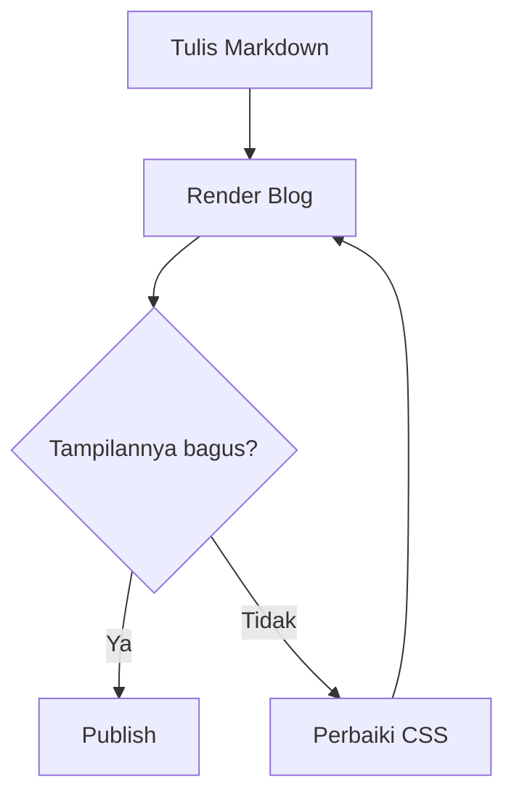

# Write for Fun, Build for Enjoy


[🇬🇧 Read in English](template-for-you-en.md)

Halo, selamat datang di blog saya.

Blog ini adalah ruang eksplorasi saya. Tempat untuk menulis hal-hal yang sedang saya pelajari, mencoba ide baru, menyimpan eksperimen, dan membangun sesuatu hanya karena terasa menyenangkan.

Saya belum tahu semua hal, dan saya tidak ingin pura-pura tahu semuanya. Saya lebih suka mulai dari rasa penasaran: coba, salah, bingung, googling, salah lagi, lalu akhirnya jalan juga.

Anggap saja ini mantra saya:

> **Explore. Write. Build. Enjoy. Repeat.**

Kalau diterjemahkan bebas: jelajahi, tulis, bangun, nikmati, ulangi. Kalau versi jujurnya: buka laptop, pusing, minum air, coba lagi.

## Kenapa artikel ini ada?

Artikel ini adalah **testing post** untuk blog saya.

Baru-baru ini saya mendesain ulang tampilan blog, terutama bagian typography, spacing, heading, list, table, image, link, dan code block. Lalu saya sadar satu hal: membuat desainnya itu satu hal, tapi memastikan semua tulisan tetap tampil rapi itu hal lain.

Jadi artikel ini ibarat tempat latihan. Semua sintaks Markdown saya lempar ke sini, lalu saya lihat mana yang tampil bagus dan mana yang bikin saya mikir, “kok bisa begini?”

Artikel ini dibuat untuk dua jenis tulisan:

- **Tulisan non-teknis**, seperti catatan harian, opini, refleksi, dan cerita eksplorasi.
- **Tulisan teknis**, seperti tutorial, catatan belajar, dokumentasi, dan eksperimen.

Anggap saja ini checklist visual:

- Apakah heading hierarchy-nya enak dibaca?
- Apakah paragrafnya nyaman untuk dibaca lama?
- Apakah list, table, dan callout tampil rapi?
- Apakah code block punya syntax highlighting, line number, dan tombol copy?
- Apakah gambar, caption, dan link bekerja dengan baik?
- Apakah YouTube bisa tampil sebagai media yang interaktif?
- Apakah footnote, math, diagram, dan elemen HTML tetap aman?
- Apakah tampilannya tetap masuk akal di mobile?

Jadi ya, artikel ini tidak terlalu serius. Ini tempat saya ngetes blog sambil tetap menulis dengan santai.

> **Note:** Kalau ada yang terlihat aneh, berarti memang sedang diuji. Bukan kamu yang salah, kemungkinan besar saya yang belum menemukan bug-nya.

## Apa yang diuji?

- Kenyamanan typography untuk membaca jangka panjang.
- Heading hierarchy dan table of contents.
- Bold, italic, strikethrough, dan inline code.
- Ordered list, unordered list, nested list, dan checklist.
- Blockquote, nested blockquote, dan callout.
- Inline technical content dan karakter khusus.
- Code block dengan syntax highlighting, line number, hover, selection, dan copy.
- Long line, whitespace, dan source integrity.
- Reading progress.
- Local image, external image, caption, dan fallback.
- Table biasa dan wide table.
- External link, internal anchor, autolink, dan reference link.
- Media biasa dan YouTube media.
- Footnote, math, diagram, dan HTML dasar.
- Responsive behavior di desktop, tablet, dan mobile.
- Accessibility dan interaksi keyboard/touch.
- Long-form content integrity.

---

## 01 — Reading Experience

### Ritme membaca yang nyaman

Tulisan teknis biasanya berganti-ganti antara penjelasan, perintah, output, dan interpretasi. Transisinya seharusnya terasa natural, bukan seperti naik roller coaster tanpa sabuk pengaman.

Teks utama seharusnya punya panjang baris yang nyaman, line-height yang cukup, dan jarak antarparagraf yang jelas. Heading harus membantu pembaca memahami struktur, bukan membuat halaman terlihat seperti rapat kantor.

Pembaca idealnya bisa scan artikel dengan cepat, berhenti di paragraf penting, melihat code block, lalu kembali membaca tanpa kehilangan posisi.

Perhatikan istilah-istilah ini: `Content-Security-Policy`, `X-Forwarded-For`, `application/json`, `0xDEADBEEF`, `snake_case`, `camelCase`, `__init__()`, dan `user_id`.

Semuanya harus tetap terbaca di dalam kalimat normal dan wrap dengan baik saat layar makin sempit.

### Text formatting

Ini adalah **teks bold**, *teks italic*, dan ~~teks strikethrough~~.

Kamu juga bisa menggabungkan **bold** dengan `inline code`, mereferensikan [tautan eksternal](https://example.com), atau memakai anchor internal artikel.

Styling-nya harus tetap enak dibaca, bukan membuat setiap kalimat terlihat seperti kumpulan kartu warna-warni.

### Heading hierarchy

#### Heading level tiga

##### Heading level empat

###### Heading level enam

Heading-heading ini ada untuk menguji hierarchy dan pembuatan anchor. Table of contents harus mengikuti aturan heading depth yang dikonfigurasi, menghindari ID duplikat, dan menjaga link tetap stabil.

## 02 — Metadata Artikel dan Layout Editorial

Header artikel seharusnya bisa menampung:

- Judul utama dan subtitle opsional.
- Avatar penulis, nama, dan link profil.
- Tanggal publikasi dan tanggal update opsional.
- Estimasi waktu baca.
- Kategori, tags, dan pilihan bahasa.
- Pengantar atau ringkasan singkat.
- Cover image opsional.

Metadata seharusnya tetap terlihat sekunder dibanding judul artikel. Judul panjang, banyak tags, avatar hilang, atau judul hasil terjemahan tidak boleh merusak layout.

Di mobile, metadata seharusnya wrap secara natural, bukan meluber ke kanan sampai pembaca harus scroll horizontal seperti sedang membaca surat kabar dari tahun 1998.

## 03 — List, Langkah, dan Catatan Teknis

### Alur investigasi

1. Tentukan scope dan tujuan.
2. Siapkan environment testing.
3. Identifikasi komponen aplikasi yang relevan.
4. Jalankan pemeriksaan yang direncanakan.
5. Catat observasi dan bukti pendukung.
6. Verifikasi temuan.
7. Dokumentasikan kesimpulan dan keterbatasan.

### Prosedur bertingkat

1. **Persiapan environment**
   - Periksa system requirements.
   - Pastikan koneksi jaringan berjalan.
   - Cek dependency aplikasi.

2. **Testing**
   - Capture request dan response.
   - Inspect behavior aplikasi yang relevan.
   - Bandingkan hasil dengan ekspektasi.

3. **Reporting**
   - Rangkum bukti.
   - Jelaskan dampaknya.
   - Dokumentasikan opsi remediasi.

### Checklist

- [ ] Environment testing sudah didokumentasikan.
- [ ] Endpoint aplikasi sudah diidentifikasi.
- [ ] Semua observasi sudah diverifikasi secara independen.
- [ ] Laporan akhir sudah direview.

### Callout editorial

> **Note:** Gunakan callout untuk memberi konteks tambahan tanpa memutus alur penjelasan utama.

> **Warning:** Warning seharusnya menyampaikan risiko yang benar-benar ada. Jangan pakai styling warning untuk informasi biasa.

> **Important:** Artikel ini hanya testing rendering. Tidak perlu terlalu serius.

Elemen-elemen ini memakai blockquote Markdown standar. Kalau renderer mendukung callout yang lebih kaya, presentasinya seharusnya berasal dari konvensi atau metadata yang jelas, bukan dari tebakan visual yang rapuh.

## 04 — Inline Technical Content

Inline code harus bekerja di dalam paragraf, list, table, dan link.

Misalnya, perintah `sudo ./check-blog.sh` bisa dibahas dalam kalimat yang sama dengan expected HTTP status, response `application/json`, atau configuration value seperti `timeout_ms`.

Identifier yang hanya berbeda huruf kapital harus tetap terlihat berbeda: `ContentType`, `contentType`, `content_type`, dan `CONTENT_TYPE`.

Karakter khusus harus tetap selamat setelah parsing dan rendering: `<`, `>`, `&`, tanda kutip, backslash, dollar sign, curly braces, brackets, dan karakter Unicode.

Teks internasional: Indonesia, 日本語, العربية, Español, Ελληνικά, dan 🔐.

Renderer tidak boleh mengira karakter code literal adalah HTML markup atau sintaks Markdown.

## 05 — Interactive Code Playground

Bagian ini menguji fitur utama renderer artikel: code presentation.

Interface yang diinginkan adalah satu interactive playground dengan language selector, bukan kartu UI terpisah untuk setiap bahasa. Pembaca harus bisa memilih bahasa yang didukung, melihat syntax highlighting, sambil panel code, line number, kontrol, dan posisi baca tetap konsisten.

### Kebutuhan playground

- Language selector yang searchable kalau jumlah bahasanya banyak.
- Dukungan grammar yang luas, termasuk alias dan bahasa yang kurang umum.
- Registrasi bahasa yang extensible.
- Line number dan syntax highlighting yang akurat.
- Line hover dan status active/selected yang berbeda.
- Copy code tanpa ikut menyalin line number.
- Line wrapping opsional.
- Horizontal scroll untuk source line yang panjang.
- Kontrol yang bisa diakses pakai keyboard.
- Selector dan touch interaction yang mobile-friendly.
- Plain-text fallback yang tetap terbaca untuk bahasa yang tidak dikenal.
- Tidak ada kehilangan atau perubahan pada source asli.

Language selector tidak boleh dianggap sebagai fitur bawaan Markdown. Fenced Markdown standar memang bisa menandai code block dan bahasanya, tetapi multi-language playground membutuhkan fungsi di level renderer.

### Primary source fixture

Berikut adalah satu code sample utama di dokumen ini. Sengaja dibuat cukup panjang, ada indentation, comment, string, dan struktur bersarang untuk menguji tampilan code.

```javascript
/**
 * Blog Renderer Test
 *
 * Inspect line numbers, syntax colors, indentation,
 * hover behavior, selection, copy, and scrolling.
 */

const configuration = {
  project: "My Personal Blog",
  environment: "local",
  features: {
    syntaxHighlighting: true,
    lineNumbers: true,
    copyButton: true,
    lineHighlighting: true,
  },
};

function summarizeNotes(notes) {
  return notes
    .filter((note) => note.published)
    .map((note, index) => ({
      number: index + 1,
      title: note.title,
      status: note.status,
    }));
}

async function loadArticle(url, options = {}) {
  if (!url) {
    throw new Error("An article URL is required");
  }

  const response = await fetch(url, {
    ...options,
    headers: {
      Accept: "application/json",
      ...options.headers,
    },
  });

  if (!response.ok) {
    throw new Error(`Request failed: HTTP ${response.status}`);
  }

  return response.json();
}

const exampleNotes = [
  {
    title: "Testing typography",
    status: "published",
    published: true,
  },
  {
    title: "Draft experiment",
    status: "draft",
    published: false,
  },
];

console.log(summarizeNotes(exampleNotes));
```

### Code interaction behavior

Saat pointer bergerak di atas source, baris saat ini seharusnya mendapat highlight halus. Line-number gutter harus tetap sejajar dengan code, termasuk saat code panel scroll horizontal.

Line atau range yang selected harus punya visual state berbeda dari hover. Interaksi ini tidak boleh mengganggu text selection biasa, keyboard navigation, atau copy.

Tombol copy harus memberi feedback yang terlihat dan accessible. Kalau akses clipboard gagal, pembaca harus mendapat fallback yang jelas, bukan status “Copied!” palsu.

Untuk snippet besar, interface boleh menyediakan kontrol expand dan collapse. Collapse tidak boleh menghapus source content, dan semua konten tersembunyi harus tetap bisa diakses lewat interaksi yang jelas.

### Language support policy

Selector seharusnya menampilkan bahasa yang tersedia dari syntax-highlighting engine yang dipakai, termasuk extension yang sudah didaftarkan.

Implementasi tidak boleh bergantung pada hardcoded short list sebagai batas permanen. Harus mendukung language alias, optional grammar loading, dan graceful fallback saat grammar tidak tersedia.

Bahasa baru seharusnya bisa ditambahkan tanpa mendesain ulang halaman artikel. Bahasa yang tidak dikenal harus tetap terbaca sebagai plain text.

Code sample di atas adalah canonical Markdown code fixture. Testing syntax untuk setiap grammar yang didukung sebaiknya diotomatisasi memakai language corpus terpisah, bukan dengan menduplikasi puluhan code block di artikel ini.

## 06 — Long Lines, Whitespace, dan Source Integrity

Source line yang panjang harus tetap bisa diakses tanpa memaksa seluruh halaman menjadi lebih lebar dari viewport.

Renderer seharusnya menawarkan horizontal scrolling secara default untuk code yang wrapping-nya bisa merusak alignment atau makna. Kalau soft wrapping tersedia, line number tetap harus masuk akal meskipun satu source line menempati beberapa visual row.

Whitespace itu penting. Indentation, blank line, tab, trailing newline, dan karakter Unicode harus dipertahankan sesuai source dan behavior renderer.

Source line seperti `if (response.status !== 200) {` harus tetap utuh. Operator seperti `===`, `!==`, `=>`, `->`, `::`, dan `&&` tidak boleh diganti jadi karakter typographic yang mirip tapi salah.

Line highlighting dan line-number anchor harus merujuk ke source line, bukan sekadar visual row saat ini.

## 07 — Reading Progress

Reading progress indicator seharusnya mencerminkan posisi pembaca yang sebenarnya.

Ia harus:

- Update dengan halus saat scrolling.
- Tetap tidak mengganggu.
- Bisa menangani artikel pendek dan panjang.
- Menghitung batas konten artikel yang sebenarnya.
- Tetap akurat saat gambar selesai loading.
- Tidak mengklaim selesai saat masih ada konten yang belum dibaca.
- Menghormati preferensi reduced motion.

Progress indicator seharusnya melengkapi pengalaman membaca, bukan menjadi animasi yang lebih menarik daripada artikelnya sendiri.

## 08 — Table of Contents

Table of contents seharusnya dibuat dari heading yang eligible di Markdown yang sudah dirender.

Expected behavior:

- Struktur heading bertingkat.
- Heading anchor yang stabil.
- Indikator section aktif.
- Smooth navigation kalau sesuai.
- Sticky navigation di desktop kalau ada ruang.
- Drawer, dropdown, atau padanannya yang compact di mobile.
- Behavior yang benar untuk heading duplikat.
- Tidak overlap dengan fixed header atau reading progress.
- Tidak rusak saat media mengubah tinggi dokumen.

TOC generation harus memakai heading ID yang sama dengan artikel yang benar-benar dirender.

## 09 — Images dan External Media

### Local cover image


*Caption: local image test untuk cover rendering, responsive sizing, dan fallback behavior.*

### Landscape image


*Caption: test image untuk responsive sizing, loading behavior, aspect ratio, dan typography caption.*

### Additional image


*Caption: image kedua untuk testing media berulang, spacing, dan gallery transition.*

### Media behavior

Test hal-hal berikut melalui image Markdown biasa dan link yang didukung:

- Local images dan externally hosted images.
- Aspect ratio portrait, landscape, dan square.
- Alt text dan captions.
- Lazy loading dan reserved image dimensions.
- Image zoom atau lightbox kalau didukung.
- Broken URLs dan media yang tidak tersedia.
- Redirects, slow responses, dan unsupported formats.
- Video dan third-party embeds kalau renderer memang mendukung.

External image URLs tidak boleh dianggap selalu bisa di-fetch. Browser restriction, CORS, authentication, hotlink protection, dan remote server failure bisa membuat akses gagal.

Image yang gagal tidak boleh menghapus teks di sekitarnya, menggeser pembaca secara tiba-tiba, atau merusak TOC.

## 10 — Tables dan Structured Data

| Feature | Expected behavior | Priority |
| --- | --- | --- |
| Syntax highlighting | Warna spesifik per bahasa | Critical |
| Line numbers | Alignment source line yang stabil | Critical |
| Copy action | Menyalin source tanpa gutter | Critical |
| Reading progress | Posisi artikel yang akurat | High |
| Table of contents | Navigasi stabil dan active section | High |
| Image lightbox | Pembesaran media yang accessible | Medium |
| Related articles | Navigasi relevan setelah artikel | Medium |

### Wide technical table

| Endpoint | Method | Authentication | Content type | Expected response | Purpose |
| --- | --- | --- | --- | --- | --- |
| `/api/health` | `GET` | Optional | `application/json` | `200 OK` | Health check |
| `/api/notes` | `GET` | Required | `application/json` | `200 OK` | Retrieve notes |
| `/api/notes/export` | `POST` | Required | `application/json` | `202 Accepted` | Start export |
| `/api/notes/status` | `GET` | Required | `application/json` | `200 OK` | Check export status |

Di layar sempit, wide table seharusnya memakai responsive strategy yang disengaja. Local horizontal scrolling lebih baik daripada mengecilkan teks sampai pembaca perlu kaca pembesar.

## 11 — Links dan References

### External links

- [Example Domain](https://example.com)
- [GitHub](https://github.com)
- [MDN Web Docs](https://developer.mozilla.org)
- [Shiki documentation](https://shiki.style)
- [Rehype Pretty Code](https://rehype-pretty.pages.dev/)

External links seharusnya punya styling yang dikenali, focus state yang usable, dan penanganan yang tepat untuk link yang membuka tab baru.

### Link dengan title

[GitHub dengan title](https://github.com "Kunjungi GitHub")

### Autolinks

https://example.com

<https://example.com>

### Reference links

Ini adalah [reference link][gh].

[gh]: https://github.com "GitHub"

### Internal anchor

Kembali ke [Reading Experience](#01--reading-experience).

Internal links seharusnya membawa pembaca ke heading artikel yang benar. Anchor generation harus stabil untuk heading berulang dan heading yang mengandung tanda baca atau karakter non-Inggris.

## 12 — Media Biasa dan YouTube

Beberapa artikel butuh lebih dari image dan source code. Renderer harus bisa membedakan **media biasa** dan **media YouTube**.

Ada dua perilaku yang diuji:

1. **Media biasa** — link eksternal normal yang tetap tampil sebagai link.
2. **YouTube media** — link YouTube yang bisa dideteksi, di-fetch, dan ditampilkan sebagai video card interaktif.

### Media biasa

Link media biasa seharusnya tetap sederhana, accessible, dan predictable. Renderer tidak perlu mengubah setiap URL eksternal menjadi embed.

- [Example website](https://example.com)
- [GitHub repository](https://github.com)
- [MDN Web Docs](https://developer.mozilla.org)
- [Shiki documentation](https://shiki.style)

External links seharusnya punya styling yang dikenali, focus state yang usable, dan penanganan yang tepat untuk link yang membuka tab baru.

Link biasa tidak boleh otomatis berubah menjadi embed. Ia tetap link normal, kecuali renderer punya aturan khusus untuk domain tertentu.

### YouTube media

Link YouTube adalah kasus khusus. Renderer seharusnya bisa mendeteksi URL YouTube, mengambil video ID, fetch metadata publik, lalu menampilkan video card interaktif.

Link berikut seharusnya dikenali sebagai YouTube video:

[Tonton di YouTube](https://www.youtube.com/watch?v=8rkiwXkEA8M&list=PLsOgFqR0cppAEuYATcmAxyHeSTkWM4ZWj)

Expected renderer behavior:

- Deteksi URL YouTube.
- Extract video ID: `8rkiwXkEA8M`.
- Fetch metadata publik melalui backend yang aman.
- Tampilkan judul video, nama channel, dan thumbnail berkualitas.
- Tampilkan tombol play atau preview interaktif.
- Load iframe YouTube hanya setelah pembaca menekan play.
- Sediakan fallback link langsung kalau fetching atau embedding gagal.

Renderer seharusnya menyimpan cache metadata agar tidak request YouTube setiap kali halaman dibuka.

### YouTube thumbnail dengan tombol play

Kalau interactive fetching belum tersedia, versi ini tetap harus tampil dengan baik: thumbnail YouTube dengan tombol play di tengah.

<a
  href="https://www.youtube.com/watch?v=8rkiwXkEA8M&list=PLsOgFqR0cppAEuYATcmAxyHeSTkWM4ZWj"
  target="_blank"
  rel="noopener noreferrer"
  style="position: relative; display: block; max-width: 800px; margin: 0 auto;"
>
  

  <span
    style="
      position: absolute;
      top: 50%;
      left: 50%;
      transform: translate(-50%, -50%);
      width: 72px;
      height: 72px;
      background: rgba(0, 0, 0, 0.65);
      border-radius: 50%;
      display: flex;
      align-items: center;
      justify-content: center;
      color: white;
      font-size: 28px;
    "
  >
    ▶
  </span>
</a>

*Caption: YouTube thumbnail dengan tombol play. Klik gambar untuk membuka video.*

### YouTube embed fallback

Kalau renderer mendukung iframe YouTube, video seharusnya bisa dirender langsung.

<iframe
  width="100%"
  height="480"
  src="https://www.youtube.com/embed/8rkiwXkEA8M"
  title="YouTube video player"
  frameborder="0"
  allow="accelerometer; autoplay; clipboard-write; encrypted-media; gyroscope; picture-in-picture; web-share"
  allowfullscreen>
</iframe>

Setiap jenis media seharusnya punya fallback yang jelas. Kalau external embed tidak bisa load, pembaca tetap harus bisa mengakses penjelasan di sekitarnya dan direct link kalau tersedia.

Jangan mengeksekusi script arbitrer dari Markdown. HTML, embeds, SVG, dan konten eksternal harus mengikuti sanitization dan security policy aplikasi.

Metadata eksternal seharusnya di-fetch melalui backend yang terkontrol, dengan request timeout, response-size limit, caching, dan validasi domain yang diizinkan.

## 13 — Responsive Reading

Evaluasi artikel yang sama di lebar desktop, tablet, dan mobile.

### Desktop

Artikel seharusnya punya prose column yang nyaman, dengan code panel yang lebih lebar kalau perlu. Sticky TOC boleh menempati side column kalau ruangnya cukup.

### Tablet

Artikel seharusnya tetap punya teks dan code yang terbaca. Secondary navigation boleh jadi lebih compact, dan code controls tidak boleh berebut ruang horizontal.

### Mobile

Artikel seharusnya memprioritaskan teks dan menjaga interactive controls tetap usable dengan touch. Code blocks boleh scroll horizontal di dalam batasnya sendiri. Tables harus tetap accessible, images harus scale dengan benar, dan sticky elements tidak boleh menutupi konten.

Test orientation portrait dan landscape, browser zoom, serta peningkatan ukuran teks.

## 14 — Accessibility dan Interaction

Semua interaksi penting harus bekerja tanpa mouse.

- Language selection yang keyboard-accessible.
- Focus indicator yang jelas.
- Copy feedback yang accessible.
- Line-number behavior yang screen-reader-friendly.
- Kontras yang cukup di light dan dark theme.
- Reduced-motion support.
- Alternatif touch untuk interaksi hover.
- Image alt text yang bermakna.
- Headings, lists, tables, dan links yang semantic.

Syntax colors tidak boleh menjadi satu-satunya cara menyampaikan informasi penting. Hover effects seharusnya halus dan tidak mengganggu text selection.

## 15 — Long-Form Content Integrity

Fixture ini juga seharusnya dikombinasikan dengan stress-test documents yang dibuat secara terpisah.

Test Markdown documents yang makin besar, misalnya 10 KB, 100 KB, 1 MB, dan ukuran yang sesuai dengan aplikasi.

Sertakan paragraf berulang, nested headings, large lists, wide tables, remote images, dan code samples yang berisi ribuan baris.

Verifikasi bahwa:

- Setiap source paragraph tetap accessible.
- Tidak ada source line yang hilang.
- Character encoding dan indentation tetap benar.
- Headings dan anchors tetap valid.
- Copy action mengembalikan source yang dimaksud.
- Rendering tidak menduplikasi konten.
- Media failure tidak menghapus section lain.
- Halaman tidak mendapat horizontal overflow yang tidak diinginkan.
- Memory usage dan rendering latency diukur.
- Resource limits ditangani secara eksplisit, bukan lewat silent truncation.

Jangan mengklaim unlimited secara matematis. Requirement-nya adalah menghindari content-length limit yang arbitrer dan memastikan dokumen besar punya strategi performa yang jelas serta teruji.

Kalau progressive rendering atau virtualization dibutuhkan, tetap pertahankan search, selection, source-line numbering, anchor navigation, dan akses ke artikel lengkap.

## 16 — Extended Markdown Coverage

Bagian ini menguji sintaks tambahan yang sering dipakai untuk tulisan teknis maupun non-teknis.

### Line breaks

Ini baris pertama.  
Ini baris kedua memakai dua spasi di akhir baris.

Ini baris lain memakai backslash.\
Ini juga seharusnya pindah baris.

### Escaping

\*Ini seharusnya tidak menjadi italic.\*

\# Ini seharusnya tidak menjadi heading.

\`Ini seharusnya tidak menjadi inline code.\`

### Nested blockquote

> Level pertama
>
> > Level kedua
> >
> > > Level ketiga

### Footnotes

Kalimat ini punya footnote.[^1]

[^1]: Ini adalah isi footnote-nya.

### Ordered list dengan custom start

3. Item ketiga
4. Item keempat
5. Item kelima

### Emphasis nesting

***Bold italic text***

**Bold dengan *italic bersarang***

*Italic dengan **bold bersarang***

### Code block tanpa bahasa

```
Ini plain text.
Tidak ada syntax highlighting yang diharapkan.
```

### HTML-based elements

<details>
  <summary>Klik untuk expand</summary>

  Konten ini berada di dalam collapsible section.

</details>

Tekan <kbd>Ctrl</kbd> + <kbd>C</kbd> untuk copy.

<mark>Teks yang di-highlight</mark>

### Math

Inline math: $E = mc^2$

Block math:

$$
\int_{a}^{b} f(x)\,dx
$$

### Mermaid diagram



### Definition list

Istilah
: Penjelasan dari istilah tersebut.

Istilah lain
: Penjelasan lainnya.

### Highlight, subscript, dan superscript

Ini adalah ==teks yang di-highlight==.

Air adalah H~2~O.

Ini adalah x^2^.

> **Note:** `footnotes`, `math`, `mermaid`, `==highlight==`, `~subscript~`, dan `^superscript^` bergantung pada extension renderer. Kalau tidak tampil, bukan berarti Markdown dasarnya salah.

## 17 — Final Verification Checklist

- [ ] Konten Markdown tetap utuh.
- [ ] Typography nyaman untuk sesi membaca panjang.
- [ ] Heading hierarchy dan TOC sesuai.
- [ ] Reading progress mengikuti artikel secara akurat.
- [ ] Code playground mendukung semua grammar yang terdaftar.
- [ ] Bahasa yang tidak dikenal fallback dengan baik.
- [ ] Line numbers sesuai dengan source lines.
- [ ] Hover tidak mengganggu selection.
- [ ] Copy tidak menyertakan line number presentational.
- [ ] Long code lines tidak membuat seluruh halaman overflow.
- [ ] Whitespace dan Unicode characters tetap dipertahankan.
- [ ] Wide tables tetap usable di mobile.
- [ ] Images punya fallback yang sesuai.
- [ ] External links, internal anchors, autolinks, dan reference links bekerja.
- [ ] Media biasa tetap tampil sebagai link.
- [ ] YouTube thumbnail dengan tombol play tampil dengan benar.
- [ ] YouTube embed atau fetching metadata berjalan sesuai kemampuan renderer.
- [ ] Footnotes, math, diagrams, dan HTML elements dirender dengan aman.
- [ ] Keyboard dan touch interactions bekerja.
- [ ] Browser zoom tidak menyembunyikan konten.
- [ ] Large documents diuji untuk performa.
- [ ] Tidak ada character limit arbitrer yang memotong artikel secara diam-diam.
- [ ] Fitur Discuss yang sudah ada tetap berfungsi.

## Conclusion

Artikel ini tetap sebuah eksperimen, tetapi tujuannya sederhana: memastikan blog saya bisa menampilkan Markdown dengan rapi, nyaman dibaca, dan tetap menyenangkan—baik untuk tulisan santai maupun tulisan teknis.

Pembaca seharusnya bisa mengikuti tulisan, melihat code block dengan jelas, navigasi artikel panjang, membuka gambar, membaca footnote, melihat diagram, membuka media biasa, dan menonton YouTube lewat thumbnail atau embed.

Renderer seharusnya menambahkan tampilan dan interaksi yang bagus tanpa mengubah Markdown asli atau membuat konten menghilang.

Tujuan akhirnya sederhana: blog yang enak dibaca, rapi, responsif, dan tetap terasa seperti tempat saya menulis untuk fun.
