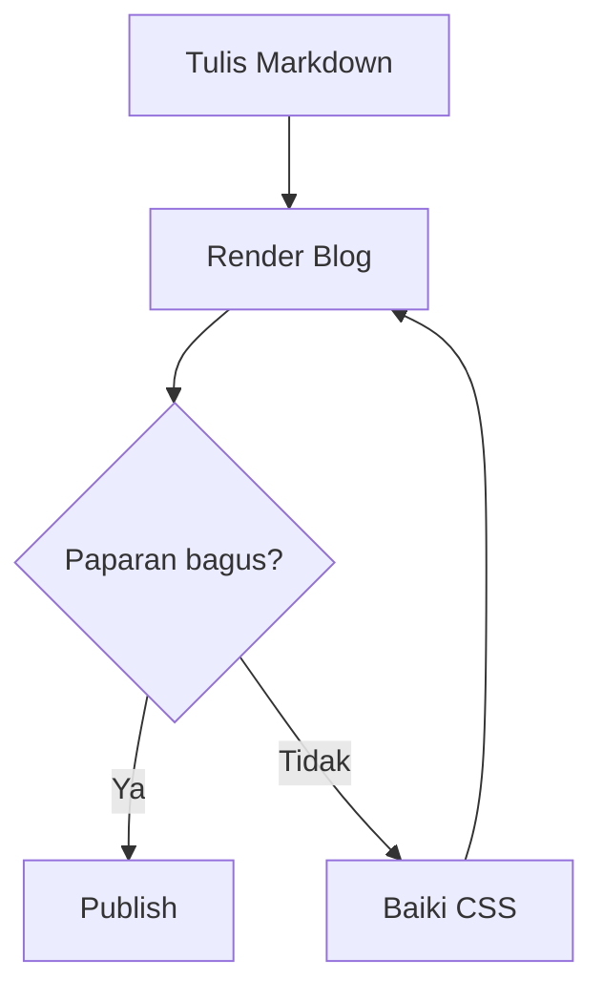

# Write for Fun, Build for Enjoy


[🇬🇧 Read in English](template-for-you-en.md)  
[🇮🇩 Baca dalam Bahasa Indonesia](template-for-you-id.md)  
[🇵🇭 Basahin sa Tagalog](template-for-you-tl.md)

Hai, selamat datang ke blog saya.

Blog ini ialah ruang penerokaan saya. Tempat untuk menulis perkara yang sedang saya pelajari, mencuba idea baharu, menyimpan eksperimen, dan membina sesuatu hanya kerana ia terasa menyeronokkan.

Saya belum tahu semua perkara, dan saya tidak mahu berpura-pura tahu semuanya. Saya lebih suka bermula daripada rasa ingin tahu: cuba, silap, keliru, buat carian, silap lagi, kemudian akhirnya berjaya juga.

Anggap sahaja ini mantra saya:

> **Explore. Write. Build. Enjoy. Repeat.**

Jika diterjemahkan secara bebas: teroka, tulis, bina, nikmati, ulangi. Jika versi jujurnya: buka laptop, pening, minum air, cuba lagi.

## Mengapa artikel ini wujud?

Artikel ini ialah **testing post** untuk blog saya.

Baru-baru ini saya mereka semula rupa blog, terutamanya bahagian typography, spacing, heading, list, table, image, link, dan code block. Kemudian saya sedar satu perkara: mencipta reka bentuknya itu satu hal, tetapi memastikan semua tulisan kekal kemas pula hal lain.

Jadi artikel ini ibarat tempat latihan. Semua sintaks Markdown saya masukkan di sini, kemudian saya lihat mana yang kelihatan baik dan mana yang membuat saya berfikir, “macam mana boleh jadi begini?”

Artikel ini dibuat untuk dua jenis tulisan:

- **Tulisan bukan teknikal**, seperti catatan harian, pendapat, refleksi, dan cerita penerokaan.
- **Tulisan teknikal**, seperti tutorial, catatan pembelajaran, dokumentasi, dan eksperimen.

Anggap sahaja ini checklist visual:

- Adakah heading hierarchy mudah dibaca?
- Adakah perenggan selesa untuk dibaca dalam tempoh lama?
- Adakah list, table, dan callout kelihatan kemas?
- Adakah code block mempunyai syntax highlighting, line number, dan butang copy?
- Adakah image, caption, dan link berfungsi dengan baik?
- Bolehkah YouTube dipaparkan sebagai media interaktif?
- Adakah footnote, math, diagram, dan elemen HTML kekal selamat?
- Adakah paparannya masih masuk akal pada mobile?

Jadi ya, artikel ini tidak terlalu serius. Ini tempat saya menguji blog sambil terus menulis dengan santai.

> **Note:** Jika ada yang kelihatan pelik, bermakna ia memang sedang diuji. Bukan anda yang salah; kemungkinan besar saya yang belum menemui bug-nya.

## Apa yang diuji?

- Kenyamanan typography untuk membaca jangka panjang.
- Heading hierarchy dan table of contents.
- Bold, italic, strikethrough, dan inline code.
- Ordered list, unordered list, nested list, dan checklist.
- Blockquote, nested blockquote, dan callout.
- Kandungan teknikal inline dan aksara khas.
- Code block dengan syntax highlighting, line number, hover, selection, dan copy.
- Long line, whitespace, dan source integrity.
- Reading progress.
- Local image, external image, caption, dan fallback.
- Table biasa dan wide table.
- External link, internal anchor, autolink, dan reference link.
- Media biasa dan YouTube media.
- Footnote, math, diagram, dan HTML asas.
- Responsive behavior pada desktop, tablet, dan mobile.
- Accessibility dan interaksi keyboard/touch.
- Integriti kandungan long-form.

---

## 01 — Reading Experience

### Rentak membaca yang selesa

Tulisan teknikal biasanya bertukar-tukar antara penjelasan, arahan, output, dan interpretasi. Peralihannya sepatutnya terasa natural, bukan seperti menaiki roller coaster tanpa tali keselamatan.

Teks utama sepatutnya mempunyai panjang baris yang selesa, line-height yang mencukupi, dan jarak antara perenggan yang jelas. Heading perlu membantu pembaca memahami struktur, bukan menjadikan halaman kelihatan seperti mesyuarat pejabat.

Pembaca sepatutnya boleh mengimbas artikel dengan pantas, berhenti pada perenggan penting, melihat code block, kemudian kembali membaca tanpa kehilangan kedudukan.

Perhatikan istilah-istilah ini: `Content-Security-Policy`, `X-Forwarded-For`, `application/json`, `0xDEADBEEF`, `snake_case`, `camelCase`, `__init__()`, dan `user_id`.

Semuanya perlu kekal mudah dibaca dalam ayat biasa dan wrap dengan baik apabila skrin semakin sempit.

### Text formatting

Ini ialah **teks bold**, *teks italic*, dan ~~teks strikethrough~~.

Anda juga boleh menggabungkan **bold** dengan `inline code`, merujuk [pautan luaran](https://example.com), atau menggunakan anchor dalaman artikel.

Gaya paparannya perlu kekal mudah dibaca, bukan menjadikan setiap ayat kelihatan seperti kumpulan kad berwarna-warni.

### Heading hierarchy

#### Heading tahap tiga

##### Heading tahap empat

###### Heading tahap enam

Heading-heading ini wujud untuk menguji hierarchy dan penciptaan anchor. Table of contents perlu mengikut peraturan heading depth yang dikonfigurasikan, mengelakkan ID pendua, dan memastikan pautan kekal stabil.

## 02 — Metadata Artikel dan Layout Editorial

Header artikel sepatutnya dapat menampung:

- Tajuk utama dan subtitle pilihan.
- Avatar penulis, nama, dan pautan profil.
- Tarikh penerbitan dan tarikh kemas kini pilihan.
- Anggaran masa baca.
- Kategori, tags, dan pilihan bahasa.
- Pengenalan atau ringkasan ringkas.
- Cover image pilihan.

Metadata sepatutnya kekal kelihatan sekunder berbanding tajuk artikel. Tajuk panjang, banyak tags, avatar hilang, atau tajuk hasil terjemahan tidak sepatutnya merosakkan layout.

Pada mobile, metadata sepatutnya wrap secara natural, bukan melimpah ke kanan sehingga pembaca perlu scroll mendatar seperti membaca akhbar tahun 1998.

## 03 — List, Langkah, dan Catatan Teknikal

### Aliran penyiasatan

1. Tentukan scope dan objektif.
2. Sediakan environment testing.
3. Kenal pasti komponen aplikasi yang relevan.
4. Jalankan pemeriksaan yang dirancang.
5. Rekod pemerhatian dan bukti sokongan.
6. Sahkan penemuan.
7. Dokumentasikan kesimpulan dan batasan.

### Prosedur berperingkat

1. **Persediaan environment**
   - Semak system requirements.
   - Pastikan sambungan rangkaian berfungsi.
   - Semak dependency aplikasi.

2. **Testing**
   - Capture request dan response.
   - Periksa behavior aplikasi yang relevan.
   - Bandingkan hasil dengan jangkaan.

3. **Reporting**
   - Ringkaskan bukti.
   - Jelaskan impaknya.
   - Dokumentasikan pilihan remediasi.

### Checklist

- [ ] Environment testing telah didokumentasikan.
- [ ] Endpoint aplikasi telah dikenal pasti.
- [ ] Semua pemerhatian telah disahkan secara bebas.
- [ ] Laporan akhir telah disemak.

### Callout editorial

> **Note:** Gunakan callout untuk memberi konteks tambahan tanpa memutus aliran penjelasan utama.

> **Warning:** Warning sepatutnya menyampaikan risiko yang benar-benar wujud. Jangan gunakan gaya warning untuk maklumat biasa.

> **Important:** Artikel ini hanya ujian rendering. Tidak perlu terlalu serius.

Elemen-elemen ini menggunakan blockquote Markdown standard. Jika renderer menyokong callout yang lebih kaya, paparannya sepatutnya berasaskan konvensyen atau metadata yang jelas, bukan tekaan visual yang rapuh.

## 04 — Kandungan Teknikal Inline

Inline code perlu berfungsi dalam perenggan, list, table, dan link.

Contohnya, arahan `sudo ./check-blog.sh` boleh dibincangkan dalam ayat yang sama dengan expected HTTP status, response `application/json`, atau configuration value seperti `timeout_ms`.

Identifier yang hanya berbeza huruf besar perlu kekal kelihatan berbeza: `ContentType`, `contentType`, `content_type`, dan `CONTENT_TYPE`.

Aksara khas perlu kekal selamat selepas parsing dan rendering: `<`, `>`, `&`, tanda petikan, backslash, dollar sign, curly braces, brackets, dan aksara Unicode.

Teks antarabangsa: Indonesia, 日本語, العربية, Español, Ελληνικά, dan 🔐.

Renderer tidak sepatutnya menganggap aksara code literal sebagai HTML markup atau sintaks Markdown.

## 05 — Interactive Code Playground

Bahagian ini menguji ciri utama renderer artikel: paparan code.

Antara muka yang diingini ialah satu interactive playground dengan language selector, bukan kad UI berasingan untuk setiap bahasa. Pembaca perlu dapat memilih bahasa yang disokong dan melihat syntax highlighting, sementara panel code, line number, kawalan, dan kedudukan bacaan kekal konsisten.

### Keperluan playground

- Language selector yang boleh dicari jika bilangan bahasa banyak.
- Sokongan grammar yang luas, termasuk alias dan bahasa yang kurang umum.
- Pendaftaran bahasa yang extensible.
- Line number dan syntax highlighting yang tepat.
- Line hover dan status active/selected yang berbeza.
- Copy code tanpa menyalin line number.
- Line wrapping pilihan.
- Horizontal scroll untuk source line yang panjang.
- Kawalan yang boleh diakses menggunakan keyboard.
- Selector dan interaksi sentuh yang mesra mobile.
- Plain-text fallback yang kekal mudah dibaca untuk bahasa yang tidak dikenali.
- Tiada kehilangan atau perubahan pada source asal.

Language selector tidak boleh dianggap sebagai ciri terbina dalam Markdown. Fenced Markdown standard memang boleh menanda code block dan bahasanya, tetapi multi-language playground memerlukan fungsi pada tahap renderer.

### Primary source fixture

Berikut ialah satu contoh code utama dalam dokumen ini. Ia sengaja dibuat cukup panjang, dengan indentation, comment, string, dan struktur bersarang untuk menguji paparan code.

```javascript
/**
 * Blog Renderer Test
 *
 * Inspect line numbers, syntax colors, indentation,
 * hover behavior, selection, copy, and scrolling.
 */

const configuration = {
  project: "My Personal Blog",
  environment: "local",
  features: {
    syntaxHighlighting: true,
    lineNumbers: true,
    copyButton: true,
    lineHighlighting: true,
  },
};

function summarizeNotes(notes) {
  return notes
    .filter((note) => note.published)
    .map((note, index) => ({
      number: index + 1,
      title: note.title,
      status: note.status,
    }));
}

async function loadArticle(url, options = {}) {
  if (!url) {
    throw new Error("An article URL is required");
  }

  const response = await fetch(url, {
    ...options,
    headers: {
      Accept: "application/json",
      ...options.headers,
    },
  });

  if (!response.ok) {
    throw new Error(`Request failed: HTTP ${response.status}`);
  }

  return response.json();
}

const exampleNotes = [
  {
    title: "Testing typography",
    status: "published",
    published: true,
  },
  {
    title: "Draft experiment",
    status: "draft",
    published: false,
  },
];

console.log(summarizeNotes(exampleNotes));
```

### Code interaction behavior

Apabila pointer bergerak di atas source, baris semasa sepatutnya mendapat highlight halus. Line-number gutter perlu kekal sejajar dengan code, termasuk semasa code panel scroll mendatar.

Line atau range yang selected perlu mempunyai visual state berbeza daripada hover. Interaksi ini tidak boleh mengganggu text selection biasa, keyboard navigation, atau copy.

Butang copy perlu memberi maklum balas yang kelihatan dan accessible. Jika akses clipboard gagal, pembaca perlu mendapat fallback yang jelas, bukan status “Copied!” palsu.

Untuk snippet besar, antara muka boleh menyediakan kawalan expand dan collapse. Collapse tidak boleh membuang source content, dan semua kandungan tersembunyi perlu kekal boleh diakses melalui interaksi yang jelas.

### Language support policy

Selector sepatutnya memaparkan bahasa yang tersedia daripada syntax-highlighting engine yang digunakan, termasuk extension yang telah didaftarkan.

Implementasi tidak sepatutnya bergantung pada hardcoded short list sebagai had kekal. Ia perlu menyokong language alias, optional grammar loading, dan graceful fallback apabila grammar tidak tersedia.

Bahasa baharu sepatutnya boleh ditambah tanpa mereka semula halaman artikel. Bahasa yang tidak dikenali perlu kekal dibaca sebagai plain text.

Contoh code di atas ialah canonical Markdown code fixture. Pengujian syntax bagi setiap grammar yang disokong sebaiknya diotomasi menggunakan language corpus berasingan, bukan dengan menduplikasi puluhan code block dalam artikel ini.

## 06 — Long Lines, Whitespace, dan Source Integrity

Source line yang panjang perlu kekal boleh diakses tanpa memaksa keseluruhan halaman menjadi lebih lebar daripada viewport.

Renderer sepatutnya menawarkan horizontal scrolling secara lalai untuk code yang wrapping-nya boleh merosakkan alignment atau maksud. Jika soft wrapping tersedia, line number tetap perlu masuk akal walaupun satu source line menempati beberapa visual row.

Whitespace itu penting. Indentation, blank line, tab, trailing newline, dan aksara Unicode perlu dikekalkan mengikut source dan behavior renderer.

Source line seperti `if (response.status !== 200) {` perlu kekal utuh. Operator seperti `===`, `!==`, `=>`, `->`, `::`, dan `&&` tidak boleh ditukar kepada aksara typographic yang kelihatan serupa tetapi salah.

Line highlighting dan line-number anchor perlu merujuk kepada source line, bukan sekadar visual row semasa.

## 07 — Reading Progress

Reading progress indicator sepatutnya mencerminkan kedudukan pembaca yang sebenar.

Ia perlu:

- Berubah dengan halus semasa scrolling.
- Kekal tidak mengganggu.
- Boleh mengendalikan artikel pendek dan panjang.
- Mengira had kandungan artikel yang sebenar.
- Kekal tepat apabila image selesai loading.
- Tidak mendakwa selesai apabila masih ada kandungan yang belum dibaca.
- Menghormati keutamaan reduced motion.

Progress indicator sepatutnya melengkapkan pengalaman membaca, bukan menjadi animasi yang lebih menarik daripada artikelnya sendiri.

## 08 — Table of Contents

Table of contents sepatutnya dibina daripada heading yang layak dalam Markdown yang telah dirender.

Expected behavior:

- Struktur heading berperingkat.
- Heading anchor yang stabil.
- Penunjuk section aktif.
- Smooth navigation jika sesuai.
- Sticky navigation pada desktop jika ada ruang.
- Drawer, dropdown, atau padanannya yang compact pada mobile.
- Behavior yang betul untuk heading pendua.
- Tidak bertindih dengan fixed header atau reading progress.
- Tidak rosak apabila media mengubah tinggi dokumen.

TOC generation perlu menggunakan heading ID yang sama dengan artikel yang benar-benar dirender.

## 09 — Images dan External Media

### Local cover image


*Caption: ujian local image untuk cover rendering, responsive sizing, dan fallback behavior.*

### Landscape image


*Caption: ujian image untuk responsive sizing, loading behavior, aspect ratio, dan typography caption.*

### Additional image


*Caption: image kedua untuk menguji media berulang, spacing, dan gallery transition.*

### Media behavior

Uji perkara berikut melalui image Markdown biasa dan link yang disokong:

- Local images dan externally hosted images.
- Aspect ratio portrait, landscape, dan square.
- Alt text dan captions.
- Lazy loading dan reserved image dimensions.
- Image zoom atau lightbox jika disokong.
- Broken URLs dan media yang tidak tersedia.
- Redirects, slow responses, dan unsupported formats.
- Video dan third-party embeds jika renderer menyokongnya.

External image URLs tidak sepatutnya dianggap sentiasa boleh di-fetch. Browser restriction, CORS, authentication, hotlink protection, dan remote server failure boleh menyebabkan akses gagal.

Image yang gagal tidak boleh membuang teks di sekelilingnya, mengalihkan pembaca secara tiba-tiba, atau merosakkan TOC.

## 10 — Tables dan Structured Data

| Feature | Expected behavior | Priority |
| --- | --- | --- |
| Syntax highlighting | Warna khusus mengikut bahasa | Critical |
| Line numbers | Alignment source line yang stabil | Critical |
| Copy action | Menyalin source tanpa gutter | Critical |
| Reading progress | Kedudukan artikel yang tepat | High |
| Table of contents | Navigasi stabil dan active section | High |
| Image lightbox | Pembesaran media yang accessible | Medium |
| Related articles | Navigasi relevan selepas artikel | Medium |

### Wide technical table

| Endpoint | Method | Authentication | Content type | Expected response | Purpose |
| --- | --- | --- | --- | --- | --- |
| `/api/health` | `GET` | Optional | `application/json` | `200 OK` | Health check |
| `/api/notes` | `GET` | Required | `application/json` | `200 OK` | Retrieve notes |
| `/api/notes/export` | `POST` | Required | `application/json` | `202 Accepted` | Start export |
| `/api/notes/status` | `GET` | Required | `application/json` | `200 OK` | Check export status |

Pada skrin sempit, wide table sepatutnya menggunakan strategi responsive yang disengajakan. Local horizontal scrolling lebih baik daripada mengecilkan teks sehingga pembaca memerlukan kaca pembesar.

## 11 — Links dan References

### External links

- [My GitHub Pages blog](https://github.com/iMoon07/imoon07.github.io/)
- [Example Domain](https://example.com)
- [GitHub](https://github.com)
- [MDN Web Docs](https://developer.mozilla.org)
- [Shiki documentation](https://shiki.style)
- [Rehype Pretty Code](https://rehype-pretty.pages.dev/)

External links sepatutnya mempunyai styling yang dikenali, focus state yang boleh digunakan, dan pengendalian yang betul untuk link yang membuka tab baharu.

### Link dengan title

[GitHub dengan title](https://github.com "Layari GitHub")

### Autolinks

https://example.com

<https://example.com>

### Reference links

Ini ialah [reference link][gh].

[gh]: https://github.com "GitHub"

### Internal anchor

Kembali ke [Reading Experience](#01--reading-experience).

Internal links sepatutnya membawa pembaca ke heading artikel yang betul. Anchor generation perlu stabil untuk heading berulang dan heading yang mengandungi tanda baca atau aksara bukan Inggeris.

## 12 — Media Biasa dan YouTube

Beberapa artikel memerlukan lebih daripada image dan source code. Renderer perlu dapat membezakan **media biasa** dan **media YouTube**.

Terdapat dua behavior yang diuji:

1. **Media biasa** — link luaran normal yang kekal dipaparkan sebagai link.
2. **YouTube media** — link YouTube yang boleh dikenal pasti, di-fetch, dan dipaparkan sebagai video card interaktif.

### Media biasa

Link media biasa sepatutnya kekal ringkas, accessible, dan predictable. Renderer tidak perlu menukar setiap URL luaran menjadi embed.

- [Example website](https://example.com)
- [GitHub repository](https://github.com)
- [MDN Web Docs](https://developer.mozilla.org)
- [Shiki documentation](https://shiki.style)

External links sepatutnya mempunyai styling yang dikenali, focus state yang boleh digunakan, dan pengendalian yang betul untuk link yang membuka tab baharu.

Link biasa tidak boleh bertukar automatik menjadi embed. Ia kekal sebagai link normal, melainkan renderer mempunyai peraturan khas untuk domain tertentu.

### YouTube media

Link YouTube ialah kes khas. Renderer sepatutnya dapat mengesan URL YouTube, mengambil video ID, fetch metadata awam, kemudian memaparkan video card interaktif.

Link berikut sepatutnya dikenal pasti sebagai video YouTube:

[Tonton di YouTube](https://www.youtube.com/watch?v=8rkiwXkEA8M&list=PLsOgFqR0cppAEuYATcmAxyHeSTkWM4ZWj)

Expected renderer behavior:

- Mengesan URL YouTube.
- Extract video ID: `8rkiwXkEA8M`.
- Fetch metadata awam melalui backend yang selamat.
- Papar tajuk video, nama channel, dan thumbnail berkualiti.
- Papar butang play atau preview interaktif.
- Load iframe YouTube hanya selepas pembaca menekan play.
- Sediakan fallback link terus jika fetching atau embedding gagal.

Renderer sepatutnya menyimpan cache metadata supaya tidak membuat request YouTube setiap kali halaman dibuka.

### YouTube thumbnail dengan butang play

Jika interactive fetching belum tersedia, versi ini tetap perlu kelihatan baik: thumbnail YouTube dengan butang play di tengah.

<a
  href="https://www.youtube.com/watch?v=8rkiwXkEA8M&list=PLsOgFqR0cppAEuYATcmAxyHeSTkWM4ZWj"
  target="_blank"
  rel="noopener noreferrer"
  style="position: relative; display: block; max-width: 800px; margin: 0 auto;"
>
  

  <span
    style="
      position: absolute;
      top: 50%;
      left: 50%;
      transform: translate(-50%, -50%);
      width: 72px;
      height: 72px;
      background: rgba(0, 0, 0, 0.65);
      border-radius: 50%;
      display: flex;
      align-items: center;
      justify-content: center;
      color: white;
      font-size: 28px;
    "
  >
    ▶
  </span>
</a>

*Caption: YouTube thumbnail dengan butang play. Klik image untuk membuka video.*

### YouTube embed fallback

Jika renderer menyokong iframe YouTube, video sepatutnya boleh dirender terus.

<iframe
  width="100%"
  height="480"
  src="https://www.youtube.com/embed/8rkiwXkEA8M"
  title="YouTube video player"
  frameborder="0"
  allow="accelerometer; autoplay; clipboard-write; encrypted-media; gyroscope; picture-in-picture; web-share"
  allowfullscreen>
</iframe>

Setiap jenis media sepatutnya mempunyai fallback yang jelas. Jika external embed tidak dapat load, pembaca masih perlu dapat mengakses penjelasan di sekelilingnya dan direct link jika tersedia.

Jangan melaksanakan script arbitrari daripada Markdown. HTML, embeds, SVG, dan kandungan luaran perlu mengikut sanitization dan security policy aplikasi.

Metadata luaran sepatutnya di-fetch melalui backend yang terkawal, dengan request timeout, response-size limit, caching, dan validasi domain yang dibenarkan.

## 13 — Responsive Reading

Nilai artikel yang sama pada lebar desktop, tablet, dan mobile.

### Desktop

Artikel sepatutnya mempunyai prose column yang selesa, dengan code panel yang lebih lebar jika perlu. Sticky TOC boleh menempati side column jika ruang mencukupi.

### Tablet

Artikel sepatutnya masih mempunyai teks dan code yang mudah dibaca. Secondary navigation boleh menjadi lebih compact, dan code controls tidak boleh berebut ruang mendatar.

### Mobile

Artikel sepatutnya mengutamakan teks dan memastikan interactive controls kekal boleh digunakan dengan sentuhan. Code blocks boleh scroll mendatar dalam hadnya sendiri. Tables perlu kekal accessible, images perlu scale dengan betul, dan sticky elements tidak boleh menutup kandungan.

Uji orientation portrait dan landscape, browser zoom, serta peningkatan saiz teks.

## 14 — Accessibility dan Interaction

Semua interaksi penting perlu berfungsi tanpa mouse.

- Language selection yang accessible menggunakan keyboard.
- Focus indicator yang jelas.
- Copy feedback yang accessible.
- Line-number behavior yang mesra screen reader.
- Kontras yang mencukupi dalam light dan dark theme.
- Sokongan reduced-motion.
- Alternatif sentuh untuk interaksi hover.
- Image alt text yang bermakna.
- Headings, lists, tables, dan links yang semantic.

Syntax colors tidak boleh menjadi satu-satunya cara menyampaikan maklumat penting. Hover effects sepatutnya halus dan tidak mengganggu text selection.

## 15 — Long-Form Content Integrity

Fixture ini juga sepatutnya digabungkan dengan stress-test documents yang dibuat secara berasingan.

Uji Markdown documents yang semakin besar, contohnya 10 KB, 100 KB, 1 MB, dan saiz yang sesuai dengan aplikasi.

Sertakan perenggan berulang, nested headings, large lists, wide tables, remote images, dan code samples yang mengandungi ribuan baris.

Sahkan bahawa:

- Setiap source paragraph kekal accessible.
- Tiada source line hilang.
- Character encoding dan indentation kekal betul.
- Headings dan anchors kekal sah.
- Copy action memulangkan source yang dimaksudkan.
- Rendering tidak menduplikasi kandungan.
- Media failure tidak membuang section lain.
- Halaman tidak mengalami horizontal overflow yang tidak diingini.
- Memory usage dan rendering latency diukur.
- Resource limits dikendalikan secara jelas, bukan melalui silent truncation.

Jangan mendakwa unlimited secara matematik. Keperluannya ialah mengelakkan content-length limit yang arbitrer dan memastikan dokumen besar mempunyai strategi prestasi yang jelas serta teruji.

Jika progressive rendering atau virtualization diperlukan, kekalkan search, selection, source-line numbering, anchor navigation, dan akses kepada artikel penuh.

## 16 — Extended Markdown Coverage

Bahagian ini menguji sintaks tambahan yang kerap digunakan untuk tulisan teknikal dan bukan teknikal.

### Line breaks

Ini baris pertama.  
Ini baris kedua menggunakan dua space pada penghujung baris.

Ini baris lain menggunakan backslash.\  
Ini juga sepatutnya berpindah baris.

### Escaping

\*Ini sepatutnya tidak menjadi italic.\*

\# Ini sepatutnya tidak menjadi heading.

\`Ini sepatutnya tidak menjadi inline code.\`

### Nested blockquote

> Tahap pertama
>
> > Tahap kedua
> >
> > > Tahap ketiga

### Footnotes

Ayat ini mempunyai footnote.[^1]

[^1]: Ini ialah kandungan footnote-nya.

### Ordered list dengan custom start

3. Item ketiga
4. Item keempat
5. Item kelima

### Emphasis nesting

***Bold italic text***

**Bold dengan *italic bersarang***

*Italic dengan **bold bersarang***

### Code block tanpa bahasa

```
Ini plain text.
Tiada syntax highlighting yang dijangkakan.
```

### HTML-based elements

<details>
  <summary>Klik untuk expand</summary>

  Kandungan ini berada dalam collapsible section.

</details>

Tekan <kbd>Ctrl</kbd> + <kbd>C</kbd> untuk copy.

<mark>Teks yang di-highlight</mark>

### Math

Inline math: $E = mc^2$

Block math:

$$
\int_{a}^{b} f(x)\,dx
$$

### Mermaid diagram



### Definition list

Istilah
: Penjelasan bagi istilah tersebut.

Istilah lain
: Penjelasan lain.

### Highlight, subscript, dan superscript

Ini ialah ==teks yang di-highlight==.

Air ialah H~2~O.

Ini ialah x^2^.

> **Note:** `footnotes`, `math`, `mermaid`, `==highlight==`, `~subscript~`, dan `^superscript^` bergantung pada extension renderer. Jika tidak dipaparkan, bukan bermakna Markdown asasnya salah.

## 17 — Final Verification Checklist

- [ ] Kandungan Markdown kekal utuh.
- [ ] Typography selesa untuk sesi membaca panjang.
- [ ] Heading hierarchy dan TOC betul.
- [ ] Reading progress mengikut artikel dengan tepat.
- [ ] Code playground menyokong semua grammar yang didaftarkan.
- [ ] Bahasa yang tidak dikenali mempunyai fallback yang baik.
- [ ] Line numbers sepadan dengan source lines.
- [ ] Hover tidak mengganggu selection.
- [ ] Copy tidak menyertakan line number presentational.
- [ ] Long code lines tidak menyebabkan keseluruhan halaman overflow.
- [ ] Whitespace dan Unicode characters dikekalkan.
- [ ] Wide tables kekal usable pada mobile.
- [ ] Images mempunyai fallback yang sesuai.
- [ ] External links, internal anchors, autolinks, dan reference links berfungsi.
- [ ] Media biasa kekal dipaparkan sebagai link.
- [ ] YouTube thumbnail dengan butang play dipaparkan dengan betul.
- [ ] YouTube embed atau metadata fetching berjalan mengikut keupayaan renderer.
- [ ] Footnotes, math, diagrams, dan HTML elements dirender dengan selamat.
- [ ] Keyboard dan touch interactions berfungsi.
- [ ] Browser zoom tidak menyembunyikan kandungan.
- [ ] Large documents diuji untuk prestasi.
- [ ] Tiada character limit arbitrer yang memotong artikel secara senyap.
- [ ] Fitur Discuss yang sedia ada kekal berfungsi.

## Conclusion

Artikel ini tetap satu eksperimen, tetapi matlamatnya ringkas: memastikan blog saya boleh memaparkan Markdown dengan kemas, selesa dibaca, dan tetap menyeronokkan—sama ada untuk tulisan santai atau tulisan teknikal.

Pembaca sepatutnya dapat mengikuti tulisan, melihat code block dengan jelas, menavigasi artikel panjang, membuka image, membaca footnote, melihat diagram, membuka media biasa, dan menonton YouTube melalui thumbnail atau embed.

Renderer sepatutnya menambah paparan dan interaksi yang baik tanpa mengubah Markdown asal atau menyebabkan kandungan hilang.

Matlamat akhirnya ringkas: blog yang selesa dibaca, kemas, responsive, dan tetap terasa seperti tempat saya menulis untuk fun.
