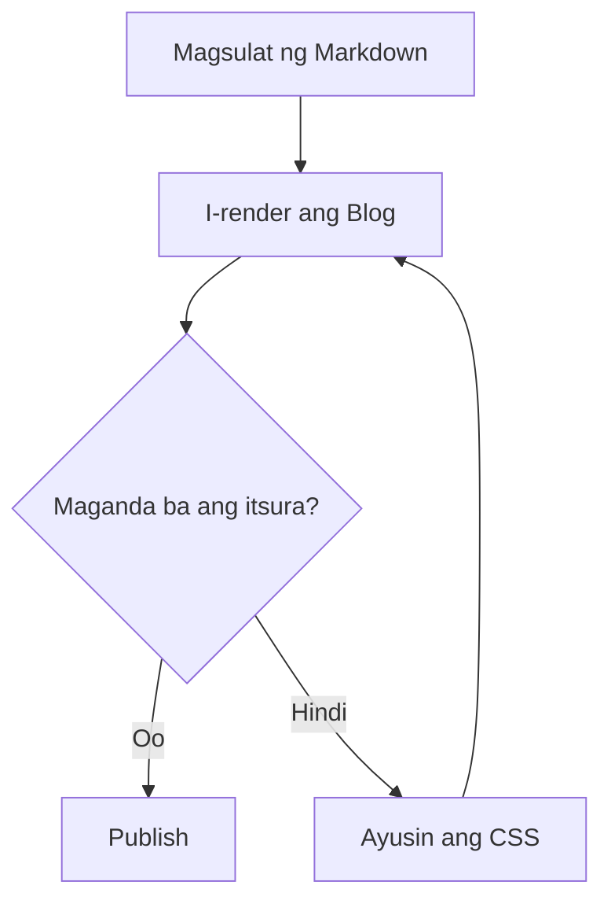

# Write for Fun, Build for Enjoy


[🇬🇧 Read in English](template-for-you-en.md)  
[🇮🇩 Baca dalam Bahasa Indonesia](template-for-you-id.md)  
[🇲🇾 Baca dalam Bahasa Melayu](template-for-you-ms.md)

﷽

Kumusta, welcome sa blog ko.

Ang blog na ito ay espasyo para sa exploration ko. Dito ako nagsusulat ng mga bagay na pinagaaralan ko, sinusubukan ang mga bagong idea, nag-iimbak ng experiments, at gumagawa ng mga bagay dahil masaya lang.

Hindi ko alam ang lahat, at hindi ko gustong magpanggap na alam ko ang lahat. Mas gusto kong magsimula sa curiosity: subukan, magkamali, malito, mag-Google, magkamali ulit, tapos sa huli, gumana rin.

Ituring na ito ang mantra ko:

> **Explore. Write. Build. Enjoy. Repeat.**

Kung isalin nang malaya: galugarin, magsulat, bumuo, mag-enjoy, ulitin. Kung totoo ang bersyon: buksan ang laptop, malito, uminom ng tubig, subukan ulit.

## Bakit may artikulong ito?

Ang artikulong ito ay **testing post** para sa blog ko.

Kamakailan, muling dinisenyo ko ang itsura ng blog ko, lalo na ang typography, spacing, heading, list, table, image, link, at code block. Pagkatapos, napagtanto ko ang isang bagay: iba ang paggawa ng design, iba ang pagtiyak na maayos pa rin ang hitsura ng lahat ng sulat.

Kaya ang artikulong ito ay parang practice area. Ibinubuhos ko rito ang lahat ng Markdown syntax ko, tapos tinitingnan ko kung alin ang maganda ang itsura at alin ang nagpapataniw sa akin, “paano nangyari iyon?”

Ginawa ang artikulong ito para sa dalawang uri ng sulat:

- **Non-technical na sulat**, tulad ng daily notes, opinyon, reflection, at exploration stories.
- **Technical na sulat**, tulad ng tutorials, study notes, documentation, at experiments.

Ituring itong visual checklist:

- Maganda ba ang heading hierarchy para basahin?
- Komportable ba ang mga paragraph kapag matagalang binabasa?
- Maayos ba ang itsura ng list, table, at callout?
- May syntax highlighting, line number, at copy button ba ang code block?
- Gumagana ba nang maayos ang images, captions, at links?
- Maaari bang ipakita ang YouTube bilang interactive media?
- Ligtas ba ang footnotes, math, diagrams, at HTML elements?
- May sense pa rin ba ang hitsura sa mobile?

Kaya oo, hindi masyadong seryoso ang artikulong ito. Para itong testing area ng blog ko habang nagsusulat pa rin ako nang relaxed.

> **Note:** Kung may mukhang kakaiba, ibig sabihin ay sinusubukan nga ito. Hindi ikaw ang mali; malamang ako pa ang hindi nakakahanap ng bug.

## Ano ang sinusubukan?

- Comfort ng typography para sa mahabang pagbabasa.
- Heading hierarchy at table of contents.
- Bold, italic, strikethrough, at inline code.
- Ordered list, unordered list, nested list, at checklist.
- Blockquote, nested blockquote, at callout.
- Inline technical content at special characters.
- Code block na may syntax highlighting, line number, hover, selection, at copy.
- Long line, whitespace, at source integrity.
- Reading progress.
- Local image, external image, caption, at fallback.
- Ordinary table at wide table.
- External link, internal anchor, autolink, at reference link.
- Ordinary media at YouTube media.
- Footnote, math, diagram, at basic HTML.
- Responsive behavior sa desktop, tablet, at mobile.
- Accessibility at keyboard/touch interaction.
- Long-form content integrity.

---

## 01 — Reading Experience

### Komportableng reading rhythm

Ang technical na sulat ay karaniwang nag-iiba sa pagitan ng explanation, command, output, at interpretation. Dapat natural ang transition, hindi parang roller coaster na walang seatbelt.

Dapat may komportableng line length, sapat na line-height, at malinaw na spacing ang main text. Dapat tumutulong ang headings sa pag-unawa sa structure, hindi ginagawang parang office meeting ang page.

Dapat kayang i-scan ng reader ang article nang mabilis, huminto sa mahalagang paragraph, tingnan ang code block, pagkatapos ay bumalik sa pagbabasa nang hindi naliligaw.

Pansinin ang mga terminong ito: `Content-Security-Policy`, `X-Forwarded-For`, `application/json`, `0xDEADBEEF`, `snake_case`, `camelCase`, `__init__()`, at `user_id`.

Dapat basahin pa rin ang lahat ng iyon sa loob ng normal na pangungusap at maayos na mag-wrap kapag kumikipit ang screen.

### Text formatting

Ito ay **bold text**, *italic text*, at ~~strikethrough text~~.

Puwede rin mong pagsamahin ang **bold** sa `inline code`, mag-reference sa [external link](https://example.com), o gumamit ng internal article anchor.

Dapat komportable pa ring basahin ang styling, hindi parang kumpol ng makukulay na cards ang bawat pangungusap.

### Heading hierarchy

#### Heading level three

##### Heading level four

###### Heading level six

Umiiral ang mga headings na ito para subukan ang hierarchy at anchor creation. Dapat sumunod ang table of contents sa configured heading depth, iwasan ang duplicate IDs, at panatilihing stable ang links.

## 02 — Article Metadata at Editorial Layout

Dapat kayang tanggapin ng article header ang mga sumusunod:

- Main title at optional subtitle.
- Author avatar, name, at profile link.
- Publication date at optional update date.
- Estimated reading time.
- Category, tags, at language options.
- Introduction o maikling summary.
- Optional cover image.

Dapat secondary pa rin ang itsura ng metadata kumpara sa article title. Hindi dapat masira ang layout dahil lang sa mahabang title, maraming tags, nawalang avatar, o translated title.

Sa mobile, dapat natural ang wrap ng metadata, hindi lumalabas sa kanan hanggang kailanganin ng reader ang horizontal scroll na parang nagbabasa ng newspaper noong 1998.

## 03 — Lists, Steps, at Technical Notes

### Investigation flow

1. Tukuyin ang scope at objective.
2. Ihanda ang testing environment.
3. Tukuyin ang relevant na application components.
4. Patakbuhin ang planned checks.
5. I-record ang observations at supporting evidence.
6. I-verify ang findings.
7. I-document ang conclusions at limitations.

### Multi-level procedure

1. **Environment preparation**
   - Tingnan ang system requirements.
   - Siguraduhing gumagana ang network connection.
   - Tingnan ang application dependencies.

2. **Testing**
   - I-capture ang request at response.
   - Suriin ang relevant na application behavior.
   - Ikumpara ang resulta sa expected outcome.

3. **Reporting**
   - I-summarize ang evidence.
   - Ipaliwanag ang impact.
   - I-document ang remediation options.

### Checklist

- [ ] Naka-document na ang testing environment.
- [ ] Natukoy na ang application endpoints.
- [ ] Na-verify nang independently ang lahat ng observations.
- [ ] Na-review na ang final report.

### Editorial callout

> **Note:** Gumamit ng callout para magdagdag ng context nang hindi napuputol ang main explanation.

> **Warning:** Dapat totoong risk ang ipinapahiwatig ng warning. Huwag gamitin ang warning styling para sa ordinaryong impormasyon.

> **Important:** Testing lang ng rendering ang artikulong ito. Hindi kailangang maging sobrang seryoso.

Gumagamit ang mga elementong ito ng standard Markdown blockquote. Kung sumusuporta ang renderer sa mas rich na callout, dapat galing ang presentation sa malinaw na convention o metadata, hindi sa fragile visual guessing.

## 04 — Inline Technical Content

Dapat gumana ang inline code sa loob ng paragraph, list, table, at link.

Halimbawa, puwedeng pag-usapan ang command na `sudo ./check-blog.sh` sa parehong pangungusap ng expected HTTP status, response na `application/json`, o configuration value tulad ng `timeout_ms`.

Dapat kita pa rin ang pagkakaiba ng identifiers na magkaiba lamang sa capitalization: `ContentType`, `contentType`, `content_type`, at `CONTENT_TYPE`.

Dapat ligtas pa rin ang special characters pagkatapos ng parsing at rendering: `<`, `>`, `&`, quotation marks, backslash, dollar sign, curly braces, brackets, at Unicode characters.

International text: Indonesia, 日本語, العربية, Español, Ελληνικά, at 🔐.

Hindi dapat ituring ng renderer na HTML markup o Markdown syntax ang literal code characters.

## 05 — Interactive Code Playground

Sinusubok ng bahaging ito ang pangunahing feature ng article renderer: code presentation.

Ang gustong interface ay isang interactive playground na may language selector, hindi magkakahiwalay na UI cards para sa bawat language. Dapat makapili ang reader ng supported language habang nananatiling consistent ang code panel, line number, controls, at reading position.

### Playground requirements

- Searchable na language selector kapag maraming language.
- Malawak na grammar support, kabilang ang aliases at less-common languages.
- Extensible na language registration.
- Tumpak na line number at syntax highlighting.
- Magkaibang visual state para sa line hover at active/selected status.
- Copy code nang hindi kinokopya ang line number.
- Optional line wrapping.
- Horizontal scroll para sa mahabang source line.
- Keyboard-accessible controls.
- Mobile-friendly selector at touch interaction.
- Plain-text fallback na readable pa rin para sa unknown languages.
- Walang nawawala o nagbabago sa original source.

Hindi dapat ituring na built-in Markdown feature ang language selector. Kaya ng standard fenced Markdown na markahan ang code block at language nito, pero kailangan ng renderer-level functionality ang multi-language playground.

### Primary source fixture

Ito ang pangunahing code sample sa dokumentong ito. Sadya itong mahaba, may indentation, comment, string, at nested structure para subukan ang code rendering.

```javascript
/**
 * Blog Renderer Test
 *
 * Inspect line numbers, syntax colors, indentation,
 * hover behavior, selection, copy, and scrolling.
 */

const configuration = {
  project: "My Personal Blog",
  environment: "local",
  features: {
    syntaxHighlighting: true,
    lineNumbers: true,
    copyButton: true,
    lineHighlighting: true,
  },
};

function summarizeNotes(notes) {
  return notes
    .filter((note) => note.published)
    .map((note, index) => ({
      number: index + 1,
      title: note.title,
      status: note.status,
    }));
}

async function loadArticle(url, options = {}) {
  if (!url) {
    throw new Error("An article URL is required");
  }

  const response = await fetch(url, {
    ...options,
    headers: {
      Accept: "application/json",
      ...options.headers,
    },
  });

  if (!response.ok) {
    throw new Error(`Request failed: HTTP ${response.status}`);
  }

  return response.json();
}

const exampleNotes = [
  {
    title: "Testing typography",
    status: "published",
    published: true,
  },
  {
    title: "Draft experiment",
    status: "draft",
    published: false,
  },
];

console.log(summarizeNotes(exampleNotes));
```

### Code interaction behavior

Kapag gumalaw ang pointer sa ibabaw ng source, dapat may subtle highlight ang current line. Dapat nananatiling aligned ang line-number gutter sa code, kahit nag-horizontal scroll ang code panel.

Dapat magkaiba ang visual state ng selected line o range sa hover. Hindi dapat magambala ang normal text selection, keyboard navigation, o copy.

Dapat may visible at accessible feedback ang copy button. Kapag nabigo ang clipboard access, dapat may malinaw na fallback ang reader, hindi pekeng “Copied!” status.

Para sa malalaking snippet, puwedeng magbigay ang interface ng expand at collapse controls. Hindi dapat mawala ang source content sa collapse, at dapat accessible pa rin ang lahat ng hidden content sa pamamagitan ng malinaw na interaction.

### Language support policy

Dapat ipakita ng selector ang mga available language mula sa ginagamit na syntax-highlighting engine, kabilang ang mga naka-register na extensions.

Hindi dapat nakadepende ang implementation sa hardcoded short list bilang permanent limit. Dapat sumusuporta ito sa language alias, optional grammar loading, at graceful fallback kapag walang available na grammar.

Dapat kayang idagdag ang bagong language nang hindi kailangang i-redesign ang article page. Dapat basahin pa rin bilang plain text ang unknown language.

Ang code sample sa itaas ay canonical Markdown code fixture. Dapat i-automate ang syntax testing para sa bawat supported grammar gamit ang hiwalay na language corpus, hindi sa pamamagitan ng pag-duplicate ng napakaraming code block sa artikulong ito.

## 06 — Long Lines, Whitespace, at Source Integrity

Dapat ma-access pa rin ang mahabang source line nang hindi pinapalapad ang buong page lampas sa viewport.

Dapat mag-offer ang renderer ng horizontal scrolling bilang default para sa code na masisira ang alignment o meaning kapag ini-wrap. Kung available ang soft wrapping, dapat may sense pa rin ang line number kahit umaabot sa ilang visual rows ang isang source line.

Mahalaga ang whitespace. Dapat mapanatili ang indentation, blank line, tab, trailing newline, at Unicode characters ayon sa source at renderer behavior.

Dapat manatiling buo ang source line tulad ng `if (response.status !== 200) {`. Hindi dapat mapalitan ng mga kamukha pero maling typographic characters ang mga operator tulad ng `===`, `!==`, `=>`, `->`, `::`, at `&&`.

Dapat tumukoy sa source line, hindi lang sa kasalukuyang visual row, ang line highlighting at line-number anchor.

## 07 — Reading Progress

Dapat sumasalamin ang reading progress indicator sa totoong posisyon ng reader.

Dapat nitong:

- Ma-update nang smooth habang nag-s-scroll.
- Manatiling hindi nakakagambala.
- Kayang hawakan ang maikli at mahabang article.
- Kalkulahin ang totoong content boundary ng article.
- Manatiling accurate kapag natapos nang mag-load ang images.
- Hindi mag-claim na tapos na kapag may hindi pa nababasang content.
- Igalang ang reduced-motion preference.

Dapat dumagdag sa reading experience ang progress indicator, hindi maging animation na mas interesting pa kaysa mismong article.

## 08 — Table of Contents

Dapat gawin ang table of contents mula sa eligible headings ng na-render na Markdown.

Expected behavior:

- Nested heading structure.
- Stable heading anchors.
- Active section indicator.
- Smooth navigation kung angkop.
- Sticky navigation sa desktop kung may space.
- Compact na drawer, dropdown, o katumbas nito sa mobile.
- Tamang behavior para sa duplicate headings.
- Hindi nag-o-overlap sa fixed header o reading progress.
- Hindi nasira kapag nagbago ang document height dahil sa media.

Dapat gumamit ang TOC generation ng parehong heading ID ng aktwal na na-render na article.

## 09 — Images at External Media

### Local cover image


*Caption: local image test para sa cover rendering, responsive sizing, at fallback behavior.*

### Landscape image


*Caption: image test para sa responsive sizing, loading behavior, aspect ratio, at caption typography.*

### Additional image


*Caption: pangalawang image para sa repeated media testing, spacing, at gallery transition.*

### Media behavior

Subukan ang mga sumusunod gamit ang ordinaryong image Markdown at supported links:

- Local images at externally hosted images.
- Portrait, landscape, at square aspect ratios.
- Alt text at captions.
- Lazy loading at reserved image dimensions.
- Image zoom o lightbox kung supported.
- Broken URLs at unavailable media.
- Redirects, slow responses, at unsupported formats.
- Video at third-party embeds kung sinusuportahan ng renderer.

Hindi dapat ituring na laging ma-fi-fetch ang external image URLs. Maaaring mabigo ang access dahil sa browser restriction, CORS, authentication, hotlink protection, o remote server failure.

Hindi dapat burahin ng failed image ang nakapaligid na text, biglang ilipat ang reader, o masira ang TOC.

## 10 — Tables at Structured Data

| Feature | Expected behavior | Priority |
| --- | --- | --- |
| Syntax highlighting | Language-specific na kulay | Critical |
| Line numbers | Stable alignment ng source line | Critical |
| Copy action | Kinokopya ang source nang walang gutter | Critical |
| Reading progress | Tumpak na article position | High |
| Table of contents | Stable navigation at active section | High |
| Image lightbox | Accessible media zoom | Medium |
| Related articles | Relevant navigation pagkatapos ng article | Medium |

### Wide technical table

| Endpoint | Method | Authentication | Content type | Expected response | Purpose |
| --- | --- | --- | --- | --- | --- |
| `/api/health` | `GET` | Optional | `application/json` | `200 OK` | Health check |
| `/api/notes` | `GET` | Required | `application/json` | `200 OK` | Retrieve notes |
| `/api/notes/export` | `POST` | Required | `application/json` | `202 Accepted` | Start export |
| `/api/notes/status` | `GET` | Required | `application/json` | `200 OK` | Check export status |

Sa makitid na screen, dapat may sadyang responsive strategy ang wide table. Mas mabuti ang local horizontal scrolling kaysa paliitin ang text hanggang kailanganin ng reader ang magnifying glass.

## 11 — Links at References

### External links

- [My GitHub Pages blog](https://github.com/iMoon07/imoon07.github.io/)
- [Example Domain](https://example.com)
- [GitHub](https://github.com)
- [MDN Web Docs](https://developer.mozilla.org)
- [Shiki documentation](https://shiki.style)
- [Rehype Pretty Code](https://rehype-pretty.pages.dev/)

Dapat may nakikilalang styling, usable focus state, at tamang handling ang external links, lalo na ang mga nagbubukas ng bagong tab.

### Link na may title

[GitHub na may title](https://github.com "Bisitahin ang GitHub")

### Autolinks

https://example.com

<https://example.com>

### Reference links

Ito ay [reference link][gh].

[gh]: https://github.com "GitHub"

### Internal anchor

Bumalik sa [Reading Experience](#01--reading-experience).

Dapat dalhin ng internal links ang reader sa tamang article heading. Dapat stable ang anchor generation para sa repeated headings at headings na may punctuation o non-English characters.

## 12 — Ordinary Media at YouTube

Kailangan ng ilang article ng higit pa sa images at source code. Dapat makilala ng renderer ang pagkakaiba ng **ordinary media** at **YouTube media**.

Dalawang behavior ang sinusubukan:

1. **Ordinary media** — normal external link na nananatiling link.
2. **YouTube media** — YouTube link na madedetect, ma-fi-fetch, at ipapakita bilang interactive video card.

### Ordinary media

Dapat simple, accessible, at predictable pa rin ang ordinary media links. Hindi kailangang gawing embed ng renderer ang bawat external URL.

- [Example website](https://example.com)
- [GitHub repository](https://github.com)
- [MDN Web Docs](https://developer.mozilla.org)
- [Shiki documentation](https://shiki.style)

Dapat may nakikilalang styling, usable focus state, at tamang handling ang external links, lalo na ang mga nagbubukas ng bagong tab.

Hindi dapat awtomatikong maging embed ang ordinary link. Nanatili itong normal na link maliban kung may special rule ang renderer para sa specific domain.

### YouTube media

Special case ang YouTube link. Dapat makilala ng renderer ang YouTube URL, kunin ang video ID, i-fetch ang public metadata, tapos ipakita bilang interactive video card.

Dapat makilala bilang YouTube video ang sumusunod na link:

[Manood sa YouTube](https://www.youtube.com/watch?v=8rkiwXkEA8M&list=PLsOgFqR0cppAEuYATcmAxyHeSTkWM4ZWj)

Expected renderer behavior:

- I-detect ang YouTube URL.
- I-extract ang video ID: `8rkiwXkEA8M`.
- I-fetch ang public metadata sa pamamagitan ng secure backend.
- Ipakita ang video title, channel name, at quality thumbnail.
- Ipakita ang play button o interactive preview.
- I-load ang YouTube iframe lamang pagkatapos pindutin ng reader ang play.
- Magbigay ng direct link fallback kung nabigo ang fetching o embedding.

Dapat mag-cache ang renderer ng metadata para hindi nagre-request sa YouTube tuwing bubuksan ang page.

### YouTube thumbnail na may play button

Kung hindi pa available ang interactive fetching, dapat maganda pa ring lumabas ang bersyong ito: YouTube thumbnail na may play button sa gitna.

<a
  href="https://www.youtube.com/watch?v=8rkiwXkEA8M&list=PLsOgFqR0cppAEuYATcmAxyHeSTkWM4ZWj"
  target="_blank"
  rel="noopener noreferrer"
  style="position: relative; display: block; max-width: 800px; margin: 0 auto;"
>
  

  <span
    style="
      position: absolute;
      top: 50%;
      left: 50%;
      transform: translate(-50%, -50%);
      width: 72px;
      height: 72px;
      background: rgba(0, 0, 0, 0.65);
      border-radius: 50%;
      display: flex;
      align-items: center;
      justify-content: center;
      color: white;
      font-size: 28px;
    "
  >
    ▶
  </span>
</a>

*Caption: YouTube thumbnail na may play button. I-click ang image para buksan ang video.*

### YouTube embed fallback

Kung sumusuporta ang renderer sa YouTube iframe, dapat ma-render nang direkta ang video.

<iframe
  width="100%"
  height="480"
  src="https://www.youtube.com/embed/8rkiwXkEA8M"
  title="YouTube video player"
  frameborder="0"
  allow="accelerometer; autoplay; clipboard-write; encrypted-media; gyroscope; picture-in-picture; web-share"
  allowfullscreen>
</iframe>

Dapat may malinaw na fallback ang bawat uri ng media. Kung hindi ma-load ang external embed, dapat ma-access pa rin ng reader ang mga paliwanag sa paligid nito at ang direct link kung available.

Huwag mag-execute ng arbitrary script mula sa Markdown. Dapat sumunod sa application sanitization at security policy ang HTML, embeds, SVG, at external content.

Dapat i-fetch ang external metadata sa pamamagitan ng controlled backend, na may request timeout, response-size limit, caching, at allowed-domain validation.

## 13 — Responsive Reading

Suriin ang parehong article sa desktop, tablet, at mobile widths.

### Desktop

Dapat may komportableng prose column ang article, na may mas malawak na code panel kung kailangan. Puwedeng okupahan ng sticky TOC ang side column kung may sapat na space.

### Tablet

Dapat readable pa rin ang text at code. Puwedeng maging mas compact ang secondary navigation, at hindi dapat nag-aagawan ng horizontal space ang code controls.

### Mobile

Dapat unahin ng article ang text at panatilihing usable ang interactive controls gamit ang touch. Puwedeng mag-horizontal scroll ang code blocks sa loob ng sarili nilang boundary. Dapat accessible pa rin ang tables, tama ang scaling ng images, at hindi dapat takpan ng sticky elements ang content.

Subukan ang portrait at landscape orientation, browser zoom, at paglaki ng text size.

## 14 — Accessibility at Interaction

Dapat gumana ang lahat ng mahalagang interaction nang walang mouse.

- Keyboard-accessible na language selection.
- Malinaw na focus indicator.
- Accessible na copy feedback.
- Screen-reader-friendly na line-number behavior.
- Sapat na contrast sa light at dark theme.
- Reduced-motion support.
- Touch alternative para sa hover interaction.
- Makabuluhang image alt text.
- Semantic na headings, lists, tables, at links.

Hindi dapat ang syntax colors ang tanging paraan para magpahayag ng mahalagang impormasyon. Dapat subtle ang hover effects at hindi nakakagambala sa text selection.

## 15 — Long-Form Content Integrity

Dapat pagsamahin din ang fixture na ito sa hiwalay na ginawang stress-test documents.

Subukan ang lalong malalaking Markdown documents, halimbawa 10 KB, 100 KB, 1 MB, at mga laki na angkop sa application.

Isama ang repeated paragraphs, nested headings, large lists, wide tables, remote images, at code samples na may libu-libong linya.

I-verify na:

- Accessible pa rin ang bawat source paragraph.
- Walang nawawalang source line.
- Tama pa rin ang character encoding at indentation.
- Valid pa rin ang headings at anchors.
- Ibinabalik ng copy action ang tamang source.
- Hindi nadodoble ang content sa rendering.
- Hindi binubura ng media failure ang ibang section.
- Walang hindi gustong horizontal overflow ang page.
- Minemeasure ang memory usage at rendering latency.
- Malinaw na hinihawakan ang resource limits, hindi sa pamamagitan ng silent truncation.

Huwag mag-claim ng mathematically unlimited. Ang requirement ay iwasan ang arbitrary content-length limit at siguraduhing may malinaw at tested performance strategy ang malalaking documents.

Kung kailangan ng progressive rendering o virtualization, panatilihin pa rin ang search, selection, source-line numbering, anchor navigation, at access sa buong article.

## 16 — Extended Markdown Coverage

Sinusubok ng bahaging ito ang mga dagdag na syntax na madalas gamitin sa technical at non-technical na sulat.

### Line breaks

Ito ang unang linya.  
Ito ang pangalawang linya gamit ang dalawang space sa dulo ng linya.

Ito ang ibang linya gamit ang backslash.\  
Dapat lumipat din ng linya ito.

### Escaping

\*Hindi dapat maging italic ito.\*

\# Hindi dapat maging heading ito.

\`Hindi dapat maging inline code ito.\`

### Nested blockquote

> Unang level
>
> > Pangalawang level
> >
> > > Pangatlong level

### Footnotes

May footnote ang pangungusap na ito.[^1]

[^1]: Ito ang nilalaman ng footnote.

### Ordered list na may custom start

3. Pangatlong item
4. Pang-apat na item
5. Panglimang item

### Emphasis nesting

***Bold italic text***

**Bold na may *nested italic***

*Italic na may **nested bold***

### Code block na walang language

```
Ito ay plain text.
Walang inaasahang syntax highlighting.
```

### HTML-based elements

<details>
  <summary>I-click para i-expand</summary>

  Nasa loob ng collapsible section ang content na ito.

</details>

Pindutin ang <kbd>Ctrl</kbd> + <kbd>C</kbd> para mag-copy.

<mark>Highlighted na text</mark>

### Math

Inline math: $E = mc^2$

Block math:

$$
\int_{a}^{b} f(x)\,dx
$$

### Mermaid diagram



### Definition list

Terminology
: Paliwanag sa terminology na iyon.

Ibang terminology
: Iba pang paliwanag.

### Highlight, subscript, at superscript

Ito ay ==highlighted na text==.

Tubig ang H~2~O.

Ito ay x^2^.

> **Note:** Nakadepende sa renderer extension ang `footnotes`, `math`, `mermaid`, `==highlight==`, `~subscript~`, at `^superscript^`. Kung hindi lumabas, hindi ibig sabihing mali ang basic Markdown.

## 17 — Final Verification Checklist

- [ ] Buo pa rin ang Markdown content.
- [ ] Komportable ang typography para sa mahabang reading session.
- [ ] Tama ang heading hierarchy at TOC.
- [ ] Tumpak na sinusundan ng reading progress ang article.
- [ ] Sinusuportahan ng code playground ang lahat ng registered grammar.
- [ ] Magandang fallback ang unknown languages.
- [ ] Tugma ang line numbers sa source lines.
- [ ] Hindi nakakagambala sa selection ang hover.
- [ ] Hindi kasama sa copy ang presentational line number.
- [ ] Hindi nag-o-overflow ang buong page dahil sa mahabang code lines.
- [ ] Napapanatili ang whitespace at Unicode characters.
- [ ] Usable pa rin ang wide tables sa mobile.
- [ ] May angkop na fallback ang images.
- [ ] Gumagana ang external links, internal anchors, autolinks, at reference links.
- [ ] Nanatiling link ang ordinary media.
- [ ] Tumutugma ang YouTube thumbnail na may play button.
- [ ] Gumagana ayon sa renderer capability ang YouTube embed o metadata fetching.
- [ ] Ligtas na na-render ang footnotes, math, diagrams, at HTML elements.
- [ ] Gumagana ang keyboard at touch interactions.
- [ ] Hindi itinatago ng browser zoom ang content.
- [ ] Nasusubukan ang large documents para sa performance.
- [ ] Walang arbitrary character limit na tahimik na pumuputol sa article.
- [ ] Gumagana pa rin ang existing Discuss feature.

## Conclusion

Testing experiment pa rin ang artikulong ito, pero simple lang ang layunin nito: siguraduhing kayang ipakita ng blog ko ang Markdown nang maayos, komportableng basahin, at enjoyable pa rin—para sa relaxed na sulat man o technical na sulat.

Dapat kayang sundan ng reader ang sulat, makita nang malinaw ang code block, i-navigate ang mahabang article, buksan ang image, basahin ang footnote, tingnan ang diagram, buksan ang ordinary media, at manood ng YouTube sa pamamagitan ng thumbnail o embed.

Dapat magdagdag ng magandang presentation at interaction ang renderer nang hindi binabago ang original Markdown o hindi pinapawalang bisa ang content.

Simple lang ang final goal: isang blog na maganda basahin, maayos, responsive, at parang espasyo pa rin kung saan ako nagsusulat para sa fun.
