# How to Setup Burpsuite Community in Browser

[🇮🇩 Read in Bahasa Indonesia](Setup-Burpsuite-Community-id.md)

﷽

First, make sure you have Burpsuite installed. If you are using Kali Linux, it is typically pre-installed.

Then, you will need an extension and a suitable, comfortable browser.

## Prerequisites:

- Burpsuite Community
- FoxyProxy Extension
- Browser (Firefox)

## Demonstration

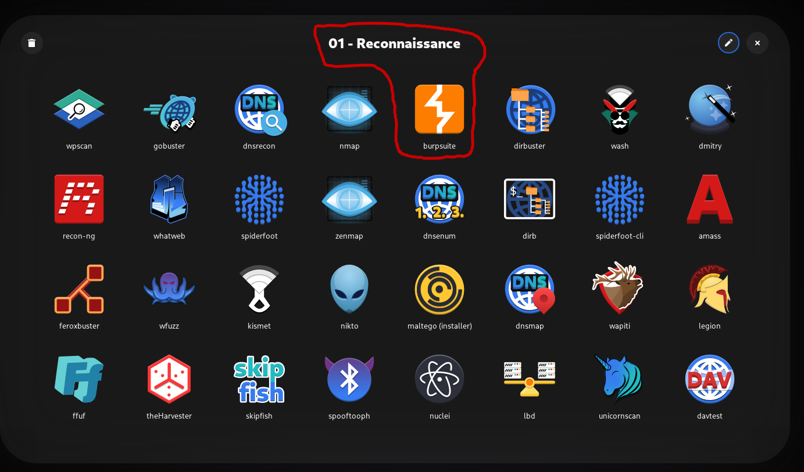

Open burpsuite

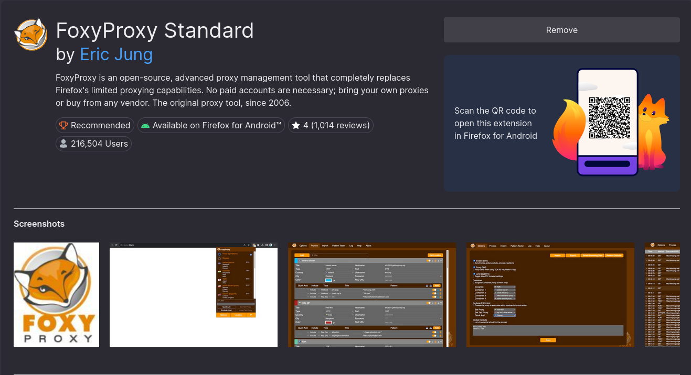

Install the extension in Firefox browser

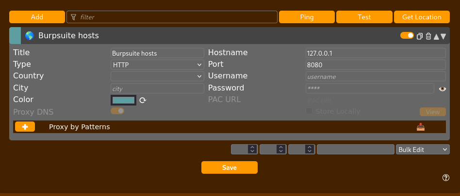

Set the interface in foxy proxy

- Title: Burpsuite hosts
- hostname: `127.0.0.1`
- port: `8080`

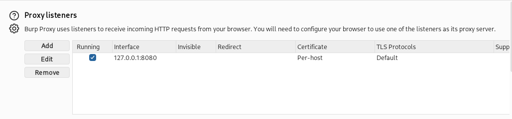

Make sure the host address is the same by default.

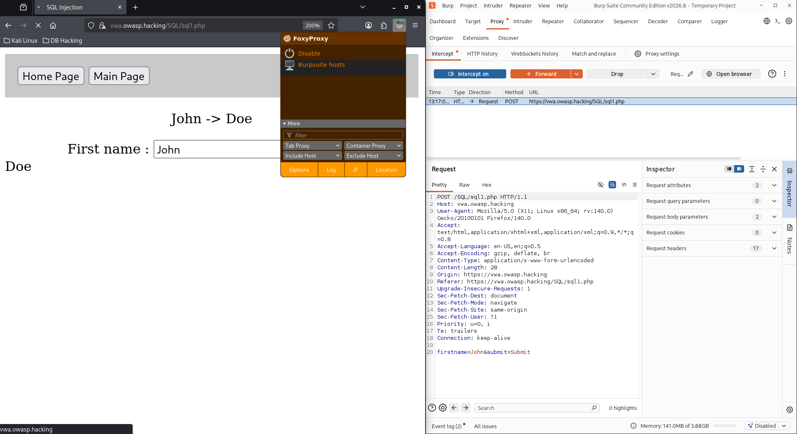

Testing proxy intercept and blocking local web traffic.

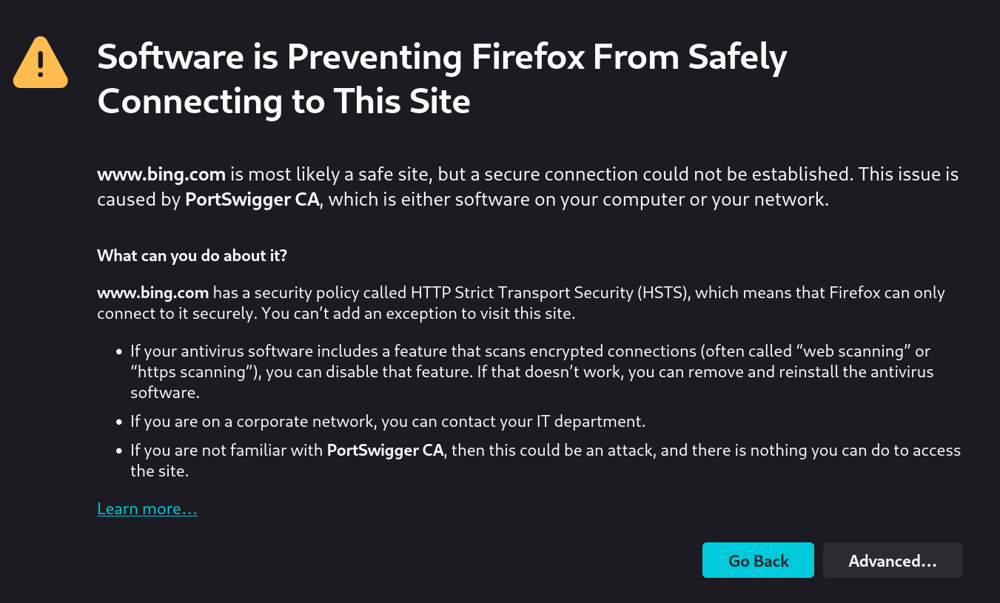

If you want to test a web domain with a public network, further configuration is required.

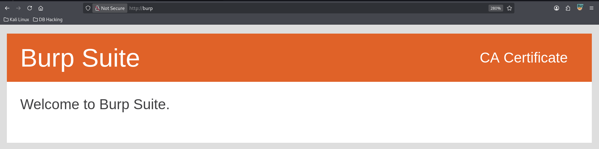

First, retrieve and download the certificate from http://burp

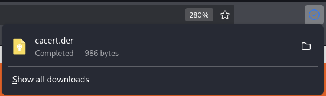

After downloading, proceed to the settings.

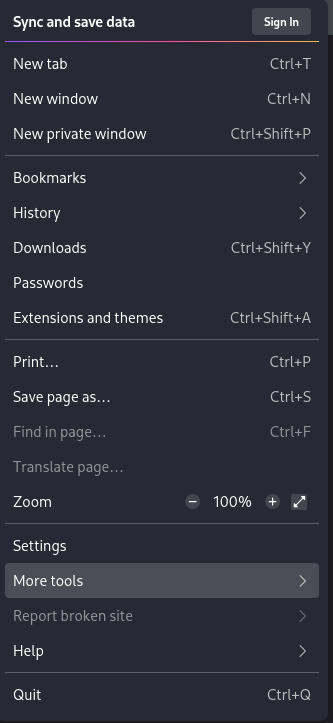

Select settings

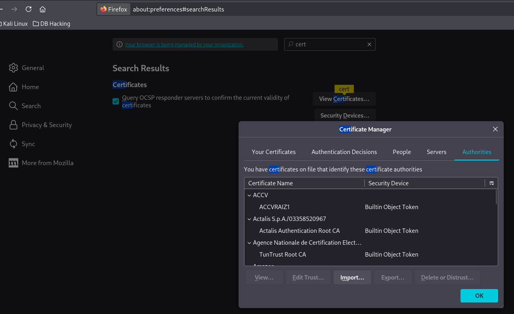

Search for the keyword "cert" and view, then import certificate

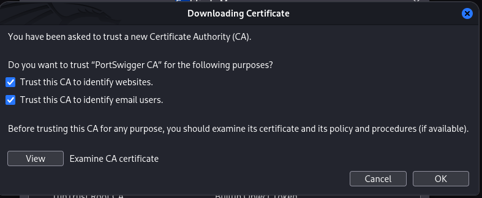

Trust CA for website identification and email users

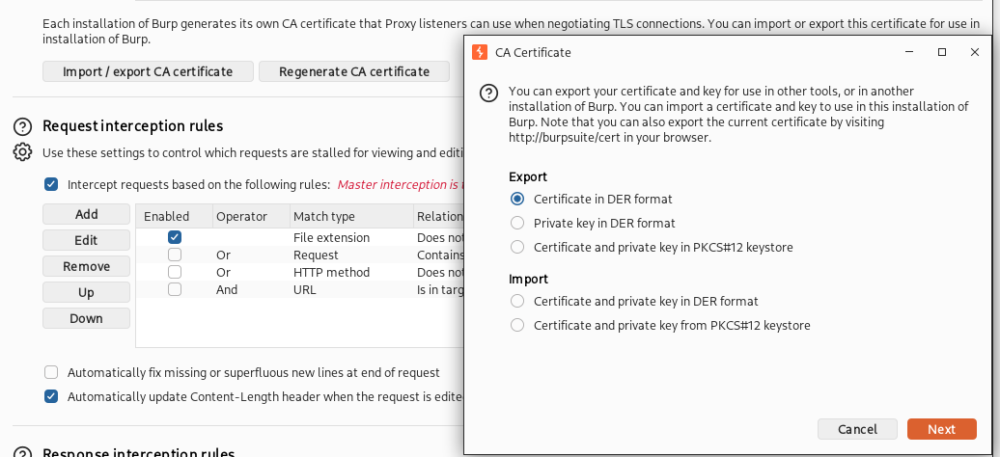

Import the certificate from browser to burpsuite in `DER` format

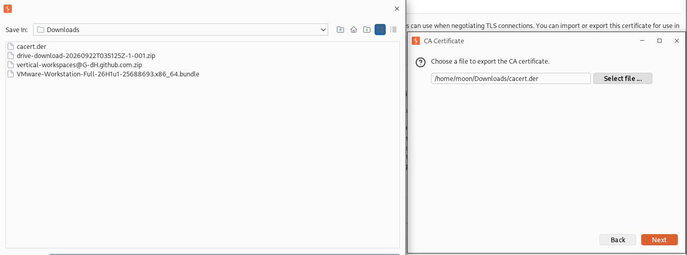

Select the location of the recently downloaded certificate, then import

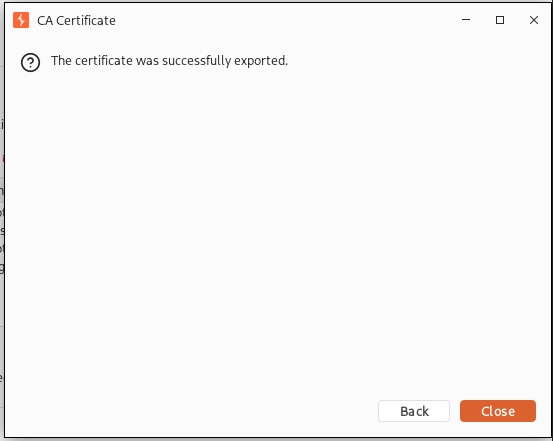

Successfully imported the certificate from browser to burpsuite.

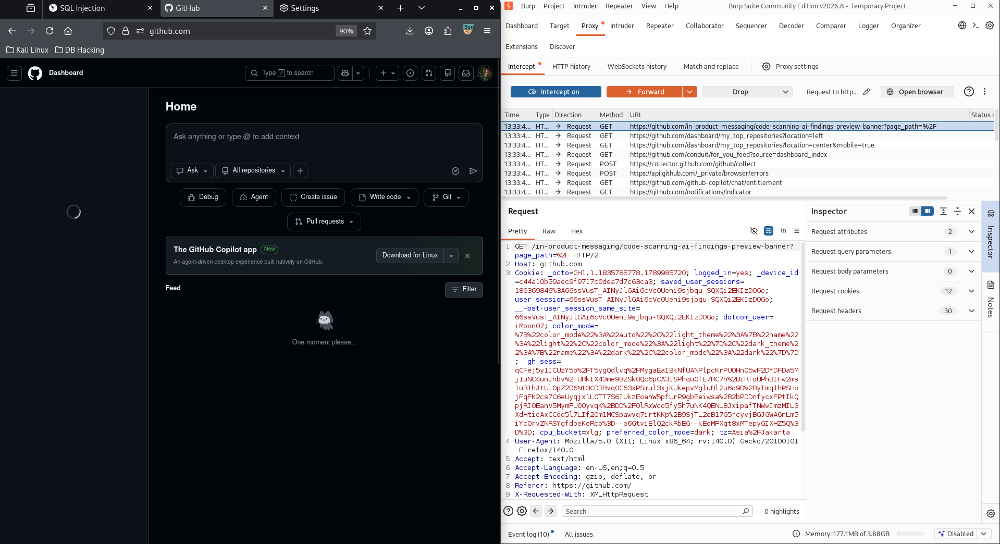

Here, for example, testing github.com with and without intercept or blocking traffic, the http can be captured by burpsuite.

## References

* Burpsuite Community
  https://portswigger.net/burp/communitydownload

* Burpsuite Documentation
  https://portswigger.net/burp/documentation/desktop/