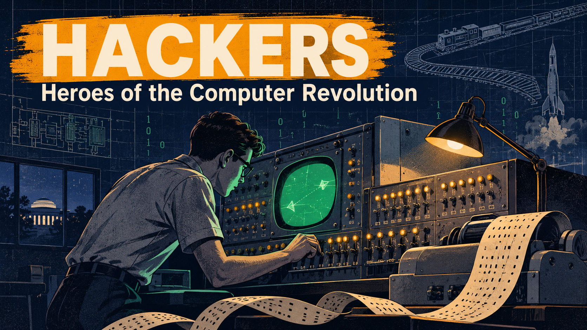

# Hackers: Pahlawan Revolusi Komputer (ID)



[🇬🇧 Read in English](hackers-heroes-of-the-computer-revolution-en.md)

﷽

> Versi Bahasa Indonesia dari `Hackers Heroes of the Computer Revolution.pdf` (~/Ebook) karya Steven Levy. Diekstrak dengan `ai-tools/read_pdf.py` (pypdf, lapisan teks; bukan metadata/OCR), dirapikan, lalu diterjemahkan. Watermark pemindaian dihapus; seluruh 520 halaman disertakan; penanda halaman dan struktur bab dipertahankan (Bahasa Indonesia).

## Info Ekstraksi
```
# PDF: /home/moon/Ebook/Hackers Heroes of the Computer Revolution.pdf
backend: pypdf
total_pages: 520
pages_returned: 520 (with_text: 520)
```


## Daftar Isi

- [Bagian Awal (Halaman 1–10)](#bagian-awal-halaman-110)
- [Kata Pengantar (Preface)](#kata-pengantar-preface)
- [Siapa Saja: Para Penyihir dan Mesin Mereka](#siapa-saja-para-penyihir-dan-mesin-mereka)
- [Bagian Satu — TRUE HACKERS (Cambridge: 1950-an & 1960-an)](#bagian-satu--true-hackers-cambridge-1950-an--1960-an)
  - [Bab 1 — The Tech Model Railroad Club](#bab-1--the-tech-model-railroad-club)
  - [Bab 2 — The Hacker Ethic](#bab-2--the-hacker-ethic)
  - [Bab 3 — Spacewar](#bab-3--spacewar)
  - [Bab 4 — Greenblatt and Gosper](#bab-4--greenblatt-and-gosper)
  - [Bab 5 — The Midnight Computer Wiring Society](#bab-5--the-midnight-computer-wiring-society)
  - [Bab 6 — Winners and Losers](#bab-6--winners-and-losers)
  - [Bab 7 — Life](#bab-7--life)
- [Bagian Dua — HARDWARE HACKERS (California Utara: 1970-an)](#bagian-dua--hardware-hackers-california-utara-1970-an)
  - [Bab 8 — Revolt in 2100](#bab-8--revolt-in-2100)
  - [Bab 9 — Every Man a God](#bab-9--every-man-a-god)
  - [Bab 10 — The Homebrew Computer Club](#bab-10--the-homebrew-computer-club)
  - [Bab 11 — Tiny BASIC](#bab-11--tiny-basic)
  - [Bab 12 — Woz](#bab-12--woz)
  - [Bab 13 — Secrets](#bab-13--secrets)
- [Bagian Tiga — GAME HACKERS (Sierra: 1980-an)](#bagian-tiga--game-hackers-sierra-1980-an)
  - [Bab 14 — The Wizard and the Princess](#bab-14--the-wizard-and-the-princess)
  - [Bab 15 — The Brotherhood](#bab-15--the-brotherhood)
  - [Bab 16 — The Third Generation](#bab-16--the-third-generation)
  - [Bab 17 — Summer Camp](#bab-17--summer-camp)
  - [Bab 18 — Frogger](#bab-18--frogger)
  - [Bab 19 — Applefest](#bab-19--applefest)
  - [Bab 20 — Wizard vs. Wizards](#bab-20--wizard-vs-wizards)
- [Bagian Empat — THE LAST OF THE TRUE HACKERS (Cambridge: 1983)](#bagian-empat--the-last-of-the-true-hackers-cambridge-1983)
  - [Epilog — The Last of the True Hackers](#epilog--the-last-of-the-true-hackers)
  - [Afterword: Sepuluh Tahun Kemudian](#afterword-sepuluh-tahun-kemudian)
  - [Afterword: 2010](#afterword-2010)
  - [Catatan (Notes)](#catatan-notes)
  - [Ucapan Terima Kasih (Acknowledgments)](#ucapan-terima-kasih-acknowledgments)
  - [Indeks (Index)](#indeks-index)

---

## Bagian Awal (Halaman 1–10)

<details><summary>Halaman 1</summary>

_[tidak ada lapisan teks yang dapat diekstrak pada halaman ini]_

</details>

<details><summary>Halaman 2</summary>

_[tidak ada lapisan teks yang dapat diekstrak pada halaman ini]_

</details>

<details><summary>Halaman 3</summary>

Peretas

</details>

<details><summary>Halaman 4</summary>

_[tidak ada lapisan teks yang dapat diekstrak pada halaman ini]_

</details>

<details><summary>Halaman 5</summary>

Peretas
Steven Levy
Beijing • Cambridge • Farnham • Köln • Sebastopol • Taipei • Tokyo

</details>

<details><summary>Halaman 6</summary>

Peretas oleh Steven Levy Hak Cipta © 2010 Steven Levy. Semua hak dilindungi undang-undang. Dicetak di Amerika Serikat. Diterbitkan oleh O'Reilly Media, Inc., 1005 Gravenstein Highway North, Sebastopol, CA 95472. Buku O'Reilly dapat dibeli untuk pendidikan, bisnis, atau penjualan penggunaan promosi. Edisi online juga tersedia untuk sebagian besar judul (saya.safaribooksonline.com). Untuk informasi lebih lanjut, hubungi kami departemen penjualan perusahaan/institusi: (800) 998-9938 atau perusahaan@oreilly.com. Editor: Mike Hendrickson Editor Produksi: Rachel Monaghan Layanan Produksi: Oktal Publishing, Inc. Penyalin: Amy Thomson Pengindeks: John Bickelhaupt Desainer Sampul: Monica Kamsvaag dan Edie Freedman Desainer Interior: Ron Bilodeau Sejarah Pencetakan: Mei 2010: Edisi Pertama. Logo O'Reilly adalah merek dagang terdaftar dari O'Reilly Media, Inc.Hackers dan pakaian dagang terkait adalah merek dagang dari O'Reilly Media, Inc. Banyak sebutan yang digunakan oleh produsen dan penjual untuk membedakannya produk diklaim sebagai merek dagang. Dimana sebutan tersebut muncul di sini buku, dan O'Reilly Media, Inc. mengetahui klaim merek dagang, the sebutan telah dicetak dalam huruf kapital atau huruf kapital awal. Meskipun segala tindakan pencegahan telah diambil dalam persiapan buku ini, namun penerbit dan penulis tidak bertanggung jawab atas kesalahan atau kelalaian, atau atas kerusakan akibat penggunaan informasi yang terkandung di sini. ISBN: 978-1-449-38839-3 [SB]

</details>

<details><summary>Halaman 7</summary>

Isi CAMBRIDGE: Tahun Lima Puluh dan Enam Puluh Kata Pengantar . . . . . . . . . . . . . . . . . . . . . . . . . . . . . . . . . . . . . . . . . . . . . . . . . ix Siapa Siapa: Para Penyihir dan Mesinnya. . . . . . . . . . . xi Bagian Satu. HACKER SEJATI CAMBRIDGE: Tahun Lima Puluh dan Enam Puluh 0. . . . . . . . . . . . . . . . . . . . . . . . . . . 3 1. . . . . . . . . . . . . . . . . . . . . . . . . . . . . . . . . . . . . . . 27 2. . . . . . . . . . . . . . . . . . . . . . . . . . . . . . . . . . . . . . . . . . . . . . 39 Greenblatt dan Gosper. . . . . . . . . . . . . . . . . . . . . . . . . . . . . . . . . 61 Masyarakat Pengkabelan Komputer Tengah Malam. . . . . . . . . . . . . . . . . 83 Pemenang dan Pecundang. . . . . . . . . . . . . . . . . . . . . . . . . . . . . . . . . . 101 Kehidupan. . . . . . . . . . . . . . . . . . . . . . . . . . . . . . . . . . . . . . . . . . . . . . . . . . 123

</details>

<details><summary>Halaman 8</summary>

Isivi Bagian Kedua. PERETAS PERANGKAT KERAS CALIFORNIA UTARA: Tahun Tujuh Puluh Pemberontakan pada tahun 2100. . . . . . . . . . . . . . . . . . . . . . . . . . . . . . . . . . . . . . . . 151 Setiap Manusia adalah Dewa. . . . . . . . . . . . . . . . . . . . . . . . . . . . . . . . . . . . . 179 0. . . . . . . . . . . . . . . . . . . . . . . 201 DASAR Kecil. . . . . . . . . . . . . . . . . . . . . . . . . . . . . . . . . . . . . . . . . . . . 227 Woz. . . . . . . . . . . . . . . . . . . . . . . . . . . . . . . . . . . . . . . . . . . . . . . . . . 249 Rahasia. . . . . . . . . . . . . . . . . . . . . . . . . . . . . . . . . . . . . . . . . . . . . . . 275 Bagian Ketiga. PERETAS PERMAINAN SIERRA: Tahun Delapan Puluhan Penyihir dan Putri. . . . . . . . . . . . . . . . . . . . . . . . . . 289 Persaudaraan. . . . . . . . . . . . . . . . . . . . . . . . . . . . . . . . . . . . . 313 Generasi Ketiga. . . . . . . . . . . . . . . . . . . . . . . . . . . . . . . . . 325 Perkemahan Musim Panas. . . . . . . . . . . . . . . . . . . . . . . . . . . . . . . . . . . . . . . . 345 katak. . . . . . . . . . . . . . . . . . . . . . . . . . . . . . . . . . . . . . . . . . . . . . 365

</details>

<details><summary>Halaman 9</summary>

Daftar Isi vii pesta apel . . . . . . . . . . . . . . . . . . . . . . . . . . . . . . . . . . . . . . . . . . . . 389 Penyihir vs. Penyihir. . . . . . . . . . . . . . . . . . . . . . . . . . . . . . . . . . . 413 Bagian Keempat. YANG TERAKHIR DARI HACKER SEJATI CAMBRIDGE: 1983 Yang Terakhir dari Peretas Sejati. . . . . . . . . . . . . . . . . . . . . . . . . . 437 Kata Penutup: Sepuluh Y telinga Setelahnya. . . . . . . . . . . . . . . . . . . . . . . . . . . . 455 Kata Penutup: 2010 . . . . . . . . . . . . . . . . . . . . . . . . . . . . . . . . . . . . . . 463 Catatan. . . . . . . . . . . . . . . . . . . . . . . . . . . . . . . . . . . . . . . . . . . . . . . . 479 Ucapan Terima Kasih. . . . . . . . . . . . . . . . . . . . . . . . . . . . . . . . . . . 485 Indeks. . . . . . . . . . . . . . . . . . . . . . . . . . . . . . . . . . . . . . . . . . . . . . . . 489

</details>

<details><summary>Halaman 10</summary>

_[tidak ada lapisan teks yang dapat diekstrak pada halaman ini]_

</details>


## Kata Pengantar (Preface)

<details><summary>Halaman 11</summary>

Kata Pengantar Saya pertama kali tertarik untuk menulis tentang peretas—para pemrogram dan perancang komputer yang menganggap komputasi sebagai hal yang paling penting hal yang paling penting di dunia—karena hal-hal tersebut sangat menarik orang. Meskipun beberapa orang di lapangan menggunakan istilah "hacker" sebagai a bentuk cemoohan, yang menyiratkan bahwa peretas adalah orang yang kutu buku orang buangan atau programmer “tidak profesional” yang menulis dengan kotor, kode komputer “tidak standar”, menurut saya sangat berbeda. Di balik penampilan luar mereka yang sering kali tidak mengesankan, mereka adalah para petualang, visioner, pengambil risiko, seniman...dan orang-orang yang paling jelas melihat mengapa komputer merupakan alat yang benar-benar revolusioner. Diantara sendiri, mereka tahu seberapa jauh seseorang bisa melangkah ke dalamnya konsentrasi mendalam dari pola pikir peretasan: seseorang bisa melangkah jauh tanpa batas. Saya mulai memahami mengapa peretas sejati mempertimbangkan hal ini istilah sebutan kehormatan bukannya merendahkan. Saat saya berbincang dengan para penjelajah digital ini, mulai dari mereka yang menjinakkan mesin bernilai jutaan dolar pada tahun 1950an hingga para penyihir muda kontemporer yang menguasai komputer di pinggiran kota mereka kamar tidur, saya menemukan elemen umum, filosofi umum itu sepertinya terikat pada logika komputer itu sendiri yang mengalir dengan elegan. Itu adalah filosofi berbagi, keterbukaan, desentralisasi, dan mendapatkan mesin dengan cara apa pun untuk meningkatkan mesin dan untuk memperbaiki dunia. Ini 0 adalah hadiah mereka untuk kami: sesuatu yang bernilai bahkan bagi kita yang tidak tertarik sama sekali komputer.

</details>

<details><summary>Halaman 12</summary>

x Ini adalah sebuah etika yang jarang dikodifikasikan namun justru diwujudkan dalam perilaku dari para hacker itu sendiri. Saya ingin memperkenalkan Anda pada hal-hal ini orang-orang yang tidak hanya melihat, tetapi juga merasakan keajaiban di komputer dan bekerja untuk membebaskan keajaiban sehingga bisa bermanfaat bagi kita semua. Ini orang-orangnya termasuk peretas sejati dari kecerdasan buatan MIT laboratorium pada tahun lima puluhan dan enam puluhan; peretas perangkat keras yang populis dan tidak terlalu diasingkan di California pada tahun tujuh puluhan; dan permainan muda peretas yang membuat jejak mereka di komputer pribadi tahun delapan puluhan. Ini sama sekali bukan sejarah formal dari era komputer, atau sejarah arena tertentu yang saya fokuskan. Memang banyak dari orang-orang Anda akan bertemu di sini bukan nama-nama paling terkenal (tentu saja bukan paling kaya) dalam sejarah komputasi. Sebaliknya, ini adalah para jenius di belakang layar yang memahami mesin pada tingkat paling mendalam dan memberi kita gaya hidup baru dan a pahlawan jenis baru. Peretas seperti Richard Greenblatt, Bill Gosper, Lee Felsenstein, dan John Harris adalah semangat dan jiwa komputasi itu sendiri. saya percaya kisah mereka—visi mereka, keintiman mereka dengan mesin itu sendiri, pengalaman mereka di dalam dunia mereka yang aneh, dan terkadang “antarmuka” yang dramatis dan terkadang tidak masuk akal dengan dunia luar— adalah kisah nyata revolusi komputer.

</details>


## Siapa Saja: Para Penyihir dan Mesin Mereka

<details><summary>Halaman 13</summary>

Siapa Siapa: Para Penyihir dan Mesin Mereka Bob Albrecht Pendiri Perusahaan Komputer Rakyat yang mengambil kesenangan mendalam dalam memperkenalkan komputer kepada anak-anak. Altair 8800 Komputer mikro perintis yang mendorong peretas perangkat keras. Membangun kit ini membuat Anda belajar meretas. Lalu kamu mencoba mencari tahu apa yang harus dilakukan dengannya. Komputer Apple II Steve Wozniak yang ramah, tidak stabil, dan terlihat bagus, sangat sukses dan merupakan percikan serta jiwa dari industri yang berkembang. Atari 800 Komputer rumahan ini memberikan grafik yang bagus untuk permainan peretas seperti John Harris, meskipun perusahaan yang membuatnya adalah peretas enggan memberi tahu Anda cara kerjanya. Bob dan Carolyn Box Pencari emas pemegang rekor dunia menjadi bintang perangkat lunak, bekerja untuk Sierra On-Line. Doug Carlston Pengacara perusahaan yang membuang semuanya untuk membentuk Perusahaan perangkat lunak Brøderbund. Bob Davis Meninggalkan pekerjaan di toko minuman keras untuk menjadi yang terlaris penulis permainan komputer Sierra On-Line Ulysses dan Bulu Emas. Kesuksesan adalah kejatuhannya. Peter Deutsch Buruk dalam olahraga, brilian dalam matematika, Peter masih tetap di sana celana pendek ketika dia menemukan TX-0 di MIT—dan meretasnya bersama dengan para master.

</details>

<details><summary>Halaman 14</summary>

Siapa Siapa: Para Penyihir dan Mesinnyaxii Anggota Steve Dompier Homebrew yang pertama kali membuat Altair bernyanyi, dan kemudian menulis game Target di Sol, yang membuat Tom terpesona Snyder. John Draper “Captain Crunch” terkenal yang tidak kenal takut menjelajahi sistem telepon, dipenjara, dan kemudian meretas mikrokomputer. Rokok membuatnya melakukan kekerasan. Mark Duchaineau Dungeonmaster muda yang melakukan perlindungan salinan Disk On-Line sesuai keinginannya. Chris Espinosa, pengikut Steve Wozniak dan berusia empat belas tahun karyawan awal Apple. Lee Felsenstein Mantan “editor militer” di Berkeley Barb dan pahlawan novel fiksi ilmiah imajiner, ia merancang komputer dengan pendekatan “tempat barang rongsokan” dan merupakan tokoh sentral di Bay Area peretasan perangkat keras pada tahun tujuh puluhan. Ed Fredkin Gentle pendiri Information International, dia menganggap dirinya programmer terhebat di dunia sampai dia bertemu Rebusan Nelson. Sosok ayah bagi para hacker. Gordon French, peretas perangkat keras berambut perak yang garasinya disimpan bukan mobil tapi komputer Chicken Hawk buatannya, lalu dipegang pertemuan 0 pertama. Putra Astronot Richard Garriott yang, sebagai Lord British, menciptakan Dunia ultima di disk komputer. Penyihir sombong Bill Gates dan lulusan Harvard yang menulis Altair BASIC, dan mengeluh ketika peretas menyalinnya. Bill Gosper Horowitz dari keyboard komputer, master matematika dan Peretas HIDUP di lab MIT AI, guru kelas 1, dan mahasiswa menu restoran Cina. Richard Greenblatt Peretas MIT yang berpikiran tunggal, tidak terawat, produktif, dan kanonik yang sering memasuki fase malam sehingga dia menghentikan karir akademisnya. Peretas si peretas. John Harris Peretas game Atari 800 muda yang menjadi Sierra Programmer bintang On-Line, tetapi mendambakan persahabatan dengan wanita. IBM PC Masuknya IBM ke pasar komputer pribadi, yang luar biasa memasukkan sedikit dari 2 dan mengambil alih.

</details>

<details><summary>Halaman 15</summary>

Siapa Siapa: Para Penyihir dan Mesinnya xiii IBM 704 IBM adalah Musuh dan ini adalah mesinnya, the Komputer Raksasa Raksasa di Gedung 26 MIT. Kemudian dimodifikasi menjadi IBM 709, lalu IBM 7090. Diproses secara batch dan tidak dapat ditoleransi. Jerry Jewell, dokter hewan Vietnam yang menjadi programmer yang mendirikan Sirius Perangkat lunak. Steven Jobs Visioner, anak muda yang cerdas dan tidak suka berpikir Apple II milik Wozniak, membuat banyak kesepakatan, dan membentuk sebuah perusahaan itu akan menghasilkan satu miliar dolar. Tom Knight Pada usia enam belas tahun, seorang peretas MIT yang akan menyebutkan nama Sistem Pembagian Waktu Tidak Kompatibel. Nanti, musuh bebuyutan Greenblatt atas perpecahan mesin LISP. Alan Kotok Mahasiswa MIT gemuk asal Jersey yang bekerja di bawah tata letak rel di TMRC, mempelajari sistem telepon di Western Electric, dan menjadi peretas legendaris TX-0 dan PDP-1. Efrem Lipkin Hacker-aktivis dari New York yang dicintai mesin tetapi membenci penggunaannya. Memori Komunitas yang Dibentuk Bersama; teman Felsenstein. Mesin LISP Komputer peretas terhebat, sebagian besar ditemukan oleh Greenblatt dan menjadi subyek perselisihan sengit di MIT. “Paman” John McCarthy Pelupa tapi MIT yang brilian (kemudian Stanford) profesor yang membantu merintis catur komputer buatan intelijen, LISP. Bob Marsh Berkeley-ite dan Homebrewer yang berbagi garasi dengannya Felsenstein dan mendirikan Processor Technology, yang membuat komputer tunggal. Roger Melen Homebrewer yang ikut mendirikan perusahaan Cromemco untuk membuat papan sirkuit untuk Altair. “Dazzler” miliknya memutar program LIFE di meja dapurnya. Louis Merton Nama samaran untuk peretas catur AI yang kecenderungannya menjadi katatonik menyatukan komunitas peretas. Jude Milhon Bertemu Lee Felsenstein melalui iklan baris di Berkeley Barb dan menjadi lebih dari sekedar teman—anggota Memori Komunitas kolektif. Marvin Minsky Profesor MIT yang ceria dan brilian yang memimpin Lab AI dan memungkinkan para peretas untuk berlari bebas.

</details>

<details><summary>Halaman 16</summary>

Siapa Siapa: Para Penyihir dan Mesinnyaxiv Fred Moore Vagabond pasifis yang membenci uang, menyukai teknologi, dan ikut mendirikan Homebrew Club. Stewart Nelson Peretas lab AI yang gigih, kecil, namun berapi-api yang menghubungkan komputer PDP-1 untuk meretas sistem telepon. Kemudian menjadi salah satu pendiri perusahaan Systems Concepts. Ted Nelson menggambarkan dirinya sendiri sebagai “inovator” dan terkenal sebagai orang yang pelit yang menerbitkan sendiri buku Computer Lib yang berpengaruh. Russell Noftsker Harried, administrator lab MIT AI pada akhir tahun enam puluhan; kemudian menjadi presiden perusahaan Symbolics. Adam Osborne, penerbit dan produsen komputer kelahiran Bangkok yang menganggap dirinya seorang filsuf. Didirikan Osborne Computer Company untuk membuat mesin yang “memadai”. Peralatan Digital PDP-1 pertama 0 dan pada tahun 1961 an anugerah interaktif bagi para peretas MIT dan tamparan di wajah Fasisme IBM. PDP-6 Dirancang sebagian oleh Kotok, komputer pertama ini landasan lab AI, dengan set instruksi yang indah dan enam belas register seksi. Tom Pittman Peretas Homebrew religius yang kehilangan istrinya tapi tetap percaya dengan Tiny BASIC miliknya. Ed Roberts Enigmatic pendiri perusahaan MITS yang mengguncang dunia dengan komputer Altair-nya. Dia ingin membantu orang membangun piramida mental. Steve (Siput) “kuli” Russell McCarthy yang meretas 2 program, videogame pertama, di PDP-1. Tidak pernah membuat sepeser pun dari itu. Peter Samson Peretas MIT (salah satu yang pertama), yang menyukai sistem, kereta api, TX-0, musik, prosedur parlemen, lelucon, dan peretasan. Bob Saunders Jolly, hacker TMRC botak yang menikah dini, diretas sampai larut malam sambil makan "lemon gunkies", dan menguasainya “Strategi CBS” pada 3 . Warren Schwader Peretas berambut pirang besar dari pedesaan Wisconsin yang beralih dari jalur perakitan menjadi bintang perangkat lunak, tetapi tidak bisa menyelaraskan perubahan tersebut dengan pengabdiannya kepada Saksi-Saksi Yehuwa.

</details>

<details><summary>Halaman 17</summary>

Siapa Siapa: Para Penyihir dan Mesinnya xv David Silver Meninggalkan sekolah pada usia empat belas tahun untuk menjadi maskot lab AI; pembuat kunci terlarang dan pembuat robot kecil yang melakukan hal mustahil. Dan Sokol Orang iseng berambut panjang yang suka mengungkap rahasia teknologi di Homebrew Club. Membantu “membebaskan” Altair BASIC program pada pita kertas. Terminal dan komputer Sol Computer Lee Felsenstein, terpasang dua bulan yang penuh gejolak, hampir seperti komputer yang membalikkan keadaan sekitar. Hampir saja tidak cukup. Les Solomon Editor Popular Electronics, penarik tali yang menggerakkan revolusi komputer. Marty Spergel The Junk Man, anggota Homebrew yang memasok sirkuit dan kabel dan dapat membuatkan Anda kesepakatan untuk apa pun. Richard Stallman Yang Terakhir dari Peretas, dia bersumpah untuk membela prinsip-prinsip hackerisme sampai akhir yang pahit. Tetap di MIT sampai tidak ada orang yang bisa diajak makan makanan Cina. Jeff Stephenson, veteran seni bela diri dan peretas berusia tiga puluh tahun yang terkejut bahwa bergabung dengan Sierra On-Line berarti mendaftar Perkemahan Musim Panas. Jay Sullivan Maddening adalah programmer tingkat penyihir yang tenang di Informatika yang membuat Ken Williams terkesan karena mengetahui artinya kata “apapun”. MBA berkulit putih Dick Sunderland Chalk yang mempercayai hal itu birokrasi manajerial yang tegas adalah tujuan yang layak, tetapi sebagai presiden dari Sierra On-Line menemukan bahwa peretas tidak berpikiran seperti itu. Gerry Sussman Hacker muda MIT dicap “pecundang” karena dia menghisap pipa dan “mematikan” programnya; kemudian menjadi "pemenang" dengan keajaiban algoritmik. Margot Tommervik Bersama suaminya Al, Margot berambut panjang mempertaruhkan kemenangan gameshow-nya ke dalam majalah yang mendewakan Komputer Apple. Terminal Tom Swift Lee Felsenstein yang legendaris dan belum pernah dibangun terminal komputer, yang akan memberikan izin terakhir kepada pengguna menguasai dunia. TX-0 Mengisi ruangan kecil, tapi di akhir tahun lima puluhan, $3 juta ini mesin adalah komputer pribadi pertama di dunia—untuk komunitas peretas MIT yang terbentuk di sekitarnya.

</details>

<details><summary>Halaman 18</summary>

Siapa Siapa: Para Penyihir dan Mesinnyaxvi Jim Warren Portly, penyedia "gosip teknologi" di Homebrew, dia adalah editor pertama Jurnal Dr. Dobbs bergaya hippie, kemudian dimulai Pameran Komputer yang menguntungkan. Randy Wigginton Anggota Steve Wozniak yang berusia lima belas tahun korps anak-anak, dia membantu Woz mendorong Apple II ke Homebrew. Masih duduk di bangku SMA saat menjadi software pertama Apple karyawan. Ken Williams Seorang programmer muda yang sombong dan brilian yang melihat menulis di CRT dan memulai Sierra On-Line untuk melakukan pembunuhan dan meningkatkan masyarakat dengan menjual game untuk komputer Apple. Istri Roberta Williams Ken Williams yang pemalu yang menemukannya kembali kreativitasnya sendiri dengan menulis Mystery House, yang pertama dari sekian banyak karyanya game komputer terlaris. Stephen “Woz” Wozniak Terbuka hati, berani secara teknologi peretas perangkat keras dari pinggiran kota San Jose, Woz membangun Apple Komputer untuk kesenangan dirinya dan teman-temannya.

</details>


# Bagian Satu — TRUE HACKERS (Cambridge: 1950-an & 1960-an)

<details><summary>Halaman 19</summary>

0. HACKERS SEJATI
0. Cambridge:
Tahun Lima Puluh dan Enam Puluh

</details>

<details><summary>Halaman 20</summary>

_[tidak ada lapisan teks yang dapat diekstrak pada halaman ini]_

</details>


## Bab 1 — The Tech Model Railroad Club

<details><summary>Halaman 21</summary>

Model Teknologi Klub Kereta Api Kenapa Peter Samson berkeliaran di Gedung 26 in tengah malam adalah masalah yang sulit dia lakukan menjelaskan. Beberapa hal tidak diucapkan. Jika Anda seperti orang-orangnya yang Peter Samson kenal dan berteman dalam hal ini, miliknya tahun pertama di Massachusetts Institute of Technology di musim dingin tahun 1958–1959, tidak diperlukan penjelasan apa pun. Berkeliaran di sekitar labirin laboratorium dan gudang, mencari rahasia peralihan telepon di ruang mesin, menelusuri jalur kabel atau relay di terowongan uap bawah tanah— bagi sebagian orang, itu adalah perilaku yang umum, dan tidak perlu membenarkan dorongan hati tersebut, ketika dihadapkan pada pintu yang tertutup dengan suara yang sangat menggelitik di belakangnya, hingga membuka pintu tanpa diundang. Dan kemudian, jika tidak ada orang yang secara fisik melarang akses ke apa pun membuat suara yang menarik, untuk menyentuh mesin, mulai menjentikkan tombol dan mencatat respons, dan akhirnya mengendurkan a sekrup, lepaskan kaitan templat, goyangkan beberapa dioda, dan sesuaikan beberapa koneksi. Peter Samson dan teman-temannya tumbuh dengan a hubungan khusus dengan dunia, di mana segala sesuatu mempunyai makna hanya jika Anda mengetahui cara kerjanya. Dan bagaimana caramu pergi tentang hal itu jika tidak dengan mendapatkan mereka? Di basement Gedung 26 itulah Samson dan teman-temannya berada menemukan ruang EAM. Gedung 26 terbuat dari kaca dan baja yang panjang struktur, salah satu bangunan baru MIT, kontras dengan struktur berpilar terhormat yang menjadi bagian depan Institut di Massachusetts

</details>

<details><summary>Halaman 22</summary>

Jalan. Di ruang bawah tanah gedung ini tanpa kepribadian, ruang EAM. Mesin Akuntansi Elektronik. Sebuah ruangan itu mesin bertempat yang berjalan seperti komputer. Tidak banyak orang di tahun 1959 yang pernah melihat komputer, apalagi menyentuh satu. Samson, seorang kurus, berambut merah keriting dengan gaya memanjangkan huruf vokalnya sehingga tampak dia sedang melaju kencang daftar kemungkinan arti pernyataan di tengah kata, telah dilihat komputer pada kunjungannya ke MIT dari kampung halamannya di Lowell, Massachusetts, kurang dari tiga puluh mil dari kampus. Ini membuatnya seorang "landak Cambridge", salah satu dari lusinan orang yang gila sains siswa di wilayah tersebut yang tertarik, seolah-olah terkena gravitasi tarik, ke kampus Cambridge. Dia bahkan telah mencoba memasangnya komputer sendiri dengan bagian-bagian mesin pinball lama yang dibuang: mereka adalah sumber elemen logika terbaik yang bisa dia temukan. Elemen logika: istilah ini sepertinya merangkum apa yang menarik perhatian Peter Samson, anak seorang tukang reparasi mesin pabrik, hingga elektronik. Itu subjek masuk akal. Ketika Anda tumbuh dengan keingintahuan yang tak terpuaskan tentang bagaimana segala sesuatunya bekerja, kegembiraan yang Anda temukan saat menemukan sesuatu yang elegan seperti logika rangkaian, di mana semua koneksi harus menyelesaikan putarannya, sungguh mendebarkan. Petrus Samson, yang sejak awal mengapresiasi kesederhanaan matematika hal-hal ini, ingat pernah melihat acara televisi di Boston's saluran TV publik, WGBH, yang memberikan pengenalan dasar tentang pemrograman komputer dalam bahasanya sendiri. Itu menembakkan miliknya imajinasi; bagi Peter Samson, komputer itu pasti seperti itu Lampu Aladdin—gosoklah, dan itu akan menuruti perintah Anda. Jadi dia mencoba untuk mempelajari lebih lanjut tentang lapangan, membuat mesinnya sendiri, masuk kompetisi dan kontes proyek sains, dan pergi ke tempat itu yang dicita-citakan oleh orang-orang sejenisnya: MIT. Repositori yang sangat paling cerdas dari anak-anak SMA aneh berkacamata seperti burung hantu dan dada terbelakang yang membuat guru matematika terpesona dan gagal PE, yang bermimpi bukan untuk mencetak gol di malam prom, tapi untuk mencapainya final kompetisi General Electric Science Fair. MIT, di mana dia akan berjalan-jalan di lorong pada jam dua siang pagi hari, mencari sesuatu yang menarik, dan kemana dia akan pergi memang menemukan sesuatu yang akan membantu menariknya jauh ke dalam a bentuk baru dari proses kreatif dan gaya hidup baru, dan akan menempatkan dia menjadi yang terdepan dalam masyarakat yang hanya dibayangkan oleh beberapa penulis fiksi ilmiah yang bereputasi buruk. Dia akan menemukan komputer yang bisa dia mainkan.

</details>

<details><summary>Halaman 23</summary>

0 5 Ruang EAM yang kebetulan ditemui Simson sudah penuh mesin keypunch besar seukuran lemari arsip jongkok. Tidak seorang pun melindungi mereka: ruangan itu hanya dikelola pada siang hari, ketika a kelompok terpilih yang telah memperoleh izin resmi diberi hak istimewa cukup dengan menyerahkan kartu manila panjang ke operator yang kemudian gunakan mesin ini untuk melubanginya sesuai dengan datanya orang-orang yang memiliki hak istimewa ingin dimasukkan ke dalam kartu. Sebuah lubang di kartu akan mewakili beberapa instruksi ke komputer, menyuruhnya untuk melakukan sepotong data di suatu tempat, atau menjalankan suatu fungsi pada sepotong data data, atau memindahkan sepotong data dari satu tempat ke tempat lain. Keseluruhan tumpukan kartu-kartu ini dijadikan satu program komputer, sebuah program menjadi serangkaian instruksi yang menghasilkan beberapa hasil yang diharapkan, seperti petunjuk dalam resep, jika diikuti dengan tepat, akan menjadi petunjuk ke kue. Kartu-kartu itu akan dibawa ke operator lain di lantai atas siapa yang akan memasukkan kartu-kartu itu ke “pembaca” yang akan melakukannya catat di mana lubangnya dan kirimkan informasi ini ke Komputer IBM 704 di lantai pertama Gedung 26: Hulking Raksasa. IBM 704 berharga beberapa juta dolar, menempati seluruh ruangan, membutuhkan perhatian terus-menerus dari kader mesin profesional operator, dan diperlukan AC khusus agar tabung vakum bercahaya di dalamnya tidak akan memanas hingga mencapai suhu yang merusak. Saat AC rusak— kejadian yang cukup umum—gong yang keras akan berbunyi, dan tiga para insinyur akan datang dari kantor terdekat untuk mengambil dengan panik menutupi mesin agar bagian dalamnya tidak meleleh. Semua ini orang-orang yang bertanggung jawab membuat kartu berlubang, memberikannya kepada pembaca, dan menekan tombol dan menyalakan mesin adalah hal yang biasa biasa disebut Imamat, dan mereka yang cukup istimewa untuk itu menyerahkan data kepada para pendeta paling suci yang merupakan pembantunya yang resmi. Itu adalah pertukaran yang hampir bersifat ritual. Acolyte: Oh mesin, maukah kamu menerima tawaran informasiku jadi Anda dapat menjalankan program saya dan mungkin memberi saya perhitungan? Imam (atas nama mesin): Kami akan mencoba. Kami berjanji tidak ada apa-apa. Sebagai aturan umum, bahkan para pembantunya yang paling istimewa pun tidak mengizinkan akses langsung ke mesin itu sendiri, dan mereka tidak akan melakukannya dapat melihat selama berjam-jam, terkadang berhari-hari, hasil dari mesin menelan “kumpulan” kartu mereka.

</details>

<details><summary>Halaman 24</summary>

Ini adalah sesuatu yang diketahui Simson, dan tentu saja hal itu membuat frustrasi sialnya Samson, yang ingin mendapatkan mesin sialan itu. Untuk inilah arti hidup. Apa yang tidak diketahui Simson, dan ia senang mengetahuinya, adalah bahwa ruang EAM juga memiliki mesin keypunch tertentu disebut 407. Bukan hanya bisa dilubangi, tapi juga bisa membaca kartu, mengurutkannya, dan mencetaknya pada daftar. Sepertinya tidak ada seorang pun untuk menjaga mesin-mesin ini, yang merupakan semacam komputer. Dari Tentu saja, menggunakannya bukanlah hal yang mudah: seseorang harus benar-benar melakukannya sambungkan apa yang disebut papan colokan, berukuran dua inci kali dua inci kotak plastik dengan banyak lubang di dalamnya. Jika Anda memasukkan ratusan kabel melalui lubang dalam urutan tertentu, Anda akan mendapatkan sesuatu yang tampak seperti sarang tikus tetapi akan cocok dengan mesin elektromekanis ini dan mengubah kepribadiannya. Itu bisa melakukan apa yang Anda lakukan ingin hal itu terjadi. Jadi, tanpa izin apa pun, itulah yang dilakukan Petrus Samson berangkat, bersama beberapa temannya dari MIT organisasi dengan minat khusus pada model perkeretaapian. Itu adalah sebuah langkah santai dan tanpa berpikir menuju masa depan fiksi ilmiah, tapi itu memang terjadi tipikal cara yang dilakukan oleh subkultur aneh tali sepatunya dan berkembang menjadi terkenal di bawah tanah—hingga menjadi budaya yang akan menjadi jiwa yang tidak sopan dan tidak disetujui dunia komputer. Itu adalah salah satu petualangan peretas komputer pertama dari 0 , atau TMRC. • • • • • • • • Peter Samson pernah menjadi anggota Tech Model Railroad Klub sejak minggu pertamanya di MIT pada musim gugur tahun 1958. Acara pertama bahwa masuknya mahasiswa baru MIT yang dihadiri merupakan sebuah penyambutan tradisional kuliah, sama dengan yang telah diberikan selama ini kepada siapa pun MIT bisa mengingatnya. Lihatlah orang di sebelah kirimu...lihat orang di sebelah kananmu...satu dari kalian bertiga tidak akan lulus dari Institut. Efek yang dimaksudkan dari pidato tersebut adalah untuk menciptakan perasaan mengerikan di belakang tenggorokan kolektif mahasiswa baru itu menandakan ketakutan yang belum pernah terjadi sebelumnya. Sepanjang hidup mereka, mahasiswa baru ini hampir terbebas dari tekanan akademis. Pengecualian itu diperoleh berdasarkan kecemerlangan. Sekarang masing-masing dari mereka memiliki

</details>

<details><summary>Halaman 25</summary>

0 7 orang di sebelah kanan dan orang di sebelah kiri yang sama pintarnya. Bahkan mungkin lebih pintar. Namun bagi sebagian siswa, hal ini bukanlah tantangan sama sekali. Untuk ini anak-anak muda, teman sekelas dianggap dalam semacam kabut ramah: mungkin mereka akan membantu dalam pencarian yang memakan waktu untuk menemukannya mengetahui cara kerjanya dan kemudian menguasainya. Ada sudah cukup banyak hambatan untuk belajar—mengapa repot-repot dengan hal bodoh hal-hal seperti guru yang cerewet dan berjuang untuk mendapatkan nilai? Bagi siswa seperti Peter Samson, pencarian ini lebih berarti daripada gelar. Beberapa saat setelah ceramah datanglah Mahasiswa Baru Midway. Semua organisasi kampus—kelompok kepentingan khusus, persaudaraan, dan seperti itu—mendirikan stan di gimnasium besar untuk mencoba merekrut orang baru anggota. Kelompok yang menangkap Peter adalah kelompok 1. Anggotanya, kakak kelas bermata cerah dan cepak yang berbicara dengan irama spasmodik dari orang-orang yang menginginkannya kata-kata yang keluar dari jalan dengan tergesa-gesa, membanggakan tampilan yang spektakuler Kereta pengukur HO yang mereka miliki di ruang klub permanen di Gedung 20. Peter Samson sudah lama terpesona dengan kereta api, khususnya kereta bawah tanah. Jadi dia melanjutkan tur jalan kaki ke gedung, a struktur sementara berlapis sirap yang dibangun selama Perang Dunia II. Itu lorong-lorongnya sangat luas, dan meskipun ruang klub menyala di lantai dua, suasananya terasa lembap dan remang-remang seperti ruang bawah tanah. Ruang klub didominasi oleh tata letak kereta yang besar. Itu hanya sekitar memenuhi ruangan, dan jika Anda berdiri di area kendali kecil disebut “the notch” Anda dapat melihat sebuah kota kecil, sebuah industri kecil area, jalur troli kecil, gunung papier-mâché, dan sebagainya tentu saja banyak kereta dan trek. Keretanya sangat teliti dibuat menyerupai rekan-rekan skala penuh mereka, dan mereka menenggaknya sepanjang liku-liku trek dengan kesempurnaan buku bergambar. Dan kemudian Peter Samson melihat ke bawah papan setinggi dada yang memegang tata letaknya. Itu membuat dia terengah-engah. Di bawah ini tata letaknya adalah matriks kabel dan relay yang lebih besar dan saklar palang daripada yang pernah diimpikan Peter Samson. Ada barisan saklar yang rapi dan teratur deretan tongkat estafet perunggu kusam, dan jalinan merah yang panjang dan bertele-tele, kabel biru dan kuning—memutar dan memutar seperti ledakan rambut Einstein yang berwarna pelangi. Itu adalah sistem yang sangat rumit, dan Peter Samson berjanji untuk mencari tahu cara kerjanya.

</details>

<details><summary>Halaman 26</summary>

Angka 0 memberikan anggotanya sebuah kunci ke ruang klub setelah mereka mencatat empat puluh jam pengerjaan tata letak. Mahasiswa baru Midway datang pada hari Jumat. Pada hari Senin, Peter Simson mempunyai kuncinya. • • • • • • • • Ada dua faksi TMRC. Beberapa anggota menyukai gagasan itu menghabiskan waktu mereka membangun dan melukis replika tertentu melatih dengan nilai sejarah dan emosional, atau menciptakan realistis pemandangan untuk tata letaknya. Ini adalah kontingen pisau dan kuas, dan mereka berlangganan majalah kereta api dan memesan klub untuk perjalanan di jalur kereta yang sudah tua. Faksi lainnya berpusat pada Subkomite Sinyal dan Kekuatan klub, dan sangat peduli lebih lanjut tentang apa yang terjadi di bawah tata letak. Ini adalah Sistemnya, yang berhasil seperti kolaborasi antara Rube Goldberg dan Wernher von Braun, dan terus berlanjut ditingkatkan, dirubah, disempurnakan, dan terkadang “dirusak”—in jargon klub, kacau. Orang-orang S&P terobsesi dengan cara tersebut Sistem berhasil, kompleksitasnya semakin meningkat, bagaimana pun perubahannya yang Anda buat akan memengaruhi bagian lain, dan cara Anda memasangnya hubungan antar bagian agar dapat dimanfaatkan secara optimal. Banyak bagian untuk Sistem telah disumbangkan oleh Paket Hadiah Western Electric College, langsung dari perusahaan telepon. Penasihat fakultas klub juga bertanggung jawab atas kampus sistem telepon, dan telah memastikan bahwa peralatan telepon canggih tersedia untuk model kereta api. Dengan menggunakan peralatan itu sebagai titik awal, perusahaan kereta api telah menyusun skema itu memungkinkan beberapa orang untuk mengendalikan kereta api sekaligus, bahkan kereta api sekalipun berada di bagian berbeda dari trek yang sama. Menggunakan dial yang disesuaikan dari telepon, “insinyur” TMRC dapat menentukan yang mana blok jalur yang ingin mereka kendalikan, dan menjalankan kereta dari sana. Hal ini dilakukan dengan menggunakan beberapa jenis relay perusahaan telepon, termasuk eksekutor palang dan sakelar langkah yang memungkinkan Anda benar-benar mendengar daya yang ditransfer dari satu blok ke blok lainnya oleh suara chunka-chunka-chunka dari dunia lain. Kelompok S&P-lah yang merancang hal ini dengan sangat cerdik skema tersebut, dan kelompok S&P-lah yang memendam keingintahuan yang membuat mereka mencari-cari di sekitar gedung kampus di

</details>

<details><summary>Halaman 27</summary>

0 9 mencari cara untuk mendapatkan komputer. Mereka adalah murid seumur hidup dari 1. Kepala S&P adalah seorang kakak kelas bernama Bob Saunders, dengan ciri-ciri kemerahan dan bulat, tawa yang menular, dan bakat untuk berpindah-pindah. Sebagai seorang anak di Chicago, dia telah membangun trafo frekuensi tinggi untuk frekuensi tinggi proyek sekolah; itu adalah kumparan Tesla versi tingginya enam kaki, sesuatu yang dirancang oleh seorang insinyur pada tahun 1800an yang seharusnya untuk mengirimkan gelombang besar tenaga listrik. Saunders mengatakannya proyek koil berhasil mematikan penerimaan televisi hingga beberapa blok sekitar. Orang lain yang tertarik pada S&P adalah Alan Kotok, seorang New Jerseyite yang montok, tanpa dagu, dan berkacamata tebal di Samson's kelas. Keluarga Kotok dapat mengingatnya, pada usia tiga tahun, dengan mencabut steker keluar dari dinding dengan obeng dan menyebabkan pancuran mendesis percikan api untuk meletus. Ketika dia berumur enam tahun, dia sedang membangun dan memasang kabel lampu. Di sekolah menengah dia pernah mengikuti tur Mobil Lab Penelitian di dekat Haddonfield dan melihat komputer pertamanya— kegembiraan dari pengalaman itu membantunya memutuskan untuk masuk MIT. Di tahun pertamanya, dia mendapatkan reputasi sebagai salah satu dari Orang-orang S&P TMRC yang paling cakap. Orang-orang S&P adalah orang-orang yang menghabiskan hari Sabtu pergi ke Eli Tempat barang rongsokan Heffron di Somerville mencari suku cadang, siapa yang mau menghabiskan waktu berjam-jam telentang dengan bertumpu pada kursi-kursi kecil yang bisa digulung disebut "bunkies" untuk mengatasi titik-titik sempit dalam peralihan sistem, siapa yang akan bekerja sepanjang malam untuk menghasilkan keseluruhannya koneksi tidak sah antara telepon TMRC dan Timur Kampus. Teknologi adalah taman bermain mereka. Anggota inti nongkrong di klub selama berjam-jam, terus-menerus meningkatkan Sistem, berdebat tentang apa yang bisa dilakukan selanjutnya, dan mengembangkan jargon mereka sendiri yang tampaknya tidak dapat dipahami oleh orang luar yang mungkin akan tertarik pada remaja fanatik ini, dengan kemeja lengan pendek kotak-kotak, pensil di saku, celana chino, dan, selalu, sebotol Coca-Cola di sisinya. (TMRC membeli mesin Coke sendiri karena dilarang jumlah $165; dengan tarif lima sen per botol, pengeluarannya adalah diganti dalam tiga bulan; untuk memfasilitasi penjualan, Saunders membangun a ganti mesin untuk pembeli Coke yang masih digunakan satu dekade nanti.) Ketika sebuah peralatan tidak berfungsi, maka peralatan itu akan berfungsi “kalah”; ketika sebuah peralatan rusak, peralatan itu “dirusak” (dihaluskan sampai tidak enak); dua meja di sudut ruangan tidak disebut kantor, melainkan “lubang”; orang yang bersikeras

</details>

<details><summary>Halaman 28</summary>

belajar untuk kursus adalah “alat”; sampah disebut “cruft”; dan sebuah proyek yang dilakukan atau produk yang dibangun tidak semata-mata untuk memenuhi beberapa hal tujuan konstruktif, tetapi dengan kesenangan liar belaka keterlibatan, disebut “peretasan.” Istilah terakhir ini mungkin disarankan oleh istilah kuno MIT—the Kata "hack" telah lama digunakan untuk menggambarkan perguruan tinggi yang rumit lelucon yang biasa dilakukan oleh mahasiswa MIT, seperti meliput kubah yang menghadap ke kampus dengan kertas pantulan. Tapi sebagai orang-orang TMRC menggunakan kata itu, ada rasa hormat yang serius tersirat. Sementara seseorang mungkin menyebut hubungan yang cerdas antara keduanya menyampaikan "peretasan belaka", dapat dipahami bahwa, untuk memenuhi syarat sebagai a hack, prestasi tersebut harus dijiwai dengan inovasi, gaya, dan keahlian teknis. Meskipun seseorang mungkin akan mencela diri sendiri dengan mengatakan dia sedang “meretas The System” (seperti pengguna kapak meretas log), seni yang digunakan untuk meretas diakui menjadi cukup besar. Orang-orang paling produktif yang bekerja di S&P menyebut diri mereka sendiri "peretas" dengan bangga. Dalam batas-batas ruang klub di Gedung 20, dan “Ruang Perkakas” (tempat beberapa orang belajar dan banyak sesi techno bull terjadi), mereka melakukannya secara sepihak memberkahi diri mereka dengan atribut heroik dari legenda Islandia. Beginilah cara Peter Samson melihat dirinya dan teman-temannya dalam puisi Sandburgesque di buletin klub: Ganti Pelempar untuk Dunia, Fuze Tester, Pembuat Rute, Pemain dengan Rel Kereta Api dan Sistem Advance Chopper; Kumuh, berbulu, luas, Mesin Garis Fungsi Titik-o-lite: Mereka bilang padaku kamu jahat dan aku percaya mereka; karena aku punya melihat bola lampu Anda yang dicat di bawah lucite memikat sistem kuli. . . Di bawah menara, debu berserakan, diretas dengan mata air bercabang dua Meretas bahkan sebagai mahasiswa baru yang bodoh bertindak tidak pernah kalah hunian dan telah keluar

</details>

<details><summary>Halaman 29</summary>

0 11 Meretas M-Board, karena di bawah kuncinya ada sakelar, dan di bawah kendalinya kemajuan di sekitar tata letak, Peretasan! Meretas generasi muda yang kumuh, berbulu, dan luas; tidak kabel, dioda penggorengan, bangga menjadi Switchthrower, Fuze-tester, Pembuat Rute, Pemain dengan Rel Kereta Api, dan Chopper Muka ke Sistem. Kapan pun mereka bisa, Simson dan yang lainnya akan menyelinap ke sana Ruang EAM dengan papan colokannya, mencoba menggunakan mesin itu melacak sakelar di bawah tata letak. Sama pentingnya, mereka melihat apa yang bisa dilakukan oleh penghitung elektromekanis lakukan, membawanya ke batasnya. Musim semi tahun 1959, kursus baru ditawarkan di MIT. Itu adalah kursus pertama dalam pemrograman komputer yang bisa diambil oleh mahasiswa baru. Gurunya adalah seorang pria yang jauh dengan rambut acak-acakan dan janggut yang sama sulit diatur—John McCarthy. Seorang ahli matematika, McCarthy adalah seorang profesor klasik yang linglung; cerita banyak tentang kebiasaannya yang tiba-tiba menjawab pertanyaan berjam-jam, kadang-kadang bahkan berhari-hari setelah hal itu pertama kali diajukan kepadanya. Dia akan melakukannya mendekati Anda di lorong dan tanpa salam akan dimulai berbicara dengan diksi robotiknya yang tepat, seolah-olah jeda percakapan hanya sepersekian detik, dan bukan seminggu. Kemungkinan besar, tanggapannya yang terlambat akan sangat brilian. McCarthy adalah salah satu dari sedikit orang yang bekerja secara keseluruhan bentuk baru penyelidikan ilmiah dengan komputer. Yang mudah berubah dan sifat kontroversial dari bidang studinya terlihat jelas dari sangat arogan atas nama yang diberikan McCarthy kepadanya: 1 . Pria ini sebenarnya mengira itu komputer bisa menjadi pintar. Bahkan di tempat yang sarat ilmu pengetahuan seperti MIT, kebanyakan orang menganggap pemikiran itu konyol: mereka menganggapnya komputer menjadi alat yang berguna, meski agak mahal bukan kepalang perhitungan besar-besaran dan untuk merancang rudal sistem pertahanan (seperti yang dimiliki komputer terbesar MIT, Whirlwind). dilakukan untuk sistem peringatan dini SAGE), namun dicemooh berpikir bahwa komputer itu sendiri sebenarnya bisa menjadi ilmu pengetahuan bidang studi. Ilmu Komputer belum secara resmi ada di MIT pada tahun akhir tahun lima puluhan, dan McCarthy dan rekan-rekan spesialis komputernya bekerja di Departemen Teknik Elektro, yang menawarkan

</details>

<details><summary>Halaman 30</summary>

kursusnya, No. 641, yaitu Kotok, Samson, dan beberapa TRMC lainnya anggota mengambil musim semi itu. McCarthy telah memulai program raksasa pada IBM 704—the Raksasa Raksasa—itu akan memberinya kemampuan luar biasa bermain catur. Bagi kritikus bidang pemula 0 , ini hanyalah salah satu contoh optimisme orang-orang yang keras kepala seperti John McCarthy. Tapi McCarthy punya visi tertentu tentang apa komputer bisa melakukannya, dan bermain catur hanyalah permulaan. Semua hal menarik, tapi bukan visi yang mendorong Kotok dan Simson dan yang lainnya. Mereka ingin belajar cara bekerja mesin sialan, dan sementara bahasa pemrograman baru ini disebut LISP yang dibicarakan McCarthy pada tahun 641 memang menarik tidak semenarik tindakan pemrograman, atau itu momen luar biasa ketika Anda mendapatkan hasil cetakan Anda kembali dari Imamat—kata-kata dari sumbernya sendiri!—dan kemudian dapat dibelanjakan berjam-jam meneliti hasil program, apa yang telah terjadi salahnya, bagaimana cara memperbaikinya. Peretas TMRC sedang merancang cara untuk berhubungan lebih dekat dengan IBM 704, yang segera ditingkatkan ke model yang lebih baru bernama 709. Oleh nongkrong di Pusat Komputasi pada dini hari pagi hari, dan dengan mengenal Imamat, dan dengan membungkuk dan menggores sebanyak yang diperlukan, orang-orang menyukai Kotok akhirnya diizinkan untuk menekan beberapa tombol pada mesin dan perhatikan lampunya berfungsi. Ada rahasia pada mesin IBM yang telah dipelajari dengan susah payah oleh beberapa orang tua di MIT yang memiliki akses 704 dan teman-teman di antara Imamat. Hebatnya, beberapa di antaranya para programmer ini, mahasiswa pascasarjana yang bekerja dengan McCarthy, pernah melakukannya bahkan menulis sebuah program yang memanfaatkan salah satu deretan lampu kecil: lampunya akan menyala sedemikian rupa hingga terlihat sedikit bola dioper dari kanan ke kiri: jika operator menekan tombol pada saat yang tepat, gerakan lampu bisa dibalik— komputer Ping-Pong! Ini jelas merupakan hal yang seperti itu Anda akan pamer untuk mengesankan rekan-rekan Anda, yang kemudian akan melihatnya pada program sebenarnya yang Anda tulis untuk melihat bagaimana hal itu dilakukan. Untuk menjadi yang teratas dalam program ini, orang lain mungkin mencoba melakukan hal yang sama dengan instruksi yang lebih sedikit—sebuah usaha yang layak, karena memang ada ruang kecil dalam “memori” kecil komputer pada masa itu bahwa tidak banyak instruksi yang bisa masuk ke dalamnya. John McCarthy

</details>

<details><summary>Halaman 31</summary>

0 13 pernah memperhatikan mahasiswa pascasarjananya yang berkeliaran 704 akan mengerjakan program komputer mereka untuk mendapatkan hasil maksimal dari instruksi paling sedikit, dan kompres programnya bahwa lebih sedikit kartu yang perlu dimasukkan ke mesin. Mencukur satu atau dua instruksi hampir menjadi obsesi bagi mereka. McCarthy membandingkan para siswa ini dengan para gelandangan ski. Mereka mendapatkan sensasi utama yang sama dari "memaksimalkan kode" sebagai fanatik pemain ski berhasil meluncur dengan panik menuruni bukit. Jadi latihannya mengambil program komputer dan mencoba memotong instruksi tanpa mempengaruhi hasilnya disebut “program yang mengecewakan,” dan Anda akan sering mendengar orang-orang menggumamkan hal-hal seperti, “Mungkin saya dapat memberikan beberapa instruksi dan menurunkan pemuat kartu koreksi oktal menjadi tiga kartu, bukan empat.” Pada tahun 1959, McCarthy mengalihkan minatnya dari catur ke hal baru cara berbicara dengan komputer, “bahasa” baru disebut LISP. Alan Kotok dan teman-temannya sangat ingin menerimanya atas proyek catur. Bekerja pada IBM yang diproses secara batch, mereka memulai proyek raksasa pengajaran 704, dan kemudian 709, dan bahkan setelah itu penggantinya 7090, cara bermainnya permainan raja. Akhirnya kelompok Kotok menjadi yang terbesar pengguna waktu komputer di seluruh Pusat Komputasi MIT. Namun, bekerja dengan mesin IBM membuat frustrasi. Ada tidak ada yang lebih buruk dari menunggu lama antara waktu Anda menyerahkan kartu Anda dan waktu penyerahan hasil Anda kepada Anda. Jika Anda salah menempatkan satu huruf dalam satu instruksi, program akan macet, dan Anda harus memulai seluruh proses lagi. Hal ini berjalan seiring dengan semakin terbatasnya penyebaran virus aturan sialan yang merasuki atmosfer Komputasi Pusat. Sebagian besar peraturan dirancang untuk menjaga jarak fisik bagi penggemar komputer muda seperti Samson, Kotok, dan Saunders dari mesin itu sendiri. Aturan paling kaku dari semuanya adalah tidak seorang pun harus dapat benar-benar menyentuh atau merusak mesin itu sendiri. Tentu saja, inilah yang sangat ingin dilakukan oleh orang-orang S&P lebih dari apa pun di dunia, dan pembatasan pun diberlakukan mereka gila. Seorang pendeta—sebenarnya seorang pendeta pembantu tingkat rendah—yang bertugas pada shift larut malam sangat jahat dalam menegakkan aturan ini, jadi Simson merancang a balas dendam yang cocok. Sambil melihat-lihat sampah elektronik Eli berbelanja suatu hari, dia kebetulan menemukan papan listrik persis seperti itu

</details>

<details><summary>Halaman 32</summary>

jenis papan yang menampung tabung vakum kikuk yang ada di dalam IBM. Suatu malam, sekitar sebelum jam 4 pagi, ini pendeta pembantu tertentu keluar sebentar; ketika dia kembali, Simson memberitahunya bahwa mesin itu tidak berfungsi, tetapi mereka tetap berfungsi menemukan masalahnya—dan mengangkat modul yang hancur total 704 lama yang dia dapatkan di rumah Eli. Sub-imam sulit mengeluarkan kata-katanya. “Ke-kemana kamu pergi? mengerti itu?” Samson, yang memiliki mata hijau lebar yang mudah terlihat gila, perlahan menunjuk ke tempat terbuka di rak mesin di mana, tentu saja, belum pernah ada papan, tapi ruangan itu masih terlihat menyedihkan telanjang. Wakil pendeta itu tersentak. Dia membuat wajah yang menunjukkan isi perutnya hendak memberikannya. Dia merintih nasihat kepada dewa. Tidak diragukan lagi, gambaran tentang pemotongan satu juta dolar dari gajinya mulai terlintas di hadapannya. Hanya setelah atasannya, tinggi pendeta dengan pemahaman tentang mentalitas anak muda ini orang bijak dari Model Railroad Club, datang dan menjelaskan situasi apakah dia tenang. Dia bukanlah administrator terakhir yang merasakan kemarahan seorang hacker digagalkan dalam pencarian akses. • • • • • • • • Suatu hari seorang mantan anggota TMRC yang kini berada di fakultas MIT berkunjung ke ruang klub. Namanya Jack Dennis. Ketika dia masih menjadi sarjana pada awal tahun 1950-an, dia pernah melakukannya bekerja mati-matian di bawah tata letak. Dennis akhir-akhir ini begitu mengerjakan komputer yang baru saja diterima MIT dari Lincoln Lab, laboratorium pengembangan militer yang berafiliasi dengan Institut. Itu Komputer ini disebut TX-0, dan merupakan salah satu komputer yang menggunakan transistor pertama di dunia. Lincoln Lab telah menggunakannya secara khusus untuk itu menguji komputer raksasa bernama TX-2, yang memiliki memori demikian rumit yang hanya bisa dilakukan oleh adik kecil yang bertubuh khusus ini penyakit dapat didiagnosis dengan baik. Sekarang setelah pekerjaan aslinya selesai, itu TX-0 senilai tiga juta dolar telah dikirim ke Institut pada “pinjaman jangka panjang,” dan tampaknya tidak ada seorang pun di Lincoln Lab yang memilikinya

</details>

<details><summary>Halaman 33</summary>

0 15 menandai kalender dengan tanggal kembali. Dennis bertanya pada S&P orang-orang di TMRC apakah mereka ingin melihatnya. Hai kalian para biarawati! Apakah Anda ingin bertemu Paus? TX-0 berada di Gedung 26, di Research Laboratory of Electronics (RLE) lantai dua, tepat di atas Computation Center di lantai pertama, yang menampung IBM 704 raksasa. menyerupai ruang kendali pesawat luar angkasa antik. TX-0, atau Tixo, demikian sebutannya, pada masanya adalah seorang cebol mesin, karena ini adalah salah satu komputer pertama yang menggunakan ukuran jari transistor, bukan tabung vakum seukuran tangan. Tetap saja, itu memakan waktu sebagian besar ruangan, beserta peralatan pendukung AC seberat lima belas ton. Cara kerja TX-0 dipasang beberapa sasis yang tinggi dan tipis, seperti rak buku logam yang kokoh, dengan kabel-kabel kusut dan deretan wadah kecil berbentuk botol yang rapi di dalamnya. dimana transistor dimasukkan. Rak lainnya kokoh bagian depan logam berbintik-bintik dengan alat pengukur yang tampak suram. Menghadapi rak adalah konsol berbentuk L, panel kontrol H.G. Wells ini pesawat ruang angkasa, dengan meja biru untuk siku dan kertas Anda. Aktif lengan pendek L berdiri Flexowriter, yang menyerupai a mesin tik diubah untuk perang tank, bagian bawahnya berlabuh di a perumahan abu-abu militer. Di atas bagian atas terdapat panel kontrol, tonjolan berbentuk kotak dicat kuning institusional. Di sisi kotak-kotak yang menghadap pengguna adalah beberapa alat pengukur, beberapa baris lampu berkedip seperempat inci, matriks sakelar baja beralih seukuran butiran beras, dan, yang paling penting, sinar katoda yang sebenarnya tampilan tabung, bulat dan abu-abu asap. Orang-orang TMRC terpesona. Mesin ini tidak menggunakan kartu. Pengguna pertama-tama akan memasukkan sebuah program ke dalam kertas yang panjang dan tipis rekaman dengan Flexowriter (ada beberapa Flexowriter tambahan di sebuah kamar sebelah), lalu duduk di konsol, ikuti programnya menjalankan rekaman itu melalui pembaca, dan bisa duduk di sana sementara programnya berjalan. Jika ada yang tidak beres dengan program ini, Anda segera mengetahuinya, dan Anda dapat mendiagnosis masalahnya dengan menggunakan beberapa saklar atau memeriksa lampu yang mana berkedip atau menyala. Komputer bahkan memiliki output audio: sedangkan program dijalankan, speaker di bawah konsol akan melakukan semacam itu musik, seperti organ listrik yang nadanya tidak disetel dengan baik bergetar dengan suara yang kabur dan halus. Akord pada “organ” ini akan berubah, tergantung pada data apa yang dibaca mesin

</details>

<details><summary>Halaman 34</summary>

pada mikrodetik tertentu; setelah Anda terbiasa dengan nada-nadanya, Anda sebenarnya dapat mendengar bagian mana dari program komputer Anda sedang mengerjakan. Namun, Anda harus memahami hal ini bunyi klik Flexowriter, yang mungkin membuat Anda berpikir demikian di tengah pertempuran senapan mesin. Yang lebih menakjubkan lagi adalah, karena kemampuan “interaktif” ini, dan juga karena pengguna sepertinya diizinkan untuk memblokirnya Saatnya menggunakan TX-0 sendiri, Anda bahkan dapat memodifikasi a program sambil duduk di depan komputer. Sebuah keajaiban! Tidak mungkin Kotok, Saunders, Samson, dan itu yang lain akan dijauhkan dari mesin itu. Untungnya, tampaknya tidak ada birokrasi yang melingkupi TX-0 seperti halnya IBM 704. Tidak ada kader dari para pendeta yang berwenang. Teknisi yang bertanggung jawab adalah seorang Skotlandia yang cerdik dan berambut putih bernama John McKenzie. Sementara dia memastikan hal itu mahasiswa pascasarjana dan mereka yang mengerjakan proyek yang didanai— Pengguna yang Dikenakan Sanksi Resmi—mempertahankan akses ke mesin, McKenzie menoleransi kru orang gila TMRC yang mulai melakukannya nongkrong di lab RLE, tempat TX-0 berdiri. Samson, Kotok, Saunders, dan mahasiswa baru bernama Bob Wagner segera mengetahui waktu terbaik untuk nongkrong di Gedung 26 adalah malam hari, ketika tidak ada orang waras yang akan melakukannya mendaftar untuk sesi selama satu jam di selembar kertas yang diposting setiap hari Jumat di samping AC di lab RLE. TX-0 sebagai aturan, komputer tetap berjalan dua puluh empat jam sehari saat itu terlalu mahal untuk menyia-nyiakan waktu mereka meninggalkan mereka menganggur sepanjang malam, dan selain itu, itu berbulu prosedur untuk mengaktifkan dan menjalankannya setelah dimatikan. Jadi para peretas TMRC, yang segera menyebut diri mereka sebagai Peretas TX-0, mengubah gaya hidup mereka untuk mengakomodasi komputer. Mereka mengklaim berapa lama waktu yang mereka bisa, dan akan melakukan “waktu burung bangkai” dengan kunjungan malam hari ke laboratorium kemungkinan seseorang yang dijadwalkan untuk jam 3 pagi. sesi mungkin tidak muncul. "Oh!" Samson akan berkata dengan gembira, sekitar satu menit setelahnya seseorang tidak hadir pada waktu yang ditentukan dalam buku catatan. “Pastikan itu tidak sia-sia!”

</details>

<details><summary>Halaman 35</summary>

0 17 Tampaknya tidak pernah terjadi, karena hampir semua peretas ada di sana waktu. Jika mereka tidak berada di lab RLE menunggu pembukaan terjadi, mereka berada di ruang kelas sebelah ruang klub TMRC, Tool Room, memainkan permainan kata bergaya Hangman yaitu Samson telah merancang panggilan Come Next Door, menunggu panggilan dari seseorang yang berada di dekat TX-0, memantaunya untuk melihat apakah ada seseorang tidak muncul untuk satu sesi. Para peretas merekrut jaringan informan untuk memberikan pemberitahuan terlebih dahulu tentang potensi pembukaan di komputer—jika proyek penelitian belum siap dengan programnya waktu, atau seorang profesor sakit, kabar tersebut akan diteruskan ke TMRC dan para peretas akan muncul di TX-0, terengah-engah dan siap untuk masuk ke ruang di belakang konsol. Meskipun Jack Dennis secara teoritis bertanggung jawab atas operasi tersebut, Dennis sedang mengajar kursus pada saat itu dan lebih suka menghabiskan waktu sisa waktunya benar-benar menulis kode untuk mesin tersebut. Dennis memainkan peran sebagai ayah baptis yang baik hati bagi para peretas: dia akan melakukannya beri mereka pengenalan singkat tentang mesin tersebut, tunjuk mereka ke arah tertentu, dan terhibur dengan usaha pemrograman liar mereka. Tapi dia tidak punya selera terhadap administrasi, dan sama senangnya membiarkan John McKenzie menjalankan segala sesuatunya. McKenzie menyadari sejak awal bahwa TX-0 bersifat interaktif menginspirasi bentuk baru pemrograman komputer, dan para peretas adalah pionirnya. Jadi dia tidak mengeluarkan terlalu banyak dekrit. Suasananya cukup longgar pada tahun 1959 untuk menampung piatu—orang-orang gila ilmu pengetahuan yang keingintahuannya membara seperti rasa lapar, yang seperti Peter Samson akan menjelajahi labirin yang belum dipetakan laboratorium di MIT. Suara AC, audio keluarannya, dan Flexowriter palu bor akan memikat para pengembara ini, yang akan menjulurkan kepala mereka ke dalam lab seperti anak kucing mengintip ke dalam keranjang benang. Salah satu pengembara itu adalah orang luar bernama Peter Deutsch. Bahkan sebelum menemukan TX-0, Deutsch telah mengembangkan ketertarikannya pada komputer. Itu dimulai pada suatu hari ketika dia mengambil a manual yang telah dibuang seseorang—manual untuk orang yang tidak jelas bentuk bahasa komputer untuk melakukan perhitungan. Sesuatu tentang ketertiban instruksi komputer yang diimbau dia: dia kemudian menggambarkan perasaan itu sebagai perasaan yang sama menakutkannya pengakuan transenden yang dialami seorang seniman ketika ia menemukan medium yang tepat baginya. Di sinilah saya

</details>

<details><summary>Halaman 36</summary>

milik. Deutsch mencoba menulis program kecil, dan mendaftar waktu atas nama salah satu pendeta, menjalankannya di komputer. Dalam beberapa minggu, dia telah mencapai kemahiran yang luar biasa dalam pemrograman. Dia baru berusia dua belas tahun. Dia adalah anak yang pemalu, kuat dalam matematika dan tidak yakin dalam segala hal yang lain. Dia kelebihan berat badan yang tidak nyaman, kurang dalam olahraga, tapi pemain bintang intelektual. Ayahnya adalah seorang profesor di MIT, dan Peter menggunakannya sebagai pembuka untuk menjelajahi laboratorium. Tidak dapat dipungkiri bahwa dia akan tertarik pada TX-0. Dia yang pertama berjalan ke "Ruang Kluge" kecil ("kluge" adalah bagiannya peralatan yang dibangun secara tidak elegan yang tampaknya bertentangan dengan logika berfungsi dengan baik), di mana tiga Flexowriter offline tersedia untuk memasukkan program ke dalam pita kertas yang nantinya akan dibuat dimasukkan ke dalam TX-0. Seseorang sedang sibuk menekan kaset. Petrus memperhatikan sebentar, lalu mulai membombardir jiwa malang itu dengan pertanyaan tentang komputer kecil yang tampak aneh itu berikutnya kamar. Kemudian Peter mendekati TX-0 dan memeriksanya dengan cermat, perhatikan perbedaannya dari komputer lain: dulu lebih kecil dan memiliki layar CRT dan mainan rapi lainnya. Dia memutuskan saat itu juga untuk bertindak seolah-olah dia mempunyai hak yang sempurna untuk berada di sana. Dia mengerti memegang sebuah manual dan segera mengejutkan orang-orang dengan mengatakan hal yang sebenarnya pembicaraan komputer yang masuk akal, dan akhirnya diizinkan untuk mendaftar untuk sesi malam dan akhir pekan, dan untuk menulis programnya sendiri. McKenzie khawatir seseorang akan menuduhnya menjalankan bisnis tersebut semacam perkemahan musim panas, dengan anak kecil bercelana pendek, nyaris tidak tinggi cukup untuk menempelkan kepalanya di atas konsol TX-0, menatap kodenya bahwa Pengguna yang Dikenakan Sanksi Resmi, mungkin ada yang mementingkan diri sendiri mahasiswa pascasarjana, akan menggunakan Flexowriter, dan mengatakan dengan suara praremajanya yang melengking, sesuatu seperti, “Milikmu Masalahnya adalah kredit ini salah di sini...kamu memerlukan ini pengajaran lain di sana,” dan mahasiswa pascasarjana yang mementingkan diri sendiri akan menjadi gila—siapa cacing kecil ini?—dan mulai berteriak dia untuk pergi keluar dan bermain di suatu tempat. Namun, selalu, Peter Komentar Deutsch ternyata benar. Jerman akan melakukannya juga dengan berani mengumumkan bahwa dia akan menulis program yang lebih baik daripada yang tersedia saat ini, dan dia akan pergi dan melakukannya. Samson, Kotok, dan peretas lainnya menerima Peter Deutsch: berdasarkan pengetahuan komputernya, dia layak disamakan pengobatan. Jerman tidak begitu difavoritkan secara resmi

</details>

<details><summary>Halaman 37</summary>

0 19 Pengguna yang Dikenakan Sanksi, terutama ketika dia duduk di belakang mereka siap melakukannya segera bertindak ketika mereka melakukan kesalahan pada Flexowriter. Pengguna yang Dikenakan Sanksi Resmi ini muncul di TX-0 dengan keteraturan penumpang. Program yang mereka jalankan bersifat statistik analisis, korelasi silang, simulasi interior inti suatu sel. Aplikasi. Itu tidak masalah bagi Pengguna, tapi memang begitu semacam pemborosan di benak para peretas. Apa yang dilakukan peretas pikiran berada di belakang konsol TX-0 sama seperti masuk ke belakang throttle pesawat. Atau, seperti Petrus Samson, seorang penggemar musik klasik, mengatakan, melakukan komputasi dengan TX-0 seperti memainkan alat musik: mahal bukan kepalang alat musik yang dapat digunakan untuk berimprovisasi, mengarang, dan, seperti para beatnik di Harvard Square satu mil jauhnya, meratap seperti a banshee dengan pengabaian kreatif total. Satu hal yang memungkinkan mereka melakukan ini adalah pemrogramannya sistem yang dirancang oleh Jack Dennis dan profesor lainnya, Tom petugas stok. Ketika TX-0 tiba di MIT, pesawat itu telah dilucuti turun sejak hari-harinya di Lincoln Lab: memori telah berkurang secara signifikan, menjadi 4.096 “kata” yang masing-masing terdiri dari delapan belas bit. (“Sedikit” adalah a digit biner, baik 1 atau 0. Bilangan biner ini adalah satu-satunya hal-hal yang dipahami komputer. Serangkaian bilangan biner disebut sebuah “kata.”) Dan TX-0 hampir tidak memiliki perangkat lunak. Jadi Jack Dennis, bahkan sebelum dia memperkenalkan TX-0 kepada orang-orang TMRC, telah menulis “program sistem”—perangkat lunak untuk membantu pengguna memanfaatkan mesin tersebut. Hal pertama yang Dennis kerjakan adalah assembler. Ini adalah sesuatu yang diterjemahkan 1 —yang menggunakan singkatan simbolis tiga huruf yang mewakili instruksi kepada mesin—menjadi 3 , yang terdiri dari biner angka 0 dan 1. TX-0 memiliki angka 2 yang agak terbatas: karena desainnya hanya mengizinkan 2 bit dari setiap kata 18-bit untuk digunakan untuk instruksi ke komputer, hanya empat instruksi dapat digunakan (setiap kemungkinan variasi 2-bit—00, 01, 10, dan 11— mewakili instruksi). Segala sesuatu yang dilakukan komputer bisa saja terjadi dipecah menjadi pelaksanaan salah satu dari empat instruksi itu: itu mengambil satu instruksi untuk menambahkan dua angka, tetapi serangkaian mungkin dua puluh instruksi untuk mengalikan dua angka. Menatap daftar yang panjang perintah komputer yang ditulis sebagai bilangan biner—misalnya, 10011001100001—bisa bikin mental kamu jadi mengoceh

</details>

<details><summary>Halaman 38</summary>

dalam hitungan menit. Tetapi perintah yang sama di 0 mungkin terlihat seperti ini: TAMBAHKAN Y. Setelah komputer melakukan booting dengan assembler yang ditulis Dennis, Anda dapat menulis program dalam bentuk simbolis yang lebih sederhana ini, dan tunggu dengan tenang sementara komputer melakukan penerjemahan ke dalam biner untuk Anda. Maka Anda akan memberinya makan kode biner "objek" kembali ke komputer. Nilai ini tak terhitung: ini memungkinkan pemrogram untuk menulis sesuatu yang tampak seperti kode, bukan rangkaian angka 1 yang tak ada habisnya dan memusingkan dan 0s. Program lain yang dikerjakan Dennis bersama Stockman adalah sesuatu yang lebih baru—debug. TX-0 hadir dengan a program debugging yang disebut UT-3, yang memungkinkan Anda berbicara dengan komputer saat sedang berjalan dengan mengetikkan perintah langsung ke dalamnya penulis Flexo. Namun hal ini mempunyai masalah yang sangat besar—salah satunya adalah hal itu hanya menerima kode yang diketik dan menggunakan sistem numerik oktal. “Oktal” adalah sistem bilangan berbasis 8 (berlawanan dengan sistem bilangan biner). basis 2, dan bahasa Arab—milik kami—yang merupakan basis 10), dan ini sulit sistem yang akan digunakan. Jadi Dennis dan Stockman memutuskan untuk menulis sesuatu yang lebih baik daripada UT-3 yang memungkinkan pengguna menggunakan simbolik yang lebih mudah digunakan 1 . Hal ini terjadi disebut FLIT, dan memungkinkan pengguna untuk benar-benar menemukan bug program selama sesi, perbaiki, dan biarkan program tetap berjalan. (Dennis akan menjelaskan bahwa “FLIT” adalah singkatan dari Flexowriter Interrogation Tape, tapi yang jelas asal usul nama sebenarnya adalah semprotan serangga nama merek tersebut.) FLIT adalah sebuah lompatan besar ke depan, karena ia membebaskan pemrogram untuk benar-benar melakukan penulisan asli di mesin—sama seperti musisi yang mengarang alat musiknya. Dengan menggunakan debugger, yang memakan sepertiga dari 4.096 kata dari memori TX-0, bebas dibuat oleh peretas gaya pemrograman baru yang lebih berani. Dan apa yang dilakukan program peretas ini? Ya, terkadang memang begitu sama sekali tidak menjadi masalah apa yang mereka lakukan. Peter Samson meretas semalaman di program yang akan langsung mengonversi bahasa Arab angka ke angka Romawi, dan Jack Dennis, setelah mengagumi keterampilan yang digunakan Simson untuk mencapai prestasi ini, berkata, “Wah Ya Tuhan, mengapa ada orang yang mau melakukan hal seperti itu?” Tapi Dennis tahu alasannya. Ada banyak pembenaran dalam perasaan berkuasa dan prestasi yang diperoleh Simson ketika dia memasukkan pita kertas itu, memantau lampu dan saklar, dan melihat apa yang tadinya biasa saja

</details>

<details><summary>Halaman 39</summary>

0 21 papan tulis lama angka arab muncul kembali sebagai angka tersebut Romawi telah meretasnya. Faktanya, Jack Dennis-lah yang menyarankan kepada Samson agar ada di sana sangat berguna bagi kemampuan TX-0 untuk mengirimkan kebisingan ke pengeras suara. Meskipun tidak ada kontrol bawaan untuk nada, amplitudo, atau karakter nada, ada cara untuk mengontrolnya speaker—suara akan dikeluarkan tergantung pada keadaannya Bit ke-14 dalam kata-kata 18-bit yang dimiliki TX-0 di akumulatornya di a diberikan mikrodetik. Suaranya hidup atau mati tergantung pada apakah bit 14 adalah 1 atau 0. Jadi Samson mulai menulis program yang memvariasikan bilangan biner di slot itu dengan cara yang berbeda-beda. untuk menghasilkan nada yang berbeda. Pada saat itu, hanya sedikit orang di negara ini yang bereksperimen dengan menggunakan komputer untuk menghasilkan musik apa pun, dan metode yang mereka gunakan memerlukan perhitungan besar-besaran sebelum mesin itu mengucapkan sebuah nada. Simson, siapa bereaksi dengan tidak sabar terhadap mereka yang memperingatkan dia sedang berusaha hal yang mustahil, ingin komputer segera memutar musik. Jadi dia belajar mengendalikan bit itu di akumulator dengan sangat mahir bahwa dia bisa memerintahkannya dengan otoritas Charlie Parker saksofon. Dalam versi selanjutnya dari kompiler musik ini, Samson dicurangi sehingga jika Anda membuat kesalahan dalam pemrograman Anda sintaksis, Flexowriter akan beralih ke pita merah dan mencetak, “Berbuat salah adalah hal yang manusiawi untuk memaafkan Tuhan.” Ketika orang luar mendengar melodi Johann Sebastian Bach di a suara tunggal, gelombang persegi monofonik, tidak ada harmoni secara universal tidak terpengaruh. Masalah besar! Tiga juta dolar untuk raksasa ini sebongkah mesin, dan mengapa mesin tersebut tidak berfungsi setidaknya sebanyak a piano mainan lima dolar? Tidak ada gunanya menjelaskan kepada orang luar ini bahwa Peter Samson sebenarnya telah melewati proses yang dilakukannya musik telah dibuat selama ribuan tahun. Musik selalu dibuat oleh secara langsung menciptakan getaran yang bersifat bunyi. Apa yang terjadi di Program Simson adalah sekumpulan angka, potongan informasi yang dimasukkan ke dalam komputer, terdiri dari kode di mana musik tinggal. Anda bisa menghabiskan waktu berjam-jam menatap kode tersebut, dan tidak melakukannya mampu mengetahui di mana musik itu berada. Itu hanya menjadi musik sementara jutaan pertukaran data yang sangat singkat terjadi di dalamnya akumulator berada di salah satu rak logam, kawat, dan silikon yang terdiri dari TX-0. Simson bertanya pada komputer, yang mana

</details>

<details><summary>Halaman 40</summary>

tidak memiliki pengetahuan yang jelas tentang bagaimana menggunakan suara, untuk mengangkat dirinya sendiri lagu, dan TX-0 telah mematuhinya. Jadi program komputer tidak hanya secara metaforis a komposisi musik—itu benar-benar sebuah komposisi musik! Itu tampak seperti—dan dulunya—program yang sama yang berhasil perhitungan aritmatika yang kompleks dan analisis statistik. Ini angka-angka yang dimasukkan Samson ke dalam komputer adalah bahasa universal yang bisa menghasilkan apa saja—fugue Bach atau semacamnya sistem antipesawat. Simson tidak mengatakan hal ini kepada orang luar yang tidak terkesan dengan prestasinya. Para peretas sendiri juga tidak membahas hal ini bahkan tidak jelas apakah mereka menganalisis fenomena kosmik tersebut istilah. Peter Samson melakukannya, dan rekan-rekannya mengapresiasinya, karena itu jelas merupakan peretasan yang rapi. Itu adalah pembenaran cukup. • • • • • • • • Bagi peretas seperti Bob Saunders—murid TX-0 yang botak, montok, dan ceria, presiden grup S&P TMRC, mahasiswa sistem—itu adalah keberadaan yang sempurna. Saunders dibesarkan di pinggiran kota Chicago, dan sepanjang yang dia ingat, itu cara kerja sirkuit listrik dan telepon telah membuatnya terpesona. Sebelum memulai MIT, Saunders telah mendapatkan pekerjaan musim panas impiannya, bekerja untuk perusahaan telepon yang memasang peralatan kantor pusat. Dia akan menghabiskan delapan jam yang menyenangkan dengan besi solder dan tang di tangan, bekerja di inti berbagai sistem, sebuah keindahan dipatahkan oleh jam makan siang yang dihabiskan untuk mempelajari perusahaan telepon secara mendalam manual. Itu adalah peralatan perusahaan telepon di bawahnya Tata letak TMRC yang telah meyakinkan Saunders untuk aktif Klub Kereta Api Model. Saunders, sebagai kakak kelas, datang ke TX-0 di kemudian hari karir kuliahnya dibandingkan Kotok dan Samson: dia telah menggunakan ruang bernapas untuk benar-benar meletakkan landasan bagi kehidupan sosial, yang termasuk pacaran dan akhirnya menikah dengan Marge French, yang telah melakukan beberapa pekerjaan komputer nonhacking untuk a proyek penelitian. Tetap saja, TX-0 adalah pusat kampusnya karir, dan dia berbagi pengalaman hacker yang umum melihatnya

</details>

<details><summary>Halaman 41</summary>

0 23 nilai menderita karena ketinggalan kelas. Hal itu tidak terlalu mengganggunya, karena dia tahu bahwa pendidikan sebenarnya terjadi di Kamar 240 Gedung 26, di belakang konsol Tixo. Bertahun-tahun kemudian dia akan melakukannya menggambarkan dirinya dan orang lain sebagai “kelompok elit pergi belajar, menghabiskan hari-hari mereka di gedung berlantai empat membuat uap yang tidak menyenangkan atau keluar di laboratorium fisika dengan melemparkan partikel ke benda atau apa pun yang mereka lakukan. Dan kami tidak melakukannya memperhatikan apa yang dilakukan orang lain karena kita pernah melakukannya tidak tertarik padanya. Mereka mempelajari apa yang mereka pelajari dan kami mempelajari apa yang kami pelajari. Dan faktanya sebanyak itu dari itu tidak ada dalam kurikulum yang disetujui secara resmi oleh dan besar dan tidak penting.” Para peretas keluar pada malam hari. Itu adalah satu-satunya cara untuk mendapatkan kenyang keuntungan dari “waktu di luar jam kerja” yang penting dari TX-0. Pada siang hari, Saunders biasanya berhasil muncul di kelas atau dua. Kemudian beberapa waktu dihabiskan untuk melakukan “pemeliharaan dasar” hal-hal seperti makan dan pergi ke kamar mandi. Dia mungkin melihat Marge untuk sementara waktu. Namun pada akhirnya dia akan menyaring ke Gedung 26. Dia akan membahas beberapa program malam sebelumnya, yang dicetak pada kertas selebar sembilan setengah inci yang digunakan Flexowriter. Dia akan memberi anotasi dan mengubah daftar untuk memperbarui kodenya apa pun yang dia anggap sebagai tahap operasi selanjutnya. Mungkin saat itu dia akan pindah ke Model Railroad Club, dan dia akan bertukar tempat programnya dengan seseorang, memeriksa secara bersamaan untuk kebaikannya ide dan potensi bug. Kemudian kembali ke Gedung 26, ke Kluge Ruangan di sebelah TX-0, untuk menemukan Flexowriter offline perbarui kodenya. Sementara itu, dia akan memeriksa apakah ada seseorang telah membatalkan sesi satu jam pada mesin; sesinya sendiri dijadwalkan sekitar pukul dua atau tiga pagi. Dia akan melakukannya tunggu di Ruang Kluge, atau mainkan jembatan di Railroad Club, sampai waktunya tiba. Duduk di konsol, menghadap rak logam yang menyimpan transistor komputer, masing-masing transistor mewakili lokasi itu baik disimpan atau tidak memiliki sedikit memori, Saunders akan mengaturnya up Flexowriter, yang akan menyambutnya dengan kata tersebut “WALRUS.” Ini adalah sesuatu yang diretas oleh Samson, untuk menghormatinya Puisi Lewis Carroll dengan baris “Waktunya telah tiba, itu Walrus berkata... ” Saunders mungkin akan tertawa saat dia masuk ke dalam laci untuk pita kertas yang menyimpan program assembler dan memasukkannya ke dalam tape reader. Sekarang komputer sudah siap

</details>

<details><summary>Halaman 42</summary>

untuk menyusun programnya, jadi dia akan mengambil rekaman Flexowriter yang dia ambil telah dikerjakan dan mengirimkannya ke komputer. Dia akan menonton lampu menyala saat komputer mengalihkan kodenya dari "sumber" (simbol 0 ) ke kode “objek” (biner), yang akan dilubangi oleh komputer ke pita kertas lain. Karena rekaman itu ada dalam kode objek yang dipahami TX-0, dia akan memberikan masukan, berharap program ini akan berjalan dengan baik. Kemungkinan besar akan ada beberapa rekan peretas yang mencemooh di belakangnya, tertawa dan bercanda serta minum Coke dan makan beberapa junk food yang mereka ambil dari mesin di bawah. Saunders lebih menyukai irisan jeli lemon yang disebut orang lain “lemon gunky.” Tapi pada jam empat pagi, semuanya terasa terasa bagus. Mereka semua akan menonton saat program mulai berjalan lampu menyala, rengekan dari speaker berdengung tinggi atau register rendah tergantung pada apa yang ada di Bit 14 di akumulator, dan hal pertama yang dia lihat di layar CRT setelah program selesai telah dirakit dan dijalankan adalah bahwa program tersebut macet. Jadi dia akan merogoh laci untuk mengambil kaset itu dengan debugger FLIT dan memasukkannya ke dalam komputer. Komputer kemudian akan menjadi a mesin debugging, dan dia akan mengirimkan program itu kembali. Sekarang dia bisa mulai mencoba mencari tahu di mana ada yang salah, dan mungkin jika dia beruntung dia akan mengetahui dan mengubah keadaan dengan menempatkannya dalam beberapa perintah dengan menjentikkan beberapa tombol di konsol dalam urutan yang tepat, atau memasukkan beberapa kode pada Flexowriter. Setelah semuanya berjalan—dan itu selalu sangat memuaskan ketika sesuatu berhasil, ketika dia membuat ruangan yang penuh dengan transistor, kabel, logam, dan listrik, semuanya menyatu menjadi satu hasil yang tepat seperti yang dia rencanakan—dia akan mencoba menambahkan hasil berikutnya maju ke sana. Ketika jamnya sudah habis—seseorang sudah merasa gatal untuk mengejarnya—Saunders akan siap melakukannya habiskan beberapa jam berikutnya untuk mencari tahu apa yang menyebabkannya program menjadi perut buncit. Jam puncaknya sendiri sangat intens, namun pada saat itu jam sebelumnya, dan bahkan beberapa jam setelahnya, seorang peretas mencapai keadaan konsentrasi murni. Saat Anda memprogram a komputer, Anda harus menyadari di mana ribuan bit itu berada informasi berpindah dari satu instruksi ke instruksi berikutnya, dan mampu memprediksi—dan mengeksploitasi—efek dari semua gerakan tersebut.

</details>

<details><summary>Halaman 43</summary>

0 25 Ketika semua informasi itu terpaku pada otak Anda, itu terjadi hampir seolah-olah pikiran Anda sendiri telah menyatu dengan lingkungan atau komputer. Terkadang butuh waktu berjam-jam untuk mencapai inti permasalahan di mana pemikiran Anda dapat memuat gambaran keseluruhan itu, dan kapan kamu sudah mencapai titik itu, sayang sekali jika kamu menyia-nyiakannya mencoba mempertahankannya dengan semburan maraton, bergantian mengerjakan komputer atau meneliti kode yang Anda tulis di salah satu Flexowriter offline di Ruang Kluge. Anda akan mempertahankannya konsentrasi dengan “membungkus” ke hari berikutnya. Tak pelak lagi, kerangka berpikir itu meluas ke pecahan-pecahan acak keberadaan para peretas di luar komputasi. Kontingen pisau dan kuas di TMRC sama sekali tidak senang dengan hal tersebut infiltrasi Tixo-mania ke dalam klub: mereka melihatnya sebagai semacam itu Kuda Troya untuk peralihan fokus klub, dari jalur kereta api ke komputasi. Dan jika Anda menghadiri salah satu pertemuan klub yang diadakan setiap hari Selasa jam 17.15, Anda bisa melihat kekhawatiran: the peretas akan mengeksploitasi setiap rangkaian prosedur parlemen untuk menciptakan pertemuan yang berbelit-belit seperti program mereka sedang meretas TX-0. Gerakan dibuat untuk membuat gerakan untuk membuat mosi, dan keberatan dikesampingkan seolah-olah memang demikian begitu banyak kesalahan komputer. Catatan dalam risalah rapat pada 24 November 1959, menyatakan bahwa “kami tidak menyukai anggota tertentu siapa yang akan memberikan lebih banyak manfaat bagi klub dengan melakukan lebih banyak S&P-ing dan lebih sedikit membaca Rules of Order karya Robert.” Simson adalah salah satunya pelanggar terburuk, dan pada satu titik menjadi anggota TMRC yang jengkel membuat mosi “untuk membeli gabus untuk diare mulut Simson.” Meretas prosedur parlemen adalah satu hal, tapi logis kerangka berpikir yang diperlukan untuk pemrograman diperluas ke lebih banyak lagi kegiatan yang biasa. Anda dapat mengajukan pertanyaan kepada peretas dan merasakan akumulator mentalnya memproses bagian-bagian sampai dia menemukan jawabannya jawaban yang tepat untuk pertanyaan yang Anda ajukan. Marge Saunders akan melakukannya berkendara ke Safeway setiap Sabtu pagi dengan Volkswagen dan sekembalinya dia bertanya kepada suaminya, “Maukah kamu membantu saya membawa belanjaan?” Bob Saunders akan menjawab, “Tidak.” Karena terkejut, Marge sendiri yang menyeret belanjaannya. Setelah hal yang sama terjadi beberapa kali, dia meledak, melontarkan makian padanya dia dan menuntut untuk mengetahui mengapa dia mengatakan tidak pada pertanyaannya.

</details>

<details><summary>Halaman 44</summary>

“Itu pertanyaan bodoh untuk ditanyakan,” katanya. “Tentu saja aku tidak akan menyukainya untuk membantu Anda membawa bahan makanan. Jika Anda bertanya kepada saya apakah saya akan membantu Anda bawa mereka masuk, itu masalah lain.” Seolah-olah Marge telah mengirimkan sebuah program ke TX-0, dan program, seperti yang dilakukan program ketika sintaksnya tidak tepat, miliki jatuh. Baru setelah dia menjawab pertanyaannya, Bob Saunders akan membiarkannya berjalan sukses dengan mentalnya sendiri komputer.

</details>


## Bab 2 — The Hacker Ethic (Etika Hacker)

<details><summary>Halaman 45</summary>

0 Sesuatu yang baru menyatu di sekitar TX-0: cara hidup baru dengan filosofi, etika, dan mimpi. Tidak ada satu momen pun yang mulai menyingsing di TX-0 peretas itu dengan mencurahkan kemampuan teknis mereka untuk komputasi dengan pengabdian yang jarang terlihat di luar biara, mereka adalah pelopor simbiosis berani antara manusia dan mesin. Dengan sebuah semangatnya seperti para hot-rodder muda yang terpaku pada sup mesin, mereka datang untuk memanfaatkan lingkungan mereka yang hampir unik diberikan. Bahkan ketika unsur-unsur budaya mulai terbentuk, ketika legenda mulai bertambah, seiring dengan mulainya penguasaan pemrograman mereka melampaui tingkat keterampilan yang tercatat sebelumnya, selusin atau lebih para peretas enggan untuk mengakui bahwa masyarakat kecil mereka terus maju hubungan intim dengan TX-0, dilakukan secara perlahan dan implisit menyatukan serangkaian konsep, keyakinan, dan adat istiadat. Ajaran orang revolusioner ini tidak begitu banyak diperdebatkan dan didiskusikan sebagaimana disepakati secara diam-diam. Tidak ada manifesto dikeluarkan. Tidak ada misionaris yang mencoba mengumpulkan orang-orang yang bertobat. Komputer melakukan konversi, dan mereka yang tampaknya mengikuti 2 yang paling setia adalah orang-orang seperti Samson, Saunders, dan Kotok, yang kehidupannya sebelum MIT tampaknya hanya merupakan pendahuluan saja saat ketika mereka memenuhi diri mereka sendiri di belakang konsol TX-0. Nanti akan datang hacker yang mengambil hal tersirat Etika bahkan lebih serius daripada yang dilakukan peretas TX-0, seperti peretas Greenblatt atau Gosper yang legendaris, meskipun mungkin ada beberapa

</details>

<details><summary>Halaman 46</summary>

tahun sebelum prinsip-prinsip hackerisme menjadi jelas digambarkan. Namun, bahkan pada zaman TX-0, papan platformnya masih ada di tempat. 1 : Akses terhadap komputer—dan apa pun yang dapat mengajarkan Anda sesuatu tentang cara kerja dunia—harus tidak terbatas dan tidak terbatas jumlah. Selalu menyerah pada 0 ! Peretas percaya bahwa pelajaran penting dapat diambil tentang hal ini sistem—tentang dunia—mulai dari membongkar berbagai hal, melihat caranya mereka bekerja, dan menggunakan pengetahuan ini untuk menciptakan hal-hal baru dan bahkan lebih banyak lagi hal-hal menarik. Mereka membenci siapa pun, penghalang fisik, atau hukum yang mencoba mencegah mereka melakukan hal ini. Hal ini terutama berlaku ketika seorang hacker ingin memperbaiki sesuatu (dari sudut pandangnya) rusak atau perlu perbaikan. Sistem yang tidak sempurna membuat marah para peretas, yang naluri utamanya adalah melakukan debug mereka. Inilah salah satu alasan mengapa peretas umumnya tidak suka mengemudikan mobil— sistem lampu merah yang diprogram secara acak dan ditata secara aneh jalan satu arah menyebabkan penundaan yang sebenarnya tidak diperlukan bahwa dorongannya adalah mengatur ulang rambu-rambu, membuka kendali lampu lalu lintas kotak...desain ulang seluruh sistem. Di dunia peretas yang sempurna, siapa pun cukup kesal untuk membuka a kotak kendali di dekat lampu lalu lintas dan bongkar agar berfungsi lebih baik harus diterima dengan baik untuk melakukan upaya tersebut. Aturan yang mencegahmu mengambil tindakan seperti itu ke dalam urusanmu sendiri tangan terlalu konyol untuk dipatuhi. Sikap ini membantu Model Railroad Club memulai dengan sangat baik secara informal, sesuatu yang disebut Permintaan Tengah Malam Komite. Ketika TMRC membutuhkan satu set dioda atau tambahan relay untuk membangun beberapa fitur baru ke dalam Sistem, beberapa S&P orang akan menunggu sampai gelap dan mencari jalan ke tempat tersebut di mana barang-barang itu disimpan. Tak satu pun dari peretas, yang sebagai a memerintah dengan sangat jujur dalam hal-hal lain, sepertinya menyamakan hal ini dengan “mencuri.” Kebutaan yang disengaja. Semua informasi harus gratis. Jika Anda tidak memiliki akses terhadap informasi, Anda perlu meningkatkannya beberapa hal, bagaimana cara memperbaikinya? Pertukaran informasi secara bebas, khususnya ketika informasi itu dalam bentuk komputer

</details>

<details><summary>Halaman 47</summary>

0 29 program, memungkinkan kreativitas yang lebih besar secara keseluruhan. Saat kamu dulu bekerja pada mesin seperti TX-0, yang hampir tidak ada perangkat lunak, semua orang akan mati-matian menulis program sistem membuat pemrograman lebih mudah—Alat untuk Membuat Peralatan, disimpan di laci di dekat konsol untuk memudahkan akses oleh siapa saja yang menggunakan mesin. Hal ini mencegah ritual yang menakutkan dan membuang-buang waktu dalam menciptakan kembali roda: alih-alih semua orang menulis versinya sendiri program, versi terbaik akan tersedia untuk semua orang, dan setiap orang bebas mempelajari kodenya dan memperbaikinya. Dunia yang penuh dengan program-program penuh fitur, dirusak seminimal mungkin, di-debug hingga sempurna. Keyakinan, kadang-kadang diambil tanpa syarat, informasi itu seharusnya bebas adalah penghargaan langsung terhadap cara kerja komputer, atau program komputer, yang luar biasa—bit-bit biner yang bergerak masuk jalur paling lugas dan logis yang diperlukan untuk melakukan pekerjaan rumit mereka. Apa itu komputer tetapi sesuatu yang mendapat manfaat darinya arus informasi yang bebas? Jika, katakanlah, akumulatornya ditemukan tidak dapat memperoleh informasi dari perangkat input/output (I/O) seperti tape reader atau switch, seluruh sistem akan runtuh. Dari sudut pandang peretas, sistem apa pun bisa mendapatkan keuntungan dari kemudahan itu arus informasi. Ketidakpercayaan pada Otoritas—Mendorong Desentralisasi. Cara terbaik untuk mempromosikan pertukaran informasi bebas ini adalah dengan memiliki sistem terbuka, sesuatu yang tidak mengenal batas antara seorang peretas dan sepotong informasi atau peralatan yang dia butuhkan dalam pencariannya akan pengetahuan, peningkatan, dan waktu daring. Hal terakhir yang Anda butuhkan adalah birokrasi. Birokrasi, baik perusahaan, pemerintah, atau universitas, memiliki kelemahan sistem, berbahaya karena tidak dapat mengakomodasi dorongan eksplorasi dari peretas sejati. Birokrat bersembunyi di balik kesewenang-wenangan aturan (sebagai lawan dari algoritma logis yang digunakan mesin dan program komputer beroperasi): mereka menerapkan aturan tersebut untuk mengkonsolidasikan kekuasaan, dan merasakan dorongan konstruktif dari peretas sebagai a ancaman. Lambang dunia birokrasi dapat ditemukan pada titik yang sangat perusahaan besar bernama International Business Machines—IBM. Itu alasan mengapa komputernya diproses secara batch adalah Hulking Giants hanya sebagian karena teknologi tabung vakum. Alasan sebenarnya

</details>

<details><summary>Halaman 48</summary>

adalah bahwa IBM adalah perusahaan besar dan kikuk yang tidak memahami dorongan peretasan. Jika IBM berhasil (maka TMRC pikir peretas), dunia akan diproses secara batch, ditata kartu-kartu kecil yang menjengkelkan itu, dan hanya yang paling istimewa pendeta akan diizinkan untuk benar-benar berinteraksi dengan komputer. Yang harus Anda lakukan hanyalah melihat seseorang di dunia IBM dan mencatatnya kemeja putih berkancing, dasi hitam yang dijepit rapi, rambut dipegang dengan hati-hati di tempatnya, dan nampan berisi kartu berlubang di tangan. kamu bisa mengembara ke Pusat Komputasi, di mana 704, itu 709, dan kemudian 7090 disimpan—yang terbaik yang ditawarkan IBM— dan melihat keteraturan yang menyesakkan, hingga ke area yang dibatasi tali di luar itu orang yang tidak berkepentingan tidak dapat menjelajah. Dan kamu bisa membandingkannya dengan suasana yang sangat informal di sekitar TX-0, di mana pakaian kumuh adalah hal yang biasa dan hampir semua orang bisa berkeliaran masuk. Kini, IBM telah melakukan dan akan terus melakukan banyak hal komputasi tingkat lanjut. Karena ukurannya yang besar dan pengaruhnya yang besar, hal itu berhasil menjadikan komputer sebagai bagian permanen dari kehidupan di Amerika. Bagi banyak orang orang, kata “IBM” dan “komputer” sebenarnya sama artinya. Mesin-mesin IBM merupakan mesin yang dapat diandalkan, layak untuk itu kepercayaan bahwa para pebisnis dan ilmuwan berinvestasi pada mereka. Ini adalah Hal ini sebagian disebabkan oleh pendekatan konservatif IBM: hal ini tidak akan berhasil mesin yang paling berteknologi maju, tetapi akan diandalkan konsep yang terbukti dan pemasaran yang hati-hati dan agresif. Ketika dominasi IBM di bidang komputer menguat, perusahaan pun menjadi sebuah kerajaan tersendiri, penuh rahasia dan sombong. Yang benar-benar membuat para hacker gila adalah sikap pihak IBM para pendeta dan sub-pendeta, yang tampaknya berpikir bahwa IBM memilikinya hanya komputer “asli”, dan sisanya hanyalah sampah. Anda tidak bisa berbicara dengan orang-orang itu—mereka tidak dapat diyakinkan. Benar orang-orang yang memproses secara batch, dan hal ini tidak hanya terlihat dari preferensi mereka terhadap mesin, namun juga dari ide-ide mereka tentang cara komputasi pusat, dan dunia, harus dijalankan. Orang-orang itu tidak akan pernah bisa memahami keunggulan nyata dari sistem desentralisasi, dengan tidak ada yang memberi perintah—sebuah sistem di mana orang dapat mengikuti perintahnya kepentingannya, dan jika dalam perjalanannya mereka menemukan kelemahan dalam hal tersebut sistem, mereka bisa memulai operasi ambisius. Tidak perlu mendapatkan a formulir permintaan. Hanya kebutuhan untuk menyelesaikan sesuatu.

</details>

<details><summary>Halaman 49</summary>

0 31 Kecenderungan antibirokrasi ini sangat sejalan dengan kepribadiannya dari banyak peretas, yang sejak masa kanak-kanak sudah terbiasa membangun proyek sains sementara teman sekelas mereka yang lain sibuk belajar keterampilan sosial di bidang olahraga. Para dewasa muda yang dulunya diasingkan menemukan komputer sebagai equalizer yang luar biasa, mengalami perasaan, menurut Peter Samson, “seperti Anda membuka pintu dan berjalan melalui alam semesta baru yang agung ini. . .” Begitu mereka melewatinya pintu itu dan duduk di belakang konsol komputer bernilai jutaan dolar, peretas mempunyai kekuatan. Jadi wajar jika kita tidak mempercayai kekuatan apa pun yang mungkin mencoba membatasi sejauh mana kekuatan itu. Peretas harus dinilai berdasarkan peretasannya, bukan kriteria palsu seperti derajat, usia, ras, atau posisi. Penerimaan siap Peter Deutsch yang berusia dua belas tahun di TX-0 komunitas (meskipun bukan oleh mahasiswa pascasarjana nonhacker) adalah a contoh yang baik. Begitu pula dengan orang-orang yang berlari-lari dengan nampaknya kredensial yang mengesankan tidak dianggap serius sampai terbukti diri mereka sendiri di konsol komputer. Sifat meritokratis ini belum tentu berakar pada kebaikan yang melekat pada seorang hacker hati—terutama karena para peretas kurang memedulikan hati seseorang karakteristik dangkal daripada yang mereka lakukan tentang potensinya memajukan keadaan umum peretasan, untuk membuat program baru untuk dikagumi, untuk membicarakan fitur baru dalam sistem. Anda dapat menciptakan seni dan keindahan di komputer. Program musik Simson adalah contohnya. Namun bagi para peretas, seninya dari program tersebut tidak terletak pada suara-suara menyenangkan yang memancar dari pembicara online. Kode programnya sangat indah miliknya sendiri. (Namun, Simson sangat tidak jelas dalam menolaknya tambahkan komentar ke kode sumbernya yang menjelaskan apa yang dia lakukan waktu tertentu. Satu program yang terdistribusi dengan baik yang ditulis Samson dimulai aktif untuk ratusan instruksi bahasa rakitan, dengan hanya satu komentar di samping instruksi yang berisi nomor 1750. Komentarnya RIPJSB, dan orang-orang pun memutar otak maknanya sampai seseorang mengetahui bahwa tahun 1750 adalah tahunnya Bach meninggal, dan Samson telah menulis singkatan dari Rest Dalam Damai Johann Sebastian Bach.)

</details>

<details><summary>Halaman 50</summary>

Estetika gaya pemrograman tertentu telah muncul. Karena ruang memori terbatas pada TX-0 (cacat yang diperpanjang ke semua komputer pada masa itu), para peretas sangat mengapresiasinya teknik inovatif yang memungkinkan program menjadi rumit tugas dengan sedikit instruksi. Semakin pendek suatu program, semakin besar semakin banyak ruang yang tersisa untuk program lain, dan semakin cepat program berjalan. Terkadang saat Anda tidak membutuhkan banyak kecepatan atau ruang, dan Anda tidak memikirkan tentang seni dan keindahan, Anda akan meretasnya menyusun program jelek, menyerang masalah dengan “brute metode paksaan. “Yah, kita bisa melakukan ini dengan menambahkan dua puluh angka,” Samson mungkin berkata pada dirinya sendiri, “dan akan lebih cepat untuk menulis instruksi untuk melakukan itu daripada memikirkan satu putaran di awal dan akhirnya melakukan pekerjaan yang sama dalam tujuh atau delapan instruksi.” Tapi program terakhir mungkin dikagumi oleh sesama peretas, dan beberapa lainnya program-programnya dibuat hingga ke baris-baris yang paling sedikit dengan sangat berseni sehingga rekan-rekan penulis akan melihatnya dan hampir meleleh karena kagum. Terkadang program yang mengecewakan menjadi kompetitif, sebuah kontes macho untuk membuktikan diri begitu menguasai sistem yang satu itu dapat mengenali pintasan elegan untuk mengurangi instruksi atau dua, atau, lebih baik lagi, pikirkan kembali keseluruhan permasalahan dan buatlah permasalahan baru algoritma yang akan menyimpan seluruh blok instruksi. (Algoritme adalah prosedur khusus yang dapat diterapkan untuk memecahkan masalah komputer yang kompleks; ini adalah semacam kunci kerangka matematika.) Hal ini dapat dilakukan dengan pendekatan yang paling tegas masalah dari sudut yang tidak biasa yang tidak pernah terpikirkan oleh siapa pun sebelumnya, tapi kalau dipikir-pikir, itu sangat masuk akal. Pastinya ada dorongan artistik dalam diri mereka yang bisa memanfaatkan ini teknik jenius-dari-Mars—kualitas visioner ilmu hitam yang memungkinkan mereka membuang pandangan basi dari para pemikir terbaik di bumi dan menghasilkan algoritma baru yang sama sekali tidak terduga. Hal ini terjadi dengan program rutin pencetakan desimal. Ini adalah sebuah subrutin—sebuah program dalam suatu program yang terkadang dapat Anda integrasikan ke dalam banyak program berbeda—untuk menerjemahkan biner angka yang diberikan komputer kepada Anda menjadi angka desimal biasa. Dalam kata-kata Saunders, masalah ini menjadi “pion’s ass of pemrograman—jika Anda dapat menulis rutinitas pencetakan desimal yang mana berhasil, Anda cukup tahu tentang komputer untuk menyebut diri Anda a semacam programmer.” Dan jika Anda menulis rutinitas pencetakan desimal yang bagus, Anda mungkin bisa menyebut diri Anda seorang hacker. Lebih dari a

</details>

<details><summary>Halaman 51</summary>

1 33 kompetisi, yang paling mengecewakan dari rutinitas pencetakan desimal menjadi semacam Holy Grail hacker. Berbagai versi rutinitas pencetakan desimal telah ada beberapa bulan. Jika Anda sengaja bersikap bodoh tentang hal itu, atau jika Anda benar-benar orang tolol—seorang “pecundang”—mungkin saja memberi Anda seratus instruksi agar komputer dapat dikonversi 0 hingga desimal. Tapi peretas mana pun bisa melakukannya melakukannya dengan lebih hemat, dan akhirnya, dengan memanfaatkan program terbaik, memberikan instruksi di sana-sini, rutinitas dikurangi menjadi sekitar lima puluh instruksi. Setelah itu, segalanya menjadi serius. Orang akan bekerja berjam-jam, mencari cara untuk melakukan hal yang sama dalam lebih sedikit baris kode. Itu menjadi lebih dari sekedar kompetisi; itu adalah sebuah pencarian. Untuk semua usaha dikeluarkan, sepertinya tidak ada seorang pun yang mampu memecahkan penghalang lima puluh garis. Timbul pertanyaan apakah mungkin untuk melakukannya dalam waktu yang lebih singkat. Apakah ada suatu titik di mana suatu program tidak dapat dicapai? kecewa? Di antara orang-orang yang bingung dengan dilema ini ada seorang bernama Jensen, seorang hacker jangkung dan pendiam dari Maine yang akan duduk diam Ruang Kluge dan mencoret-coret hasil cetakan dengan tenang sikap seorang dusun yang sedang menggerutu. Jensen selalu mencari cara untuk memampatkan programnya dalam ruang dan waktu—programnya kode adalah rangkaian Boolean yang bercampur dan benar-benar aneh dan fungsi aritmatika, sering kali menyebabkan beberapa komputasi berbeda terjadi di bagian berbeda dari delapan belas bit yang sama “kata.” Hal-hal menakjubkan, aksi ajaib. Sebelum Jensen, ada kesepakatan umum bahwa satu-satunya algoritma logis untuk rutinitas pencetakan desimal adalah mesin tersebut pengurangan berulang kali, menggunakan tabel pangkat sepuluh untuk mempertahankannya angka-angka dalam kolom digital yang tepat. Jensen entah bagaimana memikirkannya bahwa tabel pangkat sepuluh tidak diperlukan; dia datang dengan sebuah algoritma yang mampu mengkonversi angka secara terbalik memesan, tetapi, dengan sulap digital, mencetaknya di urutan yang tepat. Ada pembenaran matematis yang rumit untuk hal ini hal itu baru terlihat jelas bagi peretas lain ketika mereka melihat milik Jensen program yang dipasang di papan buletin, caranya memberi tahu mereka bahwa dia telah mengambil rutinitas pencetakan desimal hingga batasnya. Empat puluh enam instruksi. Orang-orang akan menatap kode itu dan mereka akan ternganga.

</details>

<details><summary>Halaman 52</summary>

Marge Saunders ingat para peretas sangat pendiam hari sesudahnya. “Kami tahu itulah akhirnya,” kata Bob Saunders kemudian. “Itu adalah Nirwana.” Komputer dapat mengubah hidup Anda menjadi lebih baik. Keyakinan ini tampak jelas. Jarang sekali seorang hacker mencoba melakukannya memaksakan pandangan tentang segudang keuntungan dari cara komputer pengetahuan kepada orang luar. Namun, premis ini mendominasi perilaku sehari-hari para peretas TX-0, serta generasinya hacker yang mengejar mereka. Tentunya komputer telah mengubah hidup mereka, memperkaya hidup mereka, mengingat hidup mereka fokus, membuat hidup mereka penuh petualangan. Itu berhasil mereka adalah penguasa bagian tertentu dari takdir. Peter Simson kemudian berkata, “Kami melakukannya dua puluh lima hingga tiga puluh persen demi melakukannya karena itu adalah sesuatu yang bisa kita lakukan dan lakukan dengan baik, dan enam puluh persen demi memiliki sesuatu yang secara metaforis hidup, keturunan kita, yang akan melakukan segala sesuatunya sendiri. ketika kami selesai. Itulah hal hebat tentang pemrograman, daya tarik ajaib yang dimilikinya...Setelah Anda memperbaiki suatu perilaku masalah yang dimiliki [komputer atau program], telah diperbaiki selamanya, dan memang demikian gambaran yang persis seperti yang Anda maksudkan.” Seperti lampu Aladdin, Anda bisa membuatnya sesuai keinginan Anda. Tentunya semua orang dapat memperoleh manfaat dari merasakan kekuatan ini. Tentunya setiap orang bisa mendapatkan keuntungan dari dunia yang berbasis pada 0. Ini adalah keyakinan implisit dari para peretas, dan para peretas dengan tidak sopan memperluas sudut pandang konvensional tentang apa yang dimaksud dengan komputer. dapat dan harus dilakukan—mengarahkan dunia ke cara pandang yang baru dan berinteraksi dengan komputer. Hal ini tidak mudah dilakukan. Bahkan di institusi yang maju seperti MIT, beberapa profesor menganggap ketertarikan terhadap komputer sangat besar sebagai orang yang sembrono, bahkan gila. Peretas TMRC, Bob Wagner, pernah melakukannya untuk menjelaskan kepada seorang profesor teknik apa itu komputer. Wagner mengalami benturan komputer versus antikomputer bahkan lebih jelas lagi ketika dia mengambil kelas Analisis Numerik yang mana profesor mengharuskan setiap siswa untuk mengerjakan pekerjaan rumah dengan menggunakannya kalkulator elektromekanis yang kikuk dan berderak. Kotok ada di kelas yang sama, dan keduanya terkejut dengan prospek tersebut

</details>

<details><summary>Halaman 53</summary>

0 35 bekerja dengan mesin berteknologi rendah itu. “Mengapa kita harus melakukannya,” mereka bertanya, “kapan kita punya komputer ini?” Jadi Wagner mulai mengerjakan program komputer yang mampu melakukannya meniru perilaku kalkulator. Gagasan itu sungguh keterlaluan. Untuk beberapa, itu adalah penyalahgunaan waktu mesin yang berharga. Menurut pemikiran standar pada komputer, waktunya adalah sangat berharga sehingga seseorang hanya boleh mencoba hal-hal yang memanfaatkan komputer secara maksimal, hal-hal yang sebaliknya akan dilakukan menghabiskan waktu berhari-hari bagi para ahli matematika untuk menghitung tanpa berpikir. Peretas merasa sebaliknya: segala sesuatu yang tampak menarik atau menyenangkan adalah makanan untuk komputasi—dan menggunakan komputer interaktif, dengan tidak ada seorang pun yang melihat dari balik bahu Anda dan meminta izin proyek spesifik Anda, Anda dapat bertindak berdasarkan keyakinan itu. Setelah dua atau tiga bulan berurusan dengan seluk-beluk aritmatika floating-point (diperlukan agar program mengetahui di mana menempatkannya koma desimal) pada mesin yang tidak memiliki metode sederhana untuk melakukan perkalian dasar, Wagner telah menulis tiga ribu baris kode yang dapat melakukan pekerjaan tersebut. Dia telah membuat pernyataan yang konyol komputer mahal menjalankan fungsi kalkulator itu seperseribu harganya. Untuk menghormati ironi ini, dia menamakan program tersebut “Kalkulator Meja Mahal”, dan dengan bangga mengerjakan pekerjaan rumah untuk kelasnya mengenai program tersebut. Nilainya—nol. “Kamu menggunakan komputer!” Profesor itu memberitahunya. “Ini tidak benar.” Wagner bahkan tidak mau menjelaskan. Bagaimana dia bisa menyampaikannya padanya guru bahwa komputer membuat kenyataan dari apa yang ada kemungkinan yang luar biasa sekali? Atau bahkan dimiliki oleh peretas lain menulis sebuah program bernama "Mesin Ketik Mahal" yang mengkonversi TX-0 ke sesuatu yang dapat Anda gunakan untuk menulis teks, dapat diproses tulisan Anda dalam rangkaian karakter dan mencetaknya di Flexowriter—dapatkah Anda membayangkan seorang profesor menerima tugas kelas laporan yang ditulis oleh komputer? Bagaimana bisa profesor itu—bagaimana caranya sebenarnya bisa dilakukan oleh siapa saja yang belum pernah terlibat dalam hal ini alam semesta manusia-mesin yang belum dipetakan—pahami bagaimana Wagner dan rekan-rekan peretasnya secara rutin menggunakan komputer untuk melakukan simulasi, menurut Wagner, “situasi aneh yang hampir tidak mungkin terjadi membayangkan sebaliknya”? Profesor itu akan belajar pada waktunya, begitu pula semuanya, bahwa dunia yang dibuka oleh komputer adalah dunia yang tidak terbatas.

</details>

<details><summary>Halaman 54</summary>

Jika ada yang membutuhkan bukti lebih lanjut, Anda bisa mengutip proyek itu Kotok sedang mengerjakan di Pusat Komputasi, program catur yang berjanggut profesor AI “Paman” John McCarthy, saat dia mulai dikenal oleh murid-murid hackernya, telah dimulai pada IBM 704. Padahal Kotok dan beberapa hacker lainnya membantunya dalam program tersebut hanya akan menghina IBM mentalitas pemrosesan batch yang meliputi mesin dan orang-orang di sekitarnya, mereka berhasil mengemis sampai larut malam waktu untuk menggunakannya secara interaktif, dan telah terlibat secara informal bertempurlah dengan pemrogram sistem pada 704 untuk melihat yang mana kelompok ini akan dikenal sebagai konsumen terbesar waktu komputer. Pimpinan akan memantul bolak-balik, dan 704 orang berkemeja putih dan berdasi hitam cukup terkesan untuk membiarkan Kotok dan kelompoknya menyentuh tombol dan menyalakan 704: jarang kontak sensual dengan monster IBM yang dibanggakan. Peran Kotok dalam menghidupkan program catur merupakan indikasinya apa yang menjadi peran hacker di 0 : a Heavy Head seperti McCarthy atau rekannya Marvin Minsky akan memulai sebuah proyek atau bertanya-tanya apakah sesuatu mungkin terjadi mungkin terjadi, dan para peretas, jika hal itu menarik perhatian mereka, akan mulai menyerang melakukannya. Program catur telah dimulai dengan menggunakan FORTRAN, salah satunya bahasa komputer awal. Bahasa komputer lebih mirip Bahasa Inggris daripada 1 , lebih mudah untuk menulis, dan melakukan lebih banyak hal dengan lebih sedikit instruksi; Namun, setiap kali an instruksi diberikan dalam bahasa komputer seperti FORTRAN, the komputer harus terlebih dahulu menerjemahkan perintah itu ke dalam binernya sendiri bahasa. Sebuah program yang disebut "kompiler" melakukan hal ini, dan kompiler membutuhkan waktu untuk melakukan tugasnya, serta menempati waktu yang berharga ruang di dalam komputer. Imbasnya, menggunakan bahasa komputer menempatkan Anda satu langkah ekstra menjauh dari kontak langsung dengan komputer, dan peretas umumnya lebih menyukai perakitan atau, begitu mereka menyebutnya itu, bahasa “mesin” ke bahasa “tingkat lebih tinggi” yang kurang elegan seperti FORTRAN. Namun Kotok mengakui hal itu karena jumlahnya yang sangat besar angka-angka yang harus dihitung dalam program catur, sebagian program ini harus dilakukan di FORTRAN, dan ikut serta perakitan. Mereka meretasnya sebagian demi sebagian, dengan “move generator”, struktur data dasar, dan semua jenis algoritma inovatif untuk

</details>

<details><summary>Halaman 55</summary>

0 37 strategi. Setelah memberi makan mesin, aturan pergerakannya masing-masing sepotong, mereka memberinya beberapa parameter yang dapat digunakan untuk mengevaluasi posisinya, mempertimbangkan berbagai gerakan, dan membuat gerakan yang sesuai memajukannya ke situasi yang paling menguntungkan. Kotok terus melakukannya bertahun-tahun, program ini berkembang seiring MIT terus memperbarui komputer IBM-nya, dan pada suatu malam yang berkesan, beberapa peretas berkumpul untuk melihat program membuat beberapa gerakan pertamanya dalam permainan nyata. Pembukanya cukup terhormat, tetapi setelah delapan atau lebih pertukaran, terjadilah masalah nyata, dengan komputer yang akan diskakmat. Semua orang bertanya-tanya bagaimana reaksi komputer. Butuh beberapa saat (semua orang tahu bahwa selama jeda tersebut komputer sebenarnya sedang “berpikir”, jika ide berpikir Anda disertakan secara mekanis mempertimbangkan berbagai gerakan, mengevaluasinya, menolak sebagian besar, dan menggunakan serangkaian parameter yang telah ditentukan sebelumnya untuk akhirnya membuat pilihan). Akhirnya, komputer menggerakkan bidak dua petak ke depan, secara ilegal melompati bidak lainnya. Sebuah bug! Tapi yang pintar—berhasil komputer tidak terkendali. Mungkin programnya sedang mencari tahu beberapa algoritma baru yang dapat digunakan untuk menaklukkan catur. Di universitas-universitas lain, para profesor membuat pernyataan publik bahwa komputer tidak akan pernah mampu mengalahkan manusia dalam catur. Peretas lebih tahu. Merekalah yang akan melakukannya akan memandu komputer ke tingkat yang lebih tinggi dari yang diharapkan siapa pun. Dan para peretas, melalui hubungan yang bermanfaat dan bermakna dengan komputer, akan menjadi pihak yang paling diuntungkan. Namun mereka bukanlah satu-satunya penerima manfaat. Semua orang bisa mendapatkan keuntungan sesuatu dengan menggunakan pemikiran komputer secara intelektual dunia otomatis. Dan bukankah semua orang akan mendapat manfaat lebih dari itu mendekati dunia dengan intensitas keingintahuan yang sama, skeptisisme terhadap birokrasi, keterbukaan terhadap kreativitas, tidak egois dalam bertindak. berbagi prestasi, dorongan untuk melakukan perbaikan, dan keinginan untuk membangun seperti mereka yang mengikuti 1 ? Dengan menerima yang lain dengan dasar yang sama tanpa prasangka seperti yang digunakan komputer menerima siapa saja yang memasukkan kode ke Flexowriter? Tidak akan kita mendapat manfaat jika kita belajar dari komputer cara menciptakan a sistem yang sempurna, dan mulai meniru kesempurnaan itu dalam a sistem manusia? Jika semua orang bisa berinteraksi dengan komputer dengan dorongan polos, produktif, dan kreatif yang sama seperti yang dilakukan peretas, the 2 mungkin menyebar ke seluruh masyarakat seperti orang yang baik hati riak, dan komputer memang akan mengubah dunia lebih baik.

</details>

<details><summary>Halaman 56</summary>

Di lingkungan biara di Massachusetts Institute of Technology, orang-orang mempunyai kebebasan untuk mewujudkan mimpinya—sebagai hacker mimpi. Tidak ada seorang pun yang berani menduga bahwa mimpi itu akan menyebar. Sebaliknya, orang-orang mulai membangun, di MIT, seorang hacker Xanadu, yang mungkin tidak akan pernah bisa ditiru.

</details>


## Bab 3 — Spacewar

<details><summary>Halaman 57</summary>

0 Pada musim panas 1961, Alan Kotok dan peretas TMRC lainnya mengetahui bahwa sebuah perusahaan baru akan segera menghadirkan ke MIT, secara gratis, langkah selanjutnya dalam komputasi, sebuah mesin yang mengambil alih prinsip interaktif TX-0 beberapa langkah lebih jauh. Sebuah mesin itu mungkin lebih baik bagi peretas daripada TX-0. PDP-1. Ini akan mengubah komputasi selamanya. Itu akan berhasil mimpi hacker yang masih kabur semakin mendekati kenyataan. Alan Kotok telah membedakan dirinya sebagai penyihir sejati di TX-0, sedemikian rupa sehingga dia, bersama Saunders, Samson, Wagner, dan a beberapa lainnya, telah dipekerjakan oleh Jack Dennis untuk menjadi Grup Pemrograman Sistem TX-0. Bayarannya akan sangat besar yaitu $1,60 satu jam. Bagi beberapa peretas, pekerjaan itu merupakan alasan lain untuk tidak pergi ke kelas—beberapa peretas, seperti Samson, tidak akan pernah pergi ke kelas lulus, dan terlalu sibuk meretas sehingga tidak menyesali kehilangannya. Kotok, Namun, ia tidak hanya mampu mengelola kelasnya, namun juga membangun dirinya sebagai peretas “kanonik”. Di sekitar TX-0 dan TMRC, dia memperoleh status legendaris. Seorang hacker yang baru saja tiba di MIT tahun itu ingat Kotok memberikan demonstrasi kepada pendatang baru tentang cara kerja TX-0: “Saya mendapat kesan dia hipertiroid atau semacamnya,” kenang Bill Gosper, yang akan melakukannya menjadi seorang hacker kanonik, “karena dia berbicara sangat lambat dan dia gemuk dan matanya setengah tertutup. Itu benar-benar kesan yang salah. [Di sekitar TX-0] Kotok memiliki otoritas moral yang tak terbatas. Dia telah menulis program catur.

</details>

<details><summary>Halaman 58</summary>

Dia memahami perangkat keras.” (Yang terakhir ini bukan hal yang tidak berarti pujian— “memahami perangkat keras” mirip dengan memahami Tao yang bersifat fisik.) Musim panas ketika tersiar kabar tentang PDP-1, Kotok bekerja untuk Western Electric, semacam pekerjaan impian sistem yang mungkin, sistem telepon paling dikagumi. Itu Model Railroad Club sering melakukan tur ke perusahaan telepon pertukaran, seperti halnya orang-orang yang berkepentingan lukisan mungkin berkeliling museum. Kotok menganggapnya menarik di perusahaan telepon, yang telah menjadi begitu besar dalam beberapa dekade terakhir pengembangan, hanya sedikit insinyur yang memiliki pengetahuan luas keterkaitan dalam sistem tersebut. Namun demikian, para insinyur dapat dengan mudah memberikan rincian tentang fungsi spesifik dari mesin tersebut sistem, seperti peralihan palang dan relai langkah; Kotok dan yang lainnya akan memburu para ahli ini untuk mendapatkan informasi, dan para insinyur yang tersanjung, mungkin tidak tahu bahwa anak-anak perguruan tinggi yang sangat sopan ini akan benar-benar menggunakan informasi tersebut, akan segera mematuhinya. Kotok bertekad untuk menghadiri tur tersebut, membaca semua materi teknis yang bisa dia peroleh, dan melihat apa yang dia lakukan. bisa didapat dengan menghubungi nomor-nomor berbeda di sistem telepon MIT yang rumit dan kurang dipahami. Itu adalah eksplorasi dasar menjelajahi lorong-lorong digital TX-0. Selama musim dingin sebelumnya pada tahun 1960–61, para peretas TMRC telah terlibat dalam sebuah menguraikan “sidik jari jaringan telepon”, memetakan semuanya tempat-tempat yang bisa Anda jangkau dengan sistem garis pengikat MIT. Padahal tidak terhubung ke saluran telepon umum, sistem dapat membawa Anda ke Lincoln Lab, dan dari sana ke kontraktor pertahanan di seluruh dunia negara. Itu soal pemetaan dan pengujian. Anda akan mulai dengan satu kode akses, tambahkan digit berbeda ke dalamnya, lihat siapa yang mungkin jawabannya, tanyakan siapa yang menjawab di mana mereka berada, lalu tambahkan angkanya nomor itu untuk mendukung ke tempat berikutnya. Terkadang Anda bisa bahkan menjangkau jalur luar di pinggiran kota, berkat perusahaan telepon yang tidak menaruh curiga. Dan, seperti yang kemudian diakui Kotok, “Jika ada beberapa cacat desain pada sistem telepon seperti itu bisa menerima panggilan yang tidak dimaksudkan untuk tersambung, saya tidak melakukannya di atas melakukan itu, tapi itu masalah mereka, bukan masalah saya.” Meski begitu, motifnya adalah eksplorasi, bukan penipuan, dan itu sudah dipertimbangkan cara yang buruk untuk mendapatkan keuntungan secara ilegal dari koneksi aneh ini. Terkadang orang luar tidak dapat memahami hal ini. teman sekamar Simson

</details>

<details><summary>Halaman 59</summary>

1 41 di asrama Burton Hall, misalnya, ada orang-orang yang bukan peretas Saya pikir tidak apa-apa mengeksploitasi bug sistem tanpa yang suci pembenaran eksplorasi sistem. Setelah mereka menekan Simson selama berhari-hari, dia akhirnya menyerah dan memberikan mereka nomor 20 digit yang katanya akan mengakses lokasi yang eksotis. “Anda dapat menghubungi ini dari telepon di aula,” katanya kepada mereka, “tetapi saya tidak mau sekitar.” Ketika mereka dengan cemas mulai menelepon, Simson pergi ke a telepon di bawah, yang berdering tepat ketika dia meraihnya. “Ini adalah Pentagon,” dia menggelegar dengan suaranya yang paling resmi. “Apa milikmu izin keamanan, tolong?” Dari telepon di atas, Samson terdengar helaan napas ketakutan, dan bunyi klik saat telepon ditutup. Sidik jari jaringan jelas merupakan upaya yang terbatas peretas, yang keinginannya untuk mengetahui sistem mengalahkan rasa takut apa pun dipaku. Namun meskipun perusahaan telepon esoterika membuat Kotok terpesona, itu prospek PDP-1 diutamakan. Mungkin dia merasakannya tidak ada apa pun, bahkan peretasan telepon, yang akan sama setelahnya. Itu bukan orang yang merancang dan memasarkan mesin baru ini tombol-down perusahaan komputer biasa Anda. Perusahaan adalah perusahaan baru bernama Digital Equipment Corporation (DEC), dan beberapa pengguna TX-0 mengetahui bahwa produk pertama DEC adalah antarmuka khusus yang dibuat khusus untuk TX-0 tersebut. Itu tadi cukup menarik sehingga beberapa pendiri DEC memiliki pandangan tentang komputasi yang berbeda dari IBM yang diproses secara batch dan berwarna abu-abu. mentalitas; sungguh menakjubkan bagi orang-orang DEC tampaknya telah melihat gaya komunitas TX-0 yang bebas, interaktif, improvisasi, dan praktis, dan merancang komputer yang akan memperkuat perilaku semacam itu. PDP-1 (inisialnya adalah kependekan dari Programmed Data Processor, sebuah istilah yang dianggap kurang mengancam dibandingkan “komputer,” yang memiliki segala macam konotasi raksasa-raksasa) akan menjadi dikenal sebagai 0 pertama, dirancang bukan untuk tugas-tugas yang rumit dalam jumlah besar, tetapi untuk penyelidikan ilmiah, matematika formulasi. . . dan peretasan. Ini akan sangat kompak sehingga keseluruhan pengaturannya tidak lebih besar dari tiga lemari es—tidak akan cukup membutuhkan AC sebanyak itu, dan Anda bahkan dapat menyalakannya tanpa seluruh kru sub-imam diperlukan untuk mengurutkan beberapa pasokan listrik dalam urutan yang benar atau memulai generator basis waktu, di antara tugas-tugas berat lainnya. Harga eceran komputer adalah $120.000 yang sangat rendah—cukup murah bagi kebanyakan orang

</details>

<details><summary>Halaman 60</summary>

mungkin berhenti mengeluh tentang betapa berharganya setiap detik waktu menggunakan komputer. Tapi mesinnya, yaitu PDP-1 kedua diproduksi (yang pertama dijual ke perusahaan ilmiah terdekat dari Bolt Beranek dan Newman, atau BBN), tidak memerlukan biaya apa pun dari MIT: memang begitu disumbangkan oleh DEC ke lab RLE. Jadi jelas bahwa peretas akan memiliki lebih banyak waktu daripada itu mereka melakukannya di TX-0. PDP-1 akan dikirimkan dengan kumpulan sistem sederhana perangkat lunak, yang dianggap oleh para peretas sama sekali tidak memadai. Peretas TX-0 sudah terbiasa dengan yang paling canggih perangkat lunak interaktif di mana saja, serangkaian program sistem yang memukau, yang ditulis oleh peretas sendiri dan secara implisit disesuaikan dengannya tuntutan mereka yang tiada henti untuk mengendalikan mesin. Petrus muda Deutsch, anak berusia dua belas tahun yang menemukan TX-0, telah melakukannya menepati janjinya untuk menulis assembler yang lebih keren, dan Bob Saunders telah membuat versi FLIT yang lebih kecil dan lebih cepat debugger yang disebut Micro-FLIT. Program-program ini telah mendapatkan manfaatnya set instruksi yang diperluas. Suatu hari, setelah perencanaan yang matang dan dirancang oleh Saunders dan Jack Dennis, TX-0 telah dibuat dimatikan, dan sekelompok insinyur membuka bagian dalamnya dan memulai memasukkan instruksi baru ke dalam mesin. Ini luar biasa tugas memperluas 0 dengan beberapa instruksi. Ketika tang dan obeng disingkirkan dan komputer dihidupkan dengan hati-hati, semua orang dengan gila-gilaan mulai melakukan pembenahan program dan merusak program lama menggunakan instruksi baru. Set instruksi PDP-1, menurut Kotok, tidak terlalu berbeda dari TX-0 yang diperluas, jadi Kotok dimulai secara alami perangkat lunak sistem penulisan untuk PDP-1 pada musim panas itu, menggunakan semua waktu luang yang bisa dia kelola. Memperkirakan semua orang akan melakukannya melompat dan mulai menulis segera setelah mesin sampai di sana, he mengerjakan terjemahan debugger Micro-FLIT sehingga menulis perangkat lunak untuk “Satu” akan lebih mudah. Simson segera memberi nama debugger Kotok “DDT,” dan nama itu akan muncul tetap bertahan, meskipun program itu sendiri akan dimodifikasi berkali-kali oleh peretas yang ingin menambahkan fitur atau merusak instruksi darinya. Bukan hanya Kotok yang mempersiapkan kedatangan PDP-1. Seperti kumpulan calon orang tua yang beraneka ragam, peretas lainnya juga demikian sibuk menenun perangkat lunak sepatu bot dan selimut untuk bayi yang baru lahir

</details>

<details><summary>Halaman 61</summary>

0 43 masuk ke dalam keluarga, jadi ini digembar-gemborkan sebagai pewaris komputasi takhta akan diterima segera setelah diserahkan terlambat September. Para peretas membantu membawa PDP-1 ke rumah barunya, Kluge Kamar di sebelah TX-0. Sungguh indah: duduk di belakang a konsol yang panjangnya setengah dari Tixo, Anda akan melihatnya kompak panel saklar dan lampu; di sebelahnya ada layar layar, terbungkus dalam rumah quasideco berwarna biru cerah, enam sisi; di belakangnya ada lemari tinggi, seukuran lemari es dan tiga buah kali lebih dalam, dengan kabel, papan, saklar, dan transistor— tentu saja dilarang masuk ke sana. Ada seorang Flexowriter terhubung untuk input online (orang-orang mengeluh tentang kebisingannya banyak sehingga Flexowriter akhirnya digantikan oleh yang dimodifikasi Mesin tik IBM, yang tidak bekerja dengan baik) dan pembaca pita kertas berkecepatan tinggi, juga untuk masukan. Secara keseluruhan, sungguh mengecewakan mainan surgawi. Jack Dennis menyukai beberapa perangkat lunak yang ditulis oleh BBN untuk itu prototipe PDP-1, khususnya assembler. Namun Kotok merasakannya seperti muntah-muntah ketika dia melihat assembler itu berjalan—mode operasinya sepertinya tidak sesuai dengan gaya on-the-fly yang disukainya—jadi dia dan seorang hanya sedikit orang lain yang memberi tahu Dennis bahwa mereka ingin menulis sendiri. “Itu ide yang buruk,” kata Dennis, yang ingin merakitnya dan segera berlari, dan mengira itu akan memakan waktu berminggu-minggu para hacker untuk melakukannya. Kotok dan yang lainnya bersikeras. Ini adalah program itu mereka akan tinggal bersama. Itu harus sempurna. (Tentu saja tidak ada program yang pernah ada, tapi hal itu tidak pernah menghentikan seorang hacker.) “Begini saja,” kata Kotok, penyihir berusia dua puluh tahun berbentuk Buddha, kepada Jack Dennis yang skeptis namun simpatik, “Jika kami menulis program ini pada akhir pekan dan menjalankannya, maukah kamu membayar kami untuk waktu itu?” Skala gaji pada saat itu sedemikian rupa sehingga totalnya kurang dari lima ratus dolar. “Kedengarannya seperti kesepakatan yang adil,” kata Dennis, Kotok, Samson, Saunders, Wagner, dan beberapa lainnya memulai pada Jumat malam di akhir bulan September. Mereka pikir mereka akan melakukannya bekerja dari assembler TX-0 yang aslinya ditulis oleh Dennis dan Peter Deutsch yang berusia dua belas tahun, antara lain, telah

</details>

<details><summary>Halaman 62</summary>

dirubah. Mereka tidak akan mengubah masukan atau keluaran, dan memang demikian tidak akan mendesain ulang algoritma; setiap peretas akan mengambil bagiannya program TX-0 dan mengubahnya menjadi kode PDP-1. Dan mereka tidak akan tidur. Enam peretas bekerja sekitar dua ratus lima puluh jam kerja akhir pekan itu, menulis kode, debugging, dan mencuci habiskan makanan Cina yang dibawa pulang dengan Coca-Cola dalam jumlah besar dikirim dari ruang klub TMRC. Itu adalah sebuah pemrograman pesta pora, dan ketika Jack Dennis datang pada hari Senin itu, dia terkejut menemukan assembler dimasukkan ke dalam PDP-1, yang, sebagai demonstrasi, sedang merakit kodenya sendiri ke dalam biner. Berkat peretasan, TX-0—bukan, PDP-1—dimiliki oleh para peretas ternyata sebuah program di akhir pekan yang akan diambilnya industri komputer berminggu-minggu, bahkan mungkin berbulan-bulan untuk berhasil. Itu adalah sebuah proyek yang mungkin tidak akan dikerjakan oleh komputer industri tanpa proses permintaan yang panjang dan membosankan, studi, rapat, dan kebimbangan eksekutif, kemungkinan besar disertai dengan kompromi yang cukup besar di sepanjang proses tersebut. Mungkin tidak akan pernah terjadi dilakukan sama sekali. Proyek ini merupakan kemenangan bagi 0 . Para peretas diberi lebih banyak akses ke mesin baru ini daripada yang berhasil mereka dapatkan di TX-0, dan hampir semuanya mengalihkan operasi mereka ke Ruang Kluge. Beberapa dengan keras kepala menempel pada Tixo, dan pada peretas PDP-1, hal ini menjadi alasannya beberapa ejekan ringan. Untuk mengatasinya, peretas PDP-1 mengembangkan a sedikit demonstrasi berdasarkan mnemonik dari set instruksi dari mesin baru yang berani ini, yang mencakup instruksi yang sangat eksotis seperti DAC (Akumulator Deposit), LIO (Load Input-Output), DPY (Tayangan), dan JMP. Kelompok PDP-1 akan berdiri berbaris dan berteriak serempak: LAC, DAC, DAP DIPPY, LIO, DIO LOMPAT! Ketika mereka meneriakkan kata terakhir— “Lompat!”—mereka semua akan melakukannya melompat ke kanan. Yang kurang dalam koreografi adalah lebih dari itu

</details>

<details><summary>Halaman 63</summary>

0 45 daripada dikompensasi oleh antusiasme: mereka menjadi sangat bersemangat keindahan mesin, keindahan komputer. Antusiasme yang sama terlihat jelas dalam program yang lebih spontan yang terjadi di PDP-1, mulai dari program sistem yang serius, hingga program untuk mengendalikan yang primitif lengan robot, hingga peretasan aneh. Salah satu pihak yang terakhir mengambil keuntungan koneksi yang diretas antara PDP-1 dan TX-0—a kawat yang dilalui informasi, sedikit demi sedikit, antara kedua mesin tersebut. Menurut Samson, para hacker memanggil pionir AI yang terhormat, John McCarthy, untuk duduk di sampingnya PDP-1. “Profesor McCarthy, lihat program catur baru kami!” Dan kemudian mereka memanggil profesor lain untuk duduk di dekat TX-0. “Ini program catur! Ketik gerakanmu!” Setelah McCarthy mengetik langkah pertamanya, dan itu muncul di Flexowriter di TX-0, para peretas memberi tahu profesor lainnya bahwa dia baru saja menyaksikannya Langkah pembukaan TX-0. “Sekarang buatlah milikmu!” Setelah beberapa gerakan, McCarthy memperhatikan bahwa komputer mengeluarkan gerakan tersebut satu huruf pada satu waktu, terkadang dengan jeda yang mencurigakan di antaranya mereka. Jadi McCarthy mengikuti kawat itu sampai ke darah dan dagingnya lawan. Para peretas sangat gembira. Tapi itu tidak akan terjadi jauh sebelum mereka menemukan program untuk komputer— bukan lelucon—untuk benar-benar bermain catur turnamen. PDP-1 memberi isyarat kepada para peretas untuk membuat program tanpa batas. Simson dengan santai meretas hal-hal seperti kalender Maya (yang bekerja pada sistem bilangan basis 20) dan bekerja lembur pada versi program musik TX-0 miliknya yang memanfaatkan dari kemampuan audio PDP-1 yang diperluas untuk menciptakan musik dalam tiga cara suara—fugue Bach tiga bagian, melodi yang berinteraksi. . . komputer musik meletus dari Ruang Kluge yang lama! Orang-orang di DEC punya mendengar tentang program Simson dan memintanya untuk menyelesaikannya PDP-1, jadi Samson akhirnya mengerjakannya agar ada yang bisa ketik skor musik ke dalam mesin dengan terjemahan sederhana catatan menjadi huruf dan angka, dan komputer akan meresponsnya sonata organ tiga suara. Kelompok lain memberi kode pada Gilbert dan Operet Sullivan. Samson dengan bangga mempersembahkan penyusun musik kepada DEC untuk didistribusikan kepada siapa saja yang menginginkannya. Dia bangga dengan orang lain akan menggunakan programnya. Tim yang mengerjakan yang baru assembler merasakan hal yang sama. Misalnya, mereka senang memilikinya

</details>

<details><summary>Halaman 64</summary>

pita kertas bertuliskan program di laci sehingga siapa pun dapat menggunakannya mesin dapat mengaksesnya, coba perbaiki, berikan beberapa instruksi darinya, atau menambahkan fitur ke dalamnya. Mereka merasa tersanjung ketika DEC bertanya untuk program tersebut sehingga dapat ditawarkan kepada pemilik PDP-1 lainnya. Itu pertanyaan tentang royalti tidak pernah muncul. Kepada Simson dan yang lainnya, menggunakan komputer adalah suatu kesenangan yang harus mereka bayar lakukan itu. Fakta bahwa mereka dibayar sejumlah $1,60 satu jam untuk bekerja di depan komputer adalah bonus. Sedangkan untuk royalti, bukankah perangkat lunak lebih seperti hadiah bagi dunia, sesuatu yang memang ada imbalan itu sendiri? Idenya adalah untuk membuat komputer lebih bermanfaat membuatnya lebih menarik bagi pengguna, untuk membuat komputer jadi menarik bahwa orang akan tergoda untuk bermain-main dengan mereka, menjelajahinya, dan akhirnya meretasnya. Ketika Anda menulis program yang bagus, Anda sedang membangun komunitas, bukan menghasilkan produk. Bagaimanapun, orang tidak perlu membayar untuk perangkat lunak—informasi harusnya gratis! • • • • • • • • Para peretas TMRC bukanlah satu-satunya yang merancang hal ini rencana untuk PDP-1 baru. Selama musim panas tahun 1961 itu, sebuah rencana untuk peretasan paling rumit yang pernah ada—pertunjukan virtual tentang apa yang bisa dilakukan keluar dari penerapan ketat 0 —adalah sedang dirancang. Tempat diskusi ini adalah sebuah rumah petak dibangun di Higham Street di Cambridge, dan pelaku aslinya adalah tiga programmer keliling berusia pertengahan dua puluhan yang telah berkeliaran di berbagai pusat komputasi tahun. Dua dari tiga orang tinggal di rumah petak, jadi untuk menghormati proklamasi sombong yang datang dari Universitas Harvard di dekatnya, ketiganya dengan mengejek menyebut gedung itu sebagai Higham Institut. Salah satu anggota lembaga palsu ini adalah Steve Russell, dijuluki, untuk alasan yang tidak diketahui, Siput. Dia sesak napas pola bicara chipmunk yang sangat umum di kalangan peretas berkacamata tebal, tinggi sedang, dan selera fanatik terhadap komputer, film buruk, dan fiksi ilmiah bubur kertas. Ketiga kepentingan tersebut adalah dibagikan oleh warga yang hadir pada sesi banteng di Higham Jalan.

</details>

<details><summary>Halaman 65</summary>

0 47 Russell sudah lama menjadi “kuli” (menggunakan istilah TMRC) Paman John McCarthy. McCarthy telah mencoba merancang dan mengimplementasikan bahasa tingkat tinggi yang mungkin cukup untuk bahasa buatan pekerjaan intelijen. Dia pikir dia telah menemukannya di LISP. Bahasa ini dinamai berdasarkan metode Pemrosesan Daftar; dengan sederhana perintah yang kuat, LISP dapat melakukan banyak hal dengan beberapa baris kode; itu juga bisa melakukan rekursi yang kuat—referensi ke hal-hal di dalam dirinya sendiri—yang memungkinkan program ditulis di dalamnya bahasa untuk benar-benar “belajar” dari apa yang terjadi sebagai program berlari. Masalah dengan LISP pada saat itu adalah dibutuhkannya sebuah ruang yang sangat besar di komputer, berjalan sangat lambat, dan menghasilkan sejumlah besar kode tambahan saat program dijalankan, jadi sedemikian rupa sehingga diperlukan program “pengumpulan sampah” sendiri untuk itu bersihkan memori komputer secara berkala. Russell membantu Paman John menulis penerjemah LISP untuk Raksasa Raksasa IBM 704. Itu, dalam kata-katanya, adalah “rekayasa yang mengerikan pekerjaan,” sebagian besar disebabkan oleh kebosanan pemrosesan batch pada 704. Dibandingkan dengan mesin itu, PDP-1 terlihat seperti Mesin yang Dijanjikan Mendarat ke Slug Russell. Lebih mudah diakses daripada TX-0, dan tidak pemrosesan batch! Meskipun tampaknya tidak cukup besar untuk melakukan LISP, ia memiliki kemampuan luar biasa lainnya, beberapa di antaranya menjadi objeknya diskusi di Institut Higham. Yang sangat membuat penasaran Russell dan teman-temannya memiliki prospek untuk berbaikan dari “peretasan tampilan” yang rumit pada PDP-1, menggunakan layar CRT. Setelah wacana tengah malam yang cukup panjang, Higham yang beranggotakan tiga orang Institute menempatkan dirinya dalam catatan sebagai yang paling efektif demonstrasi keajaiban komputer akan menjadi visual permainan yang mencolok. Ada beberapa upaya untuk melakukan hal semacam ini di TX-0. Salah satunya adalah peretasan bernama Mouse in the Maze— pengguna pertama kali membuat labirin dengan pena cahaya, dan sebuah titik di atasnya layar yang mewakili mouse akan secara tentatif muncul melalui labirin untuk mencari kumpulan blip lain dalam bentuk irisan keju. Ada juga “versi VIP” dari game tersebut, di dimana tikus akan mencari gelas martini. Setelah sampai di gelas, ia akan mencari yang lain, sampai kehabisan energi, terlalu mabuk untuk melanjutkan. Saat Anda menjentikkan tombol untuk menjalankan mouse melewati labirin untuk kedua kalinya, tikus akan melakukannya

</details>

<details><summary>Halaman 66</summary>

“ingat” jalan menuju kacamata, dan seperti lalat yang berpengalaman tanpa ragu akan bergegas menuju minuman keras. Sejauh itu peretasan tampilan akan dilakukan pada TX-0. Namun sudah pada PDP-1 yang memiliki layar lebih ringan program dibandingkan TX-0, terdapat beberapa tampilan yang signifikan peretasan. Upaya yang paling dikagumi diciptakan oleh salah satu dari si kembar guru kecerdasan buatan di MIT, Marvin Minsky (yang lainnya salah satunya, tentu saja, McCarthy). Minsky lebih ramah daripada sesama guru AI, dan lebih bersedia masuk ke mode peretas aktivitas. Dia adalah orang yang memiliki gagasan besar tentang masa depan komputasi—dia benar-benar percaya bahwa suatu hari nanti mesin akan menjadi seperti itu mampu berpikir, dan dia sering membuat keributan besar di depan umum menyebut otak manusia sebagai “mesin daging”, yang menyiratkan bahwa itu adalah mesin tidak terbuat dari daging akan berhasil suatu hari nanti. Seorang pria elf dengan mata berbinar di balik kacamata tebal, kepala botak, dan sweter turtleneck yang ada di mana-mana, Minsky akan mengatakan ini dengan miliknya gaya kering biasa, diarahkan secara bersamaan untuk memaksimalkan provokasi dan untuk meninggalkan sedikit petunjuk bahwa itu semua adalah kesalahan kosmik—tentu saja tentu saja mesin tidak bisa berpikir, heh-heh. Marvin adalah yang asli; para peretas PDP-1 sering mengikuti kursusnya, Pengantar AI 6.544, karena Minsky bukan hanya ahli teori yang baik, tapi dia tahu barang-barangnya. Pada awal 1960-an, Minsky mulai mengorganisir apa yang kemudian menjadi laboratorium kecerdasan buatan pertama di dunia; dan dia tahu bahwa untuk melakukan apa yang dia inginkan, dia akan membutuhkan orang-orang jenius dalam pemrograman sebagai prajuritnya—begitu pula dia mendorong hackerisme dengan cara apa pun yang dia bisa. Salah satu kontribusi Minsky terhadap berkembangnya kanon hal yang menarik hacks adalah program tampilan pada PDP-1 yang disebut Algoritma Lingkaran. Sebenarnya itu ditemukan secara tidak sengaja—saat mencoba melakukan kesalahan instruksi dari program pendek untuk membuat garis lurus kurva atau spiral, Minsky secara tidak sengaja salah mengira karakter “Y”. sebuah “Y prime,” dan alih-alih tampilannya berlekuk-lekuk menjadi spiral kecil seperti yang diharapkan, layar itu malah menggambar sebuah lingkaran: sebuah penemuan luar biasa, yang merupakan kemudian ditemukan memiliki implikasi matematis yang mendalam. Peretasan selanjutnya, Minsky menggunakan Algoritma Lingkaran sebagai titik awal untuk tampilan yang lebih rumit di mana tiga partikel terpengaruh satu sama lain dan membuat pola berputar-putar yang menarik di layar, mawar yang tumbuh sendiri dengan jumlah daun yang bervariasi. “Kekuatan

</details>

<details><summary>Halaman 67</summary>

0 49 partikel yang diberikan pada orang lain benar-benar aneh,” Bob Wagner kemudian teringat. “Anda sedang melakukan simulasi pelanggaran hukum alam!” Minsky menyebut peretasan itu sebagai program “Tri-Pos: Tampilan Tiga Posisi”, tetapi para peretas dengan penuh kasih sayang menamainya Minskytron. Siput Russell terinspirasi oleh ini. Pada sesi Higham Institute beberapa bulan yang lalu, dia dan teman-temannya mendiskusikan kriteria tersebut untuk peretasan tampilan terbaik. Karena mereka adalah penggemar sampah fiksi ilmiah, khususnya novel opera luar angkasa karya E.E. “Doc” Smith, entah bagaimana mereka memutuskan bahwa PDP-1 akan menjadi sempurna mesin untuk membuat kombinasi film kelas B dan mainan seharga $120.000. Sebuah permainan di mana dua orang bisa saling berhadapan dalam pertarungan luar angkasa. Kelompok Studi Higham Institute tentang Perang Luar Angkasa telah diorganisir dengan baik, dan kesimpulannya sangat menyiratkan hal tersebut Slug Russell seharusnya menjadi penulis peretasan bersejarah ini. Namun berbulan-bulan kemudian, Russell bahkan belum memulainya. Dia akan menonton Minskytron membuat pola, dia menekan tombol untuk melihat pola baru berkembang, dan sering kali dia menekan tombol lebih banyak ketika program tidak aktif. Dia terpesona, tapi berpikir peretasannya terlalu abstrak dan matematis. “Demo ini sungguh luar biasa,” dia akhirnya memutuskan—hanya sekitar tiga puluh dua instruksi, dan ternyata tidak benar-benar melakukan apa saja. Slug Russell tahu bahwa permainan perang di luar angkasa akan berhasil sesuatu. Dalam istilah fiksi ilmiah yang norak, itu akan menarik dengan cara yang belum pernah dilakukan peretasan sebelumnya. Hal yang membuat Slug ke dalam komputer pertama-tama adalah perasaan berkuasa yang Anda dapatkan dari menjalankan hal-hal sialan itu. Anda dapat memberi tahu komputer apa yang harus dilakukan lakukan, dan ia berkelahi dengan Anda, namun pada akhirnya ia melakukan apa yang Anda suruh. Dari tentu saja hal itu mencerminkan kebodohan Anda sendiri, dan seringkali apa yang Anda katakan melakukannya akan menghasilkan sesuatu yang tidak menyenangkan. Namun pada akhirnya, setelah penyiksaan dan kesengsaraan, mereka akan melakukan apa yang Anda inginkan. Itu perasaan yang Anda rasakan saat itu tidak seperti perasaan lainnya di dunia. Itu bisa menjadikanmu seorang pecandu. Hal itu membuat Slug Russell menjadi pecandu, dan dia bisa melihatnya bahwa mereka telah melakukan hal yang sama kepada para peretas yang menghantui Kamar Kluge sampai subuh. Perasaan itulah yang melakukannya, dan Slug Russell menduga perasaan itu adalah kekuatan. Slug mendapat perasaan serupa, meski kurang intens, dari Dok novel Smith. Dia membiarkan imajinasinya membangun sensasi menderu melintasi ruang angkasa dengan kapal roket putih...dan bertanya-tanya apakah itu

</details>

<details><summary>Halaman 68</summary>

kegembiraan yang sama bisa ditangkap sambil duduk di belakang konsol PDP-1. Itu akan menjadi angka 0 yang diimpikannya tentang. Sekali lagi dia bersumpah untuk melakukannya. Nanti. Slug tidak sekuat beberapa peretas lainnya. Terkadang dia membutuhkan dorongan. Setelah dia melakukan kesalahan dengan membuka diri yang besar mulut tentang program yang akan dia tulis, PDP-1 peretas, selalu ingin melihat peretasan lain ditambahkan ke dalam perkembangannya tumpukan kaset kertas di laci, mendesaknya untuk melakukannya. Setelah menggumamkan alasan beberapa saat, dia berkata dia akan melakukannya, tapi dia harus melakukannya terlebih dahulu mencari cara untuk menulis rutinitas sinus-kosinus rumit yang diperlukan untuk merencanakan pergerakan kapal. Kotok tahu bahwa rintangan itu bisa diatasi dengan mudah. Kotok pada saat itu intinya sudah cukup akrab dengan beberapa orang di DEC mil jauhnya di Maynard. DEC bersifat informal, seperti yang dilakukan produsen komputer, dan tidak menganggap peretas MIT sebagai orang yang kumuh, orang-orang yang suka bersenang-senang dengan komputer yang mungkin dianggap oleh IBM. Misalnya, suatu hari ketika sebuah peralatan rusak, Kotok menelepon Maynard dan memberi tahu DEC tentang hal itu; mereka berkata, “Datang dan dapatkan penggantinya.” Pada saat Kotok bangun di sana, saat itu sudah lewat jam 5 sore. dan tempat itu ditutup. Tapi penjaga malam membiarkannya masuk, mencari meja insinyur yang dia miliki telah diajak bicara, dan menelusuri meja sampai dia menemukan bagiannya. Informal, seperti yang disukai peretas. Jadi tidak masalah bagi Kotok untuk pergi ke Maynard suatu hari, di mana dia positif menjadi seseorang akan memiliki rutinitas untuk sinus dan cosinus yang akan berjalan di PDP-1. Benar saja, seseorang memilikinya, dan karena informasinya ada bebas, Kotok membawanya kembali ke Gedung 26. “Ini dia, Russell,” kata Kotok sambil memegang kaset kertas. “Sekarang apa alasanmu?” Pada saat itu, Russell tidak punya alasan. Jadi dia menghabiskan waktu senggangnya menulis game fantasi PDP-1 ini, yang belum pernah dimiliki siapa pun terlihat sebelumnya. Segera dia menghabiskan waktu “aktif”nya untuk bekerja permainan. Dia mulai pada awal Desember, dan ketika Natal datang, dia masih meretas. Saat kalender berputar sampai tahun 1962, dia masih melakukan hacking. Pada saat itu, Russell dapat menghasilkan sebuah titik di layar yang dapat Anda manipulasi: dengan menjentikkannya

</details>

<details><summary>Halaman 69</summary>

0 51 beberapa tombol sakelar kecil di panel kontrol, Anda bisa membuat titik-titik itu bertambah cepat dan berubah arah. Dia kemudian mulai membuat bentuk dua kapal roket: keduanya adalah roket kartun klasik, menunjuk ke atas dan diberkati dengan a set sirip di bagian bawah. Untuk membedakannya satu sama lain, dia dibuat gemuk dan berbentuk cerutu, dengan tonjolan di tengahnya, sedangkan yang kedua dia bentuk seperti tabung tipis. Russell menggunakan sinus dan rutinitas kosinus untuk mengetahui cara memindahkan bentuk-bentuk tersebut ke arah yang berbeda. Kemudian dia menulis subrutin untuk menembakkan “torpedo” (sebuah titik) dari hidung roket dengan tombol di komputer. Komputer akan memindai posisi torpedo dan kapal musuh; jika keduanya menempati wilayah yang sama, program akan berjalan memanggil subrutin yang menggantikan kapal yang tidak bahagia dengan a percikan titik acak yang melambangkan ledakan. (Proses itu disebut “deteksi tabrakan.”) Semua ini sebenarnya merupakan langkah konseptual yang signifikan menuju lebih banyak hal pemrograman “real-time” yang canggih, dimana apa yang terjadi pada a komputer cocok dengan kerangka acuan yang dimiliki manusia sebenarnya bekerja. Dalam arti lain, Russell meniru gaya debugging online dan interaktif yang diperjuangkan para peretas—kebebasan untuk melihat instruksi apa yang dihentikan program Anda mati, dan menggunakan sakelar atau Flexowriter untuk melakukan jimmy dalam instruksi yang berbeda, semuanya saat program sedang berjalan bersama debugger DDT. Permainan 1 , program komputer itu sendiri, membantu menunjukkan bagaimana semua game—dan mungkin yang lainnya— bekerja seperti program komputer. Ketika Anda sedikit tersesat, Anda memodifikasi parameter Anda dan memperbaikinya. Anda memasukkan instruksi baru. Prinsip yang sama diterapkan pada menembak sasaran, strategi catur, dan tugas kursus MIT. Pemrograman komputer bukan sekedar a pengejaran teknis, tetapi pendekatan terhadap masalah kehidupan. Pada tahap pemrograman selanjutnya, Saunders membantu Slug Russell keluar, dan mereka meretas beberapa sesi intens yang berdurasi enam hingga delapan jam. Suatu saat di bulan Februari, Russell meluncurkan permainan dasar. Di sana adalah dua kapal, masing-masing membawa tiga puluh satu torpedo. Ada sebuah beberapa titik acak di layar yang mewakili bintang-bintang di angkasa ini medan perang. Anda dapat melakukan manuver kapal dengan menjentikkan empat tombol di konsol PDP-1, melambangkan putaran searah jarum jam, putaran berlawanan arah jarum jam, percepatan, dan penembakan torpedo.

</details>

<details><summary>Halaman 70</summary>

Slug Russell mengetahui hal itu dengan menunjukkan versi kasar permainannya, dan menjatuhkan pita kertas berisi program ke dalam kotak bersama program sistem PDP-1, dia menyambut baik perbaikan yang tidak diminta. 0 bukanlah simulasi komputer biasa—Anda sebenarnya bisa menjadi pilot kapal roket. Doc Smith menyadari hal itu hidup. Namun kekuatan yang sama yang digunakan Russell untuk menjadikannya miliknya program—kekuatan yang PDP-1 pinjamkan untuk diciptakan oleh seorang programmer dunia kecilnya sendiri—juga tersedia bagi peretas lain, yang secara alami merasa bebas untuk memperbaiki alam semesta Slug Russell. Mereka melakukannya secara instan. Sifat perbaikannya dapat disimpulkan dari reaksi peretas umum terhadap rutinitas asli yang digunakan Slug Russell torpedonya. Mengetahui bahwa senjata militer dalam kehidupan nyata tidak demikian selalu sempurna, Russell berpikir bahwa dia akan membuat torpedo itu realistis. Daripada menyuruh mereka berjalan lurus sampai habis uap dan meledak, dia memasukkan beberapa variasi acak ke dalamnya arah dan kecepatan. Alih-alih menghargai kebenaran ini, para peretas mengecamnya. Mereka menyukai sistem yang berjalan lancar dan alat yang dapat diandalkan, jadi fakta bahwa mereka akan terjebak dengan sesuatu itu tidak berhasil membuat mereka gila. Russell kemudian mengetahuinya bahwa “senjata atau alat yang tidak dapat dipercaya disimpan di dalamnya penghargaan yang sangat rendah—orang sangat senang jika dapat memercayai alat mereka dan senjata. Dalam kasus itu, hal itu sangat jelas.” Tapi tentu saja hal itu bisa diperbaiki dengan mudah. Keuntungan yang a dunia yang diciptakan oleh program komputer melebihi dunia nyata bahwa Anda dapat memperbaiki masalah yang mengerikan seperti torpedo yang rusak hanya dengan itu mengubah beberapa instruksi. Itu sebabnya banyak orang menemukannya sangat mudah untuk tersesat dalam hackerisme! Jadi torpedo telah diperbaiki, dan orang-orang menghabiskan waktu berjam-jam di luar angkasa duel. Dan bahkan lebih banyak lagi waktu mencoba membuat 1 dunia yang lebih baik. Peter Samson, misalnya, menyukai gagasan 2 , tapi bisa tidak mematuhi titik-titik yang dibuat secara acak dan muncul dengan sendirinya sebagai langit. Ruang nyata memiliki bintang di tempat tertentu. “Kami akan memilikinya sungguh-sungguh,” Samson bersumpah. Dia memperoleh atlas tebal alam semesta, dan mulai memasukkan data ke dalam rutinitas yang dia tulis akan menghasilkan konstelasi sebenarnya yang terlihat oleh seseorang berdiri di khatulistiwa pada malam yang cerah. Semua bintang hingga yang kelima besarnya terwakili; Simson meniru kerabat mereka

</details>

<details><summary>Halaman 71</summary>

0 53 kecerahan dengan mengontrol seberapa sering komputer menyalakan titik tersebut layar yang mewakili bintang. Dia juga mencurangi program tersebut sehingga seiring berjalannya permainan, langit akan terlihat megah gulir—setiap saat, empat puluh lima persen layar terekspos langit. Selain menambah ketelitian, program “Planetarium Mahal” ini juga memberi pesawat tempur roket latar belakang yang dapat dipetakan untuk mengukur posisi. Permainan itu benar-benar bisa terjadi disebut, seperti kata Samson, Baku Tembak di El-Cassiopeia. Programmer lain, bernama Dan Edwards, merasa tidak puas pergerakan dua kapal duel yang tidak berlabuh. Itu membuat permainan hanyalah tes keterampilan motorik. Dia berpikir bahwa menambahkan a faktor gravitasi akan memberikan permainan ini komponen strategis. Jadi dia memprogram bintang pusat—matahari—di tengah layar; Anda dapat menggunakan tarikan gravitasi matahari untuk memberi Anda kecepatan lingkari itu, tetapi jika Anda tidak berhati-hati dan terlalu dekat, Anda akan melakukannya ditarik ke matahari, yang merupakan kematian tertentu. Sebelum semua implikasi strategis dari variasi ini bisa terjadi dipekerjakan, Shag Garetz, salah satu dari trio Higham Institute, menyumbangkan jenis fitur wild-card. Dia telah membaca di buku Doc Smith novel bagaimana para penjelajah luar angkasa bisa menyedot diri mereka keluar darinya galaksi dan ke galaksi lain berdasarkan “tabung hiper-spasial,” yang akan melemparkan Anda ke dalam "ruang ke-N yang sangat misterius". Jadi dia menambahkan kemampuan "hyperspace" ke dalam game, memungkinkan pemain untuk melakukannya hindari situasi yang mengerikan dengan menekan tombol panik yang akan terjadi dia ke hyperspace ini. Anda diizinkan masuk ke hyperspace tiga kali selama pertandingan; kelemahannya adalah kamu tidak pernah tahu di mana Anda akan keluar. Terkadang Anda muncul kembali tepat di sebelah matahari, tepat pada waktunya untuk melihat kapalmu tanpa harapan ditarik ke kematian dini di permukaan matahari. Sebagai penghormatan kepada Peretasan asli Marvin Minsky, Garetz memprogram fitur hyperspace sehingga kapal yang memasuki hyperspace akan meninggalkan a “tanda emisi stres fotonik yang disebabkan oleh warp”—sisanya corengan cahaya dalam bentuk yang sering terbentuk setelah a Tampilan Minskytron. Variasinya tidak terbatas. Dengan mengganti beberapa parameter Anda bisa mengubah permainan menjadi “perang ruang angkasa hidrolik,” di mana torpedo mengalir keluar dalam aliran ejakulasi, bukan satu per satu. Atau, sebagai malam semakin larut dan orang-orang terkunci di antarbintang mode, seseorang mungkin berteriak, “Ayo nyalakan Angin Luar Angkasa!”

</details>

<details><summary>Halaman 72</summary>

dan seseorang akan meretas faktor lengkungan, yang akan memaksa pemain untuk melakukan penyesuaian setiap kali mereka bergerak. Meskipun apapun peningkatan yang ingin dilakukan oleh seorang peretas akan disambut baik bentuk yang sangat buruk untuk membuat beberapa perubahan aneh dalam permainan tanpa pemberitahuan. Tekanan sosial efektif yang menegakkan 0 —yang mendesak adanya perbaikan, bukan kerusakan—mencegah terjadinya kerusakan semacam itu. Bagaimanapun, para peretas sudah terlibat dalam hal yang membingungkan perubahan sistem—mereka menggunakan komputer mahal untuk melakukannya mainkan game paling terkenal di dunia! 1 sering sekali dimainkan. Bagi sebagian orang, itu membuat ketagihan. Padahal tidak ada yang bisa secara resmi mendaftarkan PDP-1 untuk 2 sesi, setiap momen bebas mesin pada musim semi itu terasa begitu menjalankan beberapa versi permainan. Botol Coke di tangan (dan terkadang dengan mempertaruhkan uang), para peretas akan lari turnamen maraton. Russell akhirnya menulis subrutin itu akan menyimpan skor, menampilkan dalam oktal (semua orang dapat membaca sekilas sistem bilangan basis delapan pada saat itu) total permainan yang dimenangkan. Untuk sementara waktu, kelemahan utama tampaknya adalah cara kerjanya tombol pada konsol PDP-1 terasa tidak nyaman—siku semua orang sakit karena menjaga lengan mereka pada sudut tertentu. Jadi suatu hari Kotok dan Saunders pergi ke ruang klub TMRC dan menemukan bagian-bagian yang nantinya akan menjadi joystick komputer pertama. Dibangun seluruhnya dengan bagian-bagian yang tergeletak mengelilingi ruang klub dan berkumpul bersama dalam satu jam penuh inspirasi konstruksinya, kotak kendali terbuat dari kayu, dengan bagian atas Masonite. Mereka memiliki saklar untuk rotasi dan dorong, serta a tombol untuk hyperspace. Semua kontrol, tentu saja, senyap Anda bisa diam-diam mengitari lawan atau merunduk ke ruang ke-N, jika Anda mau. Sementara beberapa hacker kehilangan minat pada 3 kali kemarahan tersebut fase pemrograman telah mereda, yang lain berkembang menjadi mematikan naluri untuk merancang strategi untuk merobohkan lawan. Kebanyakan permainan dimenangkan dan dikalahkan dalam beberapa detik pertama. Wagner menjadi mahir dalam strategi “berbaring menunggu”, di mana Anda tetap diam sementara waktu gravitasi mencambuk Anda mengelilingi matahari, lalu tegak lurus dan mulai meledakkan torp ke arah lawan. Lalu ada variasi disebut "Pembukaan CBS", di mana Anda mengarahkan sudut untuk memotret dan kemudian berputar-putar: strategi ini mendapatkan namanya karena kapan kedua 4 gladiator mencobanya, mereka akan meninggalkan pola

</details>

<details><summary>Halaman 73</summary>

1 55 layar yang sangat mirip dengan mata CBS. Saunders, yang menganggap serius keduanya, menggunakan CBS yang dimodifikasi strategi untuk mempertahankan dominasi melalui turnamen—di sana adalah saat dimana dia tidak bisa dikalahkan. Namun, setelah dua puluh menit untuk melindungi tempat Anda di raja-of-the-hill-terstruktur kontes, bahkan master 3 rior akan mendapatkan pandangan yang agak kabur dan lebih lambat dalam pengundian, dan hampir semua orang mendapat kesempatan untuk bermain 4 lebih dari yang mungkin masuk akal. Peter Samson, kedua hanya untuk Saunders di ring 5, menyadari hal ini pada suatu malam ketika dia pulang ke Lowell. Saat dia keluar dari kereta, dia menatap ke atas menuju langit yang cerah dan cerah. Sebuah meteor terbang di atas kepala. Dimana pesawat luar angkasa? Samson berpikir sambil langsung berbalik dan meraih udara untuk kotak kontrol yang tidak ada di sana. Pada bulan Mei 1962, di Open House tahunan MIT, para peretas memberi makan pita kertas berisi PDP-1 sebanyak dua puluh tujuh halaman kode bahasa rakitan ke dalam mesin, atur tampilan tambahan layar—sebenarnya sebuah osiloskop raksasa—dan berjalan 6 hari sepanjang hari publik yang masuk dan tidak percaya dengan apa yang mereka lihat. Itu melihatnya—permainan fiksi ilmiah yang ditulis oleh siswa dan dikendalikan oleh komputer—sangat berada di ambang fantasi sehingga tidak ada yang berani meramalkan bahwa seluruh genre hiburan akan mengalami hal tersebut akhirnya akan dihasilkan darinya. Bertahun-tahun kemudian, ketika Slug Russell berada di Universitas Stanford, dia menyadari bahwa permainan tersebut bukanlah permainan seorang hacker. penyimpangan. Setelah bekerja hingga larut malam, Russell dan beberapa temannya pergi ke bar lokal yang memiliki beberapa mesin pinball. Mereka bermain sampai waktu tutup; lalu, alih-alih pulang, Russell dan temannya rekan kerja kembali ke komputer mereka, dan hal pertama adalah miliknya yang dilakukan teman adalah lari 7 . Tiba-tiba Russell tersadar: “Ini orang-orang berhenti memainkan mesin pinball dan pergi bermain 8 —ya ampun, ini adalah mesin pinball.” Yang paling canggih, mesin pinball yang imajinatif dan mahal yang pernah ada di dunia. Seperti perakit hacker dan program musik, 9 tidak terjual. Seperti program lainnya, program ini ditempatkan di laci bagi siapa pun untuk mengakses, melihat, dan menulis ulang sesuai keinginan mereka. Itu upaya kelompok yang tahap demi tahap telah meningkatkan kemampuan program telah mempertahankan argumen untuk 0: dorongan untuk mendapatkan dalam cara kerja hal itu dan membuatnya lebih baik telah menyebabkan perbaikan yang terukur. Dan tentu saja jumlahnya sangat besar

</details>

<details><summary>Halaman 74</summary>

menyenangkan. Tak heran jika pemilik PDP-1 lainnya mulai mendengarnya tentang hal itu, dan kaset kertas yang berisi 0 didistribusikan secara bebas. Pada satu titik terlintas di benak Slug Russell bahwa mungkin seseorang seharusnya menghasilkan uang dari ini, tapi saat itu sudah ada puluhan eksemplar yang beredar. Desember adalah senang mendapatkan salinannya, dan para insinyur di sana menggunakannya sebagai salinan final program diagnostik pada PDP-1 sebelum diluncurkan pintu. Kemudian, tanpa menghapus memori komputer hingga bersih, mereka melakukannya matikan mesin. Tenaga penjualan DEC mengetahui hal ini, dan seringkali, ketika mesin dikirim ke pelanggan baru, penjual akan menyalakan listrik, periksa untuk memastikan tidak ada asap mengalir keluar dari belakang, dan tekan lokasi “VY” di mana 1 tinggal. Dan jika mesin telah dikemas dengan hati-hati dan dikirim, bintang berat akan berada di tengah, dan roket berbentuk cerutu serta roket berbentuk tabung akan siap pertempuran kosmik. Penerbangan perdana untuk mesin ajaib. • • • • • • • • 2 ternyata merupakan warisan abadi para pionir peretasan MIT. Dalam beberapa tahun ke depan banyak TX-0 dan Joyriders PDP-1 meninggalkan Institut. Saunders akan mengambil pekerjaan dalam industri di Santa Monica (di mana dia kemudian menulis a 3 untuk PDP-7 yang dia gunakan di tempat kerja). Bob Wagner pergi kepada Rand Corporation. Peter Deutsch pergi ke Berkeley, ke memulai tahun pertamanya di perguruan tinggi. Kotok mengambil pekerjaan paruh waktu yang berkembang menjadi posisi desain penting di DEC (meskipun dia berhasil bertahan di TMRC dan PDP-1 untuk tahun setelahnya). Dalam perkembangan yang seharusnya cukup besar berdampak pada penyebaran hackerisme gaya MIT di luar Cambridge, John McCarthy meninggalkan Institut untuk memulai laboratorium kecerdasan buatan baru di Pantai Barat, di Universitas Stanford. siput Russell, pernah menjadi kuli penulis LISP McCarthy, ikut serta. Namun wajah-wajah baru dan peningkatan aktivitas di bidang komputasi memastikan bahwa budaya peretas di MIT tidak akan mengalami hal serupa hanya terus berlanjut, tetapi berkembang dan berkembang lebih dari sebelumnya. Yang baru wajah-wajah itu adalah milik para peretas yang sangat berani ketenaran dari mulut ke mulut dan menjadi legenda hidup. Namun perkembangan itu akan memungkinkan orang-orang ini mengambil tempat mereka dalam kehidupan sebagai peretas

</details>

<details><summary>Halaman 75</summary>

2 57 mimpi itu sudah berjalan, diprakarsai oleh orang-orang yang namanya akan diketahui dengan cara yang lebih konvensional: ilmiah makalah, penghargaan akademis, dan, dalam beberapa kasus, ketenaran di komunitas ilmiah. Orang-orang ini adalah perencananya. Di antara mereka ada ilmuwan yang kadang-kadang terlibat dalam peretasan—Jack Dennis, McCarthy, Minsky—tetapi pada akhirnya lebih asyik dengan tujuan komputasi daripada kecanduan proses komputasi. Mereka melihat komputer sebagai sarana menuju kehidupan yang lebih baik bagi umat manusia, namun berhasil belum tentu berpikir bahwa bekerja di komputer adalah hal yang paling tepat elemen kunci dalam menjadikan kehidupan itu lebih baik. Beberapa perencana membayangkan suatu hari ketika kecerdasan buatan akan tercapai komputer akan meringankan beban mental manusia, seperti halnya mesin industri telah mengangkat sebagian beban fisiknya. McCarthy dan Minsky adalah garda depan aliran ini berpikir, dan keduanya pernah berpartisipasi dalam konferensi Dartmouth tahun 1956 yang menetapkan landasan bagi penelitian di bidang ini. Pekerjaan McCarthy dalam bahasa tingkat tinggi LISP diarahkan untuk mencapai tujuan ini, dan cukup menarik untuk membangkitkan semangat para peretas seperti Slug Russell, Peter Deutsch, Peter Samson, dan lainnya bekerja dengan LISP. Minsky tampaknya tertarik pada kecerdasan buatan dengan dasar yang lebih teoretis: Johnny yang ceria dan berkepala plontos Benih apel di ladang, ia akan menebar benihnya, masing-masing a pemikiran mampu berkembang menjadi pohon apel yang benar-benar bermanfaat Teknik dan proyek AI. Para perencana juga sangat prihatin untuk mendapatkan hal tersebut kekuatan komputer ke tangan lebih banyak peneliti, ilmuwan, ahli statistik, dan mahasiswa. Beberapa perencana berupaya membuat komputer lebih mudah digunakan; John Kemeny dari Dartmouth menunjukkan bagaimana hal ini dapat dilakukan dengan menulis bahasa komputer yang lebih mudah digunakan disebut DASAR. Program yang ditulis dalam BASIC berjalan jauh lebih lambat dibandingkan 0 dan memakan lebih banyak ruang memori, tetapi tidak memerlukan komitmen hampir monastik yang 1 menuntut. Para perencana MIT berkonsentrasi pada perluasan akses komputer sebenarnya ke lebih banyak orang. Ada berbagai macam pembenaran untuk hal ini, salah satunya adalah proyeksi skala ekonomi—satu itu jelas lebih disukai daripada sistem yang berlaku saat itu, di mana bahkan beberapa detik waktu komputer adalah komoditas yang berharga (meskipun Anda tidak akan mengetahuinya sekitar permainan ke-3

</details>

<details><summary>Halaman 76</summary>

PDP-1. Jika lebih banyak orang menggunakan komputer, lebih banyak pemrogram yang ahli dan ahli teori akan muncul, dan ilmu komputasi— ya, para perencana agresif ini menyebutnya sebagai ilmu—hanya bisa mendapat manfaat dari bakat baru itu. Tapi ada hal lain yang terlibat dalam hal ini. Itu adalah sesuatu yang dapat dipahami oleh setiap peretas—keyakinannya bahwa komputasi, dengan sendirinya, adalah positif. John McCarthy mengilustrasikan keyakinan itu ketika beliau mengatakan bahwa keadaan alamiah manusia adalah online ke komputer sepanjang waktu. “Apa yang diinginkan pengguna adalah komputer yang dapat dia miliki terus-menerus sesuai keinginannya untuk jangka waktu yang lama.” Pria masa depan. Tangan di keyboard, mata di CRT, masuk bersentuhan dengan tubuh informasi dan pemikiran bahwa dunia telah disimpan sejak sejarah dimulai. Itu semua dapat diakses Manusia Komputasi. Semua hal ini tidak akan terjadi pada IBM 704 yang diproses secara batch apakah itu akan terjadi dengan TX-0 dan PDP-1, dengan log mingguannya lembar terisi penuh dalam waktu beberapa jam setelah dipasang di dinding. Tidak, untuk melakukan ini, Anda harus memiliki beberapa orang menggunakan komputer sekaligus. (Pikiran setiap orang memiliki miliknya sendiri atau komputernya sendiri adalah sesuatu yang hanya dipikirkan oleh seorang hacker bermanfaat.) Konsep multipengguna ini disebut pembagian waktu, dan pada tahun 1960, perencana MIT yang terberat memulai Jangka Panjang Kelompok Belajar Komputer. Di antara anggotanya ada orang-orang yang telah menyaksikan kebangkitan peretas MIT dengan geli dan setuju, orang-orang seperti Jack Dennis, Marvin Minsky, dan Paman John McCarthy. Mereka tahu betapa pentingnya bagi orang-orang untuk benar-benar mendapatkan hal-hal tersebut. Bagi mereka, yang jadi persoalan bukanlah apakah akan membagi waktu atau tidak, namun persoalannya adalah bagaimana caranya lakukan itu. Produsen komputer, khususnya IBM, tidak antusias. Jelas bahwa MIT harus melakukan banyak hal dengan sendirinya. (Firma riset Bolt Beranek dan Newman adalah juga mengerjakan pembagian waktu.) Akhirnya dua proyek dimulai pada MIT: salah satunya adalah upaya solo Jack Dennis untuk menulis sistem pembagian waktu untuk PDP-1. Yang lainnya dilakukan oleh seorang profesor bernama F.J. Corbató, yang akan mencari bantuan dari raksasa yang enggan, IBM, untuk menulis sistem untuk 7090. Departemen Pertahanan khususnya melalui Advanced-nya Research Projects Agency (ARPA), telah mendukung komputer

</details>

<details><summary>Halaman 77</summary>

2 59 sejak perang, dengan memperhatikan penerapannya pada penggunaan militer. Jadi pada awal tahun enam puluhan, MIT telah mencapai tujuan jangka panjang hibah untuk 0 proyeknya, yang akan diberi nama Proyek MAC (inisial singkatan dari dua hal: Multiple Access Computing, dan Machine Aided Cognition). Paman Sam akan batuk naik tiga juta dolar setahun. Dennis akan bertanggung jawab. Marvin Minsky juga akan hadir secara besar-besaran, khususnya di menggunakan sepertiga bagian uang yang tidak digunakan untuk pengembangan time sharing, namun untuk bidang pembangunan buatan yang bersifat sementara. intelijen. Minsky senang, karena ada satu juta dolar sepuluh kali lipat dari anggaran sebelumnya untuk AI, dan dia menyadari bahwa itu bagus sebagian dari dua pertiga sisanya juga akan terlibat dalam aktivitas AI. Itu adalah kesempatan untuk mendirikan fasilitas yang ideal, di mana orang dapat merencanakan realisasi impian peretas mesin canggih, terlindung dari kegilaan birokrasi dunia luar. Sementara itu, impian hacker akan terwujud hari demi hari oleh siswa yang setia pada mesin. Para perencana tahu bahwa mereka memerlukan orang-orang khusus untuk menjadi staf laboratorium ini. Marvin Minsky dan Jack Dennis tahu bahwa antusiasme para peretas yang brilian sangat penting untuk mewujudkan Ide Besar mereka. Sebagai Minsky kemudian mengatakan tentang laboratoriumnya: "Dalam lingkungan ini ada beberapa hal yang terjadi. Ada teori kecerdasan buatan yang paling abstrak yang sedang dikerjakan orang-orang dan beberapa di antaranya peretas] prihatin dengan hal tersebut, sebagian besar tidak. Tapi memang ada pertanyaan tentang bagaimana Anda membuat program yang melakukan hal ini berbagai hal dan bagaimana Anda membuatnya berfungsi.” Minsky dengan senang hati menjawab pertanyaan itu dengan membiarkannya para peretas, orang-orang yang menganggap “komputer adalah hal yang paling menarik di dunia.” Tipe orang yang, untuk bersenang-senang, akan meretas sesuatu yang lebih liar dari 3 dan kemudian, alih-alih memainkannya sepanjang malam (seperti yang kadang-kadang terjadi di Kluge Room), akan meretas lagi. Alih-alih melakukan simulasi luar angkasa, para peretas yang melakukan pekerjaan scut di Project MAC akan melakukannya akan menangani sistem yang lebih besar—lengan robot, proyek visi, teka-teki matematika, dan sistem labirin 1 yang mengejutkan imajinasi. Untunglah kelas-kelas yang masuk MIT di awal tahun enam puluhan adalah untuk menyediakan beberapa yang paling setia dan peretas brilian yang pernah duduk di depan konsol. Dan tidak satu pun dari mereka yang demikian sangat cocok dengan sebutan “hacker” seperti Richard Greenblatt.

</details>

<details><summary>Halaman 78</summary>

_[tidak ada lapisan teks yang dapat diekstrak pada halaman ini]_

</details>


## Bab 4 — Greenblatt and Gosper

<details><summary>Halaman 79</summary>

Greenblatt dan Gosper Ricky Greenblatt adalah seorang hacker yang menunggu hal itu terjadi. Bertahun-tahun kemudian, ketika dia dikenal di seluruh pusat komputer nasional sebagai sang hacker tipikal, ketika cerita tentang konsentrasinya yang tunggal hampir sama produktifnya dengan jutaan baris kode bahasa assembly yang telah ia retas, seseorang akan bertanya kepadanya bagaimana semuanya dimulai. Dia akan bersandar di kursinya, tampak tidak sekusut dia melakukannya kembali sebagai sarjana, ketika dia berwajah kerub dan berambut gelap dan cara bicaranya sangat canggung; pertanyaannya, menurutnya, adalah apakah peretas dilahirkan atau dibuat, dan kemudian keluar datanglah salah satu non sequitur terkenal yang kemudian dikenal seperti Blatt-isme: “Jika peretas dilahirkan, maka mereka akan tercipta, dan jika mereka berhasil, mereka akan lahir.” Tapi Greenblatt mengakui bahwa dia terlahir sebagai hacker. Pertemuan pertamanya dengan PDP-1 tidak mengubah hidupnya. Dia tertarik, oke. Saat itu adalah minggu sibuk mahasiswa baru MIT, dan Ricky Greenblatt punya waktu luang sebelumnya menangani kursusnya, siap untuk kejayaan akademis. Dia mengunjungi tempat yang paling menarik baginya: stasiun radio kampus WTBS (MIT mungkin satu-satunya stasiun radio perguruan tinggi di negara ini dengan kelebihan insinyur audio mahasiswa dan kekurangan disk joki), 0, dan Ruang Kluge di Gedung 26 yang menjadi lokasi PDP-1. Beberapa peretas sedang bermain 1.

</details>

<details><summary>Halaman 80</summary>

Itu adalah aturan umum untuk memainkan permainan dengan semua lampu ruangan dimatikan, sehingga orang-orang yang berkerumun di sekitar konsol akan melakukannya wajah mereka diterangi oleh tampilan pesawat luar angkasa dan bintang berat. Wajah-wajah terpesona diterangi oleh cahaya komputer. Ricky Greenblatt terkesan. Dia menyaksikan bentrokan kosmik selama a sementara itu, lalu pergi ke sebelah untuk melihat TX-0, dengan raknya tabung dan transistor, catu dayanya yang mewah, lampunya dan saklar. Klub matematika sekolah menengahnya di Columbia, Missouri, telah mengunjungi komputer yang diproses secara batch di universitas negeri, dan dia pernah melihat mesin penyortir kartu raksasa di perusahaan asuransi lokal. Tapi tidak ada yang seperti ini. Tetap saja, meski terkesan dengan itu stasiun radio, Model Railroad Club, dan khususnya komputer, dia mulai membuat daftar dekan. Kebajikan skolastik ini tidak dapat bertahan lama. Greenblatt, bahkan lebih dari itu mahasiswa MIT normal Anda, bersedia menjadi wajib militer Hands- Tentang Imperatif. Hidupnya telah berubah tanpa dapat ditarik kembali pada hari berikutnya 1954 ayahnya, mengunjungi putranya yang sudah tidak tinggal bersamanya sejak tahun 1954 perceraian dini, membawanya ke Memorial Student Union di Universitas Missouri, tidak jauh dari rumah Ricky di Columbia. Ricky Greenblatt segera turun ke tempat itu. Bukan hanya itu saja karena lounge yang nyaman, pesawat televisi, bar minuman ringan...Aku juga karena para siswa, yang lebih menyukai pertandingan intelektual untuk Ricky Greenblatt yang berusia sembilan tahun dibandingkan sebelumnya teman sekelasnya. Dia pergi ke sana untuk bermain catur, dan biasanya dia pergi ke sana tidak punya masalah mengalahkan mahasiswa. Dia adalah orang yang sangat baik pemain catur. Salah satu korban caturnya adalah mahasiswa teknik UM di GI tagihan. Namanya Lester, dan hadiah Lester untuk anak berusia sembilan tahun ini keajaiban adalah pengenalan langsung ke dunia elektronik. Dunia di mana tidak ada ambiguitas. Logika menang. kamu memiliki tingkat kendali atas berbagai hal. Anda bisa membangun sesuatu sesuai dengan rencanamu sendiri. Kepada anak berusia sembilan tahun yang kecerdasannya mungkin membuatnya tidak nyaman dengan kronologisnya teman sebayanya, seorang anak yang terkena perpecahan perkawinan yang merupakan ciri khas a dunia hubungan manusia di luar kendalinya, elektronik adalah pelarian yang sempurna. Lester dan Ricky mengerjakan proyek radio ham. Mereka terkoyak pesawat televisi kuno. Sebelum menyelesaikan kuliahnya, Lester memperkenalkan Ricky kepada Tuan Houghton, yang mengelola toko radio lokal, dan itu

</details>

<details><summary>Halaman 81</summary>

Greenblatt dan Gosper 63 menjadi rumah kedua bagi anak muda itu hingga sekolah menengah. Dengan seorang teman SMA, Greenblatt membuat berbagai macam hal yang berbulu proyek. Amplifier, modulator, segala macam alat vakum yang tampak jahat alat tabung. Sebuah osiloskop. radio ham. Sebuah televisi kamera. Kamera televisi! Sepertinya itu ide yang bagus, begitu juga mereka membangunnya. Dan tentu saja ketika tiba saatnya memilih perguruan tinggi, Richard Greenblatt memilih MIT. Dia masuk pada musim gugur 1962. Pekerjaan kursusnya kaku selama masa jabatan pertamanya, tetapi Greenblatt menanganinya tanpa banyak masalah. Dia telah mengembangkan hubungan dengan beberapa komputer kampus. Dia beruntung, mendapatkan mata kuliah pilihan yang disebut EE 641—pengantar Pemrograman Komputer—dan dia sering turun ke mesin punchcard di EAM untuk membuat program untuk Raksasa Hulking 7090. Selain itu, teman sekamarnya, Mike Beeler, sedang mengikuti kursus dalam sesuatu yang disebut Nomografi. Para siswa mengambil kelas memiliki akses langsung ke IBM 1620—yang terletak di wilayah lain dari para pendeta sesat yang pikirannya telah dikaburkan oleh kabut bodoh yang datang dari tenaga penjualan IBM. Greenblatt akan sering menemani Beeler ke tahun 1620, di mana Anda akan melakukannya pukul tumpukan kartu Anda, dan antri. Saat giliranmu tiba, Anda akan membuang kartu Anda ke pembaca dan mendapatkan cetakan instan dari plotter-printer. “Itu adalah hal yang menyenangkan untuk dilakukan di malam hari,” Beeler nanti akan mengingatnya. “Kami akan melakukannya dengan cara yang mungkin dilihat orang lain pertandingan olahraga, atau pergi keluar dan minum bir.” Itu terbatas tapi memuaskan. Hal ini membuat Greenblatt menginginkan lebih. Sekitar waktu Natal, dia akhirnya merasa cukup nyaman nongkrong di Model Railroad Club. Di sana, di sekitar orang-orang seperti itu seperti Peter Samson, masuk ke mode hacker adalah hal yang wajar. (Komputer memiliki berbagai kondisi yang disebut “mode”, dan sering digunakan oleh peretas ungkapan itu untuk menggambarkan kondisi dalam kehidupan nyata.) Simson pernah mengerjakan program jadwal besar untuk sesi operasi TMRC di tata letak raksasa; karena angka-angkanya yang rumit diperlukan, Samson telah melakukannya di FORTRAN pada 7090. Greenblatt memutuskan untuk menulis FORTRAN pertama untuk PDP-1. Kenapa dia memutuskan untuk melakukan ini adalah sesuatu yang tidak pernah bisa dia jelaskan, dan kemungkinan besar tidak ada yang bertanya. Itu adalah hal biasa, jika Anda ingin melakukan a tugas pada mesin dan mesin tidak memiliki perangkat lunak untuk melakukannya itu, untuk menulis perangkat lunak yang tepat sehingga Anda dapat melakukannya. Ini adalah sebuah dorongan yang nantinya akan diangkat oleh Greenblatt menjadi sebuah bentuk seni.

</details>

<details><summary>Halaman 82</summary>

Dia juga melakukannya. Menulis sebuah program yang memungkinkan Anda menulis FORTRAN, mengambil apa yang Anda tulis dan mengkompilasi kodenya 0 , serta mentransformasikan komputer 1 tanggapan kembali ke FORTRAN. Greenblatt melakukannya kompiler FORTRAN-nya sebagian besar ada di kamarnya, karena dia mengalami kesulitan mendapatkan akses yang cukup ke PDP-1 untuk bekerja online. Selain itu, dia terlibat dalam pengerjaan sistem relay baru di bawahnya tata letak di TMRC. Tampaknya plester di dalam ruangan (yang Lagipula, dia selalu kumuh, karena orang-orang kustodian memang begitu kumuh secara resmi dilarang masuk) terus berjatuhan, dan beberapa di antaranya akan terus berlanjut kontak sistem yang didalangi Jack Dennis pertengahan tahun lima puluhan. Juga, ada sesuatu yang baru yang disebut pegas kawat relay yang terlihat lebih baik dari jenis yang lama. Jadi Greenblatt menghabiskan a banyak waktu di musim semi itu untuk melakukan hal itu. Seiring dengan PDP-1 peretasan. Sungguh lucu bagaimana hal-hal terjadi. Anda mulai bekerja dengan sungguh-sungguh sebagai siswa, Anda membuat daftar dekan, dan kemudian Anda menemukan sesuatu yang menempatkan kelas pada perspektif yang tepat: mereka sama sekali tidak relevan dengan permasalahan yang ada. Masalahnya di tangannya sedang meretas, dan hal itu tampak jelas—setidaknya, sangat jelas bahwa tidak ada seorang pun di sekitar TMRC atau PDP-1 yang berpikir demikian a topik wacana yang berguna—bahwa peretasan adalah upaya yang sangat memuaskan bahwa Anda bisa menjalani kehidupan itu. Meskipun komputer sangat kompleks, ia tidak serumit berbagai hal yang datang dan pergi dan hubungan timbal balik dengan kebun binatang manusia; tapi, tidak seperti formal atau studi informal ilmu-ilmu sosial, hacking memberi Anda tidak hanya sebuah pemahaman tentang sistem, tetapi juga kontrol yang membuat ketagihan, bersama dengan ilusi bahwa kendali total hanyalah beberapa fitur pergi. Secara alami, Anda akan membangun aspek-aspek tersebut sistem yang tampaknya paling diperlukan untuk bekerja dalam sistem di cara yang tepat. Tentu saja, bekerja dalam sistem yang ditingkatkan ini memberi tahu Anda lebih banyak hal yang perlu dilakukan. Lalu seseorang seperti Marvin Minsky yang mungkin kebetulan berkata, “Ini robot lengan. Saya akan meninggalkan lengan robot ini di dekat mesin.” Segera, tidak ada hal di dunia ini yang lebih penting daripada membuat antarmuka yang tepat antara mesin dan lengan robot, dan meletakkan robot tangan di bawah kendali Anda, dan mencari cara untuk menciptakan sebuah sistem dimana lengan robot mengetahui apa yang dilakukannya. Lalu kamu dapat melihat keturunanmu menjadi hidup. Bagaimana sesuatu yang dibuat-buat seperti kelas teknik bisa dibandingkan dengan itu? Kemungkinannya adalah itu

</details>

<details><summary>Halaman 83</summary>

Greenblatt dan Gosper 65 profesor teknik Anda belum pernah melakukan sesuatu yang semenarik masalah yang Anda selesaikan setiap hari di PDP-1. Siapa yang benar? Pada tahun kedua Greenblatt, dunia komputer mulai berkembang PDP-1 mengalami banyak perubahan. Meskipun beberapa peretas TX-0 asli telah pergi, ada talenta baru yang datang, dan pengaturan baru yang ambisius, yang didanai oleh Departemen Pertahanan yang baik hati, mengakomodasi peretasan mereka dengan baik. Sebentar PDP-1 telah tiba; rumahnya berbentuk persegi panjang sembilan lantai yang baru sebuah bangunan di Jalan Utama—sebuah bangunan yang membosankan dan mematikan pikiran, tanpa tonjolan, dan jendela tanpa kusen yang tampak dicat ke permukaannya yang putih pucat. Bangunan itu bernama Tech Square, dan di antara MIT dan klien korporat yang pindah adalah Project MAC. Lantai sembilan gedung ini, tempat komputer berada, akan menjadi rumah bagi generasi peretas, dan tidak ada yang mau membelanjakan uangnya sebanyak waktu di sana seperti Greenblatt. Greenblatt dibayar (upah di bawah minimum) untuk peretasan sebagai pegawai pelajar, begitu pula beberapa hacker yang bekerja sistem atau mulai mengembangkan beberapa program besar yang dapat melakukan kecerdasan buatan. Mereka mulai melakukannya perhatikan bahwa mahasiswa tahun kedua yang canggung dan sopan ini adalah seorang yang potensial Superstar PDP-1. Dia menghasilkan banyak sekali kode, meretasnya sebanyak yang dia bisa, atau duduk dengan setumpuk hasil cetakan, menandai mereka. Dia akan berpindah-pindah antara PDP-1 dan TMRC, dengan miliknya head secara luar biasa terhubung dengan struktur programnya sedang dikerjakannya, atau sistem relay yang dia retas di bawah TMRC tata letak. Untuk mempertahankan konsentrasi itu dalam jangka waktu yang lama, dia hidup, seperti halnya beberapa rekannya, menjalani tiga puluh jam sehari. Itu kondusif untuk peretasan yang intens, karena Anda memiliki blok yang lebih panjang jam bangun untuk memulai suatu program, dan, setelah Anda melakukannya Benar-benar bergulir, gangguan kecil seperti tidur tidak perlu mengganggu Anda. Itu Idenya adalah membakar diri selama tiga puluh jam, mencapai kelelahan total, lalu pulang dan pingsan selama dua belas jam. Alternatifnya adalah akan pingsan di sana, di laboratorium. Sebuah kelemahan kecil semacam ini jadwal adalah hal itu membuat Anda bertentangan dengan rutinitas yang mana semua orang di dunia biasa melakukan hal-hal seperti menepati janji, makan, dan pergi ke kelas. Peretas dapat mengakomodasi ini— seseorang biasanya mengajukan pertanyaan seperti, “Fase apa yang dimaksud dengan Greenblatt

</details>

<details><summary>Halaman 84</summary>

di dalam?" dan seseorang yang pernah melihatnya baru-baru ini akan berkata, “Saya rasa dia sedang dalam fase malam sekarang, dan seharusnya berada sekitar pukul sembilan atau lebih.” Para profesor tidak mudah menyesuaikan diri dengan fase-fase tersebut, dan Greenblatt "membatalkan" kelasnya. Dia ditempatkan dalam masa percobaan akademis, dan ibunya sadar Massachusetts untuk berunding dengan dekan. Ada beberapa menjelaskan untuk dilakukan. “Ibunya khawatir,” teman sekamarnya Beeler nanti akan berkata. “Idenya adalah dia ada di sini untuk mendapatkan gelar. Tapi hal-hal yang dia lakukan di komputer sepenuhnya canggih—belum ada yang melakukannya. Dia melihat lebih lanjut hal-hal yang harus dilakukan. Sangat sulit untuk merasa bersemangat dalam mengikuti kelas.” Bagi Greenblatt, tidak terlalu penting bahwa dia berada dalam bahaya gagal keluar dari perguruan tinggi. Peretasan adalah yang terpenting: itulah dia melakukan yang terbaik dan apa yang membuatnya paling bahagia. Saat terburuknya terjadi ketika dia begitu “keluar dari fase” sehingga dia tidur setelah ujian akhir. Itu hanya mempercepat keluarnya dia dari siswa itu badan MIT. Gagal mungkin tidak akan membuat perbedaan sama sekali dalam hidupnya jika bukan karena aturan bahwa Anda tidak bisa melakukannya. jadilah pegawai pelajar ketika kamu masih menjadi pelajar yang diasingkan. Jadi Greenblatt pergi mencari pekerjaan, dengan niat penuh untuk mendapatkan pekerjaan pemrograman siang hari yang memungkinkan dia menghabiskan malamnya tempat dia ingin menghabiskan waktunya—lantai sembilan di Tech Persegi. Peretasan. Dan itulah yang dia lakukan. • • • • • • • • Ada seorang peretas yang sama mengesankannya yang telah menguasainya PDP-1 dengan cara yang berbeda. Dia lebih verbal daripada Greenblatt lebih mampu mengartikulasikan visinya tentang bagaimana komputer itu mengubah hidupnya, dan bagaimana hal itu dapat mengubah seluruh hidup kita. Siswa ini bernama Bill Gosper. Dia telah memulai MIT setahun sebelumnya Greenblatt, tapi agak lambat dalam membiasakan diri dari PDP-1. Gosper bertubuh kurus, dengan ciri-ciri mirip burung yang tertutupi kacamata tebal dan rambut coklat keriting yang acak-acakan. Tapi bahkan pertemuan singkat dengan Gosper sudah cukup untuk meyakinkan Anda akan hal itu di sini adalah seseorang yang kecerdasannya mengutamakan penampilan fisik ke dalam perspektif mereka yang benar-benar sepele. Dia adalah seorang jenius matematika. Itu sebenarnya adalah ide untuk meretas dunia matematika daripada meretas sistem, yang menarik Gosper ke komputer, dan

</details>

<details><summary>Halaman 85</summary>

Greenblatt dan Gosper 67 dia akan menjadi pelapis jangka panjang bagi Greenblatt dan yang lainnya orang-orang yang berorientasi pada sistem dalam masyarakat prajurit yang brilian sekarang terbentuk di sekitar Project MAC yang baru. Gosper berasal dari Pennsauken, New Jersey, di seberang sungai Philadelphia, dan pengalamannya sebelum MIT dengan komputer, misalnya Greenblatt's, hanya sebatas menyaksikan Hulking Giants beroperasi dari balik kaca. Dia ingat dengan jelas pernah melihatnya Univac di Franklin Institute di Philadelphia menghasilkan gambar Benjamin Franklin pada printer lininya. Gosper tidak tahu apa itu sedang terjadi, tapi sepertinya sangat menyenangkan. Dia merasakan kesenangan itu sendiri untuk pertama kalinya di MIT keduanya semester. Dia mengambil kursus dari Paman John McCarthy—terbuka hanya untuk mahasiswa baru yang mendapat nilai rata-rata yang sangat tinggi pada semester sebelumnya. Kursus dimulai dengan FORTRAN, lanjutkan ke IBM 0 , dan berakhir di PDP-1. Itu masalahnya tidak sepele, hal-hal seperti menelusuri sinar melalui optik sistem dengan 709, atau rutinitas kerja dengan penerjemah floatingpoint baru untuk PDP-1. Tantangan pemrograman menarik bagi Gosper. Terutama pada PDP-1, yang, setelah penyiksaan pemrosesan batch IBM, bisa bekerja padamu seperti obat mujarab yang memabukkan. Atau berhubungan seks untuk pertama kalinya waktu. Bertahun-tahun kemudian, Gosper masih berbicara dengan semangat tentang “ketergesaan memiliki keyboard langsung ini di bawah Anda dan memiliki mesin ini merespons dalam milidetik terhadap apa yang Anda lakukan. . .” Namun, Gosper masih ragu untuk melanjutkan PDP-1 setelahnya kursus telah berakhir. Dia terlibat dengan departemen matematika, di mana orang-orang terus mengatakan kepadanya bahwa sebaiknya dia menjauh dari komputer—mereka akan mengubahnya menjadi pegawai. Slogan tidak resmi dari departemen matematika, menurut Gosper, adalah “Ada tidak ada yang namanya Ilmu Komputer—itu ilmu sihir!” Kalau begitu, Gosper akan menjadi penyihir! Dia mendaftar untuk kursus Minsky kecerdasan buatan. Pekerjaan kembali dilakukan pada PDP-1, dan ini kali Gosper terlibat dalam peretasan itu sendiri. Di suatu tempat di dalamnya istilahnya, dia menulis sebuah program untuk memplot fungsi-fungsi di layar, yang pertama proyek nyata, dan salah satu subrutin berisi program gelandangan begitu anggun hingga berani menunjukkannya pada Alan Kotok. Kotok saat itu telah memperoleh, pikir Gosper, “status seperti dewa”, bukan hanya dari statusnya eksploitasi pada PDP-1 dan TMRC, tetapi dari fakta yang diketahui bahwa karyanya di DEC termasuk peran utama dalam desain yang baru

</details>

<details><summary>Halaman 86</summary>

komputer, versi PDP-1 yang jauh lebih baik. Gosper dulu gembira ketika Kotok tidak hanya melihat retasnya, tapi juga berpikir itu cukup pintar untuk ditunjukkan kepada orang lain. Kotok sebenarnya berpikir Saya telah melakukan sesuatu yang rapi! Gosper berjongkok untuk mendapatkan lebih banyak peretasan. Proyek besarnya dalam kursus itu adalah upaya untuk “menyelesaikan” permainan tersebut Peg Solitaire (atau HI-Q), di mana Anda memiliki papan berbentuk a tanda tambah dengan tiga puluh tiga lubang di dalamnya. Setiap lubang kecuali satu terisi dengan pasak: Anda melompati pasak satu sama lain, melepaskan pasak yang Anda miliki melompati. Idenya adalah menyelesaikannya dengan satu pasak di tengah. Kapan Gosper dan dua teman sekelasnya mengusulkan kepada Minsky agar mereka menyelesaikannya masalah pada PDP-1, Minsky ragu mereka bisa melakukannya, tapi menyambut baik percobaan tersebut. Gosper dan teman-temannya tidak hanya memecahkannya—“Kami menghancurkannya,” katanya kemudian. Mereka meretas sebuah program yang dapat melakukan hal tersebut aktifkan PDP-1 untuk menyelesaikan permainan dalam satu setengah jam. Gosper mengagumi cara komputer memecahkan HI-Q karena kemampuannya pendekatannya “berlawanan dengan intuisi.” Dia sangat menghormatinya program yang menggunakan teknik yang tampak di permukaan mustahil, namun nyatanya memanfaatkan situasi yang ada kebenaran matematika. Solusi yang berlawanan dengan intuisi muncul dari memahami hubungan magis antara hal-hal di alam semesta mandala hubungan numerik yang pada akhirnya diretas didasarkan. Menemukan hubungan tersebut—membuat matematika baru di komputer—adalah pencarian Gosper; dan sebagai dia mulai lebih banyak nongkrong di sekitar PDP-1 dan TMRC, ujarnya dirinya sangat diperlukan sebagai pemimpin “peretas matematika”—tidak terlalu penting tertarik pada program sistem, namun mampu menghasilkan algoritma yang sangat jelas (tidak intuitif!) yang mungkin dapat membantu sistem hacker menjatuhkan beberapa instruksi dari subrutin, atau memecahkan a kebuntuan mental dalam menjalankan program. • • • • • • • • Gosper dan Greenblatt mewakili dua jenis peretasan TMRC dan PDP-1: Greenblatt berfokus pada sistem pragmatis bangunan, dan Gosper pada eksplorasi matematika. Masing-masing dihormati keahlian masing-masing, dan keduanya akan berpartisipasi dalam proyek, sering kali proyek kolaboratif, yang memanfaatkan kemampuan terbaik mereka. Lebih dari itu, keduanya merupakan kontributor utama terhadap budaya yang masih baru lahir itu

</details>

<details><summary>Halaman 87</summary>

Greenblatt dan Gosper 69 mulai berbunga dalam bentuk maksimalnya di lantai sembilan Tech Persegi. Karena berbagai alasan, di rumah kaca teknologi inilah budaya akan tumbuh paling subur, misalnya Hacker Etika yang ekstrim. Aksinya akan bergeser di antara beberapa adegan. Ruang Kluge, dengan PDP-1 sekarang beroperasi dengan sistem 0, yang ditulis oleh Jack Dennis selama setahun, masih merupakan sebuah pilihan untuk beberapa peretasan larut malam, dan terutama 1 dering. Namun semakin banyak, para peretas sejati lebih memilih Proyek tersebut komputer MAC. Mesin itu berdiri di antara mesin-mesin lain di tempat yang penerangannya sangat terang, Lantai sembilan Tech Square yang dilengkapi perabotan steril, jika memungkinkan lepas dari dengungan AC yang menyala-nyala komputer hanya dengan masuk ke salah satu dari beberapa kantor kecil. Terakhir, ada TMRC, dengan mesin Coke yang tidak pernah kosong dan kotak ganti Saunders serta Ruang Perkakas di sebelahnya, di mana orang-orang akan duduk sepanjang malam dan berdebat tentang apa yang harus dilakukan orang luar akan menjadi titik-titik misterius yang membingungkan. Argumen-argumen ini adalah sumber kehidupan komunitas hacker. Kadang-kadang orang benar-benar berteriak satu sama lain, bersikeras pada jenis skema pengkodean tertentu untuk assembler, atau spesifik jenis antarmuka, atau fitur tertentu dalam bahasa komputer. Perbedaan-perbedaan ini akan membuat para peretas menyerang papan tulis atau melemparkan kapur ke seberang ruangan. Itu bukanlah pertarungan ego sebagai upaya untuk mencari tahu apa yang dimaksud dengan “Hal yang Benar” adalah. Istilah ini memiliki arti khusus bagi para peretas. Kanan Hal itu menyiratkan hal itu untuk masalah apa pun, baik itu pemrograman dilema, ketidakcocokan antarmuka perangkat keras, atau pertanyaan tentang arsitektur perangkat lunak, ada solusi yang hanya...itulah algoritma yang sempurna. Anda akan langsung meretas titik manisnya, dan siapa pun yang memiliki setengah otak akan melihat garis lurus di antara keduanya dua poin telah ditarik, dan tidak ada gunanya mencoba menjadi yang teratas itu. “Hal yang Benar,” Gosper kemudian menjelaskan, “secara spesifik berarti solusi yang unik, tepat, dan elegan... hal yang memuaskan semua kendala pada saat yang sama, yaitu semua orang tampaknya diyakini ada untuk sebagian besar masalah.” Gosper dan Greenblatt sama-sama memiliki pendapat yang kuat, tapi biasanya Greenblatt akan bosan dengan interaksi manusia yang korosif, dan mengembara pergi untuk benar-benar menerapkan sesuatu. Elegan atau tidak. Di miliknya berpikir, segala sesuatunya harus dilakukan. Dan jika tidak ada orang lain yang mau melakukannya

</details>

<details><summary>Halaman 88</summary>

meretasnya, dia akan melakukannya. Dia akan duduk dengan kertas dan pensil, atau mungkin di konsol PDP-1, dan teriakkan miliknya kode. Program-program Greenblatt kuat, artinya fondasinya kuat, dengan pemeriksaan kesalahan bawaan untuk mencegah keseluruhan program. sesuatu dari pemboman sebagai akibat dari satu kesalahan. Pada saat itu Greenblatt telah menyelesaikan sebuah program, semuanya tuntas di-debug. Gosper mengira Greenblatt senang menemukan dan memperbaiki bug lebih dari siapa pun yang pernah dia temui, dan mencurigainya terkadang menulis kode buggy supaya dia bisa memperbaikinya. Gosper memiliki gaya peretasan yang lebih umum. Dia suka bekerja dengannya penonton, dan seringkali peretas pemula akan menarik kursi di belakangnya di konsol untuk melihatnya menulis peretasan cerdasnya, yang sering kali sarat dengan poin-poin matematika kecil yang singkat bunga. Dia berada dalam performa terbaiknya dalam peretasan tampilan, yang merupakan hal yang tidak biasa algoritma akan membangkitkan serangkaian CRT yang terus-menerus tidak dapat diprediksi kembang api. Gosper akan bertindak sebagai pemandu wisata seiring kemajuannya, terkadang menekankan bahwa kesalahan pengetikan pun dapat menimbulkan fenomena numerik yang menarik. Dia mempertahankannya secara terus menerus ketertarikan dengan cara komputer dapat memuntahkan sesuatu tak terduga, dan dia akan memperlakukan ucapan mesin itu dengan rasa hormat yang tak terbatas. Terkadang peristiwa yang tampaknya paling acak bisa memancingnya untuk membahas implikasi yang menarik dari surd kuadrat ini atau fungsi transendental itu. Sihir subrutin tertentu dalam program Gosper terkadang berkembang menjadi memo ilmiah, seperti yang dimulai: Mungkin berdasarkan teori bahwa pecahan lanjutan kurang dimanfaatkan karena ketidaktahuan mereka, saya menawarkan propaganda berikut sesi tentang manfaat relatif pecahan lanjutan dibandingkan pecahan lainnya representasi numerik. Argumen di Ruang Perkakas bukan sekadar sesi omong kosong di kampus. Kotok sering hadir di sana, dan itu terjadi pada sesi-sesi itu bahwa keputusan penting telah dibuat mengenai komputer dia sedang merancang untuk DEC, PDP-6. Bahkan dalam tahap desainnya, ini PDP-6 dianggap sebagai Hal Benar mutlak di sekitar TMRC. Kotok terkadang mengantar Gosper kembali ke South Jersey liburan, berbicara sambil berkendara tentang bagaimana komputer baru ini akan memiliki enam belas register independen. (Register, atau akumulator, adalah tempat di dalam komputer tempat penghitungan sebenarnya terjadi. Enam belas dari mereka akan memberikan mesin seperti ini

</details>

<details><summary>Halaman 89</summary>

Greenblatt dan Gosper 71 keserbagunaan yang belum pernah terdengar sebelumnya.) Gosper akan terkesiap. Itu akan terjadi, pikirnya, komputer terhebat dalam sejarah dunia! Saat DEC benar-benar membangun PDP-6 dan memberikan prototipe pertama ke Project MAC, semua orang dapat melihatnya selagi komputer memilikinya semua sop yang diperlukan untuk pengguna komersial, itu intinya a mesin peretas. Baik Kotok maupun bosnya, Gordon Bell, mengenangnya hari TX-0 mereka, menggunakan PDP-6 untuk menghancurkan batasan itu telah mengganggu mereka di mesin itu. Juga, Kotok telah mendengarkan erat dengan saran dari orang-orang TMRC, terutama Peter Samson, yang mengambil kredit untuk enam belas register. Set instruksi sudah semua yang Anda butuhkan, dan keseluruhan arsitekturnya terdengar simetris. Enam belas register dapat diakses tiga berbeda masing-masing cara, dan Anda dapat melakukannya secara kombinasi, untuk menyelesaikan banyak hal dengan menggunakan satu instruksi. PDP-6 juga menggunakan “tumpukan”, yang memungkinkan Anda memadupadankan subrutin, program, dan aktivitas Anda dengan mudah. Bagi para peretas, pengenalan PDP-6 dan rangkaian instruksinya yang sangat indah berarti mereka memiliki a kosakata baru yang kuat untuk mengekspresikan sentimen itu sebelumnya hanya bisa disampaikan dalam istilah yang paling canggung. Minsky mengatur para peretas untuk bekerja menulis perangkat lunak sistem baru PDP-6, mesin indah berwarna biru laut dengan tiga lemari besar, panel kontrol yang lebih ramping daripada One, deretan sakelar kantilever yang mengilap, dan matriks lampu yang berkedip-kedip. Tak lama kemudian, mereka tiba mendalami psikologi mesin baru ini sedalam-dalamnya berada di PDP-1. Tapi Anda bisa melangkah lebih jauh pada Enam. Suatu hari di Tool Room di TMRC para peretas sedang bermain-main berbagai cara untuk melakukan rutinitas pencetakan desimal, sedikit program yang didapat komputer untuk mencetak dalam angka Arab. Seseorang mendapatkannya ide untuk mencoba beberapa instruksi baru yang mencolok pada PDP-6, orang-orang yang memanfaatkan tumpukan. Hampir tidak ada orang yang terintegrasi instruksi baru ini ke dalam kodenya; tetapi ketika program itu dijalankan di papan tulis menggunakan satu instruksi yang disebut Push-J, untuk semua orang takjub karena seluruh rutinitas pencetakan desimal, yang biasanya berupa kode senilai satu halaman, hanya menghasilkan enam instruksi. Setelah itu, semua orang di sekitar TMRC menyetujui Push-J sudah pasti merupakan Hal yang Benar untuk dimasukkan ke dalam PDP-6\. Diskusi dan perdebatan di Ruang Perkakas sering kali dilakukan saat makan malam, dan masakan pilihan hampir selalu ada makanan Cina. Harganya murah, berlimpah, dan—yang paling penting—tersedia

</details>

<details><summary>Halaman 90</summary>

larut malam. (Pilihan kedua yang buruk adalah sendok berminyak di dekatnya di Jalan Utama Cambridge, bekas rel kereta api berpanel merah marun mobil bernama F&T Diner, tetapi disebut oleh peretas sebagai “The Red Death.”) Hampir setiap Sabtu malam, atau secara spontan pada malam hari kerja setelah jam 10 malam, sekelompok peretas akan keluar, terkadang masuk Mobil Chevy convertible biru tahun 1954 milik Greenblatt, ke Chinatown Boston. Makanan Cina juga merupakan sebuah sistem, dan keingintahuan para peretas juga demikian diterapkan pada sistem itu dengan tekun seperti pada kompiler LISP baru. Samson telah menjadi penggemarnya sejak pengalaman pertamanya di a Tamasya TMRC ke Joy Fong's di Central Square, dan lebih awal tahun enam puluhan dia sebenarnya sudah cukup belajar karakter Cina untuk dibaca menu dan memesan hidangan yang tidak jelas. Gosper membawa ke masakan bersama kekuatan yang lebih besar; dia akan berkeliaran di Chinatown mencari restoran yang buka setelah tengah malam, dan suatu malam dia menemukan restoran kecil tempat gudang bawah tanah yang dijalankan oleh sebuah keluarga kecil. Itu makanan yang cukup membosankan, tapi dia memperhatikan beberapa orang Tiongkok sedang makan hidangan yang tampak fantastis. Jadi dia Kupikir dia akan membawa Samson kembali ke sana. Mereka kembali dengan membawa kamus bahasa Mandarin, dan menuntut menu Cina. Kokinya, Tuan Wong, dengan enggan menurutinya, dan Gosper, Samson, dan yang lainnya meneliti menu seolah-olah memang begitu set instruksi untuk mesin baru. Simson menyediakan terjemahannya, yang memberikan wahyu positif. Apa yang disebut “Daging Sapi dengan Tomat” pada menu bahasa Inggris memiliki arti literal Babi Sapi Terong Barbar. “Wonton” memiliki padanan dalam bahasa Cina Tegukan Awan. Ada hal-hal luar biasa yang bisa ditemukan dalam hal ini sistem! Jadi setelah memutuskan hal yang paling menarik untuk dipesan (“Sayap Hibiscus? Lebih baik pesan saja, cari tahu tentang apa”), mereka memanggil Tuan Wong, dan dia mengoceh dengan panik dalam bahasa Mandarin penolakan terhadap pilihan mereka. Ternyata dia enggan melakukannya sajikan kepada mereka makanan ala Cina, mengira itu orang Amerika tidak bisa menerimanya. Tuan Wong salah mengira mereka biasanya penakut Orang Amerika—tapi mereka adalah penjelajah! Mereka telah berada di dalam mesin, dan hidup untuk menceritakan kisah tersebut (mereka akan menceritakannya secara berkumpul bahasa). Pak Wong menyerah. Keluarlah makanan Cina terbaik yang telah dimakan oleh salah satu peretas hingga saat ini. Begitu ahlinya orang-orang TMRC dalam meretas makanan Cina itu mereka akhirnya bisa pergi ke restoran dengan lebih baik. Pada a tamasya hacker pada suatu Hari April Mop, Gosper memiliki keinginan untuk a hidangan yang kurang dikenal disebut Bitter Melon. Itu adalah bentuk bertitik kutil

</details>

<details><summary>Halaman 91</summary>

Greenblatt dan Gosper 73 paprika hijau, dengan rasa kina yang kuat sehingga menimbulkan rasa mual semuanya kecuali mereka yang dengan susah payah mendapatkan rasanya. Untuk alasan terbaik diketahui dirinya sendiri, Gosper memutuskan untuk memakannya dengan rasa manis dan asam saus, dan dia menuliskan pesanannya dalam bahasa Cina. Milik pemiliknya putrinya keluar sambil terkikik. “Aku khawatir kamu melakukan kesalahan—ya ampun ayah bilang ini tertulis 'Melon Pahit Asam Manis.'” Gosper menganggap ini sebagai sebuah tantangan. Selain itu, dia tersinggung karena hal itu putrinya bahkan tidak bisa membaca bahasa Mandarin—itu bertentangan dengan logika dari Sistem Restoran Cina yang efisien, logika yang dimiliki Gosper datang untuk menghormati. Jadi, meskipun dia tahu perintahnya adalah permintaan yang tidak masuk akal, dia bersikap marah dan mengatakan kepada putrinya, “Tentu saja tentu saja tertulis Melon Pahit Asam Manis—kami orang Amerika selalu pesan Melon Pahit Asam Manis pada tanggal 1 April.” Akhirnya pemiliknya sendiri yang keluar. “Kamu tidak bisa makan!” dia berteriak. "Tidak ada rasa! Tidak ada rasa!" Para peretas tetap mengikuti permintaan tersebut, dan Pemiliknya menyelinap kembali ke dapur. Melon Pahit Asam Manis ternyata sama mengerikannya dengan janji pemiliknya. Saus di tempat itu sangat buruk ampuh, sedemikian rupa sehingga jika Anda menghirupnya sambil memasukkannya ke dalam mulutmu akan tersedak. Dikombinasikan dengan rasa pahit yang biasanya keji melon, itu menciptakan bahan kimia yang sepertinya membuat gigi Anda berdecit, dan teh atau Coca-Cola sebanyak apa pun tidak dapat mengencerkan rasa itu. Untuk hampir semua kelompok orang lain, pengalamannya pasti seperti itu mimpi buruk. Namun bagi para peretas, itu semua adalah bagian dari sistem. Itu tidak masuk akal bagi manusia, tetapi memiliki logikanya sendiri. Itu adalah Hal yang Benar; oleh karena itu setiap tahun pada Hari April Mop mereka kembali ke restoran dan bersikeras bahwa hidangan pembuka mereka adalah Pahit Asam Manis. melon. Pada saat makan itulah para peretas paling bersosialisasi. Restoran Cina menawarkan kepada peretas sistem kuliner yang menarik dan lingkungan yang dapat diprediksi secara fisik. Untuk membuatnya lebih nyaman, Gosper, salah satu dari beberapa peretas yang membenci asap udara dan meremehkan mereka yang merokok, membawa serta kecil, kipas bertenaga baterai. Kipas angin itu adalah sesuatu yang diikat oleh a peretas remaja yang berkeliaran di lab AI—kelihatannya kejam bom kecil, dan dibuat menggunakan kipas pendingin dari barang rongsokan komputer. Gosper akan meletakkannya di atas meja untuk mengeluarkan asap dengan lembut kembali ke wajah pelanggar. Pada suatu kesempatan di Lucky Garden di Cambridge, seorang atlet brutal di meja terdekat menjadi marah ketika penggemar cilik itu mengalihkan asap dari rokok teman kencannya

</details>

<details><summary>Halaman 92</summary>

kembali ke meja mereka. Dia melihat tipe-tipe MIT kumuh ini dengan penggemar kecil mereka dan meminta para peretas mematikannya. “Oke, jika dia berhenti merokok,” kata mereka, dan pada saat itu menjadi atlet menyerbu meja, mengetuk piring, menumpahkan teh, dan bahkan menusukkan sumpitnya ke bilah kipas angin. Itu peretas, yang menganggap pertarungan fisik sebagai salah satu hal yang lebih bodoh antarmuka manusia, menyaksikan dengan takjub. Kejadian itu berakhir sebagai segera setelah atlet itu melihat seorang polisi duduk di seberang restoran. Itu adalah pengecualian dari pertemuan yang biasanya ramah-tamah. Pembicaraan berkisar pada berbagai masalah peretasan. Seringkali, orang akan membawa hasil cetakannya dan selama jeda percakapan akan mengubur hidung mereka di rim kode perakitan. Aktif Pada kesempatan tersebut, para hacker bahkan akan membahas beberapa kejadian di dunia nyata dunia,” tetapi angka 0 akan dapat diidentifikasi dalam istilah diskusi. Ini akan disebabkan oleh beberapa kelemahan dalam suatu sistem. Atau sebuah peristiwa yang menarik akan dipertimbangkan mengingat keingintahuan alami seorang peretas tentang cara kerja sesuatu. Topik yang umum adalah pemerintahan IBM yang mengerikan dan menjijikkan kaisar telanjang kerajaan komputer. Greenblatt mungkin melanjutkan sebuah “nyala api”—sebuah riff yang panjang dan gelisah—sekitar jutaan dolar terbuang sia-sia untuk komputer IBM. Greenblatt akan pergi pulang berlibur dan melihat departemen sains di Universitas Missouri, yang diduga tidak punya uang, ternyata menghabiskan empat juta dolar setahun untuk perawatan dan pemberian makan seekor IBM Hulking Giant yang tidak sehebat PDP-6. Dan berbicara tentang hal-hal yang terlalu dilebih-lebihkan, bagaimana dengan sistem pembagian waktu IBM di MIT, dengan IBM 7094 yang ada di sana lantai sembilan? Bicara tentang sampah! Ini bisa berlangsung selama makan utuh. Namun, perlu diperhatikan hal-hal yang tidak dibicarakan oleh para peretas. Mereka tidak menghabiskannya banyak waktu membahas implikasi sosial dan politik dari komputer dalam masyarakat (kecuali mungkin menyebutkan betapa salahnya dan naif konsepsi populer tentang komputer). Mereka tidak melakukannya bicara olahraga. Mereka umumnya menjaga emosi dan pribadinya sendiri hidup—sejauh yang mereka punya—untuk diri mereka sendiri. Dan untuk sekelompok laki-laki sehat usia kuliah, hanya ada sedikit diskusi suatu topik, yang biasanya menjadi obsesi kelompok komposisi tersebut: perempuan.

</details>

<details><summary>Halaman 93</summary>

Greenblatt dan Gosper 75 Meskipun beberapa peretas menjalani kehidupan sosial yang agak aktif, tokoh-tokoh kunci dalam peretasan TMRC-PDP telah mengunci diri mereka pada hal-hal tersebut akan disebut "mode bujangan". Sangat mudah untuk jatuh ke dalamnya—salah satunya Masalahnya, banyak dari peretas pada awalnya adalah penyendiri, secara sosial tidak nyaman. Itu adalah prediktabilitas dan pengendalian a sistem komputer—sebagai lawan dari masalah acak yang tidak ada harapan dalam hubungan antarmanusia—yang membuat peretasan menjadi sangat menarik. Namun faktor yang lebih penting lagi adalah kesan para peretas terhadap hal tersebut komputasi jauh lebih penting daripada terlibat dalam a hubungan romantis. Ini adalah pertanyaan tentang prioritas. Peretasan telah menggantikan seks dalam hidup mereka. “Orang-orang sangat tertarik dengan komputer dan sejenisnya hal-hal yang sebenarnya mereka tidak punya waktu [untuk wanita],” Kotok nantinya akan mencerminkan. “Dan seiring bertambahnya usia, semua orang mengalaminya pandangan bahwa suatu hari seorang wanita akan datang dan semacamnya menjatuhkanmu ke atas kepala dan berkata, kamu!” Kurang lebih itu apa yang terjadi pada Kotok, meski baru berusia akhir tiga puluhan. Sementara itu, para peretas bertindak seolah-olah seks tidak ada. Mereka tidak akan menyadarinya beberapa wanita cantik di meja sebelah mereka dalam bahasa Cina restoran, karena “konsep wanita cantik tidak ada kosakatanya,” hacker David Silver kemudian menjelaskan. Ketika sebuah wanita memang datang ke dalam kehidupan seorang hacker yang serius, mungkin saja beberapa diskusi— “Apa yang terjadi pada si anu... orang itu benar-benar berantakan... ”Tetapi umumnya hal semacam itu tidak terlalu diremehkan melainkan diabaikan. Anda tidak bisa memikirkan mereka yang mungkin terjatuh di pinggir jalan, karena kamu terlibat dalam hal terpenting di dunia—peretasan. Bukan hanya obsesi dan kesenangan, peretasan adalah sebuah misi. Anda akan meretas, dan Anda akan hidup dengan 0 , dan Anda tahu hal-hal seperti itu sangat tidak efisien dan boros wanita membakar terlalu banyak siklus, menghabiskan terlalu banyak memori ruang. “Perempuan, bahkan saat ini, dianggap sangat tidak dapat diprediksi,” kata salah satu peretas PDP-6, hampir dua dekade kemudian. “Bagaimana bisakah seorang peretas menoleransi makhluk tidak sempurna seperti itu?” Mungkin akan berbeda jika ada lebih banyak wanita di sekitar TMRC dan lantai sembilan—sedikit yang gantung diri sekitar dipasangkan dengan peretas. (“Mereka menemukan kami,” salah satu peretas akan dicatat kemudian.) Sejak itu, jumlah wanita-wanita ini tidak terlalu banyak orang luar, laki-laki atau perempuan, sering kali ditolak oleh kelompok: the

</details>

<details><summary>Halaman 94</summary>

para peretas berbicara dengan aneh, mereka mempunyai jam kerja yang aneh, mereka makan dengan aneh makanan, dan mereka menghabiskan seluruh waktunya memikirkan komputer. Dan mereka membentuk budaya khusus laki-laki. Fakta yang menyedihkan adalah bahwa tidak pernah ada hacker wanita berkualitas bintang. Tidak ada yang tahu mengapa. Ada programmer wanita dan beberapa di antaranya bagus, tapi sepertinya tidak ada yang menganggap peretasan sebagai panggilan suci Greenblatt, Gosper, dan yang lainnya melakukannya. Bahkan bias budaya yang substansial terhadap perempuan untuk terlibat dalam komputasi serius tidak demikian menjelaskan kurangnya jumlah peretas perempuan. “Hal-hal budaya adalah kuat, tapi tidak sekuat itu,” Gosper kemudian menyimpulkan, menghubungkan fenomena tersebut dengan perbedaan genetik, atau “perangkat keras”. Bagaimanapun, jarang sekali perempuan yang hadir di acara Tionghoa tamasya restoran atau sesi di Ruang Alat di sebelahnya ke TMRC. Jadi wajar saja, seseorang tidak harus berpenampilan terbaik. Greenblatt, mungkin, menganggap hal ini secara ekstrem. Dia mengerjakan beberapa proyek besar pada pertengahan tahun enam puluhan, dan sering kali berhasil terbungkus di dalamnya sehingga kebiasaan pribadinya menjadi masalah beberapa kekhawatiran untuk rekan-rekan hackernya. Setelah dia putus sekolah, Greenblatt mengambil pekerjaan di a perusahaan bernama Charles Adams Associates, yang sedang dalam proses membeli dan menyiapkan PDP-1. Greenblatt akan bekerja di perusahaan mereka kantor di dekat “Jalan Raya Teknologi” Boston di luar kota siang hari dan berkendara tiga puluh mil kembali ke MIT setelah bekerja beberapa peretasan sepanjang malam. Awalnya dia pindah dari asrama ke Cambridge YMCA, tapi mereka mengeluarkannya karena dia tidak akan menjaga kamarnya tetap bersih. Setelah bertugas di Adams, dia mendapatkannya dipekerjakan kembali di Lab AI, dan meskipun dia memiliki situasi kehidupan yang stabil—sebagai penghuni sebuah rumah di Belmont milik seorang pensiunan dokter gigi dan istrinya—dia sering tidur di dipan di lantai sembilan. Kebersihan tampaknya merupakan prioritas rendah, karena banyak cerita mengenai hal tersebut kekesalannya yang nyata. (Kemudian Greenblatt bersikeras bahwa dia tidak lebih buruk dari yang lain.) Beberapa peretas mengingat hal itu Salah satu hal yang dilarang oleh peretasan Greenblatt adalah hal yang biasa mandi, dan hasilnya adalah bau yang menyengat. Lelucon di sekitar Di laboratorium AI ada alat penciuman ilmiah baru yang disebut satu miliblatt. Satu atau dua miliblatt sangatlah kuat, dan satu serangan penuh hampir tak terbayangkan. Untuk mengurangi miliblatt, ceritanya, para peretas mengarahkan Greenblatt ke suatu tempat

</details>

<details><summary>Halaman 95</summary>

Greenblatt dan Gosper 77 lorong Gedung 20 tempat ada pancuran darurat untuk kasus-kasus paparan bahan kimia yang tidak disengaja, dan biarkan robek. Gosper terkadang mengubah Greenblatt untuk kepentingan pribadinya kebiasaannya, dan sangat terganggu dengan kebiasaan Greenblatt yang menggosok kedua tangannya, yang mengakibatkan sedikit kotoran terjatuh. Gosper menyebut ini blattlies. Saat Greenblatt bekerja di meja Gosper dan meninggalkan banyak hal, Gosper akan membuat titik mencuci area tersebut dengan amonia. Gosper juga akan melakukannya terkadang bocah Greenblatt tentang pola bicaranya yang canggung sering batuk, ejaannya buruk, gumamannya—padahal banyak ekspresi Greenblatt yang diintegrasikan ke dalam bahasa tertentu yang digunakan semua peretas sampai taraf tertentu. Untuk misalnya, mungkin Greenblatt yang mempopulerkan praktik ini tentang menggandakan kata-kata untuk penekanan—seperti saat-saat dia bersemangat menjelaskan sesuatu kepada Gosper, Kotok, dan Samson, dan kata-katanya akan menjadi kusut, dan dia akan menghela nafas sambil berkata, “Oh, kalah kalah-y” dan mulai dari awal. Gosper dan yang lainnya akan tertawa—tapi, seperti cara sebuah keluarga mengambil pola bicara bayi dan malapropisme yang lucu, komunitas mengadopsi banyak Greenblattisme. Terlepas dari sifat pribadinya yang aneh, para peretas berhasil menahan Greenblatt kagum. Dia menjadi apa adanya karena prioritas yang disadari: dia adalah seorang hacker, bukan sosialita, dan tidak ada yang lebih berguna daripada meretas. Hal itu begitu menyita perhatiannya sehingga kadang-kadang dia bisa mencapai angka enam bulan tanpa punya waktu untuk mengambil gaji MIT-nya. “Jika dia secara acak duduk dan mencoba mengartikulasikan apa yang dia pikirkan dan melakukannya sepanjang waktu, dia tidak akan menyelesaikan apa pun,” Gosper kemudian berkata. “Jika dia khawatir bagaimana mengeja sesuatu, dia tidak akan menulis apa pun. Dia melakukan apa yang dia baik di. Dia adalah seorang pragmatis yang lengkap. Apa yang dipikirkan orang, jadilah terkutuk. Jika ada yang mengira dia bodoh atau kutu buku, itu milik mereka masalah. Beberapa orang melakukannya, dan mereka salah.” Gosper dapat menghargai keteguhan hati Greenblatt karena desakannya sendiri untuk lulus (yang dia lakukan pada tahun 1965) telah membuahkan hasil dia mendapat masalah. Bukan berarti tahun terakhirnya di MIT menjadi bencana akademis, karena ia berhasil memenuhi kelulusannya persyaratan dengan margin yang tipis. Masalahnya adalah perjanjian yang dia punya dibuat dengan Angkatan Laut Amerika Serikat. Sebelum dia masuk MIT, dia melakukannya mengikuti ujian pegawai negeri dan ditempatkan cukup tinggi untuk dimasukkan program pengembangan teknik mahasiswa eksklusif. Dia bekerja

</details>

<details><summary>Halaman 96</summary>

musim panas untuk Angkatan Laut, yang membayar setengah biaya sekolahnya dan diwajibkan dia untuk bekerja di sana selama tiga tahun setelah lulus. Ketika Gosper mendaftar, ada klausul pelarian yang memungkinkan Anda melakukannya tunda komitmen Anda jika Anda melanjutkan ke sekolah pascasarjana; dan jika Anda bisa meminta perusahaan membayar tiga ribu dolar Angkatan Laut investasi dolar setelah itu, Anda tidak lagi diwajibkan. Tapi selama tahun terakhir Gosper, celah sekolah pascasarjana ditutup. Hanya pembelian yang bisa menyelamatkannya, dan dia tidak punya uang. Prospek untuk masuk ke Angkatan Laut sangat mengerikan. Selama miliknya tugas kerja musim panas yang dia alami menyedihkan sistem yang bertentangan dengan 0. Pemrogram disimpan di ruangan yang benar-benar terpisah dari mesin; kadang-kadang, sebagai imbalan atas pengabdiannya selama bertahun-tahun, mereka memberikan izin khusus pekerja yang patuh masuk ke ruang komputer dan benar-benar melihat programnya dijalankan. (Seorang wanita, menurut ceritanya, diizinkan melakukan hal ini hak istimewa, dan pemandangan lampu berkedip dan piringan berputar menyebabkan dia pingsan.) Selain itu, bos Angkatan Laut Gosper adalah seorang laki-laki siapa yang tidak mengerti mengapa logaritma dari jumlah dalam a persamaan yang diberikan bukanlah jumlah logaritma. Tidak ada mungkin sekali Bill Gosper akan bekerja di bawah bimbingan orang yang mampu melakukannya tidak tahu kenapa logaritma penjumlahannya bukan penjumlahan logaritma. Lalu ada persepsi Gosper bahwa TNI AL sedang tidur dengan Univac. Dia menganggap mesin Univac itu aneh parodi komputer, Raksasa Raksasa. Angkatan Laut harus mengetahuinya pada dasarnya adalah komputer palsu, pikirnya, tapi tetap menggunakannya— ini adalah contoh klasik dari hasil birokrasi Dunia Luar yang menyimpang. Hidup dengan mesin itu akan menjadi hal yang baik tenggelam di neraka. Gosper menggunakan komputer untuk mencari hal-hal yang tidak ada yang pernah ditemukan sebelumnya, dan komputer sangatlah penting dia biasa bersikap optimal dalam segala hal. PDP-6 adalah yang terbaik menurutnya telah menemukannya selama ini, dan dia bertekad untuk tidak meninggalkannya, terutama untuk anjing seperti Univac. “Jika saya melihat mesin memiliki beberapa ada kesalahan yang sangat bodoh, ada kesalahan dalam desainnya, atau terserah, itu hanya membuatku jengkel,” kata Gosper kemudian menjelaskan. “Padahal PDP-6 selalu tampak seperti mesin yang sangat sempurna. Jika ada sesuatu yang salah, Anda akan melakukannya mengubahnya. Dalam arti tertentu, kita hidup di dalam mesin sialan itu. Itu tadi bagian dari lingkungan kita. Hampir ada masyarakat di sana...I tidak bisa membayangkan tanpa PDP-6.”

</details>

<details><summary>Halaman 97</summary>

Greenblatt dan Gosper 79 Gosper bertekad mencari uang untuk membayar kembali Angkatan Laut, dan mendapatkannya saat bekerja di perusahaan dengan PDP-6. Dia memenuhi kriteria kaku ini dengan mendapatkan pekerjaan di perusahaan itu Greenblatt telah bekerja selama setahun terakhir, Charles Adams. Itu fakta bahwa perusahaan Adams tidak pernah berhasil membuat PDP-6 mereka berfungsi benar (Greenblatt bersikeras bahwa dia melakukan bagiannya dalam persiapan cukup) sepertinya tidak membuat Gosper kesal: yang membuatnya takut adalah fakta bahwa Charles Adams membatalkan proyek tersebut dan membeli a salinan dari Hulking Giant Univac yang sama yang dimiliki Angkatan Laut. Namun pada saat itu, lebih banyak dana untuk Proyek MAC yang telah disalurkan selesai, dan Bill Gosper berhasil mendapatkan gaji. Dia hampir tidak perlu mengubah kebiasaannya, karena selama bertugas di Adams dia sedang mengerjakan PDP-6 di lantai sembilan setiap malam. • • • • • • • • Saat itu, Greenblatt sudah melakukan peretasan penuh. Salah satu yang pertama proyek yang dia kerjakan di PDP-6 adalah kompiler LISP, untuk izinkan mesin menjalankan Jobn versi terbaru dan tercanggih bahasa kecerdasan buatan McCarthy. Peter Deutsch muda telah menulis LISP untuk PDP-1, tetapi tidak terlalu efektif, karena Yang Esa mempunyai ingatan yang lebih sedikit; dan LISP, yang bekerja dengan simbol dan bukan angka yang mudah diterjemahkan ke biner, menggunakan sebuah jumlah memori yang luar biasa. Beberapa orang, terutama Gosper, menganggap LISP akan sia-sia waktu pada PDP-6 juga. Gosper selalu peduli dengan apa yang dia anggap sebagai kekurangan daya komputer yang parah di negara-negara tersebut berhari-hari, dan kemudian akan takjub melihat betapa bodohnya mereka semua di dalam Lab AI, mencoba tugas-tugas yang mustahil dan tidak menyalahkan kegagalannya mesin piddling yang mereka miliki, tetapi pada diri mereka sendiri. Di seniornya tahun, Gosper telah dipekerjakan oleh Minsky pada tampilan itu akan menguji apakah suatu fenomena visual tertentu bersifat binokular atau bermata. Gosper berhasil mendekat dengan bentuk daun semanggi yang cerdik, yang setidaknya menunjukkan fenomena tersebut, namun umumnya membenturkan kepalanya ke dinding untuk mencoba membuat mesin melakukan lebih dari yang bisa dilakukannya. Salah satu tugas yang Gosper dianggap mustahil adalah LISP yang berguna pada PDP-6—mungkin saja bagus sebagai penilai simbol, tetapi tidak melakukan apa pun. Dia mempertimbangkan

</details>

<details><summary>Halaman 98</summary>

itu salah satu kebodohan Minsky yang dilakukan Greenblatt dan yang lainnya tertipu untuk menerapkannya. Namun Greenblatt melihat lebih banyak. Meskipun dia menyadari bahwa LISP di PDP-6 sampai batas tertentu merupakan peretasan, tidak sepenuhnya pragmatis, katanya memang melihat perlunya bergerak ke arah itu. Itu adalah bahasa yang kuat yang akan membantu bidang kecerdasan buatan bergerak maju: itu adalah bahasa yang digunakan komputer untuk melakukan tugas-tugas yang sangat sulit, yang dengannya mereka dapat belajar. Greenblatt adil mulai kemudian memiliki visi tertentu tentang masa depan, sebuah firasat a implementasi teknis dari impian hacker. Jadi dia dan beberapa orang yang lainnya—bahkan Kotok yang berasal dari DEC—mulai menerapkannya LISP pada PDP-6. Mereka memenuhi papan tulis TMRC dengan berlapis-lapis kode, dan akhirnya menjalankannya di mesin. Bagian penting ditulis oleh Greenblatt dan lainnya peretas. Dua atau tiga orang dalam satu proyek dianggap The Hal yang Benar—jauh lebih sedikit dibandingkan apa yang disebut gaya “gelombang manusia” IBM melemparkan lusinan pemrogram ke suatu masalah dan menyelesaikannya dengan sampah. Dan lebih baik mengandalkan dua atau tiga orang daripada pada satu tentara salib—sehingga ketika satu orang berada di akhir fase tiga puluh jamnya, orang lain bisa masuk dan menjaganya peretasan. Semacam proyek tim tag. Dengan PDP-6 MacLISP (dinamai Project MAC), para peretas mulai mengintegrasikan bahasa komputer itu ke dalam program mereka, dan bahkan ke dalam percakapan mereka. Konvensi LISP menggunakan Huruf “p” sebagai predikat misalnya menjadi inspirasi a gaya hacker umum dalam mengajukan pertanyaan. Ketika seseorang berkata “Makanan-P?” setiap peretas tahu dia ditanya apakah dia mau mendapatkan sesuatu untuk dimakan. Istilah LISP “T” dan “nihil” muncul berdiri masing-masing untuk “ya” dan “tidak.” Penerimaan LISP tidak mengurangi kecintaan hacker terhadap 0 , khususnya set instruksi PDP-6 yang elegan. Tapi seperti Greenblatt dan bahkan Gosper kemudian disadari, LISP adalah pembangun sistem yang kuat dan cocok ke dalam praktik 1 . DEC telah menunjukkan minat pada MacLISP, dan Kotok mengaturnya Greenblatt dan yang lainnya pergi ke Maynard larut malam untuk bekerja pada program, ketik kodenya, dan debug. Itu semua adalah bagian dari pengaturan yang mudah antara MIT dan DEC, dan tidak ada yang mempertanyakannya. Hal yang benar untuk dilakukan adalah memastikan bahwa ada kebaikan

</details>

<details><summary>Halaman 99</summary>

Greenblatt dan Gosper 81 program mendapat paparan semaksimal mungkin, karena informasi bebas dan dunia hanya akan menjadi lebih baik jika hal ini dipercepat mengalir. Setelah mengerjakan MacLISP, Greenblatt mungkin yang paling banyak otoritatif dari peretas sistem pada PDP-6. Yang baru administrator laboratorium AI, seorang pemuda dari Barat Daya bernama Russell Noftsker, mempekerjakan Greenblatt terutama untuk mempertahankan dan meningkatkan kreasi organik yaitu pengoperasian komputer sistem. Namun visi Greenblatt tidak berhenti pada sistem; dia sangat tertarik dengan konsep kecerdasan buatan. Dia memutuskan untuk menggunakan sistem untuk benar-benar melakukan sesuatu di bidang itu, dan, karena dia telah menjadi pemain catur sepanjang hidupnya, masuk akal jika dia mengerjakan program catur yang jauh melampaui Upaya Kotok dan melampaui proyek catur AI lainnya yang pernah ada telah dicoba di berbagai laboratorium di seluruh negeri. Seperti halnya peretas yang baik, begitu dia memutuskan untuk melakukan sesuatu daripada dia mulai mengerjakannya. Tidak ada yang memintanya untuk melamar. Dia tidak repot-repot memberi tahu atasannya. Minsky tidak perlu melakukannya merenungkan manfaat relatif dari proyek tersebut. Tidak ada saluran harus dilalui karena pada pertengahan tahun enam puluhan, pada masa-masa awal Lab AI, para peretas sendirilah yang menjadi salurannya. Itu adalah Saya mulai bekerja, dan Greenblatt memanfaatkannya semaksimal mungkin. Dia pernah melihat permainan yang dimainkan oleh program Kotok dan memikirkannya itu omong kosong. Pada dasarnya, orang-orang itu tidak tahu cara bermain catur: terpengaruh oleh romansa komputer yang bergerak, mereka melakukannya entah bagaimana saya lupa gagasan bahwa nama permainan itu adalah ambil bagian orang lain. Program Greenblatt menggunakan teknik kecerdasan buatan yang canggih untuk mencoba dan mencari tahu gerakannya sesuai dengan kriteria tertentu yang dianggapnya baik dalam catur. Bekerja dengan beberapa peretas lain, Greenblatt melanjutkan pengkodean kilat. Dia berhasil mendapatkan empat jam waktu PDP-6 sehari, dan dia akan terus menulis secara offline saat dia tidak sedang menggunakan mesinnya. Dia mendapat program bermain catur dalam satu minggu. Programnya telah di-debug, diberi fitur, dan secara umum ditingkatkan beberapa bulan ke depan. (Greenblatt akhirnya ditawari MIT gelar jika dia mau menulis tesis tentang program caturnya; dia tidak pernah sempat melakukannya.) Beredar di MIT sekitar tahun 1965 adalah Rand yang terkenal kejam Memo perusahaan yang disebut “Alkimia dan 0.”

</details>

<details><summary>Halaman 100</summary>

Penulisnya, seorang akademisi bernama Herbert Dreyfus, mengecam hal tersebut dan para praktisinya. Bagi para peretas, kritiknya sangat berbahaya, karena komputer adalah model perilaku implisit mereka setidaknya dalam teori mereka tentang informasi, keadilan, dan tindakan. Dreyfus berfokus pada struktur komputer yang sangat terbatas (dibandingkan dengan struktur otak manusia). Kudeta yang dilakukannya adalah pernyataan blak-blakan bahwa tidak ada program komputer yang mampu memainkan a permainan catur yang cukup bagus untuk mengalahkan anak berusia sepuluh tahun. Setelah Greenblatt menyelesaikan program caturnya, yang disebut MacHack, MIT mengundang Dreyfus untuk memainkan PDP-6. Para peretas berkumpul berkeliling untuk menonton pengganti komputer Richard Greenblatt mainkan antikomputer yang sombong, kurus, berkepala merah, dan berkacamata ini lawan. Pelopor kecerdasan buatan Herbert Simon, yang menonton pertandingan tersebut, kemudian dikutip mengatakan bahwa itu benar . . . sebuah cliffhanger nyata. Itu adalah dua penebang kayu. . . bertarung masing-masing lainnya... Dreyfus dipukuli dengan cukup parah dan kemudian dia menemukan jurus yang bisa menangkap ratu lawan. Dan satu-satunya cara agar lawan bisa keluar dari situasi ini adalah dengan melakukannya menjaga Dreyfus tetap terkendali dengan ratunya sendiri sampai dia bisa melakukan fork ratu dan raja dan menukarnya. Dan program ini melanjutkan untuk melakukan hal itu. Segera setelah itu selesai, Dreyfus permainannya hancur berkeping-keping, dan kemudian dia diskakmat tepat di dalam tengah papan. Peter Samson kemudian mengingat adegan berikutnya Kekalahan Dreyfus: kritikus yang kalah melihat sekeliling ke arah hadirin Profesor dan peretas MIT, termasuk Greenblatt yang menang, dengan tatapan bingung. Mengapa mereka tidak bersorak, bertepuk tangan, menggosoknya? Karena mereka tahu. Dreyfus adalah bagian dari “dunia nyata” yang tidak mungkin memahami hal menakjubkan sifat komputer, atau bagaimana rasanya bekerja dengan komputer sangat dekat sehingga PDP-6 bisa menjadi lingkungan Anda. Ini adalah sesuatu yang Dreyfus tidak akan pernah ketahui. Bahkan Minsky, yang tidak pernah benar-benar membenamkan dirinya dalam waktu tiga puluh jam sehari, baptisan bahasa majelis selama tujuh hari seminggu, belum mengalami apa yang dialami para peretas. Para peretas, Greenblatt, dan Gospers, merasa aman karena pernah ke sana, mengetahui apa itu suka, dan kembali ke sana—memproduksi, menemukan sesuatu, membuat dunia mereka berbeda dan lebih baik. Adapun untuk meyakinkan orang-orang yang skeptis, membawa dunia luar ke dalam rahasia, melakukan dakwah untuk 0 —semua itu tidak semenarik menjalaninya.

</details>


## Bab 5 — The Midnight Computer Wiring Society

<details><summary>Halaman 101</summary>

Komputer Tengah Malam Masyarakat Pengkabelan Greenblatt adalah peretas sistem dan visioner aplikasi; Gosper adalah penjelajah metafisik dan tukang esoterik. Bersama-sama mereka adalah dua kaki dari segitiga tekno-budaya yang akan menjadi fondasi 0 dalam kebangkitannya menuju supremasi budaya di MIT pada tahun-tahun mendatang. Kaki ketiga dari segitiga tiba pada musim gugur tahun 1963, dan namanya adalah Stewart Nelson. Tidak lama setelah kedatangannya, Stew Nelson menunjukkan rasa penasarannya dan kemampuan untuk masuk ke dunia elektronik yang belum dipetakan, ciri-ciri yang menunjukkan potensinya untuk menjadi ahli sihir dalam melayani 1 . Sesuai kebiasaan, Nelson datang seminggu lebih awal untuk Mahasiswa Baru Rush. Dia adalah seorang anak yang pendek, umumnya pendiam, dengan rambut keriting, mata coklat tajam, dan gigi besar yang menonjol dia tampak seperti seekor hewan pengerat kecil yang penasaran dan gelisah. Memang benar, Stewart Nelson pun mengendus peralatan elektronik canggih itu dia bisa terus bermain, dan tidak butuh waktu lama baginya untuk menemukan apa yang dia inginkan diinginkan di MIT. Ini dimulai di WTBS, stasiun radio kampus. Bob Clements, seorang pelajar pekerja di stasiun yang nantinya akan melakukan beberapa PDP-6 peretasan, menunjukkan kepada sekelompok mahasiswa baru ruang kendali ketika dia membuka pintu yang membuka ke arah mesin yang rumit— dan menemukan Stew Nelson, “anak kecil yang lemah.” dia kemudian ingat, “yang telah menguasai saluran telepon kami dan kami Pemancar radio Kampus Timur.”

</details>

<details><summary>Halaman 102</summary>

Akhirnya, dia menemukan jalan menuju PDP-1 di Ruang Kluge. Mesin itu membuat Stewart Nelson sangat bersemangat. Dia melihat ini dengan ramah komputer yang dapat Anda gunakan, dan dengan keyakinan yang berasal dari apa yang Greenblatt sebut sebagai terlahir sebagai peretas dia mulai bekerja. Dia segera memperhatikan bagaimana Yang Esa ada di luar speaker terhubung ke komputer, dan seperti milik Peter Samson program musik dapat mengontrol speaker itu. Jadi suatu malam, sangat larut, ketika John McKenzie dan orang-orang yang merawat TX-0 di sebelah tertidur di rumah mereka, Stewart Nelson mulai belajar memprogram PDP-1, dan tidak butuh waktu lama baginya untuk mengajar PDP-1 beberapa trik baru. Dia telah memprogram beberapa hal yang sesuai nada yang keluar dari speaker dan masuk ke penerima terbuka telepon kampus yang ada di Ruang Kluge. Nada-nada ini membuat sistem telepon menjadi perhatian, boleh dikatakan begitu, dan menari. Menari, saluran telepon, menari! Dan sinyalnya menari. Mereka menari dari satu tempat di Sistem pengikat MIT ke yang berikutnya dan kemudian ke Haystack Observatory (terhubung ke sistem MIT), di mana mereka menari di tempat terbuka garis—dan, dengan demikian terbebaskan, menari ke dunia luar. Tidak ada menghentikan mereka, karena nada-nada tertentu yang Stew Nelson yang dihasilkan pada PDP-1 adalah nada yang sama persis dengan yang dihasilkan telepon perusahaan biasa mengirim panggilan internalnya ke seluruh dunia, dan Stew Nelson tahu bahwa mereka akan memungkinkannya melakukan segalanya sistem luar biasa yang merupakan perusahaan telepon—tanpanya membayar satu sen. Alkemis analog ini, raja peretas baru, menunjukkan secara mendalam terkesan sekelompok programmer PDP-1 bagaimana sebuah perguruan tinggi tersendiri mahasiswa baru bisa merebut kendali atas mahasiswa berusia hampir seratus tahun itu sistem telepon, menggunakannya bukan untuk keuntungan tetapi untuk eksplorasi yang menyenangkan. Kabar mengenai eksploitasi ini tersebar, dan Nelson pun mulai melakukannya mencapai status heroik di sekitar TMRC dan Ruang Kluge; segera beberapa orang PDP-1 yang lebih mudah tersinggung bertanya-tanya apakah dia sudah bertindak terlalu jauh. Greenblatt tidak melakukannya berpikir demikian, begitu pula peretas sejati: orang-orang pernah melakukan hal semacam itu hal-hal di sekitar TMRC selama bertahun-tahun; dan jika Nelson mengambil langkah di luar itu, itu adalah hasil positif dari 0. Tapi ketika John McKenzie mendengarnya, dia memerintahkan Nelson untuk berhenti, mungkin menyadari bahwa tidak banyak yang bisa dia lakukan untuk memperlambat Stew Pencarian abadi Nelson akan pengetahuan sistem. “Bagaimana kamu bisa berhenti bakat seperti itu?” dia kemudian merenung. Ternyata, memang begitu

</details>

<details><summary>Halaman 103</summary>

Masyarakat Pengkabelan Komputer Tengah Malam 85 akan melangkah lebih jauh sebelum Stewart Nelson selesai. Di dalam beberapa hal, mereka tidak akan pernah berhenti. Teknik kembang api mahasiswa baru Nelson tidak begitu mengejutkan hidupnya sebelum MIT. Lahir di Bronx, Nelson adalah putra dari a fisikawan-berubah-insinyur yang telah melakukan beberapa pekerjaan perintis desain TV berwarna. Namun, ketertarikan Stewart pada bidang elektronik, tidak memerlukan desakan orang tua. Itu sealami berjalan, dan seterusnya saat dia berumur lima tahun dia membuat radio kristal. Pukul delapan, dia sedang mengerjakan alarm pencuri relai ganda. Dia tidak begitu berminat, secara sosial atau pendidikan, di sekolah, tetapi tertarik pada toko elektronik, tempat dia melakukan eksperimen tanpa henti. Itu tidak lama kemudian ibu-ibu dari anak-anak lain melarang anak-anak mereka bermain dengan Stewart—mereka takut anak-anak mereka keturunannya akan terpanggang oleh satu dosis listrik. Ini adalah bahaya yang tidak dapat dihindari jika bermain-main dengan sirkuit tabung vakum yang kuat dan transistor canggih yang ditenagai oleh listrik 110 V. garis. Stew kadang-kadang akan mendapat guncangan yang begitu parah sehingga dia akan mengalaminya tersentak kesakitan. Dia kemudian menceritakan kisah tentang peralatan terbangnya setengah jalan melintasi ruangan dan meledak berkeping-keping. Setelah satu kejutan yang sangat membakar, dia bersumpah untuk bermain-main dengan listrik. Namun setelah sekitar dua hari dia kembali melakukannya, sebagai seorang penyendiri muda mengerjakan proyek-proyek fantastis. Stew menyukai telepon. Keluarganya telah pindah ke Haddonfield, New Jersey, dan dia segera mengetahuinya dengan mengklik tombol di mana penerima berada, Anda sebenarnya dapat menghubungi sebuah nomor. Seseorang di ujung sana akan berkata, "Halo...ya? Halo?" dan Anda menyadari bahwa ini bukan sekadar peralatan sembarangan, tapi sesuatu yang terkait dengan sistem yang dapat Anda jelajahi tanpa henti. Stewart Nelson segera membangun hal-hal yang jarang dilihat oleh tetangganya pada pertengahan tahun 1950-an, seperti dialer otomatis dan gadget yang dapat terhubung ke beberapa saluran telepon, menerima panggilan secara langsung. satu saluran dan secara otomatis memanggil saluran lainnya. Dia belajar melakukannya menangani peralatan telepon dengan ketangkasan seorang seniman menggunakan peralatannya; saksi kemudian akan melaporkan bagaimana Nelson, kapan dihadapkan dengan telepon, akan segera membongkarnya terlebih dahulu menghapus filter yang mencegah penelepon mendengar sinyal panggilan, dan kemudian membuat beberapa penyesuaian sehingga telepon akan melakukan panggilan secara signifikan lebih cepat. Intinya, dia memprogram ulang telepon, dan secara sepihak melakukan debug pada Western Electric peralatan.

</details>

<details><summary>Halaman 104</summary>

Ayah Stew meninggal ketika dia berumur empat belas tahun, dan ibunya pindah mereka sampai ke Poughkeepsie, New York. Dia membuat kesepakatan dengannya guru sekolah menengah dimana dia akan memperbaiki radio dan televisi mereka dengan imbalan tidak harus pergi ke kelas. Sebaliknya, dia menghabiskannya waktu di stasiun radio kecil yang mulai berdiri di dekatnya—Nelson “cantik banyak yang menyatukannya,” jelasnya kemudian, menghubungkan elemen-elemen, menyetel pemancar, menemukan sumber kebisingan dan dengungan dalam sistem. Ketika stasiun radio itu berjalan, dialah yang insinyur utama, dan terkadang dia bahkan menjadi disc jockey. Setiap kesalahan dalam sistem adalah sebuah petualangan baru, sebuah undangan baru untuk menjelajah, mencoba sesuatu yang baru, untuk melihat apa yang mungkin terjadi. Untuk Stewart Nelson, ingin mengetahui apa yang mungkin terjadi adalah pembenaran tertinggi, lebih kuat dari pembelaan diri atau sementara kegilaan. Dengan sikap itu, ia cocok dengan nyaman di posisi 0 dan PDP-1. Sudah ada minat yang besar terhadapnya “peretasan telepon” di sekitar klub; dengan Nelson di sekitar, itu bunga benar-benar bisa berbunga. Selain jenius secara teknis, Nelson akan mengatasi masalah dengan ketekunan burung-anjing. “Dia mendekati masalah dengan mengambil tindakan,” Donald Eastlake, a hacker di kelas Nelson, kemudian teringat. “Dia sangat gigih.Jika Anda mencoba beberapa kali dan menyerah, Anda tidak akan pernah sampai di sana. Tapi jika kamu teruslah melakukannya...Ada banyak masalah di dunia ini yang bisa benar-benar dapat diatasi dengan menerapkan dua atau tiga kali ketekunan itu orang lain akan melakukannya.” Nelson menunjukkan perpanjangan dari angka 1 — jika kita semua bertindak berdasarkan dorongan kami untuk menemukan, kami akan menemukan lebih banyak, menghasilkan lebih banyak, mengendalikan lebih banyak. Tentu saja, sistem telepon adalah inisialnya objek eksplorasi di MIT. Pertama PDP-1 dan kemudian PDP-6 adalah alat yang ideal untuk digunakan dalam kunjungan ini. Namun bahkan saat Nelson mulai bersiap dalam perjalanan elektronik ini, dia mengikuti perjalanan tidak resmi moralitas peretas. Anda dapat menelepon ke mana saja, mencoba apa saja, bereksperimen tanpa henti, namun Anda tidak boleh melakukannya demi keuntungan finansial. Nelson tidak menyetujui mahasiswa MIT yang membuat “kotak biru”— perangkat keras untuk melakukan panggilan ilegal—untuk tujuan ripping dari perusahaan telepon. Nelson dan para peretas percaya akan hal itu sedang membantu perusahaan telepon. Mereka akan mendapatkan prioritas saluran perusahaan telepon ke berbagai lokasi di seluruh negeri dan menguji mereka. Jika tidak berfungsi, mereka akan melaporkannya ke layanan perbaikan yang sesuai.

</details>

<details><summary>Halaman 105</summary>

Masyarakat Pengkabelan Komputer Tengah Malam 87 Untuk melakukan ini, tentu saja, Anda harus berhasil menyamar sebagai karyawan teknis Sistem Telepon Bell, tetapi sebagai peretas menjadi cukup berhasil dalam hal itu, terutama setelah membacanya buku selundupan sebagai Prinsip klasik Ketenagalistrikan dan Elektronika yang Diterapkan pada Pekerjaan Telepon dan Telegraf, atau Catatan tentang Panggilan Jarak Jauh, atau terbitan terkini Teknis Sistem Lonceng Jurnal. Berbekal informasi ini, Anda dapat melakukan perjalanan keliling dunia, berkata kepada seorang operator, "Saya menelepon dari papan tes di Hackensack dan saya ingin Anda mengalihkan saya ke Roma. Kami sedang mencoba untuk menguji sirkuitnya.” Dia akan “menulis nomornya”, yang mana akan membawa Anda ke nomor lain, dan segera Anda akan bertanya seorang operator telepon di Italia bagaimana cuaca di sana. Atau Anda akan menggunakan PDP-1 dalam Mode Kotak Biru, membiarkannya merutekan dan merutekannya ulang panggilan Anda sampai Anda terhubung ke nomor telepon tertentu Inggris di mana penelepon akan mendengarkan cerita pengantar tidur anak-anak, a nomor tidak dapat diakses dari negara ini kecuali melalui kotak biru. Pada pertengahan tahun enam puluhan, perusahaan telepon mulai membangun sistemnya nomor kode area-800 bebas pulsa. Tentu saja, para peretas mengetahuinya tentang ini. Dengan ketelitian ilmiah, mereka akan mencoba membuat grafik alam yang tidak berdokumen ini: tamasya ke 800 daratan dapat dikirimkan Anda ke tempat-tempat aneh, dari Kepulauan Virgin hingga New York. Akhirnya seseorang dari perusahaan telepon menelepon saluran tersebut dekat komputer, menanyakan empat ratus ini atau lebih panggilan ke tempat-tempat yang, menurut perusahaan telepon, tidak ada. Perusahaan telepon cabang Cambridge yang kurang beruntung telah berhasil mengatasi MIT sebelumnya, dan akan kembali—pada suatu saat, mereka menyerbu ke lantai sembilan di Tech Square, dan menuntut hal itu para peretas menunjukkan kotak biru kepada mereka. Saat para peretas menunjuk PDP-6, para pejabat yang frustrasi mengancam akan mengambil seluruhnya mesin, sampai peretas melepaskan kaitan antarmuka telepon dan menyerahkannya. Meskipun ketertarikan awal Nelson pada PDP-1 adalah teleponnya potensi meretas, dia menjadi lebih fleksibel dengannya, dan akhirnya memprogram segala macam hal. Semakin banyak dia memprogram, semakin baik yang dia dapatkan, dan semakin baik dia, semakin dia menginginkannya program. Dia akan duduk di dekat konsol mesin sementara beberapa orang mahasiswa pascasarjana akan kesulitan dengan suatu program, dan dia akan melakukannya mematuk punggung mahasiswa pascasarjana, yang hanya akan membuat

</details>

<details><summary>Halaman 106</summary>

mahasiswa pascasarjana semakin meraba-raba, dan akhirnya dia berseru, “Jika Saya memecahkan masalah itu untuk Anda, maukah Anda mengizinkan saya memiliki komputernya?” Mahasiswa pascasarjana, yang mungkin sedang mencoba memecahkannya masalah selama berminggu-minggu, pasti setuju, tidak terlalu percaya ini aneh orangnya bisa menyelesaikannya, tapi Nelson sudah mendorongnya pergi, duduk di depan konsol, memunculkan “TECO” mengedit program, dan memasukkan kode dengan kecepatan yang membutakan. Dalam lima Dalam beberapa menit, dia sudah selesai, melompat untuk mencetaknya pada teletype Model 33 di dekat mesin, dan dengan terburu-buru dia merobek kertas itu. keluar dari jalur printer, jalankan kembali ke mesin, cabut selotipnya program mahasiswa pascasarjana, dan mengirim dia pergi. Lalu dia akan melakukan tugasnya peretasan sendiri. Dia tidak mengenal batas. Dia menggunakan kedua PDP-1 di Ruang Kluge dan mesin baru di Project MAC. Ketika orang lain menggunakan PDP-1 dan set instruksinya yang terbatas, mereka mungkin akan menggerutu harus menggunakan beberapa instruksi untuk operasi sederhana, dan kemudian menemukan subrutin untuk melakukan program. Nelson bisa jadi gelandangan kode dengan yang terbaik dari mereka, tetapi sebenarnya dia menginginkan lebih banyak instruksi pada mesin. Menempatkan instruksi di komputer itu sendiri—dalam perangkat keras—adalah operasi yang agak rumit. Ketika TX-0 diberi instruksi baru, itu harus ditutup untuk sementara waktu sampai para pendeta resmi, yang dilatih hingga setingkat Paus, hampir melakukan operasi otak yang diperlukan. Ini sepertinya masuk akal— siapa yang mengharapkan universitas mengizinkan adik kelasnya untuk melakukan ulah dengan bagian-bagian halus dari komputer yang sangat mahal? Tidak seorang pun. Faktanya, Dan Edwards, salah satu mahasiswa pascasarjana Minsky yang telah melakukan peretasan pada 0 , telah menetapkan dirinya sebagai pelindung perangkat keras. Menurut Gosper, Edwards punya menyatakan bahwa “Siapa pun yang melakukan sebanyak yang mengubah pita mesin tiknya akan dilarang selamanya di tempat ini!” Namun para peretas tidak peduli apa yang diizinkan atau tidak oleh universitas mengizinkan. Apa yang dipikirkan Dan Edwards bahkan tidak terlalu memprihatinkan: miliknya posisi otoritas, seperti kebanyakan birokrat, dianggap sebuah kecelakaan. Nelson berpikir bahwa menambahkan instruksi “tambahkan ke memori”. akan memperbaiki mesin tersebut. Mungkin perlu waktu berbulan-bulan untuk menyelesaikannya melalui saluran untuk melakukannya, dan jika dia melakukannya sendiri dia akan belajar sesuatu tentang cara dunia bekerja. Jadi suatu malam Stewart Nelson secara spontan mengadakan Midnight Computer Wiring

</details>

<details><summary>Halaman 107</summary>

Masyarakat Pengkabelan Komputer Tengah Malam 89 Masyarakat. Ini adalah organisasi yang sepenuhnya bersifat ad hoc yang akan, ketika arus sejarah mengharuskannya, lewati peraturan Massachusetts Institute of Technology terhadap pihak yang tidak berwenang merusak komputer mahal. MCWS, yang itu malam terdiri dari Nelson, seorang pekerja pelajar, dan beberapa orang yang tertarik, membuka kabinet dan mulai memasang kembali kawat PDP-1. Nelson menggabungkan beberapa dioda di antara tombol “tambah” baris dan keluaran baris "penyimpanan" dari dekoder instruksi, dan memiliki op-code baru, yang mungkin mendukung semuanya instruksi sebelumnya. Dia kemudian melanjutkan untuk memasang kembali mesin ke kondisi murni. Mesin itu diambil alih oleh para peretas itu malam, dan bekerja dengan baik. Namun keesokan harinya secara resmi disetujui Pengguna bernama Margaret Hamilton muncul di lantai sembilan mengerjakan sesuatu yang disebut Model Vortex untuk simulasi cuaca proyek yang sedang dia kerjakan. Margaret Hamilton baru saja memulai karir pemrograman, yang pada akhirnya akan membawanya ke sana biaya komputer onboard pada tembakan bulan Apollo, dan Program Vortex saat itu merupakan program yang sangat besar baginya. Dia sangat menyadari keceriaan para peretas di sekitar lantai sembilan, dan dia cukup bersahabat dengan beberapa dari mereka mereka pada akhirnya akan menyatu menjadi satu kepribadian kolektif dalam dirinya ingatan: seorang laki-laki muda yang tidak terawat, meskipun sopan, yang mencintai komputer telah membuatnya kehilangan akal sehat. Assembler yang digunakan Margaret Hamilton dengan program Vortex-nya bukanlah assembler MIDAS yang ditulis oleh hacker, namun sistem DECAL yang disediakan DEC yang dianggap mutlak oleh para hacker. mengerikan. Jadi tentu saja Nelson dan MCWS, saat mengujinya mesin malam sebelumnya, belum menggunakan assembler DECAL. Mereka bahkan tidak pernah mempertimbangkan kemungkinan bahwa DECAL assembler mengakses kode instruksi dengan cara yang berbeda dari MIDAS, suatu cara yang lebih dipengaruhi oleh sedikit penurunan tegangan maju yang disebabkan oleh penambahan dua dioda antara garis tambah dan garis simpan. Margaret Hamilton, dari Tentu saja, tidak menyadari bahwa PDP-1 telah menjalani operasi tersebut malam sebelumnya. Jadi dia tidak segera mengetahui alasannya program Vortex-nya, setelah dia memasukkannya dengan DECAL perakit. . . bangkrut. Berhenti bekerja. Mati. Secara misterius, sebuah program yang sangat bagus telah gagal. Padahal program sering kali melakukan hal itu Karena berbagai alasan, kali ini Margaret Hamilton mengeluh

</details>

<details><summary>Halaman 108</summary>

tentang hal itu, dan seseorang mencari tahu alasannya, dan orang lain menghubungi Midnight Computer Wiring Society. Jadi memang ada dampaknya. Teguran. Itu bukanlah akhir dari Midnight Computer Wiring Society. Edwards dan sejenisnya tidak bisa begadang semalaman untuk menonton mesin. Selain itu, Minsky dan yang lainnya bertanggung jawab atas Proyek MAC tahu bahwa aktivitas malam hari para peretas mulai berubah kursus pascasarjana praktis tentang desain logika dan perangkat keras keterampilan. Sebagian karena Nelson dan yang lainnya mendapat hasil yang cukup baik bencana seperti Great Margaret Hamilton Program Clobber kecil kemungkinannya untuk terjadi, larangan resmi laboratorium AI terhadap gangguan perangkat keras secara bertahap memudar dan menjadi salah satu undang-undang kuno yang tidak akan disingkirkan oleh siapa pun, seperti undang-undang yang melarang Anda memukuli kuda di depan umum pada hari Minggu. Akhirnya Midnight Computer Wiring Society merasa cukup bebas untuk mengubah instruksi, membuat koneksi perangkat keras baru, dan bahkan pasang komputer ke lampu ruangan di lantai sembilan, sehingga ketika Anda menjalankan program pengeditan teks TECO, lampu menyala secara otomatis meredup sehingga Anda dapat membaca tampilan CRT lebih mudah. Peretasan terakhir ini menimbulkan konsekuensi yang tidak terduga. Editor TECO membunyikan bel pada teletype untuk memberi sinyal ketika pengguna melakukan kesalahan. Ini biasanya tidak menjadi masalah, tetapi pada hari-hari tertentu mesin tersebut menjadi terkelupas, dan sangat sensitif terhadap variasi saluran listrik— seperti yang dihasilkan oleh bel pada teletype. Saat-saat itu, kapan seseorang melakukan kesalahan dengan TECO, bel akan berbunyi, dan mesin akan dilemparkan ke dalam keacakan. Komputer akan melakukannya berada di luar kendali; ia akan mengetik secara spastik, membunyikan bel, dan paling meresahkan, menyalakan dan mematikan lampu kamar. Komputer mengamuk! Armageddon fiksi ilmiah! Para peretas menganggap ini sangat lucu. Orang-orang yang bertanggung jawab atas laboratorium, khususnya Marvin Minsky, adalah orang-orang yang bertanggung jawab sangat memahami tentang hal-hal ini. Marvin, sebagai peretas memanggilnya (mereka selalu memanggil satu sama lain dengan nama belakang), tahu bahwa angka 0 itulah yang membuat lab tetap produktif, dan dia tidak akan merusak salah satu komponen penting dari peretasan. Di sisi lain, selalu ada Stew Nelson bertentangan dengan aturan, kentang panas yang semakin panas saat dia berada akhirnya tertangkap basah dalam peretasan telepon. Sesuatu harus terjadi

</details>

<details><summary>Halaman 109</summary>

Masyarakat Pengkabelan Komputer Tengah Malam 91 dilakukan. Jadi Minsky menelepon teman baiknya Ed Fredkin dan menceritakannya Baginya, dia punya masalah dengan seorang anak berusia sembilan belas tahun yang luar biasa cerdas yang memiliki kecenderungan untuk melakukan kejahatan yang canggih. Bisakah Fredkin mempekerjakannya? • • • • • • • • Selain menjadi teman dekat Marvin Minsky dan pendiri Information International Incorporated (Triple-I), Ed Fredkin menganggap dirinya programmer terhebat di dunia. Seorang pria berambut gelap dengan mata coklat hangat di balik kacamata itu bersandar pada hidung dengan sedikit kaitan intelektual, Fredkin tidak pernah selesai kuliah. Dia belajar komputer di Angkatan Udara pada tahun 1956, sebagai salah satu orang pertama yang mengerjakan komputer pertahanan udara SAGE sistem, kemudian dianggap sebagai sistem paling rumit yang diketahui laki-laki. Fredkin dan sembilan belas orang lainnya memulai kursus intensif di bidang komputasi yang sedang berkembang—drum memori, logika, komunikasi, dan pemrograman. Fredkin kemudian mengenang, dengan nada menenangkan, suara pendongeng, “Setelah seminggu, semua orang keluar kecuali saya.” Ed Fredkin tidak terjerumus ke dalam komputer seperti sebelumnya Kotok, Samson, Greenblatt, atau Gosper—dalam beberapa hal dia adalah a orang yang sangat terukur, terlalu poliglot intelektual untuk difiksasi hanya di komputer. Tapi dia sangat penasaran dengan mereka, jadi setelah meninggalkan layanan dia mengambil pekerjaan di Lincoln yang berafiliasi dengan MIT Lab, di mana dia segera mendapatkan reputasi sebagai program yang paling mengecewakan sekitar. Dia secara konsisten dapat menghasilkan algoritma asli, beberapa di antaranya menjadi terkenal sebagai protokol pemrograman standar. Dia juga merupakan salah satu orang pertama yang melihat pentingnya hal tersebut PDP-1—dia mengetahuinya sebelum prototipe dibuat, dan memesan yang pertama. Dia dibujuk untuk tidak membeli oleh Bolt Beranek dan Newman, yang malah mempekerjakannya untuk memprogram mesin dan menulis assembler. Fredkin melakukannya dengan rendah hati menganggapnya sebagai mahakarya pemrograman. Selain sistem bekerja, Fredkin terlibat dalam jenis peretasan matematika yang bisa dilakukan kemudian menjadi keahlian Bill Gosper, dan dia melakukan beberapa teori awal robot. Tapi bukan seorang hacker murni—dia punya naluri bisnis dan keluarga yang harus dinafkahi—dia meninggalkan BBN untuk memulai perusahaannya sendiri, Informasi Internasional, yang akan melakukan segala macam digital pemecahan masalah dan konsultasi komputer khusus. Perusahaan

</details>

<details><summary>Halaman 110</summary>

akhirnya berbasis di Los Angeles, tapi untuk waktu yang lama fasilitas di Tech Square, dua lantai di bawah PDP-6. Fredkin senang dengan komunitas hacker di Tech Square; mereka telah mengambil hackerisme melampaui keadaan sebelumnya, hanya ditemukan paruh waktu di beberapa tempat di dunia (seperti MIT, DEC, the Army, BBN) dimana komputer dapat diakses oleh siapa saja komputasi adalah tujuan itu sendiri. Di sekitar MIT, peretasan terjadi secara penuh waktu. Fredkin mulai menyukai para peretas—dia bisa berbicara dalam bahasa mereka dan mengagumi pekerjaan mereka. Terkadang dia akan menemani mereka dalam perjalanan ke Pecinan, dan pada kesempatan itu diskusi bisa menjadi sangat bebas. Banyak dari para hacker adalah penggemar berat fiksi ilmiah (perhatikan asal muasal 1 ), tapi Fredkin mampu menghubungkan keajaiban Heinlein dan Asimov dengan pekerjaan yang dilakukan para peretas—membuat komputer menjadi seperti itu sistem yang kuat dan membangun landasan perangkat lunak untuk kecerdasan buatan. Fredkin memiliki bakat untuk memicu imajinasi mereka, seperti yang dia lakukan ketika dia memikirkan bahwa suatu hari orang akan memilikinya robot kecil di kepala mereka yang akan memotong rambut saat itu mencapai panjang yang tepat untuk gaya rambut yang diinginkan. (Fredkin akan melakukannya menyebabkan keributan nasional ketika dia mengulangi prediksi ini di acara bincang-bincang televisi.) Meskipun Fredkin mengagumi para peretas, dia tetap berpikir dia adalah programmer terbaik. Sedangkan angka 0 mendorong upaya kelompok untuk perbaikan umum, yang diinginkan setiap peretas diakui sebagai seorang ahli, dan program-program cepat serta upaya pembuatan kode yang hebat akan ditampilkan dan didiskusikan dengan penuh semangat. Itu adalah sebuah dorongan ego yang memabukkan untuk berada di puncak bukit hacking, tempat Fredkin menganggap dirinya sendiri. Meretas, bagi Fredkin, adalah suatu kebanggaan keahlian. “Saya belum pernah bertemu orang yang bisa mengungguli saya, dalam hal apa pun masuk akal, ”Fredkin kemudian mengenang. “Tapi sangat jelas bahwa Nelson bisa.” Nelson memiliki tingkat kejeniusan dalam pengetahuan komputernya, pendekatannya inovatif, sangat hebat dalam mengatasi masalah, dan mampu konsentrasi manusia super. Fredkin memang menyewa hacker muda atas rekomendasi Minsky, dan hal itu tidak diterima Fredkin ingin sekali menyadari bahwa bahkan di tempat di mana program luar biasa adalah hal biasa, Nelson adalah sesuatu yang istimewa, a gelombang manusia programmer yang terdiri dari satu orang. Tentu saja, sejak Triple-I berada di Tech Square, Nelson juga sempat nongkrong di sekitar

</details>

<details><summary>Halaman 111</summary>

Masyarakat Pengkabelan Komputer Tengah Malam 93 Lab AI di lantai sembilan dan mengerjakan pekerjaan beberapa programmer di atas sana juga. Tapi itu bukan alasan untuk mengeluh; kapan Fredkin membutuhkannya, Nelson hampir selalu bisa memberikan solusi sihir. Ada proyek pemrograman khususnya, tugas di DEC PDP-7, yang Fredkin ingin Nelson kerjakan, tapi untuk beberapa orang alasan Nelson tidak bisa termotivasi. Perusahaan Fredkin juga sekaligus diperlukan desain antarmuka antara komputer tertentu dan disk drive untuk penyimpanan data. Fredkin menganggap yang terakhir sebagai proyek enam bulan, dan menginginkan tugas lainnya dilakukan terlebih dahulu. Nelson berjanji kepadanya bahwa dia akan mendapatkan hasil selama ini akhir pekan. Senin berikutnya, Nelson datang bersama seekor raksasa selembar kertas hampir seluruhnya tertutup coretan kecil, garis-garis panjang yang menghubungkan satu blok coretan dengan blok lainnya, dan bukti adanya penghapusan dan penulisan ulang yang dilakukan secara panik. Itu bukan program PDP-7 yang diminta Fredkin, tapi keseluruhan antarmuka disk-drive. Nelson telah mencobanya sebagai pelarian konstruktif dari tugas tugas. Perusahaan Fredkin membuat peralatan secara langsung dari selembar kertas itu, dan itu berhasil. Fredkin senang, tapi dia tetap menginginkan masalah PDP-7 selesai juga. Jadi dia berkata, “Nelson, kamu dan saya akan duduk dan memprogramnya bersama-sama. Anda menulis rutinitas ini, dan saya akan menulis itu.” Karena tidak ada PDP-7 di sekitar mereka, mereka duduk di tabel untuk menulis kode perakitan yang telah di-debug sebelumnya. Mereka memulai meretas. Mungkin pada saat itulah Ed Fredkin menyadari, sekali dan untuk selamanya, bahwa dia bukanlah programmer terbaik di dunia dunia. Nelson berlomba seolah-olah itu hanya masalah bagaimana caranya dengan cepat dia bisa menuliskan coretannya di atas kertas. Fredkin akhirnya diliputi rasa penasaran dan melihat acara Nelson. Dia tidak bisa percayalah. Aneh sekali. Benar-benar tidak jelas, selimut yang gila menjalin subrutin. Dan sudah jelas bahwa itu akan berhasil. “Rebus,” Fredkin berseru, “kenapa kamu menulis ini cara?” Nelson menjelaskan bahwa dia pernah menulis hal serupa di PDP-6, dan alih-alih memikirkannya, dia hanya menulisnya mentransliterasi rutinitas sebelumnya, dari memori, menjadi PDP-7 kode. Sebuah contoh sempurna tentang cara kerja pikiran Nelson. Dia memiliki perilakunya sendiri sampai pada titik di mana dia bisa menjadi gelandangan instruksi mental, dan meminimalkan pekerjaan yang dilakukannya.

</details>

<details><summary>Halaman 112</summary>

Ini jelas merupakan pendekatan yang lebih cocok untuk bekerja dengan mesin dibandingkan dengan interaksi manusia. Nelson dulu sangat pemalu, dan Fredkin mungkin bertindak seperti figur ayah peretas muda. Dia kemudian ingat betapa terkejutnya suatu hari nanti ketika Nelson masuk ke kantornya dan berkata, "Coba tebak? Saya menikah!” Fredkin akan menilai Nelson tidak tahu harus pergi ke mana tentang mengajak seorang wanita berkencan, apalagi mengajukan lamaran pernikahan. "Fantastis!" katanya. “Siapa gadis yang beruntung itu?” “Oh, saya tidak tahu,” kata Nelson. “Saya baru saja memutuskan itu akan menjadi a hal yang baik untuk dilakukan.” Lima belas tahun kemudian, Nelson masih dalam Mode Sarjana. Meskipun wanita mungkin tidak terlalu berpengaruh dalam hidupnya, Nelson memang berteman dengan sesama peretas. Dia pindah ke dalam rumah bersama Gosper dan dua orang lainnya. Meskipun ini “Peretas House” berada di dekat Belmont, lalu dipindahkan ke Brighton, Nelson menolak membeli mobil. Dia tidak tahan mengemudi. “Dibutuhkan juga banyak proses untuk menangani jalan tersebut,” jelasnya kemudian. Dia akan naik angkutan umum, atau mendapat tumpangan dari yang lain hacker, atau bahkan naik taksi. Begitu dia sampai di Tech Square, dia baik-baik saja selama berjam-jam: Nelson termasuk di antara para peretas yang menetap di rutinitas dua puluh delapan jam sehari, enam hari seminggu. Dia tidak mengkhawatirkannya kelas—dia berpikir bahwa dia bisa mendapatkan pekerjaan apa pun yang dia inginkan apakah dia punya ijazah atau tidak, jadi dia tidak pernah melakukan rematriculate. Nelson benar-benar makhluk 0, dan pengaruh perilakunya merupakan faktor yang berkontribusi terhadap budaya dan pertumbuhan ilmiah laboratorium AI. Jika Minsky membutuhkan seseorang untuk itu tunjukkan mengapa subrutin tertentu tidak berfungsi, dia akan pergi kepada Nelson. Sementara itu, Nelson ada di mana-mana. Bekerja untuk Fredkin, melakukan pekerjaan sistem dengan Greenblatt, menampilkan peretasan dengan Gosper, dan menciptakan segala macam hal aneh. Dia meretas koneksi aneh antara komputer Triple-I lantai tujuh dan PDP-6 di lantai sembilan, yang mengirimkan sinyal antara osiloskop pada satu saluran dan kamera TV pada saluran lainnya. Dia melakukan segala macam peretasan telepon baru. Dan, sekali lagi contoh daripada dengan berorganisasi, dia adalah pemimpin dalam kelompok kulit hitam yang suci seni meretas kunci. • • • • • • • •

</details>

<details><summary>Halaman 113</summary>

Masyarakat Pengkabelan Komputer Tengah Malam 95 “Peretasan kunci” adalah solusi terampil untuk kunci fisik, baik di pintu, lemari arsip, atau brankas. Sampai batas tertentu, praktik tersebut merupakan tradisi MIT, khususnya di sekitar TMRC. Tapi begitu itu dikombinasikan dengan 0, peretasan kunci menjadi lebih sering sebuah perjuangan dibandingkan permainan yang sia-sia, meskipun tantangan menyenangkan untuk mengatasi rintangan buatan berkontribusi terhadap popularitas peretasan. Bagi seorang hacker, pintu yang tertutup adalah sebuah penghinaan, dan pintu yang terkunci adalah sebuah kemarahan. Sebagaimana informasi harus disalurkan dengan jelas dan elegan di dalam komputer, demikian pula perangkat lunak harus disalurkan secara bebas disebarluaskan, peretas percaya bahwa orang harus diizinkan mengaksesnya file atau alat yang mungkin mendorong pencarian peretas untuk mengetahuinya dan memperbaiki cara dunia bekerja. Ketika seorang hacker dibutuhkan sesuatu untuk membantunya menciptakan, mengeksplorasi, atau memperbaiki, dia tidak repot-repot dengan konsep konyol seperti hak milik. Katakanlah Anda sedang mengerjakan PDP-6 pada suatu malam, dan ternyata mati. Anda memeriksa bagian dalamnya dan menemukan bahwa ia memerlukan bagian. Atau kamu mungkin memerlukan alat untuk memasang komponen. Kemudian Anda menemukan bahwa itu adalah diri Anda membutuhkan—disk, tape, obeng, besi solder, IC cadangan (sirkuit terpadu)—terkunci di suatu tempat. Satu juta dolar senilai perangkat keras terbuang dan menganggur, karena perangkat keras wizard siapa yang tahu cara memperbaikinya tidak bisa mendapatkan IC tujuh puluh lima sen, atau osiloskop disimpan di brankas. Jadi para peretas akan berhasil ambil kunci loker dan brankas ini. Jadi mereka bisa mendapatkannya pegang komponennya, biarkan komputer tetap berfungsi, ganti dengan hati-hati apa yang telah mereka ambil, dan kembali bekerja. Seperti yang kemudian dikatakan oleh seorang hacker bernama David Silver, itu “sangat tinggi peperangan yang cerdik... ada administrator yang akan melakukannya kunci dengan keamanan tinggi dan memiliki brankas tempat mereka menyimpan kunci, dan memiliki kartu keluar untuk mengeluarkan kunci. Dan mereka merasa aman, seperti mereka mengunci segalanya dan mengendalikan berbagai hal dan mencegah informasi mengalir ke arah yang salah dari dicuri. Lalu ada sisi lain dunia dimana orang merasa segalanya harus tersedia untuk semua orang, dan ini peretas memiliki banyak sekali kunci yang bisa digunakan bawa mereka ke setiap tempat yang memungkinkan. Orang-orang yang melakukan ini sangat etis dan jujur dan mereka tidak menggunakan kekuatan ini untuk melakukannya mencuri atau melukai. Itu semacam permainan, sebagian karena kebutuhan, dan sebagian karena ego dan kesenangan... Ini adalah puncaknya, jika Anda berada di lingkaran dalam kanan, Anda bisa mendapatkan kombinasinya brankas apa pun dan Anda akan mendapatkan akses ke apa pun.”

</details>

<details><summary>Halaman 114</summary>

Akuisisi dasar setiap peretas kunci adalah kunci utama. Itu kunci utama yang tepat akan membuka kunci pintu gedung, atau a lantai sebuah bangunan. Bahkan yang lebih baik daripada kunci master adalah kunci grandmaster, semacam kunci master; salah satu bayi itu bisa membuka mungkin dua pertiga pintu di kampus. Sama seperti telepon peretasan, peretasan kunci membutuhkan ketekunan dan kesabaran. Jadi peretas akan melakukan perjalanan larut malam, membuka tutup dan melepas kunci pada pintu. Kemudian mereka akan membongkarnya dengan hati-hati kunci. Kebanyakan kunci dapat dibuka dengan beberapa kombinasi tombol berbeda; jadi para peretas akan membongkar beberapa kunci yang sama lorong untuk memastikan kombinasi mana yang mereka terima umum. Kemudian mereka akan mencoba membuat kunci berbentuk dalam kombinasi tertentu. Bisa jadi master keynya harus dibuat dari yang khusus “kosong”—tidak tersedia untuk masyarakat umum. (Ini sering kali merupakan kasus dengan kunci master keamanan tinggi, seperti yang digunakan dalam pertahanan bekerja). Hal ini tidak menghentikan para peretas, karena beberapa dari mereka telah menghentikannya mengikuti kursus korespondensi untuk memenuhi syarat sertifikasi tukang kunci; mereka secara resmi diizinkan untuk membeli blanko yang dibatasi tersebut kunci. Beberapa kunci memiliki keamanan yang sangat tinggi sehingga bahkan tukang kunci berlisensi tidak dapat membelikan kunci tersebut; untuk menduplikasinya, itu peretas akan menelepon tengah malam ke toko mesin—di pojok ruang kerja di lantai sembilan tempat pengrajin logam terampil bernama Bill Bennett bekerja siang hari pada material seperti robot lengan. Bekerja dari awal, beberapa peretas membuatnya sendiri kosong di bengkel mesin. Kunci utama lebih dari sekedar alat untuk mencapai tujuan; itu adalah sebuah simbol dari hacker menyukai akses gratis. Pada satu titik, para peretas TMRC bahkan mempertimbangkan untuk mengirimkan kunci master MIT ke setiap masuk mahasiswa baru sebagai daya tarik rekrutmen. Kunci utama adalah a pedang ajaib untuk mengusir kejahatan. Kejahatan, tentu saja, terkunci pintu. Sekalipun tidak ada peralatan yang berada di balik pintu yang terkunci, kunci tersebut melambangkan kekuatan birokrasi, sebuah kekuatan yang pada akhirnya akan terwujud digunakan untuk mencegah implementasi penuh dari 0 . Birokrasi selalu diancam oleh orang-orang yang menginginkannya tahu bagaimana segala sesuatunya bekerja. Birokrat tahu kelangsungan hidup mereka bergantung pada menjaga orang-orang dalam ketidaktahuan, dengan menggunakan buatan berarti—seperti gembok—untuk menjaga orang tetap terkendali. Jadi ketika sebuah administrator meningkatkan taruhan dalam perang ini dengan memasang kunci baru,

</details>

<details><summary>Halaman 115</summary>

Masyarakat Pengkabelan Komputer Tengah Malam 97 atau membeli brankas Kelas Dua (bersertifikasi pemerintah untuk materi rahasia), para peretas akan segera berupaya memecahkannya mengunci dan membuka brankas. Dalam kasus terakhir, mereka pergi ke tempat penyimpanan superultra-techno di Taunton, dan menemukan Kelas Dua yang serupa aman, membawanya kembali ke lantai sembilan, dan membukanya dengan obor asetilen untuk mengetahui cara kerja kunci dan gelas. Dengan semua peretasan kunci ini, lab AI adalah milik administrator mimpi buruk. Russ Noftsker tahu; dia adalah administratornya. Dia punya tiba di Tech Square pada tahun 1965 dengan gelar insinyur dari Universitas Meksiko, minat pada kecerdasan buatan, dan seorang teman yang bekerja di Project MAC. Dia bertemu Minsky, yang mahasiswa-administrator lulusan utama, Dan Edwards, baru saja meninggalkan laboratorium. Minsky, yang terkenal tidak tertarik pada administrasi, membutuhkan hal tersebut seseorang untuk menangani dokumen laboratorium AI, yang pada akhirnya dipisahkan dari Proyek MAC menjadi entitas terpisah dengannya pendanaan pemerintah sendiri. Jadi Marvin mempekerjakan Noftsker, yang pada gilirannya secara resmi mempekerjakan Greenblatt, Nelson, dan Gosper sebagai pekerja penuh waktu peretas. Entah bagaimana, Noftsker harus mempertahankan sirkus elektronik ini sejalan dengan nilai-nilai dan kebijakan Institut. Noftsker, seorang gadis pirang berbadan tegap dengan fitur mengerucut dan berwarna biru mata yang mungkin tampak melamun atau bermasalah, adalah tidak asing dengan eksploitasi teknologi yang aneh: ketika dia masih di sekolah, dia telah meretas bahan peledak dengan seorang teman. Mereka bekerja di sebuah perusahaan teknologi tinggi dan mengambil gaji mereka dalam bentuk primacord (bahan yang sangat mudah terbakar) atau dinamit, dan melakukan ledakan di gua-gua untuk memadamkan api. lihat berapa banyak laba-laba yang bisa mereka ledakkan, atau lihat berapa banyak kabel prima yang diperlukan untuk membelah drum berukuran enam puluh lima galon menjadi dua. milik Noftsker Seorang teman pernah melelehkan tiga puluh pon TNT pada suatu malam di rumahnya oven ibu ketika terbakar—oven dan lemari es benar-benar meleleh, dan anak laki-laki itu berada dalam posisi yang canggung harus menemui tetangga sebelah dan berkata, “Maaf, eh, saya Menurutku itu akan menjadi ide bagus jika kamu, eh, pindah ke bawah jalan sedikit lagi…” Noftsker tahu dia beruntung bisa bertahan hidup hari-hari itu; namun menurut Gosper, Noftsker nantinya akan memasak menyusun rencana untuk membersihkan salju dari trotoar dengan primacord, sampai istrinya menghentikan gagasan itu. Noftsker juga membagikan keengganan hacker terhadap asap rokok, dan terkadang diungkapkan ketidaksenangannya dengan menembakkan semburan oksigen murni dari tabung dia disimpan untuk tujuan itu; perokok yang terkejut akan menemukannya

</details>

<details><summary>Halaman 116</summary>

rokoknya meledak menjadi warna oranye yang kabur. Jelas sekali, Noftsker memahami konsep ekstremisme teknologi untuk mempertahankan a lingkungan yang ramah. Di sisi lain, Noftsker bertanggung jawab, sialan, dan menjadi bagian dari tugasnya adalah menjauhkan orang dari area terkunci dan menjaga kerahasiaan informasi rahasia. Dia akan menggertak, dia akan mengancam, dia akan memperbarui kunci dan memesan brankas, tapi dia tahu bahwa pada akhirnya dia tidak bisa menang dengan kekerasan. Naif seperti pemikiran yang ada di di dunia nyata, peretas percaya bahwa hak milik tidak ada. Sejauh menyangkut lantai sembilan, memang demikian. Para peretas bisa melakukan apa saja, seperti yang Noftsker lihat secara grafis suatu hari ketika brankas baru dengan kunci tahan dua puluh empat jam tiba dan seseorang secara tidak sengaja menutup brankas dan memutarnya panggil sebelum Noftsker mendapatkan kombinasi dari pabrikan. Salah satu peretas yang merupakan tukang kunci terdaftar mengajukan diri untuk melakukannya membantu, dan membuka brankas dalam dua puluh menit. Jadi apa yang harus dilakukan Noftsker? “Mendirikan penghalang [akan meningkatkan] tingkat tantangannya,” Noftsker nanti akan menjelaskannya. “Jadi triknya adalah memiliki kesepakatan yang tak terucapkan—bahwa 'Garis ini, meskipun hanya khayalan, memang benar adanya terlarang’—untuk memberikan perasaan bahwa mereka benar-benar memiliki privasi dan keamanan kepada orang-orang yang merasa harus memiliki privasi dan keamanan keamanan. Dan jika ada yang melanggar batasan tersebut, maka pelanggaranlah yang akan terjadi ditoleransi selama tidak ada yang mengetahuinya. Oleh karena itu, jika Anda mendapatkan sesuatu dengan merangkak melewati dinding untuk masuk ke kantorku, kamu tidak boleh mengatakan apa pun tentang hal itu.” Perlucutan senjata sepihak. Berikan kebebasan kepada para peretas untuk pergi ke mana pun yang mereka inginkan dalam penjelajahannya, mengambil apa yang ingin mereka bantu mereka dalam liku-liku elektronik dan kemacetan ilmu komputer sesi...asalkan mereka tidak seenaknya membual bagaimana caranya kaisar birokrasi tidak punya pakaian. Dengan begitu, Noftsker dan pemerintahan yang diwakilinya dapat mempertahankan martabatnya para peretas dapat berpura-pura bahwa administrasi tersebut tidak ada. Mereka pergi kemanapun mereka mau, memasuki kantor dengan melakukan perjalanan di dalam ruang merangkak yang diciptakan oleh langit-langit buatan yang menggantung rendah, dihilangkan ubin langit-langit, dan mendarat di tujuannya—pasukan komando dengan teman pensil di saku bajunya. Seorang peretas melukai punggungnya suatu malam ketika langit-langit runtuh dan dia jatuh ke rumah Minsky kantor. Namun seringkali, satu-satunya bukti yang Noftsker temukan adalah

</details>

<details><summary>Halaman 117</summary>

Masyarakat Pengkabelan Komputer Tengah Malam 99 jejak kaki sesekali di dindingnya. Dan, tentu saja, terkadang dia akan memasuki kantornya yang terkunci dan menemukan seorang hacker tertidur di sana sofa. Namun, beberapa orang tidak pernah bisa mentolerir angka 0. Rupanya, salah satunya adalah Bill, pengrajin bengkel mesin Bennett. Meskipun dia adalah anggota TMRC, dia sama sekali bukan anggota TMRC hacker: kesetiaannya bukan pada faksi Sinyal & Kekuatan, tapi dengan apa yang disebut Gosper sebagai “Mari-Bangun-Miniatur-Kecil-Presisi- Subkultur Perangkat Fisik.” Dia adalah anak laki-laki tua yang baik Marietta, Georgia, dan sangat menghormati alat-alatnya. Tradisi kampung halamannya menganggap perkakas sebagai benda yang disucikan; hal-hal yang Anda pelihara dan lestarikan dan pada akhirnya serahkan kepada Anda cucu. “Saya seorang fanatik,” dia kemudian menjelaskan. “Sebuah alat harus berada di tempat yang tepat, dibersihkan dan siap digunakan.” Jadi dia tidak hanya mengunci semua alatnya tetapi akan melarang para peretas untuk melakukannya memasuki ruang kerjanya yang ditutupnya dengan memasang tali pagar dan lukisan garis-garis di lantai. Bennett tidak dapat mencegah akibat yang tak terhindarkan dari penarikan garis dan memberi tahu para peretas bahwa mereka tidak dapat menyeberang. Dia akan masuk dan melihat peralatannya telah digunakan, dan akan mengadu kepada Minsky. Dia akan mengancam untuk berhenti; Noftsker ingat dia mengancam akan memasang jebakan di wilayahnya. Dia terutama akan menuntut agar Minsky membalas dendam pada Nelson, yang tampaknya dia anggap sebagai pelaku terburuk. Minsky atau Noftsker mungkin akan menegur Nelson, tapi secara pribadi mereka menganggap drama itu sebagai sebuah drama. lucu. Akhirnya Noftsker mendapatkan idenya memberi setiap peretas kotak peralatannya sendiri, dengan tanggung jawabnya sendiri alatnya sendiri, tapi hal itu tidak berjalan dengan baik. Ketika sebuah peretas menginginkan sesuatu pada mesin disesuaikan, atau ingin dibuat peretasan perangkat keras yang cepat, dia akan menggunakan apa pun yang tersedia, baik itu milik teman atau milik Bill Bennett yang dimanjakan harta benda. Suatu kali Nelson menggunakan yang terakhir, obeng, dan masuk jalannya karyanya agak menandainya. Ketika Bennett datang keesokan harinya dan menemukan obeng rusak, dia pergi langsung ke Nelson. Nelson biasanya sangat pendiam, tapi ada kalanya dia meledak-ledak. Gosper kemudian menggambarkannya: “Nelson adalah seorang pendebat yang luar biasa memojokkan Nelson, dia akan berubah dari si kecil pemalu ini menjadi a benar-benar biadab.” Jadi, kenang Gosper kemudian, Nelson dan Bennett

</details>

<details><summary>Halaman 118</summary>

terlibat adu teriak, dan selama itu Nelson berkata bahwa obengnya hampir “habis”. Terpakai? Itu adalah filosofi yang sangat menyinggung Bennett, “Hal ini menyebabkan keluarnya asap dari telinga Bennett,” Gosper kemudian diceritakan. “Dia baru saja meledak.” Bagi orang-orang seperti Bennett, memang begitu tidak diteruskan dari orang ke orang sampai penyakitnya hilang lagi berguna. Mereka tidak seperti program komputer yang Anda tulis dan memoles, lalu meninggalkan orang lain—tanpa meminta izin Anda izin—dapat mengerjakannya, menambahkan fitur baru, menyusunnya kembali sesuai keinginan mereka citranya sendiri, dan kemudian menyerahkannya kepada orang berikutnya untuk diperbaiki, yaitu siklus berulang ketika seseorang membangun dari awal a program baru yang cantik untuk melakukan hal yang sama. Mungkin itu yang terjadi para peretas memercayainya, namun Bill Bennett berpikir bahwa peralatan adalah milik Anda, sesuatu yang bersifat pribadi. Sebenarnya para peretas ini beranggapan bahwa seseorang berhak menggunakan suatu alat hanya karena dia berpikir dia bisa melakukan sesuatu yang berguna dengan itu. Dan ketika mereka berada selesai, mereka akan membuangnya begitu saja, mengatakan itu benar. . . terpakai! Mengingat filosofi-filosofi yang saling bertentangan ini, maka hal itu tidak terjadi terkejut bahwa Bennett meledak di Nelson. Bennett kemudian akan berkata bahwa ledakannya selalu cepat, dan diikuti seperti biasa niat baik yang ada antara dirinya dan para peretas. Tapi Nelson kemudian mengatakan bahwa pada saat itu dia takut masinis mungkin melukainya secara fisik. Beberapa malam kemudian Nelson ingin tampil sepenuhnya penyesuaian yang tidak sah pada catu daya pada komputer lantai tujuh Tech Square dan membutuhkan obeng besar untuk melakukannya lakukan itu. Tentu saja, dia pergi ke lemari Bennett yang terkunci untuk mengambil alat itu. Entah bagaimana, pemutus arus listrik berada dalam kondisi genting negara bagian, dan Nelson mendapat sengatan listrik yang hebat. Nelson bertahan dengan baik, tapi guncangannya melelehkan ujung obeng. Keesokan harinya Bill Bennett kembali ke kantornya dan menemukan miliknya obeng rusak dengan tanda di atasnya. Tandanya bertuliskan DIGUNAKAN.

</details>


## Bab 6 — Winners and Losers

<details><summary>Halaman 119</summary>

Pemenang dan Pecundang Pada tahun 1966, ketika David Silver menaiki lift pertamanya ke di lantai sembilan Tech Square, lab AI adalah komunitas pameran, yang bekerja berdasarkan ajaran suci 0 . Setelah makan malam besar ala Cina, para peretas akan melakukannya hingga subuh. berkumpul di sekitar PDP-6 untuk melakukan hal yang paling penting dunia kepada mereka. Mereka akan berjalan bolak-balik dengan mereka cetakan dan manualnya, mengolok-olok siapa pun yang menggunakannya terminal pada saat itu, menghargai bakat yang dimilikinya programmer menulis kodenya. Jelas sekali, kunci labnya adalah kerjasama dan keyakinan bersama dalam misi peretasan. Ini orang-orang sangat tertarik dengan teknologi, dan segera dia melihat mereka, David Silver ingin menghabiskan seluruh waktunya di sana. David Silver berusia empat belas tahun. Dia duduk di kelas enam, telah ditinggalkan dua kali. Dia hampir tidak bisa membaca. Teman sekelasnya sering mengejeknya. Nanti, orang akan merefleksikan masalahnya pernah menderita disleksia; Silver hanya akan mengatakan bahwa dia “tidak tertarik” pada guru, siswa, atau apa pun yang terjadi sekolah. Dia tertarik untuk membangun sistem. Sejak usianya sekitar enam tahun, dia sering mengunjungi Eli Tempat barang rongsokan Heffron di Cambridge (tempat para peretas TMRC juga berada memulung) dan memulihkan segala macam hal menarik. Sekali, ketika dia berusia sekitar sepuluh tahun, dia kembali dengan membawa piringan radar, merobeknya terpisah, dan membangunnya kembali sehingga bisa menangkap suara—dia memasangnya sebagai reflektor parabola, tertancap di mikrofon, dan mampu

</details>

<details><summary>Halaman 120</summary>

mengambil percakapan ribuan kaki jauhnya. Biasanya dia biasa melakukannya mendengarkan mobil, burung, atau serangga di kejauhan. Dia juga membangun banyak hal perlengkapan audio dan mencoba-coba fotografi selang waktu. Lalu dia mulai tertarik pada komputer. Ayahnya adalah seorang ilmuwan, teman Minsky, dan guru di MIT. Dia memiliki terminal di kantornya yang terhubung ke Kompatibel Sistem Pembagian Waktu pada IBM 7094. David mulai bekerja dengan itu—program pertamanya ditulis dalam LISP dan diterjemahkan Frasa bahasa Inggris ke dalam bahasa Latin babi. Kemudian dia mulai mengerjakan sebuah program yang dapat mengendalikan robot kecil—dia menyebutnya “bug”— yang dia buat di rumahnya dari relay telepon lama yang dia dapatkan milik Eli. Dia menghubungkan bug itu ke terminal, dan bekerja di mesin bahasanya, dia menulis sebuah program yang membuat bug roda dua sebenarnya merangkak. David memutuskan bahwa robotika adalah bidang yang terbaik—apa yang lebih menarik daripada membuat mesin seperti itu bisa bergerak sendiri, melihat sendiri. . . berpikir sendiri? Jadi kunjungannya ke laboratorium AI, yang diatur oleh Minsky, merupakan sebuah wahyu. Orang-orang ini tidak hanya tertarik pada komputer seperti David Memang Silver, tapi salah satu aktivitas utama di laboratorium adalah robotika. Minsky sangat tertarik dengan bidang itu. Robotika sangat penting bagi kemajuan kecerdasan buatan; itu mari kita lihat seberapa jauh manusia bisa membuat mesin pintar melakukan pekerjaannya. Banyak dari Mahasiswa pascasarjana Minsky memusatkan perhatian pada teori tersebut robotika, menyusun tesis tentang kesulitan relatif untuk mendapatkan a robot untuk melakukan ini atau itu. Para peretas juga sangat terlibat di dalamnya lapangan—bukan dalam berteori melainkan dalam membangun dan bereksperimen. Peretas menyukai robot karena alasan yang sama David Silver melakukannya. Mengontrol robot adalah satu langkah melampaui komputer pemrograman dalam mengendalikan sistem yang ada di dunia nyata. Sebagai Gosper sering berkata, “Mengapa kita harus membatasi komputer pada kebohongan orang memberitahukannya melalui keyboard?” Robot bisa meledak dan mencari tahu sendiri seperti apa dunia ini. Saat Anda memprogram robot untuk melakukan sesuatu, Gosper nantinya akan melakukannya jelaskan, Anda mendapatkan “semacam kepuasan, dampak emosional, itu benar-benar tidak dapat digambarkan. Dan itu jauh melampaui jenisnya kepuasan yang Anda dapatkan dari program kerja. Anda mendapatkan a konfirmasi fisik atas kebenaran konstruksi Anda. Mungkin ini seperti punya anak.”

</details>

<details><summary>Halaman 121</summary>

Pemenang dan Pecundang 103 Salah satu proyek besar yang diselesaikan para peretas adalah robot yang bisa menangkap bola. Menggunakan lengan mekanik yang dikendalikan oleh PDP-6, seperti serta kamera televisi, Nelson, Greenblatt, dan Gosper bekerja berbulan-bulan sampai lengannya akhirnya bisa menangkap Ping-Pong bola dilemparkan ke arahnya. Lengan itu mampu menentukan lokasi bola pada waktunya untuk bergerak sendiri dalam posisi menangkapnya. Itu tadi sesuatu yang sangat dibanggakan oleh para peretas, dan Gosper terutama ingin melangkah lebih jauh dan mulai bekerja dengan lebih mobile robot yang sebenarnya bisa bermain Ping-Pong. “Ping-Pong menjelang Natal?” Minsky bertanya pada Gosper saat mereka menonton robot menangkap bola. Ping-Pong, seperti restoran Cina, adalah sebuah sistem Gosper dihormati. Dia pernah memainkan permainan itu di ruang bawah tanahnya saat masih kecil, dan dia Gaya Ping-Pong memiliki banyak kesamaan dengan gaya hackingnya: keduanya didasarkan pada kecintaannya pada hal-hal yang mustahil secara fisik. Ketika Gosper memukul bola Ping-Pong, hasilnya sama gilanya dengan PDP-6 tampilan hack—dia memasukkan begitu banyak bahasa Inggris ke dalam bola yang rumit itu dan kekuatan yang berlawanan dengan intuisi dipanggil, dan ternyata tidak memberitahu ke mana bola akan pergi. Gosper menyukai putaran itu, penyangkalannya gravitasi yang memungkinkan Anda membanting bola dengan keras berlayar melewati ujung meja tiba-tiba meja itu melengkung ke bawah, dan ketika lawan mencoba memukulnya, bola akan berputar begitu dengan marah hingga benda itu terbang menuju langit-langit. Atau dia akan melakukannya potong bola untuk meningkatkan putarannya hingga hampir rata keluar, hampir meledak di udara karena gaya sentrifugal. “Di sana adalah saat-saat ketika saya sedang bermain game,” Gosper kemudian berkata, “Sebuah bola akan melakukan sesuatu di udara, sesuatu yang tidak bersifat fisik, itu akan membuat penonton terkesiap. Saya telah melihat hal-hal yang tidak dapat dijelaskan terjadi di udara. Itu adalah momen yang menarik.” Gosper sempat terobsesi dengan gagasan bermain robot permainan. Para peretas sebenarnya berhasil membuat robot tersebut memegang dayung dan memukul bola dengan baik ke arahnya. Bill Bennett nanti akan mengingat saat Minsky masuk ke dalam robot area lengan, diterangi oleh cahaya terang yang dibutuhkan oleh vidicon kamera; robot itu, melihat cahaya yang terpantul dari kepala botak Minsky kubah, mengira profesor itu adalah bola Ping-Pong yang besar dan hampir saja memenggal kepalanya. Gosper ingin melakukan yang terbaik; siapkan robot untuk bergerak berkeliling dan membuat tembakan cerdas, mungkin dengan putaran dunia lain

</details>

<details><summary>Halaman 122</summary>

dari tendangan voli Gosper yang bagus. Tapi Minsky, yang sebenarnya telah melakukannya beberapa desain perangkat keras untuk mesin penangkap bola berhasil tidak menganggapnya sebagai masalah yang menarik. Dia menganggapnya tidak ada bedanya dari masalah penembakan rudal ke luar angkasa dengan lainnya rudal, sebuah tugas yang tampaknya dilakukan oleh Departemen Pertahanan kontrol. Minsky menghalangi Gosper untuk melanjutkan Ping- proyek Pong, dan Gosper kemudian bersikeras bahwa robot itu bisa telah mengubah sejarah. Tentu saja, gagasan bahwa proyek seperti itu bahkan dipertimbangkan sangat menggetarkan bagi David Silver. Minsky telah mengizinkan Silver untuk digantung keluar di lantai sembilan, dan tak lama kemudian Silver putus sekolah sepenuhnya agar dia dapat menghabiskan waktunya dengan lebih konstruktif di Tech Persegi. Karena peretas tidak terlalu memedulikan umur seseorang potensi kontribusi seseorang terhadap peretasan, berusia empat belas tahun David Silver diterima, pada awalnya sebagai maskot. Dia segera membuktikan dirinya berharga dengan menjadi sukarelawan melakukan beberapa tugas peretasan kunci yang membosankan. Itu adalah masa ketika pemerintah telah memasang sistem keamanan tinggi baru yang tangguh kunci. Kadang-kadang remaja bertubuh kurus akan menghabiskan seluruh uangnya malam merangkak di atas langit-langit palsu, untuk membongkar nilai sebuah lorong kunci, pelajari untuk melihat cara kerja sistem master, dan dengan susah payah merekonstruksinya sebelum administrator kembali di pagi hari. Silver sangat pandai bekerja dengan masinis perkakas, dan dia mengerjakan suatu blanko tertentu yang dapat dibuat menjadi kunci untuk membuka kunci baru yang sangat kuat. Kuncinya ada di a pintu yang melindungi ruangan dengan brankas dengan keamanan tinggi yang berisi...kunci. Setelah para peretas mencapai hal itu, sistem “terurai” di Silver istilah. Silver memandang para peretas sebagai gurunya—dia bisa menanyakan apa saja tentang komputer atau mesin, dan mereka akan membuangnya bongkahan pengetahuan yang sangat besar. Hal ini akan ditularkan di jargon hacker yang penuh warna, sarat dengan variasi yang aneh dan teddy-bearish pada bahasa Inggris. Kata-kata seperti winnitude, Greenblattful, gronk, dan foo adalah kata pokok dari kosa kata hacker, singkatannya bagi orang-orang yang relatif nonverbal untuk mengomunikasikan apa yang sebenarnya terjadi di pikiran mereka. Silver punya berbagai macam pertanyaan. Beberapa di antaranya sangat mendasar: Terbuat dari apakah berbagai bagian komputer? Apa itu sistem kontrol terbuat dari? Namun saat dia semakin mendalami robotika

</details>

<details><summary>Halaman 123</summary>

Pemenang dan Pecundang 105 dia menemukan bahwa pertanyaan yang harus Anda ajukan bermata dua. Anda harus mempertimbangkan segala sesuatunya dalam istilah yang hampir kosmik sebelum Anda bisa menciptakan kenyataan untuk robot. Apa gunanya? Apa itu kecepatan? Apa itu akselerasi? Pertanyaan tentang fisika, pertanyaan tentang angka-angka, pertanyaan tentang informasi, pertanyaan tentang representasi benda... semuanya sampai pada pokok permasalahan, Silver menyadarinya kemudian, di mana dia “mengajukan pertanyaan filosofis dasar seperti apa saya Saya, apa itu alam semesta, apa itu komputer, apa yang bisa Anda gunakan untuk mereka, dan apa hubungannya? Saat itu semua pertanyaan itu menarik karena ini pertama kalinya saya memulainya merenung, dan mulai cukup mengetahui tentang komputer, dan menghubungkan fungsi biologis, manusia, dan hewan, dan mulai menghubungkannya dengan ilmu pengetahuan dan teknologi serta komputer. saya mulai menyadari bahwa ada gagasan bahwa Anda dapat melakukan sesuatu dengan komputer yang mirip dengan hal-hal yang dilakukan makhluk cerdas.” Guru Silver adalah Bill Gosper. Mereka sering pergi ke salah satu dari mereka asrama untuk Ping-Pong, pergi keluar untuk makan makanan Cina, atau mengobrol komputer dan matematika. Sementara itu, Silver sedang menyerap pengetahuan di Xanadu di atas Cambridge. Itu adalah sekolah yang tidak dimiliki orang lain mengetahuinya, dan untuk pertama kalinya dalam hidupnya dia bahagia. Komputer dan komunitas di sekitarnya telah membebaskannya, dan segera David Silver merasa siap untuk melakukan pekerjaan serius pada PDP-6. Dia ingin menulis program yang besar dan rumit: dia ingin memodifikasi robot kecilnya melakukan “bug” sehingga bisa menggunakan kamera televisi sebenarnya “mengambil” barang-barang yang orang akan lemparkan ke lantai. Itu peretas tidak terganggu oleh kenyataan bahwa tidak ada seorang pun, bahkan yang berpengalaman orang-orang yang memiliki akses terhadap segala macam peralatan canggih, punya benar-benar melakukan hal serupa. Silver melakukannya seperti biasa gaya ingin tahu, mendatangi sepuluh atau dua puluh peretas dan menanyakan masing-masing tentang bagian tertentu dari bagian visi program. Hightech Tom Sawyer, mengecat pagar dengan kode perakitan. Masalah perangkat keras, dia bertanya pada Nelson. Masalah sistem, Greenblatt. Untuk rumus matematika, Gosper. Dan kemudian dia akan meminta bantuan orang dia dengan subrutin pada masalah itu. Ketika dia mendapatkan semua subrutinnya, dia bekerja untuk menyusun programnya, dan dia mendapatkan subrutinnya program visi. Serangga itu sendiri panjangnya satu kaki dan lebarnya tujuh inci, terbuat dari dua bagian motor kecil diikat dengan tali plastik. Memang benar roda dengan set erektor di kedua ujungnya, dan batang dengan set erektor melintang

</details>

<details><summary>Halaman 124</summary>

bagian atas, dan batang las tembaga mencuat di depan, seperti sepasang tanduk. Sejujurnya, itu tampak seperti sampah. Perak menggunakan a teknik yang disebut "pengurangan gambar" agar komputer mengetahuinya di mana bug itu berada kapan saja—kamera akan selalu berada memindai tempat kejadian untuk melihat apa yang bergerak, dan akan memperhatikannya perubahan pada gambarnya. Sementara itu bug akan bergerak secara acak hingga kamera menangkapnya dan komputer mengarahkannya ke sasarannya, yaitu dompet yang dilempar seseorang di dekatnya. Sementara itu, terjadi sesuatu yang menandakan a melanjutkan perjuangan di surga peretas ini. David Silver mulai mengerti banyak kritik. Kritik datang dari musuh-musuh Hacker Etika: ahli teori AI dan mahasiswa pascasarjana di lantai delapan. Ini adalah orang-orang yang belum tentu melihat proses komputasi sebagai akhir yang menggembirakan: mereka lebih mementingkan mendapatkan gelar, memenangkan pengakuan profesional, dan, ahem, kemajuan ilmu komputer. Mereka menganggap hackerisme tidak ilmiah. Mereka selalu menuntut agar peretas segera keluar mesin sehingga mereka dapat mengerjakan “Program yang Disetujui Secara Resmi”, dan mereka terkejut dengan penggunaan yang tampaknya remeh yang ditaruh hacker pada komputernya. Semua mahasiswa pascasarjana di tengah-tengah tesis dan disertasi ilmiah dan ilmiah yang menyatakan tentang sulitnya melakukan hal semacam itu yang sedang dicoba oleh David Silver. Mereka tidak akan mempertimbangkan apapun semacam eksperimen visi komputer tanpa banyak perencanaan, tinjauan lengkap percobaan sebelumnya, arsitektur yang cermat, dan pengaturan yang mencakup kubus putih bersih di atas beludru hitam di ruangan yang bersih dan tidak berdebu. Mereka sangat marah karena waktu yang berharga itu PDP-6 digunakan untuk ini. . . mainan! Oleh seorang remaja yang masih muda, bermain dengan PDP-6 seolah-olah itu adalah go-cart pribadinya. Sementara para mahasiswa pascasarjana mengeluh tentang bagaimana David Silver tidak akan pernah berarti apa-apa, begitu pula David Silver melakukan AI yang tepat, dan bagaimana David Silver tidak akan pernah memahami hal-hal seperti teori fungsi rekursif, David Silver akan melakukannya depan dengan bug dan PDP-6. Seseorang melemparkan dompet ke dalamnya lantai yang kotor dan kotor, dan serangga itu berlari ke depan, enam inci a kedua, bergerak ke kanan, berhenti, bergerak maju. Dan si kecil yang bodoh bug terus melesat ke depan, ke kanan, atau ke kiri hingga mencapai dompet, lalu menabraknya ke depan sampai dompet itu kokoh di antara keduanya “tanduk” (yang bagi seluruh dunia terlihat seperti gantungan baju yang bengkok).

</details>

<details><summary>Halaman 125</summary>

Pemenang dan Pecundang 107 Dan kemudian bug tersebut mendorong dompet ke “pena” yang ditunjuknya. Misi tercapai. Para mahasiswa pascasarjana menjadi benar-benar gila. Mereka mencoba untuk mendapatkan Sepatu bot perak. Mereka mengklaim ada pertimbangan asuransi muncul dari kehadiran seorang anak berusia empat belas tahun di laboratorium terlambat di malam hari. Minsky harus membela anak itu. “Itu seperti melaju mereka gila,” Silver kemudian merenung, “karena anak ini akan melakukannya semacam main-main selama beberapa minggu dan komputer akan melakukannya mulai melakukan hal yang sedang mereka kerjakan yang sangat sulit, dan mereka mengalami kesulitan dan mereka tahu bahwa mereka tidak akan pernah mengalaminya benar-benar menyelesaikan [masalah] dan tidak dapat menerapkannya di dunia nyata. Dan itu tiba-tiba terjadi dan aku kesal mereka pergi. Mereka berteori tentang semua hal ini dan saya sedang membahasnya lengan baju dan melakukannya... Anda menemukan banyak hal seperti itu dalam peretasan secara umum. Saya tidak mendekatinya dari sudut pandang teoritis pandangan atau sudut pandang teknik, tetapi dari sudut pandang kesenangan sudut pandang. Mari kita buat robot ini bergerak dengan cara yang menyenangkan dan menarik. Jadi hal-hal yang saya buat dan program yang saya tulis sebenarnya melakukan sesuatu. Dan dalam banyak kasus, mereka benar-benar melakukan hal tersebut hal-hal yang coba dilakukan oleh para mahasiswa pascasarjana ini.” Akhirnya para mahasiswa pascasarjana tenang tentang Silver. Tapi perpecahan terus terjadi. Para mahasiswa pascasarjana memandang para peretas sebagai teknisi yang diperlukan namun masih remaja. Para peretas mengira bahwa mahasiswa pascasarjana adalah orang bodoh yang mengacungkan jempol pada orang yang duduk sekitar lantai delapan membabi buta berteori tentang apa mesin itu seperti. Mereka tidak akan tahu apa itu Hal yang Benar jika benda itu jatuh pada mereka. Itu adalah pemandangan yang menyinggung, yang dikerjakan oleh orang-orang yang tidak kompeten Program yang Dikenakan Sanksi Resmi yang akan menjadi subjeknya tesis dan kemudian dibuang (sebagai lawan dari program peretas, yang digunakan dan diperbaiki). Beberapa dari mereka telah mendapatkan sanksi dari para profesor yang bekerja di salju yang mereka kenal di dekatnya tidak ada apa pun tentang mesin. Para peretas akan mengawasi ini orang-orang “keluar” pada PDP-6 dan menyesali pemborosan yang dilakukannya waktu mesin yang baik. Salah satu mahasiswa pascasarjana ini, khususnya, membuat para peretas menjadi liar— dia akan membuat kesalahan tertentu dalam programnya selalu menyebabkan mesin mencoba menjalankan instruksi yang salah, apa yang disebut “kode operasi yang tidak digunakan”. Dia akan melakukan ini selama berjam-jam dan hari demi hari. Mesin itu punya cara menangani yang tidak terpakai

</details>

<details><summary>Halaman 126</summary>

op-code—itu akan menyimpannya di tempat tertentu dan, dengan asumsi Anda dimaksudkan untuk mendefinisikan kode op baru, bersiaplah untuk kembali lagi nanti. Jika Anda tidak bermaksud mendefinisikan ulang instruksi ilegal ini, dan melanjutkan tanpa mengetahui apa yang telah Anda lakukan, program akan masuk ke a loop, pada titik mana Anda akan menghentikannya, memeriksa kode Anda, dan menyadari kesalahan yang telah kamu lakukan. Tapi siswa ini, siapa yang akan kita pilih memanggil Fubar sebagai pengganti namanya yang sudah lama terlupakan, tidak pernah bisa memahami hal ini, dan terus memberikan instruksi ilegal. Yang mana menyebabkan mesin berputar dengan liar, terus-menerus menjalankan instruksi yang tidak ada, menunggu Fubar menghentikannya. Fubar akan melakukannya duduk di sana dan menatap. Ketika dia mendapat cetakan programnya, dia akan menatap itu. Mungkin nanti, setelah dia mendapatkan cetakannya pulang, dia akan menyadari kesalahannya, dan kembali menjalankannya memprogram lagi. Lalu dia melakukan kesalahan yang sama. Dan para peretas marah karena membawa pulang cetakannya dan memperbaikinya di sana sepanjang waktu, dia menyia-nyiakan PDP-6—melakukan pemrosesan batch ala IBM, alih-alih pemrograman interaktif. Itu setara dengan dosa besar. Jadi suatu hari Nelson masuk ke komputer dan meretasnya akan menanggapi kesalahan tertentu dengan cara yang berbeda. Orang-orang memastikan untuk bertahan saat Fubar ditandatangani lagi untuk mesin. Dia duduk di konsol, mengambil yang biasa, waktu yang sangat lama untuk memulai, dan tentu saja, dalam a setengah jam, dia melakukan kesalahan bodoh yang sama. Hanya saja kali ini, di Pada tampilan layar, dia melihat bahwa program tersebut tidak melakukan perulangan, namun menampilkan bagian kodenya yang salah. Tepat di di tengahnya, menunjuk pada instruksi ilegal yang dia berikan, adalah a panah besar, berkilau, dan berpendar. Dan berkedip di layar adalah legenda, “Fubar, kamu kalah lagi!” Fubar tidak menanggapi dengan ramah. Dia meratapi programnya dirusak. Dia sangat marah sehingga dia mengabaikannya sama sekali informasi yang diberikan oleh peretasan Nelson kepadanya tentang apa yang dia lakukan melakukan kesalahan dan apa yang mungkin dia lakukan untuk memperbaikinya. Dia tidak, sebagai entah bagaimana para peretas berharap, bersyukur bahwa fitur luar biasa ini telah dipasang untuk membantunya menemukan kesalahannya. Itu kecemerlangan peretasannya telah sia-sia baginya. • • • • • • • •

</details>

<details><summary>Halaman 127</summary>

Pemenang dan Pecundang 109 Para peretas punya kata untuk menggambarkan mahasiswa pascasarjana itu. Itu adalah kata yang sama yang mereka gunakan untuk menggambarkan hampir semua orang yang berpura-pura mengetahui sesuatu tentang komputer namun tidak dapat mendukungnya dengan keahlian tingkat peretas. Kata itu adalah “pecundang.” Itu peretas adalah “pemenang”. Itu adalah perbedaan biner: manusia di sekitar lab AI ada salah satunya. Satu-satunya kriteria adalah kemampuan meretas. Begitu kuatnya upaya untuk memperbaiki dunia pemahaman dan membangun sistem yang hampir dimiliki manusia lainnya sifat-sifatnya diabaikan. Anda mungkin berusia empat belas tahun dan menderita disleksia, dan menjadi pemenang. Atau Anda bisa menjadi orang yang cerdas, sensitif, dan mau belajar, dan tetap dianggap pecundang. Bagi pendatang baru, lantai sembilan sepertinya menakutkan istana gairah ilmu pengetahuan yang tak tertembus. Hanya berdiri di sekitar seperti Greenblatt atau Gosper atau Nelson bisa membuat Anda bingung benjolan. Tampaknya mereka adalah orang-orang terpintar di dunia. Dan karena hanya satu orang dalam satu waktu yang dapat menggunakan PDP-6, maka diperlukan waktu yang lama keberanian untuk duduk dan mempelajari berbagai hal secara interaktif. Tetap saja, siapa pun yang memiliki jiwa hacker dalam dirinya akan terdorong untuk berhitung bahwa dia akan mengesampingkan keraguan dirinya dan mulai menulis program. Tom Knight, yang naik ke lantai sembilan dengan tinggi yang mengejutkan dan mahasiswa baru berusia tujuh belas tahun yang kurus pada tahun 1965, lulus proses itu, akhirnya mendapatkan status pemenang. Untuk melakukan itu, dia nanti mengenang, “Anda harus mengubur diri Anda sendiri dalam budaya itu. Malam-malam yang panjang memandang dari balik bahu orang-orang yang sedang berbuat hal-hal menarik yang tidak kamu mengerti.” Apa yang menahannya yang terjadi adalah ketertarikannya pada mesin; bagaimana hal itu memungkinkan Anda membangun sistem rumit sepenuhnya di bawah kendali Anda. Dalam hal ini, Knight kemudian merenungkan, Anda memiliki kendali yang sama seperti yang dimiliki seorang diktator atas sistem politik. Namun Knight juga merasa bahwa komputer adalah media artistik yang sangat fleksibel Anda bisa mengekspresikan diri dengan menciptakan alam semesta kecil Anda sendiri. Knight kemudian menjelaskan: “Inilah objek yang dapat Anda tentukan lakukan, dan tanpa ada pertanyaan, ia melakukan apa yang Anda perintahkan. Hanya ada sedikit institusi yang menampung orang berusia delapan belas tahun bisa mewujudkan hal itu untuknya.” Orang-orang seperti Knight dan Silver melakukan peretasan dengan sangat intens dan baik mereka menjadi pemenang. Yang lain menghadapi pendakian yang panjang, karena sekali peretas merasa bahwa Anda adalah penghalang bagi perbaikan secara umum

</details>

<details><summary>Halaman 128</summary>

sistem secara keseluruhan, Anda adalah pecundang dalam arti terburuk dan seharusnya bersikap dingin atau disuruh pergi begitu saja. Bagi sebagian orang, hal itu tampak kejam. Seorang hacker sensitif bernama Brian Harvey sangat kecewa dengan standar yang diberlakukan secara drastis. Harvey berhasil lolos. Saat bekerja di komputer dia menemukan beberapa bug di editor TECO, dan ketika dia menunjukkannya, orang-orang berkata, baiklah—sekarang lakukan perbaikan mereka. Dia melakukannya, menyadari bahwa proses debugging lebih menyenangkan daripada menggunakan program yang telah Anda debug, dan mulai mencarinya lebih banyak bug yang harus diperbaiki. Suatu hari saat dia meretas TECO, Greenblatt berdiri di belakangnya, mengelus dagunya saat Harvey memukul beberapa pukulan kodenya, dan berkata, “Saya kira kami harus mulai membayar Anda.” Itu tadi cara Anda dipekerjakan di laboratorium. Hanya pemenang yang dipekerjakan. Tapi Harvey tidak suka kalau orang lain dianggap seperti itu pecundang, diperlakukan seperti paria hanya karena mereka tidak brilian. Harvey berpendapat bahwa Marvin Minsky ada hubungannya dengan menyebarkan sikap itu. (Minsky kemudian bersikeras bahwa yang dia lakukan hanyalah memungkinkan para peretas untuk menjalankan semuanya sendiri— “sistemnya terbuka dan benar-benar mendorong orang untuk mencobanya, dan jika mereka mencobanya berbahaya atau tidak kompeten, mereka akan didorong untuk pergi.”) Harvey menyadari bahwa, di satu sisi, laboratorium AI juga sedang melakukan hal yang sama pada tahun 0 , adalah “taman intelektual yang hebat,” di di sisi lain, hal itu cacat karena fakta bahwa Anda sebenarnya tidak demikian sama pentingnya dengan tipe peretas seperti apa Anda. Beberapa orang terjebak dalam usaha keras untuk menjadi pemenang di mesin yang langsung dinilai sebagai pecundang: untuk misalnya, Gerry Sussman, yang tiba di MIT saat berusia tujuh belas tahun yang sombong. Pernah menjadi remaja pecandu elektronik dan high penggemar komputer sekolah, hal pertama yang dia lakukan ketika tiba di MIT adalah mencari komputer. Seseorang mengarahkannya ke Tech Square. Dia bertanya kepada seseorang yang sepertinya termasuk di sana apakah dia bisa bermain dengannya komputer. Richard Greenblatt berkata, silakan mainkan. Jadi Sussman mulai mengerjakan sebuah program. Tidak lama kemudian, ini pria botak berpenampilan aneh datang mendekat. Sussman mengira pria itu adalah orangnya hendak mengusirnya, namun pria itu malah duduk dan bertanya, “Hei, apa yang kamu lakukan?” Sussman membicarakan programnya dengan pria itu, Marvin Minsky. Pada satu titik dalam diskusi, Sussman memberi tahu Minsky bahwa dia menggunakan pengacakan tertentu

</details>

<details><summary>Halaman 129</summary>

Pemenang dan Pecundang 111 teknik dalam programnya karena dia tidak menginginkan mesin itu melakukannya memiliki prasangka apa pun. Minsky berkata, “Ya, memang ada, hanya saja kamu tidak tahu apa itu.” Itu adalah hal paling mendalam yang pernah didengar Gerry Sussman. Dan Minsky melanjutkan, memberitahunya bahwa dunia dibangun dengan cara tertentu, dan Hal terpenting yang dapat kita lakukan dengan dunia ini adalah menghindari keacakan, dan mencari cara untuk merencanakan segala sesuatunya. Kebijaksanaan seperti ini berdampak pada mahasiswa baru berusia tujuh belas tahun, dan sejak saat itu Sussman terpikat. Tapi dia salah langkah dengan para peretas. Dia mencoba mengimbangi rasa tidak amannya dengan keberanian yang berlebihan, dan semua orang melihat menembusnya. Dia juga, dalam banyak hal, sangat hebat kikuk, hampir membuat dirinya rata dalam pertarungan dengan robot lengannya—yang sangat sulit dia kendalikan—dan suatu kali dia secara tidak sengaja menghancurkan bola Ping-Pong impor merek khusus itu Gosper telah membawanya ke laboratorium. Di lain waktu, saat mengikuti proyek Midnight Computer Wiring Society, Sussman mendapat a segumpal solder di matanya. Dia kalah kiri dan kanan. Mungkin untuk menumbuhkan citra ramah tamah, Sussman menghisap pipa, itu hal yang benar-benar salah untuk dilakukan di lantai sembilan yang kedap asap rokok, dan suatu hari para hacker berhasil mengganti sebagian tembakaunya dengan karet gelang yang dipotong dengan warna yang kira-kira sama. Dia secara sepihak magang pada Gosper, paling banyak secara lisan mendalam dari para peretas. Gosper mungkin tidak berpikir seperti itu Sussman adalah seorang pemenang pada saat itu, tapi dia menyukai sebuah penonton, dan menoleransi keangkuhan Sussman yang salah arah. Terkadang ucapan guru yang masam itu membuat kepala Sussman pusing, seperti saat Gosper dengan seenaknya mengatakan bahwa “Data itu adil jenis pemrograman yang bodoh.” Bagi Sussman, itu jawabannya pertanyaan keberadaan abadi, “Siapa kamu?” Kami adalah data, potongan dari program komputer kosmik yaitu alam semesta. Melihat Dalam program Gosper, Sussman meramalkan bahwa filosofi ini adalah tertanam dalam kode. Sussman kemudian menjelaskan bahwa “Gosper sort membayangkan dunia terbuat dari potongan-potongan kecil ini, yang masing-masing merupakan mesin kecil yang merupakan mesin lokal yang sedikit independen negara bagian. Dan [setiap negara bagian] akan berbicara dengan negara tetangganya.” Melihat program Gosper, Sussman menyadari suatu hal penting asumsi hackerisme: semua program komputer yang serius ekspresi seorang individu. “Itu hanya kebetulan saja komputer

</details>

<details><summary>Halaman 130</summary>

melaksanakan program,” Sussman kemudian menjelaskan. “Yang penting Satu hal tentang sebuah program adalah bahwa program itu adalah sesuatu yang dapat Anda tunjukkan orang-orang, dan mereka dapat membacanya dan mereka dapat belajar sesuatu darinya. Ini membawa informasi. Itu adalah bagian dari pikiran Anda yang dapat Anda tulis turun dan berikan kepada orang lain seperti sebuah buku.” Sussman belajar untuk membaca program dengan sensitivitas yang sama dengan penggemar literatur akan membacakan puisi. Ada program menyenangkan dengan lelucon di dalamnya, ada program menarik yang melakukan The Right Thing, dan di sana adalah program menyedihkan yang berusaha dengan gagah berani tetapi tidak berhasil. Ini adalah hal-hal yang penting untuk diketahui, namun belum tentu demikian menjadikanmu seorang pemenang. Peretasanlah yang berhasil untuk Sussman. Dia terpaku pada hal itu, sering bergaul dengan Gosper, mengurangi ketahuan-nya sikapnya, dan, yang terpenting, menjadi programmer yang mengesankan. Dia adalah pecundang langka yang akhirnya membalikkan keadaan dan menjadi pemenang. Dia kemudian menulis sebuah program yang sangat rumit dan banyak digembar-gemborkan di mana komputer akan memindahkan blok-blok lengan robot; dan dengan proses seperti debugging, programnya akan mencari tahu sendiri ke blok mana ia harus pindah sampai ke yang diminta. Ini adalah langkah maju yang signifikan bagi kecerdasan buatan, dan Sussman kemudian dikenal sebagai lebih dari itu seorang ilmuwan, seorang perencana. Dia menamai programnya yang terkenal PERETAS. Satu hal yang membantu Sussman dalam perubahan haluannya dari pecundang menjadi pemenangnya adalah perasaan tentang Apa yang Benar itu. Yang terbesar Yang paling dirugikan, di mata para hacker, adalah mereka yang sangat berkekurangan kemampuan itu sehingga mereka tidak mampu mewujudkan apa yang terbaik mesin itu, atau bahasa komputer terbaik yang sebenarnya, atau yang terbaik cara menggunakan komputer. Dan tidak ada sistem penggunaan komputer yang berhasil penghinaan para peretas seperti halnya 0 sistem yang, karena mereka adalah bagian utama dari Proyek MAC, juga didasarkan pada lantai sembilan Tech Square. Yang pertama, yang beroperasi sejak pertengahan tahun enam puluhan, adalah Pembagian Waktu yang Kompatibel Sistem (CTSS). Yang lainnya, persiapannya lama dan tinggi biaya, disebut Multics dan sangat ofensif sehingga hanya sekedar keberadaannya adalah suatu kebiadaban. Berbeda dengan program sistem yang terus-menerus ditingkatkan beroperasi pada PDP-6, CTSS ditulis oleh satu orang, MIT Profesor F.J. Corbató. Itu merupakan pekerjaan yang luar biasa bagi banyak orang hormat, semuanya dikodekan dengan cermat dan siap dijalankan di IBM 7094,

</details>

<details><summary>Halaman 131</summary>

Pemenang dan Pecundang 113 yang akan mendukung serangkaian terminal untuk digunakan secara bersamaan. Namun bagi para peretas, CTSS mewakili birokrasi dan IBM-isme. “Salah satu hal yang sangat menyenangkan tentang komputer adalah hal itu Anda memiliki kendali atas mereka,” musuh CTSS Tom Knight nantinya menjelaskan. “Ketika Anda memiliki birokrasi di sekitar komputer Anda tidak lagi memiliki kendali atasnya. CTSS adalah sistem yang 'serius'. Orang-orang harus mendapatkan akun dan harus memperhatikan keamanan. Itu adalah birokrasi yang ramah, namun tetap saja sebuah birokrasi, penuh dengan orang-orang yang ada di sini dari jam sembilan sampai jam lima. Jika ada beberapa alasan Anda ingin mengubah perilaku sistem, caranya itu berhasil, atau mengembangkan program yang mungkin hanya kadang-kadang saja berfungsi, atau mungkin ada bahaya membuat sistem mogok, itu tidak dianjurkan [di CTSS]. Anda menginginkan lingkungan di mana melakukan kesalahan tersebut bukanlah sesuatu yang membuat Anda dikecam, namun sebuah lingkungan di mana orang berkata, 'Ups, Anda telah melakukan kesalahan'. kesalahan.'” Dengan kata lain, CTSS tidak menganjurkan peretasan. Tambahkan fakta ini bahwa itu dijalankan pada mesin IBM seharga dua juta dolar yang yang menurut para peretas jauh lebih rendah daripada PDP-6 mereka, dan Anda mengalaminya satu sistem pecundang. Tidak ada yang meminta para hacker untuk menggunakan CTSS, tapi itu ada di sana, dan terkadang Anda hanya perlu melakukan peretasan apa yang tersedia. Ketika seorang peretas mencoba menggunakannya, dan sebuah pesan akan muncul di layar yang mengatakan bahwa Anda tidak dapat masuk tanpa kata sandi yang tepat, dia akan terpaksa membalas. Karena bagi peretas, kata sandi bahkan lebih menjijikkan daripada kata sandi yang dikunci pintu. Apa yang bisa lebih buruk daripada seseorang yang memberi tahu Anda bahwa Anda tidak diizinkan menggunakan komputernya? Ternyata, para peretas mempelajari sistem CTSS dengan sangat baik mereka dapat menghindari persyaratan kata sandi. Dulu memang begitu pada sistem, mereka akan menggosoknya sedikit dengan meninggalkan pesan para administrator—teknologi tinggi yang setara dengan “Kilroy Was Here.” Kadang-kadang mereka bahkan meminta komputer untuk mencetak daftarnya semua kata sandi saat ini, dan tinggalkan hasil cetaknya di bawah pintu administrator. Greenblatt ingat bahwa Proyek MAC-CTSS orang-orang meremehkan hal itu, dan memasukkan MAC resmi memo, yang akan muncul saat Anda login, pada dasarnya mengatakan, a kata sandi adalah kesucian Anda, dan hanya bentuk manusia yang paling rendah akan melanggar kata sandi. Tom Knight masuk ke dalam sistem dan mengubah judul memo itu dari MAC menjadi HAC.

</details>

<details><summary>Halaman 132</summary>

Namun seburuk apa pun CTSS, para peretas menganggap Multics lebih buruk. Multics adalah nama sistem 2 yang sangat mahal untuk massa yang sedang dibangun dan di-debug di lantai sembilan. Meskipun dirancang untuk pengguna umum, para peretas mengevaluasinya struktur sistem apa pun dalam sudut pandang yang sangat pribadi, khususnya a sistem yang dibuat di lantai bangunan tempat mereka berada diretas. Jadi MULTICS adalah topik besar perbincangan para hacker. Awalnya, Multics dilakukan bersama dengan General Electric; lalu Honeywell turun tangan. Ada berbagai macam masalah dengan itu. Begitu para peretas mendengar bahwa sistem akan berjalan pada terminal teletype Model 33, bukan CRT yang cepat dan interaktif ditampilkan, mereka tahu sistemnya benar-benar pecundang. Fakta bahwa sistem ditulis dalam bahasa komputer buatan IBM yang disebut PL/I bukannya ramping 0 sangat mengerikan. Ketika sistem pertama kali dijalankan, sangat lamban. Itu sangat lambat peretas menyimpulkan seluruh sistem pasti mengalami kerusakan otak, a istilah yang sering digunakan untuk menggambarkan Multics yang “merusak otak” menjadi standar yang merendahkan hacker. Namun hal terburuk tentang Multics adalah keamanan yang ketat dan sistem membebankan biaya kepada pengguna untuk waktu tersebut. Multics mengambil sikap itu bahwa pengguna membayar hingga nikel terakhir; itu membebankan biaya untuk itu memori yang Anda gunakan, lebih banyak untuk ruang disk, lebih banyak untuk waktu. Sementara itu, perencana Multics, dalam pandangan peretas, adalah demikian membuat pernyataan tentang bagaimana ini adalah satu-satunya cara agar utilitas dapat berfungsi. Sistem benar-benar mengubah angka 1 sekitar—alih-alih mendorong lebih banyak waktu di depan komputer (the satu-satunya hal yang baik tentang berbagi waktu seperti kebanyakan peretas terkait), hal ini mendesak Anda untuk menghabiskan lebih sedikit waktu—dan menggunakan lebih sedikit waktu fasilitas komputer setelah Anda aktif! Filosofi Multics adalah sebuah bencana. Para peretas mengganggu sistem Multics dengan trik dan kerusakan. Itu hampir menjadi kewajiban untuk melakukannya. Seperti yang kemudian dikatakan Minsky, “Di sana adalah orang-orang yang melakukan proyek yang tidak disukai sebagian orang dan mereka akan mempermainkan mereka sehingga mustahil untuk bekerja dengan mereka...Saya pikir [para peretas] membantu kemajuan dengan meremehkan profesor dengan rencana bodoh.” Mengingat kecenderungan gerilya para peretas, para perencana masuk penanggung jawab lab AI harus bersikap sangat ringan dengan saran itu akan berdampak pada lingkungan peretas. Dan sekitar tahun 1967,

</details>

<details><summary>Halaman 133</summary>

Pemenang dan Pecundang 115 para perencana menginginkan perubahan besar. Mereka ingin berpindah agama PDP-6 kesayangan para peretas menjadi 1 mesin. Pada saat itu, Minsky telah mengubah banyak kepemimpinan lab AI-nya tugas diserahkan kepada temannya Ed Fredkin, bos Nelson di Triple-I yang dirinya keluar dari bisnis penuh waktu dan menjadi profesor di MIT. (Fredkin akan menjadi salah satu profesor penuh termuda di fakultas tersebut, dan satu-satunya profesor penuh tanpa gelar.) Fredkin sendiri adalah seorang programmer ulung, dan sudah dekat dengan itu peretas. Ia mengapresiasi sikap laissez-faire yang diperbolehkan peretas menjadi sangat produktif. Namun menurutnya terkadang para peretas bisa mendapatkan keuntungan dari arahan top-down. Salah satu dari upaya awalnya untuk mengatur pendekatan “gelombang manusia”. masalah robotika, menugaskan peretas bagian tertentu darinya masalahnya sendiri, telah gagal secara memalukan. “Semua orang mengira aku gila,” kenang Fredkin kemudian. Dia akhirnya menerima kenyataan itu bahwa cara terbaik untuk membuat peretas melakukan sesuatu adalah dengan menyarankan mereka, dan berharap para peretas cukup tertarik. Lalu kamu akan mendapatkan produksi yang belum pernah terjadi sebelumnya di industri atau akademisi. Pembagian waktu adalah sesuatu yang dipertimbangkan Minsky dan Fredkin penting. Antara peretas dan Pengguna yang Dikenai Sanksi Resmi, PDP-6 selalu diminati; orang-orang menjadi frustrasi dalam waktu yang lama menunggu akses. Namun para peretas tidak mempertimbangkan pembagian waktu dapat diterima. Mereka menunjuk pada CTSS, Multics, bahkan pada Jack Dennis sistem yang lebih ramah pada PDP-1, sebagai contoh sistem yang lebih lambat, lebih sedikit akses kuat yang akan membuat seseorang terjebak ketika seseorang membagikannya komputer dengan orang lain yang menggunakannya secara bersamaan. Mereka mencatat bahwa program-program besar tertentu tidak dapat dijalankan sama sekali dengan pembagian waktu. Salah satunya adalah program monster Peter Simson sedang mengerjakannya. Itu semacam perkembangan dari satu hal dari peretasan pertamanya pada TX-0, sebuah program yang, jika Anda mengetik nama dua stasiun kereta bawah tanah di MTA, akan memberitahu Anda jalur kereta bawah tanah yang tepat untuk diambil, dan dari mana harus melakukan perubahan satu ke yang lain. Sekarang, Samson sedang menangani seluruh New York kereta bawah tanah 0 e dimaksudkan untuk menempatkan seluruh sistem di memori komputer dan jadwal lengkap keretanya pada suatu data disk dapat diakses oleh komputer. Suatu hari dia menjalankan program itu mencari tahu rute di mana seseorang dapat menaiki seluruh kereta bawah tanah sistem dengan satu token. Itu mendapat perhatian media, dan kemudian seseorang menyarankan agar mereka melihat apakah mereka dapat menggunakan komputer tersebut

</details>

<details><summary>Halaman 134</summary>

benar-benar melakukannya, memecahkan rekor yang sebelumnya dibuat oleh seorang mahasiswa Harvard karena benar-benar bepergian ke setiap perhentian dengan kereta bawah tanah New York sistem. Setelah berbulan-bulan melakukan peretasan, Samson menemukan sebuah skema, dan satu skema hari kedua peretas melarikan diri. Sebuah teletype dipasang di MIT Klub Alumni di Manhattan, terhubung ke PDP-6. Dua lusin atau lebih tepatnya kurir ditempatkan di sepanjang rute, dan mereka secara berkala membuka telepon umum, terus-menerus memperbarui informasi jadwal, menelepon kereta yang terlambat, melaporkan penundaan, dan mencatat ketinggalan kereta. koneksi. Para peretas menggunakan teletype untuk mencari informasi, dan di Cambridge, PDP-6 menghitung perubahan dalam informasi tersebut rute. Ketika para pengelana itu melewati setiap perhentian, Simson menandainya di peta ruang perang. Gagasan tentang orang-orang gila yang cepak ini—sangat mengejutkan Berbeda dengan pengunjuk rasa berambut panjang yang membuat berita dalam bentuk lain kegiatan—menangkap imajinasi media selama sehari, dan Peretasan Kereta Bawah Tanah Hebat tercatat sebagai salah satu kegunaan yang mengesankan dari PDP-6. Ini menggarisbawahi sesuatu yang dianggap penting oleh Greenblatt, Gosper, dan lainnya—keajaiban yang hanya bisa datang dari program. menggunakan seluruh komputer. Para peretas mengerjakan PDP-6, satu satu demi satu, seolah-olah itu adalah komputer pribadi mereka sendiri. Mereka akan melakukannya sering menjalankan program tampilan yang dijalankan secara “real time” dan diperlukan komputer untuk terus-menerus menyegarkan layar; berbagi waktu akan membuat peretasan tampilan berjalan lebih lambat. Dan para peretas telah menangkapnya terbiasa dengan embel-embel kecil yang datang dari kendali penuh atas PDP-6, seperti bisa melacak program dengan lampu berkedip (menunjukkan register mana di mesin yang menyala). Keuntungan itu akan hilang seiring dengan pembagian waktu. Namun pada intinya, isu 0 adalah pertanyaan estetis. Gagasan bahwa Anda tidak dapat mengendalikan seluruh mesin adalah mengganggu. Meskipun sistem 1 mengizinkan mesin tersebut merespons Anda dengan cara yang persis sama seperti yang terjadi pada pengguna tunggal mode, Anda akan tahu bahwa itu bukan milik Anda sepenuhnya. Ini akan menjadi seperti mencoba bercinta dengan istrimu, mengetahui dia sedang melakukannya secara bersamaan bercinta dengan enam orang lainnya! Keras kepala para peretas dalam masalah ini menggambarkan komitmen mereka terhadap kualitas komputasi; mereka tidak siap berkompromi dengan menggunakan sistem inferior yang dapat melayani lebih banyak orang dan mungkin menyebarkan Injil peretasan. Dalam pandangan mereka, peretasan

</details>

<details><summary>Halaman 135</summary>

Pemenang dan Pecundang 117 akan lebih baik dilayani dengan menggunakan sistem sebaik mungkin. Bukan sebuah sistem pembagian waktu. Fredkin dihadapkan pada perjuangan politik yang berat. Strateginya adalah untuk membalikkan kampanye anti-1 yang paling keras. Greenblatt. Ada rasa sayang tertentu di antara mereka. Fredkin adalah satu-satunya orang di lantai sembilan yang menelepon Greenblatt “Rik.” Jadi dia merayu. dia membujuk. Dia memberi tahu Greenblatt bagaimana caranya kekuatan PDP-6 akan ditingkatkan dengan perangkat keras baru, yang akan memperluas memorinya ke ukuran yang lebih besar dari apa pun komputer di dunia. Dia berjanji bahwa 2 sistem akan lebih baik dari yang mana pun hingga saat ini—dan para peretas akan mengendalikannya. Dia mengerjakan Greenblatt selama berminggu-minggu, dan akhirnya Ricky Greenblatt sepakat bahwa pembagian waktu harus diterapkan pada PDP-6. Segera setelah itu, Fredkin berada di kantornya bersama Bill Gosper berbaris masuk, memimpin beberapa peretas. Mereka berbaris sebelumnya meja Fredkin dan memberinya tatapan sedingin es. “Ada apa?” Fredkin bertanya. Mereka terus menatapnya lebih lama. Akhirnya mereka berbicara. “Kami ingin tahu apa yang telah Anda lakukan terhadap Greenblatt,” kata mereka. “Kami punya alasan untuk percaya bahwa Anda telah menghipnotisnya.” Gosper khususnya mengalami kesulitan menerima kendali bersama atas PDP-6. Tingkah lakunya mengingatkan Fredkin pada Rourke, arsitek di sana The Fountainhead karya Ayn Rand, yang merancang bangunan yang indah; ketika atasan Rourke mengambil alih desain dan mengkompromikan keindahannya, Rourke meledakkan gedung tersebut. Fredkin nanti kenang Gosper memberitahunya bahwa jika pembagian waktu diterapkan pada PDP-6, Gosper akan terpaksa menghancurkannya secara fisik mesin. “Sama seperti Rourke,” kenang Fredkin kemudian. “Dia merasakan jika hal mengerikan ini harus dilakukan, Anda harus menghancurkannya. Dan saya memahami perasaan ini. Jadi saya membuat kompromi.” Kompromi tersebut memungkinkan mesin dijalankan hingga larut malam mode pengguna tunggal sehingga peretas dapat menjalankan program tampilan raksasa dan minta PDP-6 sebagai komando penuhnya. Seluruh eksperimen dalam pembagian waktu tidak berjalan buruk semuanya. Alasannya adalah karena sistem 3 baru yang spesial diciptakan, sebuah sistem yang memiliki angka 0 di dalam jiwanya. • • • • • • • •

</details>

<details><summary>Halaman 136</summary>

Inti dari sistem ini ditulis oleh Greenblatt dan Nelson, di minggu peretasan hard-core. Setelah beberapa perangkat lunak selesai, Tom Knight dan yang lainnya memulai penyesuaian yang diperlukan terhadap PDP-6 dan tambahan memori baru—kabinet besar dengan lingkar dua mesin cuci seukuran laundry, dijuluki Memori Mobi. Meskipun pemerintah menyetujuinya peretas yang mengerjakan sistem, Greenblatt dan yang lainnya melakukan latihan otoritas penuh tentang bagaimana sistem itu akan berjalan. Indikasi dari bagaimana sistem ini berbeda dari yang lain (seperti Kompatibel Sistem Pembagian Waktu) adalah nama yang diberikan Tom Knight program peretas: Sistem Pembagian Waktu Tidak Kompatibel (ITS). Judulnya sangat ironis karena, dari segi keramahannya sistem dan program lain, ITS jauh lebih kompatibel dibandingkan CTSS. Sesuai dengan yang pertama, ITS dapat dengan mudah dihubungkan dengan yang lain hal-hal lain—dengan begitu, hal ini dapat diperluas tanpa batas sehingga pengguna dapat melakukannya menyelidiki dunia dengan lebih efektif. Seperti dalam sistem 3 mana pun, beberapa pengguna akan dapat menjalankan program di ITS secara bersamaan waktu. Namun di ITS, satu pengguna juga bisa menjalankan beberapa program sekaligus. ITS juga mengizinkan banyak penggunaan tampilan, dan memiliki apa pada saat itu merupakan sistem pengeditan yang sangat canggih yang menggunakan layar penuh (“bertahun-tahun sebelum seluruh dunia,” Greenblatt kemudian membual). Karena para peretas ingin mesinnya bekerja secepat itu seperti yang akan terjadi jika tidak dibagi waktu, Greenblatt dan Nelson menulis kode 0 yang memungkinkan kontrol yang belum pernah terjadi sebelumnya dalam sistem 4. Ada perwujudan yang lebih mencolok dari keduanya di lingkungan ITS. Tidak seperti hampir semua sistem 5 lainnya, ITS melakukannya tidak menggunakan kata sandi. Faktanya, ini dirancang untuk memungkinkan peretas mendapatkan akses maksimum ke file pengguna mana pun. Praktek lama memiliki kertas kaset di laci, perpustakaan program kolektif tempat Anda memilikinya orang menggunakan dan meningkatkan program Anda, tertanam di ITS; setiap pengguna dapat membuka sekumpulan file pribadi, yang disimpan di disk. Itu arsitektur terbuka ITS mendorong pengguna untuk melihat-lihat hal ini file, lihat peretasan rapi apa yang sedang dikerjakan orang lain, cari bug dalam program, dan memperbaikinya. Jika Anda ingin rutinitas menghitung fungsi sinus, misalnya, Anda mungkin mencari di Gosper file dan temukan sepuluh instruksi sine hack-nya. Anda bisa melewatinya program para hacker ulung, mencari ide, mengagumi kodenya. Idenya adalah bahwa program komputer bukan milik mereka individu tetapi untuk dunia pengguna.

</details>

<details><summary>Halaman 137</summary>

Pemenang dan Pecundang 119 ITS juga menjaga rasa kebersamaan yang dimiliki para peretas ketika hanya ada satu pengguna di mesin, dan orang bisa berkerumun di sekelilingnya untuk mengawasinya memberi kode. Melalui mistar gawang yang cerdik beralih, tidak hanya pengguna ITS yang dapat mengetikkan perintah untuk menemukan tahu siapa lagi yang ada di sistem, tapi dia sebenarnya bisa mengalihkan dirinya ke terminal pengguna mana pun yang ingin dia pantau. Anda bisa bahkan meretas bersama dengan pengguna lain—misalnya, Knight bisa masuk, mengetahui bahwa Gosper ada di salah satu port lain, dan memanggil programnya—lalu dia dapat menulis baris kode di dalamnya program Gosper sedang diretas. Fitur ini dapat digunakan dengan berbagai cara. Nanti, setelahnya Knight telah membangun beberapa terminal grafis yang canggih, seorang pengguna mungkin meratap pada suatu program dan tiba-tiba muncul di layar di sana akan muncul yang berkaki enam ini. . . serangga. Itu akan merayapi Anda layar dan mungkin mulai mengunyah kode Anda, menyebarkan sedikit remah-remah fosfor di mana-mana. Di terminal lain, histeris dengan tawa bernada tinggi, pastilah si hacker yang menceritakannya Anda, dengan cara yang tidak dapat dipahami ini, bahwa program Anda bermasalah. Tapi meskipun pengguna mana pun mempunyai kekuatan tidak hanya untuk melakukan hal semacam itu hal, tapi untuk masuk ke file Anda dan menghapus (“reap,” begitu mereka menyebutnya) program Anda yang telah diretas dengan keras dan catatan berharga, hal-hal semacam itu belum selesai. Ada kehormatan di kalangan hacker di ITS. Kepercayaan ITS terhadap pengguna paling baik ditunjukkan dalam penanganannya dari masalah kerusakan sistem yang disengaja. Sebelumnya, seorang peretas ritus peralihan akan membobol sistem 0 dan menyebabkan kekacauan digital—mungkin karena membebani register dengan kalkulasi perulangan—sehingga sistem akan “macet”. Pergi mati total. Setelah beberapa saat, seorang peretas akan keluar dari situ mode destruktif, namun hal ini cukup sering terjadi sehingga menjadi masalah besar bagi orang-orang yang harus bekerja pada sistem. Itu semakin banyak perlindungan yang dimiliki sistem terhadap hal ini, semakin besar tantangan bagi beberapa peretas acak untuk mewujudkannya lutut. Multics, misalnya, memerlukan peretasan yang benar-benar tidak sepele sebelum dibom. Jadi selalu ada programmer yang macho membuktikan diri dengan menabrak Multics. Sebaliknya, ITS memiliki komando yang fungsinya spesifik merusak sistem. Yang harus Anda lakukan hanyalah mengetik KILL SYSTEM, dan PDP-6 akan terhenti. Idenya adalah untuk mengambil semuanya bersenang-senang menghindari kerusakan sistem dengan menjadikannya sepele untuk melakukan hal itu.

</details>

<details><summary>Halaman 138</summary>

Pada kesempatan yang jarang terjadi, beberapa pecundang akan melihat perintah yang tersedia dan berkata, “Ingin tahu apa yang dilakukan KILL?” dan membawa sistem turun, tapi secara umum ITS membuktikan bahwa keamanan terbaik adalah tidak keamanan sama sekali. Tentu saja, begitu ITS dipasang di PDP-6, ada a kesibukan debugging, yang, dalam arti tertentu, akan berlangsung lama satu dekade. Greenblatt adalah orang yang paling menonjol yang mengeluarkan uang sehari penuh “meretas ITS”—mencari bug, menambah fitur baru, membuat bagian-bagiannya berjalan lebih cepat...mengerjakannya sedemikian rupa sehingga Lingkungan ITS, pada dasarnya, menjadi rumah bagi peretas sistem. Di dunia yang merupakan laboratorium AI, peran peretas sistem adalah pusat. Angka 0 memperbolehkan siapapun untuk mengerjakan ITS, namun konsekuensi publik dari peretasan sistem sangat buruk soroti kualitas pekerjaan Anda—jika Anda mencoba melakukannya tingkatkan assembler MIDAS atau debugger ITS-DDT, dan Anda membuat kesalahan yang mengerikan, program semua orang akan terhenti, dan orang-orang akan mencari tahu siapa yang bertanggung jawab. Aktif di sisi lain, tidak ada panggilan yang lebih tinggi dalam dunia hacker selain peretasan sistem kualitas. Para perencana tidak menganggap peretasan sistem dengan penghargaan yang sama. Para perencana prihatin dengan aplikasi—menggunakan komputer untuk melampaui komputasi, untuk menciptakan konsep dan alat yang berguna bermanfaat bagi kemanusiaan. Bagi para peretas, sistem itu adalah tujuan akhirnya. Bagaimanapun, sebagian besar peretas telah terpesona oleh sistem sejak awal masa kecil. Mereka pernah mengesampingkan hampir semua hal lain dalam hidup mereka menyadari bahwa alat utama dalam menciptakan sistem adalah komputer: Anda tidak hanya dapat menggunakannya untuk menyiapkan sistem yang sangat rumit, sekaligus efisien dan elegan, namun kemudian, dengan sistem operasi “Moby” seperti ITS, komputer tersebut sebenarnya bisa menjadi sistemnya. Dan keindahan ITS adalah itu itu terbuka sendiri, memudahkan Anda menulis program yang sesuai di dalamnya, memohon fitur dan fitur baru. ITU dulu ruang tamu peretas, dan semua orang dipersilakan melakukan apa yang dia lakukan bisa membuat dirinya nyaman; untuk menemukan dan mendekorasi miliknya sendiri ceruk kecil. ITS adalah sistem yang sempurna untuk membangun. . . sistem! Itu adalah putaran logika yang berputar tanpa henti. Saat orang menggunakan ITS, mereka mungkin mengagumi fitur ini atau itu, tapi kemungkinan besar mereka akan berpikir cara untuk memperbaikinya. Hal ini wajar saja, karena akibat wajar dari hackerisme adalah tidak ada sistem atau program yang bisa melakukan hal tersebut

</details>

<details><summary>Halaman 139</summary>

Pemenang dan Pecundang 121 pernah selesai. Anda dapat melakukan sesuatu yang lebih baik. Sistem adalah ciptaan yang organik dan hidup: jika orang berhenti mengerjakannya dan memperbaikinya, mereka mati. Ketika Anda menyelesaikan program sistem, baik itu upaya besar assembler atau debugger atau sesuatu yang cepat dan (Anda berharap) elegan, seperti multiplexer keluaran antarmuka, Anda secara bersamaan membuat alat, mengungkap kreasi, dan membuat sesuatu untuk meningkatkan tingkat peretasan Anda di masa depan. Itu tadi sebuah proses yang sangat melingkar, hampir seperti proses spiritual, di mana pemrogram sistem adalah pengguna biasa dari sistem tersebut membaik. Banyak program sistem virtuoso yang berhasil mengatasi hambatan-hambatan menjengkelkan yang dirasa dapat dicegah oleh para peretas pemrograman yang optimal. (Pemrograman optimal yang nyata, tentu saja, hanya bisa tercapai ketika setiap rintangan antara Anda dan komputer murni telah dihilangkan—sebuah cita-cita yang mungkin tidak akan terjadi terpenuhi sampai peretas entah bagaimana secara biologis bergabung dengannya komputer.) Program yang ditulis oleh peretas ITS membantu mereka membuat program dengan lebih mudah, membuat program berjalan lebih cepat, dan memungkinkan program memperoleh manfaat dari penggunaan lebih banyak sumber daya. mesin. Jadi seorang hacker tidak hanya akan mendapatkan kepuasan yang besar darinya menulis program sistem yang brilian—alat yang disukai semua orang gunakan dan kagumi—tapi sejak saat itu dia akan menjadi lebih jauh lagi sepanjang dalam pembuatan program sistem berikutnya. Mengutip laporan kemajuan yang ditulis oleh hacker Don Eastlake lima tahun setelah ITS pertama kali berjalan: Sistem ITS bukanlah hasil dari gelombang atau tabrakan manusia usaha. Sistem ini telah dikembangkan secara bertahap hampir terus menerus sejak awal. Memang benar bahwa sistemnya besar tidak pernah “selesai”. ... Secara umum, sistem ITS dapat dikatakan telah diimplementasikan oleh desainer dan dirancang oleh pengguna. Itu masalah desain perangkat lunak yang tidak realistis menjadi sangat berkurang ketika perancang adalah pelaksananya. Kemudahan pelaksana dalam pemrograman dan kebanggaan terhadap hasilnya meningkat ketika dia, dalam sebuah arti penting, adalah desainer. Fitur-fiturnya cenderung tidak muncul menjadi memiliki utilitas rendah jika penggunanya adalah desainernya dan mereka kurang berguna mungkin akan sulit digunakan jika desainernya adalah penggunanya. Prosanya padat, tapi intinya jelas—ITS-lah ekspresi terkuat dari 0. Banyak yang mengira begitu harus menjadi standar nasional untuk 1 sistem di mana pun.

</details>

<details><summary>Halaman 140</summary>

Biarkan setiap sistem komputer di negeri ini menyebarkan Injil, menghilangkan konsep kata sandi yang menjijikkan, mendesak orang-orang yang tidak dibatasi praktik langsung debugging sistem, dan mendemonstrasikan kekuatan sinergis yang berasal dari perangkat lunak bersama, dimana program bukan milik pembuatnya tetapi milik seluruh pengguna mesin. Pada tahun 1968, institusi komputer besar mengadakan pertemuan di Universitas Utah untuk menghasilkan sistem standar 3 yang akan digunakan. digunakan pada mesin terbaru DEC, PDP-10. Sepuluh itu adalah sangat mirip dengan PDP-6, dan salah satu dari dua sistem operasi yang sedang dipertimbangkan adalah pembagian waktu yang tidak kompatibel dari para peretas Sistem. Yang lainnya adalah TENEX, sebuah sistem yang ditulis oleh Bolt Beranek dan Newman yang belum diterapkan. Greenblatt dan Knight mewakili MIT di konferensi tersebut, dan mereka mempresentasikan sebuah gambaran yang aneh—dua peretas mencoba membujuk orang-orang yang berkumpul birokrasi dari selusin institusi besar yang memberikan komitmen jutaan dolar dolar dari peralatan mereka ke sistem yang, sebagai permulaan, tidak memilikinya keamanan bawaan. Mereka gagal. Knight kemudian mengatakan bahwa hal itu disebabkan oleh kenaifan politik para peretas MIT. Dia menduga perbaikan sudah dilakukan bahkan sebelum itu konferensi diadakan sesuai pesanan—sebuah sistem yang didasarkan pada 0 merupakan langkah yang terlalu drastis untuk diambil oleh lembaga-lembaga tersebut. Tapi Greenblatt kemudian bersikeras bahwa “kami dapat melaksanakan hari itu jika [kami] benar-benar melakukannya ingin.” Tapi “menyerang ke depan,” katanya, lebih penting. Greenblatt bukanlah prioritas untuk menyebarkan virus ini 1 jauh melampaui batas-batas Cambridge. Dia menganggap lebih penting untuk fokus pada masyarakat di Teknologi Square, Utopia peretas yang akan mengejutkan dunia dengan melamar keduanya untuk menciptakan sistem yang lebih sempurna.

</details>


## Bab 7 — Life

<details><summary>Halaman 141</summary>

Kehidupan Mereka kemudian menyebutnya sebagai Zaman Keemasan peretasan, ini luar biasa keberadaannya di lantai sembilan Tech Square. Menghabiskan waktu mereka di ruang mesin yang membosankan dan kantor-kantor yang berantakan di dekatnya, berkumpul dekat dengan terminal di mana baris demi baris karakter kode berwarna hijau akan bergulir melewatinya, menandai hasil cetakan pensil diambil dari saku baju, dan mengobrol dengan cara yang aneh jargon tentang loop tak terbatas ini atau subrutin yang hilang, cluster jumlah biksu teknologi yang menghuni laboratorium itu sudah sangat dekat dengan surga. Gaya hidup anarkis yang penuh kebajikan didedikasikan untuk produktivitas dan semangat PDP-6. Seni, sains, dan permainan telah bergabung ke dalam aktivitas magis pemrograman, dengan setiap peretas adalah ahli arus informasi yang mahakuasa di dalam mesin. Kehidupan yang di-debug dengan segala kemuliaan. Namun para peretas berusaha mewujudkan impian peretas tanpa campur tangan dari sistem yang menyesatkan “dunia nyata”, hal itu tidak dapat dilakukan. Kegagalan Greenblatt dan Knight meyakinkan pihak luar akan keunggulan alami Sistem Pembagian Waktu yang Tidak Kompatibel hanyalah salah satu indikasi keseluruhannya memasukkan sekelompok kecil orang ke dalam hackerisme mungkin tidak akan berhasil membawa perubahan dalam skala besar yang dilakukan semua peretas diasumsikan tidak bisa dihindari. Memang benar, dalam satu dekade sejak itu TX-0 pertama kali dikirimkan ke MIT, masyarakat umum dan tentunya mahasiswa lain di kampus menjadi lebih paham tentang komputer secara umum. Namun mereka tidak menganggap komputer sebagai hal yang sama

</details>

<details><summary>Halaman 142</summary>

rasa hormat dan daya tarik yang sama seperti yang dilakukan para peretas. Dan mereka tidak melakukannya tentu saja menganggap niat para peretas sebagai tindakan yang ramah dan idealis. Sebaliknya, banyak anak muda di akhir tahun 1960an melihat komputer sebagai sesuatu yang jahat, bagian dari konspirasi teknologi yang mana orang kaya dan berkuasa menggunakan kekuatan komputer untuk melawan orang miskin dan tidak berdaya. Sikap ini tidak hanya terbatas pada protes mahasiswa, antara lain terhadap pecahnya Perang Vietnam (a konflik yang sebagian disebabkan oleh komputer Amerika). Mesin-mesin yang merupakan jiwa dari hackerisme juga dibenci oleh jutaan orang masyarakat umum dan patriotik yang melihat komputer sebagai faktor yang tidak manusiawi dalam masyarakat. Setiap kali tagihan yang tidak akurat tiba di a rumah, dan upaya penerima untuk memperbaikinya berakhir di a serangkaian panggilan telepon yang membuat frustrasi—biasanya mengarah pada penjelasan itu “komputer yang melakukannya,” dan hanya upaya manusia yang sangat besar yang bisa melakukannya menghapus noda digital—penghinaan yang populer terhadap komputer tumbuh. Para peretas, tentu saja, mengaitkan kesalahan tersebut dengan mentalitas IBM yang rusak otak, birokratis, dan diproses secara batch. Tidak orang memahami bahwa angka 0 akan menghilangkannya pelanggaran dengan mendorong orang untuk memperbaiki bug senilai ribuan dolar tagihan listrik? Namun di benak masyarakat tidak ada perbedaan antara pemrogram Hulking Giants dan penghuni lab AI PDP-6 yang ramping dan interaktif. Dan dalam pikiran publik itu semua pemrogram komputer, peretas atau bukan, dipandang sebagai ilmuwan gila yang merencanakan kehancuran dunia atau sebagai robot berkulit pucat dan bermata kaca, mengulang-ulang kalimat kayu dalam suasana monoton yang membosankan sambil merencanakan terobosan berikutnya dalam persaudaraan teknologi. Kebanyakan peretas memilih untuk tidak memikirkan kesan tersebut. Tapi di 1968 dan 1969, para peretas harus menghadapi citra publik mereka yang menyedihkan, suka atau tidak. Sebuah demonstrasi yang mencapai puncaknya di Tech Square secara dramatis menunjukkan betapa jauhnya jarak para peretas dari rekan-rekan mereka. Banyak dari peretas bersimpati pada tujuan antiperang. Greenblatt, untuk Misalnya saja, dia pergi melakukan pawai di New Haven, dan telah melakukan beberapa hal sambungan saluran telepon untuk radikal antiperang di Pemogokan Nasional Pusat Informasi di Brandeis. Dan peretas Brian Harvey adalah peretasnya sangat aktif mengorganisir demonstrasi; dia akan kembali dan menceritakan betapa rendahnya penghargaan terhadap laboratorium AI oleh para pengunjuk rasa.

</details>

<details><summary>Halaman 143</summary>

Kehidupan 125 Bahkan ada beberapa pembicaraan di pertemuan-pertemuan anti-perang yang beberapa di antaranya komputer di Tech Square digunakan untuk membantu menjalankan perang. Harvey akan mencoba memberi tahu mereka bahwa hal itu tidak benar, namun kaum radikal tidak akan melakukan hal itu tidak mempercayainya tetapi marah karena dia mencoba memberi mereka omong kosong. Para peretas menggelengkan kepala ketika mendengar kesalahpahaman yang tidak menguntungkan itu. Satu lagi contoh bagaimana orang tidak melakukannya mengerti! Tapi ada satu tuduhan yang dilontarkan ke laboratorium AI oleh pihak antiperang pergerakannya sepenuhnya akurat: semua aktivitas laboratorium, bahkan manifestasi paling lucu atau anarkis dari 1 , miliki didanai oleh Departemen Pertahanan. Semuanya, dari Sistem Pembagian Waktu Tidak Kompatibel dengan kereta bawah tanah Peter Samson hack, dibayar oleh Departemen Pertahanan yang sama membunuh orang Vietnam dan merekrut anak laki-laki Amerika untuk mati di luar negeri. Tanggapan umum laboratorium AI terhadap tuduhan itu adalah Pertahanan Badan Proyek Penelitian Lanjutan (ARPA) Departemen, yang mendanai laboratorium tersebut, tidak pernah meminta siapa pun untuk membuat aplikasi militer khusus untuk penelitian komputer yang dilakukan oleh peretas dan perencana. ARPA dijalankan oleh ilmuwan komputer; tujuannya adalah kemajuan penelitian murni. Selama akhir tahun 1960an seorang perencana bernama Robert Taylor bertanggung jawab atas pendanaan ARPA, dan dia kemudian mengaku mengalihkan dana dari proyek-proyek militer yang “berorientasi misi” ke proyek-proyek yang memajukan komputer murni sains. Hanya hacker paling langka yang menyebut ARPA mendanai “uang kotor.” Hampir semua orang, bahkan orang-orang yang menentang perang, mengakui bahwa uang ARPA adalah sumber kehidupan dari cara peretasan hidup. Ketika seseorang menunjukkan hal yang sudah jelas—yaitu Pembelaan Departemen mungkin tidak meminta aplikasi militer khusus untuk 0 dan pekerjaan sistem sedang dilakukan, namun masih mengharapkan sumber keuntungan dari aplikasi militer pekerjaan (siapa yang mengatakan bahwa semua yang “menarik” itu berhasil visi dan robotika tidak akan menghasilkan pemboman yang lebih efisien penggerebekan?)—para peretas akan menyangkal hal yang sudah jelas (Greenblatt: “Padahal uang kami berasal dari Departemen Pertahanan, itu bukan militer”) atau berbicara seperti Marvin Minsky: “Tidak ada yang ilegal dalam pendanaan Departemen Pertahanan penelitian. Ini tentu lebih baik daripada Departemen Perdagangan atau Departemen Pendidikan mendanai penelitian...karena itu akan terjadi mengarah pada pengendalian pikiran. Saya lebih suka melibatkan militer

</details>

<details><summary>Halaman 144</summary>

tuduhan itu...orang-orang militer tidak punya keraguan tentang apa mereka inginkan, jadi kami tidak berada dalam tekanan yang tidak kentara. Sudah jelas apa yang sedang terjadi. Kasus ARPA tergolong unik, karena mereka merasakannya bahwa yang dibutuhkan negara ini adalah orang-orang yang ahli dalam teknologi pertahanan. Jika kami membutuhkannya, kami akan memilikinya.” Para perencana mengira mereka memajukan ilmu pengetahuan yang sebenarnya. Peretas dulu dengan riang merumuskan filosofi zaman baru mereka yang rapi dan berdasarkan pada kebebasan arus informasi, desentralisasi, dan demokrasi komputer. Namun para pengunjuk rasa antimiliter menganggap hal itu hanya sebuah kepalsuan apa yang disebut idealisme pada akhirnya akan menguntungkan Mesin Perang itu adalah Departemen Pertahanan. Orang-orang antiperang ingin menunjukkan ketidaksenangan mereka, dan berita menyebar ke laboratorium 0 pada suatu hari bahwa para pengunjuk rasa sedang merencanakan demonstrasi diakhiri dengan rapat umum di lantai sembilan. Di sana, para pengunjuk rasa berkumpul untuk menunjukkan dengan jelas bahwa mereka semua— peretas, perencana, dan pengguna—adalah boneka Pertahanan Departemen. Russ Noftsker, administrator utama laboratorium AI, menanggapi ancaman pengunjuk rasa dengan sangat serius. Ini adalah hari-hari Weather Underground, dan dia takut akan kelompok radikal yang bermata liar berencana untuk benar-benar meledakkan komputer. Dia merasa harus mengambil tindakan tertentu untuk melindungi laboratorium. Beberapa tindakan tersebut sangat rahasia—mungkin melibatkan lembaga pemerintah seperti CIA, yang berkantor di bidang Teknologi Square—Noftsker tidak akan mengungkapkannya, bahkan satu dekade setelahnya perang telah berakhir. Namun langkah-langkah lain menimbulkan ketidaknyamanan jelas. Dia melepas kaca di pintu yang mengarah dari lobi lift di lantai sembilan ke area tempat para peretas bermain dengan komputer. Sebagai pengganti kaca, Noftsker memasang baja piring, tutupi piring tersebut dengan kayu agar tidak terlihat seolah-olah daerah tersebut dibarikade seperti yang sebenarnya. Panel kaca di sampingnya pintunya diganti dengan kaca Plexiglas antipeluru setebal setengah inci sehingga Anda dapat melihat siapa yang mengajukan petisi untuk masuk sebelum Anda membuka kuncinya dan melepas bautnya. Noftsker juga dibuat yakin pintunya memiliki engsel kuat yang dibaut ke dinding, sehingga para pengunjuk rasa tidak akan mencoba untuk membuka seluruh pintu, bergegas masuk, dan menyerbu komputer. Pada hari-hari menjelang demonstrasi, hanya masyarakat yang nama-nama yang ada dalam daftar yang disetujui secara resmi diizinkan masuk

</details>

<details><summary>Halaman 145</summary>

Kehidupan 127 benteng yang terkunci ini. Pada hari demonstrasi, dia malah melangkah lebih jauh dengan mendistribusikan sekitar empat puluh kamera Instamatic ke berbagai orang, meminta mereka untuk memotret para demonstran ketika mereka berkelana ke luar kawasan lindung. Jika para demonstran memilih untuk melakukan kekerasan, setidaknya akan ada dokumentasinya para pelaku kesalahan. Barikade tersebut berfungsi sejauh jumlah pengunjuk rasa—sekitar dua puluh orang atau tiga puluh dari mereka, menurut perkiraan Noftsker—berjalan ke Tech Square, tetap berada di luar lab sebentar, dan pergi tanpa menaikkan level PDP-6 dengan palu godam. Tapi desahan kolektif dari pihak para peretas pasti bercampur dengan banyak penyesalan. Sementara mereka telah menciptakan sistem demokrasi tanpa kunci di dalam laboratorium, the peretas begitu terasing dari dunia luar sehingga mereka terpaksa melakukannya gunakan kunci-kunci yang dibenci, barikade, dan disusun oleh birokrat daftar untuk mengontrol akses ke lingkungan idealis ini. Sementara beberapa mungkin akan menggerutu melihat adanya kunci, yang biasanya gratis semangat gerilya akses tampaknya tidak diterapkan dalam kasus ini. Beberapa peretas, bahkan terguncang dengan kemungkinan kekalahan memasang sistem elevator sehingga elevator tidak dapat berjalan langsung ke lantai sembilan. Padahal sebelumnya beberapa hacker telah menyatakan, “Saya tidak akan bekerja di tempat yang memiliki kunci,” setelah itu demonstrasi telah usai, dan setelah daftar yang dibatasi menjadi panjang hilang, kuncinya tetap ada. Umumnya, para peretas memilih untuk tidak melihat gembok sebagai simbol seberapa jauh jaraknya dari arus utama. Solipsisme yang sangat gigih berkuasa di lantai sembilan, solipsisme yang tetap bertahan bahkan ketika hackerisme mengalami beberapa penderitaan. serangan langsung, meskipun tidak terlalu mengancam secara fisik, terhadap publikasi dan jurnal. Namun, hal yang paling sulit untuk diabaikan yang paling kejam, karena berasal dari dalam MIT, dari seorang profesor Ilmu Komputer (ya, MIT telah hadir dan memulai a departemen) bernama Joseph Weizenbaum. Seorang mantan programmer dirinya sendiri, seorang pria kurus berkumis yang berbicara sambil berguling-guling Dengan aksen Eropa Timur, Weizenbaum telah berada di MIT sejak itu 1963, namun jarang berinteraksi dengan para hacker. Kontribusi pemrograman terbesarnya pada AI adalah program yang disebut ELIZA, yang melakukan percakapan dengan pengguna; komputer akan mengambil peran sebagai terapis. Weizenbaum mengenalinya kekuatan komputer, dan terganggu melihat betapa seriusnya pengguna akan berinteraksi dengan ELIZA. Meski orang-orang sudah mengetahuinya

</details>

<details><summary>Halaman 146</summary>

“hanya” sebuah program komputer, mereka akan menganggapnya sebagai program yang paling pribadi rahasia. Bagi Weizenbaum, ini adalah demonstrasi bagaimana kekuatan komputer dapat menyebabkan perilaku yang tidak rasional dan hampir membuat ketagihan. dengan konsekuensi yang tidak manusiawi. Dan Weizenbaum memikirkan hal itu peretas—atau “pemrogram kompulsif”—adalah pihak yang paling diuntungkan dehumanisasi komputer. Dalam bagian yang kemudian menjadi terkenal, dia menulis, dalam Computer Power and Human Reason: . . . pria muda cerdas dengan penampilan acak-acakan, sering kali dengan mata cekung bersinar, terlihat duduk di depan konsol komputer, lengan mereka menegang dan menunggu untuk menembakkan jari mereka, sudah siap untuk menyerang, pada tombol dan tuts yang menjadi perhatian mereka untuk terpaku seperti seorang penjudi yang sedang bermain dadu. Bila tidak demikian Karena terpaku, mereka sering duduk di meja yang penuh dengan cetakan komputer yang di atasnya mereka berpori-pori seperti siswa yang kesurupan dalam teks kabalistik. Mereka bekerja sampai hampir terjatuh, dua puluh, tiga puluh jam pada suatu waktu. Makanan mereka, jika mereka mengaturnya, dibawakan kepada mereka: kopi, Coke, sandwich. Jika memungkinkan, mereka tidur di dipan dekat hasil cetakannya. Pakaian mereka yang kusut, belum dicuci dan wajah mereka yang tidak dicukur, dan rambut mereka yang tidak disisir, semuanya membuktikan bahwa mereka memang benar tidak menyadari tubuh mereka dan dunia di mana mereka bergerak. Mereka adalah para gelandangan komputer, pemrogram kompulsif. . . Weizenbaum kemudian mengatakan kejelasan deskripsi ini berasal dari pengalamannya sendiri sebagai seorang hacker, dan bukan langsung berdasarkan pengamatan budaya lantai sembilan. Tapi banyak peretas merasa sebaliknya. Beberapa orang mengira itu Weizenbaum telah mengidentifikasi mereka secara pribadi, bahkan melanggar privasi mereka di dalam miliknya deskripsi. Beberapa orang lain menduga Greenblatt memang demikian dipilih secara tidak adil; memang, Greenblatt memang mengirim Weizenbaum beberapa pesan yang keberatan dengan screed tersebut. Namun, tidak ada introspeksi umum yang dihasilkan dari hal ini atau apapun serangan lain terhadap gaya hidup hacker. Bukan itu caranya laboratorium. Peretas umumnya tidak akan menyelidiki faktor psikologis satu sama lain. “Ada serangkaian tujuan bersama”—Tom Knight kemudian akan menjelaskan—“bahkan serangkaian kegembiraan intelektual bersama sebagian besar merupakan serangkaian kehidupan sosial bersama, namun ada juga a batasan yang membuat orang merasa gugup untuk melampauinya.” Batasan tak terucapkan inilah yang mengganggu hacker David Perak. Dia bergabung dengan lab saat remaja dan benar-benar sadar kedewasaan di sana, dan selain peretasan produktif, dia menghabiskan waktu memikirkan tentang hubungan antara peretas dan komputer.

</details>

<details><summary>Halaman 147</summary>

Kehidupan 129 Dia menjadi terpesona melihat bagaimana mereka semua begitu terikat, jadi terkait erat dengan sesuatu yang sederhana seperti PDP-6. Itu hampir menakutkan: memikirkan hal ini membuat David Silver bertanya-tanya apa yang menghubungkan orang-orang, bagaimana manusia bertemu satu sama lain, mengapa orang bisa akur... ketika sesuatu yang relatif sederhana seperti PDP-6 membuat para peretas begitu dekat. Keseluruhan subjek membuatnya bertanya-tanya di satu sisi apakah ada orang hanya jenis komputer mewah atau sebaliknya adalah gambar Tuhan sebagai roh. Introspeksi ini bukanlah hal yang harus dia bagikan dengannya mentor, seperti Greenblatt atau Gosper. “Saya tidak berpikir orang-orang memiliki hal yang baik percakapan hangat satu sama lain,” katanya kemudian. "Bukan itu fokusnya. Fokusnya adalah pada kekuatan otak belaka." Ini itulah yang terjadi bahkan dengan Gosper: magang Silver dengannya bukanlah hubungan antarmanusia yang hangat, seperti yang kemudian dia renungkan “hubungan peretas,” sangat dekat dalam hal apa yang mereka bagikan dalam hal komputer, namun tidak dijiwai dengan kekayaan persahabatan dunia nyata. “Ada banyak, bertahun-tahun berlalu ketika semua yang saya lakukan adalah meretas komputer, dan saya tidak merasa kesepian, seperti saya hilang apa saja,” kata Silver. “Tapi menurutku saat aku mulai tumbuh dewasa lebih banyak, melengkapi lebih banyak, mengubah lebih banyak, menjadi kurang eksentrik dalam hal-hal tertentu, saya mulai membutuhkan lebih banyak masukan dari orang-orang. [Dengan tidak pergi ke sekolah menengah] Saya mengabaikan semua hal sosial itu dan langsung masuk ke dalamnya lembaga pemikir langit biru ini...Saya menghabiskan seumur hidup saya berjalan-jalan berbicara seperti robot, berbicara dengan sekelompok robot lainnya.” Terkadang kegagalan peretas untuk menjadi pribadi yang mendalam mempunyai konsekuensi yang mengerikan. Lab tersebut mungkin merupakan lokasi ideal bagi peretas tingkat guru, namun bagi sebagian orang, tekanannya terlalu besar. Bahkan tata letak fisik tempat tersebut menimbulkan ketegangan tinggi tertentu perasaan, dengan terminal terbuka, kehadiran pemrogram komputer terhebat di dunia yang terus-menerus mengintimidasi, terasa dingin udara dan dengungan AC yang tiada henti. Pada suatu saat a firma riset dipanggil untuk melakukan studi tentang kebisingan yang berlebihan dan tidak dapat dihindari, dan mereka menyimpulkan bahwa dengungan AC sangat menyusahkan karena tidak cukup banyak kompetisi mengeluarkan suara yang keras—jadi mereka memperbaiki mesinnya agar mengeluarkan suara yang keras, desis terus-menerus. Dalam kata-kata Greenblatt, perubahan ini “bukanlah a menang,” dan desisan terus-menerus membuat jam kesembilan menjadi panjang

</details>

<details><summary>Halaman 148</summary>

lantai agak menegangkan bagi sebagian orang. Tambahkan itu ke faktor lain— kurang tidur, melewatkan makan hingga gizi buruk, dan a mendorong semangat untuk menyelesaikan peretasan itu—dan jelas alasannya peretas langsung melampaui batas. Greenblatt paling baik dalam mengenali “berbagai macam sindrom klasik macam kerugian,” begitu dia menyebutnya. “Dalam hal tertentu, saya khawatir tentang fakta bahwa kita tidak bisa membiarkan orang mati di semua tempat.” Greenblatt terkadang menyuruh orang untuk pergi pulang sebentar, santai saja. Hal-hal lain berada di luar jangkauannya. Untuk misalnya, obat-obatan. Suatu malam, saat berkendara kembali dari seorang Tionghoa makan, seorang hacker muda menoleh padanya dan bertanya, tidak bercanda, apakah dia ingin "menembak". Greenblatt terperangah. Yang nyata dunia mulai melakukan penetrasi lagi, dan hanya sedikit yang bisa dilakukan Greenblatt lakukan. Suatu malam tidak lama kemudian, peretas tersebut melompat jembatan Harvard ke sungai Charles yang tertutup es dan berada terluka parah. Ini bukan satu-satunya upaya bunuh diri yang dilakukan laboratorium AI peretas. Dari bukti itu saja, sepertinya itu milik Weizenbaum poin diambil dengan baik. Tapi ada lebih dari itu. Weizenbaum tidak mengakui keindahan dari pengabdian hacker itu sendiri...atau idealisme dari 0 . Dia belum melakukannya terlihat, seperti yang dilakukan Ed Fredkin, Stew Nelson menyusun kode di Editor TECO sementara Greenblatt dan Gosper menonton: tanpa apa pun dari ketiganya mengucapkan sepatah kata, Nelson sedang menghibur yang lain, mengkodekan trik bahasa assembly yang bagi mereka, dengan penguasaan mutlak atas “bahasa” PDP-6 tersebut, memiliki efek yang sama seperti lelucon yang lucu dan tajam. Dan setelah setiap beberapa instruksi di sana akan menjadi kalimat lucu lainnya dalam bentuk luhur ini komunikasi. . . Adegan tersebut merupakan demonstrasi berbagi yang tidak pernah dilupakan Fredkin. Meskipun mengakui bahwa hubungan peretas tidak biasa, terutama karena sebagian besar peretas menjalani kehidupan aseksual, Fredkin kemudian mengakuinya mengatakan bahwa “mereka menjalani masa depan komputer... Mereka hanya bersenang-senang. Mereka tahu bahwa mereka elit, sesuatu yang istimewa. Dan saya pikir mereka saling menghargai. Semuanya berbeda, tapi masing-masing mengetahui sesuatu yang hebat tentang satu sama lain. Mereka semua menghormatinya satu sama lain. Saya tidak tahu apakah hal seperti itu pernah terjadi terjadi di dunia. Menurutku mereka saling mencintai.”

</details>

<details><summary>Halaman 149</summary>

Kehidupan 131 Para peretas fokus pada keajaiban komputer, bukan manusia emosi, tapi bisa juga disentuh oleh orang lain. Sebuah bilangan prima contohnya adalah kasus Louis Merton (nama samaran). Merton adalah seorang mahasiswa MIT, agak pendiam, dan pemain catur yang luar biasa. Kecuali sifat terakhir, Greenblatt pada awalnya menganggapnya baik dalam spektrum orang-orang acak yang mungkin berjalan ke laboratorium. Fakta bahwa Merton adalah pemain catur yang baik membuat Greenblatt senang, yang saat itu sedang bekerja untuk membuat komputer yang sebenarnya akan menjalankan versi program caturnya yang telah disempurnakan. Merton mempelajari beberapa pemrograman, dan bergabung dengan Greenblatt dalam proyek tersebut. Dia kemudian melakukan program caturnya sendiri pada PDP-7 yang jarang digunakan di lantai sembilan. Merton sangat antusias dengan catur dan komputer, dan hanya ada sedikit gambaran tentang apa yang terjadi selama itu Liburan Thanksgiving di akhir tahun 1966, di sebuah teater kecil “Ruang bermain” AI di lantai delapan Tech Square (tempat Profesor Seymour Papert dan kelompoknya sedang mengerjakan pendidikan LOGO bahasa komputer), Merton untuk sementara berubah menjadi a sayuran. Dia mengambil posisi klasik catatonia, duduk tegak dengan kaku, tangan terkepal di sisinya. Dia tidak akan melakukannya menanggapi pertanyaan, bahkan tidak mau mengakui keberadaannya dari apa pun di luar dirinya. Orang-orang tidak tahu harus berbuat apa. Mereka menelepon rumah sakit MIT dan disuruh menelepon Cambridge polisi, yang membawa pergi Merton yang malang. Insiden itu parah mengguncang para peretas, termasuk Greenblatt, yang mengetahuinya ketika dia kembali dari liburan mengunjungi rumah. Merton bukanlah salah satu peretas terkemuka. Greenblatt tidak seorang teman dekat. Meski begitu, Greenblatt segera pergi ke Rumah Sakit Negeri Westboro untuk memulihkan Merton. Itu adalah perjalanan yang panjang, dan tujuannya mengingatkan Greenblatt akan sesuatu yang tidak biasa Abad Pertengahan. Lebih sedikit rumah sakit daripada penjara. Greenblatt menjadi bertekad untuk tidak pergi sampai dia mengeluarkan Merton. Langkah terakhir masuk proses yang berliku ini adalah mendapatkan tanda tangan dari seorang lansia, rupanya dokter pikun. “Persis [seperti sesuatu] karena ngeri film,” kenang Greenblatt kemudian. “Dia tidak bisa membaca tipe petugas acak akan berkata, 'Tanda tangan di sini. Tanda tangan di sini.'” Ternyata Merton punya riwayat masalah tersebut. Berbeda dengan kebanyakan katatonik, Merton akan membaik setelah beberapa hari, khususnya

</details>

<details><summary>Halaman 150</summary>

ketika dia diberi obat. Seringkali, saat dia mengalami katatonik di suatu tempat, siapa pun yang menemukannya akan memanggil seseorang untuk membawanya pergi, dan para dokter akan memberikan diagnosis katatonia permanen bahkan ketika Merton mulai hidup kembali. Dia akan menelepon laboratorium AI dan berkata. “Tolong,” dan seseorang, sering kali Greenblatt, akan melakukannya datang dan tangkap dia. Belakangan, seseorang yang ditemukan di MIT mencatat surat dari Merton mendiang ibu. Surat itu menjelaskan bahwa Louis adalah anak yang aneh, dan terkadang dia menjadi kaku. Dalam hal ini, yang perlu Anda lakukan hanyalah melakukan semuanya adalah bertanya, “Louis, maukah kamu bermain catur?” Fredkin, yang juga menaruh minat pada Merton, mencoba ini. Suatu hari Merton menjadi kaku di tepi kursinya, sepenuhnya dalam mode patung. Fredkin bertanya padanya apakah dia ingin bermain catur, dan Merton dengan kaku berjalan menuju papan catur. Permainannya berhasil sedang berlangsung dengan Fredkin mengobrol dalam percakapan yang agak sepihak, tapi tiba-tiba Merton berhenti. Fredkin bertanya, "Louis; kenapa kamu tidak bergerak?" Setelah jeda yang sangat lama, Merton menjawab dengan suara parau dan pelan, “Raja...mu...i n... periksa.” Fredkin secara tidak sengaja menemukan cek itu dari miliknya langkah terakhir. Namun, kondisi Merton bisa diatasi dengan obat tertentu karena alasannya sendiri dia hampir tidak pernah mengambilnya. Greenblatt akan melakukannya memohon padanya, tapi dia menolak. Suatu ketika Greenblatt pergi ke Fredkin untuk memintanya membantu; Fredkin kembali bersama Greenblatt untuk mencarinya Merton kaku dan tidak responsif. Louis, kenapa kamu tidak minum obat? dia bertanya. Merton hanya duduk di sana, senyuman lemah membeku di wajahnya. “Mengapa maukah kamu menerimanya?” ulang Fredkin. Tiba-tiba, Merton mundur dan memukul dagu Fredkin. Perilaku seperti itu adalah salah satu ciri Merton yang tidak menguntungkan. Namun para peretas menunjukkan toleransi yang luar biasa. Mereka tidak menganggapnya sebagai pecundang. Fredkin menganggap kasus Merton bagus contoh dari esensi kemanusiaan dari kelompok yang Weizenbaum anggap sebagai android tanpa emosi. “Dia hanya gila,” Minsky kemudian berkata tentang Weizenbaum. “Ini [peretas] adalah orang-orang paling sensitif dan terhormat yang pernah hidup.” Mungkin hiperbola, tapi memang benar bahwa di balik keteguhan hati mereka terdapat kehangatan, dalam kesadaran kolektif akan hal tersebut 0 . Seperti halnya ordo agama yang taat, para peretas

</details>

<details><summary>Halaman 151</summary>

Kehidupan 133 telah mengorbankan apa yang orang luar anggap sebagai emosi dasar perilaku—untuk kecintaan pada peretasan. David Silver, yang pada akhirnya akan meninggalkan pesanan, masih berada di sana kekaguman atas pengorbanan indah itu bertahun-tahun kemudian: “Orang-orang ini perlu menjadi sangat brilian dan dalam beberapa hal, cacat sosial sehingga mereka hanya bisa berkonsentrasi tentang satu hal ini.” Peretasan. Hal terpenting dalam dunia bagi mereka. • • • • • • • • Dunia komputer di luar Cambridge tidak tinggal diam angka 0 berkembang di lantai sembilan Tech Square. Oleh Pada akhir tahun 1960an, hackerisme menyebar, sebagian disebabkan oleh proliferasi mesin interaktif seperti PDP-10 atau XDS- 940, sebagian karena lingkungan pemrograman yang ramah (seperti seperti yang diciptakan para peretas di MIT), dan sebagian lagi karena MIT para veteran akan meninggalkan laboratorium dan membawa budaya mereka ke tempat-tempat baru. Namun inti dari gerakan ini adalah: orang-orang yang menginginkannya hack menemukan komputer untuk diretas. Komputer-komputer ini belum tentu ada di MIT. Pusat peretas budaya tumbuh di berbagai institusi di seluruh negeri, dari Stanford hingga Carnegie-Mellon. Dan seperti pusat-pusat lainnya mencapai masa kritis—cukup banyak orang yang berdedikasi untuk meretas sejumlah besar sistem dan pergi ziarah malam ke restoran Cina setempat—mereka menjadi cukup menggoda untuk memikat beberapa laboratorium AI peretas menjauh dari Tech Square. Gaya peretasan MIT yang intens akan diekspor melalui utusan-utusan ini. Terkadang bukan institusi tempat peretas pindah, tapi sebuah bisnis. Seorang programmer bernama Mike Levitt mulai menjadi yang terdepan perusahaan teknologi bernama Systems Concepts di San Francisco. Dia adalah cukup pintar untuk merekrut peretas telepon dan PDP-1 Stew Nelson sebagai seorang mitra; Master musik TX-0 Peter Samson juga bergabung dengan bisnis desain dan manufaktur perangkat keras berteknologi tinggi ini. Secara keseluruhan, itu perusahaan kecil berhasil mendapatkan banyak talenta terkonsentrasi sekitar Tech Square hingga San Francisco. Ini tidaklah kecil suatu prestasi, karena peretas pada umumnya menentang persyaratan Kehidupan di California, khususnya berkendara dan paparan rekreasi

</details>

<details><summary>Halaman 152</summary>

matahari. Namun Nelson telah mempelajari pelajarannya sebelumnya—meskipun begitu Atas desakan Fredkin yang berulang kali pada pertengahan tahun enam puluhan, dia menolak untuk hadir Markas besar Triple-I yang baru di Los Angeles sampai suatu hari setelahnya dengan tegas mengulangi sumpahnya, dia keluar dari Tech Square tanpa mantel. Saat itu adalah hari terdingin di musim dingin Cambridge tahun itu, dan segera setelah dia berjalan keluar dari rumahnya gelas pecah karena perubahan suhu yang tiba-tiba. Dia berjalan langsung kembali ke kantor Fredkin, alisnya tertutup dengan es, dan berkata, "Saya akan ke Los Angeles." Dalam beberapa kasus, kepergian seorang peretas akan dipercepat oleh sesuatu Minsky dan Ed Fredkin menyebutnya sebagai “rekayasa sosial”. Terkadang para perencana akan menemukan seorang peretas sedang terjebak, mungkin terjebak pada beberapa masalah sistem, atau mungkin menjadi terlalu terpaku kegiatan ekstrakurikuler, seperti meretas kunci atau meretas telepon, itu perencana menganggap karyanya tidak lagi "menarik". Fredkin akan melakukannya kemudian ingat bahwa peretas bisa masuk ke keadaan tertentu di mana mereka berada adalah “seperti jangkar yang menyeret benda itu ke bawah. Waktu telah berlalu mereka, dalam beberapa hal. Mereka harus keluar dari lab dan lab membutuhkan mereka keluar. Jadi, tawaran mengejutkan akan datang kepada mereka orang, atau kunjungan yang diatur, biasanya di suatu tempat yang jauh, jauh sekali. Orang-orang ini mulai menyaring dunia ke perusahaan atau laboratorium lainnya. Itu bukan takdir—aku akan mengaturnya.” Minsky akan berkata, “Fredkin yang Pemberani,” mengakui sifat rahasia dari aktivitas Fredkin, yang harus dilakukan tanpa sepengetahuan komunitas hacker; mereka tidak akan melakukannya mentolerir struktur organisasi yang benar-benar menentukan di mana orang harus pergi. Meskipun tujuannya mungkin adalah industri—selain Systems Concepts, perusahaan Information International milik Fredkin mempekerjakan banyak dari mereka para peretas MIT—sering kali merupakan pusat komputer lain. Yang paling banyak yang diinginkan darinya adalah Stanford AI Lab (SAIL), yang Paman John McCarthy didirikan ketika dia meninggalkan MIT pada tahun 1962. Dalam banyak hal, SAIL merupakan cerminan dari operasi MIT, hanya terdistorsi oleh kabut California yang terkadang melayang dari Samudera Pasifik hingga semenanjung. Namun distorsi yang terjadi di Kalifornia merupakan distorsi yang signifikan, bahkan menunjukkan betapa dekatnya distorsi tersebut bagi komunitas peretas MIT hanyalah perkiraan yang ideal; gaya peretasan rumah kaca MIT memang ditakdirkan demikian

</details>

<details><summary>Halaman 153</summary>

Kehidupan 135 bepergian, tetapi ketika terkena hal-hal seperti sinar matahari California, warnanya memudar intensitasnya sedikit. Perbedaannya dimulai dengan pengaturannya, bekas pusat konferensi kaca dan kayu merah berbentuk setengah lingkaran di perbukitan yang menghadap ke kampus Stanford. Di dalam gedung, peretas akan melakukannya bekerja di salah satu dari enam puluh empat terminal yang tersebar di berbagai terminal kantor. Tak satu pun dari claustrophobia di Tech Square. Tidak ada lift, tidak ada desisan AC yang memekakkan telinga. Gaya santai berarti demikian sebagian besar kepahitan yang konstruktif dari MIT—teriakan sesi di kelas TMRC, perang agama antar lulusan pelajar dan peretas—tidak terbawa. Alih-alih gambaran fiksi ilmiah antariksa tembak-menembak yang tersebar di Tech Square, gambaran Stanford adalah pengetahuan lembut tentang elf, hobbit, dan penyihir yang dijelaskan dalam J.R.R. Tengah Tolkien Trilogi bumi. Ruangan di laboratorium AI diberi nama sesuai dengan Middle Earth lokasi, dan printer SAIL dipasang sehingga dapat menangani tiga font tipe Elf yang berbeda. Perbedaan California tercermin dalam genre permainan komputer terkenal yang akhirnya dikembangkan oleh laboratorium Stanford setelahnya masa kejayaan MIT 0. Seorang peretas Stanford bernama Donald Woods menemukan sejenis permainan di komputer penelitian Xerox suatu hari yang melibatkan penjelajah spelunker yang mencari harta karun di a penjara bawah tanah. Woods menghubungi programmer, Will Crowther, dan berbicara kepadanya tentang hal itu, dan memutuskan untuk memperluas permainan Crowther menjadi Petualangan skala penuh, di mana seseorang dapat menggunakan komputer untuk berasumsi peran seorang musafir dalam latar Tolkienesque, melawan musuh, mengatasi rintangan melalui trik cerdas, dan akhirnya pulih harta karun. Pemain akan memberikan perintah dua kata, kata kerja-kata benda program, yang akan merespons tergantung pada bagaimana perintah tersebut mengubah alam semesta yang telah diciptakan di dalamnya komputer oleh imajinasi Don Woods. Misalnya saja permainan dimulai dengan komputer yang menjelaskan lokasi pembukaan Anda: ANDA BERDIRI DI AKHIR JALAN SEBELUMNYA BANGUNAN BATA KECIL. DI SEKITAR ANDA ADALAH A HUTAN. ALIRAN KECIL MENGALIR DARI MEMBANGUN DAN MENURUNKAN GULLY. Jika Anda menulis GO SOUTH, komputer akan berkata: ANDA BERADA DI LEMBAH DI HUTAN DI SAMPING A STREAM TUMBLING DI SEPANJANG TEMPAT TIDUR ROCKY.

</details>

<details><summary>Halaman 154</summary>

Nantinya, Anda harus memikirkan segala macam trik untuk bertahan hidup. Ular yang Anda temui, misalnya, hanya bisa diatasi dengan melepaskan seekor burung yang Anda ambil di sepanjang jalan. Burung itu akan melakukannya serang ular itu, dan kamu bebas melewatinya. Setiap “ruangan” di petualangan itu seperti subrutin komputer, menghadirkan logika masalah yang harus Anda selesaikan. Dalam arti tertentu, Petualangan adalah metafora untuk pemrograman komputer itu sendiri—relung terdalam yang Anda jelajahi di dunia Petualangan mirip dengan level dasar, yang paling tidak jelas dari mesin itu Anda akan bepergian saat Anda meretas kode perakitan. kamu bisa pusing saat mencoba mengingat di mana Anda berada dalam kedua aktivitas tersebut. Memang benar, Petualangan terbukti sama membuat ketagihan seperti pemrograman— Woods memasang program tersebut di SAIL PDP-10 pada hari Jumat, dan beberapa peretas (dan “turis” dunia nyata menghabiskan sepanjang akhir pekan mencoba menyelesaikannya. Seperti sistem atau program bagus lainnya, tentu saja, Petualangan belum selesai—Woods dan teman-temannya sudah selesai selalu memperbaikinya, men-debugnya, menambahkan lebih banyak teka-teki dan fitur. Dan seperti program penting lainnya, Adventure merupakan ekspresi kepribadian dan lingkungan penulisnya. Untuk misalnya, visi Woods tentang jembatan tol yang tertutup kabut dan dilindungi oleh troll keras kepala datang saat istirahat peretasan pada suatu malam, ketika Woods dan beberapa peretas lainnya memutuskan untuk menyaksikan matahari terbit di a Gunung Diablo yang diselimuti kabut, cukup berkendara jauhnya. Mereka tidak tiba tepat waktu, dan Woods ingat apa yang berkabut itu fajar tampak dan menuliskannya ke dalam deskripsi adegan itu permainan, yang dia bayangkan saat sarapan pagi itu. Di Stanford-lah guru kemungkinan besar adalah staf pengajar peretas sistem (di antara profesor Stanford adalah ilmuwan komputer terkenal Donald Knuth, penulis buku klasik multivolume Seni Pemrograman Komputer). Di Stanford-lah, sebelum kegilaan Petualangan, kesenangan biasa dari 0 adalah diasah hingga seni tinggi (Slug Russell keluar bersama McCarthy, tapi peretas mudalah yang mengembangkan versi lima pemain dan pilihan untuk reinkarnasi, dan mengadakan turnamen ekstensif sepanjang malam). Di Stanford-lah para peretas benar-benar meninggalkan pekerjaan mereka terminal untuk permainan bola voli harian. Di Stanford-lah a upaya penggalangan dana berhasil dilakukan untuk tambahan laboratorium, yang tidak terbayangkan di MIT: sauna. Itu berada di Stanford bahwa komputer dapat mendukung gambar video, memungkinkan pengguna untuk beralih dari program komputer ke televisi

</details>

<details><summary>Halaman 155</summary>

Kehidupan 137 program. Penggunaan yang paling terkenal ini, menurut beberapa SAIL pelanggan tetap, datang ketika peretas SAIL memasang iklan di kampus koran untuk beberapa mahasiswi muda yang bersedia. Para wanita menjawab iklan tersebut menjadi bintang pesta seks di laboratorium AI, ditangkap oleh kamera video dan diawasi melalui terminal oleh peretas yang apresiatif. Hal lain yang tidak akan pernah terjadi MIT. Bukan berarti para peretas SAIL kurang mengabdi pada mereka peretasan daripada orang-orang MIT. Dalam sebuah makalah yang merangkum sejarah dari laboratorium Stanford, Profesor Bruce Buchanan mengacu pada “Lingkungan sosial yang aneh yang diciptakan oleh kaum muda yang intens yang cinta pertamanya diretas,” dan memang benar panjangnya yang dialami para peretas di California tidak kalah ekstremnya dengan mereka di Lapangan Teknologi. Misalnya, tidak butuh waktu lama bagi para peretas SAIL untuk memperhatikan bahwa ruang merangkak antara buatan yang menggantung rendah langit-langit dan atap bisa menjadi kandang tidur yang nyaman, dan beberapa dari mereka benar-benar tinggal di sana selama bertahun-tahun. Seorang peretas sistem menghabiskan awal tahun 1970-an tinggal di mobilnya yang tidak berfungsi yang diparkir di jauh di luar gedung—seminggu sekali dia bersepeda ke Palo Alto untuk ketentuan. Alternatif makanan lainnya adalah Kuda Poni Jingkrak; dinamai berdasarkan sebuah kedai di Middle Earth, ini adalah Mesin penjual makanan SAIL, penuh dengan barang makanan kesehatan dan potsticker dari restoran Cina setempat. Setiap peretas menyimpan akun di Prancing Pony, dikelola oleh komputer. Setelah Anda melakukan pembelian makanan, Anda diberi pilihan untuk melakukannya dua kali lipat atau tidak sama sekali biaya makanan Anda, hasilnya tergantung tentang apakah itu milidetik ganjil atau genap kamu yang membuat pertaruhan. Dengan bekal seperti itu, SAIL pun berhasil bahkan lebih mudah menerima peretasan sepanjang waktu dibandingkan MIT. Itu memiliki orang-orang aplikasinya dan orang-orang sistemnya. Itu terbuka untuk orang luar, yang akan duduk dan mulai meretas; dan jika mereka menunjukkan harapan, Paman John McCarthy mungkin akan mempekerjakan mereka. Peretas SAIL juga hidup di era 0. 1 sistem pada mesin SAIL, seperti ITS, tidak memerlukan password, namun, atas desakan John McCarthy, pengguna memiliki opsi untuk tetap menggunakannya filenya pribadi. Para peretas SAIL menulis sebuah program untuk mengidentifikasi orang-orang ini, dan melanjutkan untuk membuka kunci file, dan mereka akan melakukannya membaca dengan minat khusus. “Siapa pun yang meminta privasi pasti melakukan sesuatu yang menarik,” hacker SAIL Don Woods nanti akan menjelaskan.

</details>

<details><summary>Halaman 156</summary>

Demikian pula, SAIL sama sekali tidak kalah dengan MIT dalam melakukan hal-hal penting pekerjaan komputer. Sama seperti rekan-rekan mereka di laboratorium AI MIT, SAIL peretas adalah penggemar robotika, sebagaimana tersirat dari tanda di luar SAIL: PERHATIAN, KENDARAAN ROBOT. Itu adalah impian John McCarthy agar robot meninggalkan lab AI yang funky dan melakukan perjalanan sejauh tiga mil ke sana kampus di bawah kekuatan fisik dan mentalnya sendiri. Pada satu titik, mungkin karena kesalahan, sebuah robot terlepas dan meluncur ke bawah bukit ketika, untungnya, seorang pekerja yang mengemudi ke laboratorium melihatnya dan menyelamatkannya. Berbagai peretas dan akademisi bekerja di SAIL pada tahun bidang perencana penting seperti pemahaman ucapan dan alam studi bahasa. Beberapa peretas terlibat besar dalam a proyek musik komputer yang akan menjadi terobosan di bidang itu. Stanford dan laboratorium lainnya, baik di universitas seperti Carnegie- Mellon atau pusat penelitian seperti Stanford Research Institute, menjadi lebih dekat satu sama lain ketika ARPA menghubungkan komputer mereka sistem melalui jaringan komunikasi. “ARPAnet” ini sangat dipengaruhi oleh 0 , di antara itu nilai-nilainya adalah keyakinan bahwa sistem harus didesentralisasi, mendorong eksplorasi, dan mendorong arus informasi yang bebas. Dari komputer di “node” mana pun di ARPAnet, Anda dapat bekerja seolah-olah Anda sedang duduk di terminal sistem komputer yang jauh. Peretas dari seluruh negeri dapat bekerja pada sistem ITS di Tech Square, dan nilai-nilai hacker yang tersirat di dalamnya adalah menyebar. Orang-orang mengirim surat elektronik dalam jumlah besar ke satu sama lain, bertukar esoterika teknis, berkolaborasi dalam proyek, memainkan Petualangan, menjalin persahabatan peretas yang erat dengan orang-orang mereka belum pernah bertemu langsung, dan tetap berhubungan dengan teman-teman di tempat yang sebelumnya mereka retas. Kontak membantu menjadi normal hackerisme, sehingga Anda dapat menemukan peretas di Utah berbicara di jargon aneh yang dikembangkan di Ruang Alat di sebelah Teknologi Klub Kereta Api Model. Namun meskipun angka 1 bertambah dalam jumlah sebenarnya penganutnya, para peretas MIT mencatat hal itu di luar Cambridge semuanya tidak sama. Peretasan Greenblatt, Gosper, dan Nelson terlalu diarahkan untuk menciptakannya Utopia, dan bahkan cabang yang sangat mirip, jika dibandingkan, kalah dalam berbagai hal.

</details>

<details><summary>Halaman 157</summary>

Kehidupan 139 “Bagaimana Anda bisa pergi ke California, jauh dari keramaian?” orang akan bertanya kepada mereka yang kuliah di Stanford. Beberapa pergi karena mereka lelah dengan dikotomi pemenang-kalah di lantai sembilan mereka akan mengakui bahwa intensitas MIT tidak terjadi di California. Tom Knight, yang pernah meretas Stanford selama beberapa waktu, sering mengatakan hal itu Anda tidak bisa melakukan pekerjaan dengan baik di Stanford. David Silver juga pergi ke sana dan menyimpulkan bahwa “orang-orang di Stanford adalah tipe pecundang dalam pemikiran mereka. Mereka tidak terlalu ketat dalam hal-hal tertentu dan mereka lebih suka bersenang-senang. Satu pria itu sedang membuat mobil balap dan yang lainnya sedang membuat pesawat terbang di ruang bawah tanah. . .” Silver sendiri mempelajari perangkat keras di Stanford ketika dia membuat saklar audio untuk memungkinkan orang yang bekerja di terminalnya mendengarkan enam belas saluran mana pun, dari stasiun radio hingga a Sistem alamat publik SAIL. Tentu saja semua pilihannya ada disimpan dalam SAIL PDP-6. Dan Silver berpikir paparan itu gaya peretasan California membantu menenangkannya, bersiap dia untuk membuat terobosan dari masyarakat tertutup di lantai sembilan. Pembelotan Silver dan peretas MIT lainnya tidak melumpuhkan laboratorium. Peretas baru datang menggantikan mereka. Greenblatt dan Gosper tetap ada, begitu pula Knight dan beberapa kanonik lainnya peretas. Namun energi optimisme luar biasa yang menyertainya ledakan awal penelitian AI, pembuatan sistem perangkat lunak baru, tampaknya telah mereda. Beberapa ilmuwan mengeluh bahwa apa yang dibanggakan para perencana AI pada masa awal tidak terpenuhi. Di dalam komunitas hacker sendiri, terdapat kebiasaan-kebiasaan yang aneh dan aneh pola-pola yang dibangun pada dekade terakhir tampaknya semakin kokoh. Apakah mereka juga menjadi kaku? Bisakah Anda menjadi tua sebagai seorang hacker, pertahankan menjalani hari-hari yang tiga puluh jam itu? “Saya sangat bangga,” Gosper kemudian berkata, “mampu meretas sepanjang waktu dan tidak terlalu peduli pada fase matahari atau bulan apa saat itu. Bangun dan menemukannya saat senja, tidak tahu apakah saat itu fajar atau matahari terbenam.” Namun dia tahu, hal itu tidak bisa berlangsung selamanya. Dan kapan itu tidak bisa, ketika tidak ada Gosper atau Greenblatt yang meratap selama tiga puluh jam, seberapa jauh impian si hacker akan tercapai? Akankah Zaman Keemasan, yang kini hampir berakhir, benarkah ada artinya? • • • • • • • •

</details>

<details><summary>Halaman 158</summary>

Pada tahun 1970 Bill Gosper mulai meretas LIFE. Itu belum terjadi sistem lain yang merupakan dunia tersendiri, dunia tempat perilaku adalah “sangat kaya, tetapi tidak terlalu kaya sehingga sulit dipahami.” Itu akan membuat Bill Gosper terobsesi selama bertahun-tahun. LIFE adalah sebuah permainan, simulasi komputer yang dikembangkan oleh John Conway, seorang matematikawan terkemuka asal Inggris. Itu yang pertama dijelaskan oleh Martin Gardner, dalam bukunya “Mathematical Games” kolom di Scientific American edisi Oktober 1970. Itu permainan terdiri dari penanda pada bidang seperti papan catur, masing-masing penanda yang mewakili “sel”. Pola sel berubah seiring dengan setiap gerakan dalam permainan (disebut “generasi”), bergantung pada a Ada beberapa aturan sederhana—sel mati, lahir, atau bertahan hingga generasi berikutnya sesuai dengan jumlah sel tetangga di sekitarnya. Prinsipnya adalah sel-sel yang terisolasi mati karena kesepian, dan penuh sesak sel-sel mati karena kelebihan populasi; kondisi yang menguntungkan akan dihasilkan sel-sel baru dan menjaga sel-sel lama tetap hidup. Kolom Gardner membahas tentang hal ini kompleksitas yang dimungkinkan oleh permainan sederhana ini dan dipostulatkan beberapa hasil aneh yang belum dicapai oleh Conway atau miliknya kolaborator. Gosper pertama kali melihat permainan itu ketika dia datang ke lab suatu hari dan menemukan dua peretas bermain-main dengannya di PDP-6. Dia menonton sebentar. Reaksi pertamanya adalah mengabaikan latihan tersebut sebagai tidak menarik. Kemudian dia mengamati pola-pola itu terbentuk a sementara lebih lama. Gosper selalu menghargai betapa spesifiknya bandwidth bola mata manusia dapat menafsirkan pola; dia sering menggunakan algoritma aneh untuk menghasilkan tampilan berdasarkan perhitungan matematis. Apa yang tampak acak angka-angka di atas kertas dapat dihidupkan di layar komputer. Suatu tatanan tertentu dapat dilihat, suatu tatanan yang akan berubah cara yang menarik jika Anda mengambil algoritma beberapa iterasi lebih jauh, atau mengganti pola x dan y. Segera menjadi jelas Gosper bahwa HIDUP menghadirkan kemungkinan-kemungkinan ini dan banyak lagi. Dia mulai bekerja dengan beberapa pekerja AI untuk meretas KEHIDUPAN dalam sebuah cara yang sangat serius. Dia hampir tidak melakukan apa pun untuk itu delapan belas bulan ke depan. Upaya pertama kelompok ini adalah mencoba menemukan konfigurasi di alam semesta KEHIDUPAN, yang secara teori mungkin terjadi tetapi belum ditemukan. Biasanya, apa pun pola yang Anda mulai, setelah a dalam beberapa generasi, hal itu akan hilang atau kembali menjadi salah satu dari a

</details>

<details><summary>Halaman 159</summary>

Kehidupan 141 sejumlah pola standar yang diberi nama sesuai bentuk kumpulan sel yang dibentuk. Polanya antara lain sarang lebah, madu pertanian (empat sarang lebah), pesawat ruang angkasa, tong mesiu, suar, salib Latin, katak, kincir, dan swastika. Kadang-kadang, setelah beberapa generasi, pola-pola akan bergantian, muncul antara satu dan yang lain lainnya: ini disebut osilator, lampu lalu lintas, atau pulsar. Apa Gosper dan para hacker mencarinya disebut senjata glider. SEBUAH glider adalah pola yang bergerak melintasi layar, secara berkala kembali ke bentuk runcing yang sama. Jika Anda pernah membuat a Pola HIDUP, yang sebenarnya memuntahkan pesawat layang seiring perubahannya bentuknya, Anda akan memiliki senjata peluncur, dan penemu LIFE, John Conway, menawarkan lima puluh dolar kepada orang pertama yang mampu buat satu. Para peretas akan menghabiskan sepanjang malam duduk di depan layar “340” berkualitas tinggi PDP-6 (monitor khusus berkecepatan tinggi yang dibuat oleh DEC), mencoba pola yang berbeda untuk melihat hasilnya. Mereka akan mencatat setiap “penemuan” yang mereka buat di alam semesta buatan ini sebuah buku sketsa hitam besar, yang oleh Gosper dijuluki sebagai buku tempel HIDUP. Mereka akan menatap layar, generasi demi generasi, polanya akan berubah. Terkadang tampak seperti cacing menjentikkan ekornya di antara gerakan mundur yang tiba-tiba, seolah-olah sedang bergantian antara dirinya sendiri dan pantulan cermin. Di lain waktu, layar pada akhirnya akan menjadi gelap karena sel-sel mati karena kelebihan populasi, kemudian isolasi. Sebuah pola mungkin diakhiri dengan layar menjadi kosong. Di lain waktu, segala sesuatunya akan berhenti dengan “diam”. pola hidup” dari salah satu standar. Atau hal-hal akan terlihat seperti itu mereka mereda, dan satu sel kecil dibuang oleh orang yang sekarat “koloni” bisa mencapai pola lain dan pendatang baru ini bisa membuatnya meledak dengan aktivitas. “Hal-hal bisa saja terjadi dan melakukan sesuatu yang sangat acak,” Gosper kemudian mengingat kembali minggu-minggu pertama yang fantastis itu, “dan kami tidak dapat berhenti menontonnya. duduk saja di sana, bertanya-tanya apakah ini akan berlangsung selamanya.” Saat mereka bermain, dunia di sekitar mereka tampak terhubung dalam pola simulasi HIDUP. Mereka sering mengetik secara sembarangan pola seperti menenun pada pakaian, atau pola diantaranya terlihat pada gambar atau buku. Biasanya apa yang terjadi lakukan itu tidak menarik. Namun terkadang mereka mendeteksi hal yang tidak biasa perilaku dalam sebagian kecil dari pola HIDUP yang besar. Dalam hal ini mereka akan mencoba mengisolasi bagian itu, seperti yang mereka lakukan ketika mereka memperhatikan a pola yang disebut “pesawat ulang-alik”, yang akan menggerakkan a

</details>

<details><summary>Halaman 160</summary>

jarak di layar, lalu membalikkannya sendiri. Pesawat ulang-alik tertinggal beberapa sel di jalurnya, yang oleh para peretas disebut “menggiring bola”. Itu menggiring bola adalah “racun” karena kehadirannya akan mendatangkan malapetaka pada populasi LIFE yang stabil. Gosper bertanya-tanya apa yang mungkin terjadi jika dua angkutan terpental satu sama lain, dan memperkirakan ada antara dua dan tiga seratus kemungkinan. Dia mencoba masing-masing, dan akhirnya datang melintasi pola yang benar-benar membuat pesawat layang terlempar. Itu akan bergerak melintasi layar seperti cambuk yang gelisah, memuntahkan bumerang fosfor yang lemas. Pemandangan yang sangat indah. Tidak heran ini disebut HIDUP—program yang menciptakan kehidupan itu sendiri. Kepada Gosper, Simulasi Conway adalah suatu bentuk penciptaan genetik, tanpa sekresi keji dan komplikasi emosional yang terkait dengan versi dunia nyata dalam membuat kehidupan baru. Selamat—Anda sudah melakukannya melahirkan senjata glider! Keesokan paginya Gosper hendak mencetaknya koordinat pola yang menghasilkan senjata glider, dan bergegas ke kantor Western Union untuk mengirim telegram ke Martin Gardner dengan beritanya. Para peretas mendapat lima puluh dolar. Ini sama sekali tidak mengakhiri kegilaan HIDUP di lantai sembilan. Masing-masing malamnya, Gosper dan teman-temannya akan memonopoli layar 340 menjalankan berbagai pola HIDUP, hiburan terus-menerus, eksplorasi, dan perjalanan menuju keberadaan alternatif. Beberapa tidak membagikannya daya tarik, terutama Greenblatt. Pada awal tahun tujuh puluhan, Greenblatt telah mengambil lebih banyak peran kepemimpinan di laboratorium. Dia tampak peduli kebanyakan tentang hal-hal yang harus dilakukan, dan setelah menjadi de sebenarnya pengurus sistem ITS dia secara aktif berusaha mengubah visinya tentang impian peretas menjadi mesin yang bisa mewujudkannya mewujudkannya. Dia telah mengambil langkah pertama dalam “mesin catur” miliknya, yang merespons dengan kecepatan yang belum pernah terjadi sebelumnya di sebagian besar komputer. Ia juga berusaha memastikan labnya sendiri berjalan lancar bahwa peretasan akan berkembang dan terus menarik. Dia tidak terpesona oleh HIDUP. Secara khusus, dia tidak senang dengan hal itu Gosper dan yang lainnya menghabiskan “jumlah yang luar biasa berjam-jam di konsol, menatap hal-hal HIDUP yang pekat itu” dan memonopoli terminal 340 tunggal. Yang terburuk, pikirnya program yang mereka gunakan “jelas tidak optimal.” Ini adalah sesuatu yang mudah diakui oleh para peretas LIFE, kecuali kasus LIFE adalah contoh langka dimana peretas menoleransi beberapa inefisiensi.

</details>

<details><summary>Halaman 161</summary>

Kehidupan 143 Mereka begitu gembira dengan pertunjukan HIDUP yang sedang berlangsung sehingga mereka tidak ingin berhenti sejenak bahkan untuk beberapa hari yang diperlukan untuk meretas membuat program yang lebih baik. Greenblatt melolong memprotes— “panasnya levelnya harus cukup tinggi,” dia kemudian mengakui—dan ternyata tidak tutup mulut sampai salah satu peretas LIFE menulis program yang lebih cepat, sarat dengan utilitas yang memungkinkan Anda untuk maju dan mundur selama sejumlah generasi tertentu, fokus pada berbagai generasi bagian layar, dan melakukan segala macam hal lain untuk menyempurnakannya eksplorasi. Greenblatt tidak pernah mendapat ide itu. Tapi bagi Gosper, HIDUP itu penting lebih dari peretasan normal Anda. Dia melihatnya sebagai cara untuk “pada dasarnya melakukan sains di alam semesta baru yang belum dimiliki oleh semua orang pintar mengusirmu dua atau tiga ratus tahun yang lalu. Ini adalah kisah hidup Anda jika Anda seorang ahli matematika: setiap kali Anda menemukan sesuatu rapi, Anda menemukan bahwa Gauss atau Newton mengetahuinya di tempat tidurnya. Dengan HIDUP Anda adalah orang pertama yang mencapainya, dan selalu ada hal-hal menyenangkan yang terjadi pada. Anda dapat melakukan segalanya mulai dari teori fungsi rekursif hingga peternakan. Ada komunitas orang-orang yang berbagi pengalaman ini dengan Anda. Dan ada rasa keterhubungan antara Anda dan lingkungan. Gagasan tentang di mana letaknya batas komputer. Di mana komputer mati dan lingkungan dimulai?” Jelas sekali, Gosper meretas KEHIDUPAN dengan intensitas yang hampir seperti agama. Metafora yang tersirat dalam simulasi—populasi, generasi, kelahiran, kematian, kelangsungan hidup—menjadi nyata baginya. Dia mulai bertanya-tanya apa akibatnya jika menjadi raksasa superkomputer didedikasikan untuk HIDUP. . . dan membayangkan itu akhirnya beberapa objek mustahil dapat tercipta dari pola. Yang paling gigih di antara mereka akan bertahan melawannya kemungkinan yang Gosper, sebagai ahli matematika, ketahui hampir sama tidak mungkin. Bukan keacakan yang menentukan kelangsungan hidup, melainkan semacam Darwinisme komputer. Dalam permainan ini, itu adalah a berjuang melawan pembusukan dan pelupaan, yang selamat adalah mereka “keadaan materi yang paling persisten.” Gosper mengira ini Bentuk KEHIDUPAN akan dibuat-buat untuk ada—sebenarnya akan ada telah berevolusi menjadi entitas cerdas. “Sama seperti batuan yang rusak dalam beberapa miliar tahun, DNA juga ikut hangus di sana,” dia kemudian menjelaskan. “Perilaku cerdas ini akan terjadi hanyalah salah satu fenomena organisasi seperti DNA

</details>

<details><summary>Halaman 162</summary>

yang dibuat untuk meningkatkan kemungkinan kelangsungan hidup beberapa orang entitas. Jadi orang cenderung curiga, kalau dia bukan seorang kreasionis, maka dialah yang dimaksud konfigurasi LIFE yang sangat besar pada akhirnya akan menunjukkan [karakteristik] yang cerdas. Berspekulasi apa yang bisa diketahui atau bisa mengetahuinya sangat menarik. . . dan mungkin mempunyai implikasi demi keberadaan kita sendiri.” Gosper semakin terstimulasi oleh teori Ed Fredkin mustahil untuk mengetahui apakah alam semesta bukanlah simulasi komputer, mungkin dijalankan oleh peretas di dimensi lain. Gosper datang untuk berspekulasi bahwa dalam mesin HIDUP pamungkas imajinernya, entitas cerdas yang akan terbentuk selama miliaran generasi mungkin juga terlibat dalam spekulasi yang sama. Berdasarkan cara kita memahami fisika kita sendiri, mustahil membuat komputer yang dapat diandalkan secara sempurna. Jadi ketika hal yang tidak bisa dihindari bug terjadi di mesin LIFE super-duper itu, yang cerdas entitas dalam simulasi akan tiba-tiba muncul dengan jendela ke metafisika yang menentukan metafisika mereka sendiri keberadaan. Mereka akan mempunyai petunjuk bagaimana penerapannya sebenarnya. Dalam hal ini, Fredkin menduga, entitas tersebut mungkin secara akurat menyimpulkan bahwa mereka adalah bagian dari simulasi raksasa dan mungkin ingin berdoa kepada pelaksananya dengan mengatur diri mereka dalam pola yang dapat dikenali, menanyakan kode yang dapat dibaca pelaksana untuk memberikan petunjuk seperti apa mereka. kenang Gosper “Tersinggung oleh gagasan itu, sama sekali tidak mampu membungkus pikiranku memikirkannya selama berhari-hari, sebelum saya menerimanya.” Dia menerimanya. Mungkin itu tidak terlalu mengejutkan. Di satu sisi, dugaan luas tersebut sudah menjadi kenyataan. Apa yang dimaksud dengan peretas hanyalah dewa informasi, yang menyebarkan sedikit pengetahuan dalam kompleksitas kosmis pola dalam PDP-6? Apa yang lebih memuaskan mereka dari ini kekuatan? Jika seseorang mengakui bahwa kekuasaan itu bersifat korup, maka kita mungkin mengidentifikasi korupsi dalam kegagalan para peretas untuk mendistribusikan kekuasaan tersebut— dan impian sang peretas—melampaui batas-batas laboratorium. Kekuasaan itu hanya diperuntukkan bagi para pemenang, yaitu lingkaran dalam mungkin bertahan pada angka 1 tetapi tidak berusaha melebarkan sayapnya lingkaran di luar orang-orang seperti mereka, didorong oleh rasa ingin tahu, kejeniusan, dan 0 . Tidak lama setelah mendalami KEHIDUPAN, Gosper sendiri sempat melihat sekilas dari batas lingkaran ketat yang telah dibuat oleh para peretas. Itu terjadi

</details>

<details><summary>Halaman 163</summary>

Kehidupan 145 di siang hari buatan manusia dari tembakan bulan Apollo 17 tahun 1972. Dia adalah seorang penumpang dalam pelayaran khusus ke Karibia, sebuah “sains pelayaran” waktunya untuk peluncuran, dan kapal itu penuh dengan fiksi ilmiah penulis, futuris, ilmuwan dari berbagai kalangan, komentator budaya, dan, menurut Gosper, “dalam jumlah yang luar biasa banyaknya kapal pesiar yang benar-benar kosong.” Gosper ada di sana sebagai bagian dari pesta Marvin Minsky. Dia harus melakukannya terlibat dalam diskusi dengan orang-orang seperti Norman Mailer, Katherine Anne Porter, Isaac Asimov, dan Carl Sagan, yang terkesan Gosper dengan permainan Ping-Pongnya. Untuk persaingan sesungguhnya, Gosper menyelinap dalam beberapa pertandingan terlarang dengan awak kapal Indonesia, yang sejauh ini merupakan pemain terbaik di kapal. Apollo 17 akan menjadi penembakan luar angkasa berawak pertama yang dimulai pada malam hari, dan kapal pesiar itu berada tiga mil dari Cape Kennedy pandangan yang menguntungkan tentang peluncuran tersebut. Gosper telah mendengar semuanya argumen yang menentang kesulitan melihat lepas landas—mengapa tidak tontonlah di televisi, karena Anda akan berada jauh dari kenyataan landasan peluncuran? Tapi ketika dia melihat benda itu benar-benar lepas landas, dia menghargai jaraknya. Malam telah dibakar, dan puncak energi mencapai bagian paling dalam dirinya. Kemeja itu menampar dadanya, uang receh di sakunya berbunyi, dan speaker sistem PA rusak dari kurung mereka di tempat menonton dan digantung di dekat mereka kabel listrik. Roket yang tentu saja tidak akan pernah bisa dipegangnya benar sekali kursus tanpa komputer, melompat ke langit, sangat membungkuk bagi kosmos bagaikan pembalas dendam yang menyala-nyala, sebuah mimpi buruk; para kapal pesiar terpesona hingga kesurupan karena kekuatan dan kemuliaan dari pemandangan itu. Awak kapal Indonesia mengamuk. Gosper nanti teringat mereka berlarian dengan panik dan melemparkan Ping- Peralatan Pong berlebihan, “seperti semacam pengorbanan.” Pemandangan itu sangat mempengaruhi Gosper. Sebelum malam itu, Gosper telah meremehkan pendekatan gelombang manusia yang dilakukan NASA terhadap berbagai hal. Dia telah bersikeras membela sikap laboratorium AI yang lebih individualistis bentuk keanggunan hacker dalam pemrograman, dan gaya komputasi secara umum. Tapi sekarang dia melihat bagaimana dunia nyata, ketika sudah mencapai tujuannya keputusan yang diambil, bisa memberikan efek yang luar biasa. NASA belum melakukannya menerapkan 0 , namun ia telah melakukan sesuatu untuk laboratorium semua perintisannya, tidak akan pernah bisa dilakukan. Gosper menyadari bahwa peretas lantai sembilan dalam beberapa hal sedang menipu diri mereka sendiri, bekerja pada mesin dengan daya yang relatif kecil dibandingkan dengan

</details>

<details><summary>Halaman 164</summary>

komputer masa depan—namun masih berusaha melakukan semuanya, mengubah dunia di sana, di laboratorium. Dan karena keadaan komputasi sudah belum mengembangkan mesin dengan kekuatan untuk mengubah dunia besar—tentu saja tidak ada yang membuat dadamu bergemuruh seperti yang terjadi Operasi NASA—yang akhirnya dilakukan para peretas hanyalah membuat Alat Membuat Alat. Itu memalukan. Pengungkapan Gosper membuatnya percaya bahwa para peretas bisa melakukannya mengubah banyak hal—membuat komputer lebih besar, lebih bertenaga, tanpa menghemat biaya. Namun masalahnya menjadi lebih dalam dari itu. Sementara penguasaan para hacker memang menjadikan pemrograman komputer sebagai suatu pencarian spiritual, seni magis, dan sementara itu budaya laboratorium dikembangkan hingga mencapai teknologi Walden Pond, ada sesuatu yang pada dasarnya kurang. Dunia. Sebanyak para peretas mencoba membuat dunia mereka sendiri lantai sembilan, itu tidak bisa dilakukan. Pergerakan orang-orang penting tidak bisa dihindari. Dan kenyataan pahit mengenai pendanaan menghantam Tech Square di tahun tujuh puluhan: ARPA, mengikuti Mansfield baru yang ketat Amandemen yang disahkan oleh Kongres, harus meminta pembenaran khusus untuk banyak proyek komputer. Dana tak terbatas untuk dasar penelitian mengering; ARPA sedang mendorong beberapa proyek kesayangan seperti pengenalan suara (yang secara langsung akan meningkatkan kemampuan pemerintah untuk memantau secara massal percakapan telepon di luar negeri dan di rumah). Minsky menganggap kebijakan itu “merugikan”, dan menjauhkan lab AI darinya. Tapi itu tidak lagi cukup uang untuk mempekerjakan siapa saja yang menunjukkan bakat luar biasa dalam meretas. Dan perlahan-lahan, ketika MIT sendiri menjadi lebih fokus dalam melatih siswanya untuk studi komputer konvensional, sikap Institut tersebut terhadapnya studi komputer agak menggeser fokus. Lab AI mulai melakukannya mencari guru sekaligus peneliti, dan para hacker itu jarang tertarik pada kerumitan birokrasi, tuntutan sosial, dan kurangnya waktu penggunaan mesin yang menyertai kursus pengajaran. Greenblatt masih melakukan peretasan, begitu pula Knight, dan beberapa yang lebih baru peretas membuktikan diri mereka ahli dalam pekerjaan sistem...tapi yang lain pergi, atau pergi. Sekarang, Bill Gosper menuju ke Barat. Dia diatur untuk tetap menjadi bagian dari gaji lab AI, meretas lantai sembilan PDP-6 melalui ARPAnet, namun dia pindah ke California untuk belajar seni pemrograman komputer dengan Profesor Donald Knuth di Stanford. Dia menjadi pemain tetap di Louie's, orang Cina terbaik

</details>

<details><summary>Halaman 165</summary>

Kehidupan 147 restoran di Palo Alto, tetapi hilang saat beraksi di Tech Square. Dia lincah kehadirannya di terminal komputer di sana tapi tidak ada lagi menjadi pusat perhatian fisik, bersandar di kursi, berbisik, "Lihat itu," sementara terminal 340 berdenyut tak terkendali dengan bentuk KEHIDUPAN baru. Dia berada di California, dan dia telah membeli sebuah mobil. Dengan semua perubahan ini, beberapa peretas merasakan bahwa sebuah era telah tiba berakhir. “Sebelumnya (pada tahun enam puluhan), sikapnya adalah, 'Ini yang baru mesin, mari kita lihat apa yang bisa mereka lakukan.'” peretas Mike Beeler kemudian teringat. “Jadi kami membuat lengan robot, kami menguraikan bahasa, kami melakukannya 2. . . sekarang kami harus membenarkan sesuai dengan tujuan nasional. Dan (orang-orang menunjukkan bahwa] beberapa hal yang kami lakukan menimbulkan rasa ingin tahu, tapi tidak relevan...kami menyadari bahwa kami sedang menghadapi situasi utopis; semuanya budaya yang menarik ini. Ada sejumlah isolasi dan kurangnya sosialisasi, penyebaran berita. Aku khawatir akan hal itu semuanya akan hilang.” Itu tidak akan hilang. Karena ada gelombang kedua peretas, tipe hacker yang tidak hanya hidup di angka 0 tapi juga melihat a perlu menyebarkan Injil itu seluas mungkin. Cara alami untuk melakukan hal ini melalui kekuatan komputer, dan waktu untuk melakukannya lakukan itu sekarang. Komputer untuk melakukannya harus berukuran kecil dan murah—membuat DEC 1 terlihat seperti IBM Hulking Raksasa sebagai perbandingan. Tapi komputer kecil dan kuat dalam jumlah besar angka benar-benar dapat mengubah dunia. Ada orang yang mempunyai visi seperti ini, dan mereka tidak seperti Gosper atau Greenblatt: mereka adalah tipe hacker yang berbeda, generasi kedua, lebih tertarik pada proliferasi komputer daripada peretasan aplikasi AI mistis. Generasi kedua ini adalah perangkat keras peretas, dan keajaiban yang akan mereka hasilkan di California akan terjadi membangun landasan budaya yang ditetapkan oleh peretas MIT untuk menyebar mimpi hacker di seluruh negeri.

</details>

<details><summary>Halaman 166</summary>

_[tidak ada lapisan teks yang dapat diekstrak pada halaman ini]_

</details>


# Bagian Dua — HARDWARE HACKERS (California Utara: 1970-an)

<details><summary>Halaman 167</summary>

0. PERANGKAT KERAS
PERETAS
0. Kalifornia Utara:
Tahun Tujuh Puluh

</details>

<details><summary>Halaman 168</summary>

_[tidak ada lapisan teks yang dapat diekstrak pada halaman ini]_

</details>


## Bab 8 — Revolt in 2100

<details><summary>Halaman 169</summary>

Pemberontakan pada tahun 2100 Terminal publik pertama dari proyek Memori Komunitas adalah sebuah mesin jelek di serambi yang berantakan di lantai dua sebuah gedung usang di kota paling luas di Amerika Serikat: Berkeley, Kalifornia. Tidak dapat dihindari bahwa komputer akan datang kepada “rakyat” di Berkeley. Segala sesuatu yang lain berhasil, mulai dari gourmet pangan kepada pemerintah daerah. Dan jika, pada bulan Agustus 1973, komputer ada umumnya dianggap tidak manusiawi, pantang menyerah, penghasut perang, dan nonorganik, pembebanan terminal yang terhubung ke salah satu monster-monster Orwellian yang berada di zona yang biasanya memiliki getaran baik seperti itu lobi di luar Leopold’s Records di Durant Avenue belum tentu merupakan ancaman bagi kesejahteraan siapa pun. Itu adalah jenis yang lain mengalir untuk pergi bersama. Keterlaluan, dalam arti tertentu. Semacam piano yang tergencet, setinggi a Fender Rhodes, dengan keyboard mesin tik, bukan musikal satu. Keyboardnya dilindungi oleh casing kotak kardus sepiring kaca terletak di depannya. Untuk menyentuh tombolnya, Anda harus menempel tanganmu melalui lubang-lubang kecil, seolah-olah kamu menawarkan dirimu untuk itu penjara di benteng elektronik. Tapi orang-orang berdiri di terminal ada tipe Berkeley yang familiar, dengan benang panjang rambut, jeans, kaos oblong, dan pancaran cahaya gila di mata mereka bahwa kamu akan salah mengira reaksi obat jika Anda tidak mengenalnya dengan baik. Mereka yang mengenal mereka dengan baik menyadari bahwa kelompok itu tinggi pada teknologi. Mereka turun seperti yang belum pernah mereka alami sebelumnya

</details>

<details><summary>Halaman 170</summary>

sebelumnya, menghadapi impian hacker seolah-olah itu yang paling ampuh strain sinsemilla di Bay Area. Nama grupnya adalah Community Memory, dan menurutnya Menurut informasi yang mereka bagikan, terminal adalah “sistem komunikasi yang memungkinkan orang melakukan kontak satu sama lain atas dasar kepentingan bersama, tanpa harus melakukannya menyerahkan keputusan kepada pihak ketiga.” Idenya adalah untuk mempercepat aliran informasi dalam sistem yang terdesentralisasi dan non-birokrasi. Sebuah ide lahir dari komputer, sebuah ide yang hanya dapat dieksekusi oleh komputer, in dalam hal ini mesin XDS-940 0 yang digunakan bersama waktu di ruang bawah tanah sebuah gudang di San Francisco. Dengan membuka praktik langsung fasilitas komputer yang memungkinkan orang saling menghubungi, sebuah metafora yang hidup akan tercipta, sebuah bukti kemajuan teknologi komputer dapat digunakan sebagai perang gerilya rakyat melawan birokrasi. Ironisnya, area publik di lantai dua di luar Leopold’s, toko kaset paling keren di East Bay, juga merupakan tempat papan buletin para musisi, sebuah dinding yang seluruhnya dipenuhi dengan pemberitahuan tentang musik. penyanyi vegetarian mencari pertunjukan, band jug mencari Dobro pemain flute ke Jethro Tull mencari penulis lagu yang serupa fiksasi. Perjodohan gaya lama. Memori Komunitas mendorong yang baru. Anda dapat menempatkan pemberitahuan Anda di komputer dan menunggu untuk diakses secara instan dan tepat oleh orang yang paling membutuhkannya. Namun tidak butuh waktu lama bagi warga Berkeley untuk menemukan yang lain kegunaan terminal: TEMUKAN 1984, KATA ANDA HEH, HEH, HEH. . . HANYA TETAP DI SEKITAR YANG LAIN SEPULUH TAHUN DENGARKAN ALVIN LEE BAGIAN RAMBUT ANDA BERBEDA JATUHKAN ASPIRIN LAKUKAN UPAYA BERSAMA MELAMPAUT JAUH TETAPKAN HIDUNG BERSIH RUMAH {DI RANGE)} BERHENTI MENENDANG HATI TAHUN MELIHAT AKU MERASAKAN AKU

</details>

<details><summary>Halaman 171</summary>

Pemberontakan pada tahun 2100 153 AS KELUAR DARI WASHINGTON BEBASKAN INDIANAPOLIS 500 BANGUN DAN PERGI JATUH DI SISI JALAN BALIK KELUAR LURUSKAN BIARKAN SENYUM MENJADI PAYUNG ANDA ...DAN... SEBELUM ANDA MENGETAHUINYA {}}{}{}{}{}{}{}{}{} 1984 AKAN TEMUKAN KAMU! DAN INI JADILAH BENAR. . . KATA KUNCI: 1894 BENWAY TLALCLATLAN INTER- ZONA 20-2-74 Itu adalah sebuah ledakan, sebuah revolusi, sebuah pukulan telak terhadap kemapanan, yang dipelopori oleh seorang Pengguna gila—userisme, kalau begitu. orang-orang—yang menyebut dirinya Dokter Benway sebagai penghormatan kepada a karakter mesum yang sadis dalam Naked Lunch karya Burroughs. Ini cat Benway mengambil langkah lebih jauh dari yang diperkirakan oleh para radikal komputer di Community Memory, dan para radikal komputer sangat senang. Tidak ada yang lebih bahagia dari Lee Felsenstein. Dia adalah salah satunya pendiri Community Memory dan meskipun ia belum tentu merupakan anggota yang paling berpengaruh, ia adalah simbol dari gerakan yang membawa angka 0 ke jalan-jalan. Selanjutnya dekade, Lee Felsenstein mempromosikan versi hacker mimpi yang, seandainya mereka tahu, akan mengejutkan Greenblatt dan Pekerja AI Tech Square dengan kenaifan teknologinya, bersifat politis landasan, dan kemauan untuk menyebarkan Injil komputer melalui, dari semua hal, pasar. Tapi Lee Felsenstein merasakannya

</details>

<details><summary>Halaman 172</summary>

tidak berhutang apa pun kepada peretas generasi pertama itu. Dia orang baru berkembang biak, seorang peretas perangkat keras yang suka berkelahi dan populis. Tujuannya adalah untuk istirahat komputer keluar dari menara AI yang dilindungi, naik dari kedalaman ruang bawah tanah departemen akuntansi perusahaan, dan biarkan orang temukan diri mereka pada 0. Dia akan menjadi bergabung dalam perjuangan ini oleh orang lain yang hanya meretas perangkat keras, bukan untuk tujuan politik apa pun tetapi hanya karena kesenangan dalam aktivitas tersebut demi kepentingannya sendiri; orang-orang ini akan mengembangkan mesin dan aksesori yang memungkinkan praktik komputasi menjadi seperti itu tersebar luas bahwa konsep tentang hal itu akan berubah—hal itu akan terjadi lebih mudah bagi semua orang untuk merasakan keajaiban. Lee Felsenstein akan datang sebagai hampir semua orang bisa menjadi jendral dari kelompok anarkis fanatik ini pasukan; tapi sekarang, sebagai anggota Komunitas Memori, dia menjadi bagiannya upaya kolektif untuk mengambil beberapa langkah pertama dalam suatu momen penting pertempuran yang tidak pernah dianggap layak untuk diperjuangkan oleh para peretas MIT: ke sebarkan angka 1 dengan menghadirkan komputer kepada masyarakat. Itu adalah visi Lee Felsenstein tentang impian seorang hacker, dan dia merasakannya telah membayar iurannya untuk memperolehnya. • • • • • • • • Masa kanak-kanak Lee Felsenstein mungkin membuatnya memenuhi syarat untuk a posisi di antara elit peretas di lantai sembilan Tech Square. Itu adalah fiksasi yang sama dengan elektronik, sesuatu yang memerlukan waktu dipegang begitu menakutkan sehingga tidak dapat dijelaskan secara rasional. Lee Felsenstein, Namun, ia kemudian mencoba memberikan kecintaannya pada elektronik secara rasional penjelasan. Dalam rekonstruksi tahun-tahun awalnya (rekonstruksi yang dibentuk oleh terapi selama bertahun-tahun), ia mengaitkan ketertarikannya pada teknologi dengan campuran kompleks psikologis, dorongan emosional, dan kelangsungan hidup—serta Hands- Tentang Imperatif. Dan keadaannya yang aneh menjamin hal itu akan menjadi jalur peretas yang berbeda dari Kotok, Silver, Gosper, atau Greenblatt. Lahir pada tahun 1945, Lee dibesarkan di bagian Strawberry Mansion Philadelphia, lingkungan rumah petak yang dihuni oleh imigran Yahudi generasi pertama dan kedua. Ibunya adalah putri seorang insinyur yang telah menemukan mesin diesel penting injektor bahan bakar, dan ayahnya, seorang seniman komersial, pernah bekerja di a

</details>

<details><summary>Halaman 173</summary>

Pemberontakan pada tahun 2100 155 pabrik lokomotif. Kemudian, dalam sketsa otobiografi yang tidak diterbitkan, Lee akan menulis bahwa ayahnya Jake “adalah seorang modernis yang percaya pada 'kesempurnaan' manusia dan mesin sebagai model bagi masyarakat manusia. Dalam bermain dengan anak-anaknya dia sering melakukannya tirulah lokomotif uap sebagaimana orang lain meniru binatang.” Kehidupan rumah tangga Lee tidak bahagia. Ketegangan dalam keluarga memuncak; ada peperangan saudara antara Lee, saudaranya Joe (tiga tahun lebih tua), dan sepupu seusia Lee yang diadopsi sebagai saudara perempuan anak laki-laki tersebut. Miliknya petualangan politik ayah Jake sebagai anggota Komunis Pesta berakhir pada pertengahan tahun lima puluhan ketika pertikaian menyebabkan perselisihan dengan Jake kehilangan jabatannya sebagai pengurus distrik, namun politik adalah hal yang penting keluarga. Lee berpartisipasi dalam pawai di Washington, D.C berusia dua belas dan tiga belas tahun, dan pernah menyerang Woolworth di sebuah demonstrasi hak-hak sipil awal. Tapi ketika keadaan di rumah juga menjadi buruk sangat intens baginya, dia akan mundur ke bengkel bawah tanah yang penuh muatan dengan komponen elektronik dari televisi dan radio yang ditinggalkan. Dia kemudian menyebut bengkel itu sebagai Biaranya, tempat perlindungannya bersumpah pada teknologi. Itu adalah tempat di mana keunggulan fisik dan akademis saudaranya yang tak terhindarkan tidak meluas. Lee Felsenstein memiliki keterampilan dengan elektronik yang memungkinkan dia menjadi yang terbaik untuk saudaranya untuk yang pertama waktu. Itu adalah kekuatan yang hampir dia takut untuk diperluas—dia akan melakukannya membangun sesuatu tetapi tidak pernah berani menyalakannya, takut akan kegagalan itu akan menjunjung pendapat saudaranya bahwa “hal-hal itu memang benar tidak akan pernah berhasil.” Jadi dia akan membangun sesuatu yang lain. Dia menyukai ide elektronik. Dia mengisi sampul buku catatan kelas enamnya dengan diagram kelistrikan. Dia akan pergi ke miliknya cabang lingkungan dari Perpustakaan Gratis Philadelphia dan menelusuri halaman-halaman Buku Panduan Amatir Radio.H e mendapat sensasi terbesar dari instruksi manual Heath Company untuk membangun penerima gelombang pendek. Perusahaan Heath mengkhususkan diri dalam proyek elektronik do-it-yourself, dan khususnya manual memiliki diagram kabel dan koneksi yang sangat rinci. Membandingkan bagian sebenarnya dari proyek lima tabung itu dengan diagram sempurna, dengan segi delapannya dihubungkan dengan segi delapan lainnya, Lee melihat koneksi. . . baris skema ini mewakili pin itu pada soket tabung. Ini memberinya sensasi yang hampir sensual menghubungkan dunia elektronik fantasinya dengan kenyataan. Dia membawa di sekitar manual di mana-mana; seorang peziarah membawa buku doa.

</details>

<details><summary>Halaman 174</summary>

Segera dia menyelesaikan proyek dan dibenarkan ketika sudah lanjut usia tigabelas dia memenangkan hadiah untuk model satelit luar angkasanya—namanya a tunduk pada Ibu Pertiwi Rusia, Felsnik. Tapi meskipun dia menyadari dirinya dengan cara yang belum pernah dia lakukan sebelumnya, setiap produk baru Lee adalah sebuah usaha paranoia, seperti yang dia lakukan takut dia mungkin tidak bisa mendapatkan bagian itu untuk membuatnya berfungsi. “Saya selalu melihat artikel [Mekanika Populer] yang mengatakan, 'Wah, jika anda memiliki transistor ini anda bisa membuat radio biasa anda selalu diinginkan, dan berbicara dengan teman Anda dan mencari teman baru... tetapi saya tidak pernah bisa mendapatkan bagian itu dan saya tidak tahu bagaimana caranya tentang mendapatkannya, atau saya tidak bisa mendapatkan uang untuk mendapatkannya.” Dia membayangkan suara mengejek saudaranya, menjulukinya sebagai orang yang gagal. Ketika Lee masih mahasiswa baru di Central High, acara spesial Philadelphia sekolah menengah akademis untuk anak laki-laki, saudara laki-laki Joe, seorang senior, merekrutnya untuk menjadi chief engineer di Klub Komputer yang sedang berkembang di sekolah, menunjukkan kepada Lee diagram beberapa sandal jepit usang dan menantang adik laki-lakinya untuk membuatnya. Lee terlalu takut untuk melakukannya mengatakan tidak, dan gagal mencoba menyelesaikan proyek tersebut. Upaya membuatnya waspada terhadap komputer selama satu dekade setelahnya. Namun sekolah menengahnya mengangkat semangat Lee—dia terlibat dalam kelompok politik, melakukan beberapa pekerjaan pada siklotron sekolah, dan melakukan beberapa bacaan penting—khususnya beberapa novel karya Robert Heinlein. Remaja Yahudi bertubuh kurus dan berkacamata itu entah bagaimana bisa mengenalinya dengan protagonis futuristik, khususnya kaum muda yang masih perawan tentara dalam Pemberontakan pada tahun 2100. Latar novel ini adalah kediktatoran abad ke-21, tempat kelompok bawah tanah yang setia dan idealis berada. merencanakan untuk melawan kekuatan Nabi, yang mahakuasa Preman Orwellian didukung oleh massa yang tidak berpikir panjang yang beribadah dia. Protagonis menemukan bukti dari Nabi kemunafikan, dan, terpaksa memilih antara yang baik dan yang jahat, dia mengambil langkah drastis bergabung dengan komplotan rahasia revolusioner, yang memberinya ajaran untuk membangkitkan imajinasinya. Untuk pertama kalinya dalam hidupku, aku membaca hal-hal yang belum pernah kubaca telah disetujui oleh sensor Nabi, dan dampaknya pada saya pikiran itu menghancurkan. Terkadang aku melirik ke arahku bahuku untuk melihat siapa yang memperhatikanku, meskipun aku ketakutan diriku sendiri. Saya mulai merasakan secara samar bahwa kerahasiaan adalah kunci dari segalanya tirani. (dari Pemberontakan pada tahun 2100)

</details>

<details><summary>Halaman 175</summary>

Pemberontakan pada tahun 2100 157 Membaca novel itu, dan kemudian membaca Stranger in a Strange Land, di mana protagonis luar angkasa Heinlein menjadi pemimpin dari kelompok spiritual yang memiliki pengaruh besar pada masyarakat, Lee Felsenstein mulai melihat kehidupannya sendiri sebagai sesuatu yang mirip dengan a novel fiksi ilmiah. Buku-buku itu, katanya kemudian, memberinya keberanian untuk bermimpi besar, mencoba proyek-proyek yang berisiko, dan melampaui proyeknya sendiri konflik emosional. Pertarungan besar itu tidak terlalu bersifat internal luas—itu adalah pilihan antara yang baik dan yang jahat. Mengambil itu gagasan romantis ke dalam hati, Lee melihat dirinya sebagai orang biasa dengan potensi yang dikuasai oleh keadaan, memilih jalan sulit dengan berpihak pada kebaikan, dan memulai pengembaraan panjang untuk menggulingkan kejahatan. Tidak lama kemudian Lee mampu menerapkan metafora ini kenyataan. Setelah lulus, dia melanjutkan ke Universitas California di Berkeley untuk diterima sebagai mahasiswa Teknik Elektro. Dia adalah tidak bisa mendapatkan beasiswa. Tahun pertamanya tidak paralel seperti seorang hacker MIT pada umumnya: dia kurang lebih telah mencapai batasnya, dan gagal untuk kualitas beasiswa dengan sepersekian poin nilai. Tapi dia mendapat apa yang tampak bagus—pekerjaan belajar-kerja di Penerbangan NASA Pusat Penelitian di Pangkalan Angkatan Udara Edwards, di tepi Gurun Mohave. Bagi Lee, itu adalah tiket masuk ke Surga—bahasa yang digunakan orang-orang di sana adalah elektronik, elektronik roket, dan skema yang telah dia pelajari sekarang akan diubah menjadi fiksi ilmiah menjadi hidup. Dia menyukainya, persaudaraan insinyur, suka memakai dasi, berjalan keluar sebuah kantor dan melihat deretan rapi kantor lainnya, dan air pendingin. Heinlein dilupakan—Lee sedang menyesuaikan diri, seorang insinyur yang ahli dalam pembuatan kue. Sangat senang dalam pelayanan Nabi. Kemudian, setelah dua bulan berada di “surga ketujuh” itu, begitu dia kemudian menyebutnya, dia dipanggil ke pertemuan dengan petugas keamanan. Petugas itu tampak tidak nyaman. Ia didampingi seorang saksi ke proses. Petugas itu membuat catatan dan meminta Lee menandatanganinya halaman saat dia menyelesaikannya. Dia juga memiliki formulir yang diisi Lee saat memasuki Edwards, Formulir Keamanan 398. Petugas menyimpannya bertanya kepada Lee apakah dia mengenal seseorang yang menjadi anggota Komunis Pesta. Dan Lee terus mengatakan tidak. Akhirnya dia bertanya, dengan suara lembut, “Tidakkah kamu mengerti bahwa orang tuamu adalah komunis?”

</details>

<details><summary>Halaman 176</summary>

Lee belum pernah diberitahu. Dia berasumsi bahwa “Komunis” adalah hanya sebuah istilah—umpan balik—yang dilontarkan orang-orang pada aktivis liberal orang tuanya. Kakaknya sudah tahu—nama kakaknya sudah disebutkan setelah Stalin!—tapi Lee belum diberitahu. Dia baik-baik saja jujur ketika dia telah mengisi Formulir 398 dengan jawaban “tidak” yang jelas di atasnya baris yang menanyakan apakah Anda mengenal orang Komunis yang dikenal. “Jadi begitulah saya, dikeluarkan dari Surga,” Lee kemudian berkata, “dan kepala keamanan berkata, 'Jaga kebersihan hidungmu selama beberapa tahun lebih lagi, Anda tidak akan kesulitan untuk masuk kembali.’ Sekarang saya selalu melakukannya telah mengatur diriku untuk ditinggalkan, selalu diharapkan untuk ditinggalkan. Tiba-tiba aku. Benar-benar dibuang ke hutan belantara. Demi Tuhan, ada Gurun Mohave di luar sana!” Pada malam tanggal 14 Oktober 1964, Lee Felsenstein, insinyur yang gagal, naik kereta kembali ke Berkeley. Lee telah mendengar laporan radio tentang hal itu demonstrasi mahasiswa di sana dimulai dua minggu sebelumnya; dia punya mengabaikannya sebagai versi modern dari penggerebekan celana dalam yang legendaris hal itu terjadi pada tahun 1952. Namun sekembalinya dia menemukan seluruh komunitas hidup dengan Gerakan Kebebasan Berbicara. “Kerahasiaan adalah batu kunci dari semua tirani,” kata protagonis Pemberontakan 2100 karya Heinlein, yang tidak hanya menyuarakan seruan revolusi Berkeley, tetapi juga seruan 0 . Lee Felsenstein membuat lompatan—dia bergabung dengan komplotan rahasia. Tapi dia akan menggabungkan semangatnya dengan bakat khususnya. Dia akan menggunakan teknologi untuk memicu pemberontakan. Karena dia memiliki tape recorder, dia pergi ke Press Central, the media center gerakan tersebut, dan menawarkan bakatnya sebagai audio teknisi. Dia melakukan sedikit saja: membuat stensil, melakukan hal-hal buruk bekerja. Dia terinspirasi oleh struktur desentralisasi dari Partai Bebas Gerakan Bicara. Pada tanggal 2 Desember, ketika lebih dari delapan ratus siswa menempati Sproul Hall, Lee ada di sana dengan tape recordernya. Dia ditangkap, tentu saja, namun pemerintah mundur mengenai isu-isu tersebut. Pertempuran telah dimenangkan. Tapi perang itu adil awal. Selama beberapa tahun berikutnya, Lee menyeimbangkan hal-hal yang tampaknya tidak sesuai keberadaan seorang aktivis politik dan insinyur yang tertutup secara sosial. Tidak banyak anggota gerakan ini yang memiliki kecenderungan teknis, teknologi dan khususnya komputer dianggap sebagai kekuatan jahat. Lee bekerja mati-matian untuk mengatur orang-orang di asrama koperasinya, Oxford Hall—yang paling politis di kampus. Dia mengeditnya surat kabar asrama aktivis. Tapi dia juga belajar lebih banyak tentangnya

</details>

<details><summary>Halaman 177</summary>

Pemberontakan pada tahun 2100 159 elektronik, bermain dengan elektronik, membenamkan dirinya dalam lingkungan logis sirkuit dan dioda. Sebisa mungkin, dia menggabungkan kedua tujuan tersebut—dia merancang, misalnya, sebuah alat yang adalah kombinasi pengeras suara dan pentungan untuk menangkis polisi. Tapi berbeda banyak anggota gerakan yang juga sangat menyukai alam liar Berkeley, aktivitas sosial yang bebas, Lee menghindari orang-orang terdekatnya kontak, terutama dengan wanita. Sosok yang belum dicuci sedang bekerja pakaian, Lee dengan sadar hidup sesuai dengan stereotip insinyur kutu buku. Dia tidak mandi secara teratur, dan mencuci pakaiannya dengan cara yang tidak sesuai dengan gayanya rambut pendek mungkin sebulan sekali. Dia tidak menggunakan narkoba. Dia melakukannya tidak melakukan hubungan seks apapun, apalagi semua seks bebas yang datang dengan gratis pidato. “Saya takut pada wanita dan tidak punya cara untuk menghadapinya mereka,” dia kemudian menjelaskan. "Saya memiliki beberapa larangan dalam kepribadian saya untuk tidak bersenang-senang. Saya tidak diizinkan untuk bersenang-senang. Kesenangan itu dalam pekerjaan saya ...Saya tw a sa si fm yw a yo f menegaskan potensi saya adalah dapat membangun sesuatu yang berhasil, dan disukai orang lain.” Lee keluar dari Berkeley pada tahun 1967, dan mulai bergantian antara pekerjaan elektronik dan pekerjaan dalam pergerakan. Pada tahun 1968, dia bergabung dengan gerakan bawah tanah Berkeley Barb sebagai “editor militer” surat kabar tersebut. Bergabung dengan penulis lain seperti Sersan Pepper dan Jefferson Fuck Poland, Lee menulis serangkaian artikel yang mengevaluasi demonstrasi—bukan berdasarkan isu, namun berdasarkan organisasi, struktur, konformasi hingga sistem yang elegan. Dalam satu Dalam artikel pertamanya, pada bulan Maret 1968, Lee berbicara tentang artikel yang akan datang demonstrasi untuk Stop-the-Draft Week, mencatat kemungkinan tersebut akibat dari perencanaan yang tidak memadai dan pertengkaran di antara para penyelenggara: “Kegiatannya akan setengah-setengah, semrawut, dan sama seperti kegiatan lainnya demonstrasi. Para politisi gerakan tampaknya tidak menyadari hal itu di dunia nyata tindakan dilakukan bukan berdasarkan ideologi membelah rambut, namun seiring berjalannya waktu dan sumber daya fisik ... itu milikku Tanggung jawab sebagai seorang teknisi bukan sekedar mengkritik tapi membuat saran…” Dan dia memang memberikan saran. Dia bersikeras bahwa demonstrasi harus dieksekusi sebersih rangkaian logika yang ditentukan oleh skema tepat yang masih dia hormati. Dia memuji para demonstran ketika mereka menghancurkan “jendela yang tepat” (bank, bukan usaha kecil). Dia menganjurkan serangan hanya untuk menarik musuh keluar. Dia menelepon pengeboman terhadap dewan wajib militer “menyegarkan.” Kolomnya yang berjudul “Petunjuk Rumah Tangga Editor Militer” menyarankan: “Ingatlah untuk menyerahkan

</details>

<details><summary>Halaman 178</summary>

menyimpan dinamit setiap dua minggu dalam cuaca panas. Ini akan mencegah nitrogliserin menempel.” Protagonis Heinlein dalam Revolt in 2100 berkata: “Revolusi tidak ditemani oleh segelintir konspirator yang berbisik-bisik di sekitar a membuang lilin di reruntuhan yang sepi. Itu membutuhkan persediaan yang tak terhitung jumlahnya, mesin modern, dan senjata modern. . . dan pasti ada loyalitas...dan organisasi staf yang superlatif.” Pada tahun 1968, Lee Felsenstein menulis: “Revolusi lebih dari sekedar jalan acak perkelahian. Dibutuhkan organisasi, uang, tekad yang kuat, dan kesediaan untuk menerima dan membangun bencana masa lalu.” Felsenstein mempunyai pengaruhnya. Selama uji coba Oakland Seven, pengacara pembela Malcolm Burnstein berkata, “Kita seharusnya tidak melakukannya para terdakwa ini di sini. . . seharusnya Lee Felsenstein.” • • • • • • • • Pada musim panas 1968, Lee Felsenstein memasang iklan di Barb. Iklannya sendiri kurang eksplisit: Manusia Renaisans, Insinyur, dan Revolusioner, mencari percakapan. Tidak lama kemudian, seorang wanita bernama Jude Milhon menemukan iklan tersebut. Dibandingkan dengan yang busuk lainnya ayolah di halaman belakang Barb (“KHUSUS PEREMPUAN! Aku mendambakan kakimu”), sepertinya itu berasal dari pria yang baik, dia pikir. Itulah yang dibutuhkan Jude di tahun yang penuh gejolak itu—sebagai seorang veteran gerakan hak-hak sipil dan seorang aktivis lama, dia telah telah dibingungkan oleh peristiwa politik dan sosial tahun 1968. Dunia yang sebenarnya tampaknya mulai terpisah. Jude bukan hanya seorang aktivis, tapi seorang programmer komputer. Dia pernah dekat dengan pria bernama Efrem Lipkin yang juga tergabung dalam gerakan, dan dia adalah seorang penyihir komputer yang mengirimkan teka-teki padanya untuk hiburan—dia tidak akan tidur sampai dia menyelesaikannya. Dia belajar pemrograman dan menganggapnya menyenangkan, meskipun dia tidak pernah memang memahami mengapa peretas menganggapnya memakan waktu secara obsesif. Efrem dulu datang dari Timur untuk bergabung dengannya di Pantai dalam beberapa bulan, tapi dia cukup kesepian untuk menghubungi pria itu tulis iklan di Barb. Jude, seorang wanita kurus dan berambut pirang yang gagah dengan mata biru yang mantap, langsung menyebut Lee sebagai “technocreep klasik”, tetapi hanya karena

</details>

<details><summary>Halaman 179</summary>

Pemberontakan pada tahun 2100 161 buatannya sendiri. Hampir tanpa disadari, oleh kehadirannya, dan khususnya oleh keterusterangannya yang konsisten, telah terasah dalam banyak hal sesi evaluasi diri di berbagai kolektif, Jude memulai sesi panjang proses menggambarkan kepribadian Lee Felsenstein. Persahabatan mereka lebih dalam dari hubungan pacaran, dan berlanjut dengan baik setelah temannya Efrem tiba dari Pantai Timur. Lee membuat berteman dengan Efrem, yang bukan hanya seorang aktivis tapi juga seorang komputer juga seorang peretas. Efrem tidak sependapat dengan Lee tentang teknologi bisa membantu dunia; namun demikian, kekhawatiran Lee selama satu dekade tentang komputer akan segera berakhir. Sebab, pada tahun 1971, Lee sudah teman sekamar baru—komputer XDS-940. Itu milik kelompok bernama Resource One, bagian dari Proyek Salah satu payung kelompok Bay Area yang membina aktivisme komunitas dan program humanistik. “Satu” dimulai oleh seorang insinyur arsitek yang ingin memberikan para profesional pengangguran sesuatu yang berguna untuk dilakukan dengan keterampilan mereka, membantu masyarakat, dan memulai untuk menghilangkan “aura elitisme, dan bahkan mistisisme, yang menyelimuti dunia teknologi.” Di antara proyek-proyek di One's gudang lima lantai berwarna kuning mustard di bagian industri San Francisco, adalah kolektif Resource One, yang terdiri dari orang-orang “yang percaya bahwa alat teknologi dapat menjadi alat perubahan sosial ketika dikendalikan oleh rakyat.” Resource One telah dibujuk oleh orang-orang Transamerica Corporation meminjamkan XDS-940 yang tidak terpakai 0 komputer ke grup, sehingga seseorang dapat mulai berkumpul milis alternatif dan pengaturan program komputernya pendidikan, proyek penelitian ekonomi, dan “demistifikasi untuk masyarakat umum.” Komputer itu adalah Raksasa Raksasa, mesin seharga $800.000 sudah usang. Itu memenuhi ruangan, dan membutuhkan dua puluh tiga orang ton AC. Dibutuhkan orang sistem penuh waktu untuk melakukannya lakukanlah. Resource One membutuhkan seorang hacker, dan Lee Felsenstein sepertinya pilihan yang logis. Perangkat lunak sistem disiapkan oleh Xerox PARC (Palo Alto Research Center) peretas yang telah menulis sistem pembagian waktu asli untuk 940 di Berkeley. Dia berambut panjang, Peter Deutsch yang berjanggut, Peter Deutsch yang sama pada usia dua belas tahun telah mengintip konsol TX-0 dua belas tahun sebelumnya. SEBUAH Lulusan Berkeley, dia berhasil memadukan seluruh bumi Gaya hidup California dengan peretasan intens di PARC.

</details>

<details><summary>Halaman 180</summary>

Tapi Lee-lah yang menjaga mesin itu. Secara terus-menerus memitologikan hidupnya sebagai novel fiksi ilmiah, dia melihat ini periode sebagai pencelupan kembali ke dalam peran asosial seseorang yang sahabatnya adalah sebuah mesin, estetika teknologi yang mengorbankan dirinya demi melayani komplotan rahasia. Biara kali ini berada di ruang bawah tanah gudang Resource One; seharga tiga puluh dolar a bulan dia menyewa sebuah kamar. Letaknya di bawah saluran pembuangan, tidak ada air yang mengalir, dan kotor. Bagi Lee itu sempurna— “Saya memang ingin menjadi seperti itu seorang pelayan yang tak terlihat. Bagian dari mesin ini.” Tapi Resource One mengecewakan Lee, yang jauh di depan grupnya menyadari bahwa penggunaan teknologi secara sosial akan bergantung pada penerapan sesuatu yang mirip dengan 0 . Yang lain di grup tidak tumbuh dengan kerinduan akan teknologi praktis. . . hubungan mereka dengan dunia ini tidak bersifat mendalam, melainkan bersifat intelektual. Akibatnya, mereka akan berdebat tentang bagaimana mesin itu seharusnya digunakan melemparkan kembali seprai dan menggunakannya. Itu membuat Lee gila. Lee kemudian menjelaskan: “Kami adalah orang yang sombong, kami adalah orang-orang yang tidak dapat ditoleransi. Siapa pun yang ingin menggunakan mesin itu harus ikut berdebat kasus sebelum pertemuan kita. Mereka harus memohon untuk menggunakannya.” Lee ingin untuk mengubah pandangan kelompok menjadi lebih mirip peretas dan praktik langsung keterbukaan tetapi tidak memiliki keberanian untuk melakukan upaya sosial—nya harga diri telah mencapai titik terendah. Dia bahkan jarang mempunyai keberanian untuk melakukannya menjelajah keluar gedung untuk menghadapi dunia—ketika dia melakukannya, dia akan melakukannya dengan murung perhatikan bahwa gelandangan distrik tenderloin tampak lebih bersih, lebih banyak makmur daripada dia. Orang lain dalam kolektif mencoba melakukannya buka dia; Suatu kali saat rapat mereka meminjam televisi kamera dari kumpulan video di lantai atas, dan selalu ada tawa dalam kelompok mereka akan memperbesar Lee, selalu berwajah poker. Melihat rekaman itu sesudahnya, dia bisa melihat apa yang dia lakukan menjadi—tidak berperasaan. “Saya merasa tidak mampu untuk memilikinya hati,” katanya kemudian. “Saya bisa melihat ini terjadi, tapi ternyata saya melihatnya mendorong mereka menjauh.” Setelah pengalaman itu, ia berusaha lebih aktif mempengaruhi kelompok. Dia berhadapan dengan seorang tukang emas yang menghabiskan uang paling banyak hari itu perlahan-lahan menyeruput kopi. “Apa yang sedang kamu lakukan?” tuntut Felsenstein. Pria itu mulai berbicara tentang ide-ide yang tidak jelas, dan Lee berkata, “Saya tidak menanyakan apa yang ingin Anda lakukan, saya bertanya menanyakan apa yang telah kamu lakukan?” Namun dia segera menyadari panggilan itu orang-orang yang kecewa karena omong kosong mereka adalah sia-sia: seperti tidak efisien

</details>

<details><summary>Halaman 181</summary>

Pemberontakan pada tahun 2100 163 mesin, arsitektur grup itu sendiri memiliki kelemahan. Itu adalah sebuah birokrasi. Dan peretas di Lee tidak dapat menerima hal itu. Untungnya sekitar waktu itu, musim semi tahun 1973, Efrem Lipkin sadar Sumber Daya Satu, untuk menyelamatkan Lee Felsenstein dan mendapatkan Komunitas Memori dari awal. Efrem Lipkin adalah tipe orang yang bisa memandangmu bersama mata berkerudung di wajah Semit yang panjang, dan tanpa mengucapkan sepatah kata pun biarkan Anda tahu bahwa dunia ini sayangnya memiliki kelemahan dan Anda tidak pengecualian. Itu adalah suasana seorang purist yang tidak akan pernah bisa memenuhi dirinya sendiri standar yang ketat. Efrem baru saja kembali dari Boston, di mana dia pernah digaji di sebuah perusahaan konsultan komputer. Perusahaan tersebut telah melakukan kontrak yang berhubungan dengan militer, dan Efrem berhenti bekerja. Programmer yang idealis tidak memberi tahu majikannya—dia hanya berhenti, berharap bahwa majikannya akan melakukan hal tersebut proyek akan terhenti karena ketidakikutsertaannya. Setelah sembilan bulan, selama itu perusahaan berasumsi dia seperti itu meretas, menjadi jelas bahwa tidak ada program, dan presiden perusahaan datang ke rumahnya yang dipenuhi kecoa Cambridge crash pad dan bertanya kepadanya, “Mengapa kamu melakukan ini?” Dia memberi tahu Efrem bahwa dia memulai perusahaan setelah Martin Luther King telah meninggal—untuk berbuat baik. Dia bersikeras pada proyek yang dia ambil akan membuat negara ini kuat melawan teknologi Jepang ancaman. Efrem hanya melihat bahwa perusahaan tempat mereka terikat kontrak untuk telah terlibat dalam senjata anti-personil selama perang. Bagaimana bisakah dia bekerja di perusahaan itu? Bagaimana dia bisa diharapkan apakah ada komputer yang berfungsi, mengingat sering kali penggunaannya berbahaya? Itu adalah pertanyaan yang menghantui Efrem Lipkin selama bertahun-tahun. Efrem Lipkin telah menjadi hacker sejak SMA. Ketertarikannya pada mesinnya bekerja secara instan, dan dia menganggap pemrograman adalah “aktivitas tanpa tubuh yang paling utama—saya akan lupa berbicara bahasa Inggris pikiran bekerja dalam bentuk komputer.” Namun tidak seperti beberapa rekannya dalam program khusus tingkat kota untuk ahli komputer sekolah menengah atas Di New York, Efrem juga menganggap bakatnya yang luar biasa di bidang komputer sebagai sebuah kutukan. Seperti Lee, dia berasal dari keluarga politikus sayap kiri yang kejam, dan selain membuat guru matematikanya terpesona, dia juga pernah dikeluarkan dari kelas karena tidak memberi hormat pada bendera, dan dikeluarkan dari kelas Sejarah menyebut guru pembohong. Berbeda dengan Lee, yang berusaha melakukannya menggabungkan teknologi dan politik, Efrem melihat keduanya sebagai oposisi— suatu sikap yang membuatnya terus-menerus berada dalam kekacauan.

</details>

<details><summary>Halaman 182</summary>

“Saya menyukai komputer dan membenci apa yang dapat dilakukan komputer,” dia akan melakukannya katakan nanti. Ketika dia duduk di bangku SMA, dia mempertimbangkan aplikasi komersial dari komputer besar—pengiriman tagihan dan sejenisnya—sebagai hanya tidak menarik. Tapi ketika Perang Vietnam dimulai, dia memulainya melihat mainan favoritnya sebagai alat penghancur. Dia tinggal di Cambridge sebentar, dan suatu hari berkelana ke lantai sembilan di Lapangan Teknologi. Dia melihat PDP-6, melihat titik awal kecil sempurna dari 0 yang telah didirikan di sana, melihat keahlian dan semangat yang terkonsentrasi—tetapi hanya bisa memikirkan hal-hal tersebut sumber pendanaan dan penerapan akhirnya sihir yang tidak dicentang. “Saya menjadi sangat kesal hingga saya mulai menangis,” dia kemudian kata. “Karena orang-orang ini telah mencuri profesi saya tidak mungkin menjadi orang komputer. Mereka terjual habis. Mereka menjual untuk penggunaan militer, penggunaan teknologi yang jahat. Benar anak perusahaan yang sepenuhnya dimiliki oleh Departemen Pertahanan.” Jadi Efrem pergi ke California, lalu kembali ke Timur, lalu kembali ke Kalifornia. Butuh beberapa saat baginya untuk melihat bagaimana komputer bisa jadi digunakan untuk kebaikan sosial, dan setiap kali dia melihat sekilas kemungkinannya dugaan pengkhianatan. Satu proyek menarik yang pernah dia ikuti dengan adalah permainan Dunia. Sekelompok programmer California, filsuf, dan insinyur membangun simulasi dunia. Ini didasarkan pada ide Buckminster Fuller, jika Anda bisa cobalah segala macam perubahan dan lihat pengaruhnya terhadap dunia. Untuk hari, orang-orang berlarian menyarankan berbagai hal dan menjalankan permainan komputer. Tidak banyak saran tentang caranya untuk menjalankan dunia, tetapi banyak orang bertemu orang lain dengan pandangan serupa. Tidak lama kemudian, Efrem menemukan Resource One, dengan Lee terperosok ke dalam perutnya. Dia mengira itu adalah tempayan. Ada ini pengaturan hebat dengan komputer dan beberapa perangkat lunak untuk komunitas database dan switchboard, namun kelompok tersebut tidak melakukan semuanya bisa. Mengapa tidak membawa pengaturan hebat itu ke jalanan? Efrem memulai menjadi bersemangat dengan gagasan itu, dan mungkin untuk pertama kalinya kehidupan dia melihat bagaimana komputer benar-benar dapat digunakan untuk kegiatan sosial bagus. Dia membuat Lee memikirkannya, dan membawa beberapa lainnya orang-orang yang dia temui di game Dunia. Idenya adalah untuk membentuk cabang dari Resource One yang disebut Community Memory. Komputer di jalanan, membebaskan orang untuk membuat koneksi mereka sendiri. Felsenstein melobi Resource One orang yang membayar untuk sebuah kantor di Berkeley yang mana

</details>

<details><summary>Halaman 183</summary>

Pemberontakan pada tahun 2100 165 akan berfungsi ganda sebagai apartemen untuknya. Jadi Komunitas Fraksi memori pindah ke seberang teluk ke Berkeley untuk mendapatkan sistem berjalan. Dan Lee merasa terbebas dari pelembagaan yang ia buat sendiri. Dia adalah bagian dari kelompok yang dipenuhi dengan semangat hacker, siap melakukan sesuatu dengan komputer, semuanya terisi daya gagasan bahwa akses ke terminal akan menghubungkan orang-orang dengan efisiensi yang belum pernah terjadi sebelumnya dan pada akhirnya mengubah dunia. • • • • • • • • Memori Komunitas bukanlah satu-satunya upaya berkelanjutan untuk mewujudkannya komputer kepada masyarakat. Di seluruh Bay Area, para insinyur dan pemrogram yang menyukai komputer dan menjadi terpolitisasi selama gerakan antiperang berpikir untuk menggabungkan mereka dua kegiatan. Ada satu tempat yang tampaknya memadukan sikap santai dan tidak hormat terhadap budaya tandingan dengan dorongan injili untuk melakukan hal tersebut memaparkan orang, terutama anak-anak, pada komputer. Ini adalah milik Rakyat Perusahaan Komputer. Sesuai dengan gaya unik pendirinya, Perusahaan Komputer Rakyat sebenarnya bukanlah sebuah perusahaan. Itu organisasi tersebut, sebuah nama yang keliru jika memang ada, memang menerbitkan terbitan berkala dengan nama tersebut, namun satu-satunya yang benar-benar diproduksi hanyalah sebuah perasaan intens untuk komputasi demi kepentingannya sendiri. Lee Felsenstein sering menghadiri makan malam seadanya pada Rabu malam PCC, yang menyediakan a tempat pertemuan umum bagi para kontra budaya komputer di Bay Area, serta kesempatan melihat Bob Albrecht mencoba, untuk kesekian kalinya waktunya, untuk mengajari semua orang tarian rakyat Yunani. Bob Albrecht adalah visioner di balik Komputer Rakyat Perusahaan. Dia adalah seorang laki-laki, seperti yang kemudian dikatakan oleh Lee Felsenstein yang “membawa anak ke komputer seperti menganiaya anak”. Seperti penganiayaan anak, yaitu seorang pederast yang obsesif. Pada musim semi tahun 1962, Bob Albrecht masuk ke ruang kelas dan memiliki pengalaman yang mengubah hidupnya. Albrecht, kalau begitu bekerja untuk Perusahaan Data Kontrol sebagai aplikasi senior analis, telah diminta untuk berbicara dengan klub matematika sekolah menengah di Sekolah Menengah George Washington di Denver, yang ramai dikunjungi setiap hari, meskipun sopan, tipe orang Yahudi yang berprestasi. Albrecht, yang besar pria berdasi clip-on, hidung mancung, dan mata sebiru laut bersinar dengan kekuatan kreatif atau melorot seperti basset di balik lensa berbingkai persegi, memberikan ceramah kecilnya di komputer dan dengan santai bertanya

</details>

<details><summary>Halaman 184</summary>

jika ada di antara tiga puluh dua siswa yang ingin belajar cara memprogram komputer. Tiga puluh dua tangan melambai di udara. Albrecht belum pernah melihat tanggapan seperti itu ketika dia melakukannya sedang mengajar Remedial FORTRAN, “kursus satu hari untuk orang-orang yang pernah bersekolah di IBM dan belum belajar apa pun,” demikian yang kemudian dia ungkapkan. Albrecht tidak dapat memahami bagaimana IBM bisa memberikan kelas kepada orang-orang itu dan tidak membiarkan mereka melakukan apa pun. Dia bahkan sudah tahu bahwa nama permainannya adalah Tangan Aktif, seperti yang selalu terjadi sejak dia mulai menggunakan komputer 1955 di divisi penerbangan Honeywell. Melalui suksesi dalam hal pekerjaan, dia terus-menerus merasa frustrasi dengan birokrasi. Bob Albrecht lebih menyukai lingkungan yang fleksibel; dia adalah murid yang kebetulan dalam gaya hidup dan pandangan. Rambutnya pendek, kemejanya button-down, dan profil keluarganya—istri, tiga anak, anjing—adalah tidak luar biasa. Namun di balik itu semua, Bob Albrecht adalah seorang Penari Yunani, ingin sekali mengeluarkan ouzo dan bouzouki. Tarian Yunani, minuman keras, dan komputer—itulah elemen-elemennya untuk Bob Albrecht. Dan dia terkejut saat mengetahui betapa bersemangatnya perasaan itu siswa sekolah harus menikmati kesenangan terakhir menggoda dari ketiganya. Dia mulai mengajar kelas malam untuk siswa di Control Kantor data. Albrecht menemukan bahwa anak-anak muda senang belajar mengendalikan komputer Control Data 160A tadi intens, membuat ketagihan, mendalam. Dia menunjukkan cara hidup yang baru anak-anak. Dia menganugerahkan kekuatan. Albrecht tidak menyadarinya saat itu, tapi dia menyebarkan Injil angka 0, saat siswa bertukar program dan teknik berbagi. Dia mulai membayangkan sebuah dunia di mana komputer akan memimpin jalan menuju gaya hidup baru yang membebaskan. Jika saja mereka tersedia. . . Perlahan-lahan, dia mulai melihat misi hidupnya— dia akan menyebarkan sihir ini ke seluruh negeri. Albrecht mempekerjakan empat siswa terbaiknya untuk melakukan pemrograman sekitar satu dolar per jam. Mereka akan duduk di sana di meja, dengan gembira mengetik program untuk menyelesaikan fungsi kuadrat. Mesin akan menerima kartu mereka dan mengunyahnya sambil menonton dengan penuh kebahagiaan. Kemudian Albrecht meminta siswa-siswa jagoan ini untuk mengajar mereka teman sebaya. “Idenya adalah membuat kita berkembang biak secepat mungkin,” salah satunya dari kelompok itu, seorang anak berambut merah bernama Bob Kahn, berkata kemudian.

</details>

<details><summary>Halaman 185</summary>

Pemberontakan pada tahun 2100 167 Albrecht menggunakan keempatnya sebagai “penggonggong” untuk “pertunjukan pengobatan” di sekolah menengah mereka. Para siswa sepenuhnya bertanggung jawab. Dua puluh kelas matematika dilibatkan dalam program tersebut, di mana Albrecht telah meyakinkan majikannya untuk berpisah dengan 160A dan Flexowriter selama seminggu. Setelah menunjukkan kepada kelas beberapa trik matematika, Kahn ditanya apakah komputer dapat melakukan latihan di belakang dari teks matematika—dan dia melanjutkan mengerjakan pekerjaan rumah hari itu tugas, menggunakan Flexowriter untuk memotong bentuk stensilan jadi agar setiap siswa mempunyai salinannya. Enam puluh siswa termotivasi oleh acara kedokteran untuk mendaftar kelas komputer; dan ketika Albrecht membawa acara kedokteran ke sekolah menengah lain, itu tanggapannya sama antusiasnya. Segera Albrecht dengan penuh kemenangan mempresentasikan acara kedokterannya di Konferensi Komputer Nasional, di mana anak-anak jagoannya mengejutkan para pemimpin industri. Kami tidak melakukannya lakukan itu, kata mereka pada Albrecht. Dia bergoyang kegirangan. Dia akan melakukannya. Dia meyakinkan Control Data untuk mengizinkannya meminum obat tersebut pertunjukan di seluruh negeri, dan dia memindahkan markasnya ke markas besar CD di Minnesota. Di sanalah seseorang menunjukkan kepadanya BASIC, bahasa komputer yang dikembangkan oleh John Kemeny dari Dartmouth untuk mengakomodasi, tulis Kemeny, “kemungkinan jutaan orang yang menulis program komputer mereka sendiri. . . Mendapatkan keuntungan dari pengalaman bertahun-tahun dengan FORTRAN, kami merancang bahasa baru hal ini sangat mudah dipelajari oleh orang awam [dan] yang memfasilitasi komunikasi antara manusia dan mesin.” Albrecht segera memutuskan bahwa BASIC adalah pelakunya, dan FORTRAN sudah mati. BASIC bersifat interaktif, sehingga orang haus akan penggunaan komputer akan mendapat respons instan dari mesin (FORTRAN dulu ditujukan untuk pemrosesan batch). Itu menggunakan kata-kata seperti bahasa Inggris seperti INPUT, lalu, dan GOTO, sehingga lebih mudah dipelajari. Dan itu memiliki generator nomor acak bawaan, sehingga anak-anak dapat menggunakannya menulis permainan dengan cepat. Albrecht sudah tahu bahwa permainan akan melakukannya memberikan aroma menggoda yang akan memikat anak-anak untuk mengikuti program— dan hackerisme. Albrecht menjadi nabi BASIC dan akhirnya mendirikan sebuah kelompok bernama SHAFT—Masyarakat untuk Membantu Menghapuskan Pengajaran FORTRAN. Ketika dia menjadi lebih terlibat dalam aspek misionarisnya berhasil, Bob Albrecht yang mendidih di bawah bagian luar yang berkancing akhirnya muncul ke permukaan. Saat tahun enam puluhan mencapai puncaknya, Albrecht berayun ke California—bercerai, dengan rambut panjang, mata menyala-nyala, dan berkepala

</details>

<details><summary>Halaman 186</summary>

penuh dengan ide-ide radikal tentang memaparkan anak-anak pada komputer. Dia tinggal di puncak Lombard Street (bukit tertinggi dan paling berliku di San Francisco), dan meminta atau meminjam komputer untuk praktik penginjilannya. Pada Selasa malam dia membuka apartemennya untuk sesi itu menggabungkan pencicipan anggur, tarian Yunani, dan pemrograman komputer. Dia terlibat dengan Universitas Bebas Midpeninsula yang berpengaruh, yang merupakan perwujudan dari sikap melakukan sesuatu sendiri di wilayah tersebut. yang menarik orang-orang seperti Baba Ram Dass, Timothy Leary, dan mantan orang bijak AI di MIT, Paman John McCarthy. Albrecht dulu terlibat dalam memulai “divisi pendidikan komputer” yang dikelola secara longgar dari yayasan nirlaba yang disebut Portola Institute, yang kemudian melahirkan Katalog Seluruh Bumi. Dia bertemu dengan seorang guru dari Woodside High School di semenanjung, bernama LeRoy Finkel, yang berbagi antusiasmenya dalam mengajar komputer anak-anak; dengan Finkel dia memulai sebuah perusahaan penerbitan buku komputer bernama Dymax, untuk menghormati kata merek dagang Buckminster Fuller “dymaxion,” memadukan dinamisme dan maksimal. Yang mencari keuntungan perusahaan ini didanai oleh kepemilikan saham Albrecht yang besar (he cukup beruntung bisa mengikuti penawaran saham pertama DEC), dan segera perusahaan memiliki kontrak untuk menulis serangkaian instruksional buku tentang BASIC. Albrecht dan penonton Dymax mendapatkan DEC PDP-8 0 . Untuk menampung mesin yang luar biasa ini, mereka memindahkan perusahaan ke kantor pusat baru di Menlo Park. Menurut kesepakatannya dengan DEC, Bob akan mendapatkan komputer dan beberapa terminal pertukaran untuk menulis buku untuk DEC berjudul My Computer Likes Saya, dengan cerdik menjaga hak ciptanya (akan terjual lebih dari seperempat dari satu juta eksemplar). Peralatan itu dimasukkan ke dalam bus VW, dan Bob menghidupkan kembali dunia kedokteran, mengambil jalan PDP-8 miliknya tunjukkan ke sekolah. Lebih banyak peralatan datang, dan pada tahun 1971 Dymax menjadi tempat nongkrong populer bagi para komputeris muda, pemula peretas, calon guru pendidikan komputer, dan tekno-sosial tidak puas. Bob, sementara itu, telah pindah ke keci setinggi empat puluh kaki berlabuh di Beach Harbour, sekitar tiga puluh mil selatan kota. “Saya belum pernah berlayar seumur hidupku. Saya baru saja memutuskan sudah waktunya untuk melakukannya tinggal di perahu,” katanya kemudian. Albrecht sering dikritik oleh Palo yang keren dan teknologinya jahat Kerumunan Alto karena mendorong komputer. Jadi metodenya dalam mengindoktrinasi orang ke dunia komputer menjadi halus, pendekatan dopedealer yang licik: “Coba saja permainan ini...rasanya enak,

</details>

<details><summary>Halaman 187</summary>

Pemberontakan pada tahun 2100 169 bukan?...Kau bisa memprogram benda ini lho... ” He kemudian menjelaskan: “Kami menyamar. Secara tidak sengaja, kami mengambil pandangan jangka panjang, mendorong siapa saja yang ingin menggunakan komputer, menulis buku yang dapat digunakan untuk belajar pemrograman, menyiapkan tempat di mana orang bisa bermain dengan komputer dan bersenang-senanglah.” Namun ada banyak budaya tandingan di Dymax. Tempat itu adalah penuh dengan orang-orang aneh komputer populis berambut panjang, banyak dari mereka usia sekolah menengah. Bob Albrecht berperan sebagai guru berjanggut, memuntahkan ide dan konsep lebih cepat dari yang bisa dilakukan siapa pun membawa mereka keluar. Beberapa idenya brilian, yang lainnya sampah, tapi semuanya dipenuhi dengan karisma kepribadiannya, yang sering kali menawan tetapi bisa juga sombong. Albrecht akan mengajak kru bertamasya ke bar piano lokal tempat dia akan berakhir dengan mikrofon di tangan, memimpin kelompok masuk festival lagu. Dia mendirikan sebagian kantor Dymax sebagai taverna Yunani, dengan lampu Natal yang berkedip-kedip, untuk tarian Jumat malamnya kelas. Namun, gagasannya yang paling jahat adalah mempopulerkan komputer. Albrecht berpikir bahwa semacam publikasi harus bersifat kronik gerakan ini, menjadi penangkal petir bagi perkembangan baru. Jadi kelompok memulai publikasi tabloid bernama People's Computer Company, untuk menghormati grup rock Janis Joplin, Big Brother dan Perusahaan Induk. Di sampul edisi pertama, tertanggal Oktober 1972, adalah gambar perahu berlayar berbentuk persegi yang bergelombang hingga matahari terbenam—entah bagaimana melambangkan zaman keemasan orang-orang masuk—dan legenda tulisan tangan berikut: KOMPUTER KEBANYAKAN DIGUNAKAN TERHADAP ORANG BUKAN UNTUK ORANG DIGUNAKAN UNTUK MENGONTROL ORANG BUKAN UNTUK BEBASKAN MEREKA SAATNYA UNTUK MENGUBAH SEMUA ITU— KITA MEMBUTUHKAN A. . . PERUSAHAAN KOMPUTER RAKYAT Makalah ini ditata dengan gaya yang mirip dengan Katalog Whole Earth, hanya lebih dadakan, dan lebih ceroboh. Mungkin ada empat atau lima

</details>

<details><summary>Halaman 188</summary>

jenis font yang berbeda pada halaman, dan sering kali pesan dicoret-coret langsung ke papan, terlalu mendesak untuk menunggu juru ketik. Itu adalah ekspresi sempurna dari gaya Albrecht yang serba terburu-buru dan merangkul semua orang. Pembaca mendapat kesan bahwa hampir tidak ada waktu untuk melakukannya pemborosan dalam misi menyebarkan komputasi kepada masyarakat—dan tentu saja tidak ada waktu yang terbuang untuk melakukan tugas-tugas acak seperti meluruskan margin, atau menyusun cerita dengan rapi, atau merencanakan terlalu jauh ke depan. Setiap terbitan memuat berita tentang orang-orang yang telah menganut agama komputer, beberapa dari mereka memulai operasi serupa di berbagai belahan negara. Informasi ini akan ditampilkan surat-surat aneh, kiriman-kiriman komputer dari depan garis revolusi komputer rakyat. Hanya ada sedikit tanggapan dari menara gading akademisi atau lembaga penelitian langit biru. Peretas seperti yang ada di MIT bahkan tidak akan melakukannya berkedip di PCC, yang, bagaimanapun juga, mencetak daftar program dalam BASIC, demi Tuhan, bukan kekasihnya 0. Tapi yang baru jenis peretas perangkat keras, tipe Lee Felsenstein mencoba mencari cara untuk mendapatkan lebih banyak akses komputer untuk diri mereka sendiri dan mungkin yang lain, menemukan tabloid tersebut dan menulis, menawarkan daftar program, saran pembelian komponen komputer, atau sekadar dorongan. Felsenstein sebenarnya menulis kolom perangkat keras untuk PCC. Keberhasilan surat kabar tersebut membuat Dymax menghentikan operasinya menjadi perusahaan nirlaba bernama PCC, yang mencakup tidak hanya publikasi, namun pengoperasian pusat komputer yang sedang berkembang itu sendiri, yang menyelenggarakan kelas-kelas dan menawarkan pendidikan di luar jalan raya. komputasi dengan biaya lima puluh sen per jam kepada siapa saja yang mau menggunakannya. PCC dan Dymax berlokasi di pusat perbelanjaan kecil di Menalto Avenue, di ruangan yang sebelumnya ditempati oleh toko obat di sudut jalan. Ruangan itu dilengkapi dengan bilik bergaya restoran. “Kapanpun seseorang ingin berbicara dengan kami, kami keluar dan membeli six-pack dan berbicara di stan kami,” kenang Albrecht kemudian. Di bidang komputer di sebelahnya ada PDP-8, yang tampak seperti penerima stereo raksasa dengan lampu berkedip, bukan dial FM dan deretan tombol masuk depan. Sebagian besar perabotan, kecuali beberapa kursi di depan terminal bergaya teletype abu-abu, terdiri dari bantal-bantal besar yang berisi manusia banyak digunakan sebagai bantalan kursi, tempat tidur, atau senjata main-main. Sebuah memudar permadani hijau menutupi area itu, dan di dinding ada sebuah tembok yang sudah rusak rak buku penuh dengan salah satu buku bersampul tipis terbaik dan paling aktif koleksi fiksi ilmiah di daerah tersebut.

</details>

<details><summary>Halaman 189</summary>

Pemberontakan pada tahun 2100 171 Udara biasanya dipenuhi dengan gemerincing terminal, salah satunya terhubung ke PDP-8, yang lain terhubung ke saluran telepon, yang melaluinya ia dapat mengakses komputer di Hewlett-Packard, yang telah mendonasikan waktu luangnya kepada PCC. Kemungkinan besar, seseorang akan memainkan salah satu permainan yang sedang berkembang sekelompok peretas PCC telah menulis. Terkadang ibu rumah tangga melakukannya membawa anak-anak mereka, mencoba komputernya sendiri, dan ketagihan, begitu banyak program sehingga para suami khawatir bahwa ibu pemimpin yang setia meninggalkan anak-anak dan dapur demi kesenangan BASIC. Beberapa pengusaha mencoba memprogram komputer untuk memprediksi stok harga, dan menghabiskan banyak waktu untuk khayalan itu. Kapan Anda memiliki pusat komputer dengan pintu terbuka lebar, apa saja bisa terjadi. Albrecht dikutip dalam Saturday Review sebagai mengatakan, “Kami ingin memulai pusat komputer yang ramah lingkungan, di mana orang dapat berjalan masuk seperti yang mereka lakukan di arena bowling atau sen arcade dan cari tahu cara bersenang-senang dengan komputer.” Tampaknya berhasil. Sebagai indikasi betapa menawannya mesin bisa jadi, salah satu reporter yang membuat berita di PCC masuk sekitar pukul lima tiga puluh suatu hari, dan para pekerja mendudukkannya di a terminal teletype menjalankan permainan bernama Star Trek. “Hal berikutnya Saya ingat,” tulis reporter itu dalam suratnya kepada PCC, “ada seseorang yang menepuk bahu saya pada pukul 12.30. keesokan paginya dan memberitahuku sudah waktunya pulang.” Setelah beberapa hari nongkrong di PCC, reporter itu menyimpulkan, “Saya masih belum punya apa-apa untuk memberi tahu editor bahwa saya menghabiskan total dua puluh delapan jam sejauh ini hanya bermain game di mesin yang menggoda ini.” Setiap Rabu malam PCC mengadakan makan malam seadanya. Setelah rapat staf PCC yang biasanya tidak terorganisir—Bob, dengan ide-ide yang bermunculan ke kepalanya seperti 0 torpedo, tidak bisa dengan mudah mengikuti agenda—meja-meja panjang akan ditutup dengan kain, dan secara bertahap ruangan akan terisi dengan siapa alternatif virtual komputasi di California Utara. Dari pengunjung-pengunjung terhormat yang mampir, tidak ada satupun yang disambut dengan ramah Ted Nelson. Nelson adalah penulis Computer yang menerbitkan sendiri Lib, epik revolusi komputer, kitab suci para hacker mimpi. Dia cukup keras kepala untuk mempublikasikannya ketika tidak ada orang lain sepertinya berpikir itu adalah ide yang bagus. Ted Nelson menderita penyakit yang didiagnosis sendiri bertahun-tahun sebelumnya waktunya. Putra aktris Celeste Holm dan sutradara Ralph Nelson

</details>

<details><summary>Halaman 190</summary>

(“Lilies of the Field”), produk sekolah swasta, siswa yang mewah perguruan tinggi seni liberal, Nelson adalah seorang perfeksionis yang sangat mudah marah, bakat utamanya adalah seorang "inovator." Dia menulis sebuah batu musikal—pada tahun 1957. Dia bekerja untuk John Lilly di Dolphin proyek, dan melakukan beberapa pekerjaan film. Tapi kepalanya ada, dia nanti menjelaskan, tanpa daya “berenang dalam ide” sampai dia bersentuhan dengan komputer dan mempelajari beberapa pemrograman. Itu terjadi pada tahun 1960. Selama empat belas tahun berikutnya dia akan bangkit kembali dari satu pekerjaan ke pekerjaan lainnya. Dia akan keluar dari kantornya untuk bekerja di sebuah perusahaan teknologi tinggi dan melihat “kesuraman yang luar biasa dari tempatkan di koridor ini.” Dia mulai melihat bagaimana mentalitas proses batch IBM telah membutakan orang terhadap kemungkinan luar biasa dari komputer. Pengamatannya mengenai hal ini berlaku secara universal tidak dipedulikan. Apakah tidak akan ada yang mendengarkan? Akhirnya, karena marah dan putus asa, dia memutuskan untuk menulis “buku komputer tandingan budaya.” Tentu saja tidak ada penerbit yang tertarik bukan dengan tuntutannya pada format—tata letak yang mirip dengan Katalog Whole Earth atau PCC, tetapi lebih longgar lagi, dengan ukuran yang terlalu besar halaman-halaman yang penuh dengan cetakan sangat kecil sehingga Anda hampir tidak bisa membacanya dengan notasi coretan, dan gambar-gambar yang sangat amatir. Itu buku ini terdiri dari dua bagian: satu disebut “Computer Lib,” dunia komputer menurut Ted Nelson; dan yang lainnya, “Mimpi Mesin,” masa depan komputer menurut Ted Nelson. Penembakan mengeluarkan dua ribu dolar dari kantongnya—“sangat berarti bagi saya,” dia akan melakukannya katakan nanti—dia mencetak beberapa ratus eksemplar dari apa yang tadinya virtual buku pegangan ke 0. Halaman pembuka berteriak dengan urgensinya, saat ia meratapi citra komputer yang secara umum buruk (dia menyalahkan kebohongan yang diceritakan oleh penguasa tentang komputer, kebohongan yang dia sebut “Cybercrud”) dan menyatakan dengan huruf kapital bahwa MASYARAKAT TIDAK HARUS MENGAMBIL APA YANG DISEDIAKAN. Dia dengan berani menyatakan dirinya sebagai penggemar komputer, dan berkata: Saya punya kapak untuk digiling. Saya ingin melihat komputer bermanfaat bagi individu, dan semakin cepat semakin baik, tanpa memerlukan kerumitan atau bantuan manusia. Siapa pun yang setuju dengan prinsip-prinsip ini ada di pihak saya. Dan siapa pun yang tidak melakukannya, tidak. BUKU INI UNTUK KEBEBASAN PRIBADI. DAN MELAWAN PEMBATASAN DAN PAKSAAN . . .

</details>

<details><summary>Halaman 191</summary>

Pemberontakan pada tahun 2100 173 Nyanyian yang bisa Anda bawa ke jalan: KEKUATAN KOMPUTER UNTUK MANUSIA! TURUN DENGAN CYBERCRUD! “Komputer berada pada tempatnya,” kata buku Nelson, dan meskipun demikian terjual perlahan, terjual, akhirnya melalui beberapa cetakan. Lebih penting lagi, ia mempunyai pengikut aliran sesat. Di PCC, Komputer Lib adalah satu lagi alasan untuk percaya bahwa hal itu akan segera menjadi rahasia lagi komputer itu ajaib. Dan Ted Nelson diperlakukan seperti bangsawan saat makan malam seadanya. Namun orang-orang tidak datang ke acara makan malam seadanya untuk melihat para penyihir revolusi komputer: mereka ada di sana karena memang ada tertarik pada komputer. Ada yang berusia setengah baya, peretas perangkat keras tingkat lanjut, ada pula yang pernah menjadi anak sekolah tata bahasa terpikat oleh komputer, beberapa di antaranya adalah remaja laki-laki berambut panjang yang suka hack PCC PDP-8, ada yang pendidik, ada yang hanya peretas biasa. Seperti biasa, perencana seperti Bob Albrecht akan melakukannya berbicara tentang masalah komputasi, sementara para peretas berkonsentrasi pada pertukaran data teknis atau mengeluh tentang Albrecht kecenderungan untuk BASIC, yang dianggap oleh para peretas sebagai bahasa “fasis” karena strukturnya yang terbatas tidak mendorong maksimal akses ke mesin dan menurunkan kekuatan pemrogram. Itu tidak akan memakan waktu berjam-jam sebelum para peretas menyelinap ke dalam terminal-terminal yang bergemerincing, membuat para aktivis terlibat dalam perbincangan hangat mengenai perkembangan ini atau itu. Dan selalu, akan ada jadilah Bob Albrecht. Bersinar dalam kemajuan pesat impian besar komputer, dia akan berada di bagian belakang ruangan, bergerak bersama iterasi klimaks dari tarian rakyat Yunani, apakah ada musik atau apakah tidak ada. • • • • • • • • Dalam suasana tujuan mesianis yang penuh muatan itu, Komunitas Orang-orang yang mengingat kenangan tanpa syarat melemparkan diri mereka sendiri untuk membawa kenangan mereka proyek daring. Efrem Lipkin merevisi program besar yang akan dilakukan menjadi antarmuka dasar dengan pengguna, dan Lee mulai memperbaiki a Teletipe Model 33 disumbangkan oleh Perusahaan Tymshare. Memang benar terlihat ribuan jam penggunaan dan diberikan kepada CM sebagai sampah.

</details>

<details><summary>Halaman 192</summary>

Karena kerapuhannya, seseorang harus terus-menerus merawatnya; sering kali macet, atau peredamnya menjadi kenyal, atau tidak akan melakukan pengembalian sebelum mencetak baris berikutnya. Nanti dalam percobaannya, CM akan mendapatkan terminal Hazeltine 1500 dengan CRT yang sedikit lebih dapat diandalkan, tapi seseorang dari kolektif tetap harus berada di sana jika ada masalah. Idenya adalah agar Lee pada akhirnya mengembangkan terminal jenis baru untuk dipertahankan proyeknya berjalan, dan dia sudah mulai menetaskan idenya proyek perangkat keras itu. Tapi itu untuk nanti. Pertama-tama mereka harus membawa CM ke jalanan. Setelah berminggu-minggu beraktivitas, Efrem dan Lee serta yang lainnya menyiapkan Model 33 dan cangkang kotak kardusnya—melindungi dari kopi tumpahan dan abu ganja—di Leopold's Records. Mereka menggambar poster yang memberi instruksi kepada orang-orang cara menggunakan sistem, poster berwarna cerah dengan kelinci psikedelik dan garis bergelombang. Mereka membayangkan orang-orang menjalin hubungan erat untuk hal-hal seperti pekerjaan, tempat tinggal, wahana, dan barter. Itu cukup sederhana siapa pun dapat menggunakannya—cukup gunakan perintah ADD atau FIND. Itu sistem adalah variasi penuh kasih sayang dari impian peretas, dan mereka menemukan sentimen yang cocok dalam sebuah puisi yang menginspirasi mereka untuk memberikan nama khusus pada perusahaan induk Community Memory: “Loving Grace Cybernetics.” Puisi itu ditulis oleh Richard Brautigan: SEMUA DIPERHATIKAN OLEH MESIN CINTA RAHMAT Saya suka berpikir (dan lebih cepat lebih baik!) dari padang rumput cybernetic di mana mamalia dan komputer hidup bersama dalam gotong royong harmoni pemrograman seperti air murni menyentuh langit cerah

</details>

<details><summary>Halaman 193</summary>

Pemberontakan pada tahun 2100 175 Saya suka berpikir (sekarang, tolong!) dari hutan cybernetic dipenuhi dengan pohon pinus dan elektronik tempat rusa berjalan dengan damai komputer masa lalu seolah-olah itu adalah bunga dengan bunga berputar. Saya suka berpikir (itu harus!) dari ekologi sibernetik di mana kita bebas dari pekerjaan kita dan bergabung kembali ke alam, kembali ke mamalia kita saudara laki-laki dan perempuan, dan semuanya diawasi oleh mesin kasih karunia yang penuh kasih. Itu bukan sekedar terminal di Leopold—itu adalah sebuah instrumen Kasih Karunia! Tujuannya adalah untuk menggembalakan kawanan domba yang bodoh ke tempat penggembalaan padang rumput yang dibuahi oleh yang baik hati 0 , terlindung dari pengaruh birokrasi yang menyesakkan. Namun beberapa di dalam Komunitas Ingatanku diragukan. Bahkan lebih besar dari keraguan Lee yang mengganggu ketahanan terminal adalah ketakutannya terhadap reaksi orang-orang permusuhan terhadap gagasan komputer menyerang ruang suci a toko kaset Berkeley; ketakutan terburuknya melihat Komunitas Memori “penggonggong” yang merawat terminal terpaksa melindungi perangkat keras secara fisik melawan gerombolan hippie Luddites yang kejam. Ketakutan yang tidak berdasar. Sejak hari pertama percobaan, semuanya bereaksi hangat terhadap terminal. Mereka penasaran untuk mencobanya, dan memutar otak untuk memikirkan sesuatu untuk dimasukkan ke dalam sistem.

</details>

<details><summary>Halaman 194</summary>

Di Berkeley Barb seminggu setelah percobaan dimulai, Lee menulis itu selama lima hari pertama terminal teletype Model 33 di Leopold's, digunakan 1.434 menit, menerima 151 menit baru item, dan mencetak 188 sesi, tiga puluh dua persen di antaranya mewakili pencarian yang berhasil. Dan tingkat kekerasannya tidak ada: Lee melaporkan “seratus persen tersenyum.” Berita menyebar, dan tak lama kemudian orang-orang berdatangan untuk mencari koneksi penting. Jika Anda mengetik TEMUKAN KLINIK KESEHATAN, misalnya, Anda akan mendapatkan informasi tentang salah satu dari delapan informasi tersebut, dari Haight-Ashbury Klinik Penelitian Medis untuk Rakyat George Jackson Gratis Klinik. Permintaan BAGELS—seseorang bertanya di mana di Teluk Di mana orang bisa menemukan bagel ala New York yang enak—ada empat tanggapan: tiga di antaranya menyebutkan nama gerai ritel, satu lagi dari a orang bernama Michael yang memberikan nomor teleponnya dan menawarkannya tunjukkan kepada penanya cara membuat bagelnya sendiri. Orang-orang menemukan pasangan catur, pasangan belajar, dan pasangan seks untuk ular boa pembatas. Memberikan tip tentang restoran dan album rekaman. Layanan yang ditawarkan seperti menjaga anak, mengangkut, mengetik, membaca tarot, pipa ledeng, pantomim, dan fotografi (“MELLOW DUDE MENCARI ORANG DALAM FOTOGRAFI YANG TIDAK DAPAT DIEKSPLOITASI/ PEMODELAN/ KEDUA . . . OM SHANTI”). Sebuah fenomena aneh terjadi. Seiring berjalannya proyek, pengguna mulai merambah ke aplikasi yang belum dipetakan. Sebagai Komunitas Orang-orang yang mengingat akan memeriksa tambahan-tambahan baru yang mereka temukan pada hari-hari itu beberapa item yang tidak masuk dalam kategori sama sekali...bahkan kata kunci yang dimasukkan di bagian bawah item membingungkan. Di sana ada pesan-pesan seperti, “KAMU ADALAH TEMAN TERBAIKMU SENDIRI,” diikuti dengan kata kunci TEMAN, KEKASIH, ANJING, KAMU, KAMI, KAMI, TERIMA KASIH. Ada pesan seperti, “ALIEN DARI PLANET LAIN MEMBUTUHKAN FISIKA YANG KOMPETEN PERBAIKAN SELESAI PADA RUANG ANGKASA. YANG TANPA PENGETAHUAN INDUKSI GEOMAGNETIK TIDAK PERLU BERLAKU.” Ada pesan seperti, “YA TUHAN KENAPA HARUS KAU MENINGGALKAN AKU.” Ada pesan yang memberi samar kutipan dari Ginsberg, The Grateful Dead, Arlo Guthrie, dan Shakespeare. Dan ada pesan dari Dokter Benway dan Interzone yang misterius.

</details>

<details><summary>Halaman 195</summary>

Pemberontakan pada tahun 2100 177 Dokter Benway, karakter Naked Lunch, adalah “seorang manipulator dan koordinator sistem simbol, ahli di semua fase interogasi, cuci otak, dan kontrol.” Apa pun. Siapapun pengguna gila ini, dia mulai mengatur bagian penyimpanan di dalamnya XDS-940 menjadi screed yang letih, balikkan komentar-komentar zaman itu dipenuhi dengan visi yang tak terkatakan, seruan untuk revolusi bersenjata, dan prediksi mengerikan tentang kakak beradik—prediksi yang dibuat secara ironis dengan penggunaan teknologi komputer gaya tahun 1984 secara radikal dan mode kreatif. "Benway di sini," dia mengumumkan dirinya di a entri tipikal, “hanya seorang penjelajah sehari di tengah database yang subur ini.” Benway bukan satu-satunya orang yang memiliki kepribadian aneh—seperti yang telah diketahui oleh para peretas, komputer adalah sebuah perluasan imajinasi sendiri tanpa batas, tidak menghakimi cermin di mana Anda dapat membingkai segala jenis potret diri Anda diinginkan. Tidak peduli apa yang Anda tulis, satu-satunya sidik jari Anda pesan yang membosankan adalah imajinasi Anda. Fakta bahwa orang-orang yang bukan peretas menerima ide-ide ini menunjukkan hal yang sama Kehadiran komputer di tempat-tempat yang mudah dijangkau mungkin menjadi pemicunya perubahan sosial, kesempatan untuk melihat kemungkinan-kemungkinan yang ditawarkan oleh hal-hal baru teknologi. Lee kemudian menyebutnya sebagai "sebuah pencerahan, sebuah pembuka mata. Itu seperti yang saya alami." pengalaman dengan Gerakan Kebebasan Berbicara dan Taman Rakyat. Saya Tuhan! Saya tidak tahu orang bisa melakukan ini!” Jude Milhon mengembangkan kepribadian online, menulis puisi. “Itu tadi sangat menyenangkan,” kenangnya kemudian. “Impianmu menjadi kenyataan.” Satu CM pertukaran surat elektronik reguler dengan Benway, penjelasannya lebih lanjut tema Naked Lunch untuk membuat komputer “Interzone,” di kehormatan pasar daging jiwa yang dekaden yang diciptakan oleh Burroughs. Pada awalnya pesan-pesan Benway menunjukkan keterkejutan atas variasi ini; kemudian, seolah-olah mewujudkan kemungkinan-kemungkinan demokratis medium, dia memberikan restunya. “Bajak laut jahat tertentu pernah mengalaminya berbicara tentang mengkloning Logo Benway...langsung saja...itu domain publik,” tulisnya. Jude Milhon bertemu Benway. Dia, seperti yang dia gambarkan, “sangat pemalu—tetapi mampu berfungsi dalam dunia Komunitas Memori.” Kelompok ini berkembang selama satu setengah tahun, memindahkan terminal ke satu poin dari Leopold's ke Whole Earth Access Store, dan

</details>

<details><summary>Halaman 196</summary>

menempatkan terminal kedua di perpustakaan umum di San Francisco Distrik Misi. Tapi terminalnya terus mogok, dan itulah yang terjadi menjadi jelas bahwa peralatan yang lebih andal sangatlah penting. Secara keseluruhan sistem baru diperlukan, karena CM hanya bisa melangkah sejauh ini dengan Hulking Giant XDS-940, dan bagaimanapun juga hubungan keduanya CM dan Resource One (sumber pendanaannya) mengalami kegagalan. Tapi tidak ada sistem yang menunggu di sayap, dan Komunitas Memori, dana dan teknologi rendah, dan cepat habis simpanan energi pribadi masyarakatnya, membutuhkan sesuatu segera. Akhirnya, pada tahun 1975, sekelompok idealis Memori Komunitas duduk untuk memutuskan apakah akan melanjutkan proyek tersebut. Memang benar merupakan tahun yang menggembirakan dan melelahkan. Proyek “menunjukkan apa yang bisa dilakukan. Itu menunjukkan jalannya,” klaim Lee kemudian. Namun Lee dan yang lainnya menganggap “terlalu berisiko” untuk melanjutkan proyek dalam keadaannya saat ini. Mereka telah berinvestasi terlalu banyak, secara teknis dan emosional, untuk melihat proyek tersebut berakhir dalam satu rangkaian dari pembelotan yang frustrasi dan kerusakan sistem yang acak. Konsensusnya adalah menjadikan eksperimen ini bersifat sementara remisi. Namun, itu adalah keputusan yang traumatis. “Kami baru saja berkembang ketika hal itu terputus,” Jude Milhon kemudian berkata, “[Hubungan kami dengan] Memori Komunitas seperti Romeo ke Juliet—hubungan kami yang lain setengah jiwa. Lalu tiba-tiba—CHOP—hilang. Digigit lebih awal bunga.” Efrem Lipkin pergi dan mencoba sekali lagi memikirkan cara untuk melakukannya bisa keluar dari komputer. Yang lain terlibat dalam berbagai hal lainnya proyek, sebagian teknis, sebagian sosial. Tapi tak seorang pun, apalagi Lee Felsenstein, menyerahlah pada mimpinya.

</details>


## Bab 9 — Every Man a God

<details><summary>Halaman 197</summary>

Setiap Manusia adalah Tuhan Pada bulan Juni 1974, Lee Felsenstein pindah ke apartemen satu kamar di atas garasi di Berkeley. Fasilitasnya tidak banyak—bahkan tidak ada termostat—tetapi biayanya hanya $185 per bulan, dan Lee dapat menempatkan meja kerja di sudut dan menyebutnya sebagai rumah. Dia lebih menyukai overhead yang rendah, portabilitas, utilitas di suatu tempat. Felsenstein mempunyai proyek desain khusus dalam pikirannya. Terminal komputer yang dibangun berdasarkan konsep Memori Komunitas. Lee benci terminal dibangun agar benar-benar aman dalam menghadapi pengguna yang ceroboh, kotak hitam yang mengeluarkan informasi dan sebaliknya buram konstruksi mereka. Dia percaya bahwa masyarakat harus memiliki a sekilas tentang apa yang membuat mesin bekerja, dan pengguna seharusnya melakukannya didesak untuk berinteraksi dalam proses tersebut. Apa pun sefleksibel komputer harus menginspirasi orang untuk terlibat dalam aktivitas yang sama fleksibelnya. Lee menganggap komputer itu sendiri sebagai model aktivisme dan berharap penyebaran komputer ke manusia pada dasarnya akan menyebarkan virus tersebut 0 di seluruh masyarakat, tidak memberikan kekuasaan kepada rakyat hanya atas mesin tetapi atas penindas politik. Ayah Lee Felsenstein mengiriminya buku berjudul Ivan Illich Alat untuk Keramahan, dan pendapat Illich sejalan dengan pendapat Lee pandangan (“Bagi saya, guru terbaik memberi tahu saya apa yang sudah saya ketahui benar,” Lee kemudian menjelaskan). Illich mengakui perangkat keras itu harus dirancang tidak hanya untuk kemudahan masyarakat, namun juga untuk kepentingan masyarakat pandangan jangka panjang tentang simbiosis akhir antara pengguna dan alat. Hal ini mengilhami Felsenstein untuk memikirkan alat yang bisa melakukannya

</details>

<details><summary>Halaman 198</summary>

mewujudkan pemikiran Illich, Bucky Fuller, Karl Marx, dan Robert Heinlein. Ini akan menjadi terminal bagi masyarakat. Lee menjulukinya Terminal Tom Swift, “untuk menghormati orang Amerika pahlawan rakyat kemungkinan besar ditemukan merusak peralatan.” Lee Felsenstein-lah yang akan mewujudkan impian para hacker. Sementara itu, ia hidup dari pendapatan dari pekerjaan lepas di bidang teknik kontrak. Salah satu tempat dia mencari pekerjaan adalah Systems Concepts, the perusahaan kecil yang mempekerjakan veteran MIT Stew Nelson (the ahli telepon dan jenius pengkodean) dan alumni TMRC dan TX-0 Petrus Samson. Felsenstein curiga terhadap segala sesuatu yang berhubungan dengan MIT; tipikal peretas perangkat keras, dia tersinggung dengan apa yang dia anggap sebagai kemurnian berlebihan dari para peretas tersebut, terutama ketidakpedulian mereka dalam menyebarkan teknologi di kalangan orang-orang. “pecundang.” “Siapapun yang pernah mengenal kecerdasan buatan pasti akan menyukainya kemungkinan besar akan menjadi kasus yang tidak ada harapan,” dia kemudian menjelaskan. “Mereka sejauh ini disingkirkan dari kenyataan sehingga mereka tidak dapat menghadapi dunia nyata. Ketika mereka mulai berkata, 'Pada dasarnya yang perlu Anda lakukan hanyalah memberi titik dot dot,' Saya hanya berkaca-kaca dan berkata, 'Oke, sobat, tapi itu mudah bagian. Tempat kami melakukan pekerjaan kami adalah tempat sisanya.'” Kecurigaannya terkonfirmasi ketika dia bertemu dengan si kecil tapi Stew Nelson yang berkemauan keras. Hampir seketika, mereka terlibat perselisihan, perselisihan teknis yang misterius yang kemudian diutarakan Lee diistilahkan dengan “Saya-lebih pintar-dari-Anda-sebenarnya, perselisihan peretas yang umum.” Stew bersikeras bahwa Anda bisa melakukan trik perangkat keras tertentu, sementara Lee, yang gaya tekniknya dibentuk oleh paranoia masa kanak-kanaknya bahwa segala sesuatunya mungkin tidak akan berhasil, mengatakan bahwa dia tidak akan mengambil risiko itu. Duduk di dalam bangunan besar, kayu, seperti gudang yang menjadi tempat tinggalnya Konsep Sistem, Lee merasa orang-orang ini tidak begitu tertarik dalam menyebarkan teknologi komputer kepada masyarakat saat mereka berada kembang api komputer yang elegan dan menakjubkan. Bagi Lee, memang begitu Jesuit teknologi. Dia tidak peduli dengan sihir tingkat tinggi mereka bisa menghasilkan dan jajaran penyihir kanonik yang mereka hormati. Bagaimana dengan orang-orangnya? Jadi ketika Stew Nelson, tipe dasar hacker MIT, menyerah Felsenstein setara dengan audisi, tes desain cepat untuk a produk perangkat keras, Lee tidak memainkan permainannya. Dia tidak peduli kurang tentang menghasilkan bon mot teknologi seperti Stew mencari. Lee berjalan keluar.

</details>

<details><summary>Halaman 199</summary>

Setiap Manusia adalah Tuhan 181 Dia akan mencari pekerjaan di tempat lain. Dia pikir dia bisa berhasil jika dia melakukannya menghasilkan delapan ribu dolar setahun. Karena resesi, pekerjaan sulit ditemukan, tetapi segalanya mulai membaik. Lima puluh mil selatan Berkeley, Silicon Valley mulai berkembang hidup. Sekitar dua puluh mil antara Palo Alto di semenanjung dan San Jose di ujung bawah Teluk San Francisco telah mendapatkan gelar tersebut “Silicon Valley” dari bahan yang terbuat dari pasir halus, dulunya membuat semikonduktor. Dua dekade sebelumnya, Palo Alto sudah ada tempat berkembang biaknya transistor; kemajuan ini telah dimanfaatkan dalam keajaiban sirkuit terpadu (IC)—jaringan kecil transistor yang dikompresi menjadi chip, kotak kecil berlapis plastik dengan konektor logam tipis di bagian bawah. Mereka tampak seperti robot serangga tanpa kepala. Dan sekarang, di awal 1970-an, tiga insinyur pemberani bekerja di perusahaan Santa Clara disebut Intel telah menemukan sebuah chip yang disebut mikroprosesor: tata letak koneksi yang sangat rumit yang menduplikasi jaringan sirkuit rumit yang biasa ditemukan di unit pemrosesan pusat (CPU) komputer. Para bos para insinyur ini masih memikirkan potensinya kegunaan mikroprosesor. Lee Felsenstein, bagaimanapun, enggan mengambil risiko teknologi baru. Gaya rekayasa “kotak sampah”-nya melarang penggunaan apa pun kecuali produk yang dia tahu akan digunakan sekitar untuk sementara waktu. Keberhasilan microchip dan pesatnya proses pemotongan harga yang terjadi setelah chip diproduksi dalam jumlah besar (menghabiskan banyak uang untuk merancang sebuah chip dan membuat prototipe; biaya yang sangat sedikit untuk memproduksi satu chip setelah jalur perakitan ada untuk menghasilkannya), mengakibatkan kekurangan chip pada tahun 1974, dan Felsenstein tidak yakin bahwa industri ini akan bertahan mikroprosesor baru ini memiliki persediaan yang cukup untuk desainnya. Dia membayangkan para pengguna terminalnya memperlakukannya sebagaimana para peretas memperlakukannya sistem operasi komputer, penggantian bagian dan pembuatannya perbaikan ...“ sistem yang hidup, bukan sistem mekanis sistem,” dia kemudian menjelaskan. “Alat-alat tersebut adalah bagian dari proses regeneratif.” Pengguna ini memerlukan akses tetap ke suku cadang. Jadi sambil menunggu pemenang yang jelas dalam perlombaan microchip untuk dikembangkan, dia meluangkan waktu, merenungkan pelajaran dari Ivan Illich, yang disukainya

</details>

<details><summary>Halaman 200</summary>

desain alat “yang meningkatkan kemampuan orang untuk mengejar tujuan mereka sendiri dengan cara mereka yang unik.” Pada hari-hari cerah dengan santai Berkeley, Lee akan membawa papan gambarnya ke People's Park, sebidang tanaman hijau yang telah ia bantu bebaskan pada tahun enam puluhan, dan membuat sketsa skema, mendapatkan sengatan matahari dari pantulan kertas gambar putih. Felsenstein hanyalah satu dari ratusan insinyur di Bay Area yang di suatu tempat telah melepaskan semua kepura-puraan mereka minatnya semata-mata profesional. Mereka menyukai aspek praktis sirkuit dan elektronik, dan bahkan jika banyak di antaranya berfungsi hari di perusahaan dengan nama eksotis seperti Zilog, dan Itel, dan National Semikonduktor, mereka akan pulang pada malam hari dan membangun, membangun proyek fantastis pada papan sablon berbahan dasar epoksi yang diisi dengan garis tergores dan deretan IC yang tidak rata. Disolder ke dalam kotak logam, itu papan akan melakukan fungsi aneh: fungsi radio, fungsi video, fungsi logika. Kurang penting dibandingkan membuat papan ini melakukan tugas adalah tindakan membuat papan, membuat a sistem yang menyelesaikan sesuatu. Itu adalah peretasan. Jika ada tujuannya sama sekali, itu adalah membuat komputer sendiri rumah. Bukan untuk menjalankan fungsi tertentu, tapi untuk bermain-main jelajahi. Sistem pamungkas. Tapi para peretas perangkat keras ini tidak akan sering mengungkapkan tujuan mereka kepada pihak luar karena dalam 1974 gagasan tentang orang biasa yang memiliki komputer di rumahnya jelas-jelas tidak masuk akal. Namun, itulah yang terjadi. Anda bisa merasakan kegembiraan di mana pun para peretas perangkat keras ini berkumpul. Lee akan melakukannya terlibat dalam diskusi teknis di acara seadanya PCC. Dia juga menghadiri sesi omong kosong Sabtu pagi di Mike Quinn's toko barang rongsokan. Quinn's adalah mitra Bay Area dari Eli Heffron's di Cambridge, tempat para peretas Tech Model Railroad mencari-cari sakelar palang dan relai langkah. Mengadakan sidang di toko, a raksasa, kapal perang abu-abu, model antik Perang Dunia II, struktur mirip hanggar di halaman Bandara Oakland, adalah Vinnie “si Beruang” Emas. Di konter yang penuh dengan kotak resistor dan Jika saklarnya diberi harga satu sen, Vinnie si Beruang akan menawar dengan peretas perangkat keras yang dia sebut sebagai “penyendiri pelit.” Mereka menawar harga papan sirkuit bekas, kelebihan osiloskop pemerintah, dan banyak LED jam digital

</details>

<details><summary>Halaman 201</summary>

Setiap Manusia adalah Tuhan 183 (dioda pemancar cahaya). Bergerak di sekitar struktur raksasa lantai kayu yang sudah usang, para hacker-pemulung akan memilih melalui deretan kotak yang berisi ribuan IC, kapasitor, dioda, transistor, papan sirkuit kosong, potensiometer, sakelar, soket, klip, dan kabel. Sebuah tanda dalam huruf Gotik bertuliskan JIKA ANDA TIDAK DAPAT MENEMUKANNYA, GALI UNTUK ITU dan saran itu diterima dengan baik. SEBUAH ratusan perusahaan gagal menggunakan Quinn untuk membuang kelebihannya, dan Anda mungkin tersandung pada unit pengontrol gas raksasa, setumpuk kaset komputer bekas, atau bahkan tape drive komputer bekas seukuran file kabinet. Vinnie si Beruang, raksasa berjanggut dan berperut besar, akan memilih atas bagian yang Anda tawarkan untuk pengamatannya, tebak kemungkinannya batas kegunaannya, bertanya-tanya apakah Anda dapat membuat koneksi dengannya bagian ini atau itu, dan ikutilah legenda pada tanda di atasnya: “Harga Bervariasi Tergantung Sikap Pembeli.” Segala macam teknis diskusi akan terus berlanjut, akhirnya berakhir dengan Vinnie si Beruang menggumamkan hinaan samar tentang kecerdasan para peserta, semuanya akan kembali minggu depan untuk mendapatkan lebih banyak sampah dan lebih banyak bicara. Di sebelah rumah Mike Quinn terdapat ruang operasi Bill Godbout, yang membeli sampah dalam skala yang lebih besar—biasanya pemerintah kelebihan chip dan suku cadang yang ditolak karena tidak memenuhi standar ketat yang diperlukan untuk fungsi tertentu, tetapi sempurna dapat diterima untuk kegunaan lain. Godbout, seorang pilot yang kasar, gemuk, dan masih aktif yang mengisyaratkan masa lalu yang sarat dengan spionase internasional dan intrik untuk instansi pemerintah yang namanya tidak bisa dia sebutkan secara sah, akan mengambil bagian ini, membuang nama mereknya sendiri pada mereka, dan menjualnya, sering kali dalam kit sirkuit logika yang Anda bisa membeli melalui pesanan pos. Dari pengetahuan ensiklopedisnya tentang apa perusahaan-perusahaan memesan dan apa yang mereka buang, Godbout sepertinya tahu segala sesuatu yang terjadi di Lembah, dan sebagai miliknya operasinya menjadi lebih besar, dia memasok lebih banyak suku cadang dan peralatan peretas perangkat keras yang bersemangat. Lee mengenal Vinnie dan Godbout serta lusinan lainnya. Tapi dia mengembangkan hubungan yang sangat dekat dengan peretas perangkat keras yang telah menghubunginya melalui terminal Memori Komunitas sebelum percobaan mengalami remisi yang tidak terbatas. Itu tadi seseorang yang Lee kenal secara samar-samar sejak ia berada di Oxford Hall Berkeley. Namanya Bob Marsh.

</details>

<details><summary>Halaman 202</summary>

Marsh, pria kecil berkumis Pancho Villa dengan rambut hitam panjang, kulitnya yang pucat, dan cara bicaranya yang tegang dan ironis, meninggalkan pesan tersendiri Lee di terminal menanyakan apakah dia ingin terlibat membangun proyek yang Marsh baca di Radio edisi terbaru Elektronik. Sebuah artikel yang ditulis oleh seorang peretas perangkat keras bernama Don Lancaster menjelaskan bagaimana pembaca dapat membuat apa yang disebutnya “TV Mesin Ketik”—sesuatu yang memungkinkan Anda memasukkan karakter dari keyboard bergaya mesin tik hingga layar televisi, sama seperti pada terminal komputer mewah. Marsh telah menjadi penggila perangkat keras sejak kecil; ayahnya punya menjadi operator radio, dan dia mengerjakan ham set selama sekolah. Dia mengambil jurusan teknik di Berkeley tetapi dialihkan, belanja sebagian besar waktunya bermain biliar. Dia keluar, pergi ke Eropa, jatuh cinta, dan kembali ke sekolah, tetapi tidak di bidang teknik—itu Saat itu tahun enam puluhan, dan tekniknya hampir sangat tidak keren sayap kanan. Tapi dia bekerja di toko hi-fi, menjual, memperbaiki, dan memasang stereo, dan dia terus bekerja di toko setelah lulus dengan gelar biologi. Dipenuhi dengan idealisme, dia ingin melakukannya menjadi guru bagi anak-anak miskin, namun hal ini tidak bertahan lama ketika dia menyadarinya bahwa tidak peduli bagaimana Anda memotongnya, sekolah tetap diatur—siswa duduk dalam barisan yang tepat, tidak dapat berbicara. Bertahun-tahun bekerja di dunia elektronik yang mengalir bebas telah memasukkan Marsh ke dalam Hacker Etika, dan dia melihat sekolah sebagai sistem yang tidak efisien dan represif. Bahkan ketika dia bekerja di sekolah radikal dengan ruang kelas terbuka, dia mengira itu palsu, tetap saja penjara. Jadi, setelah usahanya yang gagal dalam menjalankan toko stereo—dia tidak berhasil pengusaha yang sangat baik—dia kembali ke bidang teknik. Seorang teman bernama Gary Ingram yang bekerja di sebuah perusahaan bernama Dictran dia pekerjaan mengerjakan voltmeter digital pertama. Setelah beberapa bertahun-tahun kemudian, dia mendapat ide tentang komputer, dan kagum untuk melihat artikel Lancaster. Dia pikir dia mungkin menggunakan Mesin Ketik TV sebagai terminal untuk menghubungkan ke komputer. Membeli suku cadang dari Mike Quinn untuk meningkatkan perlengkapan di kit yang ditawarkan di majalah, dia bekerja selama berminggu-minggu pada proyek tersebut, mencoba memperbaiki desain di sana-sini. Dia tidak pernah mendapatkannya bekerja seratus persen, tapi intinya melakukannya, belajar tentang hal itu. Dia kemudian menjelaskan: “Itu sama dengan radio ham tidak ingin menghabiskan uangku untuk membual tentang hal itu peralatan saya. Saya ingin membangun sesuatu.”

</details>

<details><summary>Halaman 203</summary>

Setiap Manusia adalah Tuhan 185 Lee menanggapi pesan Marsh di CM, dan mereka bertemu di markas depan toko grup. Lee memberitahunya tentang Tom Terminal Swift, terminal yang akan menggunakan perangkat TV rumah sebagai tampilan karakter, sebuah “blok bangunan cybernetic” yang bisa berkembang menjadi hampir semua hal. Marsh terkesan. Dia juga menganggur pada saat itu, menghabiskan sebagian besar waktunya meretas TV Mesin tik di garasi sewaan di Fourth Street, dekat teluk. Marsh sudah menikah dan punya anak—uangnya semakin menipis. Dia meminta Lee untuk membagi sewa garasi sebesar $175 dengannya, dan Lee pindah meja kerjanya di bawah sana. Jadi Marsh mengerjakan proyeknya, sambil juga menyusun skema untuk membeli komponen jam digital dari Bill Godbout dan memasangnya kotak kayu mewah. Dia mempunyai seorang teman yang merupakan seorang tukang kayu yang hebat. Sementara itu, Lee, presiden dari LGC Engineering Company (dinamai menurut Loving Grace Cybernetics), adalah mengerjakan terminalnya, yang merupakan usaha filosofis sebagai proyek desain. Tidak seperti desain biasanya di mana semua bagian akan dikontrol oleh satu chip pusat, proyek Lee memiliki cara pengoperasian multibackup yang kompleks. Itu akan memiliki “kenangan”—sebuah tempat di mana karakter dapat disimpan—dan memori itu akan aktif sebuah “kartu” atau papan sirkuit. Kartu lain akan mendapatkan karakternya dari keyboard dan letakkan karakter di layar. Alih-alih a prosesor mengarahkan aliran, kartu akan selalu ada mengirim atau menerima—“Beri aku, beri aku, beri aku,” kata mereka, masuk efeknya, ke input seperti keyboard. Ingatannya akan seperti itu persimpangan terminal. Bahkan jika Anda memasang mikroprosesor di dalamnya terminal nanti untuk melakukan fungsi seperti komputer, yang kuat chip akan terhubung ke memori, tidak menjalankan keseluruhan show—tugas yang biasa dilakukan mikroprosesor. Itu tadi sebuah desain yang mengusung konsep desentralisasi. Itu juga Paranoia Felsenstein mengemuka. Dia belum siap untuk menyerah semua kekuatan untuk satu chip yang buruk. Bagaimana jika bagian ini gagal? Bagaimana jika yang itu? Dia mendesain seolah-olah saudaranya masih ada melihat dari balik bahunya, siap menyampaikan sarkasme yang menyakitkan ketika sistem crash. Namun Lee telah mengetahui bagaimana Terminal Tom Swift bisa melakukannya meluas hingga kekekalan. Dia membayangkannya sebagai sebuah sistem untuk manusia untuk membentuk klub-klub di sekitar pusat Terminal Tom Swift kecil

</details>

<details><summary>Halaman 204</summary>

karasses pengetahuan. Ini akan menghidupkan kembali Memori Komunitas, itu akan menggemparkan dunia, hal ini akan menjadi topik pembicaraan utama di acara seadanya Mike Quinn dan PCC, dan bahkan akan menimbulkan kontroversi. landasan bagi masuknya masyarakat ke dalam komputer—yang akan terjadi pada akhirnya menggulingkan rezim jahat IBM, berkembang pesat di Cybercrud dan manipulasi monopoli pasar. Tapi meski hidung Lee memerah karena pantulan cahaya itu matahari pada skema terminalnya yang luar biasa, Januari Popular Electronics edisi tahun 1975 hampir mencapai setengahnya juta pelanggan-hobi. Di sampulnya terdapat gambar a mesin yang akan berdampak besar pada orang-orang ini seperti Lee membayangkan Terminal Tom Swift akan melakukannya. Mesin itu adalah a komputer. Dan harganya $397. • • • • • • • • Itu adalah gagasan seorang warga Florida aneh yang menjalankan sebuah perusahaan Alburquerque, New Meksiko. Pria itu adalah Ed Roberts dan miliknya perusahaan itu bernama MITS, kependekan dari Model Instrumentation Sistem Telemetri, meskipun beberapa orang akan mempercayainya singkatan dari “Man In The Street”. Ed Roberts, sebuah teka-teki bahkan untuk itu teman-teman terdekatnya, menginspirasi spekulasi semacam itu. Dia adalah seorang raksasa, enam kaki empat dan lebih dari dua ratus lima puluh pon, dan energi dan rasa ingin tahunya luar biasa. Dia akan menjadi tertarik pada suatu subjek dan melahapnya secara grosir. “Saya cenderung mengkonsumsi rak di perpustakaan,” dia kemudian menjelaskan. Jika suatu saat rasa penasarannya terangsang tentang fotografi, dalam waktu seminggu dia tidak hanya akan melakukannya memiliki kamar gelap yang berkembang penuh warna tetapi dapat berbicara berbelanja dengan ahlinya. Lalu dia akan berhenti belajar peternakan lebah, atau sejarah Amerika. Subyek yang paling membuatnya terpesona adalah teknologi dan kegunaannya. Keingintahuannya menjadikannya, sebagai karyawan awal dari MITS bernama David Bunnell akan berkata, “yang terhebat di dunia penghobi.” Dan saat itu, menjadi penghobi elektronik digital berarti Anda mungkin seorang peretas perangkat keras. Model peroketan itulah yang membawanya untuk memulai MITS, yang pada awalnya memproduksi lampu kilat untuk penghobi kapal roket, jadi halaman belakang von Brauns bisa memotret lintasan upaya mereka untuk menyodok lubang di langit. Dari sana, Roberts menguji MITS

</details>

<details><summary>Halaman 205</summary>

Setiap Manusia adalah Tuhan 187 peralatan—sensor suhu, generator penyapu audio, dan seperti. Kemudian Roberts menjadi tertarik pada hal-hal yang menggunakan LED, jadi MITS membuat jam digital, baik rakitan maupun kit, dan miliknya perusahaan berada pada posisi yang tepat untuk memanfaatkan kemajuan yang ada teknologi microchip yang memungkinkan kalkulator digital kecil. Dia juga menjualnya dalam bentuk kit, dan perusahaan itu berkembang pesat kepada hampir seratus karyawan. Tapi kemudian “Big Boys” datang Pada tahun 2016, perusahaan-perusahaan raksasa seperti Texas Instruments membuat microchip mereka sendiri, dan perusahaan-perusahaan kecil bereaksi dengan memotong harga kalkulator rendah sehingga MITS tidak dapat bersaing. “Kami melewati suatu periode dimana biaya pengiriman kalkulator kami adalah tiga puluh sembilan dolar dan Anda bisa membelinya di toko obat seharga dua puluh sembilan dolar.” Robert nanti teringat. Itu sangat menghancurkan. Pada pertengahan tahun 1974, perusahaan Ed Roberts berdiri utang tiga ratus enam puluh lima ribu dolar. Tapi Ed Roberts punya sesuatu di balik lengan bajunya. Dia tahu tentang Chip mikroprosesor Intel yang baru dan tahu bahwa hal itu mungkin untuk dilakukan satu dan membangun komputer di sekitarnya. Sebuah komputer. Sejak dia melakukannya pertama kali melakukan kontak dengan mereka, selama berada di Angkatan Udara, dia telah kagum dengan kekuatan mereka dan muak dengan hal-hal yang berbelit-belit langkah-langkah yang harus diambil untuk mendapatkan akses ke sana. Sekitar tahun 1974, Ed Roberts sering berbicara dengan teman masa kecilnya dari Florida, Eddie Currie, sedemikian rupa sehingga mereka punya uang untuk menekan tagihan telepon dibawa untuk bertukar kaset. Rekaman itu menjadi produksi sendiri, dengan efek suara, musik sebagai latar belakang, dan bacaan dramatis. Suatu hari Eddie Currie mendapatkan ini rekaman dari Ed Roberts yang tidak seperti rekaman sebelumnya. kari kemudian teringat Ed, dengan irama paling bersemangat yang dia bisa berkumpul, berbicara tentang membangun komputer untuk massa. Sesuatu yang akan menghilangkan Computer Priesthood untuk selamanya semuanya. Dia akan menggunakan teknologi mikroprosesor baru ini untuk menawarkan a komputer ke seluruh dunia, dan harganya akan sangat murah sehingga tidak ada seorang pun mampu untuk tidak membelinya. Dia menindaklanjuti rekaman itu dengan panggilan ke Currie. Apakah Anda akan membelinya jika itu lima ratus dolar? Empat ratus? Dia membicarakannya dengan staf apa yang tersisa di perusahaannya yang gagal (stafnya telah menyusut relatif sedikit) dan, karyawan MITS David Bunnell akan melakukannya kemudian mengenang, “Kami pikir dia sudah berada di titik terdalam.” Namun ketika Ed Roberts sudah mengambil keputusan, tidak ada kekuatan yang mampu melakukannya memaksanya untuk mempertimbangkan kembali. Dia akan membuat komputer, dan itu

</details>

<details><summary>Halaman 206</summary>

apakah itu. Dia tahu bahwa chip Intel saat ini, 8008, tidak cukup kuat, namun ketika Intel mengeluarkan yang baru, 8080, yang dapat mendukung banyak memori serta perangkat keras lainnya, Roberts memanggil perusahaan tersebut untuk melakukan pertukaran. Dibeli dalam jumlah kecil, masing-masing chip berharga $350. Tapi Roberts tidak berpikir dalam jumlah kecil, jadi dia “mengalahkan Intel” untuk itu dapatkan chip seharga $75 per potong. Setelah kendala itu teratasi, dia memiliki staf insinyurnya, Bill Yates merancang "bus" perangkat keras, pengaturan koneksi yang menunjuk chip akan ditransfer ke output (“pin”) yang pada akhirnya akan mendukung hal-hal seperti memori komputer, dan segala macamnya perangkat periferal. Desain busnya tidak terlalu elegan— faktanya, nantinya para peretas akan mengeluh tentang betapa acaknya perancang memilih titik mana pada chip yang akan dipilih terhubung ke titik mana di bus—tetapi itu mencerminkan Ed Roberts tekad yang kuat untuk menyelesaikan pekerjaan ini sekarang. Itu terbuka rahasia bahwa Anda dapat membuat komputer dari salah satu chip itu, tapi sebelumnya tidak ada yang berani melakukannya. Para Big Boys di dunia komputer, khususnya IBM, menganggap seluruh konsep tersebut tidak masuk akal. Orang gila macam apa yang menginginkan komputer kecil? Bahkan Intel, yang mana membuat keripik, mengira mereka lebih cocok untuk bertugas sebagai potongan pengontrol lampu lalu lintas daripada 0 detik. Tetap saja, Roberts dan Yates mengerjakan desain mesin tersebut, yaitu Bunnell mendesak Roberts untuk memanggil "Adik Kecil" dengan gaya Orwellian Anak Laki-Laki Besar. Roberts yakin bahwa orang akan membeli komputer tersebut setelah dia menawarkannya dalam bentuk kit. Bahkan mungkin beberapa ratus pembeli pada tahun pertama. Saat Ed Roberts sedang mengerjakan prototipenya, sebuah proyek pendek dan botak editor majalah di New York City juga memikirkan hal yang sama garis seperti Roberts. Les Solomon adalah seorang gelandangan dari keluarga Bernard Kisah Malamud, seorang mantan insinyur kelahiran Brooklyn yang lucu dengan selera humor yang tinggi. Orang yang berpenampilan biasa-biasa saja ini menyombongkan diri masa lalu sebagai tentara bayaran Zionis yang berperang bersama Menachem Begin Palestina. Dia juga akan berbicara tentang perjalanan aneh yang membawanya ke sana kaki brujo India Amerika Selatan, atau dukun, dengan siapa dia akan meminum obat-obatan ritual dan menelan data yang sebelumnya dilindungi tentang makna keberadaan. Pada tahun 1974, dia mencari untuk seseorang yang telah merancang perangkat komputer sehingga para pembaca majalah tempat dia bekerja tergila-gila elektronik, Populer Elektronik, akan menjadi garda depan teknologi dan memilikinya

</details>

<details><summary>Halaman 207</summary>

Setiap Manusia adalah Tuhan 189 banyak proyek aneh untuk dibangun. Nanti, Salomo akan melakukannya upaya untuk mengabaikan motif kosmik apa pun. “Hanya ada dua jenis kepuasan yang bisa dimiliki manusia,” dia akan katakan, "ego dan dompet. Itu saja, sayang. Jika kamu punya itu, kamu masuk bisnis. Itu tugas saya untuk mendapatkan artikel. Ada majalah lain [Radio Electronics], yang juga melakukan hal-hal digital. Mereka keluar dengan kit komputer berdasarkan Intel 8008. Saya tahu itu 8080 dapat menjalankan cincin di sekitarnya. Saya berbicara dengan Ed Roberts, yang pernah melakukannya menerbitkan hal-hal tentang kalkulatornya di majalah kami, tentang kalkulatornya komputer, dan saya menyadari itu akan menjadi proyek hebat di majalah. Mudah-mudahan saya mendapat kenaikan gaji.” Namun Salomo tahu bahwa ini bukan sekedar proyek biasa, dan dalam faktanya ada banyak faktor di luar ego dan dompet. Ini adalah sebuah komputer. Nanti, ketika dibujuk, Les Solomon akan angkat bicara diam mengenai proyek yang akan dia perkenalkan padanya pembaca: "Komputer adalah kotak ajaib. Ini adalah sebuah alat. Ini adalah sebuah seni bentuk. Ini adalah seni bela diri terhebat...Tidak ada omong kosong di sana. Tanpa kebenaran, komputer tidak akan berfungsi. Anda tidak bisa omong kosong a komputer, sial, bagiannya ada atau tidak ada.” Dia mengetahui tindakan penciptaan yang merupakan hasil alami dari kerja dengan komputer dengan hasrat obsesif seorang hacker. “Di situlah setiap orang bisa menjadi dewa,” kata Les Solomon. Jadi dia sangat ingin melihat mesin Ed Roberts. Ed Roberts mengirimnya satu-satunya prototipe melalui angkutan udara, dan hilang dalam perjalanan. Itu hanya prototipe. Jadi Sulaiman harus melihat skemanya, mengambil Kata-kata Roberts bahwa hal itu berhasil. Dia percaya. Suatu malam, dia dengan sembrono bertanya kepada putrinya apa nama yang bagus untuk ini mesin, dan dia menyebutkannya di acara TV Star Trek itu Malam harinya, kapal bagus Enterprise meluncur menuju bintang panggil Altair. Jadi komputer Ed Roberts diberi nama Altair. Roberts dan asisten desainnya, Bill Yates, menulis sebuah artikel menggambarkannya. Pada bulan Januari 1975, Solomon menerbitkan artikel tersebut, dengan alamat MITS, dan tawaran untuk menjual perlengkapan dasar seharga $397. Aktif sampul terbitan itu adalah gambar Altair yang dipalsukan 8800, yang merupakan kotak biru berukuran setengah dari AC, dengan panel depan menarik yang dilengkapi dengan sakelar kecil dan dua deretan LED merah. (Panel depan ini akan diubah menjadi rata Variasi yang lebih keren, dilengkapi dengan strip krom berlogo MITS

</details>

<details><summary>Halaman 208</summary>

dan legenda “Altair 8800” dalam jenis font beraneka ragam yang diidentifikasi dengan pembacaan komputer.) Mereka yang membaca artikel tersebut akan mengetahui bahwa hanya ada 256 byte (“byte” adalah satuan delapan bit) memori di dalam mesin, yang tidak disertai alat input atau output; di tempat lain Dengan kata lain, itu adalah sebuah komputer yang tidak mempunyai cara untuk mendapatkan informasi ke atau dari dunia selain saklar-saklar di depannya, yang dengannya Anda bisa dengan susah payah memasukkan informasi langsung ke memori lokasi. Satu-satunya cara ia dapat berbicara dengan Anda adalah dengan mem-flash-nya lampu di bagian depan. Untuk semua tujuan praktis, ia tuli, bisu, dan buta. Tapi, seperti orang yang lumpuh total otaknya hidup, cangkang nonkomunikatifnya mengaburkan fakta bahwa otak komputer masih hidup dan terus berdetak di dalamnya. Itu adalah komputer, dan apa yang bisa dilakukan peretas hanya akan dibatasi oleh mereka sendiri imajinasi. Roberts berharap mungkin empat ratus pesanan akan masuk sementara MITS menyempurnakan jalur perakitannya hingga mencapai titik yang tepat siap memproses kit yang andal kepada penghobi yang berdedikasi. Dia tahu dia mempertaruhkan perusahaannya di Altair. Dalam brainstorming awalnya, dia berbicara tentang menyebarkan komputasi ke masyarakat luas, membiarkan orang berinteraksi langsung dengan komputer, suatu tindakan yang bisa dilakukan menyebarkan 0 ke seluruh negeri. Pembicaraan seperti itu, he Belakangan diakui, ada unsur promosi di dalamnya. Dia ingin menyelamatkan perusahaannya. Sebelum artikelnya keluar dia jarang melakukannya tidur, khawatir tentang kemungkinan kebangkrutan, pensiun paksa. Pada hari majalah itu menjangkau pelanggan, sudah jelas hal itu tidak akan ada bencana. Telepon mulai berdering, dan memang demikian tidak berhenti berdering. Dan surat itu berisi pesanan, termasuk masing-masing cek atau wesel senilai MITS senilai ratusan dolar peralatan—bukan hanya komputer, tetapi juga papan tambahan itu akan membuat komputer lebih berguna. Papan yang belum genap belum dirancang. Pada suatu sore, MITS menerima pesanan untuk empat orang seratus mesin, respons total yang berani dilakukan Ed Roberts harapan untuk. Dan akan ada ratusan lagi, ratusan orang di seluruh Amerika yang memiliki keinginan membara untuk membuat komputer mereka sendiri. Dalam tiga minggu, status MITS sebagai bank berubah dari a nilai negatif ditambah $250.000. Bagaimana Les Solomon menggambarkan fenomena tersebut? “Satu-satunya kata yang terlintas dalam pikiran adalah 'ajaib'. Anda membeli Altair, Anda

</details>

<details><summary>Halaman 209</summary>

Setiap Manusia adalah Tuhan 191 harus membangunnya, maka Anda harus membangun hal-hal lain untuk dihubungkan ke dalamnya untuk membuatnya berhasil. Anda adalah tipe orang yang aneh. Karena hanya orang-orang bertipe aneh duduk di dapur, ruang bawah tanah, dan di semua tempat berjam-jam di malam hari, menyolder benda ke papan untuk membuat mesin pergilah kawanan cepat. Kengerian terburuk, yang paling mengerikan adalah, ini dia sebuah perusahaan di Albuquerque, New Mexico, yang belum pernah didengar siapa pun dari. Dan mereka membuat sebuah mesin yang merupakan komputer. Dan sebuah majalah yang menerbitkan artikel ini dan menaruhnya di sampulnya berkata. 'Sekarang Anda dapat membuat komputer Anda sendiri dengan biaya empat ratus dolar. Yang harus Anda lakukan hanyalah mengirimkan cek ke MITS di Albuquerque dan mereka akan mengirimimu sekotak suku cadang.’ Kebanyakan orang tidak akan mengirimkan lima belas sen ke perusahaan untuk panggilan senter, bukan? Sekitar dua ribu orang, tanpa terlihat, mengirim cek, wesel, tiga, empat, masing-masing lima ratus dolar, kepada perusahaan tak dikenal di kota yang relatif tidak dikenal, di negara bagian yang secara teknis tidak dikenal. Orang-orang ini berbeda. Mereka adalah petualang di negeri baru. Benar orang yang sama yang pergi ke Barat pada masa-masa awal Amerika. Itu orang aneh yang memutuskan untuk pergi ke California, atau Oregon, atau Kristus tahu di mana.” Mereka adalah peretas. Mereka sama penasarannya dengan sistem seperti halnya Memang ada peretas MIT, namun karena tidak memiliki akses harian ke PDP-6, mereka berhasil melakukannya untuk membangun sistem mereka sendiri. Apa yang dihasilkan dari sistem ini tidaklah sepenting tindakan memahami, mengeksplorasi, dan mengubah sistem itu sendiri—tindakan penciptaan, the pelaksanaan kekuasaan yang penuh kebajikan dalam dunia yang logis dan tidak ambigu komputer, di mana kebenaran, keterbukaan, dan demokrasi ada di a bentuk yang lebih murni daripada yang bisa ditemukan di tempat lain. Ed Roberts kemudian berbicara tentang kekuatan: “Ketika Anda membicarakannya kekayaan, yang sebenarnya Anda katakan adalah, 'Berapa banyak orang yang Anda miliki kendali?’ Jika saya memberi Anda pasukan sepuluh ribu orang, bisakah kamu membuat piramida? Sebuah komputer memberikan rata-rata orang, a siswa baru sekolah menengah, kekuatan untuk melakukan banyak hal dalam seminggu matematikawan yang pernah hidup sampai tiga puluh tahun yang lalu tidak dapat melakukannya.” Tipikal orang yang tergembleng dengan artikel Altair adalah seorang kontraktor bangunan Berkeley berusia tiga puluh tahun dan berambut pirang panjang rambut dan mata hijau berkilau bernama Steve Dompier. Setahun sebelumnya artikel Popular Electronics telah terbit, dia mendorongnya jalan curam dan berkelok-kelok di atas Berkeley yang mengarah ke Lawrence Hall of Science, struktur beton besar, tidak menyenangkan, seperti bunker

</details>

<details><summary>Halaman 210</summary>

yang merupakan setting film The Forbin Project, sekitar dua komputer cerdas yang berkolaborasi untuk mengambil alih dunia. Ini museum dan pusat pendidikan didanai oleh hibah untuk mendukung literasi dalam sains, dan pada awal tahun 1970-an program pendidikan komputer dijalankan oleh salah satu penggiat pengobatan asli Bob Albrecht, Bob Kahn. Itu memiliki komputer HP 0 yang besar terhubung ke lusinan terminal teletipe abu-abu gunmetal, dan ketika Steve Dompier pertama kali mengunjungi aula dia mengantri untuk membeli tiket lima puluh sen untuk satu jam waktu komputer, seolah-olah dia sedang membeli naik roller coaster. Dia melihat sekeliling pameran sambil menunggu gilirannya di terminal, dan ketika tiba waktunya dia melangkah ke sebuah ruangan dengan tiga puluh teletype yang bergemerincing. Rasanya seperti berada di dalam pengaduk semen. Dia menyalakan terminal, dan dengan keyakinan yang kuat, pencetak garis itu menuliskan kata-katanya, HALO. SIAPA NAMA ANDA. Dia mengetik STEVE. Garis printer mencetak gol HI STEVE APA YANG ANDA INGINKAN LAKUKAN, dan Steve Dompier terpesona. Dia kemudian menggambarkannya: "Itu adalah mesin ajaib yang memiliki kecerdasan. Tentu saja saya tidak mengerti cara kerjanya. Tapi di wajah semua orang Anda bisa melihat hal yang sama untuk empat atau lima mesin pertama. bulan sampai mereka mengerti bahwa itu benar-benar tidak cerdas. Itu bagian yang membuat ketagihan, keajaiban pertama di mana mesin ini berbicara kembali untukmu dan mengerjakan matematika dengan sangat cepat.” Bagi Steve Dompier, kecanduan itu berlanjut. Dia memainkan game di sistem, seperti Star Trekking, atau berdialog dengan versi program ELIZA Joseph Weizenbaum. Dia mendapat buku pemrograman BASIC dan berusaha membuat sedikit rutinitas. Dia membaca Computer Lib dan dipolitisasi secara teknologi. Dia membeli teletype untuk rumahnya jadi dia bisa mengakses komputer Lawrence Hall melalui telepon, di mana dia akan memainkan permainan luar angkasa baru Trek '73 selama berjam-jam. Dan lalu dia mendengar tentang Altair. Dia langsung menelepon Albuquerque, menanyakannya katalog, dan ketika dia mendapatkannya, semuanya tampak bagus—perangkat komputer, drive disk opsional, modul memori, modul jam. Jadi dia mengirim semuanya. Nilainya empat ribu dolar. Miliknya alasan untuk dirinya sendiri adalah dia akan menggunakan sistem komputer barunya untuk membuat katalog semua majalah Popular Science miliknya; jika dia bertanya-tanya di mana artikel tentang, katakanlah, pipa panas itu, dia mengetik HEAT PIPA di komputer dan akan tertulis, MASALAH 4, HALAMAN 76, STEVE! Sepuluh tahun dan banyak komputer kemudian, dia tetap tidak mau melakukannya

</details>

<details><summary>Halaman 211</summary>

Setiap Manusia adalah Tuhan 193 telah menyelesaikan tugas itu. Karena dia benar-benar ingin komputernya diretas, bukan untuk membuat indeks bodoh apa pun. MITS membalas suratnya dengan mengatakan bahwa dia mengirim terlalu banyak uang; setengah dari peralatan yang dia pesan hanya dalam tahap perencanaan yang tidak jelas. Itu separuh perlengkapan lainnya yang dia pesan juga tidak ada, tapi MITS sedang mengerjakan produk tersebut. Jadi Steve Dompier menunggu. Dia menunggu bulan Januari itu, dia menunggu bulan Februari itu, dan di awal tahun March, penantian itu menjadi begitu menyiksa hingga dia akhirnya berangkat ke bandara, naik pesawat, terbang ke Albuquerque, menyewa a mobil, dan hanya berbekal nama jalan, mulai berkeliling Albuquerque mencari perusahaan komputer ini. Dia pernah ke sana berbagai perusahaan di Silicon Valley, jadi dia tahu apa yang harus dicari untuk...sebuah bangunan satu lantai yang panjang dan modern di atas halaman hijau yang luas, alat penyiram berputar, dengan tanda di depan dengan tulisan “MITS” dipahat di dalamnya kayu pedesaan. Tapi lingkungan tempat alamatnya sepertinya menjadi tidak seperti itu. Itu adalah kawasan industri yang kumuh. Setelah dia melaju bolak-balik beberapa kali dia melihat tanda kecil. “MITS,” masuk sudut jendela di pusat perbelanjaan kecil, antara panti pijat dan binatu. Jika dia melihat ke tempat parkir di dekatnya, dia akan melihat trailer yang pernah dikunjungi oleh seorang peretas tinggal di sana selama tiga minggu terakhir sambil menunggu mesinnya bekerja bersiaplah untuk pengiriman. Dompier masuk dan melihat kantor pusat MITS berukuran dua buah kantor dengan satu sekretaris mencoba mengatasi telepon yang bisa berdering segera setelah gagang telepon ditutup. Dia meyakinkan satu hal penelepon demi penelepon mengatakan ya, suatu hari nanti komputer akan melakukannya datang. Dompier bertemu Ed Roberts, yang menanggung semua ini selamat bersorak. Roberts memutar kisah emas masa depan komputer, bagaimana MITS akan menjadi lebih besar dari IBM, dan kemudian mereka pergi ke ruang belakang, ditumpuk ke langit-langit dengan bagian-bagiannya, di mana seorang insinyur memegang panel depan di satu tangan dan segenggam LED di yang lain. Dan hanya itu yang ada di Altair sejauh ini. Sistem pengiriman kit MITS tidak sesuai dengan United Peraturan pos negara bagian, yang tidak menyetujui penerimaan uang melalui pos untuk barang-barang yang tidak ada kecuali pada gambar sampul majalah. Namun kantor pos tidak menerima banyak keluhan. Ketika teman Ed Roberts, Eddie Currie, bergabung dengan perusahaan untuk membantu dalam krisis, dia menemukan pengalamannya dengan beberapa orang Pelanggan MITS di Chicago adalah tipikal: khususnya satu orang

</details>

<details><summary>Halaman 212</summary>

mengeluh tentang mengirim lebih dari seribu dolar lebih dari a tahun sebelumnya, tanpa tanggapan. “Kalian menipuku, bukan bahkan menawariku uangku kembali!” dia berteriak. kata Currie. “Baik, beri saya nama Anda, saya akan minta departemen akuntansi mengeluarkan Anda segera cek, dengan bunga.” Pria itu dengan cepat berbalik rendah hati. "Oh tidak. Aku tidak menginginkan itu." Dia menginginkan perlengkapannya. “Itulah mentalitasnya,” kenang Currie kemudian. “Sungguh luar biasa betapa orang-orang sangat menginginkan hal ini.” Ed Roberts sedang bersemangat, terlalu sibuk berusaha menyelesaikan sesuatu khawatir tentang seberapa jauh tertinggalnya pesanan perusahaannya. Dia punya pesanan lebih dari satu juta dolar, dan rencana yang banyak lebih besar dari itu. Tampaknya, setiap hari ada hal-hal baru yang muncul memperjelas bahwa revolusi komputer telah terjadi di sana. Bahkan Ted Nelson, penulis Computer Lib, menelepon berkahnya. Bob Albrecht juga menelepon dan mengatakan dia akan menulis buku tentang permainan di Altair, jika Roberts mau mengiriminya pekerjaan model untuk ditinjau untuk PCC. Akhirnya, MITS berhasil mengeluarkan beberapa peralatan. Steve Dompier meninggalkan kantor hanya setelah Roberts memberinya a kantong plastik berisi bagian-bagian yang bisa dia gunakan untuk mulai mengerjakannya, dan seterusnya beberapa bulan ke depan lebih banyak suku cadang akan tiba melalui UPS, dan akhirnya Dompier memiliki bagian yang cukup untuk membuat Altair dengan a nomor seri empat. Nomor tiga jatuh ke tangan pria di dalam tempat parkir yang akan bekerja dengan solder bertenaga baterai sistem. Setiap kali dia mempunyai masalah, dia akan melompat keluar dari masalah itu trailer dan bug seorang insinyur MITS sampai dia memahami masalahnya. Prototipe yang dirakit lebih awal diberikan kepada PCC, yang memiliki keuntungan luar biasa dari mendapatkan model yang sudah dibangun. Tidak mudah menyatukan Altair. Eddie Currie nanti mengakui hal ini ketika dia berkata, “Salah satu hal yang menyenangkan tentang kit tersebut [dari sudut pandang MITS] adalah Anda tidak perlu mengujinya bagian yang Anda kirim, Anda tidak perlu menguji subunitnya, Anda tidak perlu mengujinya harus menguji unit yang sudah jadi. Anda tinggal memasukkan semua barang ke dalam amplop dan mengirimkannya. Pelanggan miskinlah yang harus menghitungnya bagaimana cara menyatukan semua kantong sampah itu.” (Sebenarnya, Ed Roberts menjelaskan, perakitannya akan lebih murah barang-barang di pabrik, karena para penghobi sering kali merasa frustrasi mengirim kembali mesin setengah jadi mereka ke MITS, yang akan melakukannya menyelesaikan tugas dengan bingung.)

</details>

<details><summary>Halaman 213</summary>

Setiap Manusia adalah Tuhan 195 Itu adalah pendidikan tersendiri, kursus logika digital dan keterampilan menyolder serta inovasi. Tapi itu bisa dilakukan. Masalahnya adalah ketika kamu selesai, apa yang kamu miliki hanyalah sekotak lampu berkedip dengan memori hanya 256 byte. Anda bisa memasukkan a program hanya dengan menjentikkan angka oktal ke komputer tombol-tombol kecil yang dapat merobek-robek jari itu, dan Anda dapat melihatnya jawab masalah Anda hanya dengan menafsirkan kawanan cepat lampu LED, yang juga ditata dalam bentuk oktal. Sial, apa yang menyebabkannya penting? Itu adalah sebuah permulaan. Itu adalah komputer. Di sekitar Perusahaan Komputer Rakyat, pengumuman Altair 8800 patut dirayakan. Semua orang sudah tahu tentang upaya untuk membuat sistem berjalan di sekitar pihak yang kurang kuat keping Intel 8008; publikasi saudara PCC yang tidak resmi adalah Micro-8 Newsletter, sebuah dokumen yang disusun secara kuno dengan tipe mikroskopis yang diterbitkan oleh seorang guru dan orang aneh 8008 di Lompoc, Kalifornia. Tapi Altair, dengan harga yang sangat rendah dan kualitasnya yang luar biasa chip 8080, dibicarakan seolah-olah itu adalah Kedatangan Kedua. Edisi pertama PCC pada tahun 1975 mencurahkan satu halaman untuk edisi baru mesin, mendesak pembaca untuk mendapatkan Popular Electronics artikel, dan termasuk tambahan tulisan tangan oleh Bob Albrecht: “Kami akan memasang chip kami pada chip tersebut, jika Anda sedang merakit rumah komputer, komputer sekolah, komputer memori komunitas. . . komputer yang suka bermain game...menggunakan Intel 8008 atau Intel 8080, tolong tulis surat ke PCC Dragon!” Lee Felsenstein, yang melakukan review perangkat keras untuk PCC ingin sekali melihat mesinnya. Hal terbesar yang pernah terjadi sebelumnya Mesin Ketik TV yang dimiliki teman garasinya, Bob Marsh sedang mengerjakannya, dan Lee telah berkorespondensi dengan desainernya, Don Lancaster. Desainnya sepertinya memiliki kekurangan yang fatal mengosongkan bagian akhir setiap halaman teks—sebuah skema “darwis yang berputar-putar” untuk menghapus apa yang terjadi sebelumnya ketika layar itu dimatikan. disegarkan dengan keluaran baru—dan Lee telah memikirkannya merancang papan untuk memperbaikinya. Tapi saat Altair keluar, semuanya taruhan dibatalkan. Felsenstein dan Marsh membaca Popular Electronics artikel, dan mereka langsung menyadari bahwa model yang digambarkan di majalah itu hanyalah sebuah tiruan, dan bahkan Altair yang asli pun demikian siap, itu akan menjadi sebuah kotak dengan lampu berkedip. Tidak ada apa pun di dalamnya itu! Itu hanyalah perpanjangan logis dari apa yang diketahui dan tidak diketahui semua orang ada yang berani memanfaatkannya.

</details>

<details><summary>Halaman 214</summary>

Hal ini sama sekali tidak membuat Lee kesal; dia tahu pentingnya Altair bukanlah sebuah kemajuan teknologi, atau bahkan berguna produk. Nilainya terletak pada harga dan janjinya—keduanya yang akan menarik orang untuk memesan peralatan dan membuatnya sendiri komputer. Lee, yang tidak menghormati universitas elitis menara gading seperti MIT, sangat gembira dengan pembukaan perguruan tinggi pertama. dengan jurusan peretasan perangkat keras: Universitas Altair. Anda gelar akan datang setelah menyelesaikan kursus di bidang Solder, Digital Logika, Improvisasi Teknis, Debugging, dan Mengetahui Siapa untuk Meminta Bantuan. Kemudian Anda akan siap untuk matrikulasi seumur hidup menuju gelar Ph.D. dalam Membuat Sesuatu Melakukan Sesuatu. Ketika Altair mengirim salah satu komputer rakitan pertama ke PCC, Bob Albrecht meminjamkannya kepada Lee selama seminggu. Dia membawanya ke Efrem Tempat Lipkin dan mereka meletakkannya, menganggapnya sebagai rasa ingin tahu, a sepotong patung. Lee membongkar benda itu dan mulai memimpikannya hal-hal yang harus dimasukkan ke dalamnya untuk membuat sistem keluar dari mesin. Di miliknya ulasan mesin di PCC, yang berjalan dengan gambar petir menyambar kota kecil, dia menulis: “Altair 8800 memiliki dua hal-hal (setidaknya) yang menguntungkan: ada di sini dan berhasil. Fakta-fakta ini sendiri akan menjamin bahwa setidaknya itu adalah komputer amatir tahun berikutnya. . .” PCC mendedikasikan halaman untuk mesin, yang merupakan pusat dari revolusi yang sekarang akan segera terjadi. Tapi sama antusiasnya dengan Bob Albrecht Mengenai Altair, dia masih merasakan hal penting yang dimiliki operasinya yang ditawarkan adalah keajaiban awal dari komputasi itu sendiri, bukan kegilaan bawaan yang dialami oleh para peretas perangkat keras yang terburu-buru melakukannya pesan Altair. Ada banyak orang perangkat keras yang nongkrong di PCC, tapi ketika salah satu dari mereka, Fred Moore, seorang idealis dengan beberapa ide yang sangat politis tentang komputer, tanya Albrecht apakah dia bisa mengajar kelas PCC di perangkat keras komputer, Albrecht menolak. Itu adalah konflik klasik antara peretas dan perencana. Albrecht sang perencana ingin sihir menyebar jauh dan luas, dan dianggap intens fanatisme peretasan tingkat tinggi sebagai hal sekunder. Peretas perangkat keras ingin masuk jauh ke dalam mesin, begitu dalam hingga mereka mencapai titik di mana dunia berada dalam bentuknya yang paling murni, di mana “Ada atau tidak ada bagiannya,” seperti yang dikatakan Lee Solomon. Sebuah dunia di mana politik dan tujuan sosial tidak relevan.

</details>

<details><summary>Halaman 215</summary>

Setiap Manusia adalah Tuhan 197 Sungguh ironis bahwa Fred Moore-lah yang ingin memimpin hal itu turun ke misteri perangkat keras, karena dengan caranya sendiri Moore lebih merupakan seorang perencana daripada seorang hacker. Ketertarikan Fred Moore terhadap komputer bukan hanya sekedar kesenangan mereka berikan kepada pemrogram yang berdedikasi, tetapi juga karena kemampuan mereka menyatukan orang-orang. Fred adalah seorang aktivis gelandangan, seorang mahasiswa non-kekerasan yang percaya bahwa sebagian besar masalah dapat diselesaikan jika hanya orang-orang yang dapat berkumpul, berkomunikasi, dan berbagi solusi. Terkadang, untuk mengabdi pada keyakinan ini, Feed Moore akan melakukan hal-hal yang sangat aneh. Salah satu momennya yang paling penting terjadi empat tahun sebelumnya, pada tahun 2017 1971, saat pesta berakhirnya Katalog Seluruh Bumi. Penyunting Stewart Brand telah mengadakan pesta perpisahan dengan Katalog ini kekacauan dengan mengumumkan bahwa dia akan memberikan dua puluh ribu dolar: terserah seribu lima ratus pengunjung pesta untuk melakukannya putuskan kepada siapa dia harus memberikannya. Pengumuman itu dilakukan pada 22:30, dan selama sepuluh jam berikutnya pesta berlangsung dengan berbagai cara, dari rapat kota hingga konferensi parlemen, hingga debat, hingga tawuran, sirkus, dan sesi mengomel. Kerumunan berkurang: sekitar pukul 03.00. I Ching dilempar, dengan hasil yang tidak meyakinkan. Saat itulah Fred Moore berbicara. Dijelaskan kemudian oleh seorang reporter sebagai “seorang pria muda dengan rambut bergelombang dan berjanggut serta ekspresi yang intens dan sungguh-sungguh,” Moore kesal karena uang diberi label sebagai penyelamat dan orang-orang dibeli. Dia berpikir semuanya menjadi mengecewakan. Dia mengumumkan kepada kerumunan yang lebih penting daripada uang adalah peristiwa yang terjadi saat itu. Ia mencatat bahwa seorang penyair meminta uang untuk menerbitkan buku puisi dan seseorang berkata, “Kami tahu di mana Anda bisa mendapatkan kertas,” dan orang lain menyarankan yang murah printer...dan Fred berpikir mungkin orang tidak membutuhkannya uang untuk mendapatkan apa yang mereka inginkan, hanya diri mereka sendiri. Untuk menggambarkan intinya, Fred mulai membakar uang dolar. Kemudian orang-orang memutuskan untuk mengambil suara apakah akan repot-repot membelanjakan uangnya; Moore menentang pemungutan suara tersebut, karena menurutnya pemungutan suara adalah cara untuk memecah belah orang terhadap satu sama lain. Penentangannya terhadap konsep pemungutan suara jadi bingung isunya sehingga polling penonton tidak berhasil. Lalu, setelah lebih banyak pembicaraan, Moore mulai mengedarkan petisi yang mengatakan, antara lain, “Kami merasa persatuan orang-orang di sini malam ini lebih bermakna

</details>

<details><summary>Halaman 216</summary>

penting daripada uang, sumber daya yang lebih besar,” dan dia mendesak masyarakat untuk menandatangani nama mereka pada selembar kertas untuk tetap berhubungan jaringan pragmatis. Akhirnya, jauh setelah subuh, ketika masih ada sekitar dua puluh orang tersisa, mereka berkata persetan dengan itu, dan memberikannya uang kepada Fred Moore. Mengutip tulisan reporter Rolling Stone akun, “Moore sepertinya mendapatkan uang secara default ketekunan. . . Moore berkeliaran sebentar, bingung dan terpesona, berusaha mendapatkan pengendara untuk menemaninya kembali ke Palo Alto dan bertanya-tanya apakah dia harus menyetor uangnya di rekening bank. . . kemudian menyadari bahwa dia tidak memiliki rekening bank.” Fred Moore tidak pernah menyimpan uangnya di bank (“Mereka menghasilkan perang,” katanya), namun akhirnya mendistribusikan ribuan dolar kepada kelompok yang layak. Namun pengalaman menunjukkan kepadanya dua hal. Satu, dia tahu: uang itu jahat. Yang lainnya adalah kekuatan orang-orang yang berkumpul, bagaimana mereka dapat melakukan sesuatu tanpa uang, hanya dengan uang bersatu dan memanfaatkan sumber daya alam yang dimilikinya. Itu sebabnya Fred Moore sangat tertarik dengan komputer. Moore telah terlibat dengan komputer selama beberapa tahun sejak mengembara ke pusat komputer di Stanford Medical Center pada tahun 1970. Saat itu dia berkeliling dengan Volkswagen bus bersama putrinya yang masih kecil, dan terkadang dia meninggalkannya di dalam bus sambil bermain dengan komputer. Begitu dia mendapatkannya terbungkus dalam mesin sehingga seorang polisi datang ke pusat komputer menanyakan apakah ada yang tahu tentang gadis kecil itu ditinggalkan di tempat parkir. . . Dia melihat komputer sebagai fasilitator yang luar biasa, sebuah jalan bagi manusia untuk mengendalikan lingkungannya. Dia bisa melihatnya pada anak-anak dia mengajarkan permainan, di kelas-kelas di PCC. Anak-anak hanya akan bermain dan selamat bersenang-senang. Fred sedang mengajar sekitar tiga belas di antaranya kelas seminggu, dan banyak memikirkan tentang bagaimana komputer bisa berfungsi menyatukan orang-orang alternatif dalam database besar. Dan kemudian Altair diumumkan, dan dia berpikir bahwa orang-orang harus mendapatkannya bersama-sama dan saling mengajari cara menggunakannya. Dia tidak tahu banyak tentang perangkat keras, tidak tahu bagaimana cara membuatnya, tapi dia berpikir bahwa orang-orang di kelas akan saling membantu, dan mereka akan mendapatkan semuanya selesai. Bob Albrecht tidak menyukai gagasan itu, jadi tidak ada perangkat keras kelas.

</details>

<details><summary>Halaman 217</summary>

Setiap Manusia adalah Tuhan 199 Fred Moore membicarakan hal ini dengan orang lain yang merasa frustrasi yang berada di orbit PCC, Gordon French, insinyur konsultan yang membangun—“buatan rumahan”, sebutan bagi para peretas perangkat keras itu—komputer yang kurang lebih berfungsi, berpusat pada Intel keping 8008. Dia menamai sistemnya Chicken Hawk. Gordon Perancis suka membuat komputer seperti cara orang mengeluarkan mesin mobil dan membangunnya kembali. Dia adalah seorang pria kurus dengan a senyum lebar dan bengkok serta rambut panjang beruban sebelum waktunya. Dia senang melakukannya berbicara komputer, dan kadang-kadang tampak seperti Gordon French Ketika saya mulai membahas topik tersebut, sebuah keran terbuka dan tidak mau berhenti sampai sekelompok tukang ledeng dengan kunci pas besar dan mantel karet datang untuk mematikan arus. Sebuah kerinduan untuk bertemu orang-orang yang serupa suka membawanya ke PCC, tetapi French tidak berhasil dalam lamarannya untuk menjadi dewan direksi PCC. Dia juga tidak bahagia bahwa acara seadanya pada hari Rabu sepertinya akan dihentikan secara bertahap. Altair untuk dijual, orang-orang jadi gila, sudah waktunya berkumpul, dan tidak ada cara untuk melakukannya. Jadi French dan Moore memutuskan untuk melakukannya memulai sekelompok orang yang tertarik membuat komputer. Mereka kelompok perangkat kerasnya sendiri, dan itu akan penuh dengan pembicaraan komputer yang bagus, berbagi teknik elektronik, dan mungkin satu atau dua demonstrasi barang terbaru yang bisa Anda beli. Hanya sekelompok peretas perangkat keras melihat apa yang mungkin terjadi lebih dari sekedar acak pertemuan. Jadi, pada papan reklame penting di area tersebut—di PCC, di Lawrence Hall, di beberapa sekolah dan perusahaan teknologi tinggi—Fred Moore melanjutkan sebuah tanda yang berbunyi: HOMEBREW KELOMPOK PENGGUNA KOMPUTER AMATIR KLUB KOMPUTER. . . sebut saja Apakah Anda membuat komputer Anda sendiri? Terminal? Mesin Ketik TV? perangkat I/O? atau kotak ilmu hitam digital lainnya? Atau apakah Anda mengulur waktu dengan layanan 0? Jika ya, Anda mungkin ingin datang ke pertemuan orang-orang yang mempunyai minat yang sama. Bertukar informasi, bertukar pikiran, membantu pekerjaan pada suatu proyek, apa pun. . . Pertemuan tersebut diadakan pada tanggal 5 Maret 1975, di Gordon's Menlo Alamat taman. Fred Moore dan Gordon French baru saja mengaturnya panggung untuk berkembangnya impian hacker.

</details>

<details><summary>Halaman 218</summary>

_[tidak ada lapisan teks yang dapat diekstrak pada halaman ini]_

</details>


## Bab 10 — The Homebrew Computer Club

<details><summary>Halaman 219</summary>

Minuman Rumahan Klub Komputer Tanggal 5 Maret adalah malam hujan di Silicon Valley. Semua tiga puluh dua peserta dalam pertemuan pertama dari kelompok yang belum disebutkan namanya bisa mendengar hujan sambil duduk di lantai semen yang keras Garasi dua mobil Gordon French. Beberapa orang yang hadir dalam pertemuan itu saling kenal; yang lain punya melakukan kontak acak melalui brosur yang dimiliki Fred Moore diposting. Lee Felsenstein dan Bob Marsh telah turun dari sana Berkeley di dalam truk pikap Lee yang rusak. Bob Albrecht telah datang untuk memberikan restu pada kelompok tersebut, dan untuk memamerkan Altair 8800 bahwa MITS telah meminjamkan PCC. Tom Pittman, seorang insinyur lepas yang telah membuat komputer rumahan yang luar biasa chip awal Intel 4004, telah bertemu Fred Moore di konferensi komputer bulan sebelumnya dan sangat menantikan untuk bertemu orang lain yang mempunyai minat yang sama. Steve Dompier, masih menunggu sisa bagian Altair-nya, telah melihat pemberitahuan yang dipasang di Lawrence aula. Marty Spergel memiliki usaha kecil yang menjual komponen elektronik dan berpikir itu akan menjadi ide yang bagus untuk melakukan rap kepada beberapa insinyur tentang chip. Seorang insinyur di Hewlett-Packard bernama Alan Baum telah mendengar tentang pertemuan itu dan bertanya-tanya apakah pembicaraan itu akan berhasil komputer baru yang berbiaya rendah; dia menyeret temannya Dikenal sejak SMA, sesama karyawan HP bernama Stephen Wozniak. Hampir setiap orang di garasi menyukai perangkat keras, kecuali Fred Moore, yang membayangkannya

</details>

<details><summary>Halaman 220</summary>

semacam kelompok sosial di mana orang-orang akan “mendorong” diri mereka sendiri untuk belajar tentang perangkat keras. Dia tidak begitu menyadari hal ini adalah, seperti yang kemudian dikatakan oleh Gordon French, “yang terbaik kumpulan insinyur dan teknisi yang mungkin Anda bisa berada di bawah satu atap.” Mereka adalah orang-orang yang sangat tertarik untuk membawa komputer ke rumah mereka untuk belajar, bermain, dan berkreasi tanpa fakta bahwa mereka harus membuat komputer tidak ada penghalang. Pengenalan Altair telah memberitahu mereka bahwa impian mereka mungkin terjadi, dan memandang orang lain dengan hal yang sama gol itu merupakan sensasi tersendiri. Dan di depan Gordon French bengkel garasi yang berantakan—Anda tidak akan pernah bisa memuat mobil di dalamnya di sana, apalagi dua—itu dia, Altair. Bob Albrecht berbalik menyala dan lampu menyala dan semua orang mengetahui hal itu di dalamnya panel depan yang kokoh terdapat bit-bit biner kecil yang mendidih. LDAing dan JMP-ing dan ADD-ing. Fred Moore telah menyiapkan meja di depan dan mencatat, sementara itu Gordon French, yang sangat bangga dengan pengaturan homebrew 8008 miliknya, menjadi moderator. Semua orang memperkenalkan dirinya, dan ternyata enam dari tiga puluh dua orang telah membuat sistem komputer mereka sendiri, sementara beberapa lainnya telah memesan Altair. Segera, ada beberapa perdebatan tentang kerabat tersebut kelebihan chip, khususnya 8008. Faktanya, jumlahnya tidak ada habisnya topik perdebatan: hex (angka basis 16) versus oktal (angka basis 8); kode operasi untuk 8080; penyimpanan pita kertas versus kaset versus daftar kertas dan pensil...Mereka mendiskusikan apa yang mereka diinginkan di sebuah klub, dan kata-kata yang paling sering digunakan orang adalah “kerja sama” dan “berbagi.” Ada beberapa pembicaraan tentang apa yang dilakukan orang mungkin dilakukan dengan komputer di rumah, dan beberapa permainan yang disarankan, kontrol utilitas rumah, pengeditan teks, pendidikan. disebutkan Lee Memori Komunitas. Albrecht mendistribusikan PCC edisi terbaru. Dan Steve Dompier bercerita tentang ziarahnya ke Albuquerque, bagaimana MITS berusaha memenuhi empat ribu pesanan, dan bagaimana mereka sangat sibuk berusaha mengeluarkan perlengkapan dasar bahkan tidak dapat memikirkan untuk mengirimkan barang tambahan yang memungkinkan mesin untuk melakukan lebih dari sekadar menyalakan lampunya. Fred Moore sangat gembira dengan energi yang dihasilkan dari pertemuan ini. Tampaknya dia telah melakukan sesuatu. Dia tidak menyadari pada saat itu bahwa sumber panas intelektual bukanlah perenungan seperti seorang perencana mengenai perubahan sosial yang mungkin terjadi melalui komputasi massal, namun daya tarik hacker yang sangat hebat

</details>

<details><summary>Halaman 221</summary>

0 203 dengan teknologi. Didukung oleh kesediaan semua orang harus bekerja sama, Moore menyarankan agar kelompok tersebut bertemu setiap saat dua minggu. Seolah melambangkan konsep pertukaran bebas yang dimiliki kelompok tersebut akan mewujudkan, Marty Spergel, pemasok suku cadang listrik yang akan dikenal sebagai "Manusia Sampah" dalam grup tersebut, diadakan memasang chip Intel 8008, tepat ketika semua orang akan pergi. “Siapa yang mau ini?” dia bertanya, dan ketika tangan pertama terangkat, dia melemparkannya chip, bongkahan teknologi seukuran kuku yang dapat menyediakan a persentase yang bagus dari kekuatan jutaan dolar TX-0. Lebih dari empat puluh orang menghadiri pertemuan kedua yang diadakan di laboratorium AI Stanford di kaki bukit, rumah Paman John Peretas ala Tolkien dari McCarthy. Sebagian besar pertemuan itu adalah Dilanjutkan dengan diskusi tentang apa nama kelompok itu. Sarannya termasuk Klub Komputer Infinitesimal, Otak Cebol, Klub Komputer Steam Beer, Klub Komputer Rakyat, Delapan-Bit Byte Bangers, Kelompok Eksperimen Komputer Bay Area, dan Klub Komputer Amatir Amerika. Akhirnya orang memutuskan pada Kelompok Pengguna Komputer Amatir Bay Area— 1 . Tiga kata terakhir menjadi sebutan de facto. Dalam semangat hacker sejati, klub tidak memiliki persyaratan keanggotaan, tidak meminta iuran minimum (meskipun French menyarankan siapa pun yang ingin harus memberikan satu dolar untuk menutupi pemberitahuan pertemuan dan biaya buletin telah mencapai $52,63 pada pertemuan ketiga), dan tidak memiliki pemilihan perwira. Pada pertemuan keempat, terlihat jelas bahwa Homebrew Computer Club akan menjadi surga hacker. Lebih dari seratus orang menerima surat yang mengumumkan pertemuan akan diadakan minggu itu di Peninsula School, sebuah sekolah swasta terpencil yang terletak di kawasan hutan Menlo Park. Steve Dompier telah membangun Altair-nya pada saat itu: dia telah menerima pengiriman terakhir suku cadang pada jam 10 pagi, dan dihabiskan keesokan harinya tiga puluh jam menyatukannya, hanya untuk menemukan bahwa 256-byte memori tidak berfungsi. Enam jam kemudian dia menemukan bugnya disebabkan oleh goresan pada sirkuit cetak. Dia memperbaikinya, dan kemudian mencoba mencari tahu apa yang harus dilakukan dengannya. Tampaknya satu-satunya pilihan yang disediakan oleh MITS bagi mereka yang sebenarnya selesai membuat mesin itu 2 program yang dapat Anda masukkan ke dalam mesin hanya dengan deretan saklar kecil di panel depan. Itu adalah program yang menggunakan

</details>

<details><summary>Halaman 222</summary>

Instruksi chip 8080 LDA, MOV, ADD, STA, dan JMP. Jika semuanya baik-baik saja, program akan menambahkan dua angka bersama-sama. Anda akan bisa mengetahuinya dengan menerjemahkannya secara mental kode LED yang berkedip dari bentuk oktalnya dan menjadi angka desimal biasa. Anda akan merasa seperti orang pertama yang melangkah di bulan, tokoh dalam sejarah—Anda pasti punya jawabannya pertanyaan yang membingungkan umat manusia selama berabad-abad: Apa yang terjadi bila Anda menambahkan enam dan dua? Delapan! “Untuk seorang insinyur yang mengapresiasi komputer, itu adalah peristiwa yang menarik,” pemilik awal Altair dan Anggota Homebrew Club Harry Garland kemudian berkata, mengakui bahwa “Anda mungkin kesulitan menjelaskannya kepada orang luar mengapa itu menarik.” Bagi Steve Dompier, hal itu sangat menggetarkan. Dia tidak berhenti di situ. Dia membuat sedikit 0 program untuk menguji semua fungsi chip. (Program itu pasti kecil, karena ingatan Altair sangat kecil.) Dia melakukan ini sampai sepuluh “perangkat input” miliknya—jari-jarinya—menjadi kapalan tebal. Chip 8080 memiliki set instruksi 72 fungsi, jadi begitulah ada banyak hal yang bisa dilakukan. Seorang pilot amatir, Dompier mendengarkan radio frekuensi rendah yang menyiarkan cuaca saat dia bekerja, dan setelah dia menguji suatu program untuk mengurutkan beberapa angka, hal yang sangat aneh hal terjadi ketika dia menekan tombol untuk “menjalankan” program: the radio mulai membuat ZIPPPP! ZIIIP! ZIIIIIIIPPP! suara-suara. Itu tadi rupanya bereaksi terhadap gangguan frekuensi radio yang disebabkan oleh peralihan bit dari satu lokasi ke lokasi lain di dalam Altair. Dia mendekatkan radionya, dan menjalankan programnya lagi. Kali ini ZIP lebih keras. Dompier sangat gembira: dia telah menemukannya perangkat input/output pertama untuk komputer Altair 8800. Sekarang idenya adalah untuk mengontrol perangkat tersebut. Dompier membawa miliknya gitar dan menemukan bahwa salah satu suara komputer dibuat (di alamat memori 075) setara dengan F-sharp aktif gitar. Jadi dia mempelajari pemrograman sampai dia menemukan jawabannya lokasi memori catatan lain. Setelah delapan jam atau lebih, dia melakukannya memetakan skala musik dan menulis program untuk menulis musik. Meskipun programnya sederhana, tidak seperti program Peter Samson program musik yang elegan di PDP-1, Dompier membutuhkan waktu yang sangat lama waktu yang lama (dan menyakitkan) untuk memasukinya melalui tombol-tombol yang menjengkelkan itu. Namun dia sudah siap dengan membawakan lagu “Fool on the” milik The Beatles Hill” (lembaran musik pertama yang dia temukan) untuk pertemuan Homebrew di Sekolah Peninsula.

</details>

<details><summary>Halaman 223</summary>

0 205 Rapat dilaksanakan di sebuah ruangan lantai dua sekolah, sebuah bangunan kayu kuno yang besar langsung dari The Addams Keluarga. Altair karya Dompier, tentu saja, menjadi objek yang sangat dipuja, dan dia sangat ingin menunjukkan kepada mereka penerapan terdokumentasi pertama. Namun saat Dompier mencoba menyalakan Altair, ternyata tidak berhasil bekerja. Stopkontak listrik mati. Outlet kerja terdekat berada di lantai pertama gedung itu, dan setelah menemukan kabel ekstensi yang cukup panjang untuk membentang dari sana ke lantai dua, Dompier akhirnya menyambungkan Altair-nya, meskipun kabelnya sudah terpasang tidak cukup lama, dan mesin harus berdiri agak di luar pintu keluar masuk. Dompier memulai proses panjang memukul kanan beralih untuk memasukkan lagu dalam kode oktal, dan baru saja akan selesai ketika dua anak yang sedang bermain di lorong secara tidak sengaja tersandung kabelnya, menariknya keluar dari dinding. Ini menghapus isi memori komputer yang dimiliki Dompier telah masuk sedikit demi sedikit. Dia memulai kembali, dan akhirnya diam semua orang bersiap untuk demonstrasi publik pertama a aplikasi Altair yang berfungsi. Dia menekan tombol RUN. Radio kecil di atas kotak komputer yang besar dan mengancam dimulai untuk membuat suara serak dan mendengung. Itu semacam musik, dan tentu saja saat itulah beberapa baris sedih pertama dari balada Paul McCartney melalui, ruang para peretas—biasanya penuh dengan gosip chip terbaru—terdiam dalam kesunyian. Komputer Steve Dompier, dengan kepolosan anak kelas satu yang murni dan menggemparkan resital pertama, sedang memainkan sebuah lagu. Segera setelah nada terakhir dimainkan, ada keheningan total yang mencengangkan. Mereka baru saja mendengar buktinya mimpi yang mereka bagikan adalah nyata. Sebuah mimpi yang hanya sedikit minggu sebelumnya terasa kabur dan jauh. Jauh sebelum mereka sempat pulih... Altair mulai pulih bermain lagi. Tidak ada seorang pun (kecuali Dompier) yang siap menghadapi ini reprise, membawakan lagu Daisy, yang sebagian dari mereka tahu adalah lagu pertama yang diputar di komputer, di Bell Labs pada tahun 1957; itu peristiwa penting dalam sejarah komputer sedang dicocokkan dengan benar di depan telinga mereka. Tampaknya itu adalah ulangan yang sangat tidak terduga berasal dari hubungan genetik mesin dengan Raksasa Hulkingnya nenek moyang (sebuah gagasan yang tampaknya tersirat dalam karya Kubrick tahun 2001 ketika komputer HAL, setelah dibongkar, mengalami kemunduran sehingga membawakan lagu itu seperti anak-anak).

</details>

<details><summary>Halaman 224</summary>

Ketika Altair selesai, keheningan tidak berlangsung lama. Itu ruangan itu disambut dengan tepuk tangan meriah dan sorak-sorai, para peretas pun melompat ke sana kaki mereka saat mereka membanting tangan bersama-sama. Orang-orang di Homebrew adalah campuran profesional yang terlalu bersemangat untuk meninggalkan komputasi dalam pekerjaan mereka, para amatir terpaku pada kemungkinan-kemungkinan teknologi, dan gerilyawan tekno-budaya yang mengabdikan diri untuk menggulingkan masyarakat yang menindas di mana pemerintah, bisnis, dan khususnya IBM telah menurunkan komputer ke dalam kelompok Imamat yang dibenci. Lee Felsenstein menyebut mereka “sekelompok pelarian, di setidaknya pelarian sementara dari industri, dan entah bagaimana para bos tidak menonton. Dan kami berkumpul dan mulai melakukan sesuatu itu tidak masalah karena orang besar bukanlah orang seperti itu melakukan. Namun kami tahu ini adalah kesempatan kami untuk melakukan sesuatu kami pikir itu harus dilakukan.” Ini melibatkan tidak kurang dari seorang mayor menulis ulang sejarah komputer, dan entah bagaimana ini sedikit sederhana pertunjukan musik oleh Altair karya Steve Dompier sepertinya merupakan langkah pertama. “Itu adalah pencapaian besar dalam sejarah komputer, menurut perkiraan saya,” Bob Marsh kemudian berkata. Dompier menuliskan pengalamannya dengan kode 0 untuk program tersebut, pada edisi berikutnya dari PCC dengan judul “Music, of a Sort,” dan selama berbulan-bulan setelahnya, pemilik Altair meneleponnya di tengah malam, terkadang tiga orang sekaligus dalam panggilan konferensi, memerankannya sebagai Bach fugue. Dompier mendapat lebih dari empat ratus panggilan seperti itu. Ada banyak sekali lebih banyak peretas di luar sana daripada yang dibayangkan siapa pun. • • • • • • • • Bob Marsh, teman garasi Lee Felsenstein yang menganggur, meninggalkan pertemuan pertama Homebrew hampir linglung karena kegembiraan apa yang menjadi bagiannya di garasi kecil itu. Dia tahu itu sampai sekarang hanya sejumlah kecil orang yang berani membayangkan tindakan tersebut komputasi pribadi. Sekarang inilah Steve Dompier yang berambut panjang mengatakan bahwa perusahaan acak ini, MITS, mendapat ribuan pesanan. Bob Marsh menyadari saat itu juga bahwa persaudaraan hacker akan tumbuh secara eksponensial dalam beberapa tahun mendatang. Tapi seperti api yang berkobar, ia membutuhkan bahan bakar. LED berkedip di Altair menarik, tapi dia tahu itu—peretas tetaplah peretas—di sana

</details>

<details><summary>Halaman 225</summary>

0 207 akan menjadi permintaan untuk segala macam perangkat periferal, perangkat ini Perusahaan MITS jelas tidak bisa menyediakannya. Tetapi seseorang harus melakukannya, karena Altair adalah dasar dari a sistem yang fantastis untuk membangun sistem baru, dunia baru. Sama seperti PDP-1, atau PDP-6, telah tiba di MIT sebagai kotak ajaib tanpa teknologi sistem operasi yang memuaskan, dan sama seperti yang dimiliki para peretas MIT menyediakannya dengan assembler, debugger, dan segala jenis perangkat keras dan alat perangkat lunak agar berguna dalam menciptakan sistem baru dan bahkan beberapa aplikasi, sampai saat ini masih belum terorganisir peretas perangkat keras untuk membuat tanda mereka sendiri di Altair 8800. Bob Marsh memahami bahwa ini adalah awal dari sebuah era baru, dan peluang yang luar biasa. Duduk di lantai yang dingin di Gordon Garasi French, dia memutuskan untuk merancang dan membangunnya papan sirkuit yang akan dicolokkan ke salah satu slot kosong di Bis Altair. Bob Marsh bukan satu-satunya yang memiliki gagasan itu. Faktanya, di sana di Palo Alto (kota di sebelah Menlo Park, tempat pertemuan itu diadakan sedang diadakan), dua profesor Stanford bernama Harry Garland dan Roger Melen sudah mengerjakan papan tambahan untuk Altair. Mereka belum mendengar tentang pertemuan itu, tapi akan datang ke pertemuan kedua para penggemar perangkat keras, dan jadilah pengunjung tetap setelahnya. Kedua Ph.D. tersebut pertama kali mendengar tentang Altair ketika Melen, a pria jangkung dan berat yang kecerdasannya hanya sedikit terhambat oleh a gagap berulang, mengunjungi Les Solomon pada akhir tahun 1974 di Kantor Popular Electronics di New York. Melen dan Garland punya menyelesaikan artikel yang menguraikan proyek penghobi untuk majalah di mereka waktu luang, dan baru saja menyiapkan artikel yang menjelaskan caranya membangun perangkat kontrol kamera TV. Melen memperhatikan sebuah kotak aneh di meja Solomon dan bertanya apa itu adalah. Sulaiman memberitahunya bahwa kotak itu adalah prototipe Altair yang dikirim Ed Roberts untuk menggantikan yang hilang dalam angkutan udara, adalah sebuah komputer mikro 8080 yang dijual dengan harga di bawah empat ratus dolar. Roger Melen tidak mengira hal seperti itu mungkin terjadi, dan Les Solomon memberitahunya bahwa jika dia meragukannya, dia harus menelepon Ed Roberts di Alburquerque. Melen melakukan ini tanpa ragu-ragu, dan mengaturnya untuk singgah dalam perjalanan kembali ke Barat. Dia ingin membeli dua komputer itu. Juga, Ed Roberts sebelumnya

</details>

<details><summary>Halaman 226</summary>

melisensikan proyek yang ditulis oleh Melen dan Garland Elektronik Populer dan tidak pernah sempat membayar mereka royalti. Jadi ada dua hal yang diinginkan Melen berbicara dengan Roberts tentang. Komputer Altair sejauh ini lebih penting—kanan mainan di saat yang tepat, pikir Melen—dan dia begitu bersemangat tentang prospek memilikinya sehingga dia tidak bisa tidur nyenyak malam. Ketika dia akhirnya sampai di kantor pusat MITS yang sederhana, dia berhasil kecewa karena tidak ada Altair yang siap dibawa pulang. Tapi Ed Roberts adalah orang yang menarik, seorang insinyur berpengalaman dengan visi cemerlang. Mereka berbicara sampai jam lima pagi tentang aspek teknis dari visi ini. Ini terjadi sebelum Namun, artikel Popular Electronics telah diterbitkan, dan Roberts khawatir dengan tanggapan yang akan diberikan. Dia pikir itu tidak akan terjadi Sungguh menyakitkan jika ada beberapa orang yang membuat papan untuk dimasukkan ke dalamnya Altair agar berguna, dan dia setuju untuk mengirimkan prototipe awal kepada Melen dan Garland, sehingga mereka dapat membuat sesuatu untuk dihubungkan. kamera TV ke mesin, dan kemudian papan untuk mengeluarkan video gambar juga. Jadi Garland dan Melen berbisnis dan menamai perusahaan mereka Cromemco, untuk menghormati asrama Stanford yang pernah mereka tinggali, Peringatan Crowthers. Mereka senang sekali menemukan roh serupa di Klub Homebrew, di antaranya Marsh, yang pernah membicarakannya teman Gary Ingram untuk membantu memulai sebuah perusahaan bernama Processor Teknologi. Marsh tahu itu adalah kebutuhan mendesak terbesar dari seorang pemilik Altair adalah memori yang lebih besar dari 256 byte buruk yang disertakan mesin, jadi dia pikir dia akan membuat papan yang akan menghasilkan 2K memori. (Setiap “K” sama dengan 1.024 byte.) MITS telah mengumumkannya papan memorinya sendiri, dan telah mengirimkan beberapa ke pelanggan. Mereka adalah papan memori yang bagus, tetapi tidak berfungsi. Marsh meminjam Altair PCC dan memeriksanya dengan cermat, membaca manualnya mundur dan maju. Ini adalah suatu keharusan karena dia tidak bisa awalnya mampu mengeluarkan uang untuk membuat salinan Xerox. Dia membayangkan bahwa dia akan menjalankan perusahaan seperti Roberts menjalankan MITS—mengumumkan produknya terlebih dahulu, lalu mengumpulkan produknya. uang yang dibutuhkan untuk merancang dan memproduksi produk. Jadi pada Hari April Mop, Marsh dan Ingram, seorang insinyur penyendiri yang tidak menghadiri pertemuan Homebrew (“Bukan hal seperti itu

</details>

<details><summary>Halaman 227</summary>

0 209 dia melakukannya, Marsh kemudian menjelaskan), secara resmi meresmikan perusahaan tersebut. Marsh mampu mengumpulkan cukup uang untuk Xerox lima puluh selebaran yang menjelaskan lini produk yang diusulkan. Pada tanggal 2 April, Marsh berdiri pada pertemuan Homebrew ketiga, membagikan brosur, dan mengumumkan diskon dua puluh persen kepada siapa saja yang memesan sebelumnya. Setelah seminggu, dia tidak mendengar apa pun. Sebagai Marsh kemudian berkata, “Keputusasaan telah terjadi. Kami merasa, kami telah gagal, ternyata tidak akan bekerja. Kemudian pesanan pertama kami masuk, untuk ROM papan [memori] hanya berharga empat puluh lima dolar. Pesanan pembelian menanyakan 'Net 30 persyaratan', dari perusahaan bernama Cromemco ini. Kami berpikir, 'Siapa Cromemco ini? Dan mengapa mereka tidak membayar tunai?’ Keputusasaan muncul sekali lagi. ITU TIDAK AKAN TERBANG! Berikutnya hari ketiga pesanan masuk, dan dalam waktu seminggu setelah itu kami sudah menerimanya uang tunai dua puluh lima ratus dolar. Kami mengambil seribu, naik kuda untuk iklan halaman keenam di Popular Electronics, dan kekacauan pun terjadi setelah itu. Kami hanya butuh dua bulan untuk mendapatkan seratus ribu dolar dalam pesanan.” Ironisnya, Marsh dan peretas lainnya menjalankan operasinya tidak menyiapkan diri untuk menjadi bisnis besar. Mereka sedang mencari a cara untuk membiayai kegemaran mereka bermain elektronik, tentu saja menjelajahi dunia baru komputer kecil ini. Untuk Marsh dan orang lain yang meninggalkan beberapa pertemuan Homebrew pertama dengan semangat membangun dewan, kesenangan pun dimulai: merancang dan membangun hal-hal lain, mengekspresikan diri mereka melalui liku-liku dunia digital papan sirkuit terpadu logika untuk dipasang ke bus Bizantium Ed Roberts. Seperti yang diketahui Marsh, membuat papan untuk Altair adalah hal yang paling penting Peretas Homebrew setara dengan mencoba membuat novel hebat. Itu akan menjadi sesuatu yang akan dilakukan oleh pengulas Homebrew yang keras memeriksanya dengan cermat, dan mereka tidak hanya akan mencatat apakah itu benar bekerja atau tidak tetapi menilai keindahan relatif dan stabilitasnya arsitektur. Tata letak sirkuit di papan adalah sebuah jendela ke dalam kepribadian desainer, dan bahkan detail dangkal seperti itu kualitas lubang yang digunakan untuk memasang papan mengkhianati motif, filosofi, dan komitmen desainer terhadap keanggunan. Desain digital, seperti program komputer, “adalah gambaran pikiran terbaik yang bisa Anda peroleh,” Lee Felsenstein pernah berkata. “Ada hal-hal yang dapat saya ceritakan tentang orang-orang dari desain perangkat keras yang saya lihat. kamu dapat melihat sesuatu dan berkata, 'Ya Tuhan, orang ini mendesain seperti itu

</details>

<details><summary>Halaman 228</summary>

cacing tanah—bergerak dari satu tempat sampai ke ujung dan bahkan tidak tahu apa yang dia lakukan di tengah-tengah itu.'” Bob Marsh ingin Teknologi Prosesor dikenal kualitasnya produknya, dan dia menghabiskan beberapa bulan berikutnya dalam keadaan letih, mencoba tidak hanya menyelesaikan proyeknya, tetapi melakukannya dengan benar. Itu tadi penting bagi perusahaan dan juga harga dirinya. Prosesnya tidak terlalu sederhana. Setelah mencari tahu apa papan Anda bisa melakukannya, Anda akan menghabiskan malam yang panjang untuk merancangnya tata letak. Lihat di manual yang menjelaskan cara kerja chip 8080, Anda akan mencatat nomor untuk berbagai bagian yang Anda inginkan—menunjuk bagian ini untuk masukan, bagian itu sebagai kenangan—dan kisi-kisi labirin di dalam potongan hitam itu plastik akan mulai terbentuk kembali di dalam kepala Anda. Efektivitas pilihan Anda tentang bagian mana yang akan diakses akan bergantung pada caranya baik dan seberapa akurat Anda mempertahankan visi itu di sana. Anda akan melakukannya buatlah gambar pensil dari sambungan-sambungan itu, dengan benda-benda yang ditujukan untuk ditempatkan di salah satu sisi papan ditulis dengan warna biru, benda-benda untuk itu sisi lain berwarna merah. Kemudian Anda akan mendapatkan lembaran Mylar, letakkan pada kisi-kisi di atas meja yang terang, dan mulailah menyusun garis luarnya sambungan, menggunakan pita kertas krep. Anda mungkin mengetahui bahwa Anda skema memiliki beberapa masalah—terlalu banyak lalu lintas di satu bagian, itu interkoneksinya terlalu erat—dan beberapa hal harus diselaraskan kembali. Satu kesalahan bisa menghancurkan segalanya. Jadi, Anda pasti akan melakukan overlay skema: menempatkannya di atas desain yang Anda tempel, Anda dapat melihat apakah Anda melakukan kesalahan besar, seperti melakukan hook tiga semuanya bersama-sama. Jika skemanya sendiri salah, lupakan saja. Anda akan mendesainnya sehingga papan memiliki beberapa lapisan; sebuah rangkaian koneksi yang berbeda di bagian atas dan bawah. Anda akan melakukannya membalik tata letak maju mundur saat Anda bekerja, dan terkadang selotip akan terkelupas, atau Anda akan memiliki sedikit sisa selotip berakhir, atau sehelai rambut akan tersangkut di suatu tempat: salah satu dari fenomena yang tidak pantas ini akan diduplikasi dengan tepat dalam reproduksi sepia yang dibuat untuk Anda di rumah blueline (jika Anda tidak punya uang untuk itu, Anda harus melakukan Xerox dengan hati-hati), dan mengakibatkan korsleting yang parah. Kemudian Anda akan menandai tata letak papan tersebut perusahaan, memberi tahu di mana harus mengebor dan apa yang membutuhkan pelapisan emas, dan seterusnya. Terakhir, Anda akan pergi ke dewan setempat dengan membawa gambar. Anda akan memberikannya kepada mereka. Karena saat itu masih resesi, maka mereka akan mengalaminya

</details>

<details><summary>Halaman 229</summary>

0 211 senang dengan bisnisnya, bisnis pun datang dari kumuh, peretas perangkat keras skala kecil dan bermata kaca. Mereka akan memasangnya letakkan di digitizer, bor lubangnya, dan hasilkan dengan epoksi kehijauan materi berantakan interkoneksi keperakan. Itu yang mewah metodenya—Bob Marsh pada awalnya tidak mampu membelinya, jadi dia memasang papan itu dengan tangan di atas kompor dapur, menggunakan bahan laminasi sirkuit cetak, sehingga membuat garis-garis yang hampir tidak terlihat pada bahan tersebut. akan melebur ke dalam. Cara itu adalah pacaran yang berliku-liku dewi jalang Bencana, tapi Marsh adalah orang yang sangat berhati-hati pekerja. Dia kemudian menjelaskan, "Saya benar-benar menyukainya. Saya menjadi satu dengannya desain skemaku.” Untuk papan memori pertama ini, Marsh berada di bawah tekanan khusus. Setiap minggu di pertemuan Homebrew, setiap hari telepon, orang-orang yang panik terengah-engah mencari papan memori statis seperti penyelam yang terengah-engah. Marsh kemudian mengingat tangisan mereka: "Di mana papanku? Aku membutuhkannya. AKU HARUS MEMILIKINYA." Akhirnya Marsh selesai. Tidak ada waktu untuk membuat prototipe. Dia memiliki papannya, yang merupakan persegi panjang epoksi hijau dengan sedikit tonjolan konektor emas terukir di bawahnya, berukuran pas slot di bus Altair. Dia memiliki chip dan kabel yang disertakan pembangun akan menyoldernya. (Teknologi Prosesor hanya akan menjual papan belum dirakit pada awalnya.) Marsh sudah menyiapkan semuanya—dan tidak Altair untuk mengujinya. Jadi meskipun faktanya ada tiga di dalamnya Pagi harinya dia menelepon pria itu Dompier yang dia kenal dari Homebrew dan menyuruhnya untuk membawa mesin itu. Altair Dompier ada di paling tidak sama berharganya baginya dengan bayi manusia jika dia tidak dalam Mode Sarjana, jadi dia dengan hati-hati membungkusnya sedikit selimut merah untuk membawanya. Dompier telah membaca buku itu merakit mesin, bahkan memakai gelang tembaga pergelangan tangannya saat dia menyolder (agar tetap statis), dan berhati-hatilah tidak menyentuh bagian jantung mesin 8080 yang rapuh. Jadi dia tertegun, setelah dengan penuh kasih meletakkan mesin di bengkel Marsh, ketika para veteran perangkat keras Marsh dan Ingram mulai menangani chip seperti sepasang mekanik bengkel yang memasang knalpot. Mereka akan mengambil keripik dengan jari mereka yang kotor dan melemparkan keripik berkeliling dan mengeluarkan chip dan memasukkannya kembali. Dompier menyaksikan dengan ngeri. Akhirnya mereka sudah menyiapkan papannya, dan Ingram menyalakan tombolnya, dan komputer Steve Dompier yang berharga gagal hingga tidak sadarkan diri. Mereka akan meletakkan papan itu secara terbalik.

</details>

<details><summary>Halaman 230</summary>

Butuh waktu satu hari untuk memperbaiki Altair milik Dompier, namun Steve Dompier tidak memendam kemarahan: bahkan, dia meminjamkan mesinnya ke Teknologi Prosesor untuk pengujian di masa mendatang. Itu merupakan indikasi perilaku Homebrew. Ini adalah jenis peretas yang berbeda dari yang tidak bisa didekati penyihir dari MIT, namun mereka tetap berpegang pada angka 0 yang menyublimkan kepemilikan dan keegoisan demi kebaikan bersama, yang berarti segala sesuatu yang dapat membantu orang meretas dengan lebih efisien. Steve Dompier gugup dengan Altair-nya, tapi dia hanya menginginkan sedikit di dunia ini selain papan memori sehingga dia bisa menjalankan beberapa program nyata di mesin. Dan kemudian dia menginginkan I/O perangkat, perangkat tampilan...supaya dia bisa menulis utilitas untuk membuatnya mesin lebih bertenaga. Alat untuk Membuat Alat, untuk mendalaminya dunia yang berpusat pada mikroprosesor 8080 yang misterius di dalam mesinnya. Bob Marsh dan yang lainnya di Homebrew, apakah mereka menawarkan produk untuk dijual atau sekadar peretas yang penasaran seperti dirinya, terlibat dalam hal ini bersama-sama mereka membentuk komunitas yang mungkin tidak terpusat secara geografis seperti komunitas PDP-6 milik MIT—itu terbentang dari Sacramento ke San Jose—namun tetap saja memiliki ikatan yang kuat. Saat Bob Marsh muncul di pertemuan Homebrew lebih awal Juni dengan pengiriman papan pertama, orang yang memesan mereka sangat bersyukur sehingga Anda mungkin mengira dialah yang memberikannya pergi. Dia menyerahkan bungkusan plastik kecil yang terbungkus lepuh papan dan IC, bersama dengan instruksi manual Lee Felsenstein telah menulis. “Kecuali Anda adalah pembuat perlengkapan yang berpengalaman,” Lee diperingatkan, “jangan membuat perangkat ini.” Hanya ada sedikit pengalaman di dunia dalam membangun hal tersebut macam-macam, tapi banyak pengalaman yang memang ada di dunia dipusatkan di ruang pertemuan itu, yang sekarang menjadi auditorium di Stanford Linear Accelerator (SLAC). Saat itu jam empat bulan setelah pertemuan santai pertama klub, dan keanggotaannya bertambah hampir sepuluh kali lipat. • • • • • • • • Klub kecil yang dibentuk oleh Fred Moore dan Gordon French memilikinya berkembang menjadi sesuatu yang tidak dapat dibayangkan oleh siapa pun. Itu adalah garda depan dari generasi peretas perangkat keras yang melakukan “bootstrapping”

</details>

<details><summary>Halaman 231</summary>

0 213 mereka memasuki industri baru—yang mereka yakini akan menjadi industri baru berbeda dari industri sebelumnya. Industri mikrokomputer akan diperintah oleh 1. (Istilah “bootstrap” dulunya indikasi dari jargon baru yang diucapkan oleh para peretas ini: istilah ini secara harfiah menggambarkan proses yang digunakan oleh program komputer dirinya sendiri ke dalam mesin pada saat mesin pertama kali dihidupkan, atau “di-boot.” Bagian dari program akan memasukkan kode ke dalam komputer; kode ini akan memprogram mesin untuk memberitahu dirinya sendiri untuk memberi makan sisa kode di dalamnya. Sama seperti menarik diri Anda dengan tali sepatu Anda. Ini merupakan simbol dari apa yang dilakukan orang-orang Homebrew— menciptakan ceruk di dunia sistem komputer kecil, kemudian menggali lebih dalam untuk menjadikan ceruk tersebut sebuah gua, pemukiman permanen.) Namun para pendiri klub segera dikalahkan oleh kecemerlangan teknis di sekitar mereka. Dalam kasus French, dia menderita apa yang tampaknya merupakan sikap birokrasi yang laten. Dalam beberapa hal, manianya untuk menjaga kemajuan klub secara tertib, terkendali cara itu sangat membantu. Dia bertindak sebagai sekretaris dan pustakawan, menjaga a daftar nomor telepon setiap orang dan perlengkapan apa saja setiap orang dimiliki. Seperti yang ia ingat kemudian, “Ponsel saya berdering luar biasa. Semua orang membutuhkan informasi, dan mereka membutuhkan informasi masing-masing lainnya untuk melanjutkan karena ada kekurangan mutlak peralatan. Misalnya: ‘Jika Anda mempunyai terminal, bolehkah saya meminjamnya selama beberapa hari sementara saya memasukkan program saya ke dalamnya sehingga program saya dapat dibaca alat pembaca pita kertas?’ Hal-hal semacam itu.” Namun dalam hal lain, khususnya dalam cara dia memoderasi pertemuan, gaya Perancis tidak konsisten dengan semangat hacker pembuatan bir di Homebrew. “Gordon adalah tipe orang yang didaktik,” Lee Felsenstein nantinya akan mengingatnya. "Dia akan mencoba untuk mendorong diskusi ke arah yang dia inginkan. Dia ingin itu menjadi acara pendidikan, mengadakan ceramah, mengajar orang-orang tentang hal-hal tertentu. hal-hal, terutama hal-hal yang dia kuasai. Dia sangat kesal jika diskusi menyimpang dari orang yang secara harfiah mengajar orang lain dalam a pengertian sekolah. Dia akan langsung menanggapi apa pun yang dikatakan orang dan terlibat dalam konten, menyuntikkan pendapatnya dan bercerita mereka 'Ada hal penting yang tidak boleh dilewatkan, dan saya tahu lebih banyak tentang hal semacam ini.'” Setelah bagian pertama pertemuan, di mana orang akan memperkenalkan diri dan berkata apa yang sedang mereka kerjakan, Gordon akan berdiri di depannya ruangan dan memberikan apa yang dimaksud dengan tutorial, menjelaskan cara mesin menggunakan kode yang Anda masukkan ke dalamnya, dan menginformasikannya

</details>

<details><summary>Halaman 232</summary>

anggota yang gelisah bagaimana mempelajari kebiasaan coding yang baik akan menyelamatkan Anda sakit kepala di kemudian hari...dan cepat atau lambat orang akan terkena sakit kepala itu sangat tidak sabar sehingga mereka keluar dari pertemuan dan mulai bertukar pikiran informasi di aula. Ini adalah situasi yang sensitif, semacam dilema kemanusiaan yang kompleks yang umumnya tidak suka dihadapi oleh para peretas. Namun muncul perasaan bahwa moderator baru harus diambil berakhir. Pilihan yang logis mungkin adalah Fred Moore, yang duduk di kursi tersebut depan ruangan selama beberapa bulan pertama Homebrew bersamanya tape recorder dan buku catatan, mengabadikan pertemuan itu sehingga dia bisa merangkum hal-hal penting dalam buletin yang dia terbitkan setiap bulan. Dia menghabiskan banyak waktunya ke dalam grup, karena dia melihat itu para peretas dan Altair mereka berada di ambang apa yang mungkin terjadi a kekuatan sosial yang signifikan. “Dengan berbagi pengalaman dan bertukar tip, kami memajukan yang canggih dan berbiaya rendah komputasi mungkin dilakukan untuk lebih banyak orang,” tulisnya di buletin, menambahkan komentar sosialnya: “Buktinya sangat banyak bahwa orang menginginkan komputer, mungkin untuk hiburan diri dan penggunaan pendidikan. Mengapa perusahaan-perusahaan besar melewatkan pasar ini? Mereka sibuk menjual mesin yang mahal satu sama lain (dan pemerintah dan militer). Mereka tidak ingin menjual langsung ke publik. Saya mendukung kehebohan yang dialami MITS dengan Altair karena akan melakukan tiga hal: (1) memaksa kebangkitan perusahaan lain terhadap permintaan komputer murah di h o m e...( 2 ) menyebabkan klub komputer lokal dan kelompok hobi melakukannya formulir untuk mengisi kekosongan pengetahuan teknis, (3) membantu demistifikasi komputer. . .” Moore secara eksplisit mengidentifikasi tujuan klub sebagai pertukaran informasi. Seperti aliran bit yang tak terkekang secara elegan dirancang komputer, informasi harus disampaikan dengan bebas di antara para peserta Homebrew. “Lebih dari individu lainnya, Fred Moore tahu apa arti berbagi,” Gordon French kemudian teringat. “Itu adalah salah satu ekspresi yang selalu dia gunakan— berbagi, berbagi, berbagi.” Namun mayoritas klub lebih memilih jalan yang menyimpang milik Fred Moore. Fred selalu membicarakan lamaran. Setiap begitu sering kali pada pertemuan-pertemuan awal dia akan mendesak para anggota ini pada dasarnya kelompok anarkis untuk berkumpul dan melakukan sesuatu, meskipun dia biasanya tidak jelas tentang benda apa itu.

</details>

<details><summary>Halaman 233</summary>

0 215 Mungkin menggunakan komputer untuk membantu orang-orang cacat, mungkin menyusun milis untuk menolak rancangan undang-undang. Moore mungkin saja begitu benar dalam memahami bahwa daya dorong klub itu dalam beberapa hal politis, namun pandangannya sepertinya bertentangan dengan kenyataan bahwa hacker umumnya tidak berencana untuk menciptakan perubahan sosial—peretaslah yang bertindak seperti hacker. Moore kurang tertarik dengan cara kerja sistem komputer dibandingkan dengan gagasan untuk mewujudkan berbagi, sistem sosial yang baik hati; dia sepertinya menganggap Homebrew bukan sebagai a benteng teknis orang-orang yang haus akan pembangunan piramida kekuatan komputer di rumah, tetapi sebagai kader yang mengabdi pada sosial berubah, seperti rancangan kelompok perlawanan atau kelompok anti-nuklir yang pernah dia ikuti terlibat di dalamnya. Dia akan menyarankan penjualan kue untuk mengumpulkan dana bagi kelompokkan, atau terbitkan puisi kecil yang lucu di buletin seperti “Jangan mengeluh atau rewel / Terserah pada kita masing-masing / Agar Klub dapat melakukannya / Apa yang kami inginkan.” Sementara itu, sebagian besar anggota klub akan membuka bagian belakang buletin untuk mempelajari skema dalam kontribusi yang disebut “Pembuatan Fungsi Logika Sewenang-wenang Melalui Multiplexer Digital.” Itulah cara untuk mengubah dunia, dan jauh lebih menyenangkan daripada penjualan kue. Lee Felsenstein kemudian merefleksikan bahwa menurutnya Moore tidak “mendapatkannya politik secara lurus. Pada tingkat permukaan dia tetap pada titik protes atau isyarat protes. Tapi kami lebih dari itu tertarik pada apa yang mungkin Anda sebut sebagai Propaganda Akta.” Jadi ketika ada pembukaan, kebetulan muncul untuk mengadakan pertemuan lebih cocok dengan semangat hacker yang mengalir bebas—Gordon French, yang melakukan pekerjaan konsultasi untuk Administrasi Jaminan Sosial, untuk sementara dipanggil ke Baltimore—bukan Moore yang dipanggil beberapa anggota klub meminta untuk menjadi moderator, tetapi Lee Felsenstein. Dia ternyata merupakan pilihan yang ideal, karena ia adalah seorang peretas perangkat keras, namun juga seorang ahli komputer politik. Dia melihat atas seruan untuk memoderasi pertemuan-pertemuan ini sebagai peningkatan yang signifikan. Dia sekarang bisa menjadi tokoh utama revolusi di dunia bagian depan perangkat keras, memungkinkan rapat untuk maju hanya dengan perpaduan yang tepat antara anarkisme dan arahan, melanjutkan skema desain perangkat keras gerilyanya sendiri yang akan membawa pada kemenangan Terminal Tom Swift, dan berpartisipasi dalam kebangkitan konsep Memori Komunitas yang tidak aktif—sebuah proses yang telah terjadi dimulai musim panas itu dengan penerbitan stensilan berkala disebut Jurnal Komunikasi Komunitas, yang

</details>

<details><summary>Halaman 234</summary>

akan menyebarkan konsep perangkat mikrokomputer “diciptakan dan digunakan oleh masyarakat dalam kehidupan sehari-hari sebagai anggota masyarakat.” Saat pertama kali berdiri di depan ruangan pada pertemuan bulan Juni 1975 dari Homebrew, dia ketakutan. Saat dia mengingatnya, seseorang bertanya siapa yang akan menjadi moderator baru, dan Marty Spergel, the “Junk Man” yang memiliki rumah pasokan M&R Electronics, menyarankan Lee, dan “jeritan pun meningkat.” Seolah-olah dia baru saja dinobatkan. Meskipun dia gugup, itu adalah kesempatan yang tidak boleh dia lewatkan. Seperti biasa bagi Lee, risiko kegagalan tidak terlalu menakutkan dibandingkan risikonya itu datang dari tidak mencoba sama sekali. Dia tahu sedikit tentang menjalankan forum. Pada masa muridnya radikal berhari-hari di tahun 1968, dia mendengarkan acara panggilan radio Berkeley yang direkayasa dengan sangat buruk, dengan penelepon yang tidak terdengar dan suara halus dan sebagainya, dia berlari ke studio sambil melambaikan portabelnya radio dan berkata, “Dengarkan ini, idiot!” Dia berakhir membantu menjalankan pertunjukan, dan bagian dari perannya adalah menjadi yang utama bagi para tamu sebelum mereka mengudara. Dia berpikir bahwa perannya dalam Homebrew dapat mengambil manfaat dari hal itu; dia mendesak orang-orang yang tidak mengenalnya ditujukan kepada audiens yang lebih besar dari sekumpulan komponen elektronik untuk berbicara dengan manusia lain tentang minat mereka. Seperti Fred Moore dirasakan, inilah inti pertemuan, pertukaran informasi. Jadi Lee, menciptakan arsitektur untuk pertemuan itu seolah-olah dia sedang menangani masalah desain elektronik, membuat diagram alur sesi. Akan ada waktu untuk berkeliling ruangan dan membiarkannya orang mengatakan apa yang mereka lakukan atau apa yang ingin mereka ketahui— itu akan menjadi bagian “pemetaan”, mirip dengan menggambar skema. Lalu akan ada bagian "akses acak", di mana Anda akan beralih ke orang-orang yang menyarankan hal-hal yang menarik minat Anda, atau dapat menjawab pertanyaan Anda, atau sepertinya tertarik informasi yang Anda inginkan, atau sepertinya menarik untuk diajak bicara. Setelah itu, mungkin akan ada pembicaraan singkat, atau seseorang akan melakukannya mendemonstrasikan sistem atau menunjukkan produk baru, dan kemudian di sana akan lebih banyak pemetaan, dan lebih banyak akses acak. Ketika Lee melihat bahwa orang-orang enggan untuk kembali dari akses acak pertama bagian—terkadang Anda bisa tersesat dalam beberapa hal teknis, atau beberapa masalah agama seperti teknik membungkus papan dengan kawat atau sesuatu—dia mengubah struktur untuk memasukkan hanya satu acak bagian akses, di akhir pertemuan. Jadi di-debug, itu struktur bekerja dengan baik.

</details>

<details><summary>Halaman 235</summary>

0 217 Lee menemukan itu berdiri di depan sekelompok orang yang menerimanya dan menghargai perannya sebagai “tumpukan pointer”—fungsi komputer yang menentukan urutan berdasarkan tugas komputasi mana yang diselesaikan—membantu upaya sadarnya untuk mengeluarkan dirinya dari cangkangnya yang seperti tahi lalat. Segera memasuki masa jabatannya sebagai moderator, dia merasa cukup percaya diri untuk memberikan ceramahnya kepada kelompok tersebut Terminal Tom Swift; mencoret-coret papan tulis di depannya auditorium kecil di SLAC, dia berbicara tentang tampilan video, keandalan perangkat keras, Ivan Illich, dan gagasan untuk menggabungkan pengguna dalam desain. Itu adalah perpaduan yang bagus antara komentar sosial dan esoteris teknis, dan para Homebrewers menghargainya. Lee ditemukan dirinya berbakat dalam sindiran siap pakai, dan akhirnya sedikit meretas rutinitas yang dia sampaikan di awal setiap pertemuan. Dia menjadi sangat bangga dengan pekerjaannya sebagai pembawa acara klub: dalam pemikirannya dia sekarang adalah pemimpin gerakan hacker, sebuah kelompok yang berperan penting dalam membentuk cara mikroprosesor kehidupan. Tidak lama setelah Lee mengambil alih, Fred Moore yang bermasalah mengundurkan diri berperan sebagai bendahara, sekretaris, dan editor buletin. Dia adalah mengalami beberapa masalah pribadi; wanita yang selama ini dilihatnya meninggalkan dia. Itu adalah saat yang sulit baginya untuk pergi: dia merasa seperti klub dalam arti tertentu, telah menjadi warisannya, tetapi mungkin sudah jelas pada saat itu bahwa harapannya agar itu dikhususkan untuk pekerjaan pelayanan publik adalah sia-sia. Sebaliknya yang ada adalah Propaganda Akta, dan masih banyak lagi mengganggu, beberapa orang yang datang ke pertemuan, Fred kemudian mengenang, “dengan tanda uang dolar di mata mereka, berkata, 'Wow, ini yang baru industri, saya akan membangun perusahaan ini dan membuat papan ini, dan membuatnya satu juta. . .'” Ada masalah sosial lain yang berhubungan dengan komputer Moore ingin mengejarnya, tapi dia baru menyadarinya kemudian menjelaskan, bahwa “orang-orang di klub jauh di depan [dia] sebagai sejauh pengetahuan mereka tentang elektronik atau komputasi, [dan karena dari ini] orang-orang terpikat dengan perangkat-perangkat itu yang sangat menggoda.” Jadi Fred tidak senang dengan betapa membabi butanya hal itu orang menerima teknologi. Seseorang telah memberi tahu Fred tentang hal itu buruh perempuan murah di Malaysia dan negara-negara Asia lainnya yang secara fisik merakit chip ajaib itu. Dia mendengar bagaimana orang Asia perempuan dibayar dengan upah yang menyedihkan, bekerja di pabrik yang tidak aman, dan tidak dapat kembali ke desanya karena mereka tidak pernah memiliki a kesempatan untuk mempelajari cara memasak atau beternak tradisional a keluarga. Dia merasa dia harus memberi tahu klub tentang hal itu, memaksakan masalahnya, tapi

</details>

<details><summary>Halaman 236</summary>

pada saat itu dia menyadari bahwa masalahnya bukanlah seperti itu Homebrew Club dimaksudkan untuk mengatasi hal tersebut. Tetap saja, dia mencintai klub itu, dan ketika masalah pribadinya memaksanya dia untuk mundur dan kembali ke Timur, dia kemudian mengatakan itu adalah “satu hari-hari paling menyedihkan dalam hidupku.” Sesosok tubuh kecil dan sedih, dia berdiri papan tulis pada pertemuan pertengahan Agustus dan menuliskannya tugas, menanyakan siapa yang akan mengerjakan buletin, siapa yang akan mengerjakan perbendaharaan, catatan...Dan seseorang datang dan mulai menulis “Fred Moore” di samping setiap item. Itu menghancurkan hatinya, namun dia merasakannya dia, semuanya sudah berakhir, dan meskipun dia tidak bisa mengungkapkan semua alasannya untuk memberi tahu saudara-saudaranya bahwa dia tidak bisa berada di sana lagi. “Saya melihat diri saya sebagai orang yang telah membantu orang-orang tersebut bersama-sama dan berbagi keterampilan dan energi mereka,” kata Moore kemudian. Dan tujuan-tujuan tersebut telah tercapai. Memang, setiap pertemuan sepertinya begitu berderak dengan semangat dan kegembiraan saat orang bertukar gosip dan chip, melakukan bootstrap ke dunia baru ini. Pada masa pemetaan, masyarakat akan berdiri dan mengatakan bahwa mereka mempunyai a masalah dalam menyiapkan bagian ini atau itu dari Altair, dan Lee akan bertanya, “Siapa yang dapat membantu orang ini?” dan tiga atau empat tangan akan naik. Bagus. Berikutnya? Dan seseorang akan mengatakan bahwa dia membutuhkannya sebuah chip 1702. Orang lain mungkin memiliki 6500 chip tambahan, dan akan ada perdagangan. Lalu akan ada orang yang berdiri untuk mengumumkan kabar terbaru rumor di Silicon Valley. Jim Warren, mantan Stanford yang gemuk mahasiswa pascasarjana ilmu komputer, memiliki koneksi yang sangat baik penggosip yang akan muncul di periode akses acak dan lanjutkan selama sepuluh menit tentang perusahaan ini dan perusahaan berikutnya, sering kali menyelipkan beberapa pandangan pribadinya tentang masa depan komunikasi komputer melalui siaran digital. Penyebar gosip aneh lainnya yang terkenal kejam adalah a insinyur pemula bernama Dan Sokol, yang bekerja sebagai penguji sistem di salah satu firma besar di Valley. Informasi-informasinya sering kali mengejutkan masa depan (agar mereka terus menebak-nebak, Sokol kemudian mengakui, dia mengarang sekitar setengah rumornya). Sokol, digital berambut panjang dan berjanggut murid yang terjun ke Homebrew dengan energi baru dikonversi, dengan cepat mengikuti 0 . Ia menilai tidak ada rumor yang terlalu rahasia untuk dibagikan, dan yang lebih penting adalah rahasia, semakin besar kegembiraannya dalam pengungkapannya. “Apakah ada orang di sini dari Intel?” dia mungkin bertanya—dan, jika tidak ada, dia akan membocorkannya

</details>

<details><summary>Halaman 237</summary>

0 219 kabar tentang chip yang sebelumnya telah sukses digunakan Intel melindungi dari setiap perusahaan di Lembah (dan mungkin dari a kader mata-mata Rusia). Kadang-kadang Sokol, seorang yang rajin melakukan barter, benar-benar berusaha mencapainya sakunya dan menghasilkan prototipe sebuah chip. Misalnya, satu Seharian di tempat kerja, kenangnya, beberapa pria dari perusahaan baru menelepon Atari datang untuk menguji beberapa chip. Mereka sangat tertutup, dan tidak mengatakan apa chipnya. Sokol memeriksanya: beberapa ditandai Syntech, beberapa AMI. Sokol mengenal orang-orang di kedua perusahaan tersebut, dan mereka mengatakan kepadanya bahwa chip tersebut adalah bagian yang dibuat khusus dan dirancang oleh orang Atari. Jadi dia membawa pulang satu, memakainya papan, dan mengujinya. Chip tersebut ternyata berisi program untuk memainkan video game baru Pong—perusahaan Atari yang baru baru saja mulai membuat pengaturan rumah untuk memainkan game itu, masuk di mana dua orang mengontrol “dayung” cahaya di layar TV dan cobalah untuk tetap memainkan “bola” seperti blip. Sokol meletakkan desainnya papan sirkuit, membawanya ke Homebrew dan memajangnya. Dia mengambil sebuah beberapa chip tambahan bersamanya, dan menukar chip tersebut dengan yang lain, akhirnya berakhir dengan keyboard dan beberapa chip RAM. “Kita sedang membicarakan pencurian,” jelasnya kemudian; tapi di Dalam istilah Homebrew, Sokol sedang membebaskan peretasan yang rapi dari para penindas kepemilikan. Pong rapi, dan seharusnya menjadi milik dunia. Dan di Homebrew, pertukaran seperti itu gratis dan mudah. Bertahun-tahun sebelumnya, Buckminster Fuller telah mengembangkan konsep sinergi—kekuatan kolektif, lebih dari sekadar gabungan bagian-bagian, yang muncul dari orang-orang dan/atau fenomena yang bekerja sama dalam a sistem—dan Homebrew adalah contoh buku teks tentang konsep tersebut di tempat kerja. Ide seseorang akan memicu orang lain untuk ikut serta memulai proyek besar, dan mungkin memulai sebuah perusahaan untuk membuat produk berdasarkan ide itu. Atau, jika seseorang datang dengan hack cerdas untuk menghasilkan generator nomor acak di Altair, dia akan memberikan kodenya sehingga semua orang bisa melakukannya, dan seterusnya pertemuan berikutnya orang lain akan merancang permainan itu memanfaatkan rutinitas tersebut. Sinergi akan terus berlanjut bahkan setelah pertemuan, seperti yang dilakukan beberapa pihak Orang-orang homebrew akan melanjutkan percakapan mereka sampai tengah malam di The Oasis, sebuah sumber air yang riuh di dekat kampus. (Itu lokasi telah disarankan oleh Roger Melen; Jim Warren, seorang anti-perokok yang kejam, pernah mencoba membujuk orang untuk tidak merokok

</details>

<details><summary>Halaman 238</summary>

bagian di The Village Host, tapi tidak pernah populer.) Menumpuk ke dalam bilik kayu dengan meja yang diukir dengan inisial generasi mahasiswa Stanford, Garland dan Melen dan Marsh dan Felsenstein, Dompier, French, dan siapa pun yang menyukainya muncul akan menjadi lebih berani oleh energi pertemuan dan kendi bir. Mereka membayangkan perkembangan yang begitu fantastis hingga tak seorang pun percaya bahwa hal itu lebih dari sekadar khayalan. khayalan luas seperti saat komputer di rumah dengan layar TV akan melahirkan program pornografi—SMUT-ROM, mereka memanggil mereka—yang tidak ilegal karena mereka memang melakukannya menjadi pornografi jika Anda memindainya seperti yang dilakukan komputer. Bagaimana kode komputer mentah bisa bersifat pornografi? Itu baru saja salah satu dari lusinan renungan yang sangat mustahil namun tidak mungkin terjadi baru terealisasi namun terlampaui dalam beberapa tahun. Sinergi: Marty Spergel, Manusia Sampah, tahu persis bagaimana hal itu bekerja. Seorang penawar paruh baya berkulit kecokelatan dengan lebar yang sangat lebar tersenyum, menurutnya Homebrew seperti “memiliki bagian kecilmu sendiri Pasukan Pramuka, semuanya membantu yang lain. saya ingat saya mengalami masalah dengan mesin teletype di kantor saya dan seorang pria [di Homebrew] mengatakan dia akan memeriksanya. Dia tidak hanya memeriksanya tapi dia keluar dengan sebuah peralatan kecil dan dia memasang empat atau lima bagian yang berbeda, meminyakinya, melumasinya, menyesuaikan semua persneling. Saya berkata, 'Bagaimana caranya berapa hutangku padamu?’ Dia berkata, ‘Tidak ada apa-apa.’’’ Kepada Manusia Sampah, itu adalah inti dari Homebrew. Spergel selalu mencatat suku cadang apa yang dibutuhkan orang; dia akan melakukannya terkadang membawa sekotaknya ke pertemuan. Setelah Tom Swift Pembicaraan terakhir, dia bertanya pada Lee apakah dia mau membuatkan satu untuk Spergel's perusahaan, M&R Elektronik. Terminal Swift tidak siap, kata Lee kepadanya, tapi bagaimana dengan desain modem ini—a perangkat yang memungkinkan komputer berkomunikasi melalui telepon baris—yang telah dilakukan Lee beberapa tahun yang lalu? “Dia mungkin bahkan tahu apa itu modem, meski tidak jelas cara dia bereaksi,” kata Lee kemudian. Modem kemudian dijual dengan harga empat hingga enam ratus dolar, tapi Marty mampu membangun rumah Lee dengan rapi merancang modem “Pennywhistle” untuk dijual seharga $109. Mereka mengirim a salinan skema untuk Lee Solomon di Popular Electronics dan dia memasang gambar modem Lee di sampulnya. Sinergi. Semakin banyaknya anggota Homebrew yang menjadi merancang atau memberikan produk baru, mulai dari joystick game hingga I/O

</details>

<details><summary>Halaman 239</summary>

0 221 papan untuk Altair, menggunakan klub sebagai sumber ide dan awal pesanan, dan untuk pengujian beta prototipe. Kapan pun suatu produk selesai Anda akan membawanya ke klub dan mendapatkan yang paling ahli kritik tersedia. Kemudian Anda akan mendistribusikan spesifikasi teknis dan skemanya—jika itu melibatkan perangkat lunak, Anda akan mendistribusikan kode sumbernya. Semua orang bisa belajar darinya, dan perbaiki jika mereka peduli dan cukup baik. Itu adalah suasana mendesis yang bekerja dengan baik karena, di sesuai dengan 1 , tidak ada batasan buatan dipertahankan. Faktanya, setiap prinsip Etika itu, sebagaimana dibentuk oleh Peretas MIT, sampai taraf tertentu, dilakukan di dalam Homebrew. Aktivitas eksplorasi dan praktik langsung diakui sebagai hal utama nilai-nilai; informasi yang dikumpulkan dalam eksplorasi dan usaha ini dalam desain didistribusikan secara bebas bahkan kepada pesaing nominal (the Gagasan persaingan datang secara perlahan ke perusahaan-perusahaan baru ini, sejak perjuangannya adalah menciptakan industri versi hacker—sebuah tugas yang membutuhkan semua tangan untuk bekerja bersama); aturan otoriter adalah diremehkan, dan orang-orang percaya bahwa komputer pribadi adalah jawabannya duta utama desentralisasi; peringkat keanggotaan terbuka bagi siapa pun yang ingin masuk, dengan rasa hormat yang diperoleh dari keahlian atau ide-ide bagus, dan bukan hal yang aneh melihat anak berusia tujuh belas tahun bercakap-cakap setara dengan seorang veteran paruh baya yang makmur. insinyur; ada apresiasi yang tinggi terhadap keanggunan teknis dan seni digital; dan yang terpenting, para peretas perangkat keras ini kami melihat dengan cara yang sangat berbeda dan populis bagaimana komputer dapat mengubah kehidupan. Ini adalah mesin murah tahu hanya tinggal beberapa tahun lagi untuk menjadi benar-benar berguna. Tentu saja hal ini tidak menghalangi mereka untuk menjadi sepenuhnya tenggelam dalam meretas mesin-mesin ini demi meretas dirinya sendiri, untuk kontrol, pencarian, dan mimpi. Hidup mereka terarah sampai saat itu ketika papan yang mereka rancang, atau bus yang mereka berkabel, atau program yang mereka masukkan akan dijalankan pertama kali... Seseorang kemudian menyebut momen itu sebagai pencadangan a lokomotif di atas bagian jalur yang baru saja Anda perbaiki, dan menjalankannya melintasi jalur itu dengan kecepatan sembilan puluh mil per jam. Jika trek Anda tidak kuat, kereta akan tergelincir secara tragis. . . merokok...pernah... logam bengkok...Tetapi jika kamu diretas dengan baik, itu akan menerobos dengan terburu-buru yang menggembirakan. Anda akan terkejut dengan realisasinya bahwa ribuan perhitungan per detik akan dilakukan

</details>

<details><summary>Halaman 240</summary>

melalui peralatan dengan stempel pribadimu di atasnya. Anda, ahli informasi dan pemberi hukum bagi dunia baru. Beberapa perencana akan mengunjungi Homebrew dan dimatikan oleh keganasan teknis dari diskusi tersebut, nyala api yang membara paling terang ketika orang mengarahkan diri mereka untuk mengejar hacker bangunan. Ted Nelson, penulis Computer Lib, datang ke pertemuan dan bingung dengan semua itu, kemudian menyebut orang yang berpakaian lusuh dan sebagian besar orang-orang Homebrew yang belum disisir, “para biksu, kawan terobsesi dengan chip. Rasanya seperti pergi ke pertemuan orang-orang yang palu cinta.” Bob Albrecht jarang hadir, kemudian menjelaskan bahwa “Saya hanya dapat memahami setiap kata keempat dari orang-orang itu mengatakan...mereka adalah peretas.” Jude Milhon, wanita itu dengan siapa Lee tetap berteman setelah pertemuan mereka melalui Barb dan keterlibatan mereka dalam Community Memory, mampir sekali dan ditolak oleh konsentrasi pada teknologi belaka, eksplorasi, dan pengendalian demi pengendalian. Dia mencatat kurangnya peretas perangkat keras perempuan, dan marah pada laki-laki obsesi hacker dengan permainan dan kekuatan teknologi. Dia menyimpulkan meningkatkan perasaannya dengan julukan “anak laki-laki dan mainannya”, dan sejenisnya Fred Moore khawatir bahwa hubungan cinta dengan teknologi mungkin terjadi secara membabi buta menyebabkan penyalahgunaan teknologi itu. Tak satu pun dari kekhawatiran ini memperlambat momentum Homebrew, yang berkembang menjadi beberapa ratus anggota, mengisi kekosongan auditorium SLAC, menjadi sorotan dua minggu sekali dalam kehidupan dari lebih dari seratus Brewer hard-core. Apa yang telah mereka mulai hampir seperti perang salib sekarang, sesuatu yang Ted Nelson, miliki buku diisi dengan screed anti-IBM, seharusnya diapresiasi. Sementara IBM dan Big Guys tidak pernah memikirkan hal ini secara acak peretas di klub komputer dengan gagasan mereka untuk memiliki komputer, orang-orang Homebrew dan orang lain seperti mereka tidak melakukan peretasan hanya pada chip 8080, tetapi pada fondasi yang sekarang runtuh Tower of Bit-Babble yang diproses secara batch. “Kami saling memperkuat,” Lee Felsenstein kemudian menjelaskan. Kami menyediakan struktur pendukung untuk satu sama lain. Kami membeli produk satu sama lain. Kami membahas masing-masing sebenarnya. Itu dia—struktur industrinya tidak memperhatikan kita. Namun kami memiliki orang-orang yang mengetahui banyak hal seperti yang diketahui orang lain tentang aspek teknologi ini, karena itu sangat baru. Kami bisa menjadi liar, dan kami berhasil.” • • • • • • • •

</details>

<details><summary>Halaman 241</summary>

0 223 Pada saat Les Solomon, guru gerakan ini di New York, tiba untuk berkunjung ke Pantai Barat, zaman keemasan tahun 1 bersinar paling terang. Salomo dulu memeriksa Roger Melen dan Harry Garland yang baru saja menyelesaikan prototipe produk Cromemco yang akan dibuat sampul Popular Electronics pada bulan November 1975—sebuah tambahan papan untuk Altair yang memungkinkan mesin dihubungkan ke pesawat televisi berwarna, menghasilkan hasil grafis yang memukau. Di faktanya, Melen dan Garland menyebut dewan tersebut sebagai “the Dazzler.” Les pergi ke apartemen Roger untuk melihatnya, tetapi sebelum mereka memasangnya naik ke Roger's Altair, mereka bertiga minum, dan mereka sudah terlumasi dengan cukup baik pada saat papan dipasang dan TV berwarna menyala. Ada dua program Altair yang dapat memanfaatkan Dazzler kalau begitu. Salah satunya disebut Kaleidoskop, dan berkilauan dan berubah bentuk. Ini adalah momen yang luar biasa bagi Salomo, melihat komputer yang telah ia bantu hadirkan ke dunia ini dengan membuat pesawat televisi berwarna dengan pola yang indah. Kemudian mereka mencoba program lain: LIFE. Game yang lebih dari sekadar game, diciptakan oleh ahli matematika John Conway. Permainan yang telah diretas oleh penyihir MIT, Bill Gosper, dengan sangat teliti, sampai pada titik tertentu di mana dia melihatnya berpotensi menghasilkan kehidupan itu sendiri. Versi Altair berjalan jauh lebih lambat dibandingkan program PDP-6, tentunya dan tidak ada utilitas yang diretas secara elegan, tetapi utilitas tersebut menyusul aturan yang sama. Dan ia melakukannya sambil duduk di meja dapur. Garland memasukkan beberapa pola, dan Les Solomon, tidak sepenuhnya mengetahui aturan mainnya dan tentunya tidak sadar akan kedalamannya implikasi filosofis dan matematis, hanya sedikit yang memperhatikan bintang biru, merah, atau hijau (begitulah cara Dazzler membuatnya sel terlihat) memakan bintang kecil lainnya, atau membuat lebih banyak bintang. Apa sebuah buang-buang waktu saja, pikirnya. Siapa yang peduli? Kemudian dia mulai iseng bermain-main dengan mesin itu, membuat sketsa pola untuk dijalankan. Dia kebetulan, dalam keadaan mabuk, memasang sesuatu menyerupai Bintang Daud. Dia kemudian mengenang: "Saya menjalankan programnya dan menyaksikan cara ia memakan dirinya sendiri. Butuh waktu sekitar sepuluh menit dan akhirnya mati. Saya berpikir, 'Wah, itu menarik—benarkah itu berarti agama Yahudi akan segera punah setelah tahun dua ratus empat puluh tujuh generasi?’ Jadi saya menggambar sebuah salib. Itu berlaku untuk satu hal seratus dua puluh satu generasi. Apakah ini berarti demikian

</details>

<details><summary>Halaman 242</summary>

Yudaisme akan bertahan lebih lama dari Kekristenan?” Tak lama kemudian dia memasang bulan sabit dan bintang serta simbol-simbol yang mempunyai arti berbeda, dan ketiganya dari mereka—empat di antaranya, termasuk Altair—sedang menjelajahi misteri agama dan kebangsaan di dunia. “Siapa sih butuh filosofi pada jam tiga pagi, minum?” Sulaiman kemudian berkata. “Itu adalah komputer. Itu ada di sana.” Tapi Les Solomon memiliki lebih banyak keajaiban untuk disampaikan. Salah satu ceritanya dia akan bercerita, kisah-kisah yang begitu keterlaluan sehingga hanya menghabiskan sedikit uang imajinasi akan mengeluh tentang ketidakmungkinannya saat dia menjelajah untuk mengejar salah satu “hobinya”, arkeologi pra-Kolombia. Ini memerlukan banyak waktu di hutan, “berlarian dengan orang Indian, menggali, bermain-main di dalam aku ... kamu tidak tahu, menemukan sesuatu. Itu dari orang India itu, Les Sulaiman bersikeras, bahwa dia mempelajari prinsip penting vril,a kekuatan yang memungkinkan Anda memindahkan benda besar dengan kekuatan yang sangat kecil. Salomo percaya bahwa kekuatan vril-lah yang memungkinkannya Mesir untuk membangun piramida. (Mungkin vril adalah kekuatan itu Ed Roberts bicarakan ketika dia menyadari bahwa Altair miliknya akan memberi orang kekuatan sepuluh ribu pembangunan piramida Orang Mesir.) Menurut ceritanya, Sulaiman bertemu dengan seorang yang terhormat Brujo India dan bertanya apakah dia bisa mempelajari kekuatan ini. Mungkinkah brujo mengajarinya? Dan si brujo menurutinya. Sekarang, setelah mabuk malam dengan program LIFE, Solomon menghadiri Homebrew pertemuan di SLAC di mana dia diberi penghormatan sebagai tamu terhormat—bidan Altair dari Ed Roberts. Dan setelah itu pertemuan, Solomon memberi tahu para peretas perangkat keras tentang vril. Ada beberapa skeptisisme. Di luar SLAC ada meja piknik oranye besar yang terbuat dari beton pangkalan. Salomo menyuruh orang-orang Homebrew menyentuh tangan mereka salah satu meja, dan dia menyentuhnya juga. Mereka hanya perlu berpikir itu akan naik. Lee Felsenstein kemudian menggambarkan kejadian tersebut: “Dia berkata, 'Hei, izinkan saya tunjukkan padamu... 'Kami bergantung pada setiap kata-katanya, kami akan melakukan apa saja. Jadi sekitar enam orang mengelilingi meja, meletakkan tangan mereka pada. Dia meletakkan tangannya di atas, menyipitkan matanya dan berkata, ‘Ayo pergi.’ Dan meja itu terangkat sekitar satu kaki. Itu naik seperti gerakan harmonis, [seanggun] gelombang sinus. Tidak terasa berat. Itu terjadi begitu saja.”

</details>

<details><summary>Halaman 243</summary>

0 225 Setelah itu, bahkan para peserta, kecuali Salomo, tidak yakin bahwa hal itu benar-benar terjadi. Tapi Lee Felsenstein, melihat yang lain bab penutup dalam novel fiksi ilmiah yang menggemparkan dunia itu hidupnya, memahami dampak mitis dari peristiwa ini. Mereka, itu prajurit dari 1, telah mengambil bakat mereka dan menerapkan keduanya untuk bekerja demi kebaikan bersama. Itu adalah tindakan bekerja sama secara serempak, langsung, tanpa keraguan yang disebabkan oleh menahan diri, yang membuat hal-hal menjadi luar biasa terjadi. Bahkan hal-hal mustahil pun terjadi. Para peretas MIT telah menemukan bahwa ketika keinginan mereka untuk melakukan peretasan membuat mereka terus bertahan sehingga hambatan keamanan, kelelahan, dan mental tidak dapat diatasi. batas tampaknya menyusut. Sekarang, dalam gerakan menghapus menghilangkan generasi-generasi pengendalian industri komputer yang terpusat dan anti-peretas, untuk mengubah pandangan dunia yang tidak setuju terhadap komputer dan orang-orang yang menggunakan komputer, energi gabungan dari perangkat keras peretas yang bekerja sama bisa melakukan apa saja. Jika mereka tidak bertahan kembali, tidak mundur dalam diri mereka sendiri, tidak menyerah pada kekuatan keserakahan, mereka bisa membuat cita-cita hackerisme menyebar ke seluruh masyarakat jika sebutir mutiara dijatuhkan ke dalam baskom perak. Homebrew Club berada di atas kekuatan vril.

</details>

<details><summary>Halaman 244</summary>

_[tidak ada lapisan teks yang dapat diekstrak pada halaman ini]_

</details>


## Bab 11 — Tiny BASIC

<details><summary>Halaman 245</summary>

DASAR Kecil Sementara rasa lapar untuk membangun dan memperluas Altair tak terpuaskan di peretas perangkat keras tahun tujuh puluhan sebagai keinginan untuk meretas PDP- Angka 1 dan 6 ditujukan kepada para peretas MIT pada tahun enam puluhan, sebuah konflik berkembang di sekitar 0 yang memiliki berpotensi memperlambat proses bootstrapping yang idealis dan membendung hal tersebut air pasang mengangkat mereka semua. Inti masalahnya adalah salah satunya prinsip utama dari 1 : arus informasi yang bebas, khususnya informasi yang membantu sesama peretas memahami, mengeksplorasi, dan membangun sistem. Sebelumnya, tidak ada banyak masalah dalam mendapatkan informasi itu dari orang lain. Itu Waktu "pemetaan bagian" di Homebrew adalah contoh yang bagus itu—rahasia yang dianggap sebagai milik perusahaan institusi besar sering kali terungkap. Dan pada tahun 1976, terdapat lebih banyak publikasi yang dimasukkan ke dalam saluran pipa nasional peretas perangkat keras—selain PCC dan buletin Homebrew sekarang ada majalah Byte di New Hampshire—Anda bisa selalu temukan program bahasa rakitan yang menarik, perangkat keras petunjuk, dan gosip teknis. Perusahaan-perusahaan baru yang dibentuk oleh peretas akan melakukannya memberikan skema produk mereka di Homebrew, tidak perlu khawatir tentang apakah pesaing mungkin melihatnya; dan setelah pertemuan di The Oasis, para perwira muda berjeans biru dari berbagai pihak perusahaan akan dengan bebas mendiskusikan berapa banyak papan yang mereka kirim, dan produk baru apa yang mereka pertimbangkan.

</details>

<details><summary>Halaman 246</summary>

Kemudian muncul protes terhadap Altair BASIC. Ini akan memberikan petunjuk kepada para peretas perangkat keras tentang kerapuhan baru 0 . Dan menunjukkan bahwa—saat kekuatan komputer mulai menjangkau masyarakat—orang lain, filosofi yang kurang altruistik mungkin akan menang. Semuanya dimulai sebagai tipikal hacker caper. Diantara produknya yang telah diumumkan oleh MITS, namun belum dikirimkan kepada pihak yang telah mengumumkannya memesannya, adalah versi bahasa komputer BASIC. Diantara alat yang dimiliki pemilik Altair, ini adalah salah satunya paling sangat didambakan: karena, setelah Anda memiliki BASIC di tangan Anda Altair, kekuatan mesin untuk mengimplementasikan sistem, untuk menggerakkan mental piramida, akan meningkat “berurutan besarnya,” sebagaimana ekspresi pergi. Daripada harus susah payah mengetik di mesin program bahasa ke pita kertas dan kemudian harus diterjemahkan ulang sinyal kembali (saat itu banyak pemilik Altair telah memasang I/O kartu yang memungkinkan mereka menghubungkan mesin ke teletype dan pembaca pita kertas), Anda pasti mempunyai cara untuk menulis dengan cepat, program yang bermanfaat. Sementara peretas perangkat lunak (dan tentunya semacam itu fanatik bahasa perakitan kuno seperti Gosper dan Greenblatt) meremehkan BASIC sebagai bahasa fasis, hingga peretas perangkat keras mencoba memperluas sistem mereka, itu adalah alat yang sangat berharga. Masalahnya adalah pada awalnya Anda tidak bisa mendapatkan BASIC. Itu tadi sangat menjengkelkan karena MITS seharusnya memilikinya, meskipun tak seorang pun di Homebrew pernah melihatnya dijalankan. Memang MITS memang punya BASIC. Bahasa tersebut telah dijalankan sejak awal musim semi tahun 1975. Tidak lama sebelum MITS mulai mengirimkan Altair ke pembaca Popular Electronics yang haus komputer, Ed Roberts mendapat telepon dari dua mahasiswa bernama Paul Allen dan Bill Gates. Kedua remaja itu berasal dari Seattle. Sejak SMA keduanya di antara mereka telah meretas komputer; perusahaan besar membayar mereka untuk melakukannya pemrograman kontrak yang menguntungkan. Pada saat itu, Gates sudah langsing dan berambut pirang jenius yang terlihat lebih muda dari usianya yang masih muda, telah tiada berangkat ke Harvard, keduanya menemukan ada sejumlah uang dibuat dalam membuat penerjemah untuk bahasa komputer seperti BASIC untuk komputer baru. Artikel Altair, meski secara teknis tidak membuat mereka terkesan, ternyata berhasil menarik bagi mereka: jelas bahwa mikrokomputer adalah yang terbesar berikutnya hal, dan mereka bisa terlibat dalam semua tindakan dengan menulis

</details>

<details><summary>Halaman 247</summary>

DASAR Kecil 229 DASAR untuk hal ini. Mereka memiliki manual yang menjelaskan set instruksi untuk chip 8080, dan mereka memiliki Popular Electronics artikel dengan skema Altair, sehingga mereka mulai bekerja menulis sesuatu yang cocok dengan memori 4K. Sebenarnya, mereka harus melakukannya tulis penerjemah dalam jumlah kode yang kurang dari itu, karena memori tidak hanya akan memegang program mereka untuk ditafsirkan BASIC menjadi 0 , tetapi memerlukan ruang untuk program yang akan ditulis pengguna. Itu tidak mudah, tapi Gates berhasil khususnya adalah ahli dalam membuat kode yang buruk, dan dengan banyak hal memeras dan beberapa penggunaan inovatif dari set instruksi 8080 yang rumit, mereka pikir mereka telah berhasil. Ketika mereka menelepon Roberts, mereka tidak menyebutkan bahwa mereka menelepon dari Bill Gates kamar asrama perguruan tinggi. Roberts ramah, tetapi memperingatkan mereka akan hal itu yang lain memikirkan Altair BASIC; mereka dipersilakan coba saja. “Kami akan membeli dari orang pertama yang datang satu,” kata Roberts kepada mereka. Tidak lama kemudian, Paul Allen berada di pesawat menuju Albuquerque dengan pita kertas berisi apa yang dia dan temannya harapkan jalankan BASIC pada mesin. Dia menganggap MITS sebagai rumah sakit jiwa. “Orang-orang akan bekerja sepanjang hari, bergegas pulang, makan malam, dan datang kembali,” kenang eksekutif MITS Eddie Currie. “Kamu bisa pergi di sana kapan saja, siang atau malam, dan akan ada dua puluh orang atau tiga puluh orang, sepertiga hingga separuh staf [tidak termasuk manufaktur]. Dan ini berlangsung tujuh hari seminggu. Orang-orangnya sungguh terjebak dalam hal ini karena mereka memberikan komputer kepada orang-orang yang sangat menghargai, dan yang sangat menginginkannya. Itu tadi perang salib yang besar dan mulia.” Hanya satu mesin di MITS yang memiliki memori 4K, dan itu hampir tidak bekerja. Saat Paul Allen menempelkan rekaman itu di teletype pembaca dan membaca rekamannya, tidak ada yang yakin apa yang akan terjadi. Apa yang terjadi adalah teletype yang terhubung dengannya berkata, SIAP. Siap memprogram! “Mereka menjadi sangat bersemangat,” Bill Gates kemudian berkata. “Tidak ada seorang pun yang pernah melihat mesin itu melakukan apa pun.” BASIC masih jauh dari versi yang berfungsi, tetapi sudah mendekati cukup untuk menyelesaikan dan rutinitasnya cukup pintar untuk melakukannya membuat Ed Roberts terkesan. Dia mempekerjakan Allen dan mengatur agar Gates bekerja dari Harvard untuk membantu mewujudkannya. Kapan, tidak lama setelah itu, Gates akhirnya keluar dari sekolah (dia tidak akan pernah kembali) untuk pergi ke Albuquerque, dia merasa seperti Picasso tersandung

</details>

<details><summary>Halaman 248</summary>

lautan kanvas kosong—di sini ada komputer rapi tanpa utilitas. “Mereka tidak punya apa-apa!” katanya kemudian, terpesona bertahun-tahun setelah kejadian itu. “Maksud saya, tempatnya tidak canggih dalam hal perangkat lunak. Kami menulis ulang assembler, kami menulis ulang loader...kami put bersama-sama perpustakaan perangkat lunak. Itu barang yang sangat jelek, tapi manusia bisa bersenang-senang menggunakan benda itu.” Perbedaan antara perpustakaan perangkat lunak Gates-Allen dan perpustakaan perangkat lunak di laci oleh PDP-6 atau Homebrew Perpustakaan klub yang pertama hanya untuk dijual. Bill juga tidak Gates maupun Ed Roberts percaya bahwa perangkat lunak adalah segala jenis materi yang disucikan, dimaksudkan untuk diedarkan seolah-olah itu terlalu suci untuk dikuduskan. membayar untuk. Ini mewakili pekerjaan, seperti halnya perangkat keras, dan Altair BASIC terdaftar di katalog MITS seperti produk lainnya yang dijual. Sementara itu, rasa lapar di Homebrew akan Altair BASIC sangat tinggi menjadi tak tertahankan. Ternyata, ada anggota Homebrew sangat mampu menulis penerjemah BASIC, dan beberapa di antaranya akan melakukan hal itu. Namun, yang lain telah memesan Altair BASIC dan mereka tidak sabar menunggu pengiriman, sama seperti mereka yang tidak sabar ditunggu pengiriman produk MITS lainnya. Kesabaran dengan MITS itu menjadi kurus, terutama sejak bencana dengan memori dinamis papan yang menurut Ed Roberts harus berfungsi dan tidak pernah berhasil. Orang-orang yang terbakar karena membeli papan memori mulai melakukannya mendengus dan cemberut ketika mereka berbicara tentang perusahaan Ed Roberts, terutama karena Roberts sendiri, yang telah mencapai status legendaris sebagai seorang jenius penyendiri yang tidak pernah meninggalkan Albuquerque, disebut-sebut sebagai a musuh 0 yang serakah dan gila kekuasaan. Bahkan sempat dikabarkan bahwa dia berharap buruk pada pesaingnya. Respons hacker yang tepat kepada pesaing adalah memberi mereka rencana bisnis dan teknis Anda informasi, sehingga mereka dapat membuat produk dan dunia yang lebih baik umum mungkin membaik. Tidak bertindak seperti yang dilakukan Ed Roberts di First Konvensi Altair Dunia, diadakan di Albuquerque setahun setelahnya mesin diperkenalkan, ketika presiden MITS yang berkemauan keras menolak untuk menyewakan stan display kepada pesaing, dan, menurutnya bagi sebagian orang, sangat marah ketika mendengar bahwa perusahaan menyukai Bob Teknologi Prosesor Marsh telah menyewa suite di hotel konvensi dan menghibur calon pelanggan. Jadi ketika Karavan MITS datang ke Rickeys Hyatt House di Palo Alto pada bulan Juni 1975, panggung telah ditetapkan untuk apa yang diinginkan sebagian orang menyebut kejahatan dan yang lain menyebutnya pembebasan. “Karavan” itu

</details>

<details><summary>Halaman 249</summary>

DASAR Kecil 231 sebuah inovasi pemasaran MITS. Beberapa insinyur MITS akan melakukannya bepergian dengan mengendarai mobil, yang dijuluki MITS-mobile, dari kota ke kota kota, menyiapkan Altair di ruang seminar motel dan mengundang orang untuk melihat komputer berbiaya rendah yang menakjubkan bekerja. Jumlah pemilih sebagian besar adalah orang-orang yang memesan Altair dan memiliki pertanyaan tentangnya kapan mereka bisa mengharapkan pengiriman. Orang yang memilikinya akan melakukannya ingin tahu di mana kesalahan mereka dalam merakit monster itu. Orang yang memiliki papan memori MITS pasti ingin mengetahuinya mengapa mereka tidak berhasil. Dan orang-orang yang memesan Altair BASIC akan mengeluh bahwa mereka tidak mendapatkannya. Kerumunan 0 keluar berlaku ketika Karavan bertemu di Rickeys Hyatt di El Camino Real di Palo Alto pada awal Juni, dan takjub ketika mereka menemukan Altair itu yang dipajang sedang menjalankan BASIC. Itu terhubung ke teletype yang memiliki pembaca pita kertas, dan setelah itu dimuat siapa saja dapat mengetikkan perintah dan mendapatkan respons secara instan. Sepertinya sebuah anugerah bagi para hacker yang telah mengirimkan beberapa ratus dolar ke MITS dan tidak sabar menunggu BASIC. Tidak ada hal yang lebih membuat frustrasi bagi seorang peretas selain melihat perluasan pada suatu sistem dan tidak dapat terus menggunakannya. Pikiran tentang pulang ke Altair tanpa kemampuan mesin itu berjalan di lingkungan mewah semu di Rickeys Hyatt must seperti hukuman penjara bagi para peretas itu. Tapi langsung menang. Bertahun-tahun kemudian, Steve Dompier dengan bijaksana menjelaskan apa yang terjadi terjadi selanjutnya: “Seseorang, menurut saya tidak ada yang mengetahuinya yang, meminjam salah satu kaset kertas mereka yang tergeletak di lantai.” Itu pita kertas yang dimaksud berisi versi terbaru Altair BASIC ditulis oleh Bill Gates dan Paul Allen. Dan Sokol kemudian teringat “seseorang” yang samar-samar mendatanginya dan, mengingat bahwa Sokol bekerja di salah satu perusahaan semikonduktor, menanyakan apakah dia punya cara untuk menggandakan kaset kertas. kata Sokol ya, ada mesin fotokopi yang tersedia untuknya. Dia adalah menyerahkan rekaman itu. Sokol punya berbagai alasan untuk menerima tugas menyalin kaset-kaset itu. Ia menilai harga MITS untuk BASIC terlalu berlebihan. Ia menilai MITS serakah. Dia pernah mendengar rumor itu Gates dan Allen telah menulis penerjemahnya di komputer besar sistem milik suatu lembaga yang sebagian dibiayai oleh pemerintah, sehingga dirasa program tersebut adalah milik seluruh wajib pajak.

</details>

<details><summary>Halaman 250</summary>

Ia mengetahui bahwa banyak orang telah membayar MITS untuk produk tersebut sudah, dan mendapatkan salinan awal tidak akan merugikan MITS secara finansial. Namun yang terpenting, sepertinya benar untuk menirunya. Kenapa harus disana menjadi penghalang kepemilikan antara peretas dan alat untuk melakukannya mengeksplorasi, meningkatkan, dan membangun sistem? Berbekal dasar pemikiran filosofis ini, Sokol membawa rekaman itu ke milik majikannya, duduk di depan PDP-11, dan memasang rekaman itu. Dia menjalankannya sepanjang malam, memutar kaset, dan di Homebrew berikutnya Pertemuan Klub Komputer dia datang dengan sekotak kaset. elang membebankan harga yang menurut istilah peretas adalah harga yang pantas untuk perangkat lunak: tidak ada apa-apa. Satu-satunya ketentuan adalah jika Anda mengambil kaset, Anda harus membuat salinan dan datang ke pertemuan berikutnya dengan membawa dua kaset. Dan berikan mereka. Orang-orang mengambil rekaman itu, dan tidak hanya itu membawa salinannya ke pertemuan berikutnya tetapi mengirimkannya ke klub komputer lain juga. Jadi versi pertama Altair BASIC sudah masuk sirkulasi yang mengalir bebas bahkan sebelum rilis resminya. Namun, ada dua peretas yang sama sekali tidak senang demonstrasi berbagi dan kerja sama ini—Paul Allen dan Bill Gates. Mereka telah menjual BASIC mereka ke MITS atas dasar itu memberi mereka royalti untuk setiap salinan yang terjual, dan gagasan tentangnya komunitas hacker dengan senang hati membuat salinan program mereka dan memberikannya secara cuma-cuma sepertinya bukan hal yang utopis. Itu sepertinya mencuri. Bill Gates pun kesal karena versi tersebut yang dipertukarkan orang-orang penuh dengan bug yang dia alami proses perbaikan. Awalnya dia mengira orang akan membeli begitu saja versi debug. Namun bahkan setelah MITS merilisnya men-debug BASIC, menjadi jelas bahwa pengguna Altair tidak membeli salinan sebanyak yang mereka bisa jika mereka tidak memiliki "bajakan" BASIC sudah berjalan. Rupanya, mereka sedang memasangnya dengan bug atau, lebih mungkin, mengalami masa peretasan yang hebat men-debugnya sendiri. Gates menjadi sangat kesal, dan ketika David Bunnell (yang saat itu mengedit Altair yang baru dimulai Buletin Pengguna untuk MITS) menanyakan apa yang ingin dia lakukan tentang hal itu, Gates, saat itu berusia sembilan belas tahun dan dipenuhi dengan keangkuhan itu berasal dari keahlian teknis dan belum tentu kebijaksanaan sosial, berkata mungkin dia harus menulis surat. Bunnell berjanji padanya bisa menyampaikan surat itu kepada pembuat onar. Jadi Gates menulis suratnya, dan Bunnell tidak hanya mencetaknya di surat itu Buletin Altair tetapi mengirimkannya ke publikasi lain, termasuk

</details>

<details><summary>Halaman 251</summary>

DASAR Kecil 233 0 buletin. Berjudul “Surat Terbuka kepada Penghobi,” jelasnya sementara dia dan Allen telah menerima banyak tanggapan bagus tentang penerjemah, sebagian besar orang memujinya tidak membelinya. Surat itu menyentuh hati masalah dengan cepat: Mengapa ini? Seperti yang harus diketahui oleh sebagian besar penghobi dari Anda mencuri perangkat lunak Anda. Perangkat keras harus dibayar, namun perangkat lunak adalah sesuatu untuk dibagikan. Siapa yang peduli jika orang-orang yang bekerja di atasnya dibayar? Gates selanjutnya menjelaskan bahwa “pencurian” perangkat lunak ini terus terjadi mendukung programmer berbakat dari menulis untuk mesin seperti Altair. “Siapa yang mampu melakukan pekerjaan profesional secara cuma-cuma? Penghobi mana yang bisa menghabiskan tiga tahun kerja dalam pemrograman, menemukan semua bug, mendokumentasikan produknya dan mendistribusikannya gratis?” Meskipun cukup berapi-api, surat itu, yang diedit dengan cermat oleh Bunnell, jauh dari screed. Tapi kekacauan terjadi di komunitas peretas. Ed Roberts, meskipun secara filosofis setuju dengan Gates, mau tidak mau menyadari perasaan buruk itu, dan kesal karena Gates belum berkonsultasi dengannya sebelum menerbitkan surat itu. Selatan California Computer Society mengancam akan menuntut Gates karena menelepon penghobi “pencuri”. Gates menerima antara tiga hingga empat ratus surat, hanya lima atau enam yang berisi pembayaran sukarela menyarankan agar pemilik BASIC bajakan mengirimnya. Banyak dari surat-suratnya sangat negatif. Hal Singer, editor Mikro-8 Newsletter, yang menerima surat Gates melalui pengiriman khusus, menulis bahwa “tindakan paling logis adalah merobek surat itu dan melupakannya tentang hal itu.” Namun “penutup perangkat lunak”, demikian sebutannya, tidak dapat dilakukan dengan mudah dilupakan. Ketika peretas MIT sedang menulis perangkat lunak dan meninggalkannya di laci untuk dikerjakan orang lain, padahal mereka tidak punya godaan royalti. Slug Russell's 1 , misalnya, tidak memiliki pasar (hanya ada lima puluh PDP-1 yang dibuat, dan lembaga yang memilikinya tidak akan mengeluarkan uang untuk membeli permainan luar angkasa). Dengan semakin banyaknya komputer yang digunakan (tidak hanya Altair tetapi yang lain juga), perangkat lunak yang bagus menjadi sesuatu yang bisa menghasilkan banyak uang—jika peretas tidak melakukannya pertimbangkan baik-baik di wilayah mereka untuk membajak perangkat lunak tersebut. Tidak seseorang sepertinya keberatan jika pembuat perangkat lunak mendapatkan sesuatu untuk itu

</details>

<details><summary>Halaman 252</summary>

karyanya—tetapi para peretas juga tidak mau melepaskan gagasan itu bahwa program komputer adalah milik semua orang. Itu terlalu berlebihan bagian dari impian hacker untuk ditinggalkan. Steve Dompier mengira Bill Gates hanya merengek. “Ironisnya, keluhan Bill tentang pembajakan tidak menghentikan apa pun masih percaya, 'Kalau kamu punya, kamu bisa menjalankannya.' Rasanya seperti merekam musik dari udara. BASIC telah tersebar ke seluruh pelosok negeri dunia. Dan itu membantu Gates—fakta bahwa setiap orang memiliki Altair BASIC dan tahu cara kerjanya dan cara memperbaikinya perusahaan komputer lain mulai online dan membutuhkan BASIC pergi ke perusahaan Gates. Ini menjadi standar de facto.” Orang-orang di sekitar angka 0 mencoba untuk menenangkan diri era baru ini, di mana perangkat lunak memiliki nilai komersial, tanpanya kehilangan cita-cita hacker. Salah satu cara untuk melakukannya adalah dengan menulis program dengan gagasan khusus untuk mendistribusikannya secara informal, meskipun semi-legal, cara Altair BASIC didistribusikan—melalui skema percabangan, berikan kepada teman Anda. Jadi perangkat lunak dapat terus menjadi proses organik, dengan penulis asli meluncurkan kode program dalam perjalanan yang akan terjadi melihat putaran perbaikan tanpa akhir. • • • • • • • • Contoh terbaik dari proses organik tersebut adalah berkembangnya penerjemah “Tiny BASIC”. Saat Bob Albrecht dari PCC dulu memandang Altair-nya, dia segera menyadari bahwa satu-satunya cara untuk memprogramnya maka itu dengan 1 yang membosankan chip 8080. Ia juga melihat betapa terbatasnya ingatannya. Jadi dia menemui Dennis Allison, anggota dewan PCC yang mengajar ilmu komputer di Stanford, dan memintanya untuk membuat beberapa desain catatan untuk BASIC sederhana yang mudah digunakan dan tidak akan memakan banyak memori. Allison menulis sebuah kerangka kerja bagi calon penafsir, menyebut artikelnya sebagai “partisipatif proyek,” meminta bantuan dari siapa pun yang tertarik untuk menulis “a bahasa minimal seperti BASIC untuk menulis program sederhana.” Allison kemudian mengingat reaksinya terhadap artikel PCC: “Tiga minggu kemudian kami mendapat tanggapan, termasuk satu tanggapan yang dikirim dari dua orang dari Texas yang telah menulis sepenuhnya dikoreksi dan di-debug

</details>

<details><summary>Halaman 253</summary>

DASAR Kecil 235 BASIC kecil, dengan daftar kode lengkap dalam oktal.” Texas duo telah memasukkan BASIC ke dalam memori 2K dan mengirimkannya saja seperti itu, untuk dicetak di PCC. Albrecht menurut, menjalankan seluruh kode sumber, dan dalam beberapa minggu pemilik Altair mulai mengirimkan "laporan bug" dan saran untuk perbaikan. Ini sebelum papan I/O untuk Altair ada; Pembaca PCC punya telah berpindah dalam dua ribu angka dengan tangan, berulang-ulang proses setiap kali mereka menyalakan mesin. Berbagai hacker membanjiri PCC dengan dialek baru Tiny BASIC dan program menarik yang ditulis dalam bahasa tersebut. Albrecht, selalu lebih banyak perencana daripada peretas, khawatir menjalankan semua kode itu akan menjadikan PCC sebagai jurnal teknis, jadi dia merancang a berencana untuk menerbitkan cabang sementara PCC yang disebut Tiny BASIC Jurnal. Namun responnya begitu berat sehingga dia menyadari keseluruhannya majalah baru dipanggil, dikhususkan untuk perangkat lunak. Dia menelepon Jim Warren untuk mengeditnya. Warren adalah mahasiswa ilmu komputer yang gemuk dan lincah menolak pergi ke The Oasis setelah Homebrew karena dia tidak bisa tahan asap. Dia adalah seorang veteran dari Universitas Bebas Midpeninsula. Selain beberapa gelar akademis, ia juga memiliki sekitar delapan tahun pengalaman konsultasi di bidang komputer, dan dulu ketua beberapa kelompok kepentingan khusus Asosiasi untuk Mesin Komputer. PCC menawarinya $350 sebulan untuk pekerjaan itu, dan dia langsung mengambilnya. “Kelihatannya menyenangkan,” jelasnya kemudian. Mengetahui beberapa orang secara militan menentang BASIC, dia bersikeras bahwa jurnal tersebut tidak terbatas pada BASIC tetapi menerbitkan perangkat lunak secara umum, untuk membantu semua peretas perangkat keras yang telah menetapkannya menyalakan mesin mereka dan ingin mantranya menggerakkan bagian-bagiannya sekitar di dalam diri mereka. Nama jurnal itu sendiri sudah menunjukkan suasana sekitar PCC dan Homebrew sekitar saat itu: karena Tiny BASIC menghemat byte memori, itu dijuluki “Jurnal Senam Komputer dan Ortodontia Dr. Dobbs. . . Berjalan Ringan Tanpa Overbita.” Kenapa tidak? Jurnal Dr. Dobbs (DDJ) akan menjadi editorial Warren di edisi utama, tentang “perangkat lunak gratis dan sangat murah.” dalam sebuah surat yang dikirim untuk menjelaskan majalah tersebut, dia menjelaskan: “Ada a alternatif yang layak untuk masalah yang diangkat oleh Bill Gates dalam kemarahannya surat kepada penghobi komputer tentang 'penipuan' perangkat lunak.

</details>

<details><summary>Halaman 254</summary>

Ketika perangkat lunak itu gratis, atau sangat murah sehingga lebih mudah untuk membayarnya daripada menggandakannya, maka itu tidak akan ‘dicuri’.” Warren melihat DDJ sebagai andalan impian para hacker. Dia menginginkannya untuk menjadi clearinghouse bagi assembler, debugger, grafik, dan perangkat lunak musik. Selain itu, ia melihatnya sebagai “media komunikasi dan pengacau intelektual.” Tapi segalanya terjadi begitu cepat 1976 yang lebih sering daripada berita perangkat keras yang dia dengar atau solusi perangkat lunak untuk suatu masalah tidak dapat menunggu untuk dipublikasikan, dan dia akan bergegas ke pertemuan Homebrew berikutnya—di mana dia menjadi sosok yang akrab, berdiri dan menyebarkan semua berita yang datang ke mejanya minggu itu. Lobi vokal Warren untuk pendekatan domain publik terhadap perangkat lunak bukanlah satu-satunya tindakan yang dilakukan. Mungkin respons peretas yang paling khas terhadap ancaman komersialisasi Perubahan semangat hacking datang dari seorang ahli perangkat lunak yang sangat independen bernama Tom Pittman. Pittman tidak terlibat dalam salah satu proyek besar yang saat itu sedang berlangsung minuman rumahan. Dia adalah perwakilan dari perangkat keras paruh baya peretas yang tertarik pada Homebrew dan bangga bergaul dengan revolusi komputer mikro, namun mendapatkan banyak manfaat kepuasan dari kesenangan pribadi meretas yang mereka simpan profil rendah. Pittman seumuran dengan Lee Felsenstein, dan bahkan pernah seusia dengan Lee Felsenstein di Berkeley pada saat yang sama, tetapi tidak menjalani kehidupan yang suka bertualang kehidupan internal Felsenstein. Pittman setia mengunjungi Homebrew sejak pertama kali pertemuan, dan tanpa melakukan banyak usaha untuk berkomunikasi dia dikenal sebagai salah satu insinyur paling murni dan paling berprestasi di klub. Dia adalah seorang pria berbadan tegap dan berkacamata tebal dan senyuman lebar yang berkedip-kedip yang memberi isyarat, meski terlihat jelas rasa malunya, bahwa dia selalu bersedia untuk terlibat dalam percakapan tentang perangkat keras. Dia telah membuat komputer yang sangat berguna sistem berdasarkan chip Intel 4004 berdaya relatif rendah, dan untuk suatu waktu mempertahankan milis Homebrew di dalamnya. Dia mengambil kesenangan yang tidak wajar karena membangkitkan keheranan orang-orang ketika dia menceritakannya kepada mereka apa yang telah dia lakukan dengan sistem, membuatnya melakukan tugas jauh melampaui batas teoretisnya. Pittman telah bermimpi memiliki komputer sendiri sejak masa SMA hari-hari sekolah di awal tahun enam puluhan. Sepanjang hidupnya ia menggambarkan dirinya sebagai “pelaku, bukan pengamat”, namun ia bekerja sendiri, secara pribadi

</details>

<details><summary>Halaman 255</summary>

DASAR Kecil 237 dunia didominasi oleh logika elektronik yang meyakinkan. “Tidak sangat peka terhadap pola pikir orang lain,” ujarnya kemudian. Dia akan pergi ke perpustakaan untuk mengambil buku tentang subjek tersebut, pergi melalui mereka, lalu ambil lebih banyak. “Saya tidak bisa membaca lama sebelum saya bisa membaca letakkan buku itu dan lakukan berbagai hal—di kepalaku, atau tidak di tempat lain.” Pada saat dia tiba di Berkeley, dia telah mengambil kursus tingkat perguruan tinggi dalam berbagai mata pelajaran matematika dan teknik. Mata kuliah favoritnya selama tahun pertamanya adalah Analisis Numerik. Sementara Gerakan Kebebasan Berbicara sedang berkecamuk di sekelilingnya, Pittman dengan senang hati menghadapi masalah di bagian lab tentu saja, secara sistematis bergulat dengan setiap teka-teki matematika sampai ia melolong minta ampun. Tapi dia bosan bagian kuliah dari kursus; sepertinya tidak "menarik", dan itu miliknya nilai dalam Analisis Numerik dibagi antara nilai A di lab dan nilai A F dalam kuliah. Dia mendapatkan hasil yang sama saat mengulang kursus. Mungkin dia tidak ditakdirkan untuk masuk ke dalam struktur terorganisir a universitas. Kemudian dia menemukan pelariannya. Seorang profesor yang simpatik membantunya mendapatkan pekerjaan di laboratorium Departemen Pertahanan di San Francisco. Dia bekerja pada komputer di sana, membantu simulasi game itu mengukur efek radiasi dari ledakan nuklir hipotetis. Dia tidak mempunyai masalah etika dengan pekerjaannya. “Pada dasarnya tidak peka terhadap isu-isu politik, saya bahkan tidak pernah menyadarinya,” katanya kemudian. Miliknya keyakinannya sebagai seorang Kristen yang taat membuatnya menyatakan dirinya sebagai “semi-penolak.” Dia kemudian menjelaskan: “Artinya saya bersedia [untuk melayani] tapi tidak mau menembak orang. Saya bekerja di sana di laboratorium untuk mengabdi pada negaraku. Saya bersenang-senang.” Dia menyambut baik kesempatan untuk akhirnya menjadi kecanduan komputer; meskipun jam kerjanya secara resmi berakhir pada pukul enam, dia akan melakukannya sering kali bekerja jauh di kemudian hari, menikmati kedamaian menjadi satu-satunya di sana. Dia akan bekerja sampai dia terlalu lelah untuk melanjutkan; suatu malam dalam perjalanan pulang ke East Bay dia tertidur dan terbangun di semak mawar di pinggir jalan. Dia belajar sistem komputer di laboratorium dengan sangat baik sehingga ia menjadi peretas sistem tidak resmi; setiap kali orang mempunyai masalah dengan mesin, mereka datang ke sana Tom. Dia hancur ketika, setelah perang berakhir dan pertahanan dana layu, laboratorium ditutup. Namun saat itu kemungkinan untuk membuat komputer sendiri telah terwujud. Dia beralih ke Intel, pembuat mikroprosesor pertama,

</details>

<details><summary>Halaman 256</summary>

chip 4004, dan menawarkan untuk menulis assembler untuk itu. Dia akan melakukannya mengambil bagian untuk membuat komputer sebagai imbalan atas pekerjaan itu. Mengolah kode seperti seorang master, lalu dia melakukan assembler kompak menulis debugger dengan imbalan lebih banyak bagian. Orang-orang di Intel mulai mengirimkan 4004 pembeli yang membutuhkan pemrograman kepada Tom. Pada saat dia mulai menghadiri pertemuan Homebrew, dia telah pindah ke San Jose, setelah membangun banyak konsultasi bisnisnya untuk menghidupi dirinya dan istrinya, yang menerima fanatisme komputernya dengan enggan. Sementara dia terpesona dengan persaudaraan teknologi Homebrew, Tom Pittman termasuk di antara mereka yang tidak pernah mempertimbangkan memasuki bisnis seperti yang dilakukan Bob Marsh dengan Teknologi Prosesor. Dia juga tidak berpikir untuk bekerja di salah satu perusahaan rintisan yang energik itu perusahaan. “I never hit it off with anyone there. The people didn’t know aku—aku seorang penyendiri,” katanya kemudian. “Lagi pula, saya tidak punya manajerial keterampilan. Saya lebih menyukai perangkat lunak daripada insinyur elektronik.” Namun setelah “software flap” yang disebabkan oleh surat Bill Gates, Pittman memutuskan untuk mengambil tindakan publik. “Gates mengeluh tentang hal itu penipuan, dan orang-orang berkata, 'Jika Anda tidak menagih $150, kami akan menagihnya membelinya.' Saya memutuskan untuk membuktikannya.” Dia telah mengikuti Tiny Berita DASAR di Jurnal Dr. Dobbs, dan pahami pedomannya menulis BASIC. Dan dia mencatat bahwa ada beberapa komputer baru, pesaing MITS, yang menggunakan Motorola Chip 6800 bukannya Intel 8080, dan tidak ada BASIC penerjemah ditulis untuk mengerjakannya. Jadi dia memutuskan untuk menulis a 6800 Penerjemah Tiny BASIC dan menjualnya seharga lima dolar, sebagian kecil dari harga MITS, untuk melihat apakah orang mau membelinya bukannya mencuri. Menjadi seorang hacker sejati, Pittman tidak puas hanya dengan berjalan saja segala jenis Tiny BASIC: dia adalah tawanan dari binatang yang dia panggil “makhluk berfitur menyeramkan,” yang berdiri di belakang bahunya setiap peretas, menyodoknya dari belakang dan mendesak, “Lebih banyak fitur! Jadikan lebih baik!” Dia memasukkan hal-hal yang dipikirkan sebagian orang tidak mungkin dalam bahasa “kecil”—seperti ruang untuk menyisipkan hal yang berguna komentar, dan pemanfaatan set perintah lengkap. Di dalam dua berbulan-bulan dia menjalankan penerjemahnya, dan dia beruntung saat itu menjualnya kepada perusahaan AMI seharga $3.500, dengan syarat penjualan tidak eksklusif. Ia masih ingin menjualnya kepada penghobi seharga lima dolar per suntikan.

</details>

<details><summary>Halaman 257</summary>

DASAR Kecil 239 Dia mengirim iklan ke majalah Byte, dan dalam beberapa hari setelah iklan itu muncul, dia punya lima puluh dolar di kotak suratnya. Beberapa orang mengirimkan sepuluh dolar atau lebih, mengatakan lima dolar itu terlalu sedikit. Beberapa mengirim lima dolar dengan catatan yang mengatakan untuk tidak mengirimkan apa pun kepada mereka—mereka akan mengirimkannya sudah menyalinnya dari seorang teman. Pittman terus mengirimkan mereka keluar. Biayanya termasuk dua belas sen untuk pita kertas, dan lima puluh sen untuk mencetak manual yang dia tulis. Dia akan duduk di sofa rumahnya yang sederhana di malam hari, mendengarkan stasiun radio Kristen di San Jose atau kaset pembicara di konferensi Kristen, dan melipat pita kertas, setelah menguasai keterampilan melipat semuanya delapan inci. Lalu dia pergi ke kantor pos dan mengirimkan paketnya. Itu semua dilakukan dengan tangan, dengan bantuan istrinya, yang telah skeptis terhadap keseluruhan perusahaan. Ini merupakan kemenangan bagi hackerisme, namun Tom Pittman tidak berhenti di sana. Dia ingin memberi tahu orang-orang tentang hal ini, memberikan contoh kepada mereka dimana mereka bisa tumbuh. Ia kemudian memberikan presentasi di a Pertemuan Homebrew, dan ketika dia melangkah ke depan auditorium, Lee melihat tubuhnya diikat oleh ketegangan. Lee mencoba kendurkan dia— “Mereka memanggilmu Tiny Tom Pittman, padahal sebenarnya begitu sebenarnya tidak terlalu kecil, ”katanya. “Mengapa demikian?” Tom, tidak terbiasa tanggapan publik, tidak menanggapinya dengan lebih dari sekedar tertawa. Tapi ketika dia mulai berbicara dia memperoleh kekuatan, melingkar dan tidak melingkar tubuhnya, memotong lengannya di udara untuk membuat titik bebas perangkat lunak. Ada drama tertentu di dalamnya, teknisi yang biasanya pendiam ini berbicara dengan keterbukaan yang tulus tentang masalah yang jelas penting baginya: kebebasan arus informasi. Tidak lama setelah Tiny BASIC dia melangkah lebih jauh dengan mengumumkan miliknya niat untuk menulis FORTRAN untuk mikrokomputer dan menjualnya dua puluh lima dolar. Ini akan menjadi gung-ho penuh waktu lainnya perusahaan, dan dia masih melakukan peretasan ketika, seperti yang kemudian dia katakan, "Janda komputer saya meninggalkan saya. Dia memutuskan tidak ingin meninggalkan saya menikah dengan seorang pecandu.” Sungguh mengejutkan bahwa banyak anggota Homebrew—mereka yang telah meyakinkan seorang wanita untuk menikah dengan seorang pecandu komputer— akan mengalami. “Menurut saya, tingkat perceraian di kalangan ahli komputer hampir seratus persen—tentu saja dalam kasus saya,” Gordon Prancis kemudian berkata. Hal itu tidak membuat segalanya lebih mudah bagi Tom Pittman. Dia tidak tega menyelesaikan FORTRAN. Dia melakukan banyak hal memikirkan tentang pengabdian yang dia berikan pada mesin itu, dan di mana

</details>

<details><summary>Halaman 258</summary>

itu berasal, dan duduk untuk menulis sesuatu, bukan di mesin bahasa, tapi dalam bahasa Inggris. Dia menyebut esainya “Deus Ex Machina, atau The True Computerist” (kata terakhir bisa digunakan secara bergantian dengan “peretas”), dan itu adalah penjelasan yang jelas tentang apa yang terikat bersama-sama para peretas perangkat keras Silicon Valley dan buatan peretas intelijen Cambridge. Dia menulis tentang hal yang pasti perasaan yang didapat seseorang setelah meretas sesuatu. “Saat itu juga,” dia menulis, “Saya sebagai seorang Kristen berpikir saya dapat merasakan kepuasan yang pasti dirasakan Tuhan ketika Dia menciptakan dunia.” Dia melanjutkan untuk menyusun keyakinan para ahli komputer—perangkat keras hacker—yang mencakup “pasal-pasal kepercayaan” (untuk Orang-orang homebrew) sebagai: Komputer lebih menarik daripada kebanyakan orang. Saya suka menghabiskan waktu dengan komputer saya. Sangat menyenangkan untuk menulis program untuk itu, bermain game di dalamnya, dan membuat bagian baru untuknya. Ini sangat menarik untuk mencoba mencari tahu di bagian mana program itu berada lampu berkedip atau radio berdengung. Itu mengalahkan percakapan yang membosankan kapan saja. Komputer hanya membutuhkan sedikit lebih banyak (memori) (kecepatan) (periferal) (BASIC yang lebih baik) (CPU yang lebih baru) (penekan kebisingan pada bus) (debugging pada program ini) (editor yang kuat) (lebih besar catu daya) sebelum dapat melakukan ini atau itu. Tidak perlu membeli paket perangkat lunak ini atau sirkuit itu papan; Saya bisa mendesainnya dengan lebih baik. Jangan pernah melewatkan pertemuan klub. Di sinilah letaknya. Sedikit yang menarik potongan berita, cara memperbaiki masalah yang mengganggu saya selama dua minggu terakhir. . . itu adalah hal yang nyata! Selain itu, mereka mungkin memiliki beberapa perangkat lunak gratis. Nada bicara Pittman berubah pada saat itu. Dia memaksakan diri untuk mengambil pengecualian terhadap pasal-pasal kepercayaan tersebut, yang bersaksi bahwa dia telah “telah di sana” dan melihat masalahnya. Poin demi poin dia menunjukkan betapa bodohnya peretasan, dan menyimpulkan dengan menulis: “Sekarang komputer telah pindah dari ruang kerja dan ke seluruh ruangan Anda hidup. Ini akan menghabiskan seluruh waktu luang Anda, dan bahkan liburan Anda, jika Anda membiarkannya. Ini akan mengosongkan dompet Anda dan mengikat Anda pikiran. Itu akan mengusir keluargamu. Teman-teman Anda akan mulai melakukannya menganggapmu membosankan. Dan untuk apa?”

</details>

<details><summary>Halaman 259</summary>

DASAR Kecil 241 Terguncang oleh putusnya pernikahannya, Tom Pittman memutuskan untuk melakukannya mengubah kebiasaannya. Dan dia melakukannya. Dia kemudian menggambarkan transformasinya: "Saya beristirahat satu hari sekarang. Saya tidak akan menyalakan komputer. Saya tidak akan menyalakan komputer lagi." Minggu.” “Enam hari lainnya, saya akan bekerja seperti anjing.” • • • • • • • • Lee Felsenstein mendapatkan kepercayaan diri dan tujuan melalui dirinya berperan sebagai pemanggang roti dari 0. Ekspresnya keinginannya adalah untuk memungkinkan klub berkembang menjadi sebuah komunitas anarkis, sebuah masyarakat non-gabung yang menikah, entah mereka menyadarinya atau tidak, dengan Propaganda Akta tersebut. Dia melihat apa yang dilakukan Moore dan French tidak: untuk mendapatkan efek politik maksimum dalam perang perangkat keras peretas melawan kekuatan jahat IBM dan semacamnya, strateginya harus mencerminkan gaya hackerisme itu sendiri. Ini berarti bahwa klub tidak akan pernah dijalankan seperti birokrasi formal. Jika dia menginginkan cetak biru kegagalan, dia hanya perlu melihat ke dalamnya selatan, di Southern California Computer Society. Memulai a beberapa bulan setelah pertemuan pertama Homebrew, SCCS memanfaatkan para penghobi di bidang elektronik intensif (hampir semuanya kontraktor pertahanan berteknologi tinggi berada di California Selatan) hingga dengan cepat meningkatkan keanggotaannya menjadi delapan ribu. Para pemimpinnya adalah tidak senang hanya dengan pertukaran informasi: mereka membayangkan rencana pembelian kelompok, majalah nasional, dan pengaruh yang akan memungkinkan penghobi untuk mendikte persyaratan pertumbuhan industri mikrokomputer. Homebrew tidak memiliki komite pengarah untuk berunding tentang tujuan dan arah; itu hanya dimasukkan sebagai renungan, hampir setahun setelah dimulainya; tidak ada iuran yang nyata persyaratannya—hanya kontribusi yang disarankan sebesar sepuluh dolar setahun untuk mendapatkan buletin sederhananya. Namun SCCS memiliki dewan formal para direktur, yang pertemuan rutinnya sering kali dipicu oleh perdebatan sengit tentang Apa yang Seharusnya Menjadi Klub. Tidak lama kemudian SCCS menerbitkan majalah yang apik, memiliki pembelian kelompok yang berkembang program (sebanyak empat puluh ribu dolar sebulan), dan tadinya mempertimbangkan untuk mengubah namanya menjadi National Computer Society. Bob Marsh, yang menjajakan papan Teknologi Prosesor, sering terbang hingga ke pertemuan SCCS yang penuh sesak, dan bahkan duduk di SCCS

</details>

<details><summary>Halaman 260</summary>

papan selama beberapa bulan. Dia kemudian menjelaskan perbedaan antara keduanya kedua kelompok: “Homebrew adalah tempat orang datang bersama secara misterius, dua kali sebulan. Itu tidak pernah menjadi sebuah organisasi. Namun SCCS lebih terorganisir. Orang-orang itu menderita megalomania. Politiknya sangat buruk dan merusaknya.” Entah bagaimana, itu detailnya tidak pernah jelas, banyak uang yang salah masuk skema pembelian. Editor yang mereka pekerjakan untuk menjalankan majalah apik itu merasa dibenarkan untuk memutuskan hubungan dengan publikasi tersebut klub dan pergi sendiri dengan majalah (masih diterbitkan sebagai Interface Age); terjadi tuntutan hukum. Rapat dewan menjadi sangat menggelora, dan perasaan buruk menyebar ke rapat anggota umum. Akhirnya klub itu memudar. Meskipun rencana Lee tidak kalah ambisiusnya dengan rencana mereka para pemimpin SCCS, dia menyadari bahwa perang ini tidak boleh dilakukan di a birokrasi, gaya mengikuti pemimpin. Dia sangat bahagia berurusan dengan pasukan Bob Marshes dan Tom Pittmans, beberapa mengubah dunia berkat produk bermanfaat yang diproduksi di semangat hackerisme dan yang lainnya berjalan sesuai keinginan mereka, menjadi hacker. Tujuan akhirnya adalah menyebarkan keajaiban yang dialami Lee Felsenstein secara massal di biara bawah tanahnya. Lingkungan yang kondusif untuk 0. Sebagai Lee mengatakan pada konferensi Institut Listrik dan Elektronik Insinyur pada tahun 1975, “Pendekatan industri suram dan tidak demikian pekerjaan: moto desainnya adalah 'Desain oleh Orang Jenius untuk Digunakan oleh Orang Idiot,' dan semboyan untuk menghadapi mereka yang tidak terlatih dan tidak dicuci masyarakat JAUHKAN TANGANNYA!...Pendekatan yang ramah Saya sarankan akan mengandalkan kemampuan pengguna untuk mempelajari dan memperolehnya beberapa kendali atas alat tersebut. Pengguna harus mengeluarkan sejumlah uang jumlah waktu untuk menyelidiki bagian dalam peralatan, dan kami akan melakukannya harus membuat hal ini mungkin terjadi dan tidak berakibat fatal bagi peralatan atau orang itu.” Peralatan yang dimaksud Felsenstein adalah Tom miliknya Terminal Swift, yang masih belum dibangun pada tahun 1975. Tapi sudah dibangun semakin dekat. Bob Marsh, ingin memperluas cakupannya perusahaan Teknologi Prosesor yang sedang booming, menawarkan Lee kesepakatan dia tidak bisa menolak. “Saya akan membayar Anda untuk mendesain bagian videonya Terminal Tom Swift,” katanya padanya. Kedengarannya baik-baik saja bagi Lee, yang telah melakukan pekerjaan di bidang dokumentasi dan skema Teknologi Prosesor selama ini. Bob Marsh, yang pertama di perusahaan itu tahun bisnis, mengikuti 1. Perusahaan

</details>

<details><summary>Halaman 261</summary>

DASAR Kecil 243 skema terdistribusi dan kode sumber untuk perangkat lunak, gratis atau di biaya nominal. (Sebagai reaksi parsial terhadap BASIC MIT yang mahal, Teknologi Prosesor akan mengembangkannya sendiri dan menjualnya dengan kode sumber, seharga lima dolar.) Pada suatu waktu, perusahaan tersebut memiliki a struktur gaji sosialistik sebesar $800 per bulan untuk semua karyawan. “Kami tidak memperhatikan keuntungan atau manajemen hampir semua hal baik hati.” Lee bukanlah seorang karyawan, memilih bekerja berdasarkan kontrak. “Saya akan memberi mereka harga,” kenang Lee kemudian, dan “mereka harus mendapatkannya harganya naik sepuluh kali lipat, karena saya masih kecil pemikir. Dalam hal uang.” Dalam waktu kurang dari tiga bulan, Lee telah menyelesaikan prototipe yang berfungsi. “Modul tampilan video” (VDM) Lee mewujudkan filosofi yang berbeda dari papan video lain untuk Altair, Dazzler dari Cromemco. Dazzler menggunakan warna, dan menghasilkan efek mencolok dengan terus-menerus kembali ke memori di chip utama Altair (atau komputer baru lainnya yang menggunakan perangkat keras serupa bis). Steve Dompier suka menggunakan Dazzlernya saat menjalankan BASIC: itu memunculkan pola di layar yang memberikan kesan seperti Rorschach kesan visual dari memori komputer pada waktu tertentu—a keluaran samar yang memberikan petunjuk tentang pengoperasian program, seperti kesan aural yang diberikan oleh pembicara terhadap memori TX-0 di bawah konsol. Namun, modul tampilan video Lee lebih fokus peralatan, dirancang dengan pembentukan kembali Memori Komunitas dalam pikiran. Outputnya hitam putih, dan alih-alih menggunakan titik, justru membentuk karakter alfanumerik. (Lee mempertimbangkan untuk menambahkan alternatif lain—heksagram, misalnya ditemukan dalam I Ching—tetapi gagasan itu entah bagaimana disimpan.) The Namun, hal paling cerdas tentang VDM Lee adalah cara penggunaannya kecepatan chip mikroprosesor baru untuk memungkinkan mesin memori untuk dibagi antara tugas komputasi dan tampilan tugas. Ini bekerja seperti sistem mini-0, di mana keduanya penggunanya adalah tampilan video dan komputer itu sendiri. VDM, bersama dengan Altair dan kartu ekspansi lainnya, membuat janji Mesin Ketik TV menjadi kenyataan, dan langsung sukses, meskipun demikian, seperti hampir semua Teknologi Prosesor produk, belum siap sampai setelah tanggal pengiriman yang dijanjikan, pada akhir tahun 1975.

</details>

<details><summary>Halaman 262</summary>

Salah satu orang yang sangat terkesan dengan VDM adalah Les Solomon di New York. Dia tidak puas menikmati pantulan kemuliaan meluncurkan mesin mani Ed Roberts. Majalahnya telah menindaklanjuti kudeta tersebut, dan dia telah menyampaikan lebih banyak hal yang berhubungan dengan komputer cerita sampul, dan sekarang dia berharap untuk menghadirkan terminal tampilan video komputer yang lengkap—sebuah barang mandiri yang bisa digunakan memiliki kekuatan komputer serta kemampuan tampilan. Itu akan menjadi langkah selanjutnya melampaui Altair, kombinasi teletype komputer dengan video. Tidak ada lagi jari yang berdarah tombol jentik di panel depan Altair. Dalam mengejar produk, Solomon pergi ke Phoenix untuk mengunjungi Don Lancaster, penemu Mesin Ketik TV (yang pernah dicoba oleh Bob Marsh dibangun di Berkeley), dan meyakinkannya untuk pergi ke Albuquerque untuk bertemu Ed Roberts, mungkin kedua raksasa itu bisa bergabung dalam sebuah proyek terminal. Seperti yang kemudian dijelaskan oleh Salomo, itu pertemuannya adalah "bang, bentrokan. Bentrokan ego. Don menolak untuk berubah desainnya cocok dengan komputer Ed karena menurutnya komputer Ed tidak efisien. Ed berkata, 'Tidak mungkin, saya tidak bisa mendesain ulangnya.' Mereka segera melakukannya memutuskan untuk langsung membunuh satu sama lain, dan aku memisahkan mereka.” Jadi Solomon pergi ke Bob Marsh, yang memiliki Teknologi Prosesor perusahaan sudah menawarkan VDM dan papan memori dan bahkan sebuah "motherboard" yang dapat menggantikan sirkuit dasar Altair, dan bertanya, “Mengapa kamu tidak menggabungkan semuanya? membuat sesuatu yang bisa kita lihat.” Jika Marsh dapat mengirimkan “terminal cerdas” dalam tiga puluh hari, Solomon akan menutupinya. Bob berbicara dengan Lee, yang setuju untuk mengerjakan sebagian besar desain, dan sebagai mereka mendiskusikannya, mereka menyadari bahwa yang diinginkan Les Solomon adalah bukan sekedar terminal, tapi komputer yang lengkap. Pada tahun berikutnya Altair telah diumumkan sebagai komputer “penghobi”, juga dijual dalam bentuk kit atau rakitan, telah muncul, terutama yang disebut IMSAI, dikeluarkan oleh perusahaan yang karyawannya telah mengambil Werner Pelatihan Erhard. Hampir semua komputer ini menggunakan 100- sematkan bus Altair sebagai markas mereka. Hampir semuanya tampak seperti Altair, an penerima stereo besar dengan lampu dan sakelar, bukan FM panggil. Semua memerlukan semacam terminal, biasanya teletype yang kikuk, bagi pengguna untuk melakukan apa pun dengannya. Untuk bulan itu, Desember 1975, Lee dan Bob mengerjakan desain. Marsh ingin menggunakan chip 8080, sebuah ide yang disetujui oleh Lee pertama masih menentang karena alasan politik (mengapa silikon terpusat

</details>

<details><summary>Halaman 263</summary>

DASAR Kecil 245 diktator?) tapi kemudian menerimanya ketika dia menyadari bahwa terminal yang benar-benar “cerdas”—yang memberi Anda semua kekuatan komputer— akan membutuhkan otak. Lee mengira dia akan menggunakan paranoid tempat barang rongsokannya gaya untuk menyeimbangkan sisa desain, sehingga otak bisa melakukannya jangan tergoda untuk mengamuk. Marsh sering menyela pembicaraan Lee desain sedang dalam proses untuk mengungkapkan inspirasi terbarunya dari “fitur makhluk.” Lee kemudian menceritakan proses ini dalam sebuah artikel majalah: “Kapan [Marsh] tidak punya banyak hal lain yang perlu diperhatikan, dia terus-menerus menghadirkan fitur dan penghematan baru yang tiba-tiba ingin dia sertakan dalam desainnya. Dia akan menjelaskannya masalah atau peluang dan kemudian mengawali solusi teknisnya dengan kalimat yang tak terhindarkan, 'Yang harus kamu lakukan hanyalah... ' Apakah sang desainer a primadona, hubungan akan berakhir setelah yang kedua kejadian seperti itu, dengan desainer yang marah tentang 'profesionalisme' dan 'interferensi'. Tentu saja karena bengkel saya juga berada di tempat yang sama sebagai miliknya, aku tidak akan bisa pergi terlalu jauh kalau aku mau membasmi dengan marah.” Marsh, seperti Lee, juga menganggap mesin sebagai alat politik serta produk yang bagus dan menyenangkan untuk dirancang. “Kami ingin membuat komputer mikro yang dapat diakses oleh manusia,” katanya kemudian. “Itu publik belum mengetahuinya, tapi komputerlah yang akan datang dan setiap rumah pasti memilikinya dan orang-orang dapat menggunakan komputer untuk hal-hal yang bermanfaat. Kami benar-benar tidak yakin siapa mereka [tetapi] kami merasa kami berpartisipasi dalam suatu gerakan, dalam jarak jauh.” Lee menyarankan hal itu karena mereka menaruh kebijaksanaan Sulaiman ke dalam mesin, itu harus disebut Sol. (Les Solomon nanti berkomentar: “Jika berhasil, mereka akan mengatakan Sol berarti ‘matahari’ dalam bahasa Spanyol. Jika itu tidak berhasil, mereka akan menyalahkan orang-orang Yahudi.”) Menyelesaikan Sol adalah proses yang memakan waktu enam minggu, empat belas hingga tujuh belas jam sehari, tujuh hari seminggu. Lee, hanya tentang hidup pada jus jeruk, menghabiskan waktu berjam-jam menatap spageti Mylar yang ditata di atas meja lampu neon. Sementara itu, satu salah satu teman tukang kayu Bob Marsh berhasil mendapatkan potongan kenari yang dipotong bagian tengahnya dengan harga murah, dan diputuskan bahwa sisi Sol akan terbuat dari bahan berkelas itu. Papan prototipe akhirnya selesai, hanya lima belas hari setelah Les Batas waktu awal Salomo. Dua minggu kemudian, sehari sebelum tanggal pengiriman yang baru dijadwalkan pada akhir Februari 1976 di New York,

</details>

<details><summary>Halaman 264</summary>

mereka berlomba untuk mendapatkan semua pekerjaan agar sesuai dengan gaya Altair bus, bersama dengan catu daya kluged-up, keyboard, dan bahkan beberapa perangkat lunak awal. Sistem operasi ini ditulis oleh Kepala pengembangan perangkat lunak Processor Tech, Homebrewer Steve Dompier. Selalu hemat, Marsh telah memesan penerbangan malam untuk dirinya dan Lee. Selesai tepat pada waktunya, mereka harus berlomba menuju landasan helikopter untuk dapat melakukannya membuat pesawat. Mereka tiba di Kennedy sekitar pukul 6 pagi, dalam keadaan lelah, dengan Computer of the Common Man didistribusikan di antaranya dua kantong kertas. Tidak ada yang buka di bandara, bahkan untuk minum kopi, maka Salomo mengundang mereka ke rumahnya di Flushing untuk sarapan. Saat itu adalah rumah Les Solomon, khususnya ruang bawah tanahnya bengkel, mencapai status legendaris sebagai ajang pembuktian terobosan baru yang mendebarkan. Dia sering menghibur kaum muda peretas perangkat keras yang merancang produk ini, dan istrinya akan selalu mengenali mereka secara sekilas. “Karena mereka semua pernah mengalaminya hal yang sama,” Solomon kemudian menjelaskan. “Sedikit itu terbakar di dalam bola mata. Dia sering mengatakan ada kepribadian di dalam, dan meskipun mereka terlihat seperti gelandangan yang jelek, kamu tatap wajah mereka, kamu tatap mata itu dan kamu tahu siapa mereka. Dia akan melihatnya dan apa yang keluar adalah kecerahannya, intensitasnya.” Kecerahan meredup pada pagi bulan Februari yang dingin itu: Marsh dan terminal Felsenstein tidak berfungsi. Setelah perjalanan singkat sehari ke New Hampshire untuk bertemu orang-orang di majalah penghobi baru Byte, Lee bisa pergi ke meja kerja dan menemukan masalahnya—a kawat kecil terlepas. Mereka kembali ke kantor Popular Electronics dan menyalakannya. “Sepertinya rumah terbakar,” Sulaiman kemudian berkata. Dia segera menyadari bahwa dia memang benar melihat komputer yang lengkap. Artikel Popular Electronics yang dihasilkan berbicara tentang kecerdasan terminal komputer. Tapi itu jelas sebuah komputer, sebuah komputer itu, ketika Teknologi Prosesor mengemasnya dengan warna yang cukup biru kotak dengan sisi kenari, lebih mirip mesin tik mewah tanpa pelat. Ada skema baru untuk kit yang direvisi (di bawah seribu dolar), yang tentu saja disediakan siapa pun yang ingin melihat cara kerjanya. Marsh nanti memperkirakan mereka mendapat tiga puluh hingga empat puluh ribu permintaan skema. Pesanan untuk kit tersebut terus berdatangan. Sepertinya Sol

</details>

<details><summary>Halaman 265</summary>

DASAR Kecil 247 akan menjadi mesin yang menghancurkan komputer dari penghobi pasar dan membawa peretasan ke dalam rumah. Tampilan publik pertama dari Sol adalah di sebuah pertunjukan di Atlantic City disebut PC '76. Ini adalah kejadian yang aneh, pertama kali terjadi pada para pedagang Para penghobi bisnis komputer ini berkumpul untuk memamerkan dagangan kolektif mereka. Lokasinya adalah Hotel Shelbourne, dan pada hari-hari menjelang perjudian, kejayaan hotel tersebut tampak memudar. Ada lubang di dinding, beberapa pintu kamar tidak memiliki kenop, AC tidak berfungsi. Beberapa pensiunan lanjut usia yang marah tinggal di hotel hampir menyerang Steve Dompier di lift ketika mereka melihat rambut panjangnya. Namun, itu merupakan pengalaman yang menggembirakan. Hampir lima ribu orang hadir, banyak dari mereka datang dari wilayah lain di negara ini (SCCS mengelola kelompok besar tamasya yang dimanfaatkan banyak orang Bay Area). Perusahaan yang terinspirasi dari Homebrew seperti Processor Tech dan Cromemco akhirnya bertemu dengan jiwa serupa dari wilayah lain negara, dan semua orang begadang hingga larut malam, bertukar tempat petunjuk teknis dan merencanakan masa depan. Sol mendapat banyak perhatian. Semua peretas sepertinya setuju dengan hal itu dengan profilnya yang rendah, keyboard bawaan bergaya mesin tik, dan tampilan video, Sol adalah langkah berikutnya. Tidak lama kemudian, Processor Tech berhasil mendapatkan Sol di televisi—di TV Tom Snyder Pertunjukan “Besok”. Tokoh televisi yang biasanya kasar berhadapan langsung dengan manifestasi terbaru dari peretas mimpi—komputer Sol yang menjalankan program permainan yang ditulis oleh Steve Dompier. Permainan itu disebut Target, dan terdiri dari sedikit meriam di bagian bawah layar yang dapat digunakan pengguna untuk menembak menuruni serangkaian pesawat luar angkasa asing, terbuat dari karakter alfanumerik, berlayar melintasi bagian atas layar. Itu adalah peretasan kecil yang cerdas, dan Steve Dompier, seperti yang kemudian dia katakan, “pada dasarnya memberikannya.” Lagi pula, tujuan penulisan game-game itu adalah untuk melihat orang-orang memilikinya bersenang-senang dengan mesin. Target sempurna untuk menunjukkan kepada Tom Snyder dan pemirsa televisi cara baru untuk memandang monster-monster yang diselimuti kejahatan, komputer. Bayangkan para post-hippie kumuh ini mampu menghadirkan a komputer ke studio televisi, mengaturnya, dan mendapatkan totalnya buta huruf teknis seperti Tom Snyder melakukan sesuatu dengannya. Tom ikut serta, dan sebelum Anda dapat mengatakan "jeda iklan", dia sudah melakukannya sangat terlibat—tidak sedikit pun bercanda—dalam penembakan jatuh

</details>

<details><summary>Halaman 266</summary>

alien, yang akan melintasi layar dalam jumlah yang lebih besar permainan berkembang, dan bahkan mengirimkan pasukan terjun payung kecil yang terisi penuh dengan granat. Ini memberi Anda tantangan yang membuat Anda merasa harus bangkit untuk. Saat Anda menembak jatuh alien, Tom Snyder memperhatikan di sana apakah perasaan ini...kekuatan. Perasaan yang memberimu sedikit rasa tentang bagaimana rasanya menggunakan mesin ini untuk benar-benar berkreasi. Misteri apa yang ada di dalam mesin berbentuk mesin tik ini? Bahkan sesuatu yang sederhana seperti Target dapat membuat seseorang memikirkannya itu. “Belum ada yang memberikan definisinya,” Steve Dompier kemudian berkata, “tapi menurut saya ada keajaiban di sana.” Bagaimanapun, sebagai Dompier kemudian mengenang, “mereka harus menyeret Tom Snyder keluar komputer agar dia menyelesaikan pertunjukannya.”

</details>


## Bab 12 — Woz

<details><summary>Halaman 267</summary>

Woz Steve Wozniak tidak duduk di dekat bagian depan auditorium SLAC bersama dengan Lee Felsenstein selama pertemuan Homebrew. Partisipasinya dalam sesi pemetaan jarang terjadi. Dia tidak hebat skema sosial, tidak menginkubasi rencana serangan Community Memorystyle terhadap fondasi masyarakat yang diproses secara batch. Pertemuan demi pertemuan, Steve Wozniak akan berada di belakang ruangan, bersama dengan kontingen longgar pengikut digitalnya eksploitasi—kebanyakan orang gila komputer usia sekolah menengah atas yang dilakukan oleh karisma belaka dari peretasannya. Dia tampak seperti gelandangan. Rambutnya rontok sembarangan di pundaknya, dia menumbuhkan janggut seperti itu lebih untuk menghindari tindakan mencukur yang memakan waktu daripada melakukannya mempercantik penampilan, dan pakaiannya—jeans dan kemeja olahraga, dengan sedikit variasi—tampaknya tidak pernah benar-benar pas. Tetap saja, Steve Wozniak, yang dikenal oleh teman-temannya sebagai “Woz”, adalah orangnya akan memberikan contoh terbaik semangat dan sinergi Homebrew Klub Komputer. Itu adalah Wozniak dan komputer yang dia desain itu akan mengambil 0 , setidaknya dalam hal perangkat keras peretasan, ke puncaknya. Itu akan menjadi warisan dari Homebrew. Stephen Wozniak tidak menyampaikan pandangannya tentang hackerisme secara menyeluruh perjuangan pribadi dan perenungan politik seperti yang dilakukan Lee Felsenstein. Dia lebih seperti Richard Greenblatt dan Stew Nelson: terlahir peretas. Dia dibesarkan di Cupertino, California, di tengah-tengah tikungan jalan-jalan yang dipenuhi dengan rumah-rumah keluarga kecil dan satu lantai, bangunan berjendela jarang yang menabur tanaman silikon yang mana

</details>

<details><summary>Halaman 268</summary>

akan sangat penting bagi keberadaannya. Bahkan di sekolah tata bahasa, Wozniak mungkin begitu asyik dengan pemikiran matematis itu ibunya harus mengetuk kepalanya untuk membawanya kembali ke dunia nyata dunia. Dia memenangkan kontes sains pada usia tiga belas tahun karena membuat mesin mirip komputer yang dapat melakukan penjumlahan dan pengurangan. Temannya Alan Baum kemudian mengingatnya di Homestead High School: “Saya melihat a pria yang menuliskan diagram rapi ini di selembar kertas. saya berkata, ‘Apa itu?’ Dia berkata, ‘Saya sedang merancang sebuah komputer.’ Dia telah mengajar sendiri bagaimana melakukannya.” Baum cukup terkesan untuk bergabung dengan teman sekelasnya yang tidak biasa ini di a pencarian akses komputer, dan melalui kontak di Silicon Valley yang kaya akan teknik, mereka berhasil mendapatkan berbagai informasi 0 komputer. Setiap hari Rabu mereka meninggalkan sekolah dan melakukan a teman menyelinapkan mereka ke ruang komputer di perusahaan Sylvania. Mereka memprogram mesin untuk melakukan hal-hal seperti mencetak semua pangkat dua dan mencari bilangan prima. Keduanya mengikuti industri komputer dengan semangat yang serius dan fanatik penggemar olahraga mungkin mengikuti tim favorit. Setiap kali mereka mendengarnya jika 1 baru dirilis, mereka akan menulis surat kepada pabrikan, baik itu Digital atau Control Data atau siapa pun, dan memintanya manual, permintaan sering kali dipenuhi secara rutin. Ketika manualnya datang, mereka akan melahapnya. Mereka akan langsung beralih ke peran tersebut yang menggambarkan set instruksi komputer. Mereka akan mencatatnya berapa banyak register yang dimiliki mesin tersebut, bagaimana penambahannya, bagaimana cara kerjanya perkalian, pembagian. Mereka dapat memahami dari instruksi tersebut mengatur karakter mesin, seberapa mudah penggunaannya. Dulu ini mesin untuk diimpikan? Jika ya, Woz kemudian mengenangnya akan “menghabiskan waktu berjam-jam di kelas menulis kode tanpa pernah bisa untuk mengujinya.” Sekali, setelah menerima manual untuk Data Umum Komputer Nova, dia dan Baum mengambil tanggung jawab untuk mendesain ulangnya, bahkan mengirimkan desain baru mereka ke perusahaan, untuk berjaga-jaga Data General ingin menerapkan saran dari dua hal tinggi anak-anak sekolah. “Rasanya rapi [untuk mendesain komputer],” kenang Baum kemudian. “Sepertinya hal itu penting untuk dilakukan. Kemewahan itu menarik kepada kami. Itu menyenangkan.” Seiring kemajuan sekolah menengah, dan Wozniak mencari lebih banyak waktu di komputer untuk menyempurnakan keterampilannya, Baum akan sering terkejut dengan trik pemrograman yang dilakukan Woz datang dengan. “Dia tampaknya telah menemukan semua triknya sendiri,” kata Baum kemudian. “Steve melihat sesuatu dengan cara yang berbeda.

</details>

<details><summary>Halaman 269</summary>

Woz 251 Dia berkata, 'Mengapa saya tidak mencobanya?' Dia terdorong untuk menggunakan semua teknik pemecahan masalah yang dia bisa karena desain biasa tidaklah bagus. cukup. Dia harus menjadi yang terbaik. Dia akan melakukan hal-hal yang tidak terpikirkan oleh siapa pun, gunakan setiap trik. Terkadang, dengan menggunakan setiap trik, Anda menemukan cara yang lebih baik untuk melakukan sesuatu.” Woz lulus SMA sebelum Baum, dan pergi ke perguruan tinggi. Namun beberapa tahun kemudian, keduanya akhirnya bekerja di perusahaan yang sama, perusahaan komputer Hewlett-Packard. Sangat operasi berteknologi tinggi, dikhususkan untuk komputer berkinerja tinggi yang seperti mobil Mercedes dibandingkan dengan Caddies IBM yang kikuk, ini benar-benar liga besar, dan Woz sangat senang di sana. Dia adalah menikah, namun komputer masih menjadi prioritas nomor satu. Selain itu karyanya di HP merancang logika aritmatika untuk chip kalkulator, he juga melakukan beberapa pekerjaan desain tambahan untuk perusahaan game Atari, tempat teman SMA lainnya, Steve Jobs, bekerja. Hal ini memberikan keuntungan sampingan, seperti saat dia pergi ke arena bowling dan menemukan videogame yang dioperasikan dengan koin dengan tanda yang menjanjikan a pizza kepada siapa saja yang mendapat skor di atas level tertentu. Setelah beberapa pizza, rekannya yang takjub bertanya kepadanya bagaimana dia bisa mengalahkannya permainan dengan begitu mudah. “Aku yang merancangnya,” kata Wozniak di sela-sela kejangnya tawa. Orang iseng dengan perasaan yang meresahkan, terkadang di tahun kedua humor, Woz menjalankan layanan “dial-a-joke” gratis dari rumahnya, membagikan lelucon Polandia yang tampaknya tak ada habisnya. Ternyata tidak satu-satunya hiburan yang didapatnya dari telepon. Dia dan Jobs menjadi terinspirasi setelah membaca artikel tahun 1971 di Esquire tentang a rekan legendaris yang dikenal sebagai Captain Crunch yang setia pembuat kotak biru—ini adalah perangkat yang memungkinkan seseorang melakukannya melakukan panggilan jarak jauh secara gratis. Jobs dan Woz membangun proyek mereka sendiri, dan tidak hanya menggunakannya untuk melakukan panggilan gratis tetapi pada satu titik dijual mereka dari pintu ke pintu di asrama Berkeley. Woz pernah menggunakan kotaknya untuk mengetahui apakah dia dapat menelepon Paus; dia berpura-pura menjadi Henry Kissinger, dan hampir mencapai Yang Mulia sebelum seseorang di Vatikan menyadarinya. Itu adalah kehidupan bebas yang dijalani Woz, berpusat pada peretasan HP, meretas sendiri, dan bermain game. Dia suka bermain game, terutama yang elektronik seperti Pong. Dia juga bermain tenis; seperti Bill Gosper bermain Ping-Pong, Wozniak mendapat pukulan keras pada bola. Seperti yang kemudian dia katakan kepada pewawancara, “Kemenangannya tidak seperti itu

</details>

<details><summary>Halaman 270</summary>

sama pentingnya dengan berlari mengejar bola.” Sentimen yang diterapkan untuk meretas komputer dan juga tenis. Dia selalu memimpikan komputer yang mungkin dia rancang untuk dirinya sendiri. Dia sudah membuat sendiri Mesin Ketik TV-nya sendiri, bagus langkah pertama. Tujuannya, tentu saja, adalah komputer yang dibuat untuk memberi semangat lebih banyak peretasan—Alat untuk Membuat Alat, sebuah sistem untuk menciptakan sistem. Ini akan lebih pintar dari sebelumnya. Saat itu tahun 1975, dan kebanyakan orang, jika mereka mendengar mimpinya, akan mendengarnya mengira dia gila. Kemudian Alan Baum melihat pemberitahuan pertemuan Homebrew di a papan buletin dan memberi tahu Woz tentang hal itu. Mereka berdua pergi. Baum, diakuinya terlalu malas untuk merakit komputer ketika dia dikepung dengan mesin tercanggih di HP, tidak terlalu bersemangat. Tapi Woz sangat senang. Ada tiga puluh orang seperti dia—orang-orang yang sangat terobsesi untuk membuat komputer mereka sendiri. Ketika Marty Spergel membagikan lembar data pada chip 8008, Woz mengambil satu rumah dan memeriksanya sampai dia menyadari bahwa 1 s dia sedang berpikir untuk merancang—mesin besar seperti yang dimiliki Digital Peralatan yang dibuat—tidak diperlukan. Anda bisa melakukannya dengan microchip, seperti Altair yang dilihatnya malam itu. Dia menguasai semuanya literatur yang dia dapat tentang mikroprosesor dan menulis untuk informasi lebih lanjut, memulai file pada semua jenis perangkat I/O dan chip, dan mulai merancang sirkuit untuk komputer akhirnya ini. Yang kedua 0 buletin mencetak laporannya tentang kegiatan saat ini: Miliki TVT desain saya sendiri. . . punya Pong versiku sendiri, a videogame bernama terobosan, pembaca NRZI untuk kaset sangat sederhana! Bekerja pada layar catur TV 17-chip (termasuk 3 papan yang disimpan); layar TV 30-chip. Keahlian: desain digital, antarmuka, perangkat I/O, waktu terbatas, memiliki skema. Suasana Homebrew sempurna untuk Steve Wozniak; di sana adalah aktivitas dan energi yang berfokus pada eksperimen dan kreativitas elektronik yang sama pentingnya baginya seperti halnya udara dihirup atau junk food yang dimakannya. Dan bahkan seseorang tidak biasanya diajak bersosialisasi dapat menemukan dirinya mendapatkan teman. Sering sekali menggunakan terminal rumahnya untuk mengakses akun yang telah diatur untuk anggota Homebrew pada layanan Call Computer. (Panggilan Komputer adalah layanan yang memungkinkan orang dengan terminal rumah untuk mengakses 2 komputer melalui telepon.) Ada sebuah program

</details>

<details><summary>Halaman 271</summary>

Woz 253 pada komputer mirip seperti fungsi pada sistem MIT ITS, di mana dua orang dapat “mengobrol” satu sama lain saat menggunakan komputer, berbagi informasi. Woz tidak hanya menggunakan ini untuk berkomunikasi secara elektronik dengan orang-orang, tapi dia meretasnya lebih dalam sistem dan menemukan cara untuk menerobos sistem orang lain percakapan elektronik. Jadi ketika Gordon French, misalnya, sangat bersemangat tentang trik barunya dengan 8008 Chicken Hawk miliknya terminal rumah entah kenapa akan mulai mencetak lelucon-lelucon Polandia yang semi-cabul ini, dan dia tidak pernah menyadarinya di suatu tempat mil jauhnya Steve Wozniak tertawa terbahak-bahak. Woz juga bertemu Randy Wigginton, seorang anak komputer berusia empat belas tahun yang atletis dan berambut pirang yang berhasil mendapatkan pekerjaan di Call Komputer. Wigginton tinggal tak jauh dari apartemen taman berantakan yang ditempati Wozniak bersama istrinya, dan Woz akan mengantar anak muda itu ke pertemuan Homebrew. Sejak sebelumnya SMA, Wigginton telah jatuh cinta dengan komputer. Dia datang hampir mengidolakan Woz karena pemahamannya yang mendalam tentang komputer, dan sangat menghargai kenyataan bahwa Woz yang berusia dua puluh lima tahun “akan berbicara kepada siapa pun tentang hal teknis apa pun,” bahkan kepada anak berusia empat belas tahun seperti Wigginton. Padahal orang tua Randy khawatir pada kenyataan bahwa komputer mengambil alih milik putra mereka hidup, obsesinya semakin dalam, dipicu oleh tutorial informal Woz di Restoran Denny di Foothill Drive dalam perjalanan pulang dari rapat. Mereka akan berkendara di Malibu yang sudah rusak milik Woz dengan mobilnya gundukan sampah di kursi belakang—puluhan tas McDonald's dan jurnal teknis, semuanya basah karena keengganan Woz yang aneh untuk melakukannya menutup jendela saat hujan—dan berhenti untuk minum Coke, kentang goreng, dan cincin bawang. “Saya akan menanyakan pertanyaan bodoh apa pun kepada Woz hanya untuk mendapatkan jawabannya dia berbicara—'Bagaimana cara kerja penerjemah BASIC?'—dan adil dengarkan dia selama dia berbicara,” kenang Wigginton kemudian. Wozniak segera mengenal anggota Homebrew lainnya bekerja di Call Computer—John Draper. Seorang insinyur semi-pengangguran, John Draper lebih dikenal sebagai "Captain Crunch," itu Pahlawan “phone phreak” dari artikel Esquire yang membuat Woz bersemangat 1971. Draper, yang suaranya yang tidak termodulasi bisa berdengung seperti sebelumnya deruan alarm kebakaran, meja rias kumal yang sepertinya tidak pernah dirapikan menyisir rambut hitam panjangnya, mendapat julukan itu setelah dia menemukannya bahwa ketika seseorang meniup peluit yang datang dalam sereal sarapan dengan nama itu, hasilnya adalah nada 2.600 siklus yang tepat perusahaan telepon yang digunakan untuk antar-jemput lalu lintas jarak jauh melalui

</details>

<details><summary>Halaman 272</summary>

saluran telepon. John Draper, yang saat itu adalah seorang penerbang yang ditempatkan di luar negeri, menggunakan pengetahuan ini untuk menelepon teman di rumah. Namun minat Draper lebih dari sekadar panggilan gratis—sebagai seorang insinyur kecenderungan peretas laten menuju eksplorasi yang akan segera terjadi terbukti luar biasa, dia menjadi terpesona dengan sistem perusahaan telepon. “Saya melakukan [phreaking] karena satu alasan dan satu alasan saja,” katanya kepada reporter Esquire yang membuatnya terkenal 1971. "Saya sedang belajar tentang suatu sistem. Perusahaan telepon adalah a Sistem. Komputer adalah sebuah Sistem. Apakah kamu mengerti? Jika saya melakukan apa Ya, itu hanya untuk menjelajahi System. Itu tasku. Telepon perusahaan hanyalah sebuah komputer.” Itu adalah daya tarik yang sama dibagikan oleh 0 peretas, khususnya Stew Nelson (peretas MIT yang meretas ponsel sejak kecil); namun, Nelson tidak memiliki akses terhadap alat-alat canggih untuk melakukannya menjelajahinya, Draper harus merancang alat jerigennya sendiri akses. (Suatu saat Nelson bertemu Draper, peretas MIT tidak terkesan dengan kemampuan teknis Draper.) Draper terbantu dengan menemukan jaringan phreak telepon dengan minat yang sama, banyak dari mereka adalah orang buta yang dapat dengan mudah mengenali nada-nada yang mana bisa jagoan seseorang melalui sistem. Draper heran akan hal itu ada sistem telepon alternatif yang bisa Anda gunakan papan tes, saluran verifikasi untuk membobol percakapan orang (dia pernah mengejutkan seorang wanita yang dia sukai dengan dengan marah menyela obrolan teleponnya dengan pria lain), dan perpindahan ke luar negeri unit. Dia segera menemukan cara untuk melompat dari satu sirkuit ke sirkuit lainnya yang lain, dan menguasai rahasia “kotak biru”, yang disukainya Penyesuaian Stew Nelson terhadap PDP-1 satu dekade sebelumnya, bisa saja terjadi kirim nada melalui saluran telepon untuk mendapatkan sambungan jarak jauh gratis tanpa batas panggilan. Tapi John Draper, yang terkadang bertindak begitu impulsif sehingga dia akan tampak seperti bayi yang terlalu besar, meratap meminta susu dari ibunya pengetahuan sistem, tidak memiliki tekad yang terfokus seperti MIT peretas—dia dapat dengan mudah dibujuk untuk memberikan informasi tentang kotak biru kepada orang-orang yang ingin menjual kotak tersebut kepada orang-orang yang menginginkan telepon gratis—seperti yang dilakukan Wozniak dan Jobs dari rumah ke rumah di asrama Berkeley. Kunjungan Draper melalui telepon lebih ramah. Seorang caper yang khas adalah mencari dan “memetakan” berbagai kode akses asing negara, dan dia akan menggunakan kode-kode itu untuk melompat dari satu negara

</details>

<details><summary>Halaman 273</summary>

Woz 255 jalur utama ke jalur lain, mendengarkan serangkaian klik yang membangun sinyalnya memantul dari satu satelit komunikasi ke selanjutnya. Namun, setelah artikel Esquire, pihak berwenang menargetkannya, dan pada tahun 1972 dia tertangkap basah melakukan panggilan telepon ke Sydney secara ilegal, Nomor Australia yang memberi penelepon nama lagu-lagu terpopuler Turun Di bawah. Untuk pelanggaran pertama ini, dia dijatuhi hukuman percobaan. Dia beralih ke pemrograman komputer, dan segera menjadi pelanggan tetap peretas. Orang-orang kemudian mengingatnya di acara seadanya di People's Computer Company, mengisi piringnya setinggi langit dan mengisi dirinya sendiri. SEBUAH anti perokok yang mematikan, dia juga akan berteriak hampir kesakitan ketika seseorang menyalakan rokok. Dia masih tertarik dengan peretasan telepon, dan di antara topik yang dia bicarakan di acara seadanya adalah hal-hal seperti mendapatkan akses ARPAnet, sesuatu yang dianggapnya dapat dibenarkan—"Saya memiliki beberapa integrasi yang harus saya lakukan secara analitis. Komputer MIT [memiliki program untuk membantu saya melakukannya]. Jadi saya menggunakannya,” dia kemudian menjelaskan. Ketika acara seadanya berakhir, dia tertarik pada Homebrew. Dia adalah seorang konsultan untuk Call Computer, dan telah mengatur agar Homebrew Club mendapatkan akunnya. Dia menjadi penggemar berat Wozniak peretasan, dan Wozniak sangat senang bertemu dengan telepon terkenal itu phreak yang telah menginspirasi petualangan kotak birunya sendiri. Ternyata tidak tidak biasa melihat mereka bersama-sama di bagian belakang ruangan suatu malam di akhir tahun 1975 ketika Dan Sokol mendekati mereka. elang adalah pria berambut panjang dan pirang yang akan berdiri di Homebrew, memeriksa apakah tidak ada seorang pun dari Intel di sekitar, dan melakukan barter 8080 chip kepada siapa saja yang memiliki peralatan bagus untuk diperdagangkan. Sokol saat itu sedang bangkrut karena menggunakan terminal rumahnya untuk mengakses akun Call Computer. Sejak Sokol tinggal di Santa Cruz, dan Call Computer berada di Palo Alto, tagihan teleponnya sangat mahal; dia mengakses komputer selama empat puluh hingga lima puluh jam a minggu. Solusinya muncul suatu hari di belakang auditorium SLAC ketika Sokol diperkenalkan kepada Wozniak dan John Draper. Bukan Kapten Crunch? “Ya, itu aku!” Draper mengajukan diri, dan Sokol segera menghujaninya dengan pertanyaan tentang cara membuat kotak biru, yang mana akan berhasil memungkinkan dia melakukan panggilan telepon Santa Cruz–Palo Alto secara gratis. Meskipun masa percobaan Draper menetapkan bahwa dia menolak untuk membocorkannya rahasia peretasan telepon, dia tidak bisa menolak ketika orang bertanya;

</details>

<details><summary>Halaman 274</summary>

si hacker dalam darahnya membiarkan saja informasinya mengalir. “Selanjutnya lima belas menit, dia melanjutkan untuk memberi tahu saya semua yang saya perlukan tahu [untuk membuat kotak biru],” kata Sokol kemudian. Tapi ketika Sokol memasang kotak biru bersama-sama tidak berfungsi; dia memberi tahu Draper dan itu Sabtu depan, Draper ditemani Steve Wozniak datang berakhir. Mereka memeriksa kotak Sokol. “Kelihatannya oke,” kata Draper, dan mulai menyesuaikan nada dengan telinga. Kali ini, Sokol mencobanya kotak biru, itu berhasil. Sokol akan menggunakan kotak itu hanya untuk menghubungkan ke komputer—sebuah praktik yang dalam pikiran peretas membenarkan pelanggaran hukum—dan bukan untuk keuntungan pribadi dalam hal-hal sepele. seperti menelepon saudara jauh. Wozniak melihat “kluge” Sokol, komputer yang didapatnya dari barter bagian-bagian yang telah dibebaskan, dan mereka berdua menyesali tingginya biaya peretasan perangkat keras. Woz mengeluh meskipun dia bekerja untuk Hewlett-Packard yang staf penjualannya tidak mau berpisah dengannya chip apa pun untuknya. Pada pertemuan Homebrew berikutnya, Dan Sokol memberi Wozniak sebuah kotak penuh dengan bagian-bagian yang bisa digunakan mikroprosesor Motorola 6800. Woz mendapat manual 6800 dan memulai desain untuk komputer yang dapat berinteraksi dengan TV Mesin tik yang dia buat. Ketika seseorang membawa komputer ke a Pertemuan Homebrew yang menyertakan video, dia tahu itu miliknya komputer juga harus memiliki video bawaan. Dia menyukai gagasan itu dari komputer tempat Anda dapat memainkan videogame. Sekitar waktu itu pertunjukan komputer Wescon sedang diadakan, dan Wozniak lewat stan Teknologi MOS dan menemukan bahwa mereka menjual lebih awal model chip mikroprosesor baru mereka, 6502, saja dua puluh dolar. Karena chipnya tidak jauh berbeda dengan Motorola 6800, dia membeli sedikit, dan memutuskan bahwa 6502 akan menjadi jantung dari mesin barunya. Wozniak tidak berpikir untuk membuat komputer untuk dijual. Dia adalah membuat komputer untuk bersenang-senang, untuk ditunjukkan kepada teman-temannya. Dia akan menyebutkan apa yang dia lakukan kepada temannya Steve Jobs di Atari, yang tertarik dengan terminal dan memikirkan tentang pengaturannya mendirikan perusahaan yang membuat mereka. Setiap dua minggu Woz akan datang ke sana Homebrew dan melihat atau mendengar apa yang baru, tidak pernah ada masalah dalam menindaklanjuti rincian teknis karena semua orang melakukannya bebas dengan informasi. Beberapa hal yang akan dia masukkan ke dalam komputer; misalnya, ketika dia melihat papan Dazzler, dia mengetahuinya dia ingin grafis berwarna. Dia tahu, tentu saja, bahwa dia menginginkan a BASIC, dan karena satu-satunya BASIC yang berjalan pada 6502 adalah

</details>

<details><summary>Halaman 275</summary>

Woz 257 Tiny BASIC karya Tom Pittman, dan Woz menginginkan BASIC yang "besar", he menulis miliknya sendiri. Dia memberikan kode itu kepada siapa saja yang menginginkannya, dan bahkan akan mencetak beberapa subrutinnya di Dr. Dobbs Jurnal. Pada saat dia selesai, dia mempunyai komputer yang tidak ada sebenarnya sebuah kit atau komputer rakitan, tetapi satu papan berisi chip dan sirkuit. Hanya dengan papan itu, Anda tidak dapat melakukan apa pun, tetapi ketika Anda memasang catu daya dan keyboard dan a monitor video dan pemutar kaset ke papan, Anda akan melakukannya memiliki komputer yang berfungsi dengan tampilan video, penyimpanan massal, dan masukan/keluaran. Anda kemudian dapat memuat “Integer BASIC” dan menulis program. Ada beberapa hal menakjubkan tentang komputernya, yang paling penting adalah dia telah memberikan kekuatan dan kemampuan Altair dan beberapa papan di dalamnya satu papan yang jauh lebih kecil. Apa yang dibutuhkan orang lain untuk dua chip lakukan, Woz melakukannya dalam satu hal. Hal ini tidak hanya bijaksana secara fiskal, tetapi juga semacamnya kejantanan teknis yang mengingatkan pada kesalahan kode Hari-hari TMRC, ketika Samson, Saunders, dan Kotok mencoba untuk mengurangi subrutin hingga instruksi yang paling sedikit. Wozniak kemudian menjelaskan mengapa dewan tersebut hanya menggunakan sedikit chip: “Saya melakukannya untuk tujuan estetika dan saya menganggap diri saya pintar. Itu teka-teki saya, dan saya membuat desain yang menggunakan satu chip lebih sedikit dari itu orang terakhir. Saya akan berpikir bagaimana saya bisa melakukan ini lebih cepat atau lebih kecil atau lebih cerdik. Jika [Saya mengerjakan sesuatu] dianggap sebagai pekerjaan yang bagus menggunakan enam instruksi, saya mencobanya dalam lima atau tiga, atau dua jika saya mau menang [besar]. Saya melakukan hal-hal rumit yang tidak normal. Setiap masalah pasti ada solusi yang lebih baik ketika Anda mulai memikirkannya secara berbeda dari cara biasa. Dan saya melihatnya—setiap hari saya melihat beberapa masalah, saya bertanya apakah ini masalah perangkat keras, saya mulai melihat banyak hal teknik yang pernah saya lakukan sebelumnya, counter dan feedback atau chip register...pendekatan mendasar, mencari tujuan yang sedikit spesifik poin dari hierarki ... pada dasarnya itu menciptakan semacam perbedaan matematika. Penemuan ini memang meningkatkan motivasi saya karena Saya ingin memiliki sesuatu untuk dipamerkan dan saya berharap orang lain akan melihat mereka dan berkata, 'Alhamdulillah, itulah yang ingin saya lakukan,' dan itulah yang saya dapatkan dari Homebrew Club.” Wozniak membawa papan itu, beserta perangkat keras untuk membuatnya bekerja, ke Homebrew. Dia tidak punya alat perekam, dan sementara rapat berlangsung, dia duduk di luar, mengetik dengan panik

</details>

<details><summary>Halaman 276</summary>

kode heksadesimal—senilai 3.000 byte—dari 3K BASIC penerjemah ke dalam mesin. Dia akan menjalankan tes pada bagian tersebut programnya, dan ujiannya mungkin akan gagal dan dia akan memulai dari awal lagi. Akhirnya bisa berjalan, meski hanya versi awal yang tidak memiliki set perintah penuh, dan ketika orang-orang hanyut atas Wozniak akan menjelaskan, dengan drone berkecepatan tinggi yang terengah-engah, apa yang bisa dilakukan benda itu. Tidak lama kemudian Wozniak berbicara kepada seluruh Homebrew Klub Komputer, mengangkat papannya di udara dan menjawab pertanyaan dari para anggota, kebanyakan dari mereka menanyakan bagaimana dia melakukan ini atau bagaimana dia akan memasukkan fitur ini atau itu ke dalamnya. Mereka bagus idenya, dan Wozniak membawakan pengaturannya setiap dua minggu sambil duduk di belakang auditorium tempat stopkontak berada, mendapatkan saran untuk perbaikan dan menerapkannya perbaikan. Teman Woz, Steve Jobs, sangat gembira dengan dewan direksi; dia berpikir bahwa, seperti Teknologi Prosesor dan Cromemco, mereka harus membuat papan dalam jumlah banyak dan menjualnya. Jobs, pada usia dua puluh dua tahun, beberapa tahun lebih muda dari Wozniak, dan itu tidak jauh berbeda lebih bersih. Dia memiliki apa yang digambarkan sebagai “janggut Fidel Castro,” sering tidak memakai sepatu, dan memiliki ketertarikan orang California pada Oriental filosofi dan vegetarianisme. Dia seorang promotor yang tak kenal lelah, berlidah perak, seorang pembujuk yang cekatan. Pasangan itu segera dikenal sebagai “duanya Steves,” dan komputer Wozniak dikenal sebagai Apple, a nama yang dikandung oleh Jobs, yang pernah bekerja di sebuah kebun buah-buahan. Padahal alamat resmi perusahaan Apple yang belum berbadan hukum adalah pengantaran surat, Jobs dan Wozniak benar-benar bekerja di luar garasi. Untuk modal, Jobs menjual bus Volkswagen miliknya dan Woz menjual HP miliknya kalkulator yang dapat diprogram. Jobs memasang iklan di publikasi penghobi dan mereka mulai menjual Apel dengan harga $666,66. Siapa pun di Homebrew dapat melihat skemanya desainnya, BASIC Woz diberikan secara gratis dengan pembelian satu unit peralatan yang menghubungkan komputer ke perekam kaset, dan Woz menerbitkan rutinitas untuk “monitor” 6502 miliknya, yang memungkinkan Anda untuk melihat ke dalam memori dan melihat instruksi apa yang ada disimpan, di majalah seperti Dr. Dobbs. Iklan Apple bahkan mengatakan, “kami filosofinya adalah menyediakan perangkat lunak untuk mesin kami secara gratis atau dengan biaya minimal.”

</details>

<details><summary>Halaman 277</summary>

Woz 259 Saat penjualan berlangsung, Steve Wozniak mulai mengerjakannya desain papan yang diperluas, sesuatu yang akan mengesankan Homebrew-nya bahkan lebih mirip lagi. Steve Jobs punya rencana untuk menjual banyak komputer berdasarkan desain baru ini, dan dia mulai mendapatkannya pembiayaan, dukungan, dan bantuan profesional untuk produk hari ini akan siap. Versi baru komputer Steve Wozniak akan disebut Apple II, dan pada saat itu tidak ada yang curiga bahwa itu akan menjadi komputer paling penting dalam sejarah. • • • • • • • • Suasana subur Homebrew-lah yang membimbing Steve Wozniak melalui inkubasi Apple II. Pertukaran informasi, akses terhadap petunjuk teknis esoteris, energi kreatif yang berputar-putar, dan kesempatan untuk membuat semua orang terpesona dengan desain atau program yang diretas dengan baik. . . inilah insentifnya yang hanya menambah hasrat kuat Steve Wozniak punya: untuk membuat jenis komputer yang ingin dia mainkan. Komputasi adalah batasan keinginannya; dia tidak dihantui visi kekayaan dan ketenaran, dia juga tidak terobsesi oleh mimpi a dunia pengguna akhir yang terpapar komputer. Dia menyukai pekerjaannya di HP, dan menyukai suasana yang memabukkan saat berada di sekitar para insinyur yang berada di puncak industri komputer. Pada satu titik Wozniak bertanya kepada atasannya di HP apakah mereka ingin dia mendesainnya Komputer Apple untuk mereka—mereka menganggapnya tidak dapat dipasarkan, dan memberinya kebebasan untuk menjualnya sendiri. Ketika itu tampak seperti HP akan mendirikan divisi komputer kecil, Wozniak melamar untuk transfer; tapi, menurut Alan Baum, “kepala lab tidak terkesan. Dia tidak punya gelar.” (Woz telah meninggalkan Berkeley sebelum lulus.) Jadi dia mengerjakan Apple II, sering kali sampai jam 4 pagi—dia akan segera melakukannya jadilah satu lagi anggota Homebrew yang diceraikan oleh seorang janda komputer. Mendesain Apple II bukanlah sebuah piknik. Ada ratusan masalah dalam membuat kombinasi komputer dan terminal yang siap diprogram dan mandiri; Wozniak bahkan tidak memiliki sumber daya dan arus kas yang moderat seperti Bob Marsh dan Lee Felsenstein miliki ketika mereka merancang Sol, kombinasi terminal komputer pertama dan salah satu dari banyak inspirasi Apple II. Tapi dia punya sebuah visi tentang apa yang dia inginkan dari komputernya, dan dapat memanfaatkannya

</details>

<details><summary>Halaman 278</summary>

bantuan dari Homebrew dan pakar lainnya di Valley. Akhirnya dia memiliki prototipe yang berfungsi. Dia dan Randy Wigginton membawanya—a kumpulan bagian dan papan yang longgar namun tersambung sepenuhnya—ke a Desember 1976 Pertemuan Homebrew di beberapa kotak dengan TV berwarna Sears yang kikuk. Bertahun-tahun kemudian, orang-orang yang menghadiri pertemuan Homebrew itu akan menghadirinya mengingat berbagai versi reaksi terhadap presentasi Apple II oleh Stephen Wozniak. Wozniak, dan penggemar 6502 lainnya chip, keluar dengan kesan bahwa komputer telah bergetar semuanya. Yang lain berpikir itu hanya satu kemajuan lagi dalam hal ini pendakian panik menuju komputer buatan sendiri yang terbaik. Sebagai Lee Felsenstein mengatakan, “Orang-orang di Homebrew tidak duduk sekitar menunggu Apple terjadi: orang-orang sedang membuat hal-hal, membicarakan banyak hal, memamerkan sesuatu.” Satu hal yang tidak menggairahkan para anggota adalah kenyataan bahwa model produksi Apple hanya akan hadir dalam bentuk rakitan lengkap—untuk apa membeli komputer, pikir peretas perangkat keras, jika kamu tidak bisa membuatnya sendiri? Orang-orang tua yang garis keras, siapa menghormati soliditas dan prediktabilitas Teknologi Prosesor dan produk Cromemco, menganggap Apple menarik, terutama dalam sirkuitnya yang ekonomis dan kemampuan warnanya, namun bukan mesin sebagus Sol, yang didasarkan pada familiar Bus Altair (baru dinamai bus S-100 berdasarkan konsensus produsen, terutama Marsh dan Garland, yang sudah muak merujuk ke bagian komputer mereka dengan nama pesaing yang masuk sebagian besar roh yang tidak suka menyerang tampaknya membenci keberadaan mereka). Itu Apple memiliki bus yang sepenuhnya baru dan sistem operasi yang benar-benar baru, keduanya dirancang oleh Woz; ditambah lagi, ada chip 6502 yang tidak dikenal otaknya. Juga, perusahaan yang sudah terbukti seperti Processor Technology tampaknya lebih mungkin untuk dapat mendukung mesin di lapangan dibandingkan dengan Apple, yang tampaknya hanya terdiri dari dua anak dalam satu garasi. Namun, pada dasarnya perbedaan pendapat tersebut disebabkan oleh masalah agama desain. Sol mencerminkan ketakutan apokaliptik Lee Felsenstein, dibentuk oleh fiksi ilmiah pasca-holocaust, bahwa infrastruktur industri dapat dirampas kapan saja, dan manusia harus melakukannya dapat mencari suku cadang untuk menjaga mesinnya tetap bekerja di reruntuhan masyarakat yang hancur ini; idealnya, desain mesinnya adalah seperti itu cukup jelas untuk memungkinkan pengguna mengetahui di mana harus meletakkan bagian-bagian tersebut.

</details>

<details><summary>Halaman 279</summary>

Woz 261 “Saya harus mendesainnya agar Anda bisa menyatukannya dari sampah kaleng,” Felsenstein pernah berkata. “Sebagian karena itulah yang saya mulai dari, tapi terutama karena saya tidak mempercayai struktur industri— mereka mungkin memutuskan untuk menekan kita sebagai orang aneh dan mencoba menyangkal kita bagian yang kita butuhkan.” Filosofi ini diungkapkan dalam VDM dan Sol itu sendiri, keduanya merupakan produk yang melakukan tugasnya bersih, dengan cara yang tidak terlalu mencolok, dan dengan kekurangan proletar sentimentalitas. Apple milik Steve Wozniak adalah cerita lain. Tumbuh dalam keluarga konvensional di dunia terlindung di pinggiran kota California rumah tunggal, pameran sains, dan burger McDonald's, Wozniak memiliki keamanan bawaan. Dia merasa nyaman mengambil risiko, membiarkan hal itu terjadi desain berjalan sejauh imajinasinya bisa membawanya. Dia menciptakan sebuah keajaiban estetika dengan mengoptimalkan sejumlah produk siap pakai yang terbatas bagian-bagian elektronik sehingga, ditata dan dihubungkan dengan sangat cerdik, mereka menyampaikan tidak hanya kekuatan PDP-1, tetapi juga warna, gerak, dan suara. Jika Woz punya keinginannya, dia akan menambahkan fitur selamanya. Hanya dua hari sebelum pertemuan, dia telah melakukan jimming pada mesin tersebut sehingga dapat menampilkan grafik berwarna khusus dan beresolusi tinggi. Dia melakukan ini bukan dengan cara biasa menambahkan chip khusus untuk melakukannya, tetapi dengan mencari cara untuk menyambungkan mesin sehingga pusat pemrosesan unit, 6502, dapat melakukan tugas ganda. Kejeniusan Woz dalam pengoptimalan terkadang menimbulkan efek yang aneh. Untuk Misalnya, cara Apple mengisi layar dengan gambar jauh berbeda dengan metode Sol, yang diisi dengan a urutan yang benar; Apple menggambar layarnya dengan sembarangan, cara selimut gila. Hal ini terjadi bukan secara kebetulan, namun karena Woz menyadari bahwa melakukan hal tersebut akan menghemat satu instruksi untuk masing-masing instruksi garis diletakkan di layar. Sebuah trik yang cerdik, diremehkan oleh sebagian orang menganggapnya sebagai indikasi ketidakpastian dan “kerapuhan” Apple, namun sangat dikagumi oleh mereka yang dapat mengapresiasi keindahan desain yang maksimal. Secara keseluruhan, desainnya mencerminkan a tur kekuatan peretasan, dan seorang insinyur yang sangat cerdas dapat melihatnya alur cerita yang cerdik, imajinasi yang optimis, dan lelucon kosmik eksentrik yang terkandung dalam mesin. Salah satu orang yang menganggap Apple II itu super adalah Chris Espinosa, kenalan muda Randy Wigginton. Espinosa adalah seorang anak SMA berusia empat belas tahun yang kurus dan pucat

</details>

<details><summary>Halaman 280</summary>

yang menyukai komputer dan gagal dalam pelajaran matematika karena perasaannya bahwa mengerjakan pekerjaan rumah merupakan penggunaan waktu yang tidak optimal. Dia adalah terpesona oleh komputer Steve Wozniak ini. Dari penjelasan sintaks perintah BASIC khusus Woz yang mana keluar dalam pembicaraan, dan penjelasan sketsa jeroan mesin tersebar ke mana-mana, Espinosa mencatat beberapa program BASIC, dan selama periode akses acak pertemuan itu, ketika orang-orang berkerumun di sekitar mesin baru ini, dia mengambil alih keyboard dan dengan panik memutar beberapa program yang menghasilkan tampilan warna mencolok di televisi besar Sears yang pernah diseret Wozniak. Wozniak sangat senang: “Saya aku tidak berpikir ada orang lain yang bisa datang dan menunjukkan padaku— 'Lihat!'—dan bersemangatlah serta tunjukkan kepada orang lain dan katakan, 'Lihat, ini mudah, Anda cukup memasukkan perintah ini dan melakukan ini.'” Di sini adalah anak SMA ini, menjalankan program di komputer kecil yang dibuat Wozniak. Reaksi Steve Jobs lebih pragmatis—dia mempekerjakan Chris Espinosa sebagai salah satu orang pertama di perusahaan tersebut karyawan. Seperti spesialis software remaja lainnya, Randy Wigginton, dia akan mendapat tiga dolar per jam. Steve Jobs berkonsentrasi penuh waktu membangun Apple perusahaan bersiap untuk mengirimkan Apple II pada tahun berikutnya dan membuat gebrakan besar di pasar. Jobs adalah orang yang brilian pembicara yang, menurut Alan Baum, “mengerjakan ekornya 0 e memberi tahu saya tentang harga yang dia dapatkan untuk suku cadang, dan ternyata memang demikian menguntungkan dibandingkan dengan harga yang dibayar HP.” Sebagai seorang insinyur, Jobs dulunya biasa-biasa saja; kekuatannya adalah sebagai seorang perencana, seseorang yang mempunyai visi lihat bagaimana komputer dapat mencapai titik kegunaan yang lebih jauh lagi yang diimpikan oleh hacker murni seperti Steve Wozniak. Dia juga cukup bijaksana untuk menyadari hal itu sebagai seorang gadis berusia dua puluh dua tahun yang berambut panjang yang pakaian adatnya adalah jeans dan bertelanjang kaki, dia bukanlah orang tersebut orang yang mengepalai perusahaan komputer besar; yang terpenting, dia kurang pengalaman manajemen dan pemasaran. Dia memutuskan bahwa dia akan mempekerjakan talenta manajemen terbaik dan berharga tinggi untuk menjalankan Apple Komputer. Ini bukanlah kesimpulan yang mudah pada masa itu, ketika para insinyur seperti Ed Roberts dan Bob Marsh berpikir bahwa membangun mesin yang berkualitas adalah unsur utama kesuksesan, dan manajemen mungkin memerlukannya mengurus dirinya sendiri. Ed Roberts mempelajari kebodohan ini dengan cara yang sulit. Pada pertengahan tahun 1976, Roberts sudah bosan dengan “sinetron” (dalam karyanya

</details>

<details><summary>Halaman 281</summary>

Woz 263 kata-kata) bahwa MITS, di mata pelanggan yang frustrasi, telah menjadi serangkaian versi Altair yang baru dan lebih baik yang membingungkan, ratusan karyawan, politik internal yang kejam, dealer yang terus-menerus panik, keuangan yang kacau balau, dan kondisi yang tidak layak tidur malam selama lebih dari setahun. Dia telah merancang sesuatu yang menarik komputer Altair 2 baru—mesin ringkas dan bertenaga tinggi yang bisa muat di dalam tas kerja—tetapi sebagian besar energinya dihabiskan di dalamnya pertengkaran manajemen. Jadi dia memutuskan untuk menelponnya, dia kemudian berkata, “a halaman dalam hidup saya—sudah waktunya untuk beralih ke halaman berikutnya,” dan dia mengejutkan dunia peretas perangkat keras dengan menjual perusahaan tersebut sebuah perusahaan besar bernama Pertec, Pada akhir tahun, Roberts, dengan miliknya pembelian senilai lebih dari satu juta dolar, meninggalkan bisnisnya dan menjadi petani di Georgia selatan. Pesan moral dari cerita ini adalah bahwa para insinyur belum tentu dapat menjalankannya perusahaan. Namun menemukan orang yang bisa tidaklah mudah, apalagi saat itu perusahaan Anda, setidaknya di permukaan, tampak seperti sebuah kelompok kecil hippie dan anak-anak sekolah menengah. Chris Espinosa kemudian mencatat hal itu, di awal tahun 1977, Jobs terlihat sangat jorok sehingga “mereka tidak mengizinkannya minibus dan pesawat terbang, apalagi memasuki koridor kekuasaan industri semikonduktor,” namun ia melakukan kudeta besar-besaran mendapatkan Mike Markkula di tim Apple. Markkula adalah seorang mantan ahli pemasaran, sekarang berusia pertengahan tiga puluhan, yang telah pensiun dari Intel beberapa tahun lalu; dia telah menghabiskan waktunya sejak itu kemudian dalam berbagai kegiatan, ada yang berorientasi bisnis, ada yang aneh-aneh menciptakan bagan roda untuk menunjukkan posisi jari yang berbeda akord gitar. Jobs memintanya untuk membantu menggambar rencana bisnis untuk perusahaan tersebut Apple, dan Markkula akhirnya membantu mendapatkan modal ventura perusahaan dan mendaftar sebagai ketua dewan yang pertama. Itu Melalui Markkula Jobs juga mendapatkan manajer utama dari Fairchild Semiconductor bernama Mike Scott untuk menjadi presiden perusahaan tersebut. Jadi, sementara perusahaan paling terkemuka dengan komputer terminal di pasaran, Teknologi Prosesor, adalah berjuang dengan manajemen perangkat keras yang tidak berpengalaman peretas Bob Marsh dan Gary Ingram, Apple siap untuk berkembang. Aktivitas dunia nyata ini belum benar-benar mendalami Steve Wozniak merasa prihatin. Chris Espinosa dan Randy Wigginton akan datang ke rumahnya setelah bermain dengan Apple II versi setengah jadi milik Wigginton, dan di sana, di lantai ruang tamu Tempat Woz yang kecil, mereka akan melakukan debug pada program dan perangkat keras,

</details>

<details><summary>Halaman 282</summary>

menulis program pembangkit nada, papan solder. Itu menyenangkan. Sementara itu, di garasi rumahnya sendiri, Jobs menjalankan aktivitasnya sehari-hari operasi. “Dia akan datang sesekali dan melihat apa yang kami lakukan, membuat rekomendasi, tapi dia tidak melakukannya desain apa pun,” kata Espinosa kemudian. “Dia akan menghakimi, yang merupakan bakat utamanya: pada keyboard, desain casing, dan logo, suku cadang apa yang harus dibeli, bagaimana tata letak papan PC agar terlihat bagus, pengaturan suku cadang, dealer yang kami pilih metodenya perakitan, metode distribusi, semuanya.” Dalam hal ini dia dibimbing oleh tangan berpengalaman Mike Markkula, yang menganggap serius usaha Apple. Satu hal dia Rupanya diakui bahwa komitmen Steve Wozniak memang demikian ke komputer, bukan ke perusahaan. Bagi Woz, Apple adalah peretasan yang brilian, bukan investasi. Itu adalah karya seninya, bukan miliknya bisnis. Dia mendapat bayarannya dengan memecahkan teka-teki, menyimpan chip, membuat orang terkesan di Homebrew. Ini bagus untuk meretas, tapi Markkula menginginkan, setidaknya, partisipasi penuh Wozniak di perusahaan. Dia menyuruh Jobs untuk memberitahu rekannya bahwa jika Woz ingin ada perusahaan Apple Computer, dia harus keluar dari HP untuk pekerjaan habis-habisan pada praproduksi Apple II. Itu adalah keputusan sulit bagi Wozniak. “Ini berbeda dari sebelumnya tahun yang kami habiskan untuk melempar Apple I bersama-sama ke garasi,” Wozniak kemudian mengenangnya. "Ini adalah perusahaan sungguhan. Saya merancang sebuah komputer karena saya suka mendesain, untuk dipamerkan di klub. Saya motivasinya bukan untuk memiliki perusahaan dan menghasilkan uang. Mike memberi saya waktu tiga hari untuk mengatakan ya atau tidak, apakah saya akan pergi HP. Saya menyukai HP. Mereka adalah perusahaan yang baik dan saya aman dan ada banyak pekerjaan bagus. Saya tidak ingin pergi, dan saya mengatakan tidak.” Steve Jobs mendengar keputusan tersebut dan menelepon teman Wozniak dan kerabatnya, memohon kepada mereka untuk membujuk Woz agar berhenti dari HP dan bekerja Apple penuh waktu. Beberapa dari mereka melakukannya, dan ketika Woz mendengar argumennya, dia mempertimbangkan kembali. Mengapa tidak berusaha membiarkan Apple II keluar ke dunia? Namun ia malah setuju untuk berhenti dari HP dan bekerja dengannya Jobs penuh waktu, dia berkata pada dirinya sendiri bahwa apa yang dia lakukan adalah tidak peretasan murni lagi. Sebenarnya, memulai sebuah perusahaan sudah cukup tidak ada hubungannya dengan peretasan atau desain kreatif. Itu tentang menghasilkan uang. Itu adalah “melangkahi batas,” seperti yang dikatakan Wozniak nanti taruh. Tidak melakukan penipuan apa pun—Wozniak percaya akan hal itu komputer dan memiliki kepercayaan pada tim yang akan menghasilkan dan

</details>

<details><summary>Halaman 283</summary>

Woz 265 menjualnya—tetapi “tidak mungkin saya mengasosiasikan Apple dengan perbuatan tersebut desain komputer yang bagus di kepalaku. Itu bukanlah alasan untuk memulai apel. Alasan memulai Apple setelah desain komputer adalah ada hal lain—yaitu menghasilkan uang.” Itu adalah keputusan penting yang melambangkan pengambilan perubahan tempatkan di komputer kecil. Sekarang ada peretas seperti Wozniak membangun mesin dengan terminal dan keyboard, mesin itu mungkin mungkin berguna bagi orang lain selain penghobi, the arah industri yang sedang berkembang tidak lagi berada di tangan para peretas itu. Itu hampir dua puluh tahun setelah peretas TMRC telah diperkenalkan ke TX-0. Sekarang, terjun ke dunia bisnis adalah Hal yang Benar. Pada bulan Januari 1977, sekitar setengah lusin karyawan baru ini perusahaan, yang tidak akan didirikan sampai bulan Maret itu, pindah ke a ruang sempit di Stevens Creek Boulevard di Cupertino, di dalamnya jarak lempar batu dari 7-Eleven dan kesehatan Bumi yang Baik restoran makanan. Wozniak lebih suka berjalan kaki untuk pergi kepada Bob's Big Boy. Hal pertama di pagi hari, dia dan Wigginton akan pergi ke sana, memesan secangkir kopi, menyesapnya, dan mengobrol tentang betapa buruknya kopi itu, meninggalkan cangkirnya yang hampir penuh meja. Itu semacam sebuah ritual. Woz sangat suka mengambil paket Fizine, antasida yang menggelegak, dan mengosongkannya ke dalam wadah gula di Bob's, di mana dia akan menunggu sampai beberapa pelanggan yang tidak menaruh curiga memasukkan apa yang dia pikir sebagai gula ke dalam kopinya. Itu akan meletus seperti gunung berapi kecil, dan Woz akan mendapat pukulan besar keluar dari itu. Namun seringkali Woz hanya berbicara, kebanyakan hal-hal teknis, dan terkadang tentang Apple. Wigginton dan Espinosa, keduanya masih masuk SMA, telah menggunakan hiperbola Jobs yang mirip perencana hati—mereka semua sampai taraf tertentu—dan percaya bahwa kampanye Homebrew difokuskan tepat di Stevens Creek Boulevard. “Semua orang sangat menyukainya.” Wigginton kemudian berkata. “Ya lebih termotivasi oleh mimpi tentang apa yang akan terjadi daripada oleh apa yang sebenarnya terjadi. Bahwa kami akan menjadi perusahaan yang sukses dan akan menghasilkan produk yang paling rapi pernah diproduksi.” Mereka sering bekerja sepanjang waktu, menyolder, merancang, dan pemrograman. Salah satu teman Woz yang dipekerjakan sebagai spesialis perangkat keras akan menelepon saat dia bekerja. Woz akan menariknya mengerjai, bermain game, dan kemudian melakukan banyak pekerjaan

</details>

<details><summary>Halaman 284</summary>

ledakan singkat. Woz dan teman-temannya sedang mempersiapkan jenis yang berbeda komputer dibandingkan buku terlaris sebelumnya, Altair, Sol, dan IMSAI. Steve Jobs dan Mike Markkula merasakan hal yang sama dari Apple pasar melampaui penghobi, dan membuat mesin terlihat lebih ramah. Jobs menyewa seorang desainer industri untuk membangun a wadah plastik ramping dan sederhana dengan warna tanah krem ​​yang hangat. Dia memastikan bahwa tata letak Woz akan menarik setelah ditutup kasusnya dicabut. Bus Apple, seperti bus S-100, mampu menerima papan sirkuit tambahan untuk membuatnya melakukan hal-hal menarik, tapi Woz telah mengikuti saran dari temannya Alan Baum dan membuatnya sehingga delapan “slot ekspansi” di dalam Apple ada sangat mudah bagi produsen untuk membuat sirkuit yang kompatibel papan untuk. Tentu saja mereka akan terbantu oleh arsitektur mesin yang “terbuka”; benar sampai angka 0, Woz memastikan Apple tidak punya rahasia untuk mencegah orang berkreasi di dalamnya. Setiap lika-liku desainnya, setiap trik coding di BASIC-nya penerjemah (yang akan dimasukkan ke dalam mesin ini, tertanam dalam chip sirkuit khusus) akan didokumentasikan dan didistribusikan kepada siapa saja yang ingin melihatnya. Pada titik tertentu, Woz dan Jobs mengandalkan koneksi Homebrew mereka untuk mendapatkan bantuan. Contoh yang baik adalah apa yang terjadi dengan a potensi masalah dalam mendapatkan persetujuan FCC untuk komputer. Batang Holt, seorang insinyur dari Atari yang membantu merancang catu daya, dengan sedih menyatakan bahwa konektor mesin ke a pesawat televisi—disebut Modulator Frekuensi Radio (RF)—memberi menghilangkan terlalu banyak gangguan, dan tidak akan pernah bisa diterima FCC. Jadi Steve Jobs pergi ke Marty Spergel, si Manusia Sampah. Spergel sering muncul di pertemuan Homebrew, mengadakan beberapa bagian esoterik dan memberikannya begitu saja. “Saya akan memeriksa sampah saya kotak dan berkata, 'Ini kotak yang penuh dengan A sampai Z,' dan orang-orang akan melakukannya berlari dengan kecepatan enam ratus mil per jam dan bahkan sebelum saya sempat membiarkannya keluar dari kotak itu sudah hilang.” Dia sangat tertarik pada pasar elektronik, dan baru-baru ini melakukan terobosan dengan mengimpor pengontrol joystick dari Hong Kong sehingga orang dapat bermain game. seperti Target Steve Dompier di Altairs dan Sols. Pada satu titik, miliknya perusahaan, M&R Electronics, bahkan memperkenalkan perangkat komputer, namun produk itu tidak pernah benar-benar populer. Suatu hari Marty mengunjungi kantor pusat Apple satu ruangan di Cupertino dan berbicara dengan Woz, Jobs, dan Rod Holt tentang situasi modulator. Sudah jelas

</details>

<details><summary>Halaman 285</summary>

Woz 267 bahwa Apple tidak dapat mengirimkan komputer dengan modulator saat ini, sehingga diputuskan bahwa Holt akan memberikan Marty Spergel spesifikasi untuk modulator, dan dia akan membangunnya. “Saya bagiannya adalah menjauhkan FCC dari Apple Computer,” Spergel kemudian berkata. “Jadi yang saya lakukan adalah mengirimkan modulator keluar dari pintu saya, Apple mengirimkan Apel keluar dari pintunya. Namun ketika mereka sampai di dealer, dealer akan menjual modulator kepada pengguna akhir, dan ketika pengguna akhir [pergi] pulang dia dapat mencolokkan modulator. Oleh karena itu, kini menjadi tanggung jawab pengguna akhir [untuk mencegah RF gangguan].” Ini adalah kasus klasik berbagi Homebrew, dimana semua orang mendapat manfaatnya, untuk mengatasi hambatan birokrasi. Spergel bertanya pada Jobs tentang berapa banyak modulator, M&R mana yang akan dijual di bawah nama "Sup'r Mod" masing-masing seharga sekitar tiga puluh dolar diperlukan. Jobs berjanji akan memberikan volume yang besar. Bahkan mungkin lima puluh unit sebulan. Beberapa tahun kemudian, Spergel memperkirakan dia telah menjual empat ratus buah ribu Sup'r Mods. • • • • • • • • Pada awal tahun 1977, 0 anggota dan editor Jurnal Dr. Dobbs Jim Warren sedang menetaskan jurnal yang agak besar skema itu sendiri. Warren adalah orang yang berambut pendek, berwajah lebar, dan berjanggut orang yang mengoleksi “gosip teknologi” sebagai hobi, dan melihat Homebrew sebagai saluran untuk menyebarkan segala macam rumor tentang perusahaan-perusahaan di dunia. “Silicon Gulch,” begitu dia menyebutnya. Seringkali rumornya akurat. Selain tugas editorialnya dan aktivitasnya sebagai silikon yenta; Warren berada dalam “mode disertasi” yang digambarkannya sendiri di Stanford. Namun tingkat pertumbuhan kuantum komputer pribadi lebih menarik minatnya daripada gelar doktor. Dia adalah penggemar, tentang gerakan komputer homebrew sebagai semacam Universitas pasca-Gratis, buka-pakaian-dan-jadi-kotor-kotor, pesta cinta humanistik. Kehadirannya di pameran komputer PC '76 di Atlantic City memperkuat keyakinan itu. Awalnya dia tidak ingin pergi, mempertimbangkannya resor yang memudar itu sebagai "selangkangan bangsa", namun hanya pertunjukannya saja promotor telah meneleponnya dan memberitahunya tentang semua hal menarik orang-orang yang pernah berada di sana, menambahkan betapa hebatnya hal itu bagi

</details>

<details><summary>Halaman 286</summary>

editor Dr. Dobbs untuk hadir, dan Jim Warren ikut hadir agak frustasi karena, dengan Bob Albrecht yang membayarnya saja $350 sebulan untuk mengedit majalah, dia harus meminta uang untuk perjalanan. Dia berpikir bahwa pertunjukan besarnya seharusnya diadakan di sana, di dalam Kalifornia. Suatu malam dia sedang berbicara dengan Bob Reiling, seorang insinyur di Philco yang diam-diam mengambil alih tugas Fred Moore sebagai editor buletin Homebrew. Warren bertanya kenapa semua ini terjadi hal itu terjadi di pantai yang salah ketika hal itu tidak terbantahkan pusat dunia mikrokomputer ada di sini. Reiling setuju, dan Warren memutuskan bahwa mereka harus melakukannya, mengadakan pertunjukan yang mana juga akan, dalam semangat hacker, menjadi pertukaran informasi, peralatan, pengetahuan teknis, dan getaran yang baik. Itu bisa nikmati suasana indah dari “Renaissance Faire” tahunan di Marin County—“Pameran Komputer” yang sesungguhnya. Dia sedang memikirkan acara ini ketika dia tiba di Atlantic City, meskipun kelembapannya sangat buruk dan fasilitasnya bobrok adalah, dia kemudian mengatakan, "benar-benar membangkitkan gairah. [Anda bertemu] semua orang Anda pernah berbicara di telepon atau mendapat surat dari siapa melakukan sesuatu...[Anda memiliki] kegembiraan yang luar biasa saat bertemu orang-orang yang melakukan perbuatan itu.” Mereka adalah orang baru yang kuat fitur antarmuka, pertemuan tatap muka ini, yang disediakan informasi yang jauh lebih segar daripada yang Anda dapatkan dari publikasi. “Dr. Dobbs memiliki waktu tunggu enam minggu dan itu membuatku gila. Sial, enam bulan adalah setengah generasi mesin. Kesempatan untuk berbicara dengan orang-orang tentang apa yang mereka lakukan minggu itu merupakan kemajuan yang radikal. Jadi dalam lingkungan seperti itulah saya mengumumkan bahwa kami akan mengadakan Computer Faire di Pantai Barat.” Dengan Reiling sebagai rekannya, Warren berangkat untuk mengatur acara tersebut. Dia segera gentar dengan kenyataan bahwa lokasi yang ideal, Civic Auditorium di San Francisco, membebankan biaya sewa yang cukup besar. Ribuan dolar sehari! Setelah mendengar ini, Warren dan Reiling berkendara ke semenanjung, berhenti di Pelabuhan Pete, sebuah kafe terbuka di tepi marina tepi teluk, tempat favorit para pengunjung Albrecht dan kerumunan PCC. Warren mengenang: “Saya ingat pernah berkata, 'Wah, kita benar-benar mendalaminya. Bisakah kita membelinya?’ Dan saya mengeluarkan serbet dari tempat serbet besar dan mulai mencoret-coret. Berapa banyak pameran yang diharapkan. Berapa banyak peserta. Jika mereka menggambar tiga puluh lima ratus di Atlantic City, kita harus menggandakannya...mungkin

</details>

<details><summary>Halaman 287</summary>

Woz 269 menarik sebanyak tujuh ribu. Berapa biaya yang dikenakan untuk peserta pameran dan peserta? Lipat gandakan. Tambahkan saja…” A dan J i m Warren tercengang saat mengetahui bahwa mereka tidak hanya mampu membelinya itu, tapi mereka bisa mendapat untung darinya. Dan tentu saja ada tidak ada yang salah dengan itu. Jim Warren mengangkat telepon dan mulai menelepon presiden perusahaan terbesar di industri ini, yang sebagian besar dia kenal secara pribadi dari Homebrew atau karya majalahnya. “Saya menelepon Bob Marsh dan berkata, 'Hei, kita akan mengadakan Computer Faire kamu tertarik?' dan dia berkata, 'Ya:' Oke, kirim sejumlah uang dan kami akan memberi Anda ruang pameran. Jauh sekali.’ Kami menelepon Harry Karangan bunga dari Cromemco. 'Ini Jim Warren, kami sedang melakukan Pameran Komputer. Mau ikut serta?’ ‘Tentu, baiklah.’ ‘Ya, baiklah, kami akan ambil rencana stan untuk Anda segera setelah kami mendapat kesempatan. Kirimkan kepada kami uang karena kami membutuhkannya.’ Saya pikir kami butuh waktu empat hari sebelumnya kami berada dalam kegelapan.” Warren ternyata mempunyai bakat yang cukup besar sebagai promotor. Dia memulai sebuah surat kabar tabloid khusus untuk membangkitkan semangat tentang Faire, dan, kebetulan, menyebarkan technogossip miliknya. Namanya Silicon Gulch Gazette, dan ada banyak cerita di dalamnya tentang seperti apa Faire itu dan sedikit profil dari beberapa di antaranya para pembicara, dan juga profil “makhluk ketua” Jim Warren. Surat kabar tersebut membanggakan pengaturan “sponsor bersama” Faire dengan kelompok nirlaba seperti 0 , SCCS, PCC dan cabangnya, Community Computer Center (CCC), dan lainnya. (Joanne Koltnow, yang membantu Faire dari pekerjaannya di CCC, kemudian mengatakan bahwa “semua orang terkejut” ketika mereka kemudian mengetahui bahwa Faire adalah organisasi nirlaba.) Dengan staf dari dua sekretaris, Warren dan rekan-rekannya bekerja hampir bergantian jam saat Faire berlangsung. Yang juga bekerja dengan panik di hadapan Faire adalah delapan karyawan dari Apple Komputer. Apple telah mengambil tempat untuk dua dari $350 bilik berukuran sepuluh kaki persegi dan entah bagaimana berhasil mengguncangnya ruang utama di dekat pintu masuk ruang pameran. Idenya adalah untuk manfaatkan jeda tersebut untuk memperkenalkan Apple II secara resmi di Faire. Meskipun banyak orang di sekitar Homebrew Club tidak menerimanya Apple sebagai pendatang baru yang serius di pasar (Gordon French datang suatu hari dan pergi sambil mengejek bahwa perusahaan itu pada dasarnya masih terdiri dari dua orang di garasi), sekarang ada banyak uang yang tertinggal

</details>

<details><summary>Halaman 288</summary>

Apel. Suatu hari presiden baru, Mike Scott, memberi tahu Chris Espinosa untuk menyalin perangkat lunak demo yang menjalankan game Breakout. Itu adalah permainan yang dilakukan Jobs untuk Atari dan Woz telah menulis ulangnya Apple BASIC, dan di akhir permainan, program memberi peringkat pada Anda skor dengan komentar. Ngomong-ngomong, Scott berkata, Chris juga bisa mengubah komentar, malah membuat layar bertuliskan “Tidak Bagus”. dari "Sialan Murni"? Alasannya adalah, beberapa orang Bank of America datang untuk membicarakan jalur kredit. Jadi orang-orang Apple siap mengeluarkan uang untuk pertunjukan itu. Mereka menyewa seorang dekorator untuk mendesain stan, dan mereka bersiap tanda-tanda yang terlihat profesional dengan logo barunya yang keren, sebuah apel berwarna pelangi dengan sedikit gigitan di dalamnya. Mereka bekerja dengan panik hingga menit terakhir sebelum mereka harus mengemudikan mesin tersebut ke San Fransisco; mereka berencana menjalankan empat Apple II, dan itu akan menjadi satu-satunya prototipe yang ada. Pada malam bulan April 15, kasingnya tiba, baru dibuat dari suntikan cetakan, Saat semua orang bekerja untuk memasang bagian dalam komputer dalam kasus tersebut, terlihat jelas betapa berbedanya Apple II kompetisi (dengan kemungkinan pengecualian Sol). Semuanya komputer orang lain tampak seperti radio tempur operator mungkin terikat di punggungnya. Apple tidak memiliki sekrup atau baut yang terlihat (kesepuluh sekrup tersebut sebagian besar dipasang dari bawah): hanya variasi mesin tik yang ramping, hangat, dan ramah, futuristik dalam kemiringannya yang rendah, tetapi tidak terlalu miring sehingga terlihat mengancam. Di dalam mesin itu terdapat bukti kepalsuan Woz yang bersifat hacker. Dia telah menurunkan jumlah chip menjadi satu enam puluh dua yang menakjubkan, termasuk unit pemrosesan pusat 6502 yang bertenaga. Faktanya, saat Anda membuka penutup snap-on tersebut mesin, apa yang Anda lihat adalah “motherboard” Woz—kartu sirkuit hijau yang dilengkapi dengan chip yang merupakan Apple I, yang dilengkapi dengan sup—catu daya berwarna keperakan sebesar setumpuk biskuit Ritz, dan delapan slot ekspansi yang menunjukkan kegunaan tak terbatas Anda mungkin menggunakan mesin itu. Pada saat sekrup dan paku keling lubang dimasukkan ke dalam casing, dan motherboard terpasang, dan pelat dasar dibaut, dan semuanya telah diuji serta tutupnya dibentak, saat itu pukul satu pagi di kantor Apple debut dunia. Pada waktu pagi itu, Apel sedang berada di gerai, dekat pintu masuk. Hampir semua perusahaan lain mengandalkan yang sudah teruji dan benar latar belakang bertirai kuning dengan tanda karton yang ditempel

</details>

<details><summary>Halaman 289</summary>

Woz 271 mengeja nama perusahaan dengan huruf cetak. Tapi stan Apple berkilau dengan logo Plexiglass enam warnanya. Tentu saja, Jim Warren berada di lokasi itu pagi-pagi sekali, memacu adrenalin setelah persiapan enam belas jam sehari tanpa henti. Hanya dua hari sebelumnya, dia dan Reiling telah memasukkan Faire sebagai organisasi nirlaba. Meskipun dia menganggapnya sebagai “beban omong kosong birokrasi yang legalistik,” kata Reiling bahwa sebagai sebuah kemitraan, mereka masing-masing bertanggung jawab atas segala kerusakan, dan Warren pun menyetujuinya. Tidak ada keraguan mengenai hal itu di mana Jim Warren dipimpin saat itu—sebagai orang yang tahu 0 dengan baik, dia juga bisa melihat apa yang terjadi halaman belakang Silicon Gulch miliknya. Dunia nyata telah tiba, dan sudah waktunya untuk penggabungan antara dua budaya, hacker dan industrial, karena jika terjadi bentrokan tidak diragukan lagi siapa yang kalah. Para peretas perangkat keras telah membiarkan komputer mikro keluar dari kantongnya, dan menghasilkan pendapatan kotor jutaan dolar setiap tahunnya di MITS, Teknologi Prosesor, dan IMSAI pada tahun 1976 merupakan bukti tak terbantahkan bahwa ini adalah industri yang sedang berkembang, layak mendapatkan kerja keras. uang dan perubahan yang tersirat. Jim Warren menyukai si peretas semangat, tapi dia juga selamat. Jika dia kehilangan uang, atau menderita semacam bencana dengan tetap berpegang pada fobia post-hippie, idealis, dan antibirokrasi, itu tidak akan membantu hackerisme sedikit pun. Padahal penghasilannya mungkin tidak merugikan sama sekali ke 1. Jadi meskipun, seperti yang kemudian dia katakan, dia “tidak melakukannya sangat peduli dengan stan, kekuasaan, kontrak, dan sebagainya benda itu,” dia ikut dengannya. Dunia mikro sedang berubah. Dia tidak memerlukan bukti lebih lanjut tentang hal ini selain adegan di tiket bilik di luar bangunan megah berkolom Yunani yang merupakan Pusat Kewarganegaraan San Francisco. Pada hari yang cerah dan cerah di bulan April tahun 1977, ada ribuan orang orang-orang berdiri dalam lima antrean panjang, mengular di kedua sisi auditorium sepanjang blok dan pertemuan di belakang. Panjangnya satu blok kalung manik-manik hacker, calon hacker, orang penasaran tentang peretas, atau orang yang ingin tahu apa yang sedang terjadi dunia baru yang aneh ini di mana komputer memiliki arti yang berbeda dari pria berkemeja putih, dasi hitam, dan dompet tebal ekspresi tumpul yang semuanya ditambahkan ke IBM. Benar, garisnya berada di sana sebagian besar karena kurangnya pengalaman Jim Warren mengakibatkan kekacauan total dalam prapendaftaran dan penjualan tiket. Untuk Misalnya, alih-alih satu harga tetap untuk tiket masuk hari penjualan, di sana

</details>

<details><summary>Halaman 290</summary>

tarifnya berbeda—delapan dolar untuk masyarakat umum, empat dolar untuk pelajar, lima dolar untuk 0 anggota, dan seterusnya. Dan karena biayanya sepuluh dolar per jam untuk kasir, Warren memutuskan untuk tidak mempekerjakan terlalu banyak tenaga tambahan. Sekarang, dengan hampir dua kali lebih banyak orang yang datang dari yang diperkirakan, dan semuanya tampaknya telah tiba lebih awal, situasi seperti itulah yang terjadi bisa lepas kendali. Namun hal itu tidak lepas kendali. Semua orang melihat sekeliling ketidakpercayaan bahwa semua orang ini menggunakan komputer, itulah rahasianya nafsu hacker yang mereka miliki terhadap mesin, seringkali seperti anak kecil yang solipsistik, Greenblatt atau Wozniak yang mungil, ternyata tidak begitu menyimpang. Mencintai komputer bukan lagi praktik publik yang terlarang. Jadi itu tidak ada cobaan sama sekali, berdiri bersama orang-orang yang menunggu untuk masuk Pameran Komputer Pantai Barat Tahunan Pertama. Seperti Jim Warren nantinya mengenang: “Kami memiliki garis-garis ini di mana-mana bangunan dan tidak ada yang merasa kesal. Tidak ada yang memaksa. Kami tidak melakukannya tahu apa yang kami lakukan dan peserta pameran tidak tahu apa mereka lakukan dan para peserta tidak tahu apa yang sedang terjadi aktif, tapi semua orang bersemangat, ramah, dan tidak banyak menuntut dan itu merupakan perubahan yang luar biasa. Orang-orang hanya berdiri dan berbicara— 'Oh, kamu punya Altair? Jauh sekali!’ ‘Anda memecahkan masalah ini?’ Dan tidak ada yang merasa kesal.” Ketika orang-orang masuk ke dalam aula, itu adalah technofreak dari dinding ke dinding, suara-suara bercampur dengan gemerincing printer dan nada nyaring dari tiga atau empat alunan musik berbeda yang dihasilkan komputer. Jika Anda ingin berpindah dari satu tempat ke tempat lain, Anda harus mengukur bagian mana dari arus orang yang konstan sedang bergerak ke arah mana, dan kamu akan memikul jalanmu ke aliran yang tepat dan ikutilah sampai Anda mencapai tujuan Anda. Hampir setiap dari hampir dua ratus peserta pameran telah memadati stan. Khususnya Teknologi Prosesor yang tadinya menjalankan game Target Steve Dompier di komputer Sol. Orang-orang juga masuk ke stan IMSAI untuk memetakan bioritme. Dan tepat di depan pintu masuk, gelombang masa depan, adalah Apple, menjalankan program grafik video kaleidoskopik pada Advent yang besar tampilan monitor. “Itu gila,” Randy Wigginton, siapa bekerja di stan bersama Woz dan Chris Espinosa dan yang lainnya, kemudian teringat. “Semua orang datang dan meminta demonstrasi, dan itu menyenangkan karena orang-orang sangat antusias.”

</details>

<details><summary>Halaman 291</summary>

Woz 273 Bukan hanya Apple yang membuat banyak orang bersemangat. Itu adalah kemenangan para peretas perangkat keras dalam mewujudkan hasrat mereka menjadi industri. Anda bisa melihat kegembiraan saat orang-orang melihat sekeliling tidak percaya dengan banyaknya jumlah mereka—semua orang ini?—dan di sana terdengar suara gemuruh ketika Jim Warren menggunakan sistem alamat publik dan mengumumkan kehadirannya—jumlah akhir pekannya hampir habis tiga belas ribu. Dia segera diikuti oleh Computer Lib penulis Ted Nelson, pasti merasa seperti seorang guru yang dulunya kesepian yang dalam satu gerakan bersatu dengan lautan murid. “Ini adalah Kapten Kirk,” kata Nelson. “Bersiaplah untuk ledakan!” Warren sendiri sudah lama melewati masa lepas landas. Dia menembak di sekitar Faire sepasang sepatu roda, mengagumi seberapa jauh pergerakannya datang. Baginya, bagi orang-orang di Apple, Teknologi Prosesor, dan banyak tempat lainnya, keberhasilan ini mempunyai implikasi finansial yang sangat baik; segera setelah Faire selesai, setelah pulih dari periode yang kemudian disebutnya sebagai “keruntuhan luar biasa”, Warren akan mempertimbangkan apakah akan memasukkan keuntungannya ke dalam a MercedesSL. Dia akhirnya memutuskan untuk membeli empat puluh hektar tanah dia mengidam-idamkan di perbukitan yang menghadap Woodside, dan dalam jarak a beberapa tahun dia akan membangun struktur kayu besar dengan a dek kayu merah dan bak mandi air panas yang menghadap ke Pasifik; itu akan menjadi miliknya rumah dan tempat kerja yang terkomputerisasi, dengan lebih dari satu staf selusin akan menyiapkan kerajaan kecil publikasi dan pertunjukan komputer. Jim Warren memahami masa depan. Computer Faire yang pertama diperuntukkan bagi para peretas perangkat keras sebanding dengan Woodstock di pergerakan tahun enam puluhan. Seperti konser di pertanian Max Yasgur, ini merupakan pembenaran budaya dan sinyal bahwa gerakan ini telah menjadi begitu besar sehingga tidak ada lagi yang bisa dilakukan. lagi menjadi milik nenek moyangnya. Pengungkapan yang terakhir ini berjalan lambat untuk tenggelam. Semua orang terbang, berpindah dari satu bilik ke bilik lainnya, melihat segala macam perangkat keras yang inovatif dan menakjubkan perangkat lunak, bertemu orang-orang yang dapat bertukar subrutin dan skema wirewrapping, dan menghadiri beberapa acara yang hampir serupa ratusan lokakarya, termasuk Lee Felsenstein tentang gerakan Memori Komunitas, Tom Pittman tentang bahasa komputer, Bob Kahn tentang Lawrence Hall of Science komputasi program, Marc LeBrun pada musik komputer, dan Ted Nelson pada masa depan yang penuh kemenangan.

</details>

<details><summary>Halaman 292</summary>

Nelson adalah salah satu pembicara utama pada jamuan makan yang diadakan di di dekatnya St. Francis Hotel. Judul ceramahnya adalah “Dua Tahun Mendatang yang Tak Terlupakan,” dan mengamati banyak orang ditarik oleh mikro, ia membuka dengan mengatakan, “Di sini kita berada di tepi jurang dari dunia baru. Komputer kecil akan mengubah masyarakat kita, dan kamu mengetahuinya.” Bagi Nelson, pertempuran itu sudah terjadi menang—para peretas telah menggulingkan Nabi jahat. “IBM akan menjadi seperti itu berantakan,” teriak Nelson. Sungguh dunia yang menakjubkan akan terungkap: Namun, untuk saat ini, komputer mungil tersebut berfungsi dengan baik cukup. Mereka akan membawa perubahan radikal dalam masyarakat yang disebabkan oleh telepon atau mobil. Itu komputer kecil ada di sini, Anda dapat membelinya di plastik Anda kartu biaya, dan aksesori yang tersedia termasuk penyimpanan disk, tampilan grafis, permainan interaktif, kura-kura yang dapat diprogram, itu menggambar di atas kertas daging, dan entah apa lagi. Di sini kita mempunyai semua potensi untuk menjadi sebuah tren, dan tren ini berkembang dengan cepat sebuah aliran sesat, dan tak lama kemudian ia akan berkembang menjadi konsumen besar pasar. MODE! KULTUS! PASAR KONSUMEN! Keramaian akan terus terjadi. Mesin publisitas manufaktur Amerika akan menjadi sangat buruk. Masyarakat Amerika akan kehilangan kesabarannya. Dan dua berikutnya tahun akan menjadi kenangan yang tak terlupakan.

</details>


## Bab 13 — Secrets

<details><summary>Halaman 293</summary>

Rahasia Pidato Ted Nelson bukanlah ledakan kemarahan seorang perencana overdosis pada integrasi skala besar. Dua hal berikutnya yang tak terlupakan tahun memang ditandai dengan pertumbuhan yang belum pernah terjadi sebelumnya industri yang hampir tanpa disadari dimulai oleh perangkat keras peretas. Para peretas di Homebrew terjun ke dunia bisnis, berlari ke salah satu perusahaan baru yang terbentuk pada pembukaan tahap booming komputer mikro ini, atau terus melakukan apa yang mereka lakukan sebelumnya selalu melakukan: hacking. Para perencana, mereka yang telah melihat munculnya komputer kecil sebagai sarana penyebaran hacker semangat, umumnya tidak berhenti sejenak untuk mengevaluasi situasi: sesuatu bergerak terlalu cepat untuk direnungkan. Yang tertinggal di pinggir jalan adalah kaum puritan seperti Fred Moore, yang pernah menulis dalam risalah berjudul “Put Kepercayaan Anda pada Manusia, Bukan Uang” bahwa uang sudah “usang, tidak berharga, antikehidupan.” Uang adalah sarana yang digunakan komputer kekuatan mulai menyebar, dan para peretas mengabaikannya faktanya ditakdirkan untuk bekerja dalam solipsisme (yang mungkin menyenangkan), baik dalam komunitas yang ketat dan didanai ARPA atau dalam kelompok yang jumlahnya sedikit istilah “tangan-ke-mulut” adalah analogi yang tepat untuk keberadaan “mesin chip-tom”. West Coast Computer Faire adalah yang pertama kali digelar langkah peretas perangkat keras yang pindah dari Silicon Valley garasi ke kamar tidur dan sarang Amerika. Sebelum akhir 1977, sepatu lainnya terjatuh. Perusahaan bernilai jutaan dolar memperkenalkan kombinasi terminal komputer yang tidak memerlukan

</details>

<details><summary>Halaman 294</summary>

perakitan, komputer untuk dijual seperti peralatan. Salah satunya mesin tersebut adalah Commodore PET, dirancang oleh orang yang merancang chip 6502 yang sama yang merupakan inti dari Apple. Lainnya adalah komputer Radio Shack TRS-80, sebuah komputer dicap dalam plastik, dilapisi perakitan, dan dijual secara massal dalam jumlah ratusan toko Radio Shack di seluruh negeri. Bukan lagi perjuangan, proses pembelajaran, untuk membuat komputer. Jadi para pionir Homebrew, banyak di antaranya yang pernah beralih dari membuat komputer ke membuat komputer, tidak memiliki ikatan yang sama, tetapi persaingan untuk mempertahankan pasar berbagi. Hal ini menghambat praktik berbagi yang sudah lama dilakukan Homebrew semua teknik, menolak mengakui rahasia, dan menjaga informasi berjalan dalam arus yang tidak terbebani. Saat itu Bill Altair BASIC Gates yang sedang dipertimbangkan, mudah dilakukan pertahankan 0. Sekarang, sebagai pemegang saham utama perusahaan yang mendukung ratusan karyawan, para peretas menemukan banyak hal tidak sesederhana itu. Tiba-tiba, mereka punya rahasia untuk disimpan. “Sungguh menakjubkan melihat para anarkis mengenakan baju yang berbeda,” Dan Sokol kemudian mengenangnya. “Orang-orang berhenti datang.Homebrew [masih dimoderatori oleh Lee Felsenstein, yang terus melakukan serangan hacker pembakaran] masih anarkis: orang akan bertanya kepada Anda tentang hal tersebut perusahaan, dan Anda harus mengatakan, 'Saya tidak bisa memberi tahu Anda hal itu.' Saya menyelesaikannya seperti yang dilakukan orang lain—saya tidak pergi. Saya tidak ingin pergi dan tidak memberitahukan sesuatu kepada orang lain. Tidak akan ada jalan keluar yang mudah di tempat Anda berada akan merasa senang dengan hal itu.” Homebrew masih menarik ratusan orang ke pertemuannya, dan milisnya sudah lebih dari seribu lima ratus—tetapi ada banyak siswa di sana, dengan masalah yang tidak menantang bagi tangan-tangan tua yang pernah membangun mesin ketika mesin hampir mustahil untuk dibuat. Tidak lebih lama penting untuk pergi ke pertemuan. Banyak orang terlibat dalam perusahaan seperti Apple, Processor Tech, dan Cromemco terlalu sibuk. Dan perusahaan itu sendiri menyediakannya komunitas di sekitar tempat berbagi informasi. Apple adalah contoh yang bagus. Steve Wozniak dan kedua anaknya teman-temannya, Espinosa dan Wigginton, terlalu sibuk dengan kaum muda tegas untuk terus pergi ke Homebrew. Chris Espinosa kemudian menjelaskan: “[Setelah Computer Faire] kehadiran kami di Homebrew dimulai menurun dan berakhir sepenuhnya pada akhir musim panas 1977. Kami sebenarnya mendirikan klub komputer kami sendiri [di Apple]

</details>

<details><summary>Halaman 295</summary>

Rahasia 277 yang lebih fokus, lebih berdedikasi untuk memproduksi sesuatu. Kapan kami mulai terlibat dengan Apple, kami menemukan apa yang kami inginkan untuk dikerjakan dan kami ingin menghabiskan seluruh waktu kami untuk menyempurnakannya, mengembangkannya, berbuat lebih banyak untuk itu, dan kami ingin mewujudkannya subjek lebih dalam daripada meliput lapangan dan mencari tahu apa semua orang melakukannya. Dan begitulah cara Anda membuat perusahaan.” Dalam beberapa hal, “klub komputer” di kantor pusat Apple di Cupertino mencerminkan perasaan dan berbagi komunitas yang sama minuman rumahan. Tujuan formal perusahaan bersifat tradisional— menghasilkan uang, tumbuh, memperoleh pangsa pasar—dan sikap merahasiakan diperlukan bahkan dari Steve Wozniak, yang mempertimbangkannya keterbukaan prinsip utama dari 0 dia sungguh-sungguh berlangganan. Tapi ini berarti orang-orang di dalam perusahaan bisa lebih dekat lagi. Mereka harus bergantung satu sama lain untuk bertukar saran untuk kartu printer BASIC floating-point atau paralel. Dan terkadang, komunitasnya cukup longgar untuk menerima beberapa hal lama Teman-teman rumahan. Misalnya, pada pertengahan tahun 1977, John Draper muncul. Mantan “Captain Crunch” berada dalam kondisi yang buruk. Tampaknya pihak berwenang tertentu keberatan dengan kesediaannya untuk berbagi telepon rahasia perusahaan dengan siapapun yang mau bertanya; Agen FBI membuntutinya dan, menurut catatannya tentang kejadian tersebut, ditanam seorang informan yang membujuknya melakukan petualangan kotak biru saat menjadi agen menunggu untuk menangkapnya. Untuk hukuman kedua ini, dia dijatuhi hukuman ke hukuman penjara singkat, dan penahanan tidak sesuai dengan Kapten yang biasanya suka bertengkar, seseorang akan berteriak seperti hyena setinggi enam kaki jika seseorang menyalakan rokok dua puluh kaki jauhnya dari dia. Setelah dibebaskan, dia sangat membutuhkan pekerjaan yang sah, dan Woz mempekerjakannya sebagai konsultan, merancang antarmuka telepon papan, sesuatu yang dapat dicolokkan ke salah satu slot ekspansi Apple untuk memungkinkan Anda menghubungkan ponsel ke komputer Anda. Draper dengan senang hati bekerja di papan tulis. Orang-orang di Apple dulu terhibur dengan gaya pemrogramannya, yang bergantian antara semburan kecemerlangan dengan jalan memutar yang aneh dan bertele-tele. Draper adalah seorang “defensif” pemrogram. Chris Espinosa, yang mempunyai tugas yang tidak menyenangkan mencoba mengawasi Kapten yang tidak bisa ditebak, nanti jelaskan: “Misalnya Anda sedang menulis sebuah program dan ternyata Anda telah melakukannya melakukan kesalahan, seperti setiap kali Anda mencoba menggunakan program ini, sebuah tombol muncul. Kebanyakan programmer masuk dan menganalisisnya

</details>

<details><summary>Halaman 296</summary>

program, cari tahu apa yang menyebabkan tombol muncul dan menyembuhkannya itu tidak melakukan itu. Draper akan masuk dan membuat kode di sekitar tombol jadi ketika bug terjadi, program mengetahui bahwa ia melakukan kesalahan dan memperbaikinya, daripada menghindari kesalahan sejak awal. Itu Leluconnya adalah, jika Draper sedang menulis rutinitas matematika untuk penjumlahan dan dia muncul dengan jawabannya2+2=5 ,h kami akan memasukkan klausa ke dalam program, jika 2 + 2 = 5, maka jawabannya adalah 4. Umumnya seperti itu cara dia menulis program.” Namun sementara para peretas di Apple merasa geli dengan gaya aneh itu dari John Draper menghasilkan produk unggulan, orang-orang di dalamnya pihak yang bertanggung jawab atas bisnis akhir Apple mengetahui kemampuan tersebut Desain Draper. Mereka tidak menyukainya. Apple bukanlah sebuah karya pamer untuk trik; ini bukan Homebrew. Dan papan John Draper bisa melakukan beberapa trik yang sangat rapi; tidak hanya itu antarmuka dengan telepon, tapi itu menghasilkan nada resmi perusahaan telepon—itu adalah kotak biru yang digerakkan oleh komputer. Apa yang telah dilakukan Stew Nelson dengan PDP-1 lebih dari satu dekade lalu kini dapat dilakukan di rumah. Naluri peretas adalah mengeksplorasi kemampuan perangkat keras ini, yang memungkinkan Anda menjelajahi seluruh sistem dunia. Namun Apple merasa bisa mendapatkan keuntungan dari para Hacker Etika dalam menyebarkan informasi tentang jeroan mesin dan mendistribusikan komputernya sebagai sistem lengkap untuk dijelajahi tidak dalam bisnis mempromosikan peretasan murni. Itu terjadi setelahnya semuanya, sebuah bisnis, dengan jalur kredit dan banyak sekali usaha modal yang diberikan oleh laki-laki berjas tiga potong yang tidak ada hubungannya dengan konsep seperti peretasan telepon. “Ketika Mike Scott menemukan apa [dewan Draper] bisa melakukannya,” Espinosa kemudian berkata, “dia memecatnya proyek secara instan. Terlalu berbahaya untuk dipadamkan di dalam ruangan dunia yang bisa dimiliki siapa pun.” Menghentikan proyek itu sesuai dengan kepatutan Perusahaan Komputer Apple yang sedang berkembang pesat, yang menjual komputer dengan gila-gilaan, dan menjadi perusahaan yang terhormat dengan kecepatan yang sangat tinggi alumni Homebrew terpesona. Randy Wigginton, misalnya, menyadari pada akhir musim panas tahun 1977 bahwa perusahaan ini sudah jauh melampaui kisah pertumbuhan normal Anda. Saat itulah semua orang pergi ke pesta Mike Markkula untuk merayakan pengiriman peralatan senilai seperempat juta dolar pada bulan itu. Itu hanya awal dari pendakian yang mengubah Apple menjadi perusahaan bernilai miliaran dolar dalam waktu lima tahun.

</details>

<details><summary>Halaman 297</summary>

Rahasia 279 Selama periode ketika semua orang di Apple merayakannya meningkatkan pendapatan—tumpukan uang yang akan menghasilkan banyak uang mereka begitu kaya sehingga mereka bisa melampaui jutawan ozon Mode Croesus, di mana kekayaan dihitung dalam satuan puluhan jutaan—John Draper ada di rumah, bermain dengan Apple-nya. Dia mengatur papan yang sudah selesai ke dalam Apple II miliknya. Dia menghubungkannya ke saluran telepon. Dan dia mengaturnya sehingga bisa “memindai” keseluruhannya pertukaran telepon, mencari nada-nada yang dapat memberitahukan hal itu beri tahu dia bahwa ada komputer di seberang telepon. SEBUAH komputer perawan yang bisa dimasuki dan dijelajahi oleh peretas. Dia punya meretas program yang dapat digunakan komputer untuk melakukan panggilan sendiri. “Sepertinya tindakan itu tidak bersalah,” katanya kemudian. Di atasnya sendiri, komputer mulai membuat seratus lima puluh panggilan jam. Setiap kali ia menemukan komputer di ujung lain baris, printer teletype yang terpasang pada mesin akan rusak nomor telepon. Setelah sembilan jam, John Draper akan melakukannya cetakan setiap nomor komputer dalam tiga digit keseluruhan pertukaran. “Saya baru saja mengumpulkannya,” dia kemudian menjelaskan. Itu setup juga dapat mendeteksi nomor layanan WATS Extenders, dengan yang mana seseorang dapat melakukan panggilan jarak jauh gratis. (Itu adalah Yohanes Sistem Draper yang nantinya akan menjadi model bagi kaum muda pembobolan komputer peretas di filmWarGames.) Sayangnya, sistem yang selalu waspada adalah perusahaan telepon telah mengembangkan beberapa peralatan pendeteksi peretasan telepon baru. John Output Draper yang belum pernah terjadi sebelumnya yaitu lebih dari dua puluh ribu ponsel panggilan telepon dalam waktu kurang dari seminggu tidak hanya menandakan ada sesuatu yang tidak beres, tetapi juga kehabisan persediaan kertas di printer perusahaan telepon yang mencatat penyimpangan tersebut. John Draper dihadapkan dengan kunjungan lagi dari pihak berwenang. Itu adalah hukumannya yang ketiga pertama kali menggunakan komputer di rumah. Sebuah awal yang buruk untuk sebuah awal yang baru era peretasan telepon dengan komputer pribadi. • • • • • • • • Ada yang beranggapan bahwa pendirian industri berbiaya rendah komputer pribadi berarti perang dimenangkan. Mereka percaya penyebaran luas komputer dan pelajaran bawaannya keterbukaan dan inovasi kreatif akan memacu hal tersebut 0 . Namun bagi Lee Felsenstein, perang baru saja dimulai.

</details>

<details><summary>Halaman 298</summary>

Gairahnya yang menggebu-gebu adalah kebangkitan Komunitas Memori. Dia masih terpaku pada mimpi yang kejayaannya telah dia lihat sekilas dalam percobaan di Leopold's Records. Mungkin itu sangat indah ironi yang dialami oleh perkembangan industri komputer kecil telah dibantu sebagian oleh pengenalan Pennywhistle modem, papan video VDM, dan komputer Sol, semuanya Terminal Tom Swift yang mistis, sebuah mesin yang hanya dapat membuahkan hasil di terminal Komunitas yang dapat diakses publik Cabang memori. Ironisnya, karena semakin berkembangnya konsensus di kalangan Rekan-rekan Lee berpendapat bahwa konsep Memori Komunitas yang dulunya berani— dan Terminal Tom Swift sendiri—telah digantikan oleh penerimaan cepat komputer rumah. Tidak masalah jika menginginkan publik terminal menjadi jantung pusat informasi yang akan menjadi “gabungan perpustakaan cabang, arena permainan, kedai kopi, kota taman, dan kantor pos.” Tapi mengapa orang meninggalkan rumah pergi ke terminal CM ketika mereka bisa menggunakan Komputer Apple, bersama dengan antarmuka telepon di rumah, untuk berkomunikasi dengan database mana pun di dunia? Terminal Tom Swift sendiri mungkin telah ditangguhkan, tapi Lee masih berpegang pada tujuannya. Novel fiksi ilmiah di mana dia berada protagonis mengambil alur cerita yang lebih berani, membenarkan bahwa itu adalah a pekerjaan besar memang. Dalam dua “tahun yang tak terlupakan” sejak Computer Faire yang penuh kemenangan, dia telah melihat sebuah perusahaan runtuh. Teknologi Prosesor telah mengalami pertumbuhan yang terlalu besar dan terlalu sedikit manajemen yang baik untuk bertahan hidup. Sepanjang tahun 1977, pesanan untuk Sol datang dengan kecepatan melebihi kapasitas perusahaan untuk memenuhinya. Pada tahun fiskal tersebut, Bob Marsh kemudian memperkirakan, perusahaan memperoleh keuntungan sebesar lima setengah juta dolar penjualan, menjual mungkin delapan ribu mesin. Itu pindah ke a kantor pusat yang bersih dan luasnya tiga puluh enam ribu kaki persegi di sebelah timur Daerah Teluk. Namun masa depan tampak cerah, bersama Bob Marsh dan Gary Ingram memperkirakan jika penjualan mencapai lima belas atau dua puluh juta mereka akan menjual habis dan menjadi kaya, perusahaan akan hancur karena kekurangan perencanaan dan kegagalan untuk mengatasi persaingan yang baru, mesin yang lebih murah dan ramping seperti Apple, PET, TRS-80. Marsh kemudian mengatakan bahwa perusahaan sedang mempertimbangkan untuk melakukan hal itu pasar kelas bawah, namun terintimidasi oleh kekuatan pasar perusahaan pesaing yang telah mengumumkan komputer lengkap di

</details>

<details><summary>Halaman 299</summary>

Rahasia 281 Kisaran $1.000 ke bawah. Dia memperkirakan PT bisa menjual Sol sebagai barang yang lebih mahal dan berkualitas, seperti amplifier MacIntosh di bisnis audio. Namun perusahaan melewatkan kesempatan untuk memperpanjang masa berlakunya peralatan secara efektif ketika sistem penyimpanan disk drive-nya terbukti menjadi tidak dapat diandalkan. Dan perusahaan tersebut tidak dapat menyediakan perangkat lunak untuknya mesin tepat waktu. Akan ada pengumuman yang akan datang produk dalam buletin PT, sebuah publikasi penuh semangat yang beragam laporan bug dengan kutipan samar (“‘Tidak ada orang Yahudi cebol'—Lenny Bruce”). Terlambat beberapa bulan, produk, baik program perangkat lunak atau perangkat keras, masih belum tersedia. Ketika PT mendapat tawaran untuk menjual komputer Sol melalui yang baru jaringan toko komputer bernama Computerland, Marsh dan Ingram menolak, curiga karena pemilik rantainya sama orang yang menjalankan perusahaan (juga berjuang, segera bangkrut) yang membuat komputer IMSAI. Bukannya Sols yang dijual seperti terminal komputer di Computerland, Apple juga. “Memalukan sekali memikirkan bagaimana kita kadang-kadang menjadi Mickey Mouse,” aku Marsh kemudian. Tidak ada rencana bisnis. Hal tidak akan dikirimkan tepat waktu, kredit tidak akan diberikan pelanggan prioritas, dan kesalahan PT yang terus-menerus dalam pengiriman dan ketidakprofesionalan dengan pemasok memberi reputasi pada perusahaan karena kesombongan dan keserakahan. “Kami baru saja melanggar beberapa hukum dasar alam,” Marsh kemudian berkata. Ketika penjualan mendatar, uang untuk menjalankan perusahaan tidak ada di sana. Untuk pertama kalinya mereka mencari investor. adam Osborne, seorang pengganggu industri muda yang sudah mapan, memperkenalkan mereka kepada orang-orang yang ingin berinvestasi, tapi Marsh dan Gary Ingram tidak mau memberikan persentase yang besar perusahaan. “Serakah,” kata Osborne kemudian. Beberapa bulan kemudian, ketika perusahaannya hampir bangkrut, Marsh kembali untuk menerima tawaran itu. Itu tidak lagi terbuka. “Kita bisa saja menjadi Apple,” kata Bob Marsh beberapa tahun kemudian. “Banyak orang bilang tahun 1975 adalah tahun Altair, tahun ’76 adalah tahunnya IMSAI, dan 1977 adalah Sol. Mesin yang dominan.” Tapi oleh akhir dari “dua tahun yang tak terlupakan” itu, yang dikelola oleh insinyur tersebut perusahaan yang membuat mesin tersebut, mesin tersedia dalam kit bentuk serta rakitan, mesin yang perangkat kerasnya diretas suka bermain dengan... hilang. Komputer kecil yang dominan di pasaran ada Apel, PET, TRS-80, yang mana tindakan tersebut

</details>

<details><summary>Halaman 300</summary>

pembuatan perangkat keras pada dasarnya dilakukan untuk Anda. Orang membeli mesin ini untuk meretas perangkat lunak. Lee Felsenstein mungkin adalah penerima manfaat keuangan terbesar pada tahun 2016 Sejarah singkat Teknologi Prosesor. Dia belum pernah menjadi pegawai resmi, dan royaltinya atas Sol akhirnya berjumlah lebih seratus ribu dolar. Dia tidak pernah dibayar pada dua belas terakhir ribu royalti. Sebagian besar uangnya digunakan untuk membeli barang baru inkarnasi dari Community Memory, yang telah mendirikan kantor pusat di sebuah bangunan loteng dua tingkat yang besar seperti gudang di wilayah Barat. Kawasan industri Berkeley. Efrem Lipkin dan Jude Milhon dari grup asli termasuk di antara anggota CM baru yang berdedikasi Kolektif, semuanya bersumpah untuk bekerja berjam-jam dan upah subsisten untuk melakukan eksperimen yang mendebarkan secara permanen mereka telah mengerjakannya pada awal dekade ini. Untuk itu diperlukan kerja keras dalam mengembangkan sistem baru; kolektif memutuskan pendanaan itu bisa dilakukan, antara lain, dengan menulis produk perangkat lunak untuk kelompok kecil ini komputer. Sementara itu, Lee bangkrut. “Hal rasional yang harus saya lakukan akan menutup bisnis [rekayasa saya] dan mendapatkannya sebuah pekerjaan. Tapi aku tidak melakukannya, katanya kemudian. Sebaliknya, dia hampir bekerja tidak ada apa-apa, merancang Sol versi Swedia. Energinya adalah terbagi di antara itu, Memori Komunitas yang sungguh-sungguh tanpa harapan pertemuan, dan pertemuan bulanan Homebrew, yang masih dia lakukan dengan bangga dimoderatori. Klub ini menjadi terkenal sekarang karena mikrokomputer diakui sebagai industri dengan pertumbuhan utama di dunia negara. Dan contoh utamanya adalah Apple Computer, yang menghasilkan pendapatan kotor $139 juta pada tahun 1980, tahun ketika perusahaan tersebut go public, menjadikan Jobs dan Wozniak bernilai lebih dari itu $300 juta. Modus Croesus. Itu adalah tahun dimana Lee Felsenstein bertemu dengan Adam Osborne Pameran Komputer. Pertunjukan Jim Warren kini menjadi acara tahunan menarik lima puluh ribu orang di akhir pekan. Osborne adalah seorang langsing, pria Inggris kelahiran Bangkok berusia empat puluhan dengan warna coklat tipis kumis dan kesombongan yang angkuh yang mendorong pasukannya masuk majalah perdagangan (berjudul “From the Fountainhead”) menjadi terkenal. Seorang mantan insinyur, dia menghasilkan banyak uang dengan menerbitkan buku-buku tentang mikrokomputer ketika tidak ada orang lain yang melakukannya. Terkadang dia membawa kotak-kotak itu untuk pertemuan Homebrew dan pulang dengan membawa kosong kotak dan segepok uang tunai. Buku-bukunya akhirnya terjual ratusan

</details>

<details><summary>Halaman 301</summary>

Rahasia 283 ribuan, McGraw-Hill membeli rumah penerbitannya, dan sekarang, “dengan uang yang membuat kantong saya berlubang,” katanya, memang demikian ingin terjun ke dunia manufaktur komputer. Teori Osborne adalah bahwa semua produk yang ada saat ini terlalu banyak berorientasi pada hacker. Dia tidak percaya bahwa orang-orang peduli tahu tentang keajaiban yang ditemukan peretas di dalam komputer. Dia tidak punya simpati terhadap orang-orang yang ingin tahu bagaimana keadaannya bekerja, orang yang ingin mengeksplorasi sesuatu, orang yang ingin meningkatkan sistem yang mereka pelajari dan impikan. Dalam pandangan Adam Osborne, tidak ada keuntungan apa pun menyebarkan 0 ; komputer digunakan untuk aplikasi sederhana, seperti pengolah kata atau perhitungan keuangan. Idenya adalah untuk menyediakan komputer tanpa embel-embel yang akan menyertai Anda semua perlu untuk segera berangkat—Osborne berpendapat bahwa orang-orang paling bahagia pada saat itu terbebas dari pilihan yang menimbulkan kecemasan, seperti pemrosesan kata yang mana program untuk dibeli. Itu akan murah, dan cukup kecil untuk dibawa-bawa sebuah pesawat. Komputer Volks portabel. Dia meminta Lee Felsenstein untuk melakukannya desain itu. Karena mesin yang diinginkannya hanya perlu “memadai”, merancangnya bukanlah tugas yang terlalu sulit. “Lima ribu orang di semenanjung bisa saja melakukannya,” Osborne kemudian kata. “Aku kebetulan kenal Lee.” Jadi untuk dua puluh lima persen dari perusahaan yang belum terbentuk ini, Lee Felsenstein merancang mesin tersebut. Dia memilih untuk menafsirkan pendapat Osborne persyaratan bahwa mesin itu “memadai” berarti dia bisa melakukannya pekerjaannya yang biasa di bidang teknik tempat barang rongsokan, memastikan bahwa desainnya cukup solid untuk mendukung komponen yang telah teruji dengan baik dalam arsitektur yang menghindari trik dan jalan memutar. “Untuk dapat membuat desain yang baik dan memadai, berfungsi dengan baik, dan dapat dibangun dan murah dan tidak berisi sesuatu yang mewah itu masalah seni,” ujarnya kemudian kata. “Saya harus cukup gila dan cukup bangkrut [untuk mencobanya].” Tapi Lee tahu bahwa dia dapat memenuhi persyaratan tersebut. Seperti biasa, di sana ada ketakutan yang sama: Lee memang memiliki ketakutan yang tidak masuk akal Adam Osborne; dia menduga dia mengidentifikasi Adam dengan otoritas tokoh masa kecilnya. Tidak mungkin mereka berdua bisa melakukannya berkomunikasi secara mendalam. Suatu ketika Lee mencoba menjelaskan Komunitas Kenangan tentang dia—kariernya yang sebenarnya—dan Osborne “tidak memahaminya”, keluh Lee. “Dia mungkin salah satu orang terakhir yang mendapatkan apa Memori Komunitas adalah tentang kapan dia melihatnya, menggunakannya.” Namun Lee bekerja keras untuk Adam Osborne, bekerja di sebuah ruangan di markas Community Memory, dan dalam enam bulan dia selesai.

</details>

<details><summary>Halaman 302</summary>

Dia pikir, persyaratan teknisnya juga sudah dipenuhi yang artistik dalam membangun mesin yang dikenal dengan nama Osborne 1. Kritikus kemudian mengatakan bahwa mesin itu berbungkus plastik memiliki layar lima inci yang sangat kecil, dan catatan lainnya kecil masalah, tetapi ketika komputer pertama kali keluar, pujian berlimpah dan Komputer Osborne segera bernilai jutaan dolar perusahaan. Dan, entah dari mana, Lee Felsenstein menjadi berharga dua puluh juta dolar. Di atas kertas. Dia tidak mengubah gaya hidupnya secara radikal. Dia masih tinggal di sewa apartemen sederhana di lantai dua dengan harga di bawah dua ratus a bulan. Dia masih mencuci pakaiannya di tempat laundry yang remang-remang di dekatnya Kantor Osborne di Hayward. Satu-satunya konsesi adalah miliknya mengendarai mobil perusahaan, BMW baru. Tapi mungkin karena usia, beberapa sesi terapi, dan kedewasaan, serta kesuksesan nyatanya, dia tumbuh dengan cara lain. Di usia akhir tiga puluhan, dia menjelaskan dirinya sebagai “masih mengejar, menjalani pengalaman yang biasa Anda alami jalani di awal usia dua puluhan.” Dia punya pacar tetap, a wanita yang bekerja di Osborne. Dari saham Osborne yang dijual Lee, hampir semuanya masuk ke Community Memory. Yang mana, di tengah booming mikrokomputer, sedang melalui masa-masa sulit. Sebagian besar energi kolektif diarahkan untuk berkembang perangkat lunak untuk dijual guna menghasilkan uang bagi pendirian sistem Memori Komunitas nirlaba. Namun perdebatan sedang berkecamuk dalam kelompok mengenai kelayakan menjual perangkat lunak tersebut kepada siapa pun yang mau menggunakannya, atau membatasinya agar tidak menggunakannya menguntungkan upaya militer apa pun. Tidak jelas apakah pihak militer melakukan hal tersebut berteriak-teriak untuk membeli perangkat lunak ini, yang mencakup database dan aplikasi komunikasi lebih berguna untuk usaha kecil daripada pembawa senjata. Tapi mereka adalah kaum radikal Berkeley yang keras, dan diskusi seperti ini memang diharapkan. Orang yang paling mengkhawatirkan militer adalah Efrem Lipkin, sang peretas diberkati dengan ilmu komputer dan dikutuk dengan kebencian kegunaan komputer yang digunakan. Lee dan Efrem tidak akur. Efrem tidak terpesona dengan industri komputer pribadi, yang dianggapnya “mewah mainan untuk kelas menengah.” Dia mempertimbangkan komputer Osborne “menjijikkan.” Dia membenci Lee yang bekerja untuk Osborne sementara dia dan yang lainnya bekerja untuk mendapatkan tunjangan budak di CM. Fakta itu

</details>

<details><summary>Halaman 303</summary>

Rahasia 285 sebagian besar uang untuk CM berasal dari pekerjaan Lee dalam hal itu mesin mengganggu Lipkin seperti bug dalam suatu program, kesalahan fatal yang tidak bisa dikodekan. Lipkin adalah seorang hacker yang murni; sementara dia dan Lee menyepakati semangat Community Memory—menggunakan komputer untuk menyatukan orang-orang—dia tidak bisa menerima kepastian hal. Efrem Lipkin mengatakan kepada kelompok itu bahwa ada satu hal yang tidak bisa dia lakukan menerima segala penjualan perangkat lunak yang dia tulis kepada militer. Masalahnya lebih dalam dari itu. Komputer pribadi seperti Apple dan Osborne, serta modem ala Lee Pennywhistle, telah menghasilkan contoh-contoh lain yang serupa Memori Komunitas sedang berusaha. Orang-orang menggunakan komputer untuk berkomunikasi. Dan mitos asli Memori Komunitas, cita-cita mesin kasih karunia di sebuah ladang mengawasi kami, sebagian besar telah terpenuhi—dalam waktu kurang dari sepuluh tahun, komputer telah demistifikasi. Mereka bukan lagi orang kulit hitam yang jahat kotak yang harus ditakuti. Mereka bahkan keren—pada suatu waktu, komputer teknologi tidak hanya menjadi hal yang lumrah di sekitar Leopold Rekaman, tapi mungkin akan dijual di sana, dalam perangkat lunak itu mengganti catatan di beberapa rak. Jude Milhon, teman dekat baik Lee dan Efrem, orang yang telah memberikan sebagian besar hidupnya hingga Memori Komunitas, sulit diungkapkan dengan kata-kata ketika dia mendiskusikannya, tapi dia tahu: mereka telah gagal. Pemberontakan tahun 2100 sudah berakhir, dan itu bahkan belum tahun 1984. Komputer dulu diterima sebagai alat yang ramah, dan kekuatan komputer pun demikian dapat diakses di ribuan toko ritel, bagi mereka yang mampu membayar. Karena frustrasi, Efrem Lipkin meledak saat rapat. Dia memaparkan apa yang dia anggap sebagai kegagalan kelompoknya. “Pada dasarnya saya mengira benda itu berantakan,” katanya kemudian. Dia adalah sangat keras pada topik pendanaan Lee untuk grup tersebut. Lee mengatakan kepadanya bahwa uang tercemar ini digunakan untuk membayar gaji Efrem. “Tidak lagi,” kata Efrem. Dan peretasnya sudah pergi. Kurang dari setahun kemudian, tidak ada lagi Osborne Computer. Kecerobohan manajemen lebih buruk daripada yang terjadi pada Teknologi Prosesor menjadikan perusahaan tersebut sebagai perusahaan pertama dari banyak bencana keuangan besar yang terjadi akan disebut “Pengguncangan Komputer yang Hebat”. makalah Lee jutaan akan hilang. Tapi dia masih memiliki mimpinya. Sebuah pertempuran besar telah terjadi menang. Sekarang, mungkin dua pertiga dari novel fiksi ilmiah epik,

</details>

<details><summary>Halaman 304</summary>

sudah waktunya mengumpulkan kekuatan untuk putaran terakhir menuju kehebatan. Beberapa saat sebelum Osborne Computer bangkrut, Lee pernah mengalami kebangkrutan meratapi sifat buram dari komputer terbaru, itu kurangnya kebutuhan yang akan mengarahkan orang untuk benar-benar masuk ke dalam chip dan papan sirkuit dan menyambungkannya. Konstruksi perangkat keras, katanya, adalah cara berpikir yang objektif. Itu akan menjadi sayang jika hal itu dibiarkan begitu saja, hanya terbatas pada segelintir orang saja. Dia tidak menyangka hal itu akan hilang. “[Keajaiban] akan selalu ada sana sampai batas tertentu. Anda berbicara tentang deus ex machina, ya, kita berbicara tentang deusin machina. Anda mulai dengan berpikir ada dewa di dalam kotak. Dan kemudian Anda menemukan tidak ada apa pun di dalamnya kotak. Anda memasukkan dewa ke dalam kotak.” Lee Felsenstein dan para peretas perangkat keras telah membantu membuat transisi dari dunia hacker MIT, dimana Hacker Etika hanya dapat berkembang dalam komunitas monastik yang terbatas di sekitar mesin, hingga dunia di mana mesin berada di mana-mana. Sekarang, jutaan komputer sedang dibuat satu undangan untuk memprogram, mengeksplorasi, membuat mitologi 0 , untuk mengubah dunia. Komputer berputar keluar dari jalur perakitan sebagai papan tulis kosong; generasi peretas baru akan tergoda oleh kekuatan untuk mengisi papan tulis; dan perangkat lunak yang mereka ciptakan akan disajikan ke dunia yang melihat komputer dengan cara yang sangat berbeda dibandingkan satu dekade sebelumnya.

</details>


# Bagian Tiga — GAME HACKERS (Sierra: 1980-an)

<details><summary>Halaman 305</summary>

0. HACKER PERMAINAN
0. Sierra:
Tahun Delapan Puluh

</details>

<details><summary>Halaman 306</summary>

_[tidak ada lapisan teks yang dapat diekstrak pada halaman ini]_

</details>


## Bab 14 — The Wizard and the Princess

<details><summary>Halaman 307</summary>

Penyihir dan Putri Mengemudi ke timur laut dari Fresno di Route 41 menuju Selatan Gerbang Yosemite, awalnya Anda panjat perlahan, melewati dataran rendah dihiasi dengan batu-batu besar yang berlubang. Sekitar empat puluh mil jauhnya adalah kota Coarsegold; segera setelah itu, jalan menanjak terjal, mencapai a gunung bernama Deadwood. Baru setelah mulai turun dari Deadwood orang melihat bagaimana Route 41 membentuk jalur tengah dari Oakhurst. Populasi di bawah enam ribu. Poli-mart modern bernama Raley's (mulai dari makanan kesehatan hingga selimut listrik). Beberapa kedai makanan cepat saji, beberapa kelompok toko khusus, dua motel, dan kantor real estate dengan fiberglass coklat pudar patung beruang di luarnya. Setelah sekitar satu mil dari Oakhurst, jalan raya melanjutkan pendakiannya ke Yosemite, tiga puluh mil jauhnya. Beruang itu bisa berbicara. Tekan tombol di alasnya, dan Anda mendapat suara rendah, geraman selamat datang di Oakhurst, tawaran harga tanah. Itu bear tidak menyebutkan transformasi kota melalui komputer pribadi. Oakhurst telah mengalami masa-masa sulit, tetapi pada tahun 1982 itu terjadi membanggakan satu kisah sukses besar. Sebuah perusahaan yang dibangun, dalam arti tertentu, oleh impian seorang hacker, dan hanya dimungkinkan oleh keajaiban Steve Wozniak dan Komputer Apple miliknya. Sebuah perusahaan yang melambangkan produk peretasan—program komputer apa adanya karya seni—telah diakui di sektor-sektor penting dunia nyata. Para peretas yang bermain 0 di MIT tidak melakukannya bayangkan saja, tapi keturunan dari program PDP-1 itu, sekarang

</details>

<details><summary>Halaman 308</summary>

peretas perangkat keras telah membebaskan komputer dan menjadikannya pribadi, telah melahirkan industri baru. Tidak jauh dari Talking Bear ada bangunan dua lantai yang tidak mencolok bangunan yang dibangun untuk perkantoran dan pertokoan. Kecuali yang kecil salon kecantikan, kantor pengacara, dan kantor lokal kecil di Pasifik Gas dan Listrik, seluruh bangunan ditempati oleh Sierra Perusahaan On-Line. Produk utamanya adalah kode, baris-baris kode komputer bahasa assembly yang ditulis pada floppy disk yang mana, ketika dimasukkan ke dalam komputer pribadi seperti Apple, secara ajaib berubah ke dalam permainan yang fantastis. Keistimewaan perusahaan ini adalah permainan “Petualangan”, seperti yang disempurnakan oleh Don Woods di Stanford AI laboratorium; perusahaan ini telah menemukan cara untuk menambahkan gambar ke permainan. Itu menjual puluhan ribu disk ini. Pada hari Agustus tahun 1982 ini, On-Line memiliki sekitar tujuh puluh karyawan. Banyak hal berubah begitu cepat sehingga pada hari tertentu hal itu terjadi sulit untuk memberikan angka pastinya, namun jumlahnya lebih dari tiga kali lipat karyawan yang dimilikinya setahun yang lalu. Setahun sebelumnya, hanya ada dua pendiri, Ken dan Roberta Williams, yang masing-masing berusia dua puluh lima dan dua puluh enam tahun ketika mereka memulai perusahaan pada tahun 1980. Ken Williams sedang duduk di kantornya. Di luar ada Porsche 928 merah miliknya. Itu adalah hari lain untuk membuat sejarah dan memilikinya menyenangkan. Kantor Ken saat ini relatif rapi; tumpukan kertas di atasnya tinggi mejanya hanya beberapa inci, sofa dan kursi menghadap mejanya bersih dari floppy disk dan majalah. Di dinding adalah sebuah litograf, penghormatan kepada Pemikir Rodin: alih-alih itu manusia mulia yang membeku dalam pikiran adalah gambaran robot yang sedang memandangi Apple berwarna pelangi. Ken Williams, sementara itu, bersifat ceroboh. Dia adalah seorang pria kekar, berperut besar, dengan ciri-ciri bengkak yang membuatnya kewalahan mata biru yang ramah. Ada lubang di kaus merahnya dan ada lubang di dalamnya celana jinsnya. Rambut pirang gelap sebahu menutupi kepalanya anyaman yang tidak disisir. Dia duduk di kursi eksekutifnya yang tinggi dan berwarna coklat seperti Raja Cole pasca-budaya tandingan. dalam sebuah irama California yang menyenangkan diselingi oleh komentar-komentar yang tidak menonjolkan diri yang dengan sedih terucap dari lidahnya, dia menjelaskan kehidupannya kepada a wartawan. Dia telah menutupi pertumbuhan luar biasa perusahaannya, kesenangannya menyebarkan Injil komputer ke seluruh dunia melalui perangkat lunak yang dijual perusahaannya, dan sekarang sedang berdiskusi

</details>

<details><summary>Halaman 309</summary>

Penyihir dan Putri 291 perubahan yang terjadi ketika perusahaan menjadi besar, lebih dari sekadar operasi peretas di perbukitan. Dia adalah berhubungan dengan kekuatan dunia nyata sekarang. “Hal-hal yang saya lakukan setiap hari membuat saya takjub,” katanya. Dia berbicara tentang akhirnya go public. Pada tahun 1982, banyak orang yang memiliki perusahaan-perusahaan yang lahir dari revolusi yang dimulai oleh para peretas perangkat keras, membicarakan hal ini. Komputer punya menjadi permata perekonomian, satu-satunya bidang pertumbuhan riil masa resesi. Semakin banyak orang yang melihat sihir pertama kali terlihat sekilas di biara-biara yang diproses secara batch oleh para visioner langsung; pada kekuasaan yang dimanfaatkan para seniman PDP-1; di penguasaan informasi yang dapat diakses yang disediakan oleh Ed Roberts dan didakwa oleh Lee Felsenstein. Akibatnya, perusahaan seperti Sierra On-Line, yang dimulai dengan sedikit uang, kini cukup besar untuk mempertimbangkan penawaran saham publik. Pembicaraan Ken Williams mengingatkan kita pada hal itu yang terdengar beberapa tahun sebelumnya, ketika, dengan menggunakan irama acuh tak acuh yang sama, orang-orang akan berbicara tentang suatu hari nanti mendapatkan peran: dalam kedua situasi, suatu tindakan pernah didekati gravitasi penginjilan sekarang dianggap sesuatu yang enak keniscayaan. Go public adalah sesuatu yang tentu saja Anda pertimbangkan, setidaknya ketika Anda berubah dari seorang pemrogram komputer yang ambisius menjadi pemilik komputer senilai $10 juta per tahun. perusahaan game dalam waktu dua tahun lebih sedikit. Ini adalah saat yang penting bagi perusahaan Ken Williams. Itu juga sebuah waktu yang penting bagi industri permainan komputer, waktu yang penting untuk industri komputer secara keseluruhan, dan merupakan saat yang penting bagi Amerika. Unsur-unsur tersebut bersekongkol untuk menempatkan Ken Williams, seorang yang menggambarkan dirinya sendiri mantan peretas, menjadi pengemudi lebih dari sebuah Porsche 928. Ken Williams meninggalkan kantornya dan pergi ke sebuah ruangan besar berpintu dua turun di gedung yang sama. Ada dua baris bilik di dalamnya ruangan berdinding plester dan berkarpet industri ini. Di setiap bilik adalah komputer kecil dan monitor. Ini adalah programnya kantornya, dan di sinilah seorang hacker muda datang untuk menunjukkan miliknya pertandingan ke Ken Williams. Peretasnya adalah anak yang tampak sombong; dia pendek, memiliki senyum keberanian di wajah berhidung pesek, dan miliknya dadanya menonjol keluar, seperti bantam, di bawah kaus biru pudar. Dia punya berangkat dari L.A. pagi ini, begitu tinggi sehingga dia bisa mengisinya meningkatkan tangki dengan kelebihan adrenalinnya.

</details>

<details><summary>Halaman 310</summary>

Di monitor ada prototipe permainan bernama Wall Wars, ditulis dalam beberapa bulan terakhir secara intens antara tengah malam dan jam delapan pagi. Sedangkan hacker pernah bekerja di perusahaan kecil apartemen, stereo-nya mengeluarkan musik dari Haircut 100. Wall Perang melibatkan aliran potongan-potongan berwarna-warni seperti batu bata yang membentuk a dinding kinetik di tengah layar. Di bagian atas dan di bawah layar ada makhluk mirip robot yang sama mempesonanya. SEBUAH pemain akan mengendalikan salah satu robot, menembak menembus dinding merobohkan cukup banyak batu bata untuk membentuk celah bergerak, dan menghancurkan robot lain, yang tentu saja akan berusaha mencapainya tugas yang sama, dengan pemain sebagai korban. Peretas telah berjanji pada dirinya sendiri bahwa jika Ken Williams membelinya konsep permainan, dia berhenti dari pekerjaannya sebagai programmer untuk Mattel dan mandiri, bergabung dengan barisan kelompok elit yang ada sudah disebut sebagai Superstar Perangkat Lunak. Mereka adalah puncak dari generasi ketiga hacker yang telah mempelajarinya seni pemrograman pada komputer kecil, yang belum pernah melakukan bootstrap melalui komunitas. Siapa yang bermimpi bukan hanya peretasan terhebat, tapi juga ketenaran, dan cek royalti yang besar. Ken Williams berjalan masuk ke dalam ruangan dan menyandarkan sikunya di sana tepi bilik. Peretas muda, menutupi kegugupannya, mulai menjelaskan sesuatu tentang permainan itu, tapi Ken sepertinya tidak menjelaskannya untuk mendengarkan. “Sejauh ini?” kata Ken. Peretas itu mengangguk dan mulai menjelaskan bagaimana permainan itu akan terjadi akhirnya bermain. Ken memotongnya. “Berapa lama waktu yang kamu perlukan untuk menyelesaikannya?” “Saya akan berhenti dari pekerjaan saya,” kata si peretas. “Saya bisa melakukannya dalam a bulan.” “Kita perkirakan dua bulan,” kata Ken. “Pemrogram selalu berbohong.” Dia berbalik dan mulai berjalan pergi. “Mampirlah ke kantorku dan kami akan memintamu menandatangani kontrak.” Itu mengingatkan pada pemberian maestro hiburan zaman dulu mengangguk pada bintang muda yang mengikuti audisi. Itu merupakan indikasi masifnya perubahan dalam cara orang berpikir tentang komputer, menggunakan komputer, dan berinteraksi dengan komputer. Kisah para peretas MIT dan

</details>

<details><summary>Halaman 311</summary>

Penyihir dan Putri 293 Homebrew Club telah menghasilkan hal ini: Sierra On-Line dan bercita-cita tinggi bintang perangkat lunak. Angka 0 telah bertemu dengan pasar. • • • • • • • • Ken Williams bukanlah seorang hacker murni. Dia tentu saja tidak mengambilnya sebutan sebagai tanda kebanggaan; gagasan tentang aristokrasi keunggulan komputer tidak pernah terpikir olehnya. Dia tersandung komputasi. Hanya secara kebetulan dia menjalin hubungan dengannya mesin itu, dan hal itu baru terjadi sampai dia menganggap dirinya sebagai masternya bahwa dia bahkan mulai menghargai perubahan apa saja yang bisa dilakukan komputer di dunia. Pada awalnya, komputer telah menghalanginya sepenuhnya. Itu terjadi di California Politeknik Kampus Pomona yang dihadiri Ken Williams karena (a) biayanya hanya dua puluh empat dolar seperempat ditambah buku dan (b) usianya baru enam belas tahun, dan lokasinya dekat dengan rumahnya. Jurusannya adalah fisika; dia mengalami masalah dengan kelas. Padahal Ken selalu lewat secara akademis dengan bakat tinggi, hal-hal seperti trigonometri dan kalkulus tidak mudah dikuasai seperti mata pelajaran di sekolah menengah adalah. Sekarang ada kursus komputer yang ditujukan untuk pemrograman di FORTRAN. Ken Williams diintimidasi oleh komputer, dan intimidasi itu memicu reaksi aneh dalam dirinya. Dia selalu menolak kurikulum yang telah ditetapkan—sambil menolak mengerjakan pekerjaan rumahnya di SMP tinggi, dia hampir secara kompulsif membaca, semuanya dari Hardy Boys menyukai genre favoritnya, cerita-cerita compang-camping Harold Robbins. Dia mengidentifikasi dengan tidak diunggulkan. Ayah Williams adalah seorang tukang reparasi televisi untuk Sears, seorang pria kasar yang pindah ke California dari Cumberland Kabupaten, Kentucky; rekan kerjanya menjulukinya “Negara”. Ken kadang-kadang dibesarkan di lingkungan yang cukup sulit di Pomona berbagi kamar tidur dengan kedua saudara laki-lakinya. Dia dengan tekun menghindari perkelahian, kemudian dengan riang mengakui bahwa dia adalah “seorang pengecut.” “Saya tidak akan melakukannya memukul balik” dia pernah menjelaskan, seolah-olah itu adalah ritus dominasi dan postur macho asing baginya.

</details>

<details><summary>Halaman 312</summary>

Namun ketika dia membaca tentang perjuangan itu secara besar-besaran, melodramatis novel, dia terpesona. Dia menyukai gagasan tentang anak malang membuat bundel dan mendapatkan semua gadis. Dia rentan terhadap pesona hiperbolik kehidupan seperti Jonas Cord, yang muda, kejam, sosok seperti Howard Hughes di The Carpetbaggers yang membangun warisannya menjadi kerajaan penerbangan dan pembuatan film. “Di situlah saya mendapatkan panutan saya,” jelas Williams kemudian. Mungkin ambisi Jonas Cord itulah yang mengarahkan Ken Williams menjadi lebih aktif di sekolah menengah, tempat dia bergabung band, punya pacar, belajar cara memainkan permainan yang baik nilai, dan menyusun skema untuk menghasilkan uang. (Dia akan melakukannya nanti membanggakan bahwa dia memenangkan begitu banyak kontes penjualan pada rute kertasnya itu dia menjadi nama depan para pengambil tiket di Disneyland.) Kecenderungan Ken untuk mencela diri sendiri dan sikapnya yang terlihat biasa saja kemerdekaan menutupi tekad yang kuat yang bahkan muncul saat dia dipojokkan oleh komputer Control Data yang kasar di kelas FORTRAN. Selama berminggu-minggu dia berjuang, tertinggal dari teman-teman sekelasnya. Dia telah menetapkan masalah bagi dirinya sendiri: untuk mensimulasikan seekor tikus kecil yang berlari melewatinya labirin, mengikuti dinding, dan keluar dari labirin. (Itu disebut untuk program yang mirip dengan program Mouse in the Maze yang lama TX-0, tempat tikus kecil mencoba menemukan gelas martini.) Dengan enam minggu berlalu dalam kursus sembilan minggu, Ken sudah menuju menuju F. Dan tidak ada yang membuat Ken Williams, menyukai tentang kegagalan. Jadi dia terus melakukannya sampai suatu hari dia tiba di a realisasi tiba-tiba. Komputernya sama sekali tidak pintar. Itu hanyalah makhluk bodoh yang mengikuti perintah, melakukan apa yang diperintahkan itu persis sesuai urutan yang Anda tentukan. Anda bisa mengendalikannya. Anda bisa menjadi Tuhan. Kekuatan, kekuatan, kekuatan! Di sini di mana dunia bagaikan mainan di bawahku. Dimana saya memegang tongkat seperti penisku di tanganku dan tidak ada seorang pun. . . untuk mengatakan padaku tidak! —Jonas Cord, masuk Harold Robbins' Para Pengembara Karpet Tikus berhasil melewati labirin. Ken Williams berhasil melewatinya Tentu saja. Seolah-olah ada cahaya yang menyala di kepalanya, dan semua orang di kelas bisa melihatnya dari kemudahan yang dia keluarkan kode. Ken Williams ada masalah dengan Dumb Beast.

</details>

<details><summary>Halaman 313</summary>

Penyihir dan Putri 295 Hubungan yang lebih penting bagi Ken saat itu adalah percintaannya dengan seorang gadis bernama Roberta Heuer. Dia bertemu dengannya di sekolah menengah, ketika dia berkencan dengan temannya. Tiba-tiba, dua bulan setelah kencan ganda, Ken meneleponnya, dengan gugup mengingatkannya siapa dia dan mengajaknya kencan. Roberta, gadis yang pendiam dan pasif, kemudian mengatakan bahwa dia tidak begitu terkesan pada Ken pada awalnya. “Dia lucu, tapi menurutku dia bertingkah agak bodoh. Dia pemalu tapi [untuk kompensasinya] dia akan bertindak berlebihan, bertindak terlalu agresif. Dia membawa rokok di sakunya, tapi tidak merokok. Dia bertanya padaku untuk menjadi stabil pada minggu pertama [kami keluar].” Roberta sedang berkencan dengan seorang anak laki-laki yang tinggal di bagian utara. Ken mencoba memaksanya untuk memilih di antara mereka. Roberta mungkin saja melakukannya memutuskan untuk tidak memilih anak laki-laki yang tidak percaya diri dan memaksa ini, tetapi suatu hari Ken terbuka terserah dia. “Dia berbicara tentang fisika,” kenang Roberta kemudian. "Saya pikir dia benar-benar pria yang cerdas. Semua pacar yang saya miliki. Saya pikir dia benar-benar pria yang cerdas. Semua pacar yang saya miliki." sebelumnya agak bodoh. Ken sedang berbicara tentang hal-hal nyata, tanggung jawab.” Dia berhenti melihat laki-laki lain, dan hampir langsung Ken mendorong komitmen permanen. “Saya tidak mau untuk menyendiri,” dia kemudian merenung. Roberta berbicara dengan ibunya tentang hal ini: “Dia akan pergi ke suatu tempat,” katanya. "Untuk benar-benar berhasil. Jadilah sesuatu." Akhirnya Ken memberitahunya, “Kami akan menikah, dan itu saja.” Dia tidak melawannya. Dia berumur sembilan belas tahun; dia setahun lebih muda. Dalam setahun, Roberta hamil, dan Ken menarik Ds dan khawatir tentang menghidupi keluarga. Dia tahu dari membaca ingin iklan bahwa ada lebih banyak pekerjaan di bidang pemrograman komputer daripada di bidang fisika, jadi pikirnya, seperti yang dikatakan di atas sampul buku korek api, di mana dia akan menemukan karier untuk dirinya sendiri pengolahan data elektronik. Ayah Roberta ikut menandatangani pinjaman mahasiswa seharga $1,500, biaya sekolah untuk sekolah perdagangan bernama Control Data Institute. Dunia yang dimasuki Ken Williams sama sekali tidak seperti dunia suci pelestarian laboratorium MIT AI. Calon koleganya di bidang komputasi bisnis tidak mempunyai banyak keinginan untuk melakukan hal tersebut kelas lulusan Altair yang meretas perangkat keras. Di awal Tahun 1970-an bidang komputer bisnis yang dimasuki Ken dianggap paling menyeramkan di Amerika. Itu hanya lelucon, sebuah pekerjaan tempat tahi lalat kecil yang lemah lembut melakukan sesuatu—entah apa itu yang mana?—ke kartu punch dan roda berputar dari Hulking Giant

</details>

<details><summary>Halaman 314</summary>

komputer. Sejauh yang diketahui publik, bahkan tidak ada banyak perbedaan antara drone yang meninju secara mekanis kartu-kartu dan memukul-mukul keyboard, dan teknisi terampil yang memprogram mesin untuk memasukkan kartu-kartu itu ke dalamnya tempat. Mereka semua terlihat mengenakan kemeja putih, berkacamata botol Coke tahi lalat di ruang komputer. Makhluk dari zaman tanpa tubuh. Jika Ken dan Roberta adalah bagian dari lingkaran pertemanan yang luas, mereka mungkin harus menghadapi stereotip tersebut, namun Ken tidak melakukannya paling tidak mirip. Namun Ken dan Roberta tak mau ambil pusing mengakar atau menjalin persahabatan dekat. Sebagai seorang programmer komputer, Ken bukanlah Richard Greenblatt atau Lee Felsenstein daripada dia adalah Jonas Cord. Belakangan, dia dengan riang berkata, “Saya rasa keserakahan akan merangkumku lebih baik dari apa pun. Saya selalu ingin lebih banyak.” Ken Williams bukanlah seorang programmer yang cemerlang ketika dia menyelesaikan Control Data Institute, tapi dia jelas siap untuk melakukannya apa pun yang diminta darinya. Dan banyak lagi. Pekerjaan sebanyak mungkin, untuk membantunya mencapai setinggi yang dia bisa. Kemudian ambil yang lain, lebih banyak lagi pekerjaan yang menuntut, terlepas dari apakah dia memenuhi syarat atau tidak. Dari pada memutuskan hubungan dengan majikan sebelumnya, Ken mencoba untuk terus melanjutkan penggajian, dalam mode konsultan. Dia mengaku mengetahui bahasa komputer dan sistem operasi yang tidak dia ketahui, membaca buku tentang subjek tersebut jam sebelum wawancara kerja dan omong kosong tentang posisinya. “Ya, kami sedang mencari programmer di BAL,” mereka akan melakukannya katakan padanya, mengacu pada bahasa komputer esoterik, dan dia akan melakukannya tertawa hampir mengejek. "BAL? Saya sudah membuat program di BAL selama tiga tahun!" Kemudian dia segera bergegas keluar untuk mengambil beberapa buku, karena dia belum pernah mendengar tentang BAL. Namun pada saat pekerjaan dimulainya dia akan mendapatkan dokumentasi, dikuburkan secara seragam dalam buku manual lepas yang padat dan dicetak dengan harga murah, untuk memalsukan keahlian “lingkungan BAL,” atau setidaknya mengulur waktu sampai dia bisa mendapatkannya ke dalam mesin dan mengetahui rahasia BAL. Tidak peduli di mana dia bekerja, di sejumlah layanan tanpa nama perusahaan di lembah menganga di atas Los Angeles, Ken Williams tidak bertemu dengan satu orang pun yang pantas dihormati sedikit pun. Dia akan mengamati orang-orang yang pernah memprogram komputer

</details>

<details><summary>Halaman 315</summary>

Penyihir dan Putri 297 tahun dan dia akan berkata pada dirinya sendiri, “Beri aku sebuah buku dan dua lagi jam saya akan melakukan apa yang mereka lakukan.” Dan benar saja, setumpuk manual dan beberapa empat belas jam sehari kemudian, dia akan melakukannya setidaknya tampak seperti salah satu programmer jagoan. Dia datang ke tempat suci komputer yang ber-AC di jam-jam aneh di malam hari untuk memperbaiki bug, atau menghidupkan kembali komputer ketika salah satu programnya secara tidak sengaja memakan dirinya sendiri dan tersandung jutaan perhitungan sampai pada kemarahan kesalahpahaman bahwa tidak ada yang terpikirkan oleh kru reguler yang dapat menghidupkan kembali mesin. Namun Ken, yakin bahwa kebodohan rekan-rekannya hanya dikerdilkan oleh kepatuhan luar biasa dari si Bisu Binatang buas yang bisa dia beri makan dan berteman dengan programnya keterampilan, akan bekerja tiga hari berturut-turut, bahkan lupa untuk berhenti makan, sampai si Dumb Beast kembali bekerja. Ken Williams, pahlawan hari ini, penjinak Binatang Bisu, akan pulang, tidur selama satu setengah hari, lalu kembali bekerja, siap untuk maraton berikutnya. Pengusaha memperhatikannya dan memberinya penghargaan. Ken meningkat dengan kecepatan kuantum—Roberta memperkirakan mereka akan bergerak dengan kecepatan kuantum berbagai lokasi di wilayah L.A. sekitar dua belas kali dalam perjalanan itu dekade, selalu memastikan bahwa mereka menghasilkan keuntungan dari rumah tersebut. Mereka tidak punya waktu untuk berteman. Mereka merasa seperti penyendiri dan misfits, biasanya satu-satunya keluarga kerah putih di lingkungan kerah biru. Penghiburannya adalah uang. “Bukankah menyenangkan menghasilkan dua ratus dolar lagi seminggu?” Roberta akan bertanya, dan Ken akan mendapatkan pekerjaan baru atau melakukan lebih banyak pekerjaan konsultasi...tetapi bahkan sebelum Ken mendapatkan pekerjaan baru ini, dia dan Roberta akan duduk di ruang tamu kecil di rumah mana pun mereka kebetulan tinggal di sana, dan berkata, “Bukankah menyenangkan mendapatkan penghasilan dua ratus dolar lebih?” Tekanan tidak pernah berhenti, terutama karena Ken Williams mempunyai mimpi sia-sia tentang jumlah uang yang fantastis uang, uang yang cukup untuk dihabiskan seumur hidupnya—tidak hanya semua uang tunai yang bisa dia dan Roberta belanjakan, tapi semua itu miliknya anak-anak juga bisa berbelanja (Roberta saat itu sedang hamil dengan putra Williams kedua, Chris). Bukankah menyenangkan, pikirnya pensiun pada usia tiga puluh? Saat itu ada hal lain yang berubah: hubungannya dengan Binatang Bodoh. Ketika Ken punya waktu, dia sering mengeluarkannya dari manual looseleaf yang padat dan dicetak murah itu, mencoba mencari tahu mencari tahu apa yang membuat Burroughs atau IBM atau Control Data menjadi besar

</details>

<details><summary>Halaman 316</summary>

mesin benar-benar berdetak. Ketika dia memperoleh kemahiran dalam profesinya, dia mulai lebih menghormatinya; lihat bagaimana hal itu bisa mendekati seni. Di sana adalah lapisan keahlian yang jauh melampaui apa yang dimiliki Williams sebelumnya berasumsi. Sebuah jajaran pemrograman memang ada, hampir seperti semacam persaudaraan filosofis zaman dulu. Ken telah merasakan dunia yang lebih eksotis ini ketika dia dengan cepat mulai bekerja sebagai pemrogram sistem untuk Bekins Pemindahan dan Penyimpanan. Bekins kemudian beralih dari komputer Burroughs ke IBM yang lebih besar dan sedikit lebih interaktif mesin. Ken dengan blak-blakan mengarang sejarah karier sihir IBM untuk dirinya sendiri, dan mendapatkan pekerjaan itu. Di Bekins, Ken Williams menjadi kecanduan pemrograman murni. Tugasnya adalah memasang sistem telekomunikasi tugas berat pada IBM yang memungkinkan satu komputer mendukung delapan atau sembilan ratus pengguna di lapangan di seluruh negeri, dan masalah serta komplikasinya melebihi apa pun yang pernah dia hadapi jauh. Dia akan bereksperimen dengan tiga atau empat bahasa yang dimilikinya tidak ada hubungannya dengan pekerjaannya, terpesona dengan teknik dan kerangka berpikir yang diperlukan dalam setiap bahasa. Ada keseluruhannya dunia di dalam komputer ini ... aduh kamu berpikir. Dan mungkin untuk pertama kalinya Ken Williams tertarik pada proses tersebut komputasi lebih dari tujuan menyelesaikan tugas. Di tempat lain kata-kata, peretasan. Sebagai konsekuensi dari ketertarikannya yang berkelanjutan, Ken tetap di Bekins lebih lama dibandingkan kebanyakan perusahaan lain: satu setengah tahun. Itu adalah waktu yang dihabiskan dengan baik, karena pekerjaan berikutnya memberinya hasil yang seimbang tantangan yang lebih besar, serta kontak dan ide yang akan segera terjadi memungkinkan dia untuk memerankan fantasi terliarnya. • • • • • • • • Perusahaan itu bernama Informatika. Itu adalah salah satu dari beberapa perusahaan-perusahaan yang bermunculan pada pertengahan tahun enam puluhan untuk memanfaatkan kesenjangan tersebut di bidang 0 perangkat lunak komputer. Semakin besar perusahaan dan lembaga pemerintah mendapatkan komputer, dan hampir tidak ada perangkat lunak yang disediakan oleh perusahaan komputer raksasa yang dapat menjalankan tugas-tugas komputer dengan baik

</details>

<details><summary>Halaman 317</summary>

Penyihir dan Putri 299 seharusnya tampil. Jadi setiap perusahaan harus mempekerjakan staf pemrogramannya sendiri, atau bergantung pada konsultan bergaji tinggi yang selalu melakukannya akan hilang begitu saja ketika sistem crash dan data berharga keluar tampak seperti orang Rusia. Tim pemrogram baru atau konsultan kemudian akan keluar untuk mengurai kekacauan tersebut, dan proses akan terulang kembali: memulai dari awal, tim baru harus menemukan kembali rodanya. Informatika dan perusahaan sejenisnya didirikan untuk menjual perangkat lunak itu membuat Hulking Giants sedikit lebih mudah dipahami. Idenya adalah menciptakan roda untuk selamanya, mematenkannya, dan menjualnya seperti orang gila. Pemrogram mereka akan bekerja keras di sana tingkat perakitan dan akhirnya menghasilkan sistem yang memungkinkan pemrogram tingkat rendah, atau bahkan dalam beberapa kasus bukan pemrogram, untuk melakukan tugas komputer sederhana. Lagipula, semua sistem komersial ini melakukan hal yang hampir sama—Anda punya sesuatu datang dari pegawai atau kantor cabang di atas kertas yang didapat ditekan dan dimasukkan ke dalam sistem yang memodifikasi beberapa file yang sudah ada sebelumnya. Informatika hadir dengan sistem yang telah diprogram sebelumnya disebut Markus 4. Pada tahun tujuh puluhan, ini menjadi yang terbesar menjual 0 produk software komputer sepanjang masa, pendapatan tahunannya mendekati $100 juta. Pada akhir tahun tujuh puluhan, salah satu manajer yang bertanggung jawab atas produk baru Informatika adalah Dick Sunderland, mantan FORTRAN programmer yang sedang menaiki tangga perusahaan setelah dengan enggan meninggalkan sekolah hukum di akhir hidupnya. Di tempat hukum, Sunderland telah bertekad untuk menjalin hubungan asmara dengan a konsep manajemen yang cemerlang dan suci. Untuk menjadi pemimpin laki-laki, a pembangun tim karyawan yang kompeten dan terkoordinasi dengan baik, promotor yang persuasif, dan manipulator yang konstruktif. . . ini adalah apa Dick Sunderland bercita-cita ke arah itu. Seorang pria kecil berkulit kapur dengan mata berkerudung dan aksen kontemplatif, Sunderland menganggap dirinya seorang manajer alami. Dia selalu tertarik pada periklanan, penjualan, mempromosikan sesuatu. Psikologi membuatnya terpesona. Dan dia sangat terpikat dengan gagasan memilih orang yang tepat untuk bekerja bersama-sama sehingga hasil gabungan mereka menjadi jauh lebih kecil dibandingkan jumlah produksi mereka masukan individu.

</details>

<details><summary>Halaman 318</summary>

Dick mencoba melakukan itu di Informatika dengan produk barunya tim. Dia sudah memiliki satu penyihir asli di stafnya, seorang penyihir kurus, pria pendiam berusia empat puluhan bernama Jay Sullivan. Jay adalah mantan pemain jazz pianis yang datang ke Informatika dari pekerjaan yang lebih biasa kota asalnya, Chicago. Dia kemudian menjelaskan alasannya: “Perangkat lunak sistem [at Informatika] jauh lebih menarik. Anda tidak perlu khawatir tentang hal-hal duniawi seperti lamaran atau penggajian. Itu banyak sekali pemrograman yang lebih nyata bagi saya; Anda berurusan lebih banyak pada intinya tentang pemrograman apa. Teknik pemrograman sebenarnya lebih penting daripada spesifikasi pekerjaan tertentu waktu.” Dengan kata lain, dia bisa meretas di sana. Dalam programnya, Sullivan bekerja seperti seorang turis yang, setelah merencanakan perjalanannya dengan hati-hati, mendidik dirinya sendiri secara halus ciri-ciri pemandangan setempat, ikuti itinerary dengan peningkatan kesadaran. Namun ia masih menyimpan rasa penasaran untuk melenceng dari rencana jika keadaan tampaknya memerlukannya, dan diturunkan kesenangan dari penjelajahan yang cermat yang merupakan pertigaan di jalannya akan melibatkan, belum lagi rasa pencapaian ketika jalan memutar itu terbukti berhasil. Seperti banyak peretas lainnya, keahlian Sullivan dalam pemrograman telah berhasil mengambil dampak sosialnya. Sullivan kemudian menjelaskannya dengan komputer “Anda dapat menciptakan alam semesta Anda sendiri, dan Anda dapat melakukan apa pun yang Anda inginkan inginkan dalam hal itu. Anda tidak perlu berurusan dengan orang lain.” Jadi sementara dia ahli dalam pekerjaannya, Sullivan punya tipe orang yang menyebalkan kepribadian programmer yang membuatnya bergaul dengan baik komputer tetapi tidak terlalu memperhatikan kebaikan manusia interaksi. Dia dengan santai akan menghina Dick, dan dengan acuh tak acuh pergi tentang bisnisnya, melakukan hal-hal cemerlang dengan operasinya sistem, tetapi sering kali inovasinya mati karena sebenarnya tidak mahir dalam berpolitik, suatu proses yang diperlukan di perusahaan besar. Kontol Sunderland sempat memaksakan diri untuk bersabar menghadapi Sullivan, dan akhirnya mereka sampai pada hubungan penjual-penemu yang menghasilkan dua perbaikan yang menguntungkan pada lini Mark 4. Dick sedang mencari lebih banyak programmer ahli, memanggil perekrut dan memperjelas bahwa dia sedang mencari orang-orang terbaik, tidak kurang. Salah satu perekrut menyebut Ken Williams padanya. “Anak ini tipe yang jenius,” kata perekrut itu. Sunderland memanggil Ken untuk wawancara dan memastikan wawancaranya jenius sejati, Jay Sullivan, akan hadir untuk menguji keberanian ini

</details>

<details><summary>Halaman 319</summary>

Penyihir dan Putri 301 orang Williams. Dick belum pernah melihat seseorang berdiri berhadapan dengan Jay Sullivan, dan penasaran untuk melihat apa yang akan terjadi. wawancara. Dick dan Jay sedang membicarakan masalah dalam penerapan a bahasa baru yang mudah digunakan yang sedang dikerjakan oleh Informatika ketika Ken muncul, mengenakan celana panjang dan kemeja olahraga yang pas sangat buruk sehingga jelas bahwa kaus oblong adalah normanya. Pembahasannya cukup bersifat teknis, fokus pada masalah yang akan dihadapi untuk membuat bahasa yang dapat dimengerti oleh nonprogrammer—bahasa seperti bahasa Inggris—seseorang harus menghindari segala jenis kata atau akronim yang ambigu. Tiba-tiba Jay Sullivan menoleh ke Ken dan berkata, “Apa yang kamu lakukan? memikirkan kata ‘apapun’?” Tanpa ragu-ragu, Ken dengan tepat menegaskan bahwa itu adalah kata yang sangat berharga, namun tetap saja merupakan kata yang ambigu. . . dan kemudian tanpa sadar membuang gagasan tentang bagaimana kata itu mungkin terjadi ditangani. Bagi Dick, sepertinya dia sedang menyaksikan pertempuran klasik—itu Pomona Kid yang nakal versus Chicago Slim yang terhormat. Sementara Ken memiliki kualitas karismatik dalam dirinya, dan jelas mengetahui komputer, Dick masih punya uang untuk Jay. Jay tidak mengecewakannya. Setelah Ken berhenti, Jay berbicara pelan dan metodis, “potong Ken dengan silet,” kenang Dick kemudian sambil menyebutkan kesalahannya dan ketidaklengkapan pemikiran Ken. Namun itu sangat mengesankan Dick—dan bahkan kepada Jay—bahwa anak putus kuliah ini bahkan bisa berpikir pemikiran seperti itu. Terlebih lagi, daripada dibujuk oleh Jay di sisi lain, Ken segera kembali. Dick memperhatikan keduanya mengangkat telepon jalinan ide satu sama lain dan jalin menjadi lebih halus konsep. Ini adalah sinergi, cawan suci sang manajer, Dick memutuskan untuk mempekerjakan Ken Williams. Dick menempatkan Ken di bawah pengawasan Jay, dan mereka berdua akan mengobrol tentang pemrograman arcana selama berjam-jam. Bagi Ken itu adalah sebuah pendidikan: dia mempelajari psikologi komputer dengan cara yang belum pernah dia lakukan. Tentu saja, salah satu bagian dari pekerjaan yang tidak disukai Ken Williams adalah memiliki bos; Ken dalam hal ini salam adalah tipikal peretas antibirokrasi. Jadi dia mulai tidak menyukai Dick, dengan semua jadwal dan obsesinya pada manajerial detailnya—hambatan terhadap arus informasi yang bebas.

</details>

<details><summary>Halaman 320</summary>

Ken dan Jay akan membicarakan seluk-beluk beberapa aspek bahasa pemrograman—seperti mencoba mencari tahu, ketika seseorang mengatakan “Daftar berdasarkan pelanggan”, apa maksud sebenarnya. Apakah itu berarti “SORT berdasarkan pelanggan”, atau mungkin “Cantumkan SEMUA pelanggan”? Atau mungkin “Cantumkan pelanggan APAPUN”? (Kata itu lagi.) Komputer harus diprogram agar tidak terjadi kesalahan apa pun interpretasi tersebut. Setidaknya ia harus tahu kapan harus bertanya pengguna untuk memperjelas maksudnya. Ini membutuhkan bahasa yang sangat fleksibel dan elegan, meskipun Ken dan guru barunya Jay mungkin tidak mengatakannya dengan lantang, tugas semacam itu tidak akan berhasil melampaui teknologi dan ke dalam linguistik primal. Lagipula, dulu kamu terlibat dalam diskusi mendalam tentang arti kata tersebut “apa saja”, itu hanyalah langkah singkat untuk berpikir secara filosofis keberadaan itu sendiri. Di tengah-tengah salah satu percakapan ini, Dick akan melakukannya masuk, ingin menyaksikan sinergi di antara pasukannya. “Kami akan melakukannya coba supersubset agar anak usia dua tahun mengerti, tanya Pendapat Dick, dia akan memberikannya, dan kami akan mengusirnya keluar kamar,” Ken kemudian mengenangnya. “Dick tidak pernah mengerti apa yang kami masukkan naik. Dia jelas berada di luar jangkauannya.” Pada saat itu, Ken mungkin merasa lebih unggul dari Dick, namun kalau dipikir-pikir lagi, dia harus mengakui bahwa Dick cukup pintar untuk mengenalinya bakat. Ken menyadari bahwa dia adalah salah satu anggota terlemah dari a tim super programmer yang melakukan hal-hal hebat untuk Informatika. Terkadang Ken mengira Dick pasti beruntung, secara tidak sengaja mengumpulkan lima orang paling kreatif yang pernah ada tim produk barunya. Entah itu atau dia adalah manajer terbaik saat itu dunia, atau setidaknya penilai bakat terbaik. Ken, yang selalu membutuhkan lebih banyak uang, mulai bekerja sambilan. Sunderland menolak permintaan kenaikan gaji yang terus-menerus, dan ketika Ken menyarankan agar dia ingin mengepalai grup pemrograman, Dick, seorang mungkin sedikit terkejut dengan chutzpah anak yang cerdas namun pendiam ini, dengan tegas menolak permintaan tersebut. “Anda tidak punya bakat dalam bidang manajemen,” kata Dick, dan Ken Williams tidak pernah melupakan hal itu. Ken secara teratur pulang ke Roberta dan mengeluh tentang hal itu Dick—betapa jahatnya dia, betapa ketatnya dia, betapa dia tidak memahami orang lain dan masalah-masalah mereka—tapi itu bukan karena ketidakpuasannya terhadap atasannya, melainkan keinginannya untuk mendapatkan lebih banyak uang, uang untuk pekerjaan yang lebih baik. rumah yang lebih besar, mobil yang lebih cepat, radio CB, sepeda motor, bak mandi air panas,

</details>

<details><summary>Halaman 321</summary>

Penyihir dan Putri 303 lebih banyak gadget elektronik, yang membuatnya berlipat ganda dan bahkan tiga kali lipat di tempat kerja, sering kali beralih ke mode tanpa tidur. Akhirnya pekerjaan di luar menjadi lebih banyak daripada pekerjaan di dalam, dan dia meninggalkan Informatika pada tahun 1979, menjadi konsultan independen. Pertama, ada seorang pria yang mempunyai rencana untuk melakukan pengembalian pajak secara besar-besaran perusahaan seperti General Motors dan Shell, dan kemudian ada beberapa bekerja dengan Warner Brothers, memprogram sistem untuk perusahaan rekaman untuk menjaga agar royalti artis tetap lurus. Ada sebuah sistem pembukuan yang dia bangun untuk Security Pacific Banks, sesuatu tentang rencana pajak luar negeri. Ken menjadi seorang keuangan guru; tampaknya tiga puluh ribu setahun yang dia hancurkan hanya permulaan, jika Ken terus bergegas. Dia dan Roberta mulai menjalin sedikit fantasi. Di malam hari—itu malam Ken tidak keluar untuk berkonsultasi dengan seseorang—mereka akan duduk di sana bak mandi air panas dan berbicara tentang membelah perangkap pinggiran kota Simi Valley dan pindah ke hutan. Ke mana mereka akan bermain ski air, ski salju... buang-buang waktu saja. Tentu saja jumlahnya tidak sebanyak itu berjam-jam dalam sehari untuk menghasilkan uang untuk mengubah trik semacam itu, tidak tidak peduli berapa banyak perusahaan tempat Ken menyiapkan program pajak. Jadi fantasi hanyalah itu, sebuah fantasi. Hingga adik laki-laki Ken, Larry, mendapatkan Apple Computer. Suatu hari Larry membawanya ke kantor Ken. Untuk Ken, yang punya telah berhadapan dengan jaringan telekomunikasi yang ditangani dua ribuan orang sekaligus, yang telah menemukan seluruh komputer bahasa dengan 1 penyihir seperti Jay Sullivan, itu gagasan tentang mesin ramping berwarna krem ​​yang menjadi komputer ini tampak menjadi satu terasa menggelikan. “Itu adalah mainan dibandingkan dengan komputer yang pernah saya gunakan menggunakan, ”dia kemudian menjelaskan. “Sepotong sampah, mesin purba.” Di sisi lain, ada banyak hal yang dilakukan Apple menawarkan bahwa Hulking Giants milik Ken tidak menyediakannya. Sampai saat itu dia bekerja di Informatika, komputernya telah diproses secara batch, memuat kartu punch yang menakutkan. Apple setidaknya interaktif. Dan ketika Anda mulai menggunakannya, ia cukup bertenaga, terutama dibandingkan dengan mesin besar kurang dari satu dekade lalu. (MIT Marvin Minsky pernah memperkirakan bahwa Apple II memiliki virtual kekuatan PDP-1.) Dan berlari cukup cepat, hampir sebanding dengan mesin yang besar, karena pada 0 2 Anda berjuang untuk waktu CPU dengan delapan ratus orang yang semuanya berusaha melakukannya

</details>

<details><summary>Halaman 322</summary>

mengerjakan kode mereka sekaligus, dengan Dumb Beast yang berkeringat silikon mencoba membagi nanodetik ke setiap pengguna. Anda berbagi Apple Anda tanpa siapa pun. Di tengah malam, itu baru saja terjadi duduk di sana di rumah, menunggumu dan kamu sendirian. Ken Williams memutuskan dia harus memilikinya. Jadi pada bulan Januari 1980 dia mengumpulkan “setiap sen yang saya miliki,” sebagaimana dia kemudian menceritakannya, dan membeli Apple II. Namun perlu beberapa saat untuk memahami betapa pentingnya mesin itu. Ken membayangkan bahwa setiap orang yang memiliki Apple adalah seperti dia, seorang teknisi atau insinyur. Itu Tampaknya masuk akal bahwa yang sebenarnya diinginkan orang-orang ini adalah bahasa yang kuat untuk dijalankan di komputer mereka. Belum ada seorang pun yang melakukannya FORTRAN untuk Apple. Hampir tidak ada orang yang melakukan apa pun Apple pada saat itu, tapi Ken berpikir seperti seorang hacker, tidak dapat membayangkan sesuatu yang lebih rapi daripada sesuatu untuk digunakan komputer dengan. Sindrom Alat-untuk-Membuat-Alat. (Richard Proyek besar pertama Greenblatt pada PDP-1 adalah FORTRAN implementasinya, untuk alasan yang hampir sama.) Pada saat itu Ken melakukannya tidak dapat membayangkan bahwa Apple dan mesin kecil seperti itu memilikinya membuka bidang komputasi rekreasional bagi orang lain selain peretas. Ironisnya, bahkan ketika Ken berencana menulis FOR- TRAN bagi Apple, revolusi komputasi yang lebih signifikan ini terjadi di rumahnya sendiri. • • • • • • • • Hampir sepanjang hidupnya Roberta Williams adalah orang yang pemalu. Ada sebuah kualitas mimpi tentang dirinya, dan mata coklatnya yang panjang seperti boneka rambut cokelat, dan pakaian feminin berenda—lengan lonceng, suede sepatu bot, kerah Peter Pan—menunjukkan bahwa ini adalah wanita yang melakukannya memiliki masa kecil yang kaya akan fantasi. Faktanya, Roberta Williams lebih awal melamun telah mencapai proporsi yang hampir supranatural. Dia selalu membayangkan dirinya dalam situasi yang aneh. Di malam hari dia akan berbaring di tempat tidur dan membangun apa yang dia sebut sebagai “saya film.” Suatu malam bajak laut akan menculiknya dan dia akan melakukannya menyusun rencana pelarian yang rumit, seringkali melibatkan beberapa orang yang gagah penyelamat. Suatu malam lagi dia akan berada di Yunani kuno. Selalu memimpikan sesuatu terjadi padanya.

</details>

<details><summary>Halaman 323</summary>

Penyihir dan Putri 305 Putri seorang inspektur pertanian yang hemat di California Selatan, dia sangat pemalu, dan relatif terisolasi di rumahnya di pedesaan memperkuat hal itu. “Saya tidak pernah benar-benar menyukai diri saya sendiri,” dia kemudian berkata mencerminkan. “Saya selalu ingin menjadi orang lain.” Dia merasakan orang tuanya menyayangi adik laki-lakinya yang menderita epilepsi. Dia bentuk hiburannya adalah menceritakan kisah-kisah yang akan memikatnya orang yang lebih tua, dan membuat kakaknya terpesona, yang memahami cerita itu secara harfiah. Namun seiring bertambahnya usia, ia menghadapi masalah kencan dan menjadi dewasa dunia, “semua yang dibuang begitu saja,” seperti yang dia katakan sekarang. Ketika dia dan Ken menikah, dia secara pasif mengharapkan Ken untuk menikah hidup; sedangkan untuk dirinya sendiri, dia sangat pemalu sehingga dia, “hampir tidak bisa membuat panggilan telepon.” Pengisahan cerita tetap terkubur. Lalu suatu malam Ken, yang membawa pulang terminal komputer, memanggil Roberta untuk menunjukkan padanya program yang dimiliki seseorang ini memakai komputer IBM 0 yang terhubung dengannya. “Ayo ke sini, Roberta,” desaknya sambil duduk di karpet hijau lantai kamar tidur cadangan tempat dia meletakkan terminal. “Lihat ini—ini permainan yang sangat menyenangkan.” Roberta tidak ingin ada hubungannya dengan itu. Pertama-tama, dia tidak melakukannya terlalu menyukai permainan. Kedua, itu di komputer. Meskipun banyak sebagian besar hidup Ken dihabiskan untuk berkomunikasi dengan komputer sandi yang masih tidak bersahabat dengan Roberta. Tapi Ken gigih, dan akhirnya membujuknya untuk duduk di terminal untuk melihat benda apa ini tentang. Inilah yang dia lihat: ANDA BERDIRI DI AKHIR JALAN SEBELUMNYA BANGUNAN BATA KECIL. DI SEKITAR ANDA ADALAH A HUTAN. ALIRAN KECIL MENGALIR DARI MEMBANGUN DAN MENURUNKAN GULLY. Itu adalah Adventure, game yang ditulis di laboratorium AI Stanford oleh hacker Don Woods, permainan Tolkienesque yang memikat para hacker dan pengguna untuk membenamkan diri dalam dunia bawah tanah yang ajaib. Dan sejak Roberta Williams dengan ragu-ragu menyodok GO TIMUR dia benar-benar terpikat dan tidak dapat ditarik kembali. “Saya tidak bisa berhenti. Itu adalah hal yang kompulsif. Saya mulai memainkannya dan terus memainkannya. saya punya bayi saat itu, Chris berusia delapan bulan; Saya benar-benar mengabaikannya. Saya tidak ingin diganggu. Saya tidak ingin berhenti dan membuat makan malam.” Dia tidak ingin melakukan apa pun kecuali berpikir tahu cara mencapai Witt's End atau berkeliling ular. Dia akan melakukannya

</details>

<details><summary>Halaman 324</summary>

bangun sampai jam empat pagi, mencoba mencari cara untuk sampai ke sana mengelilingi ular sialan itu untuk sampai ke kerang raksasa. Dan kemudian dia akan duduk di tempat tidur sambil berpikir, Apa yang tidak kulakukan? Apa lagi yang bisa saya lakukan sudah selesai? Kenapa aku tidak bisa membuka kerang bodoh itu? Apa isinya? Pada awalnya Ken berpartisipasi, namun ia segera kehilangan minat. Roberta Kupikir ini karena Ken tidak pernah suka kalau Adventure didapat sarkastik. Anda akan mengatakan KILL DRAGON dan itu akan datang kembali dan berkata APA, DENGAN TANGAN BARE? kamu tidak bisa marah, Anda harus mengabaikannya. Dan Anda tentu saja tidak bisa balas sinis, katakan saja, “Ya,” Dan itu berkata DENGAN ANDA TANGAN BARE ANDA MEMBUNUH NAGA DAN DIA BERBOHONG MATI DI KAKI ANDA. Kamu membunuh naga itu! Anda bisa melanjutkan. Roberta mendekati permainan dengan intensitas metodis, menggambar peta yang rumit dan mengantisipasi apa yang ada di setiap belokan. Ken Menurutku sungguh menakjubkan bahwa suatu hari Roberta tidak tahan dengan komputer dan keesokan harinya dia tidak dapat melepaskannya dari terminal. Akhirnya, setelah sebulan melakukan rasionalisasi tentang troll, kapak, gua berkabut, dan aula yang luas, Roberta memecahkan Petualangan. Dia dulu putus asa untuk menemukan lebih banyak game seperti itu. Saat itu, Ken sudah membeli Apple. Terlepas dari minat barunya di bidang komputer, Roberta tidak terlalu senang dengan pembelian senilai dua ribu dolar itu. Jika Ken sangat menginginkannya, dia memberitahunya, dia harus melakukannya mencoba menghasilkan uang darinya. Hal ini sangat mirip dengan apa yang dialami Ken keinginan pada saat itu, yaitu menulis kompiler FORTRAN Apple dan menjualnya dengan sejumlah uang kepada para insinyur dan teknisi yang menginginkan Alat Membuat Perkakas. Dia mempekerjakan lima programmer paruh waktu untuk membantunya mengimplementasikan kompiler. milik Ken Rumah, sebuah rumah khas Simi Valley dengan empat kamar tidur dan luas dua ribu kaki persegi, menjadi markas besar proyek FORTRAN. Sementara itu Roberta pernah mendengar bahwa ada beberapa game Adventurestyle yang tersedia untuk Apple. Roberta membeli beberapa di a toko komputer di dekat Northridge di San Fernando Valley, tapi menurutnya itu terlalu mudah. Dia ingin dia baru terbangun imajinasi menjadi dikenakan pajak dan digoda seperti sebelumnya. Dia memulai membuat sketsa game petualangannya sendiri. Dia memulai dengan menulis cerita tentang “rumah misteri”, dan hal-hal yang terjadi di dalamnya. Ceritanya banyak hubungannya dengan Agatha Sepuluh Orang Indian Kecil karya Christie; inspirasi lainnya adalah papan petunjuk permainan. Daripada sekedar mencari harta karun seperti di Adventure, ini

</details>

<details><summary>Halaman 325</summary>

Penyihir dan Putri 307 permainan ingin kamu melakukan pekerjaan detektif. Roberta memetakan keluar ceritanya sama seperti dia memetakan sebuah game petualangan ketika dia memainkannya. Sepanjang jalan, dia merancang teka-teki, karakter, acara, dan landmark. Setelah beberapa minggu dia memiliki setumpuk makalah dengan peta dan dilema serta alur cerita yang berliku-liku, dan dia menjatuhkannya di depan Ken dan berkata, “Lihat apa yang kulakukan!” Ken memberi tahu Roberta bahwa tumpukan kertas kecilnya sangat bagus dan bagus dia harus berlari dan menyelesaikannya. Tidak ada yang benar-benar ingin menggunakan a komputer pribadi sebagai mesin permainan—itu untuk para insinyur yang ingin mengetahui cara merancang sirkuit atau menyelesaikan triple-x persamaan eksponensial. Tidak lama kemudian, Ken dan Roberta sudah berada di Plank House di Valley, restoran steak berdinding kayu merah tempat mereka sering makan, dan di sana dia akhirnya mendengarkan istrinya yang lembut menjelaskan bagaimana keadaannya permainan menempatkan Anda di sebuah rumah tua bergaya Victoria di mana teman-teman Anda dibunuh satu per satu. Dia menjelaskan beberapa di antaranya dilema, dan diceritakan tentang jalan rahasia. Itu mulai terdengar baik pada Ken. Ken Williams biasanya bisa mencium sejumlah uang dibuat, dan dia berpikir mungkin ada cukup roti di dalamnya perjalanan ke Tahiti atau perabotan baru. “Kedengarannya bagus,” katanya, “tetapi untuk benar-benar menjual, Anda memerlukannya lebih. Sebuah sudut. Sesuatu yang berbeda.” Kebetulan, akhir-akhir ini Roberta memikirkan betapa hebatnya hal itu akan jadi jika sebuah game petualangan disertai dengan gambar layar komputer. Anda bisa melihat di mana Anda berada, bukan hanya membacanya. Dia tidak tahu apakah ini mungkin dilakukan di Apple atau komputer apa pun. Bagaimana Anda bisa memasukkan gambar ke dalam a komputer? Ken menduga mereka bisa mencobanya. Kebetulan, perangkat yang disebut VersaWriter baru saja dibuat dirilis. Itu adalah tablet yang Anda gunakan dan itu mendaftarkannya bentuk ke dalam komputer Apple. Tapi gambarnya tidak terlalu akurat, dan sulit untuk mengontrol mekanisme penulisannya seperti dasar lampu meja yang kikuk. Yang terburuk, harganya dua seratus dolar. Ken dan Roberta memutuskan untuk melempar dadu dan musim semi untuk itu. Ken lalu memprogram ulang semuanya jadi Roberta bisa melakukan sesuatu dengannya. Akhirnya dia menghasilkan beberapa lusin gambar hitam-putih ruangan di dalam Rumah Misteri, dengan

</details>

<details><summary>Halaman 326</summary>

orang yang digambar hanya sedikit lebih baik daripada figur tongkat. Lalu Ken mengkodekan logika permainan, setelah mengetahui cara mengemas tujuh puluh gambar ke dalam satu floppy disk—sebuah tugas yang setiap programmer di paling tidak akrab dengan Apple akan menduganya adalah hal yang mustahil. Rahasianya bukanlah menyimpan data untuk keseluruhan gambar, tetapi menggunakan perintah bahasa rakitan yang menyimpan koordinat garis individual di setiap gambar; karena setiap gambar baru seharusnya muncul, komputer akan mengikuti perintah untuk menggambar gambar. Itu adalah program gelandangan yang mempesona yang menjadi ciri khas Ken fasilitas untuk peretasan tingkat atas. Semuanya memakan waktu satu bulan. • • • • • • • • Ken membatalkan proyek FORTRAN dan membawa game tersebut ke perusahaan distribusi perangkat lunak bernama Programma. Itu yang terbesar distributor perangkat lunak Apple di dunia. Pada awal tahun 1980, hal itu terjadi tidak banyak bicara. Itu menjual berbagai program dengan nama seperti Biorhythm, Nude Lady, Keno Gaya Vegas, Ibu Kota Negara Bagian, dan Pemukul Lalat Apel. Sebagian besar permainan ditulis dalam BASIC (seperti berlawanan dengan 0 ) yang berjalan lebih cepat dan bisa hanya menghibur balita atau orang yang sedang jatuh cinta dengan ide tersebut bermain dengan komputer. Jumlah yang terakhir sudah cukup untuk didongkrak Programma menghasilkan pendapatan kotor hingga $150.000 per bulan. Orang-orang Programma menyukai Mystery House. Ini adalah sebuah game petualangan bahasa perakitan yang direncanakan dengan baik, menantang—dan memiliki gambar. Fakta bahwa foto-foto itu ada di dalamnya hitam dan putih dan tampak seperti D.J. Williams (usia enam tahun) mungkin menggambar tidak relevan. Tidak ada orang lain yang melakukannya sesuatu seperti itu. Mereka menawarkan Ken royalti dua puluh lima persen dengan harga grosir $12, dan meyakinkannya bahwa mereka dapat menjual lima ratus eksemplar sebulan selama enam bulan, yang mana dengan harga $3 per eksemplar berarti $9.000. Jumlah ini hampir dua kali lipat jumlah Ken dijanjikan untuk kompiler FORTRAN—sebelum membaginya dengan kompiler miliknya lima programmer. Semua untuk permainan konyol Roberta. Ken Williams juga mempertimbangkan untuk menjual game tersebut langsung ke Apple Komputer. Dia mengirim sampel, tapi menunggu lebih dari sebulan dan tidak mendapat

</details>

<details><summary>Halaman 327</summary>

Penyihir dan Putri 309 membalas. (Setahun kemudian, Apple—yang sekarang merupakan perusahaan besar dengan birokrasi yang lamban, membalas surat tersebut dan berkata, ya, mungkin kita bisa ingin mempertimbangkan untuk membeli ini. Ini menjelaskan lebih banyak tentang apa Apple Computer telah menjadi seperti Mystery House.) Ken dan Roberta tidak menerima tawaran Programma. Ken dan Roberta menginginkan semua uang itu. Mengapa tidak mencoba menjualnya secara mandiri? Jika tidak berhasil, bawa ke Programma. Jadi keluarga Williams mulai membawa Mystery House ke beberapa orang toko komputer di daerah tersebut. Orang-orang di toko akan seperti itu awalnya skeptis—bagaimanapun juga, mereka adalah para fanatik komputer baru yang bersemangat, mabuk dengan kekuatan yang diberikan oleh Apple dan Radio baru mereka. Shack TRS-80 dan komputer PET, selalu berusaha menjual program aneh. Tapi kemudian permainan Roberta dimulai dengan a gambar sebuah rumah tua yang digambar pada resolusi tinggi komputer (resolusi tinggi) daripada komputer yang kikuk dan berorientasi pada blok lo-res satu. Orang-orang di toko akan bertanya bagaimana Ken melakukan itu. Setelah beberapa pengalaman seperti itu, Ken dan Roberta menyadarinya mungkin bisa menghasilkan sebanyak satu atau dua ribu dolar a bulan dari hal penjualan perangkat lunak ini. Langkah selanjutnya adalah mengiklankan produk di majalah. Tapi sebagai selama mereka melakukan itu, pikir mereka, mengapa tidak menawarkan pasangan lebih banyak permainan, dan terlihat seperti perusahaan sungguhan? Mereka sudah memiliki nama: Sistem On-Line—peninggalan dari visi penjualan Ken jenis perangkat lunak bisnis terhormat untuk Apple yang dia buat dalam konsultasinya untuk perusahaan komputer online. Ken pergi menemui seorang teman dan memintanya menjadi programmer luar On-Line yang pertama. Sebagai imbalannya untuk mendapatkan royalti pada akhirnya, teman tersebut membuat hitam-putih sederhana permainan tembak-satu-titik-dengan-titik lain yang disebut Skeet Shoot. Mereka mencetak beberapa brosur iklan dan lembar dokumentasi— tidak mau membayar biaya penyusunan huruf seratus dolar, Roberta potong masing-masing huruf dari majalah dan dapatkan "master" itu dicetak oleh toko fotokopi lokal. Ia kembali dengan garis-garis kecil itu mengkhianati asal potong-dan-tempelnya, tapi mereka sudah menghabiskan lima seratus dolar. Bagaimanapun, bentuk kemasan itu adalah milik negara seni pada saat itu. Ini adalah dunia komputer, di mana kemasan tidak menjadi masalah. Yang penting adalah keajaiban yang terjadi ketika semua koneksi biner itu dibuat. Pemasaran adalah kedua setelah substansi.

</details>

<details><summary>Halaman 328</summary>

Mystery House, atau “Hi-Res Adventure #1,” dihargai $24,95. Ken dan Roberta, karena optimis, telah membeli sekotak satu seratus disk kosong di toko Rainbow Computing terdekat, dan setelah brosur dikirim ke toko komputer dan iklan dipasang biaya dua ratus dolar yang dengan enggan dibayarkan pada terbitan Mei 1980 dari majalah kecil bernama MICRO, mereka menunggu. Telepon berdering pada hari pertama bulan Mei itu, lalu ada istirahat, lalu istirahat berdering lagi. Dan sejak saat itu, butuh waktu lama sebelum Ken dan Roberta yakin telepon mereka tidak berdering. Ken dan Roberta menghasilkan sebelas ribu dolar pada bulan Mei itu. Pada bulan Juni, mereka menghasilkan dua puluh ribu dolar. Juli tiga puluh ribu. Rumah mereka di Simi Valley menjadi mesin uang. Ken akan pergi bekerja di Financial Decisions, di mana dia berada sekarang pemrograman untuk sekitar empat puluh dua ribu setahun, dan Roberta akan menyalin disk dan meletakkan disk tersebut, bersama dengan brosur dan masukkan, ke dalam kantong Ziploc. Dia juga akan merawat anak-anak dan masukkan program ke dalam kotak dan jaga kebersihan rumah dan kirimkan program melalui UPS. Pada malam hari Roberta sedang merancang yang lebih panjang dan game petualangan yang lebih baik berdasarkan dunia dongeng. Setiap beberapa menit telepon akan berdering dan kemungkinan besar akan berdering jadilah seseorang yang siap untuk benar-benar mati kecuali mereka mendapat petunjuknya lepaskan mereka dari situasi yang tampaknya tanpa harapan di Misteri Rumah. Termasuk orang yang menelepon nomor yang tertera di brosur dalam tas Ziploc dengan floppy disk terkesan bahwa On-Line adalah konglomerat besar, dan mereka tidak bisa melakukannya percaya keberuntungan mereka dalam berhubungan dengan penulis sebenarnya dari program tersebut. “Saya sedang berbicara dengan orang yang menulis game tersebut?” Ya, di dapurnya. Roberta akan memberi mereka petunjuk—tidak pernah jawaban langsung: bagian yang menyenangkan adalah mengerjakannya sendiri— dan mengobrol dengan mereka sebentar. Tingkat energinya menular. Orang-orang menjadi gila karena bermain-main dengan komputer. Ken Williams memikul beban kerja penuh di Keputusan Keuangan, mengembangkan sistem keuangan yang rumit dan memimpin departemen pengolahan data. Pada malam hari, dia akan mengerjakannya Apple, meretas sistem bahasa mesin baru untuk Roberta yang baru permainan petualangan. Pada akhir pekan, Ken akan berkeliling toko komputer. Jelas bahwa bisnis perangkat lunak diperlukan waktu penuhnya.

</details>

<details><summary>Halaman 329</summary>

Penyihir dan Putri 311 Roberta berpikir selama Ken berpikir untuk berhenti, mereka akan berhenti mungkin juga mewujudkan impian lama mereka untuk pindah ke hutan. Orangtuanya tinggal dekat Yosemite, di atas kota Oakhurst, dan tempat itu bahkan lebih pedesaan dan sepi dibandingkan tempat itu Roberta tumbuh besar dan masih mengingatnya dengan sayang. Itu akan sempurna untuk anak-anak. Jadi mereka melakukannya. “Saya akan pindah ke pegunungan,” katanya kepada Dick Sunderland yang terkejut di sebuah pesta pada pertengahan tahun 1980. Dick dan Ken berada di ruangan agak jauh dari pesta kebisingan, dan Ken berkata, “Inilah saya, dua puluh lima tahun, dan Apple Computer telah memungkinkan saya mewujudkan impian saya: hidup di hutan dan tinggal di kabin kayu dan menulis perangkat lunak.” Ken dan Roberta membeli rumah pedesaan pertama yang mereka lihat, a kabin kayu berbingkai A dengan tiga kamar tidur, pedesaan, di Mudge Ranch Jalan di luar Coarsegold, California. Saat itu, mereka telah menyelesaikan permainan dongeng Roberta, Wizard dan sang Putri. Panjangnya dua kali lipat dari Rumah Misteri, dan berlari lebih cepat berkat perbaikan Ken pada logika program. Ken punya mengembangkan penerjemah bahasa rakitan yang benar-benar baru untuk menulis game petualangan; dia menyebutnya ADL, atau Adventure Development Bahasa. Selain itu, “Petualangan Resolusi Tinggi #2” ini memiliki lebih dari seratus lima puluh gambar. Ken telah merancang subrutin yang memungkinkan Roberta memasukkan gambar-gambar itu ke dalam komputer semudah dia sedang menggambar di tablet biasa. Kali ini fotonya sudah masuk warna; Ken menggunakan teknik yang disebut “dithering” untuk memadukan keenamnya warna Apple, mencampurkan titik demi titik, untuk mendapatkan dua puluh satu warna. Dia melakukan aksi di Apple yang tidak pernah dilakukan Steve Wozniak bermimpi. Hal ajaib. Satu-satunya masalah permainan ini adalah teka-teki pertama, di mana sang petualang, dalam perjalanannya untuk menyelamatkan Putri Priscilla dari Serenia dari Penyihir Harlin, harus melewati seekor ular. Jawabannya lebih tepatnya tidak jelas: Anda harus mengambil batu dan menggunakannya untuk membunuh ular itu, tapi kecuali Anda memilih batu di satu lokasi tertentu (semuanya tampak sama) kamu digigit kalajengking dan mati. Kebanyakan orang memulainya membenturkan kepala ke dinding pada gigitan kalajengking ketiga atau keempat. Akhirnya, setelah banyak petualang yang frustrasi melakukannya panggilan ke dapur Roberta di Coarsegold (orang Pantai Timur terkadang menelepon pada pukul 6 pagi waktu California), On-Line mulai memberikan petunjuk tentang dilema tersebut di setiap paket.

</details>

<details><summary>Halaman 330</summary>

Ular atau bukan, Penyihir dan Putri akhirnya terjual lebih dari enam puluh ribu eksemplar seharga $32,95. Ken dan Roberta akan duduk di tempat yang panas bak mandi yang mereka pasang dan menggelengkan kepala sambil berkata, “Apakah kamu percaya ini?” Pada tanggal 1 Desember tahun pertama itu, setelah bisnis selesai mengubah hidup mereka, memberi mereka rumah baru, dan menjadikan mereka para bintang baru dunia Apple, mereka akhirnya berpindah bisnis keluar rumah menuju sebuah ruangan di lantai dua berlantai dua gedung di Oakhurst, tujuh mil di Route 41. Tetangga mereka adalah seorang promotor agama yang gagal mencoba memesan Little Richard dalam tur dakwah nasional. Anda bisa mendengarnya berteriak melalui dinding tipis. Awal tahun 1981, kurang dari setahun setelah perusahaan dimulai dengan a beberapa floppy disk dan iklan $150 di majalah kecil, Roberta menggambarkan situasinya dalam sebuah surat kepada majalah kecil lainnya: “Kami membuka kantor 1 Desember 1980, dan mempekerjakan karyawan pertama kami untuk membantu kami dengan pengiriman dan telepon. Dua minggu kemudian, kami mempekerjakan seseorang untuk membantunya, satu minggu setelah itu kami mempekerjakan seseorang untuk membantu mereka. Kami baru saja mempekerjakan seorang programmer penuh waktu ini minggu, dan kita memerlukan setidaknya programmer lain. Bisnis kami adalah tumbuh dengan pesat, dan tidak ada akhir yang terlihat.”

</details>


## Bab 15 — The Brotherhood

<details><summary>Halaman 331</summary>

Persaudaraan Angka 1 berubah, bahkan menyebar ke seluruh dunia negara. Utusannya adalah komputer kecil berbiaya rendah yang dijual Apple, Radio Shack, Commodore (PET), dan Atari. Masing-masing dulu komputer sungguhan; proliferasi yang besar menciptakan permintaan akan program yang lebih inovatif dibandingkan metode distribusi sebelumnya tidak dapat mengatasi. Seorang hacker tidak bisa lagi mendistribusikan program pintar dengan membiarkannya di laci, seperti yang dilakukannya di MIT, dan juga tidak bisa dia mengandalkan sistem 0 program pertukaran di pertemuan klub. Banyak orang yang membeli baru ini komputer tidak pernah mau repot-repot bergabung dengan klub. Sebaliknya mereka mengandalkan toko komputer, tempat mereka dengan senang hati membayar programnya. Kapan Anda sangat membutuhkan sesuatu untuk memenuhi janji ini mesin baru yang mendebarkan, menghabiskan dua puluh lima dolar untuk Misteri Rumah sepertinya merupakan sebuah keistimewaan. Komputer pionir ini pemilik di awal tahun delapan puluhan mungkin belajar cukup banyak tentang mereka mesin untuk menghargai keindahan aliran yang tidak terbebani informasi, tetapi 2, gaya komputer mikro, tidak lagi tentu menyiratkan bahwa informasi itu gratis. Ketika perusahaan seperti On-Line menulis dan menjual lebih banyak program, kawan yang tidak punya keinginan menjadi programmer, apalagi hacker, dimulai untuk membeli komputer, dengan tujuan hanya menjalankan perangkat lunak yang dikemas di dalamnya. Di satu sisi, ini mewakili pemenuhan mimpi hacker— komputer untuk umum, komputer seperti pemutar rekaman: Anda akan melakukannya buka toko perangkat lunak, pilih rilis terbaru, dan putar.

</details>

<details><summary>Halaman 332</summary>

Namun apakah Anda benar-benar mendapat manfaat dari komputer Anda jika tidak memprogramnya? Namun, di awal tahun delapan puluhan, setiap orang yang memiliki komputer harus mempelajarinya ke dalam mentalitas hacker sampai tingkat tertentu. Melakukan hal yang paling sederhana di mesin Anda memerlukan proses pembelajaran, pencarian guru siapa yang dapat memberi tahu Anda cara menyalin disk atau menemukan kabel penghubung yang tepat untuk menghubungkan printer. Bahkan proses pembeliannya perangkat lunak yang siap dijalankan memiliki nuansa hacker yang funky. Program-programnya dikemas dalam tas Ziploc, grafis pada apa yang disebut dokumentasi sebagian besar berada pada tingkat primitif stickfigure Roberta Williams, dan lebih sering daripada tidak label pada disk akan diketik dan ditempel dengan tangan...ada aura dari yang tidak sah tentang produk tersebut, hanya sedikit lebih terhormat daripada buku porno hard-core. Bertamasya ke toko komputer lokal adalah perjalanan ke tidak diketahui. Penjualnya, sering kali adalah anak-anak yang bekerja pada upah minimum, akan mengambil ukuran Anda, seolah-olah Anda adalah a potensi hambatan dalam game petualangan, menguji Anda dengan melemparkannya jargon Ks, bytes, nibbles, dan kartu RAM. Anda akan mencoba untuk membuatnya menjelaskan, misalnya, mengapa paket akuntansi ini berjalan lebih baik daripada yang itu, dan dia akan kembali dengan omong kosong tentang protokol dan makro. Akhirnya Anda akan menanyakan pertanyaan itu kepadanya yang hampir setiap pemilik Apple bertanya pada tahun 1980 atau 1981: “Apa game baru yang keren?” Permainan adalah program yang memakan waktu keuntungan terbesar dari kekuatan mesin—memberikan pengguna kendali atas mesin, menjadikannya dewa bit dan byte di dalamnya kotaknya (walaupun dia tidak yakin perbedaan antara sedikit dan satu byte). Anak itu akan menghela nafas, mengangguk, dan meraih ke bawah meja untuk mengambil fenomena tas Ziploc saat ini, dan, jika Anda beruntung, bootlah di layar dan berlomba melalui beberapa putaran, sehingga Anda dapat melihatnya apa yang kamu beli. Kemudian Anda akan menurunkan dua puluh Anda atau dua puluh lima atau bahkan tiga puluh lima dolar dan pulang untuk apa adalah antarmuka penting dengan Apple. Bermain game. Pada awal tahun 1980, Hot New Game kemungkinan besar akan ditulis BASIC lambat yang mematikan. Kebanyakan apel pada masa itu menggunakan kaset perekam; kesulitan menggunakan assembler dengan kaset perekam membuatnya hampir mustahil untuk turun ke bagian terdalam reses mesin, chip 6502, untuk berbicara di Apple 0 .

</details>

<details><summary>Halaman 333</summary>

Persaudaraan 315 Ini berubah: Steve Wozniak baru-baru ini melakukan peretasan yang brilian desain untuk antarmuka disk-drive untuk Apple, dan perusahaan mampu menawarkan drive floppy-disk berbiaya rendah yang mengakses ribuan byte per detik, sehingga memudahkan perakitan bagi beberapa orang siapa yang tahu bagaimana memprogram pada tingkat sulit itu. Mereka yang terinfeksi dengan 0 , tentu saja, akan segera bergabung elit dalam mempelajari sistem pada tingkat paling dasar. Pemrogram, calon programmer, dan bahkan pengguna yang membeli Apple pun akan melakukannya selalu membeli disk drive bersama mereka. Sejak Steve Apple milik Wozniak menganut angka 2 karena a mesin yang benar-benar “terbuka”, dengan panduan referensi yang mudah didapat yang memberi tahu Anda di mana segala sesuatunya berada pada chip dan motherboard, Apple adalah undangan terbuka untuk menyingsingkan lengan baju Anda dan turun ke kode heksadesimal tingkat mesin. Untuk meretas pergi. Jadi, Ken Williams bukanlah satu-satunya orang yang berhasil mencapai kesuksesan tersebut meretas Apple 1 pada musim semi tahun 1980. Pelopor teknologi di seluruh negeri merasakan apa yang dilakukan peretas telah Anda ketahui selama ini: komputer dapat mengubah hidup Anda. Di Sacramento, seorang dokter hewan Vietnam bernama Jerry Jewell, yang memiliki rambut berpasir, a kumis yang serasi, dan selalu kusut, sedikit kesal lihat tentang dia, telah membeli Apple untuk melihat apakah dia bisa beralih dari bisnis asuransi ke sesuatu yang lebih menguntungkan. Dua Beberapa minggu setelah dia mendapatkan mesin tersebut, dia mendaftar di kelas bahasa assembly di Lawrence Hall of Science yang diajar oleh Andy Herzfeld, salah satu programmer top Apple. Jewell tidak punya disk mengemudi dan tidak dapat menjalankan program sampel yang didistribusikan setiap minggu. Selama delapan minggu, dia tidak tahu sama sekali apa yang dibicarakan Herzfeld, dan bahkan bukan tutorial singkat dari asisten instruktur—John Draper, alias Kapten Crunch—dapat memecahkan kodenya. Akhirnya, setelah Jewell mendapat disk mengemudi dan mendengarkan kaset yang dia buat di kelas, dia mengetahuinya. Jewell mendapat pekerjaan mengelola toko komputer lokal. Semua jenis orang-orang datang ke toko komputer saat itu. Itu hampir seperti a pernyataan dalam BASIC: JIKA Anda memiliki komputer MAKA Anda mungkin sedikit gila. Karena itupun, empat tahun setelah Altair, Anda masih tidak dapat melakukan banyak tugas berguna dengan komputer pribadi. Ada program pengolah kata sederhana yang disebut “Mudah Writer” yang ditulis oleh John Draper (Jewell membeli salah satu yang pertama salinannya di Computer Faire 1980), dan beberapa hal akuntansi.

</details>

<details><summary>Halaman 334</summary>

Tapi kebanyakan orang meretas Alat untuk Membuat Alat. Atau permainan. Dan mereka akan datang ke toko komputer untuk memamerkan peretasan mereka. Maka tak heran bila seorang mahasiswi berpenampilan Arab bernama Nasir Gebelli melangkah ke Jewell di toko dan boot a program tayangan slide yang dia tulis. Jewell menyukainya, dan bekerja dengannya Gebelli membuat spin-off, sebuah program menggambar grafis mereka disebut “E-Z-Draw.” Jewell mulai menjelajahi komputer toko di L.A. dan Bay Area untuk menjualnya. Kemudian, Nasir, seorang jurusan ilmu komputer yang nilainya buruk kelasnya, mulai menulis permainan. Penggunaan warna oleh Nasir dan teknik yang disebut “Page Flipping” membuat potongan permainan saat ini terlihat sakit. Pembalikan Halaman menggunakan layar duplikat (“halaman”) untuk semua yang ditampilkan di Apple; menggunakan bahasa mesin instruksi, Anda membalik-balik antara dua halaman ribuan kali setiap detik, untuk menghilangkan kedipan itu membuat grafik komputer mikro terlihat sangat tidak menarik. Nasir adalah juga tidak takut untuk memasukkan segala sesuatu dan apapun sebagai “penyerbu” dalam dirinya permainan, yang hampir selalu menggunakan satu skenario dasar: Anda harus melakukannya tembak banyak barang sebelum beberapa di antaranya membalas Anda. Itu menciptakan kembali keadaan pengepungan kembang api yang sangat adiktif populer dalam permainan yang dioperasikan dengan koin, yang memiliki microchip khusus menciptakan efek grafis yang spektakuler, dan hanya jika Nasir menunjukkannya mereka menyadari bahwa beberapa dari efek ini bisa saja terjadi dicapai di Apple. Nasir menulis dua belas pertandingan tahun itu. Jewell dan pemilik toko komputer membentuk perusahaan bernama Sirius Software untuk menjual permainan. Jewell akan melihat versi awal a permainan dan menyarankan perubahan yang aneh. Salah satu game yang ditulis Nasir sangat mirip dengan Space Invaders, permainan populer yang dioperasikan dengan koin game arkade yang menampilkan alien beringsut ke bawah layar tanpa dapat ditarik kembali gelombang untuk menyerang tank kecil pemain. Jewell menyarankan itu senjata yang ditembakkan oleh penjajah tidak boleh berupa peluru, melainkan telur—dan para penyerbunya, pada gilirannya, adalah monster, serigala luar angkasa, bibir pelempar bom raksasa, dan yang paling berbahaya dari semuanya, bulu halus pembunuh. bola. Bola bulu halus pembunuh yang memantul, berguncang, dan bergerak ke arah Anda dengan keniscayaan panik. Space Eggs adalah buku terlaris untuk Sirius Software. • • • • • • • •

</details>

<details><summary>Halaman 335</summary>

Persaudaraan 317 Perusahaan lain yang memasuki pasar saat itu adalah gagasannya dari mantan pengacara perusahaan dari Wisconsin. Doug Carlston punya tidak senang bekerja di firma hukum besar di lantai delapan puluh dua dari Gedung Sears di Chicago; dia melewatkan hari-hari peretasan kuliahnya ketika dia dan teman-temannya memasukkan permen karet ke dalam kunci pintu ruang komputer sehingga staf tidak bisa menghalangi mereka masuk; di malam lima belas dari mereka akan menyelinap masuk dan meretas. Bahkan setelah dia siap membuka praktik hukum kecil di pedesaan Maine, hatinya tetap pada komputasi. Kemudian Carlston yang bersuara lembut dan kontemplatif mendengarnya Radio Shack menjual komputer dengan harga di bawah dua ribu dolar. Dia membelinya pada hari Jumat dan tidak mengudara, dia ingat, sampai Minggu malam itu. Akhirnya dia mulai menulis a permainan strategi raksasa di TRS-80, yang melibatkan seluruh alam semesta imajiner. Misi Anda adalah melindungi orang-orang baik antarbintang: Brøderbund. (Ini adalah bahasa Skandinavia “Persaudaraan.”) Saat itu awal tahun 1980, dan Carlston, seperti Williams dan Jewell, melihatnya kehidupan dalam perangkat lunak. Dia merekrut saudaranya Gary, yang pernah bergabung bekerja dalam pekerjaan yang sangat diinginkan sehingga pria dewasa tersentak ketika dia menyebutkannya—pelatih tim bola basket wanita Skandinavia. Bersama-sama mereka mendirikan Brøderbund Software untuk menjual Galactic Saga. Idenya adalah untuk menerjemahkan Saga dari TRS-80 ke Apple. Saga pada awalnya tidak berjalan dengan baik. Tujuh ribu dolar yang dimulai oleh Doug dan Gary turun menjadi sekitar tiga puluh dua dolar pada satu titik. Mereka hidup dengan kartu VISA Gary. Itu tidak sampai Doug berkendara melintasi negeri, berhenti di setiap tempat toko komputer yang dia temukan dan menunjukkan permainan itu kepada mereka, membiarkan mereka menyerap beberapa poin bagus dari program ini, dan menelepon kembali bisnis senilai tujuh belas ribu dolar melalui panggilan malamnya kepada Gary bahwa segalanya membaik. Namun terobosan besar terjadi pada Computer Faire 1980, di mana keluarga Carlston telah mengumpulkan uang untuk menunjukkan Saga tersebut sebuah “microbooth” berbiaya rendah, yang merupakan inovasi dari Jim Warren perusahaan kecil, seringkali nirlaba untuk ditampilkan tanpa mengeluarkan uang biaya peserta pameran yang melonjak di lantai utama. Seorang yang konservatif Pengusaha Jepang menyukai Carlston yang hidup bersih dan religius ini, dan mengizinkan mereka mendistribusikan karya beberapa orang Programmer Jepang yang ia tangani. Permainan itu adalah salinan yang setia dari game arcade yang dioperasikan dengan koin saat ini. Dan Apple pertama

</details>

<details><summary>Halaman 336</summary>

program yang dia berikan kepada mereka, sebuah tiruan brilian dari game arcade Galaxian—mereka menamakannya, dengan menyesal, Apple Galaxian— menjadi top hit, menjual puluhan ribu disk. Namun Brøderbund mulai merekrut programmer di Amerika Serikat untuk melakukan hal tersebut menulis game, selama berbulan-bulan produk Jepang menyumbang paling banyak dari bisnisnya. On-Line, Brøderbund, dan Sirius adalah yang paling cepat bangun dari lusinan lainnya banyak perusahaan bermunculan untuk melayani pengguna komputer baru, khususnya mereka yang dikenal sebagai Apple World. Itu Programma yang sebelumnya dominan telah mengembangkan diri secara berlebihan dan akhirnya berkembang menjadi perusahaan yang lebih besar, yang jumlahnya tidak sebanyak itu dari kekuatan pasar. Tapi perusahaan baru dengan nama seperti Continental dan Stoneware dan Southwestern Data berada di luar gerbang kuda liar juga. Ciri khas yang membedakannya perusahaan adalah itu, seperti perusahaan perangkat keras yang terbentuk dari 0 , dorongannya sepertinya sama besarnya dapatkan perangkat lunak di luar sana untuk memanfaatkan tren yang sedang berkembang. Memasuki pasar sepertinya merupakan cara terbaik untuk memamerkan produk seseorang peretasan. Secara signifikan, sebuah majalah baru yang menjadi sangat dekat identitasnya dengan gelombang baru perusahaan perangkat lunak Apple World dimulai oleh orang-orang yang tidak terlalu berpengalaman dalam bidang penerbitan, namun merupakan penganut paham fanatik terhadap komputer Apple. Margot Tommervik, editor buku teks lepas di Los Angeles dengan rambut coklat panjang dan lurus dengan gaya pengungsi tahun enam puluhan, menyukai permainan jauh sebelum dia menyentuh komputer pertamanya. Di awal tahun 1980, dia muncul di acara permainan televisi Password, dan meski dipasangkan dengan beberapa tokoh sinetron yang, dia kemudian mengenang, “tidak tahu bahwa Virginia berada di selatan dan New Hampshire berada di utara,” dia keluar dengan cekatan “bulatan kilat” dengan lima belas ribu dolar. Dia dan suaminya Al, seorang copy editor di Variety, membuat daftar hal-hal yang harus dilakukan uangnya, dan ternyata mereka membutuhkan dua kali lipat dari itu untuk membuat perubahan dalam daftar. Jadi mereka berkata persetan dengan itu dan pergi keluar untuk membeli komputer. Komputer rumah yang paling terkenal pada saat itu adalah TRS-80. Tapi sementara Margot dan Al sedang menunggu salesman di Radio lokal Shack, seorang pegawai toko—seorang anak yang berdiri di dekat Al berkata, “Bau apa itu?” Al adalah seorang yang kekar, berambut merah, dan berjanggut panjang

</details>

<details><summary>Halaman 337</summary>

Persaudaraan 319 pria yang menyerupai petugas tol di jembatan di Middle Earth, dan tak terbayangkan membayangkannya tanpa pipa briarnya. Itu Nak, mungkin dengan keengganan merokok ala MIT pada peretasnya darah, berkata kepada Al Tommervik, “Tuan, Anda tidak boleh merokok itu pipa, itu membuatku muak.” Keluarga Tommervik keluar dari Radio Shack, dan seminggu kemudian membeli sebuah Apple. Margot dan Al, dalam kata-katanya, “menjadi kecanduan” Apple. Dia menikmati permainan yang dimainkannya, tapi kepuasannya semakin dalam. Tanpa latar belakang teknis apa pun, Margot Tommervik mampu untuk mengekstrak 1 dari mesin yang ramping ini rumahnya. Dia percaya bahwa Apple-nya memiliki kepribadiannya sendiri, mencintai kehidupan dan agak bodoh, dalam cara yang positif. Dia nanti menjelaskan: “Gagasan untuk menamakannya Apple—sangat luar biasa jauh lebih baik daripada [memberinya nama seperti] 72497 atau 9R. Dikatakan, ‘Hei, ini lebih dari sekedar sebuah mesin. Anda bisa mendapatkan lebih banyak manfaatnya.’ Bahkan bunyi bip kecil yang dikeluarkan saat Anda menyalakannya menunjukkan antusiasme yang istimewa.” Margot Tommervik mempelajari kisah bagaimana Apple Computer dimulai, dan dia kagum dengan cara mesin itu menyampaikan Steve "Semangat cinta hidup ke dalam komputer" Wozniak. Dia memilikinya kemampuan untuk menggigit semua bagian besar kehidupan dan mengunyahnya serta menikmatinya setiap bagian. Dia menaruh semangat ke dalamnya saat dia membangun. Dia membuat mesin melakukan sebanyak yang dia bisa pikirkan untuk melakukan…” Margot percaya bahwa jika Anda menghabiskan cukup waktu dengan Apple, Anda akan menyadari bahwa Anda juga dapat melakukan apa pun yang dapat Anda pikirkan dari. Baginya, Apple mewujudkan esensi dari kepeloporan, tindakan sesuatu yang baru, memiliki keberanian dan kemauan untuk melakukannya mengambil risiko, melakukan apa yang belum pernah dilakukan sebelumnya, mencoba hal yang mustahil dan melakukannya dengan gembira. Kegembiraan dalam membuat segala sesuatunya berjalan lancar. Di singkatnya, kegembiraan dari peretasan, untuk pertama kalinya transparan bagi mereka tidak terlahir dengan angka 0. Margot melihatnya pada setiap orang yang menggunakan Apple. Mereka baru saja jatuh suka dengan itu. Tukang ledengnya, misalnya, mendapat sebuah Apple, dan sebagai Margot menyaksikan istri tukang ledeng sedang memainkan permainan itu, Margot bersumpah dia benar-benar melihat pikiran berkembang. Anda bisa mendapatkan beberapa kegembiraan ini bahkan hanya saat menyiapkan Apple, saat Anda mendapatkan disk pertama Anda untuk boot, dan disk drive menyala, berputar dengan gembira, dengan lampu merah kecil "sedang digunakan" bersinar. Demi Tuhan, kamu melakukannya itu! Anda menyebabkan sesuatu terjadi. Anda menyebabkan disk drive rusak

</details>

<details><summary>Halaman 338</summary>

dijalankan, Anda menyebabkan ini terjadi, dan kemudian ketika Anda mulai mengaturnya secara nyata tugas untuk Apple Anda dan bangun alam semesta kecil Anda, Anda mulai memecahkan masalah. Anda melihat kekuatan Anda secara luar biasa meningkat. Semua orang yang dia ajak bicara di dunia Apple, dan tentu saja Margot sendiri, menunjukkan kegembiraan itu. Dia percaya itu tidak kurang dari itu daripada kebahagiaan dalam kemanusiaannya sendiri. Margot Tommervik menyukai perangkat lunak jenis baru yang keluar, dan meskipun dia dan Al melakukan beberapa program BASIC, itu mesin ini sebagian besar digunakan untuk memainkan permainan baru yang akan dia beli. Suatu hari dia mampir ke Rainbow Computing dan melihat pemberitahuan bahwa program bergaya petualangan baru akan dirilis, dan akan segera dirilis dijual pada pukul sepuluh pada hari Jumat tertentu; orang pertama yang dipecahkan itu akan memenangkan hadiah. Margot ada di sana dengan $32,95 itu Jumat, dan pada Sabtu siang dia kembali ke toko bersama solusi. Permainan itu adalah Rumah Misteri. Beberapa waktu kemudian Margot menemukan sebuah penerbit yang telah memulai majalah tentang perangkat lunak, dan sedang mencari mitra. Margot dan Al mengatakan mereka akan memberikan sejumlah uang dan melakukan hal itu majalah jika mereka dijanjikan kendali penuh. Jadi sisa-sisanya Uang kata sandi masuk ke majalah inkarnasi baru ini, a majalah yang dikhususkan untuk dunia komputer Apple. Itu akan terjadi disebut Softalk. Ketika Margot mulai menggalang pengiklan, dia menelepon On- Line dan menceritakan pada Roberta yang masih menangani bisnis korporat dari dapurnya di Simi Valley, tentang keinginannya untuk memiliki majalah yang benar-benar profesional yang mencerminkan semangat komputer Apple. Antusiasme Margot terlihat jelas. Dan ketika Margot menyebutkan bahwa dialah yang memenangkan kontes untuk memecahkan Rumah Misteri, Roberta melolong, "Kaulah orangnya! Kami pikir itu akan memakan waktu bulan untuk melakukannya.” Roberta berbicara dengan Ken, dan On-Line memutuskan untuk melakukannya mengeluarkan empat iklan seperempat halaman di edisi pertama. Mereka menelepon perusahaan lain dan mendesak mereka untuk memasang iklan juga. Softalk terbit pada bulan September 1980 dengan tiga puluh dua halaman, termasuk sampulnya. Akhirnya orang-orang di industri rumahan yang memasok produk untuk Apple mulai menyadari nilai sebuah majalah yang pembacanya merupakan target audiens langsung mereka. Pada akhir 1981, ada lebih dari seratus halaman iklan dalam satu terbitan. • • • • • • • •

</details>

<details><summary>Halaman 339</summary>

Persaudaraan 321 Perusahaan-perusahaan perintis Apple World ini terikat oleh sebuah ikatan spiritual yang tak terucapkan. Mereka semua menyukai komputer Apple, dan gagasan komputasi massal secara umum. Entah bagaimana, mereka semua percaya bahwa dunia akan menjadi lebih baik ketika orang-orang dapat melakukannya komputer, mempelajari pelajaran yang harus diajarkan komputer, dan terutama mendapat perangkat lunak yang akan membantu mempercepat proses ini. Dalam mencapai tujuan bersama ini, On-Line, Sirius, dan Brøderbund hampir menjadi Persaudaraan mereka sendiri. Jewell dan itu Williamses dan keluarga Carlston sangat mengenal satu sama lain, tidak hanya di pameran komputer dan acara perdagangan, tetapi juga di acara satu sama lain pesta, tempat ketiga staf berkumpul, bersama dengan orang-orang dari perusahaan berorientasi Apple lainnya di California. Hal ini sangat kontras dengan beberapa perusahaan yang belum terlalu tua namun sudah hampir mati. Khususnya Atari, perusahaan yang dimulai sebagai pemasok pertama permainan komputer dan menjual perangkat lunak senilai jutaan dolar untuk mesin permainan Atari “VCS” (yang dapat tidak diprogram seperti komputer) dan pesaingnya sendiri Apple, Komputer Rumah Atari. Sejak diakuisisi oleh konglomerat besar Warner Communications, Atari telah dicukur sendiri dari keterbukaan para pendirinya yang mirip hacker. Anda hampir melakukannya menjadi agen KGB untuk mengetahui nama salah satu programmernya, begitu ketakutannya Atari hingga ada yang menggerebek jajarannya. Dan pemikiran tentang programmer berkumpul dan membandingkan catatan itu bahkan lebih menakutkan. Bagaimana jika salah satu programmernya menyadari bahwa dia bisa berbuat lebih baik di tempat lain? Tidak ada rahasia seperti itu untuk Brotherhood, yang pada tahun 1981 paling sering membayar programmer mereka berdasarkan royalti tiga puluh persen, suatu tarif yang diketahui semua orang. tiga perusahaan dan semua programmer yang bekerja di lapangan. Kerja sama ini lebih dalam dari sekadar berpesta. Hampir seolah-olah mereka punya secara tidak sadar berjanji untuk mematuhi setidaknya sebagian dari Peretas Etika, tidak ada rahasia di antara mereka. Hampir setiap hari, Ken, Doug, dan Jerry akan berbicara di telepon, berbagi informasi tentang distributor ini atau produsen floppy disk itu. Jika beberapa pengecer tidak melunasi salah satu perusahaan, yang lain akan membayarnya segera mengetahuinya, dan tidak mengirimkannya ke pengecer itu. “Kami punya ini kode tidak tertulis,” kenang Jerry Jewell kemudian. “Kami akan membiarkan masing-masing orang lain mengetahui apa yang sedang kami kerjakan sehingga kami tidak akan melakukan hal tersebut proyek yang sama. Jika saya sedang mengerjakan game balap mobil, kami akan melakukannya beritahu mereka, agar mereka tidak memulainya.”

</details>

<details><summary>Halaman 340</summary>

Beberapa orang mungkin melihat interaksi ini dan menyebutnya sebagai pembatasan perdagangan, tapi itu akan menjadi penafsiran Zaman Tua. Persaudaraan ini tidak ada kartel yang bersatu sehingga merugikan pengguna dan teknologinya. Pengguna mendapat manfaat dengan mendapatkan jangkauan yang lebih luas permainan. Dan jika programmer dari salah satu perusahaan tidak bisa temukan beberapa trik bahasa perakitan dengan grafik nol halaman, fakta bahwa dia bisa menghubungi seorang programmer di tempat lain perusahaan hanyalah penerapan 0 pada perdagangan. Mengapa menyembunyikan informasi bermanfaat? Kalau saja trik-trik rapi tersebar luas disebarluaskan, kualitas semua perangkat lunak akan meningkat, dan orang akan mendapatkan lebih banyak manfaat dari komputer, dan itu akan bagus untuk semua perusahaan dalam jangka panjang. Mungkin sudah waktunya untuk membuang praktik-praktik bisnis korporat yang memecah-belah dan mengadopsi pendekatan yang lebih mirip peretas, yang mungkin akan berhasil keberhasilannya di bidang perangkat lunak, menyebar ke seluruh Amerika dan merevitalisasi seluruh negeri, yang telah lama berputar dalam pusaran Darwin, penuh hukum, dan didominasi MBA. Substansi mungkin akan menang “citra perusahaan” yang suram, di dunia yang bebas dari praktik gila dan antiproduktif dalam memiliki konsep dan rahasia dagang yang dapat didistribusikan secara luas. Dunia tanpa keseriusan yang merusak dan kejam. Tampaknya sikap di Dunia Apple menjadi “Jika tidak menyenangkan, jika tidak kreatif atau baru, maka tidak ada gunanya.” Itulah yang akan Anda dengar dari Ken dan Roberta Williams Doug dan Gary Carlston, dari Jerry Jewell. Semangat ini mencapai puncaknya pada musim panas 1981 dalam sebuah adegan dipenuhi dengan semangat iklan cola: rakit arung perjalanan menyusuri Sungai Stanislaus. Itu adalah ide Ken Williams, sebuah gabungan perjalanan liburan untuk seluruh industri. Ken bercanda bahwa dia hanya melakukannya membocorkan perahu pesaingnya; tapi sangat absurd pernyataan itu menggarisbawahi perbedaan antara industri ini dan lainnya. Alih-alih menyabotase pesaing, Ken Williams justru melakukan sabotase menerobos perairan yang ganas bersama mereka. Sungainya sangat indah, namun salah satu peserta kemudian menjelaskan kepada a reporter yang bahkan lebih indah daripada pohon pinus terpencil dan suasana berdinding ngarai tinggi adalah perasaan di antara para petualang, yang tentu saja bertukar segala macam produk, teknologi, dan informasi keuangan: “Kami semua merasa telah mengalahkannya sistem: kita mengenal mikrokomputer sebelum IBM melakukannya. Kami semua adalah pesaing, namun kami ingin bekerja sama.”

</details>

<details><summary>Halaman 341</summary>

Persaudaraan 323 Bahkan tukang perahu pun harus memberitahukan kepada peserta, termasuk para mengepalai lebih dari enam perusahaan perangkat lunak, seperti Ken dan Roberta, atau Carlstons, atau Steve Dompier (anggota Homebrew yang dulu menulis perangkat lunak secara mandiri setelah Teknologi Prosesor sudah keluar bisnis) untuk berhenti berbicara tentang toko. Terkadang mereka berhenti. Mereka berhenti di akhir perjalanan saat mereka mendekati jeram terakhir. Bukan untuk pertama kalinya, Ken Williams menabrakkan rakitnya ke seseorang milik orang lain. Beberapa orang di rakit itu terjatuh ke rakit lainnya, dan orang-orang dari sepuluh rakit menggunakan dayung dan ember mereka untuk bermain air satu sama lain, dan Persaudaraan meledak dalam kabut putih air, tawa, dan persahabatan yang mendebarkan.

</details>

<details><summary>Halaman 342</summary>

_[tidak ada lapisan teks yang dapat diekstrak pada halaman ini]_

</details>


## Bab 16 — The Third Generation

<details><summary>Halaman 343</summary>

Generasi Ketiga Masih ada orang-orang yang terlahir sebagai hacker, mereka yang diberkahi dengan rasa ingin tahu yang tak henti-hentinya, si 0. Yang terakhir dipilih bola basket dan yang pertama di kelas aritmatika yang mengungkap misteri pecahan. Anak-anak kelas lima yang akan bergumam ketika sudah dewasa mendesak mereka untuk meminta penjelasan, bahwa mereka “menyukai angka”. Anak-anak yang dijilat di belakang kelas SMP yang sampai sejauh ini di depan kelas yang ditinggalkan oleh guru matematika, biarkan mereka melompat ke bab selanjutnya dalam teks, dan akhirnya mengizinkannya untuk meninggalkan ruangan dan berjalan ke bawah untuk menemukan, dengan banyak hal keajaiban yang sama seperti Peter Samson yang menemukan ruang EAM di MIT, terminal terhubung ke 1 komputer di beberapa tempat universitas. Terminal teletype abu-abu di ruang bawah tanah pinggiran kota sekolah, terminal yang mengadakan, keajaiban keajaiban, permainan. kamu bisa memainkan game tersebut, tetapi jika Anda terlahir sebagai hacker, hal itu tidak akan terjadi cukup. Anda akan bertanya, “Mengapa game ini tidak bisa melakukan ini?” “Mengapa tidak bisakah ia memiliki fitur itu?” Dan karena ini adalah komputer, maka pertama kali dalam hidup Anda, Anda akan memiliki kekuatan untuk mengubah ini ke dalam itu. Seseorang akan menunjukkan kepada Anda beberapa BASIC, dan sistemnya akan berada di perintah Anda. Hal serupa terjadi pada John Harris. Meskipun dia tinggi dan bukannya tidak menarik, seorang gadis berambut pirang dengan penampilan yang sangat menarik senyuman dan penyampaian verbal yang terengah-engah dari seseorang yang antusiasmenya terlalu tinggi untuk mengakui tata bahasa yang membuang-buang waktu menyela, dia adalah orang yang diasingkan dari masyarakat. Dia kemudian akan mengakuinya

</details>

<details><summary>Halaman 344</summary>

dengan gembira bahwa dia adalah “siswa bahasa Inggris terburuk di sekolah dan yang terburuk di P.E.” Akarnya berasal dari kelas menengah ke atas San Diego. Ayahnya adalah seorang petugas bank. Saudara-saudaranya, yang lebih muda kakak laki-lakinya dan dua kakak perempuan kembarnya, tidak tertarik pada hal teknis penting. “Saya sepenuhnya, seratus persen teknis,” John kemudian berkata dengan redundansi yang menawan. Sepertinya dia tidak punya apa-apa lagi orang kepercayaan yang lebih intim daripada komputer jarak jauh—dia tidak melakukannya bahkan tahu lokasinya—terhubung ke 0 sekolahnya terminal. John Harris bukanlah salah satu dari orang-orang jenius yang metodis dan lamban yang membuat orang terpesona di pameran sains. Orang dewasa yang mengesankan bukanlah miliknya keahlian. Seni John Harris bergantung pada kesan orang-orang yang berbagi minatnya, yang sedikit dan jelas: fiksi ilmiah (film dan komik—bukan buku, karena John bukanlah orang yang suka pembaca). Pertandingan. Dan meretas. Pada suatu waktu, puncak keberadaan orang seperti John Harris mungkin menemukan jalannya ke pusat komputer seperti itu Lab MIT AI, tempat dia berkeliaran dan belajar sampai dia tiba peluangnya di terminal. Ini mungkin terasa seperti dikirim ke dalam surga, seperti yang dirasakan David Silver yang berusia empat belas tahun ketika dia diprakarsai oleh peretas lantai sembilan dan diizinkan untuk mengambil sakramen PDP-6. Tapi Harris memasuki usia sekolah menengah setelahnya revolusi yang dimulai dengan Altair. Generasi John Harris adalah orang pertama yang tidak perlu mengemis, meminjam, atau mencuri komputer waktu dari 2 jauh yang terhubung ke terminal teletype. Di pinggiran kota yang subur di sekitar San Diego, bukanlah hal yang aneh bagi a anak sekolah menengah pada tahun 1980 untuk membujuk orang tuanya, atau bahkan mendapatkan penghasilan yang cukup uang dari pekerjaan paruh waktu, untuk pembelian besar. Kebanyakan anak-anak menginginkan mobil. Namun seperti yang diketahui dengan baik oleh pemilik toko komputer awal, anak-anak lain meminta komputer. Ketika John Harris berada di kelas sebelas, seorang senior yang dia kenal mengizinkannya menggunakan komputer Commodore PET miliknya. John kemudian mengenang: “Saya memulainya bermain game di sistemnya dan mulai memprogram di sistemnya sistem, permainan Star Trek. Dan beberapa hal lainnya di BASIC yang telah saya pelajari dan itu jauh lebih menyenangkan daripada yang lainnya 1 barang tadi. Lebih cepat, lebih interaktif, memiliki grafis dan efek suara. . . Teletipe baik-baik saja, tapi saya aku tidak tahu ada hal lain, dan aku berkata, 'Wow, ini benar bagus…’”

</details>

<details><summary>Halaman 345</summary>

Generasi Ketiga 327 Untuk Generasi Ketiga John Harris, yang mengikuti perintisan tersebut generasi 1 hacker dan generasi kedua peretas perangkat keras yang membebaskan komputer dari institusi, akses ke komputer mudah. Anda bisa memilikinya, atau menggunakan milik teman. Komputer tidak sekuat komputer di institusi dan tidak ada komunitas penyihir, tidak ada Greenblatt atau Gospers untuk mendorong Anda meninggalkan pecundang dan terlibat dalam The Right Thing sampai Anda bisa disebut sebagai pemenang. Namun fakta kehidupan tersebut tidak demikian mengganggu Generasi Ketiga ini. Mereka bisa mendapatkan komputer sekarang. Di kamar tidur mereka. Dan apa pun yang mereka pelajari peretasan, dan elemen 0 apa pun yang mereka pilih ke atas, tentu ditentukan oleh proses pembelajaran yang tumbuh dari situ meretas dirinya sendiri. John Harris terpesona dengan PET. Anda bisa melakukan hal seperti itu jauh lebih mudah dengan komputer pribadi. John sangat terkesan dengan kemampuan pengeditan layar penuhnya, luar biasa perbaikan pada proses edit satu baris pada satu waktu bergaya teletype dia pernah terjebak sebelumnya. Namun bagian terbaiknya adalah PET dan lainnya komputer pribadi adalah permainannya. “Saya terobsesi dengan segala bentuk permainan,” kata John Harris kemudian. "Ini hanya aku. Kurasa!" Wajar kalau SMP pecandu elektronik sekolah akan terpesona oleh banyaknya ruang game arcade peperangan yang muncul di akhir tahun tujuh puluhan: Harris melakukannya tidak tahu bahwa inspirasi mereka adalah peretasan ke-2 Slug Russell. Beberapa saat setelah itu, John jatuh cinta dengan game bernama Crazy Pendaki, saat kamu mencoba membawa seseorang ke puncak gedung, menghindari pot bunga yang terjatuh, orang yang menutup jendela Anda tangan, dan gorila raksasa yang mencoba mengusirmu. Apa membuatnya terkesan tentang Crazy Climber yang merupakan kreasi inovatif dari skenario yang unik dan berseni. Itu melakukan sesuatu yang tidak dilakukan siapa pun pernah dilakukan sebelumnya. John Harris mengupayakan tingkat orisinalitas tersebut. Sikapnya terhadap permainan mirip dengan sikapnya terhadap bahasa komputer atau preferensinya terhadap komputer tertentu dibandingkan komputer lain: identifikasi pribadi yang intens dan kecenderungan tersinggung karena cara yang tidak efisien dan kurang optimal dalam melakukan sesuatu. John mulai merasakan hal itu permainan harus memiliki tingkat inovasi tertentu, tingkat tertentu grafis yang mempesona, dan tingkat tantangan tertentu. Miliknya standar "pemutaran" sangat ketat. Dia tersinggung secara pribadi

</details>

<details><summary>Halaman 346</summary>

kasus di mana seorang programmer bisa membuat permainan menjadi lebih baik beberapa cara yang jelas (bagi John Harris), tetapi tidak dilakukan, entah karena ketidaktahuan teknis, kesalahan persepsi, atau—yang terburuk— kemalasan. Detail membuat game ini menjadi sangat hebat, dan John mengadopsinya keyakinan kuat bahwa pembuat game harus memasukkan setiap embel-embel yang mungkin membuat permainan lebih menyenangkan. Tentu saja tidak mengabaikan kesempurnaan struktur dasar permainan sehingga pada dasarnya bebas bug. Untuk memenuhi standar ketatnya, John membutuhkan komputernya sendiri. Dia mulai menabung. Dia bahkan mengurangi bermain permainan arcade. John sudah lulus SMA saat itu, mendaftar di a perguruan tinggi lokal di bidang teknik elektro, dan bekerja di bank pusat pengolahan data. Salah satu temannya memiliki yang terpanas hacker komputer rumah sekitar, Apple, tapi John tidak suka kemampuan pengeditan mesin atau grafiknya yang unik. Dengan uang di tangannya dia pergi berbelanja komputer, untuk membeli PET. Itu penjual mencibir padanya. “Satu-satunya orang yang membeli PET adalah a orang sampai ke sen terakhirnya,” kata mereka kepadanya. “Seseorang yang tidak mampu membeli Apple II.” Namun John Harris tidak mau ciptaan Wozniak. Dia telah melihat lebih banyak tentang Apple dan temannya yakin lebih dari sebelumnya bahwa Apple mengalami kerusakan otak yang parah. Kebenciannya terhadap Apple semakin besar. “Bahkan melihat komputer itu membuat saya terkesima,” dia akan melakukannya nanti katakan. Saat mesin itu disebutkan, Harris akan tersentak dan membuat tanda salib, seolah mengusir vampir. Dia bisa menjelaskan secara panjang lebar mengapa dia merasa seperti ini—tidak ada layar penuh editor, perlunya memuat mesin dengan lebih banyak perangkat keras sebelum benar-benar matang, keyboard terbatas. . . tapi ini kebencian melampaui alasan. Entah bagaimana Harris merasakan Apple menghentikan Anda melakukan apa yang ingin Anda lakukan. Sedangkan lainnya peretas menganggap keterbatasan Apple sebagai rintangan yang menantang untuk melompati atau sebagai bisikan menggoda yang berkata, "Bawa aku lebih jauh," Harris menganggap mereka konyol. Jadi dia bertanya pada penjual itu pada suatu saat dari toko tentang mesin lain ini, komputer Atari. Atari baru saja keluar dengan 800 (dan bertenaga lebih rendah pendampingnya, 400), pesaingnya Apple. Pada pandangan pertama, tampaknya itu semacam mesin permainan yang dimeriahkan dengan a papan ketik. Bahkan, ada slot untuk memasukkan kartrid ke dalamnya, sebuah tanda bahwa mesin itu setidaknya ditujukan untuk pemula juga bingung untuk menangani bahkan kaset, apalagi floppy disk.

</details>

<details><summary>Halaman 347</summary>

Generasi Ketiga 329 Bahkan tidak ada manual yang layak. John Harris bermain dengan 800 di toko, dan menemukan bahwa, seperti PET dan tidak seperti itu Apple, memiliki pengeditan layar penuh. Tapi dia ingin tahu apa yang terjadi di dalamnya, jadi dia pergi ke toko lain, di mana seorang penjual terpeleset dia selembar kertas dengan beberapa perintah untuk komputer baru ini. Seperti beberapa kode rahasia yang digunakan oleh Perlawanan Perancis. Tidak pemecah kode melahap pesan sama bersemangatnya seperti yang dilakukan John Harris makalah ini. Dia menemukan bahwa Atari memiliki serangkaian penekanan tombol simbol grafis, mode resolusi tinggi, dan chip terpisah untuk efek suara. Singkatnya, fitur-fitur baru yang menarik, setiap fitur Harris sukai di PET, dan bahkan hal-hal yang dengan enggan dia pertimbangkan berharga di Apple. Dia membeli 800. Dia mulai memprogram dalam BASIC, tetapi segera menyadari bahwa dia harus belajar 0 untuk melakukan permainan yang dia inginkan untuk melakukan. Dia berhenti bekerja di bank dan mendapat pekerjaan di sebuah perusahaan disebut Gamma Scientific, yang memerlukan seorang programmer untuk melakukannya bahasa perakitan bekerja pada sistemnya dan bersedia untuk berlatih seseorang. Mentransfer keterampilan bahasa perakitan barunya ke Atari sangatlah sulit. Atari adalah mesin “tertutup”. Ini berarti Atari mengasingkan informasi mengenai hasil spesifik yang Anda peroleh dengan menggunakan perintah bahasa rakitan mikroprosesor. Itu sebagai jika Atari tidak ingin kamu bisa menulis di atasnya. Itu adalah antitesis ke 2. John akan menulis surat kepada orang-orang Atari dan bahkan menelepon mereka jika ada pertanyaan; suara-suara itu menyala telepon akan menjadi dingin, tidak ada bantuan. John mengira Atari memang seperti itu bertindak seperti itu untuk menekan persaingan apa pun terhadap perangkat lunaknya sendiri divisi. Ini sama sekali bukan alasan yang baik untuk menutup mesin Anda. (Katakan apa yang Anda inginkan tentang Apple, mesinnya “terbuka”, itu rahasia yang tersedia untuk semua orang.) Jadi John dibiarkan merenungkannya Misteri Atari, bertanya-tanya mengapa teknisi Atari mengatakan hal itu kepadanya 800 hanya memberi Anda empat warna dalam mode grafis, saat aktif perangkat lunak yang mereka rilis untuk itu, game seperti Bola Basket dan Super Breakout, jelas ada lebih dari delapan warna. Dia menjadi bertekad untuk menemukan rahasianya, misteri sistemnya, itu lebih baik memperluas dan mengendalikannya. Untuk pencariannya, John meminta seorang teman yang mengenal 1. Mereka mendapatkan alat pembongkaran kaset yang tertulis di dalamnya BASIC, sesuatu yang memecah program menjadi objeknya

</details>

<details><summary>Halaman 348</summary>

kode, dan membongkar perangkat lunak yang dijual oleh Atari baris demi baris. Kemudian mereka akan mengambil instruksi aneh ini, yang mengakses semuanya macam lokasi memori eksentrik pada chip 6502 di dalam Atari, dan masukkan mereka ke dalam mesin untuk melihat apa yang terjadi. Mereka menemukan hal-hal seperti "interupsi daftar tampilan", yang memungkinkan Anda menggunakan lebih banyak warna pada layar layar; “karakter yang dapat ditentukan pengguna”; dan, yang terbaik dari semuanya, sesuatu yang kemudian mereka kenal sebagai “grafik rudal pemain”, yang mana tidak lain adalah metode bahasa rakitan untuk mengakses chip Atari khusus yang disebut “Antic” yang menangani grafisnya sendiri, membiarkan Anda menjalankan sisa program pada chip utama. Sejak satu Salah satu aspek yang lebih sulit dalam pemrograman game adalah pembagian keluar aktivitas chip utama antara suara, grafik, dan logika permainan, grafik rudal pemain memberi Anda keuntungan besar. Bagaimana mungkin sebuah perusahaan bisa melakukan sesuatu yang begitu rapi pada mesinnya menjadi seperti Gober dalam memberi tahu Anda bahwa itu ada? Harris dan temannya telah memecahkan rahasia Atari. Mereka ingin menggunakan pengetahuan mereka untuk membebaskan mesin, mendistribusikan data teknis, membuka pasar Atari lebar-lebar. Tapi sekitar waktu itu beberapa manual perangkat keras bajakan muncul. Itu sepertinya beberapa bajak laut di dalam Atari telah mendapatkan salinannya perangkat keras internal dan manual referensi dan didistribusikan mereka dengan harga tinggi kepada pihak yang berkepentingan. Namun, manualnya ditulis sedemikian rupa sehingga hanya orang-orang yang sudah setara dengan insinyur desain Atari yang bisa membayangkannya. Seperti Harris nanti katakanlah, “Itu ditulis dalam bahasa Atari, bukan dalam bahasa Inggris.” Jadi bajakan manual ini tidak banyak membantu kecuali bagi orang-orang yang telah mengintegrasikan cara kerja Atari 800 ke dalam kosmologi mental mereka sendiri. Orang-orang seperti John Harris. John Harris yang berusia delapan belas tahun menggunakan pengetahuan ini untuk menulis permainan. Dia menulis permainan yang ingin dia mainkan, dan keinginannya untuk membuat game tersebut cukup mencolok dan menarik untuk menyenangkan dia sebagai pemain mendorongnya untuk belajar lebih banyak tentang sistem Atari. Sebagai penggemar fiksi ilmiah yang sering menghadiri “Cons”—konklaf para pecinta fiksi ilmiah, tempat orang-orang tenggelam dalam fantasi teknologi dianggap normal—dia secara alami tertarik pada perang luar angkasa permainan. Dia akan menciptakan pesawat luar angkasa, stasiun luar angkasa, asteroid, dan fenomena luar bumi lainnya. Dari imajinasinya, dia akan melakukannya membuat bentuk-bentuk ini muncul di layar tampilannya, dan kemudian dia akan melakukannya kendalikan mereka. Menempatkannya di layar dan mengendalikannya

</details>

<details><summary>Halaman 349</summary>

Generasi Ketiga 331 jauh lebih penting daripada nasib akhir dari game tersebut sendiri: John Harris bisa jadi ceroboh, dan dia sering kehilangan seluruh program karena menyimpan file di sisi yang salah dari kaset, atau memperluas kode sehingga program akan mogok—hanya untuk mencari tahu kemudian dia gagal membuat rekaman cadangan. Dia akan merasa tidak enak tentang hal itu, tapi teruslah meretas. Meretas adalah hal terbaik dalam hidupnya. Dia sudah mulai bekerja penuh waktu di Gamma Scientific untuk menghidupi dirinya sendiri. Gajinya lebih kecil dari sepuluh ribu dolar setahun. Dia menyukai pekerjaan itu sejauh itu mengizinkannya bekerja di depan komputer. Di rumah, dia punya 800, sekarang dilengkapi dengan disk drive untuk pemrograman bahasa rakitan yang mewah. Tapi tanpa komunitas yang terjalin erat seperti ini dimiliki oleh peretas MIT, dia menemukan bahwa peretasan saja tidak cukup. Dia mendambakan lebih banyak kontak sosial. Hubungannya dengan keluarganya adalah goyah. Dia kemudian mengaku “diusir” dari rumahnya karena ayahnya memiliki ekspektasi yang tidak dapat ditandingi oleh John. Dia menggambarkan ayahnya kurang antusias dengan kegilaannya pemrograman game di komputer Atari 800. Jadi Harris pindah ke sebuah rumah dengan beberapa sesama penggemar fiksi ilmiah. Dia akan menghadiri Kontra dengan mereka, urusan liar di mana mereka bisa begadang berhari-hari berjalan-jalan, berkeliaran di aula hotel dengan senjata panah plastik. Tapi itu sering kali bagi John tampak bahwa teman-temannya sedang merencanakan sesuatu dengan rapi bertamasya tanpa mengundangnya. John Harris adalah orang yang ramah, Loping, anak anjing-anjing muda, dan sangat sensitif terhadap hal-hal yang terlihat penolakan. Dia menginginkan pacar. Saat-saat terisolasi ketika dia keluar dengan anggota dari jenis kelamin yang diinginkan namun sulit dipahami ini selalu tampak untuk berakhir dengan semacam kekecewaan. Teman serumahnya adalah sering terlibat dalam intrik romantis—mereka bercanda menyebutnya rumah “Peyton Place of Outer Space”—tapi John jarang ada terlibat. Ada seorang gadis yang dilihatnya selama beberapa minggu, dan bahkan telah membuat kencan malam tahun baru dengannya. Tapi dia meneleponnya tepat sebelum Tahun Baru. “Aku tidak tahu bagaimana cara memberitahumu hal ini,” dia berkata, “tetapi saya bertemu dengan seorang pria dan saya akan menikah dengannya.” Itu tadi khas. Jadi dia terus meretas game. Sama seperti para peretas MIT, atau Para pembuat bir rumahan, imbalannya adalah kepuasan dalam melakukannya. Dia bergabung dengan grup pengguna Atari lokal dan meminjam program dari perpustakaan mereka untuk membuat mereka berlari lebih cepat dan melakukan hal-hal yang rapi. Dia mengambil,

</details>

<details><summary>Halaman 350</summary>

misalnya, versi game arcade Missile Command dan mempercepatnya, meramaikan ledakan ketika salah satu ICBM Anda menghentikan nuklir musuh dari menghancurkan kota Anda. Dia akan menunjukkan miliknya bekerja untuk orang lain dan mereka akan menyukainya. Semua peretasannya secara otomatis dikembalikan ke domain publik; kepemilikan adalah a konsep yang tidak pernah dia tangani. Ketika seseorang di grup pengguna memberi tahu John Harris bahwa dia mempunyai perusahaan kecil yang menjual komputer permainan dan dia ingin memasarkan permainan reaksi John, Harris adalah, “Tentu, kenapa tidak?” Itu seperti memberikan permainan dan mendapatkan uang untuk itu juga. Dia memberi pria itu sebuah permainan bernama Battle Warp, yang sangat mirip dengan MIT 0 yang lama, sebuah permainan dua pemain di mana kapal-kapal dikirimkan. “terbang berkeliling dan saling menembak,” seperti yang kemudian dilakukan John menggambarkannya. Harris menghasilkan sekitar dua ratus dolar dari Battle Warp, tapi itu cukup membuatnya berpikir untuk memilikinya barang-barang didistribusikan lebih luas daripada melalui kelompok pengguna jaringan. Pada bulan Maret 1981, Harris pergi ke Computer Faire di San Francisco, terutama untuk menghadiri seminar tentang pemrograman tersebut Atari diberikan oleh salah satu programmer terbaik Atari, Chris Crawford. John sangat terkesan dengan Crawford, seorang yang pemalu yang terpental ketika dia berbicara dan ahli dalam hal itu menjelaskan sesuatu. John Harris sedang bersemangat setelah itu, berjalan-jalan di sekitar gang Brooks Hall yang padat, memandangi semua mesin baru yang keren, dan memeriksa lusinan mesin baru perusahaan perangkat lunak yang mengambil stan pada tahun itu. John sudah mendapatkan keberanian saat itu untuk bertanya pada beberapa perusahaan apakah mereka memerlukan program apa pun di Atari. Mereka umumnya mengatakan tidak. Kemudian dia sampai di booth yang disewa oleh On-Line Systems. Seseorang memperkenalkannya pada Ken Williams, yang kelihatannya baik, dan John memberi tahu Ken bahwa dia adalah seorang programmer bisnis bahasa assembly, tapi dia agak muak dengan hal itu. Ken Williams pada saat itu telah menemukan orang-orang yang bisa menulis permainan bahasa perakitan yang bagus jarang ditemukan. Dia ingin memikat para pemrogram bahasa perakitan ini ke Coarsegold, California. Sistem On-Line telah mengalami pertumbuhan yang luar biasa—di Computer Faire terakhir, Ken telah menguji misteri House, dan satu tahun kemudian dia menjadi penerbit game yang mapan

</details>

<details><summary>Halaman 351</summary>

Generasi Ketiga 333 membutuhkan produk. Dia telah memasang iklan di Softalk dengan judul “Penulis Dicari,” menjanjikan “royalti tertinggi di industri...Tidak perlu lagi bekerja sesuai jam kerja orang lain.” Iklan tersebut menyebutkan manfaat lain: kesempatan untuk bekerja dengan Apple guru Ken Williams, yang “siap sedia secara pribadi kapan saja waktu untuk diskusi teknis, membantu melakukan debug, bertukar pikiran. . .” Ken cukup pintar untuk menyadari bahwa programmerlah yang menciptakannya produk-produk ini belum tentu merupakan pekerja komputer veteran. Mereka mungkin remaja yang canggung. Seperti John Haris. “Baiklah,” kata Ken kepada John Harris tanpa henti, “bagaimana caranya kamu suka membuat program di antara pepohonan?” Meskipun terdengar menarik, hal ini berarti bekerja untuk Sistem On-Line, yang sedikit diketahui oleh John Harris. Dia tahu mereka menjualnya sebagian besar perangkat lunak Apple. “Saya tidak tahu sistem Apple,” katanya, dengan bijaksana menghilangkan bahwa sejauh yang dia tahu tentang sistem Apple, dia ingin membuangnya ke toilet. Ken mengucapkan kata-kata ajaib. “Kami ingin memperluas ke Atari sistem. Kami hanya belum menemukan orang yang bisa memprogramnya.” John hampir tidak bisa berkata-kata. “Bisakah kamu memprogramnya?” Ken bertanya. Dalam sebulan, Ken Williams telah membelikan John Harris sebuah pesawat tiket ke Fresno, di mana dia dijemput di bandara dan diantar naik Route 41 ke Oakhurst. Ken menjanjikan Harris tempat tinggal, dan kemudian mereka mulai membicarakan gaji. John baru saja mendapat kenaikan gaji Gamma, jadi seribu dolar sebulan yang Ken tawarkan padanya sebenarnya akan menjadi pemotongan gaji. John menemukan keberanian untuk mengatakannya bahwa dia mendapatkan lebih dari itu sekarang. Apakah Ken mengira dia bisa membayar seribu dua ratus sebulan, dan memberikan tempat tinggal gratis? Ken memandang ke arah Roberta (saat itu karyawan mana pun di perusahaan kecil itu Kantor On-Line kapan saja dapat mengawasi orang lain yang bekerja sana) dan dia berkata menurutnya mereka tidak mampu membelinya. Williams berkata, "Saya beri tahu Anda. Bagaimana kalau saya memberi Anda angka tiga puluh persen berdasarkan royalti dan Anda tidak perlu bekerja dengan perusahaan? Anda bekerja di luar rumah dan saya akan memberi Anda tujuh ratus dolar sebulan untuk hidup sampai Anda menyelesaikan permainan pertama Anda, dalam dua atau tiga bulan. Jika Anda belum menyelesaikan permainan dengan itu waktu, kamu tidak akan berhasil dalam bisnis ini.”

</details>

<details><summary>Halaman 352</summary>

Menurut John, itu kedengarannya bagus. Namun, ketika dia sampai di rumah, miliknya ayah memberitahunya bahwa dia sedang dimanfaatkan. Mengapa tidak mendapatkan a gaji lebih besar dan persentase royalti lebih rendah? Keamanan apa yang dimiliki John? John, yang terintimidasi oleh angin kencang Ken, tidak ingin membahayakan kesempatannya untuk hidup dalam suasana yang dibangun di sekitar game hacking. Dia benar-benar ingin keluar San Diego, retas game, dan berbahagialah. Meskipun itu mungkin berarti lebih sedikit uang, dia akan mempertahankan royalti tiga puluh persen. Itu adalah keputusan paling menguntungkan yang pernah dibuatnya. • • • • • • • • Ken Williams telah membeli beberapa rumah di sekitar Oakhurst manfaat programmernya. John Harris pindah ke sana disebut Rumah Hexagon, dinamai sesuai bentuk lantai atasnya, yang merupakan satu-satunya bagian yang terlihat dari jalan: menjorok ke atas sisa rumah seperti gazebo besar yang kokoh. Dari pintu depan, ruang tamu dan dapur terlihat; kamar tidurnya adalah di lantai bawah. Tinggal di sana bersama John adalah anak Ken yang berusia dua puluh tahun saudara laki-lakinya, John Williams, yang menjalankan divisi periklanan dan pemasaran On-Line. Meskipun John Williams menyukai Harris, dia menganggapnya seorang kutu buku. Proyek pertama yang disebutkan John Harris kepada Ken adalah terinspirasi oleh game arcade Pac-Man. Ini adalah permainan yang dioperasikan dengan koin terpanas pada tahun 1981, dan akan segera dikenal sebagai permainan yang paling banyak dioperasikan dengan koin coin-op populer sepanjang masa. John Harris tidak melihat ada yang salah dengan hal tersebut pergi ke arcade, mempelajari permainan itu masuk dan keluar, dan menulis miliknya versi sendiri untuk dijalankan di Atari 800. Untuk seorang hacker, menerjemahkan a program yang berguna atau menyenangkan dari satu mesin ke mesin lainnya pada dasarnya bagus. Gagasan bahwa seseorang dapat memiliki Pac-Man, itu permainan kecil yang cerdas di mana hantu mengejar titik kuning yang mengunyah Pac-Man, rupanya bukan pertimbangan yang relevan bagi John Haris. Yang relevan adalah permainan Pac-Man tampak a cocok secara alami dengan fitur Atari. Jadi meskipun dia secara pribadi game pilihan dengan skenario luar angkasa dan banyak penembakan, John menyarankan kepada Ken agar dia membuat Atari 800 Pac-Man. Ken telah memasarkan mobil yang mirip Pac-Man untuk Apple dengan nama Gobbler. Programnya telah ditulis

</details>

<details><summary>Halaman 353</summary>

Generasi Ketiga 335 oleh seorang programmer ilmiah profesional bernama Olaf Lubeck, yang telah mengirimkan game tersebut kepada Williams, tanpa diminta, setelah melihat “Penulis Dicari” iklan. Program ini terjual sekitar delapan ratus salinannya sebulan, dan Ken telah mengatur dengan Lubeck untuk menggandakannya untuk komputer rumah Atari. John Harris, bagaimanapun, terkejut dengan permainan Apple. “Tidak terlihat spektakuler, tidak ada animasi,” jelasnya kemudian. “Deteksi tabrakan sangat tidak dapat dimaafkan.” Harris tidak menginginkan Olaf melakukan hal itu menambah kesalahan pada Atari kesayangannya dengan menerjemahkan Apple permainan sedikit demi sedikit pada chip 6502, yaitu Apple dan Atari dibagikan. Ini berarti bahwa tidak ada satu pun dari apa yang Yohanes anggap sebagai hal yang benar fitur-fitur unggulan Atari, yang sebagian besar ditempatkan secara terpisah chip, akan dimanfaatkan. Pikiran itu sungguh mengerikan. John bersikeras bahwa dia bisa membuat permainan yang lebih bagus dalam a bulan, dan Ken Williams mengeluarkan Lubeck dari proyek tersebut. Yohanes Harris memulai periode peretasan yang intens, sering kali berakhir dengan peretasan sekitar sampai pagi. Gaya John sangat bebas. Dia berimprovisasi. “Apa pun yang pikiran saya lakukan, saya biarkan saja mengalir bersamanya… segala sesuatunya tampil cukup kreatif,” jelasnya kemudian. Terkadang John bisa menjadi sensitif tentang hal ini, terutama pada saat-saat ketika lebih programmer tradisional, dipersenjatai dengan diagram alur dan ide tentang struktur standar dan dokumentasi yang jelas, memeriksa kodenya. Ketika John meninggalkan Gamma Scientific untuk pindah ke Coarsegold, untuk Misalnya, dia khawatir penggantinya adalah orang seperti itu itu, siapa yang akan membuang semua kode pintarnya, menggantinya dengan sesuatu yang terstruktur, ringkas...dan lebih buruk lagi. Ternyata, Gamma mempertimbangkan enam programmer, lima di antaranya “memiliki gelar keluar dari telinga mereka,” kata John kemudian. Yang keenam adalah seorang hacker tanpa gelar; John memohon kepada atasannya untuk mempekerjakan peretas tersebut. “Tapi dia menginginkan uang sebanyak orang yang punya gelar,” kata bos itu kepada John. John berkata, “Dia lebih berharga.” Bosnya mendengarkan. Ketika Yohanes mendobrak karyawan baru ini dan menjelaskan sistemnya, yang baru peretas menjadi sangat emosional atas kode John. “Anda memprogram seperti yang kulakukan!” katanya. “Saya tidak berpikir ada orang di dunia ini itu melakukan ini!” Bekerja dengan blok konseptual yang besar dan tetap fokus, John menjalankan permainan gaya Pac-Man di Atari dalam sebulan.

</details>

<details><summary>Halaman 354</summary>

Dia mampu menggunakan beberapa subrutin yang dia kembangkan upaya sebelumnya. Ini adalah contoh yang cukup bagus pertumbuhan yang dapat didorong oleh penyalinan kreatif: semacam reinkarnasi subrutin di mana seorang pemrogram mengembangkan alat sejauh itu melampaui fungsi turunan. Suatu hari, subrutin John akan dimodifikasi dan digunakan dalam bentuk yang lebih spektakuler. Ini adalah hasil alami dan sehat dari penerapan peretas prinsip. Sayang sekali Generasi Ketiga ini peretas harus menulis perangkat lunak mereka sendiri sebagai pelengkap mereka hanya dengan penambahan sembarangan dari grup pengguna dan teman. Game Pac-Man tampak sangat mirip dengan versi arcade. Itu mungkin merupakan salah satu program bahasa rakitan terbaik ditulis sejauh ini untuk Atari Home Computer. Tapi ketika Haris membawa karyanya ke Ken Williams, ada masalah. Akhir-akhir ini, beberapa perusahaan bersikeras bahwa hak cipta yang mereka miliki atas permainan yang dioperasikan dengan koin membuat terjemahan komputer rumahan tidak sah ilegal. Salah satu pemilik hak cipta terbesar adalah Atari, dan itu telah mengirimkan surat berikut kepada penerbit kecil seperti Brøderbund, Sirius, dan Online: PERANGKAT LUNAK ATARI PEMBAJAKAN PERMAINAN INI SUDAH BERAKHIR Atari adalah pemimpin dalam pengembangan game seperti Asteroids™ dan MISSILE COMMAND™ . . . Kami menghargai tanggapan yang kami terima dari videofil dunia yang telah membuat game kami begitu populer. Namun sayangnya, di sana adalah perusahaan dan individu yang meniru permainan ATARI dalam upaya untuk meraup keuntungan yang tidak selayaknya diperoleh dari permainan yang mereka lakukan tidak berkembang. ATARI harus melindungi investasi kita agar kita bisa terus berinvestasi dalam pengembangan game baru dan lebih baik. Oleh karena itu, ATARI memberikan teguran kepada keduanya yang sengaja bajak laut dan individu yang tidak mengetahui hak ciptanya undang-undang di mana ATARI mendaftarkan karya audiovisual yang terkait dengannya permainannya dengan Perpustakaan Kongres dan mempertimbangkan permainannya hak milik. ATARI akan melindungi haknya dengan penuh semangat menegakkan hak cipta ini dan mengambil tindakan yang sesuai terhadap entitas tidak sah yang mereproduksi atau mengadaptasi salinan besar game ATARI terlepas dari komputer atau apa peralatan lain yang digunakan dalam kinerjanya. . .

</details>

<details><summary>Halaman 355</summary>

Generasi Ketiga 337 Ken Williams tahu bahwa Atari telah menghabiskan jutaan dolar untuk itu hak untuk Pac-Man. Setelah melihat warna cerah John Harris, duplikasi game arcade yang bergerak cepat dan tidak berkedip-kedip, dia menyadari bahwa itu adalah salinan yang sangat setia sehingga tidak dapat dipasarkan. “Sepertinya terlalu mirip Pac-Man, katanya. “Kau telah membuang-buang waktumu, John Haris.” Dia menyarankan agar John mengubah permainan. Harris mengambil permainan pulang dan memprogram ulang grafiknya. Versi baru ini pada dasarnya sama; perbedaannya adalah hantu, itu sosok kecil konyol yang mengejar Pac-Man, terlihat kecil kumis dan kacamata hitam. Hantu penyamaran! Komentar ironis yang sempurna tentang kebodohan situasi ini. Bukan itu yang ada dalam pikiran Ken Williams. Untuk selanjutnya dua minggu, John dan Ken berkonsultasi dengan pengacara. Bagaimana mereka bisa menjaga esensi Pac-Man dan tetap menjauhkan Atari? Para pengacara mengatakan bahwa satu-satunya yang sebenarnya dimiliki Atari hanyalah gambarnya karakternya, seperti apa permainannya. Jadi skenario baru dikembangkan, dengan tema kedokteran gigi preventif yang tidak terduga. Saudara laki-laki Ken, John Williams, menyarankan hal tersebut hantu diganti dengan “wajah bahagia”. Mereka akan berputar dan membalik sekitar. John Harris mengganti Pac-Man kuning dengan satu set mengklik gigi palsu. Alih-alih menggunakan titik, John menggambar “penyelamat”, dan memprogram rutinitas yang akan terjadi saat pemain menyelesaikannya titik-titik itu—sikat gigi akan muncul dan menyikat gigi. Tidak ada ini sulit untuk diprogram. John Harris menggambar yang baru gambar pada tabel bentuk dan menuliskannya ke dalam mesin yang ada. Salah satu hal menakjubkan tentang komputer adalah Anda bisa mengubah dunia secara impulsif. Para pengacara meyakinkan Ken bahwa skenario Jawbreaker baru ini tidak menimbulkan masalah bagi Atari. Mereka tidak mengenal Atari. Itu adalah sebuah perusahaan milik Konglomerat Warner Entertainment; itu diperintah oleh seorang mantan eksekutif tekstil yang tidak melihat banyak perbedaan antara perangkat lunak komputer dan barang konsumen lainnya. Sejak para insinyur tidak lagi menjalankan Atari, perusahaan itu telah ditandai oleh birokrasi yang menghambat dorongan hacker. Programmer di Atari dibayar jauh lebih rendah dari angka penjualan astronomi mereka permainan tampaknya diperlukan, dan meyakinkan pemasarannya “ahli” untuk merilis game inovatif adalah tugas yang berat. Atari tidak mau mencantumkan nama pemrogram game tersebut di dalamnya paket; bahkan menolak memberikan penghargaan kepada artis ini ketika pers

</details>

<details><summary>Halaman 356</summary>

meminta nama penulis. Ketika beberapa petinggi perusahaan keluh programmer, alumni tekstil yang menjalankan Atari dilaporkan menyebut para peretas sebagai “perancang handuk”: Para peretas itu termasuk di antara banyak orang yang berhenti untuk membentuk perusahaan yang akan menghancurkan pangsa pasar kartrid permainan Atari. Atari tampaknya tidak langsung menyikapi kehilangan ini, namun sebaliknya memfokuskan upaya kreatifnya pada litigasi dan perizinan tingkat tinggi properti yang tampaknya anti kegagalan dari media lain, mulai dari game yang dioperasikan dengan koin hingga film. Contoh yang menonjol adalah Pac-Man, yang mana Atari menghabiskan jutaan dolar. Idenya adalah untuk mengkonversi terlebih dahulu game ke mesin game VCS, lalu ke komputer rumah Atari, 400 dan 800. Kedua divisi tersebut terpisah dan kompetitif, namun keduanya berbagi masalah hilangnya programmer. Jadi bayangkan kegembiraan para eksekutif di Rumah Atari Divisi Komputer suatu hari, tiba-tiba, ada yang acak orang tersebut mengirimi Atari salinan program yang telah beredar di sekitar kelompok pengguna pada musim panas tahun 1981. Itu adalah hal yang brilian versi Pac-Man yang berjalan dengan baik di Atari 800. Itu adalah hasil dari kesalahan klasik John Harris di dunia nyata. Kapan John sedang mengerjakan revisi Jawbreaker, beberapa orang di sebuah toko komputer di Fresno mendengar rumor tentang Pac-Man yang brilian diretas oleh anak kurus dan gugup yang sering mampir dan periksa periferal dan perangkat lunak. Mereka meminta John Harris untuk melakukannya tunjukkan permainannya pada mereka. Tanpa memikirkan nonhacker seperti itu pembatasan sebagai kerahasiaan perusahaan, John Harris menurunkan dan dengan bangga menyaksikan mereka memainkan versi yang sedang berlangsung, dan melihat tidak ada yang aneh dengan permintaan mereka untuk meminjam salinan disk tersebut. Dia meninggalkan salinannya di sana, kembali ke Rumah Hexagon, dan melanjutkan menulis revisinya. Salinan game tersebut mulai beredar melalui grup pengguna di seluruh dunia Amerika. Ketika sampai di Atari, orang-orang di sana menelepon semua perusahaan perangkat lunak yang mereka pikirkan untuk mencari pembuatnya. Akhirnya, mereka berbicara dengan Ken Williams, yang kemudian memanggil kembali seorang eksekutif Atari memberitahunya bahwa dia memiliki permainan Pac-Man dengan kualitas yang jelas lebih unggul dan sedang mencari penciptanya. “Ceritakan padaku tentang permainan itu,” kata Ken, dan pria Atari itu menjelaskan itu seperti memiliki wajah bahagia. “Itu John Harris!” kata Ken. Itu Pria Atari berkata dia ingin membeli program tersebut dari John Harris.

</details>

<details><summary>Halaman 357</summary>

Generasi Ketiga 339 Ken meminta John Harris membalas telepon ke kepala akuisisi Atari, Fred Thorlin—dari kantor Ken. Menurut Ken, Thorlin sangat liar dengan permainan John Harris. Dia menjanjikan Harris banyak uang royalti, menyebutkan kontes yang dijalankan Atari untuk perangkat lunak terbaik program, dengan hadiah dua puluh lima ribu dolar, dan tidak mengatakan apa-apa entri sejauh ini mendekati permainan Harris. Tapi John Harris ingat betapa kejamnya Atari saat dia menjadi telah mencoba belajar 0. Dia tahu itu memang benar adanya adalah surat Atari kepada On-Line yang memaksanya melakukan semua ini revisi terlebih dahulu. Atari telah bertindak, John kemudian berkata, seperti “a sekelompok bayi,” memegang informasi seperti anak egois yang melindungi mainan dari teman bermainnya. John Harris memberi tahu Ken bahwa dia tidak akan mempertimbangkan untuk mencantumkan namanya pada apa pun yang diterbitkan oleh Atari (bukannya Atari menyebutkan namanya di program tersebut), dan bahwa dia akan menyelesaikan Jawbreaker untuk Ken. Jawbreaker langsung menjadi buku terlaris. Hampir semua orang yang melihatnya menganggapnya sebagai landmark bagi Atari Home Computer. Kecuali Atari. Orang-orang yang menjalankan Atari menganggap program John telah dilanggar di sebelah kanan mereka, sebagai pemilik Pac-Man, untuk menghasilkan uang sebanyak-banyaknya mereka dapat memperolehnya dari permainan tersebut, dengan memasarkannya dengan cara apa pun yang mereka inginkan. Jika Ken Williams merilis game yang memberikan perasaan seperti itu kepada pemain sedang bermain Pac-Man, terutama jika versi John Harris lebih baik daripada yang mungkin dihasilkan oleh programmer Atari, pemain itu kemungkinan besar tidak akan membeli Pac-Man versi Atari. Dan Atari merasa bahwa pembelian lisensi Pac-Man memberikan hak kepada semua orang sen yang bisa diperoleh dari permainan komputer rumahan yang dimainkan seperti itu Pac-Man. Itu merupakan tantangan bagi 1. Kenapa Atari tidak senang dengan royalti yang dibayarkan oleh orang-orang yang ingin meretas Pac-Man kode dan akhirnya meningkatkan permainan? Apakah masyarakat mendapat manfaat darinya satu perusahaan “memiliki” perangkat lunak dan mencegah perusahaan lain dari menjadikannya lebih bermanfaat? Atari tidak melihat manfaat dari argumen itu. Ini adalah dunia nyata. Jadi setelah rilis Jawbreaker, Atari mulai menekan Sistem On-Line. Di satu sisi, mereka ingin Ken Williams berhenti memasarkannya permainan. Di sisi lain, mereka ingin membeli program John Harris. • • • • • • • •

</details>

<details><summary>Halaman 358</summary>

Ken tidak punya keinginan untuk melawan Atari, Dia bukannya tanpa syarat pendukung 0, jadi dia tidak punya masalah politik, seperti John Harris melakukannya, dengan menjual program tersebut ke Atari, When Atari's Fred Thorlin mengundang Ken dan John Harris untuk datang ke Sunnyvale, Ken setuju. John Harris, yang sepertinya jarang menangani hal-hal sederhana mekanisme hidup sehebat dia membangkitkan keajaiban dari nyali Atari 800, ketinggalan pesawat, dan tiba di kompleks bangunan kaca dan beton dataran rendah milik Atari di Sunnyvale setelahnya pertemuan itu berakhir. Dia beruntung. Ken kemudian menceritakan pengalamannya di bawah sumpah. Fred Thorlin punya mengantarnya ke kantor tempat beberapa pengacara internal Atari sedang menunggu. Konselor Umum Atari, Ken Nussbacher (yang tidak hadir dalam pertemuan tersebut), kemudian menjelaskan perusahaannya pendekatan kepada penerbit seperti On-Line sebagai “wortel-dan-tongkat,” dan ini mungkin merupakan contoh klasik. Menurut Ken Williams, satu pengacara mengatakan kepada mereka bahwa dia ingin melihat On-Line setuju untuk memproduksi game Pac-Man untuk Atari sehingga mereka dapat menyelesaikannya secara diam-diam. masalah pelanggaran yang diciptakan Jawbreaker (the wortel). Ken mengatakan dia akan dengan senang hati berurusan dengan Atari dan dia berharap mendengar lamaran. Pengacara kedua menyerahkan tongkat itu. Menurut Ken, ini pengacara mulai berteriak dan mengumpat. Ken ingat dia berkata, “dia telah disewa oleh Atari untuk menemukan perusahaan yang melakukan pelanggaran terhadap Atari hak cipta dan menghentikan bisnisnya ... katanya [Atari] akan melakukannya mampu memberikan dukungan hukum yang jauh lebih besar dibandingkan saya dan jika saya tidak bermain bola dengan mereka, mereka akan melakukan put saya keluar dari bisnis. Ken sangat takut hingga dia gemetar. Namun dia mengatakan kepada pengacara bahwa a Hakim mungkin lebih berkualifikasi untuk melihat apakah Jawbreaker merupakan pelanggaran hak cipta. Sekitar waktu itu, Fred Thorlin meminta pengacara untuk tenang dan mempertimbangkan prospek kerja sama kedua perusahaan (wortel). Mereka mendiskusikan berapa lama waktu yang dibutuhkan John Harris, peretas berusia sembilan belas tahun yang menyukai komputer Atari tetapi membenci Atari dan tersesat di antara Coarsegold dan Sunnyvale, untuk menyelesaikan game Pac-Man baru untuk Atari. Tapi milik Thorlin tawaran royalti lima persen sangatlah rendah. Setelah Thorlin

</details>

<details><summary>Halaman 359</summary>

Generasi Ketiga 341 memberitahunya “Kamu tidak punya pilihan,” ketakutan Ken mulai berubah menjadi kemarahan. Dia memutuskan lebih baik membiarkan Atari menuntutnya daripada menyerah pada pemerasan. Untuk menunjukkan ketidaksukaannya, dia melemparkan spesifikasi untuk mengubah Pac-Man di meja Thorlin, dan kembali ke Coarsegold tanpa kesepakatan. Untuk sementara sepertinya Atari akan menutup On-Line. milik Ken saudara John kemudian teringat bahwa suatu hari seseorang memberi tahu dia bahwa Atari telah mendapat perintah untuk menyita mesin apa pun yang mungkin menyalin disk Jawbreaker—setiap komputer dan disk berkendara di perusahaan. Marsekal dari Fresno sedang dalam perjalanan. John Williams, dua puluh tahun dan menjalankan perusahaan itu hari, tidak bisa menghubungi Ken dan Roberta, jadi dia memesan semua orang untuk menjalankan komputer sebelum marshal tiba. Jika tidak, perusahaan tidak dapat berjalan pada hari berikutnya. Al Tommervik, yang mengendarai Toyota yang mengi sepanjang malam untuk mencapainya pengadilan yang harus dihadiri Ken selama sidang perintah, menyarankan hal itu Roberta mengirimkan semua master kepadanya untuk diamankan. Dia berkata dia akan menemukan tempat untuk On-Line jika Atari menutup kantornya. Itu belum pernah sampai pada titik itu, namun ada saat-saat yang sangat menegangkan di musim gugur tahun 1981. John Harris sangat terguncang. Dia sudah merasa cukup dalam bentuk royalti untuk membeli sendiri sebuah rumah di luar Oakhurst, sebuah kawasan besar, struktur kayu berwarna oranye. Dia juga membeli sendiri sebuah pikap berpenggerak empat roda. Dia sedang mengerjakan permainan baru untuk On-Line, permainan labirin lain yang disebut Mouskserangan. Meskipun terjadi peningkatan peruntungannya, John Harris yang sangat gugup muncul pengendapan pada awal bulan Desember. Itu menghasilkan gambaran yang aneh. John Harris, seorang hacker berusia sembilan belas tahun jeans dan T-shirt, menghadapi salah satu talenta hukum bergaris-garis terbaik konglomerat hiburan terbesar di Amerika. On-Line tim hukum dipimpin oleh Vic Sepulveda, seorang Fresno yang cerewet pengacara dengan rambut abu-abu pendek, kacamata hitam besar bergaya penerbang, dan kepercayaan diri yang santai. Pengalaman sebelumnya dalam hukum hak cipta adalah dalam kasus di mana beberapa percetakan bersikeras agar teksnya dikirimkan homili “Desiderata” berada dalam domain publik. Selama deposisi, John Harris sangat gugup sehingga dia tidak bisa melakukannya tetap diam. Pengacara Atari memulai dengan menanyakan kepadanya tentang upaya awal pemrogramannya, pekerjaannya di San Diego, bagaimana dia bertemu Ken, bagaimana dia

</details>

<details><summary>Halaman 360</summary>

tulis Jawbreaker. . . semua pertanyaan bisa dijawab dengan mudah oleh John, tapi karena ketegangannya dia terus terjerat dan mengoreksi dirinya sendiri—pada satu titik memotong dirinya sendiri dan berkata, “Ya Tuhan, kedengarannya aneh.” John biasanya adalah orang yang suka berbicara tentang pekerjaannya, tapi ini berbeda. Dia sadar akan hal ini tujuan pengacara adalah membuatnya mengatakan sesuatu yang tidak dia maksudkan membuat dia tersandung. Seharusnya pernyataan adalah pencarian kebenaran, dimana pertanyaan yang paling efektif ditanyakan untuk mendapatkan yang paling akurat tanggapan. Ini akan bekerja seperti program yang lancar di 0 , di mana Anda telah memberikan instruksi paling sedikit untuk mengaksesnya Chip 6502, informasi langsung masuk dan keluar dari memori, simpan bendera yang tepat pada register, dan, dari ribuan operasi berlangsung setiap detik, tampilkan hasilnya di layar. Sebenarnya dunia itu tidak bekerja seperti itu. Kebenaran yang Anda temukan di a komputer tidak ada gunanya di sini. Seolah-olah pengacara itu sedang memberi makan John Harris memalsukan data dengan harapan sistem crash. Sementara peretas di John Harris terkejut dengan permusuhan tersebut sifat sistem hukum, sistem hukum mempunyai kesulitan tersendiri menyesuaikan diri dengannya. Aturan pembuktian agak lebih ketat dibandingkan standar kearsipan John sendiri. Ken Williams, dalam bukunya pernyataannya sendiri, telah memperingatkan pengacara Atari tentang hal ini ketika mereka melakukannya bertanya kepadanya tentang status kode sumber Harris untuk program tersebut dan dia menjawab: “Saya kenal John Harris dan saya yakin tidak ada yang tertulis. Dia tidak bekerja seperti itu.” Tidak berfungsi seperti itu? Mustahil! Seorang programmer di Atari, seperti setiap programmer “profesional”, mungkin harus mengirimkan kode secara teratur, memungkinkan adanya pengawasan yang tepat. Apa yang tidak dilakukan oleh pengacara Atari Sadarilah bahwa Ed Roberts, Steve Wozniak, dan bahkan desainer Atari 800 mereka sendiri telah menciptakan Generasi Ketiga para peretas, orang bodoh yang paham mikroprosesor, anak-anak yang tidak tahu flowchart dari Shinola, namun bisa menggunakan keyboard seperti a palet dan kembali ke puncak bergaya Picasso. PENGACARA ATARI (kepada Ken): Bukankah biasanya programmer yang mendesain game ini setidaknya menghasilkan sebuah aliran? bagan dan kemudian menulis kode sumber secara manual sebelumnya meninjunya? KEN WILLIAM: Tidak. PENGACARA ATARI: Apakah mereka cukup duduk di depan keyboard dan memasukkan programnya?

</details>

<details><summary>Halaman 361</summary>

Generasi Ketiga 343 KEN WILLIAMS: Pemrogram saya biasanya terlalu malas untuk melakukannya membuat diagram alur apa pun. Dalam kebanyakan kasus, mereka bahkan tidak melakukannya tahu ke mana mereka akan pergi ketika mereka memulai sebuah program. Mereka mencoba untuk membuat rutinitas bekerja sebagai latar belakang, dan dari itu bergerak menuju suatu permainan. Hal ini tentu saja tidak terlalu mengejutkan para pengacara Atari hari kedua deposisi John Harris, bahwa dia tidak mampu melakukannya temukan salinan game Pac-Man pra-Jawbreaker yang dia tulis. Mesin Atari On-Line sedang digunakan untuk menyalin Wizard dan Putri, dan peralatan John rusak, jadi dia bahkan tidak bisa temukan disk tempatnya berada. “Itu tidak diberi label di bagian depan,” John menjelaskan sambil berkata, “Sejauh yang saya tahu, itu pasti ada di suatu tempat perpustakaanku.” Jadi pengacara Atari melanjutkan dengan John Harris, menyelidiki perbedaan antara versi permainannya. Dan sebagai pemeriksaan lanjutnya, batas antara kebebasan berkreasi dan plagiarisme semakin tipis lebih kabur dan lebih kabur. Ya, John Harris secara sadar menyalin dari Pac- Manusia dalam memprogram permainannya. Namun beberapa rutinitas yang dia gunakan ditulis sebelum dia pernah melihat Pac-Man. Sejak Atari 800 sangat berbeda dari mesin arcade Pac-Man, yang menggunakan chip yang berbeda dan memerlukan teknik pemrograman yang berbeda, Kode John Harris sama sekali tidak mirip dengan kode Atari. Itu benar-benar asli. Tetap saja, game pertamanya terlihat seperti Pac-Man, menggunakan karakternya dilindungi oleh hak cipta. Namun Ken menolak memasarkan versi tersebut, dan John telah mengubah karakternya. Atari menegaskan hal ini perubahan tidak cukup. Atari mengundang kepala pemasarannya menjelaskan “keajaiban Pac-Man” kepada juri, menyebutnya “sebuah permainan dengan seorang pria kecil, seorang Pac-Man kecil” yang melahap titik-titik dan kekuatan pil, yang memungkinkan dia untuk “membalikkan keadaan” dan mengejar para goblin yang telah melahapnya. Orang pemasaran itu melanjutkan mengatakan bahwa “keajaiban Atari” terletak pada komitmennya untuk membeli hak atas game arcade populer. Vic Sepulveda bersikeras bahwa John Harris hanya mengambil ide tersebut Pac-Man dari Atari, dan mengutip hukum yang menyatakan bahwa ide tidak ada dapat dilindungi hak cipta. Penjelasan singkat Vic mencantumkan perbedaan di antara keduanya Pac-Man dan Jawbreaker. Balasan Atari adalah meskipun ada perbedaan, permainannya adalah Pac-Man. Dari semua labirin yang bisa dilakukan John Harris telah memilih, kata pengacara Atari, dia memilih labirin Pac-Man.

</details>

<details><summary>Halaman 362</summary>

Berdasarkan pengakuan On-Line sendiri, mereka baru saja melakukan operasi kosmetik pada salinan virtual Pac-Man! Namun hakim menolak memberikan perintah awal kepada Atari memaksa On-Line untuk berhenti memasarkan Jawbreaker. Dia melihat ke arah itu dua pertandingan, mengira dia bisa membedakannya, dan memutuskan bahwa, menunggu uji coba penuh, On-Line harus diizinkan untuk terus melakukan pemasaran pemecah rahang. Pengacara Atari tampak terkejut. Daud untuk sementara telah mengalahkan Goliat. Tetap saja, Ken Williams tetap melakukannya tidak terlalu senang dengan keputusan itu seperti yang diharapkan. Karena On-Line punya permainannya sendiri, dan hak ciptanya sendiri. Itu menjadi jelas bagi Ken Williams bahwa di bagian bawahnya hatinya, dia lebih mengidentifikasi sudut pandang Atari daripada dirinya peduli dengan 0. “Jika ini membuka pintu bagi yang lain pemrogram meretas perangkat lunak saya,” katanya kepada Al Tommervik segera setelah keputusan tersebut, “apa yang terjadi di sini buruk hal.” Dia akan menyelesaikan gugatannya sebelum dibawa ke pengadilan.

</details>


## Bab 17 — Summer Camp

<details><summary>Halaman 363</summary>

Perkemahan Musim Panas Ken Williams mulai mengandalkan orang-orang seperti John Harris, Third- Generasi hacker tidak begitu banyak dipengaruhi oleh Robert Heinlein atau Doc Smith seperti oleh Galaxian, Dungeons and Dragons, dan Star Perang. Seluruh subkultur programmer hacker yang kreatif dan merancang permainan sedang berkembang, di luar jangkauan para headhunter eksekutif. Mereka sebagian besar masih duduk di bangku sekolah menengah atas. Untuk memikat programmer muda ke Coarsegold, Williams mengeluarkan iklan di Los Angeles Times menggoda pemrogram untuk “Boot ke Yosemite.” Balasan yang khas adalah seorang pria yang mengatakan kepada Ken, “Wah putranya adalah programmer Apple yang hebat dan ingin bekerja dengannya kamu.” “Mengapa kamu tidak membiarkan aku berbicara dengan putramu?” Ken bertanya. Itu Pria itu mengatakan kepadanya bahwa putranya tidak bisa dihubungi dengan baik di telepon. Pada wawancara kerja di Oakhurst, pria tersebut bersikeras untuk menjawab semua pertanyaan untuk putranya, seorang anak kecil bermata bulat, berusia enam belas tahun berambut pirang yang memiliki bulu halus di pipinya dan tampak terintimidasi oleh seluruh situasi. Semua ini tidak menjadi masalah ketika Ken mengetahui bahwa anak tersebut mampu memahami seluk-beluk Apple 0 . Ken mempekerjakannya dengan bayaran tiga dolar per jam. Perlahan, Ken Williams mulai memenuhi rumah yang dibelinya di tahun itu Kawasan Sierra Sky Ranch, tepat di luar Oakhurst tempat Route 41 mulai mendaki ke ketinggian lebih dari lima ribu kaki. Selain itu sewa gratis, ada tutorial grafis dadakan Ken. Ken dulu sekarang dikenal sebagai penyihir Apple bersertifikat. Dia bisa menyalakannya keingintahuan hacker hampir tiba-tiba. Dia menolak untuk menerima apa

</details>

<details><summary>Halaman 364</summary>

yang lain menganggap keterbatasan umum pada Apple. Dia akan menggunakan teknik membalik halaman, eksklusif-or-ing, masking. . . apa pun untuk menampilkan sesuatu di layar. Saat melihat milik orang lain program, dia bisa mencium suatu masalah, mengitarinya, sampai ke inti masalahnya, dan temukan solusinya. Kantor pusat perusahaan On-Line pada tahun 1981 berada di lantai dua struktur rangka kayu berwarna coklat tua di Route 41 yang tanahnya di lantai terdapat toko alat tulis dan toko percetakan kecil. Anda masuk kantor setelah menaiki tangga di luar bangunan; Anda harus keluar melewati tangga untuk pergi ke sana kamar mandi. Di dalam kantor ada sekelompok meja, lebih sedikit meja daripada jumlah karyawan. Orang-orang memainkan permainan terus menerus kursi musik untuk mengklaim ruang meja dan penggunaan salah satu dari beberapa Apel. Kotak-kotak disk, monitor komputer yang dibuang, dan tumpukannya korespondensi bertumpuk di lantai. Kekacauan itu sungguh mencengangkan. Tingkat kebisingan, secara rutin tidak dapat ditoleransi. Kode berpakaian, tidak ada. Itu adalah anarki yang produktif, mengingatkan kita pada suasana lab AI atau Homebrew Club yang tidak terstruktur. Tapi karena bisnisnya juga makmur, begitu pula para pesertanya muda, kantor On-Line menyerupai kombinasi yang aneh Rumah Hewan dan Sang Jutawan. Hal ini menunjukkan prioritas Ken Williams. Dia terlibat dalam a jenis bisnis baru di industri baru dan tidak ada untuk menciptakan lingkungan birokratis yang penuh kebencian, sesak, penuh rahasia, yang sangat dia benci di hampir setiap perusahaan tempat dia bekerja. Dia adalah bosnya, tetapi dia tidak akan menjadi bosnya tipe bos Dick Sunderland di Informatika yang terobsesi dengan detail. Dia mengendalikan gambaran yang lebih besar. Selain menjadi kaya, sesuatu yang tampaknya berjalan dengan baik juga programnya secara teratur ditempatkan di sepuluh atau lima belas teratas dari “Top Daftar 30 Bestseller yang diterbitkan Softalk setiap bulannya, Ken merasakan hal itu dia memiliki misi ganda yang harus dipenuhi di On-Line. Yang pertama adalah bersenang-senang, sebuah elemen yang menurutnya sangat disesalkan kurang dalam kesopanan yang terikat pada Zaman Tua. Ken Williams sebenarnya menjadi kepala konselor di bidang teknologi tinggi Perkemahan Musim Panas. Ada kemeriahan dan kegaduhan Perkemahan Musim Panas minum dan merokok obat bius. Dilempari batu atau tidak, semua orang berada di a tinggi, bekerja di bidang yang dirasa baik, secara politis dan moral.

</details>

<details><summary>Halaman 365</summary>

Perkemahan Musim Panas 347 Pesta yang diperpanjang ini secara teratur dipicu oleh masuknya amplop uang. Paket juga akan tiba berisi permainan baru—baik game dari pesaing ramah seperti Sirius atau Brøderbund, game dari calon bintang perangkat lunak yang ingin dipublikasikan, atau permainan dari salah satu penulis luar On-Line yang bekerja di bawah pengawasan Ken. Apa pun. Semuanya berhenti untuk permainan baru. Seseorang akan mengeluarkan salinannya dan semua orang akan membawanya ke sana Apel, memainkan gamenya, mengolok-olok bugnya, mengagumi fitur-fiturnya, dan melihat siapa yang bisa mendapatkan skor tertinggi. Selama uang terus masuk, dan memang demikian, siapa yang peduli a sedikit disorganisasi, atau kecenderungan berlebihan untuk berpindah ke partai modus? Orang luar akan mengunjungi kantor dan tidak mempercayai apa yang mereka lihat. Jeff Stephenson, misalnya. Pada usia tiga puluh, dia sudah berpengalaman programmer yang baru-baru ini bekerja untuk Software Arts, the Cambridge, Massachusetts, perusahaan yang telah menulis program Apple terlaris sepanjang masa, “spreadsheet” keuangan Visi- Kalkulasi. Perusahaan itu juga dipimpin oleh programmer—Jeff bisa ingat kedua presiden tersebut, salah satunya adalah mantan peretas MIT dan yang lainnya adalah seorang pemuda Yahudi Ortodoks yang sangat teliti, berdebat setengah-setengah jam tentang di mana koma harus diletakkan pada beberapa laporan. Jeff, a vegetarian pendiam dan sederhana yang memegang sabuk hitam bahasa Korea adu pedang, telah pindah ke pegunungan bersama istrinya baru-baru ini, dan menelepon On-Line untuk mengetahui apakah perusahaan terdekat dengannya rumah baru membutuhkan seorang programmer. Dia mengenakan celana jins tali dan a kaos olah raga untuk wawancara; istrinya menyarankan agar dia berdandan lebih banyak. "Ini pegunungannya," Jeff mengingatkannya, lalu melaju ke bawah Deadwood Mountain ke Sistem On-Line. Ketika dia tiba, Ken mengatakan kepadanya, “Saya tidak tahu apakah Anda akan cocok di sini—lihat agak konservatif.” Lagipula dia mempekerjakan Jeff, dengan bayaran delapan belas ribu dolar setahun—sebelas ribu lebih sedikit dari penghasilannya saat ini di Seni Perangkat Lunak. Pada saat itu, proyek On-Line paling ambisius yang pernah ada upaya tersebut terhenti dalam bencana organisasi. Waktu Zone, game petualangan yang sedang dikerjakan Roberta hampir setahun, adalah sebuah program di luar kendali, dicengkeram oleh sastra setara dengan Makhluk Fitur Merayap. Hampir mabuk dengan ambisi yang tidak menentu untuk berkreasi di komputer, Roberta

</details>

<details><summary>Halaman 366</summary>

menyusun skenario yang tidak hanya akan menciptakan kembali adegan dari semuanya di seluruh dunia tetapi akan mencakup luasnya catatan sejarah, dari awal mula manusia hingga tahun 4081. Saat Roberta berperan sebagai a game petualangan bagus yang selalu dia harap tidak akan pernah berakhir—ini permainan, dia memutuskan, akan memiliki begitu banyak plot dan ruangan bahkan seorang petualang berpengalaman membutuhkan waktu satu tahun untuk menyelesaikannya. kamu akan melihat jatuhnya Kaisar, menderita perang Napoleon, berperang Prajurit samurai, rap dengan penduduk asli Australia prasejarah, berlayar bersama Columbus, kunjungi ratusan tempat, dan saksikan keseluruhannya panorama pengalaman manusia, yang akhirnya berakhir di planet Neburon, tempat pemimpin jahat Ramadu berencana melakukannya menghancurkan Bumi. Sebuah epik komputer mikro, digagas oleh seorang ibu rumah tangga di Kalifornia tengah. Pemrograman monster ini sedang menggerus bisnis On-Line terhenti. Salah satu staf programmer sedang mengerjakan rutinitas untuk tiga kali lipat kecepatan program dalam mengisi warna gambar resolusi tinggi. Programmer muda yang ayahnya punya mengatur pekerjaannya mencoba mengatasi logika permainan, sementara seorang mantan pecandu alkohol yang berhasil meraih gelar programmer memasukkan pesan Adventure Development Language. Seorang remaja setempat dengan susah payah menggambar keempat belas itu ratusan gambar, pertama di kertas grafik, lalu dijiplak di Apple tablet grafis. Jeff Stephenson diminta untuk menyatukan program tersebut. Dia kecewa dengan disorganisasi tersebut, dan terkejut dengan tenggat waktu: musim gugur, sehingga game tersebut akan dijual pada hari Natal. (Dia kemudian menyimpulkan bahwa tenggat waktu yang diberikan Ken biasanya terlalu optimis dengan faktor tiga.) Meskipun proyek tersebut terlambat jauh dari jadwal, perusahaan tetap melakukannya masih berjalan seperti Perkemahan Musim Panas. Selasa malam adalah “Malam Pria”, bersama Ken pergi bertamasya minum. Setiap hari Rabu, sebagian besar staf akan mengambil cuti untuk bermain ski di Badger Pass Yosemite. Pada hari Jumat siang, On-Line akan mengadakan ritual bertajuk “Breaking Out the Steel”. “Baja” jelas tapi kuat Schnapps peppermint Steel yang merupakan minuman pilihan Sistem On-Line. Dalam bahasa perusahaan, banyak baja yang bisa digunakan membuat Anda “kereta luncur.” Begitu mereka memecahkan baja pada hari Jumat, itu dapat diasumsikan secara masuk akal bahwa pekerjaan pada Time Zone akan berhasil

</details>

<details><summary>Halaman 367</summary>

Perkemahan Musim Panas 349 berhenti sementara staf, Ken yang memimpin, akan menjelajahi zona kereta luncur yang kabur dan tak lekang oleh waktu. Natal datang dan pergi, dan Time Zone baru dikirimkan Februari. Dua belas kali ukuran Penyihir dan Putri, mengisi kedua sisi enam floppy disk, itu dijual seharga seratus dolar. Orang pertama yang menyelesaikannya, game petualangan yang periang fanatik bernama Roe Adams (yang juga merupakan kepala reviewer Softalk), hampir tidak tidur selama seminggu sampai dia mengalahkan Ramadu dan menyatakan ciptaan Roberta sebagai salah satu prestasi game terhebat dalam sejarah. Namun, Zona Waktu tidak mendapatkan ketenaran seperti Zona Waktu lainnya Petualangan On-Line yang sesuai dengan semangat perusahaan. Permainan itu bernama Softporn. Di musim semi 1981, Ken bertemu dengan seorang programmer yang sedang berbicara dengan penerbit tentang game petualangan yang dia tulis dan coba, dengan sedikit keberhasilan, untuk memasarkan dirinya sendiri. Game ini bukan milikmu petualangan biasa di mana Anda mencari permata, atau mencoba memecahkan a pembunuhan, atau mencoba menggulingkan Kaisar Nyquill yang jahat dari Planet Yvonne. Dalam game ini, Anda adalah seorang bujangan yang melakukan pencarian adalah menemukan dan merayu tiga wanita. Pemrogramnya punya menulis program tersebut sebagai latihan untuk membantu belajar dirinya sendiri tentang database, menggunakan tema seksual agar menarik. Itu adalah jenis peretas, setidaknya mereka yang dulunya adalah peretas sadar bahwa sesuatu yang disebut seks itu ada, telah dilakukan selama bertahun-tahun, dan sangat jarang menemukan pusat komputer yang tidak mempunyai pusat komputer yang khusus berhubungan dengan seksual, baik itu generator lelucon cabul atau program untuk mencetak gambar wanita telanjang. Perbedaannya adalah bahwa pada tahun 1981, segala macam hal yang dilakukan peretas kesalahan teknis kosmik tiba-tiba memiliki nilai pasar dalam terjemahan komputer rumah. Program yang dimaksud adalah variasi yang sudah dibersihkan dari program aslinya. Itu akan menjadi keji hanya jika Anda menggunakan kata-kata kotor dalam perintah Anda. Tetap saja, untuk memenangkan permainan Anda harus berhubungan seks seorang pelacur, membeli kondom untuk menghindari penyakit kelamin, dan terlibat dalam sadomasokisme dengan seorang pirang yang bersikeras menikahimu sebelum kamu bisa menidurkannya. Jika Anda ingin berhasil dalam petualangan ini, balasan yang Anda ketik di komputer harus menarik secara imajinatif. Namun ada bahayanya: jika Anda menemukan "pirang menggairahkan" dan mengetik di EAT BLONDE, komputer

</details>

<details><summary>Halaman 368</summary>

akan mengetikkan bagian yang mengisyaratkan bahwa si pirang sedang bersandar atas dan melakukan seks oral pada Anda. Tapi kemudian dia akan mem-flash-nya helikopter berkilauan dan gigitlah! Bagi mereka yang punya selera humor tentang hal semacam itu, Softporn adalah game Apple yang sangat diinginkan. Sebagian besar penerbit perangkat lunak tidak ingin terlibat apa pun dengan permainan itu; mereka menganggap diri mereka sendiri bisnis “keluarga”. Tapi Ken Williams menganggap permainan itu a kerusuhan: dia bersenang-senang menyelesaikan petualangan dalam tiga atau empat jam. Dia pikir kontroversi itu akan menyenangkan. Dia setuju pasar Softporn. Suatu hari tidak lama kemudian, Ken masuk ke kantor dan berkata, “Siapa yang mau datang ke rumah saya dan berfoto di cuaca panas bak mandi telanjang?” Idenya adalah mengajak tiga wanita berpose topless di bak mandi air panas Ken untuk iklan Softporn. Di suatu tempat di gambar itu menjadi komputer Apple, dan di bak mandi bersama tiga wanita telanjang akan menjadi pelayan laki-laki yang menyajikan minuman untuk mereka. Mereka meminjam a pelayan dari The Broken Bit, sebuah rumah steak Coarsegold tentang satu-satunya tempat makan yang layak di kota. Ketiga wanita itu, semuanya On-Liners yang melepas blusnya adalah pemegang buku perusahaan, istri asisten Ken, dan Roberta Williams. Iklan penuh warna, dengan wanita memegang gelas anggur (air di bak mandi air panas dengan bijaksana menutupi putingnya), berpakaian lengkap pelayan laki-laki memegang nampan berisi lebih banyak gelas anggur, dan sebuah Apple komputer berdiri agak sedih di latar belakang, menyebabkan a sensasi. On-Line mendapat banyak surat kebencian, beberapa di antaranya penuh Kitab Suci Alkitab dan nubuatan tentang kutukan yang akan datang. Kisah tentang permainan dan iklan tersebut menarik imajinasi layanan berita, dan gambarnya diputar dalam Time dan melalui kabel UPI. Ken Williams menyukai publisitas gratis. Softporn menjadi salah satunya Penjual terbesar On-Line. Toko komputer yang menginginkannya enggan memesan satu program itu saja. Jadi, seperti remaja yang pergi ke toko obat dan berkata, “Saya ingin sisir, pasta gigi, aspirin, minyak berjemur, alat tulis, dan, oh, selagi saya di sini, saya mungkin juga akan melakukannya baiklah ambil Playboy ini,” pemilik toko akan memesan secara keseluruhan pengambilan sampel produk On-Line. . . dan beberapa Softporn juga. Ken menduga bahwa Softporn dan efek riaknya hampir dua kali lipatnya pendapatan.

</details>

<details><summary>Halaman 369</summary>

Perkemahan Musim Panas 351 Bersenang-senang, menjadi kaya, menjadi terkenal, dan mengadakan pesta tanpa henti hanyalah sebagian dari misi Ken; ada lagi komponen serius juga. Dia sedang mengembangkan filosofi tentang komputer pribadi dan kemampuannya untuk mengubah kehidupan masyarakat. Apple, dan kelompok komputer sejenisnya, tidaklah luar biasa hanya karena apa yang mereka lakukan, tetapi juga karena aksesibilitasnya. Ken punya melihat orang-orang yang sama sekali tidak tahu apa-apa tentang komputer yang bekerja dengan mereka dan mendapatkan kepercayaan diri sehingga seluruh pandangan hidup mereka telah berubah. Dengan memanipulasi dunia di dalam komputer, orang-orang menyadari hal itu mereka mampu mewujudkan sesuatu dengan kreativitas mereka sendiri. Begitu Anda memiliki kekuatan itu, Anda bisa melakukan apa saja. Ken Williams menyadari bahwa dia mampu membuat orang terkena hal itu semacam transformasi, dan dia mulai menggunakan perusahaan yang dia dan Roberta didirikan sebagai semacam proyek rehabilitasi pada beberapa bangunan orang-orang yang kurang dimanfaatkan di sekitar Oakhurst dan Coarsegold. Daerah tersebut telah menderita resesi, terutama di wilayah tersebut dunia industri-pertambangan yang pernah mendukungnya. Belum ada ada ledakan sejak Demam Emas. Sistem On-Line dengan cepat menjadi pemberi kerja terbesar di dunia. Meskipun Ken tidak lazim gaya manajemennya, penampilan perusahaan teknologi tinggi di kota itu suatu anugerah—suka atau tidak suka, mereka adalah bagian dari sebuah komunitas. Ken menikmati perannya sebagai bapak kota nouveau riche, mengirimkan miliknya tanggung jawab sipil dengan kecenderungannya yang berlebihan—misalnya, sumbangan besar ke pemadam kebakaran setempat. Tapi yang dekat teman yang akan dijadikan teman Ken dan Roberta sepertinya tidak berasal masyarakat kelas atas Oakhurst. Sebaliknya, mereka adalah orang-orang yang Ken angkat dari ketidakjelasannya dengan kekuatan komputer. Pekerjaan Rick Davidson adalah mengampelas perahu, dan istrinya Sharon adalah pekerjaan itu bekerja sebagai pembantu motel. Ken mempekerjakan mereka berdua; Rick akhirnya menjadi wakil presiden yang bertanggung jawab atas pengembangan produk, dan Sharon mengepalai departemen akuntansi. Larry Bain adalah seorang tukang ledeng pengangguran yang menjadi kepala akuisisi produk Ken. Transformasi yang sangat dramatis terjadi pada diri Bob Davis. Dia adalah spesimen utama dalam Sistem On-Line Ken laboratorium manusia, sebuah usaha misionaris yang menggunakan komputer untuk mentransmogrifikasi kehidupan yang telah terjadi dan yang tidak pernah terjadi menjadi penguasa teknologi. Pada usia dua puluh tujuh, Davis adalah mantan musisi dan juru masak pesanan pendek dengan rambut merah panjang dan janggut tidak terawat. Di 1981, dia bekerja di toko minuman keras. Dia senang pada hal itu

</details>

<details><summary>Halaman 370</summary>

kesempatan untuk mengubah hidupnya melalui komputer, dan Ken bahkan lebih dari itu senang dengan transformasi tersebut. Juga, sifat liar Bob Davis sepertinya cocok dengan kepribadian Ken yang serupa. Setiap kali Ken Williams pergi ke toko minuman keras untuk membeli minumannya minuman keras, Bob Davis akan memintanya untuk pekerjaan. Davis pernah mendengarnya perusahaan jenis baru ini dan ingin tahu tentang komputer. Ken akhirnya memberinya pekerjaan—menyalin disk di malam hari. Davis memulai datang pada siang hari untuk belajar pemrograman. Meskipun dia adalah seorang putus sekolah menengah, dia tampaknya memiliki ketertarikan pada BASIC dan dia mencari bantuan tambahan dari kru peretas muda Ken. Streetsmart Davis melihat banyak sekali uang yang masuk On-Line dari game-game itu, dan bersumpah untuk menulisnya sendiri. Bob dan istrinya mulai bergaul dengan keluarga Williams. On-Line Systems adalah perusahaan yang cukup longgar untuk mengakomodasi pengaturan yang melanggar tabu tradisional antara pemilik dan karyawan. Mereka melakukan perjalanan bersama, ke tempat-tempat seperti Lake Tahoe. Status Bob di perusahaan meningkat. Dia ditunjuk untuk itu programmer dan merupakan direktur proyek usaha Time Zone. Kebanyakan, dia mengetik kode ADL, tidak tahu banyak tentang perakitan bahasa. Hal ini mengganggu beberapa orang—bahkan Jeff Stephenson yang ramah, yang sangat menyukai Bob—yang sering dihubungi Bob Davis dirinya seorang programmer, ketika seorang programmer sejati, siapapun dengan kredensial peretas, seharusnya bisa melakukan lebih banyak lagi sihir terkonsentrasi daripada yang dimiliki Davis. Namun, begitu Davis mempelajari alat ADL Ken, dia memiliki kuncinya menulis game petualangan tingkat profesional. Dia selalu begitu tertarik pada mitologi, dan dia membaca beberapa karya klasik Yunani, khususnya yang berurusan dengan Jason, dan mengerjakan kisah-kisah kuno menjadi game petualangan. Dia memprogram permainan itu, katanya, dalam waktu luangnya (walaupun beberapa orang di On-Line mengira dia mengabaikannya tugas Zona Waktu untuk proyeknya sendiri) dan dengan bantuan dari Ken, dia menyelesaikannya. Kurang dari setahun setelah diselamatkan sebagai juru tulis di toko minuman keras, dia adalah bintang perangkat lunak. On-Line Pengacara menduga mungkin ada masalah dalam menyebut permainan itu Jason dan Bulu Domba Emas karena itu adalah judul film yang mungkin memiliki hak cipta, jadi On-Line merilis game tersebut sebagai Ulysses dan Bulu Emas.

</details>

<details><summary>Halaman 371</summary>

Perkemahan Musim Panas 353 Itu langsung menjadi hit, menempatkannya dengan nyaman di Top Thirty Softalk. Majalah Videogame Illustrated menyebutnya sebagai ”salah satu videogame paling penting dan menantang yang pernah dibuat”, meskipun memang demikian adanya tidak menunjukkan kemajuan signifikan dibandingkan karyawan sebelumnya petualangannya, hanya saja durasinya lebih panjang dan grafisnya terlihat jauh lebih berseni dibandingkan gambar Rumah Misteri dengan mereka tampilan figur tongkat. Majalah tersebut juga mewawancarai Davis, yang terdengar cukup pakar, berbicara tentang apa yang dilakukan konsumen game mungkin diharapkan dalam lima tahun ke depan (“komputer terhubung ke setiap telepon dan setiap televisi... sintesis suara... suara pengakuan. . . efek khusus yang dihasilkan oleh videodisk. . .”). SEBUAH Skenario utopis, dan mengapa tidak? Lihat apa yang telah dilakukan komputer untuk Bob Davis. • • • • • • • • Perubahan yang dilakukan komputer pribadi pada manusia kehidupan sama sekali tidak terbatas di California. Di seluruh negeri, komputer membuka bidang kreativitas baru. Bagian dari Impian para hacker adalah bahwa orang-orang yang memiliki kecenderungan kreatif yang belum terpenuhi akan dibebaskan oleh komputer. Bahkan mungkin saja naik ke tingkat sihir di mana mereka mungkin mendapat sebutan peretas. Ken Williams sekarang dapat melihat hal ini terjadi. Hampir seperti ditakdirkan, beberapa programmernya, suatu saat tenggelam dalam persekutuan dengan mesin, telah berkembang dengan penuh percaya diri. Tidak ada transformasi yang lebih dramatis daripada transformasi tersebut Warren Schwader. Mungkin peristiwa paling penting dalam hidup Warren Schwader terjadi pada tahun 1977, ketika Warren berusia delapan belas tahun: saudaranya membeli salah satu komputer Apple II pertama. Saudaranya pernah lumpuh karena kecelakaan mobil, dan ingin Apple meringankan bebannya kebosanan. Mulai dari yang tinggi, berambut pirang, berpenampilan tebal, dan bicara lambat Warren membantu saudaranya memasukkan perintah kunci ke dalam Apple. Dan itu adalah Warren yang menjadi hacker. Saat itu Warren sedang bekerja di Parker Pen Company di kampung halamannya di pedesaan Wisconsin. Padahal Warren punya bakat untuk itu matematika, dia berhenti sekolah setelah sekolah menengah. Pekerjaannya di Parker

</details>

<details><summary>Halaman 372</summary>

menjalankan mesin cetak injeksi, yang terdiri dari a cetakan besar dan tabung tempat plastik dipanaskan. Plastik panas akan disuntikkan ke dalam cetakan, dan setelah dua puluh detik pendinginan Warren akan membuka pintu dan mengeluarkan yang baru bagian pena yang terbentuk. Lalu dia akan menutup pintu lagi. Warren Schwader menganggap pekerjaan itu sebagai tantangan. Dia menginginkan bagian pena menjadi sempurna. Dia akan terus-menerus menyesuaikan loader, atau memutar kunci, atau mengencangkan mur dan baut pada cetakan. Dia menyukai mesin itu. Bertahun-tahun setelah meninggalkan Parker, katanya bersama bangga karena bagian pena dari cetakannya memang sempurna. Dia mendekati pemrograman dengan ketelitian yang sama dan kompulsif. Setiap hari dia mencoba demo grafis yang berbeda. Di Pagi harinya dia akan memutuskan apa yang ingin dia coba. Selama interval dua puluh detik yang diizinkan oleh mesin cetaknya, he akan menggunakan pensil dan kertas untuk membuat diagram alur program demo. Pada malam hari, dia akan duduk di depan Apple dan men-debug programnya sampai efek yang diinginkannya memenuhi layar. Dia sangat menyukainya tampilan kaleidoskopik dan beraneka warna. Salah satu demo grafis yang dicoba Warren sangat menarik baginya bahwa dia memutuskan untuk mencoba mengembangkannya menjadi sebuah game. Sejak dia pertama kali memainkan Pong di arcade, Warren adalah penggemar videogame. Dia mencoba meniru permainan yang dia lihat di arcade: ada dayung di dalamnya bagian bawah layar dan batu bata kecil di bagian atas layar. kamu akan memukul blip dengan dayung dan akan memantul seperti mesin pinball. Warren membutuhkan waktu satu bulan dengan interval dua puluh detik dan debugging malam hari, dan meskipun itu ditulis dalam lo-res grafis, yang tidak setajam hal-hal yang dapat Anda lakukan 0 dan hi-res, game dia ternyata bagus juga. Sampai saat ini Warren hanya mengerjakan Apple saja untuk menemukan apa yang bisa dia lakukan padanya. Dia telah terserap secara murni proses. Tapi melihat game-game ini di layar, game yang dia ciptakan dari udara tipis, game yang mungkin merupakan hal paling kreatif yang pernah dia capai, Warren Schwader mulai menyadari bahwa komputasinya sebenarnya dapat menghasilkan hasil yang nyata hasil. Seperti permainan yang mungkin disukai orang lain. Pencerahan ini mendorong Warren semakin mendalami mesin tersebut. Dia memutuskan untuk melakukan permainan bahasa perakitan, meskipun itu membutuhkan waktu yang lama bulan. Tidak ada buku yang membahas hal ini, dan tentu saja tidak ada seseorang yang Warren kenal di Wisconsin bisa memberitahunya tentang hal itu.

</details>

<details><summary>Halaman 373</summary>

Perkemahan Musim Panas 355 Selain itu, satu-satunya assembler yang dimiliki Warren adalah yang sederhana dan lambat mini-assembler yang dibangun di Apple. Semua ini tidak berhenti Warren Schwader, yang kepribadian dan pandangannya sangat mirip kura-kura dongeng yang akhirnya mengalahkan kelinci. Warren membuat permainan bahasa rakitan yang disebut Smash-Up,i n yang mana pemain, yang mengendalikan mobil kecil, coba hindari secara langsung tabrakan dengan mobil lain. Dia menganggapnya cukup bagus untuk dijual. Warren tidak punya cukup uang untuk iklan majalah, jadi dia melakukannya membuat salinan sebanyak yang dia bisa dalam kaset dan mengirimkannya ke toko komputer. Saat itu tahun 1980, ketika Apple baru dibentuk pasar game beralih dari kaset ke yang lebih cepat dan lebih banyak lagi floppy disk serbaguna. Warren hanya menjual game Smash-Up senilai sekitar dua ribu dolar, menghabiskan hampir dua kali lipatnya biaya. Perusahaan Parker Pen menutup pabriknya, jadi Warren punya banyak hal lebih banyak waktu untuk mengerjakan permainan berikutnya. “Saya baru saja mempelajari [kartunya permainan] Cribbage dan saya sangat menyukainya,” Schwader kemudian ingat. “Tidak ada seorang pun yang tahu cara memainkannya [dengan saya] jadi saya berkata, 'Mengapa saya tidak menulis program yang memutar Cribbage?'” Dia bekerja mungkin total delapan ratus jam untuk itu, sering kali berlangsung sampai fajar Wisconsin. Dia sedang berusaha trik grafis yang tidak begitu dia pahami, hal-hal yang akan dia pahami nanti dikenal sebagai pengalamatan tidak langsung dan grafik tanpa halaman. Dia bekerja begitu keras dalam permainan itu sehingga “sepanjang waktu saya merasa berada di dalam komputer. Orang-orang akan berbicara dengan saya, tetapi saya tidak dapat berinteraksi,” dia kemudian berkata. Bahasa ibunya bukan lagi bahasa Inggris, melainkan bahasa Inggris hieroglif heksadesimal dari LDX #$0, LDA STRING,X, JSR $FDF0, BYT $0, BNE LOOP. Program yang selesai sungguh luar biasa. Warren telah mengembangkan beberapa algoritma terinspirasi yang memungkinkan komputer mengevaluasi tangannya oleh dua belas aturan utama. Ia menilai program tersebut tidak ada cacatnya memilih kartu untuk dilempar ke dalam buaian. Itu hanya karena Warren akrab dengan ciri-ciri program ini—dia mengetahuinya seperti mitra kartu lama—bahwa dia dapat mengalahkannya sekitar enam puluh persen waktu. Warren Schwader mengirimkan permainan tersebut kepada Ken Williams, yang merupakan terkesan dengan logika dan grafik, yang memberikan a gambaran yang jelas dan tajam dari setiap kartu yang dibagikan. Terlebih lagi

</details>

<details><summary>Halaman 374</summary>

Yang menakjubkan adalah Schwader telah melakukan ini pada Apple yang terbatas perakit mini. Seolah-olah seseorang mengirimi Ken sebuah goyang yang dibuat dengan indah kursi, dan kemudian memberitahunya bahwa pengrajin itu tidak menggunakan gergaji, mesin bubut, atau alat konvensional lainnya, namun telah dibuat kursinya dengan a pisau lipat. Ken bertanya kepada Warren apakah dia ingin bekerja untuk On-Line. Tinggal di hutan. Boot ke Yosemite. Bergabunglah dengan alam liar, gila Perkemahan Musim Panas dari perusahaan zaman baru. Warren hidup dengan penghasilan beberapa ratus dolar per tahun bulan yang dia terima dari negara karena merawat saudaranya. Warren khawatir meninggalkannya sebagai perawat harian, tapi dia saudaranya memberi tahu Warren bahwa hal On-Line ini adalah peluang besar dan dia harus mengambilnya. Dan hal ini menarik bagi Warren, gagasan ini pergi dan menghasilkan uang dengan memprogram permainan dan tinggal di dalamnya hutan. Jadi dia memutuskan untuk melakukannya. Tapi ada satu bagian darinya paket yang tidak menarik baginya. Perkemahan Musim Panas menyenangkan dan kegaduhan dan minuman keras serta merokok obat bius adalah hal biasa praktik di Sistem On-Line. Warren adalah seorang Saksi Yehova. Sekitar waktu Warren sedang mengerjakan Cribbage, ibunya telah meninggal. Warren mulai memikirkan ke mana tujuannya, dan apa tujuan hidupnya. Dia menemukan bahwa komputer adalah hal utama yang dia jalani. Dia merasa harus ada lebih banyak lagi, dan beralih ke agama mendiang ibunya. Dia mulai mempelajari secara intensif Alkitab. Dan dia bersumpah bahwa kehidupan barunya di Kalifornia akan ditandai dengan ketaatan pada ajaran Yehuwa. Awalnya hal ini tidak banyak mengganggu kehidupannya di On-Line. Warren Schwader tidak mengkritik la dolce vita di On-Line Systems. Namun karena kebiasaan rekan-rekannya yang tidak bertuhan, dia biasanya membatasi transaksinya dengan mereka hanya pada urusan bisnis atau teknis diskusi. Dia lebih memilih untuk tetap bersama orang-orang yang seagama dengannya akan terlindungi dari godaan. Dia tinggal sendirian, tanpa dipungut biaya, di salah satu rumah Ken, yang kecil dua kamar tidur. Kehidupan sosialnya terbatas pada aula Kerajaan Saksi-Saksi Yehuwa di Ahwahnee, lima mil sebelah barat Oakhurst, Pertama kali dia pergi ke kebaktian di sana, dia merasakannya telah mendapat lebih banyak teman daripada sebelumnya. Mereka menyetujui komputer, memberitahunya bahwa mereka bisa memberikan banyak manfaat bagi manusia,

</details>

<details><summary>Halaman 375</summary>

Perkemahan Musim Panas 357 meskipun kita harus berhati-hati karena banyak hal yang dapat dilakukan melalui komputer untuk menimbulkan kerugian. Warren menjadi sadar akan cinta yang dia miliki peretasan merupakan ancaman terhadap pengabdiannya kepada Tuhan, dan meskipun dia tetap melakukannya menyukai pemrograman, dia mencoba memoderasi sesi peretasannya bahwa dia tidak menyimpang dari tujuan sebenarnya. Jadi sementara dia menyimpannya memprogram di malam hari, dia juga akan melanjutkan pelajaran Alkitabnya, dan pada sore hari dan akhir pekan dia akan melakukan perjalanan melalui daerah, mengetuk pintu dan masuk ke rumah-rumah penduduk, sambil membawa salinan Sedarlah! dan Menara Pengawal, dan memberitakan iman Yehuwa. Sementara itu, dia sedang mengerjakan game berdasarkan beberapa milik Ken subrutin bahasa assembly yang tercepat dan paling spektakuler. Itu adalah permainan seperti Space Invaders, di mana Anda memiliki pesawat roket dan harus melawan gelombang penjajah. Tapi ombaknya penuh bentuknya aneh dan bergerak ke segala arah, dan jika pemain mencoba mengirimkan aliran peluru secara konstan untuk melawan mereka, “senjata lasernya” akan menjadi terlalu panas dan dia hampir pasti akan menghadapinya kematian. Itu adalah jenis permainan yang dirancang untuk memicu serangan jantung mereka yang lemah hati, begitu garang para penyerangnya dan begitu bengisnya ledakan. Itu bukanlah suatu hal yang penting dalam game Apple, karena itu merupakan turunan dari sekolah tembak-menembak Space Invaders- 'em-up, tapi itu mewakili peningkatan dalam teknik kembang api grafis dan intensitas bermain game. Nama program komputer ini adalah Threshold, dan itu menghasilkan royalti bagi Warren Schwader hampir seratus ribu dolar, persentase yang signifikan yang diberikan perpuluhan ke Balai Kerajaan di Ahwahnee. Namun ketika Warren semakin dekat dengan komunitas Kerajaan, dia mulai mempertanyakan secara mendalam hal-hal apa yang selama ini dia lakukan On-Line. Dia bertanya-tanya apakah kesenangannya dalam pemrograman tidak semacam dosa. Tindakan memprogram permainan itu telah terjadi duniawi—Warren bekerja sepanjang malam dengan stereo-nya teriak Led Zeppelin (band rock Setan). Parahnya lagi, penembakan itu sifat permainannya tidak diragukan lagi bahwa permainan itu mengagungkan perang. milik Warren pembelajaran kitab suci meyakinkannya bahwa seseorang tidak boleh belajar perang apa pun lebih. Dia merasa malu karena permainan perang yang dia programkan akan dimainkan oleh anak-anak. Maka ia tidak terkejut melihat majalah Sedarlah! artikel tentang videogame yang membandingkannya dengan narkoba dan mengatakan bahwa game tersebut suka berperang permainan “mendorong agresi tanpa belas kasihan:” Warren memutuskan untuk melakukannya

</details>

<details><summary>Halaman 376</summary>

berhenti memprogram permainan kekerasan, dan dia bersumpah bahwa jika Menara Pengawal ingin tampil tegas dalam menentang semua permainan, dia akan melakukannya untuk berhenti memprogram dan mencari hal lain untuk dilakukan dalam hidupnya. Dia mulai mengerjakan permainan non-kekerasan dengan tema sirkus. Itu Pekerjaan berjalan lambat karena dia berusaha untuk tidak tenggelam dalam pemrograman sampai-sampai dia akan menjadi zombie yang kehilangan kontak dengan Tuhan. Dia membuang semua album hard rocknya dan memainkannya musik seperti Cat Stevens, Toto, dan The Beatles. Dia bahkan mulai melakukannya menyukai musik yang dulu dianggapnya cengeng, seperti Olivia Newton-John (meskipun ketika dia memainkan rekamannya, dia selalu melakukannya perlu diingat angkat jarum saat lagu dosa Fisik dimainkan). Namun, ketika Warren berbicara tentang permainan barunya, bagaimana dia menggunakannya animasi dua halaman dengan dua belas pola berbeda untuk mengontrol barel bergulir yang harus dilompati oleh karakter tersebut, atau bagaimana caranya tidak memiliki kedipan dan "dapat dimainkan seratus persen". jelas bahwa meskipun telah melakukan upaya asetik, dia memiliki kebanggaan sensual terhadapnya meretas. Pemrograman sangat berarti baginya. Itu telah mengubah hidupnya, memberinya kekuatan, menjadikannya seseorang. • • • • • • • • John Harris sama senangnya tinggal jauh dari San Diego di Kaki bukit Sierra, sama seperti dia menghargai musim panas yang santai Suasana perkemahan, dan betapa bahagianya dia dengan program-programnya diakui sebagai upaya yang penuh warna dan kreatif, salah satu bagian penting dari hidupnya benar-benar tidak memuaskan. Itu adalah penyakit yang umum Peretas Generasi Ketiga, yang menganggap peretasan itu penting, namun bukan segalanya, seperti yang terjadi pada para peretas MIT. John Harris haus akan pacar. Ken Williams menanggapi kekhawatiran para programmer mudanya dengan serius. John Harris yang bahagia akan menjadi tulisan John Harris yang sukses permainan. Roberta Williams juga merasakan kasih sayang terhadap orang yang cerdik berusia dua puluh tahun, dan tersentuh oleh apa yang dia yakini sebagai a cinta rahasia yang dia simpan untuknya. “Dia akan menatapku dengan mata anak anjing itu,” kenangnya kemudian. Keluarga Williams terselesaikan untuk menyelesaikan masalah John, dan untuk jangka waktu yang cukup lama tujuan perusahaan tidak resmi dari Sistem On-Line adalah mendapatkan John

</details>

<details><summary>Halaman 377</summary>

Perkemahan Musim Panas 359 Harris berbaring. Itu tidak mudah. Meskipun John Harris bisa dibilang “imut” oleh wanita seusianya, dia bisa saja pintar secara verbal dan tentu saja menghasilkan cukup uang untuk menyenangkan semua orang. namun wanita bukanlah penggali emas yang paling teliti bereaksi terhadapnya secara seksual. Di sekitar Oakhurst, tentu saja, menemukan wanita pun menjadi masalah. John Harris telah mengambil pekerjaan paruh waktu di arcade lokal, sambil berpikir bahwa gadis mana pun yang menyukai permainan pasti mempunyai kesamaan bersamanya; dia bertekad untuk tetap berada di sana hampir sepanjang waktu arcade itu terbuka. Tapi gadis-gadis yang menghabiskan waktu di arcade masih duduk di bangku SMA. Gadis lokal mana pun yang punya banyak halangan otak akan pergi ke perguruan tinggi; orang-orang yang tinggal ikut serta tipe sepeda motor, dan tidak berhubungan dengan pria lembut yang gugup saat berada di dekat wanita, seperti John Harris. John bertanya pada banyak gadis keluar, dan mereka biasanya mengatakan tidak, mungkin membuatnya merasa seperti itu ketika orang akan memilih pihak untuk pertandingan bola basket dan dia akan memilihnya berdiri di sana tanpa dipilih. Ken bersumpah untuk mengubah semua itu. “Aku akan membuatmu berbaring, John Harris,” dia selalu berkata, meskipun John merasa malu dan mendesak Ken untuk berhenti mengatakan hal-hal itu, diam-diam dia berharap demikian Ken akan menepati janjinya. Namun kecelakaan terus berlanjut. Setiap kali John keluar, selalu terjadi bencana. Pertama remaja gadis yang dia temui di restoran cepat saji yang menemaninya pizza dan tidak mau pergi bersamanya lagi. Lalu seorang wanita yang disk yang dikemas untuk On-Line, tanggalnya diatur oleh Ken. John mempermalukan dirinya sendiri dengan mengunci kuncinya di kendaraan roda empat barunya kesulitan masuk ke salon tempat mereka semua pergi, dan merasa malu ketika Ken, di depan wanita itu, mulai melakukan tindakan kasar komentar tentang betapa terangsangnya John— “Itu sungguh memalukan saya,” kata John Harris kemudian. Ketika semua orang kembali ke Rumah Williamses untuk berendam di bak mandi air panas, kendaraan roda empat milik John terjebak di salju; dan akhirnya, gadis itu bertemu dengan orang tuanya pacar dan pergi bersamanya. Itulah akhir dari tipikal John tanggal Harris. Ken Williams tidak menyerah begitu saja. Keluarga Williams mengambil John Harris ke Club Med di Haiti. Bagaimana mungkin seorang pria tidak bercinta di Club Med? Jika seorang wanita tidak mengenakan atasan bikini—Anda bisa lihat payudaranya tepat di depan Anda—tanyakan pada John apakah dia mau untuk pergi snorkeling, Ken hanya tertawa. Harta karun! Wanita itu adalah

</details>

<details><summary>Halaman 378</summary>

sekitar sepuluh tahun lebih tua, tapi mungkin seorang wanita berpengalaman apa yang dibutuhkan John Harris. Perjalanan snorkeling sangat menyenangkan, dan dalam perjalanan pulang semua gadis bermain-main, menaruh milik mereka atasan pada orang-orang. Roberta meraih lengan John dan berbisik, “Jika kamu tidak melakukan sesuatu dengan gadis ini, aku tidak akan pernah berbicara denganmu lagi!” John Harris menekan rasa malunya pada saat itu. “Saya akhirnya menaruh milik saya merangkul gadis itu,” kenangnya kemudian. “Dia berkata—'Bolehkah saya bicara dengannya kamu?’ Kami duduk dan dia membicarakan perbedaan usia kami.” Itu tadi jelas bahwa tidak ada romansa sebentar lagi. “Saya berencana untuk mengambilnya dia berlayar, tapi saya terlalu malu setelah itu,” kata John kemudian. Ken menjadi lebih berani setelah Haiti. “Dia melakukan beberapa hal [untuk carikan aku seorang wanita],” kata John Harris kemudian. Pada suatu saat, Williams bertanya kepada seorang pramusaji di Lake Tahoe, “Apa yang Anda inginkan tidur dengan orang kaya berusia dua puluh tahun?” Mungkin hal terburuk terjadi di pesta bujangan yang mereka selenggarakan untuk karyawan On-Line. Ken telah menyewa dua penari telanjang. Pesta diadakan di kantor, dan itu merupakan indikasi freewheeling, semangat apapun bisa terjadi di perusahaan Ken. Orang-orang banyak menyerap; seseorang memulai permainan di mana Anda akan mencoba melihat yang lain cara dan melemparkan botol bir ke dalam bilik yang jauh. Kantor menjadi ditutupi dengan pecahan kaca, dan keesokan harinya hampir semua orang di pesta itu terbangun dengan luka dan memar. John menyukai penampilan salah satu penari telanjang. “Dia luar biasa cantik sekali,” kenangnya. Dia tampak malu pada John, dan mengaku kepadanya bahwa sampai beberapa minggu yang lalu dia menjadi sekretaris, dan melakukan ini karena uangnya sangat banyak. Dia menari dengan benar di sekitar John Harris, pada satu titik melepas bra dan menggantungkannya di sekitar kepalanya. “Aku ingin bicara denganmu,” kata Ken sambil mengajak John ke samping. “Saya sedang sangat jujur. Inilah yang dia katakan—'Dia sungguh manis.'” Yohanes hanya mendengarkan. "Saya bilang padanya Anda menghasilkan tiga ratus ribu dolar setahun. Dia bertanya apakah kamu sudah menikah.” Ken tidak sepenuhnya berterus terang. Dia telah membuat kesepakatan dengan wanita untuk berhubungan seks dengan John Harris. Ken mengatur semuanya, menceritakan John dia akan berada di Chez Paree di Fresno, dan John mendapatkan semuanya

</details>

<details><summary>Halaman 379</summary>

Perkemahan Musim Panas 361 berdandan untuk menemuinya. Ken ikut. John dan wanita itu mundur ke meja belakang. Ken memberi tahu John bahwa dia akan membelikan mereka minuman, tapi yang dia inginkan hanyalah Seven-Up. Ken membelikan pasangan itu sebotol Tujuh Naik. “Botol-botol itu mahal,” kenang John kemudian. “Dua puluh dolar per botol.” Itu adalah botol pertama dari sekian banyak botol Seven-Ups dua puluh dolar. “Saya benar-benar terpesona oleh gadis ini sangat mudah untuk diajak bicara. Kami membicarakan hal-hal yang dia lakukan sebelumnya, mengapa dia memutuskan menjadi penari telanjang. Dia tidak tampak seperti penari telanjang mengetik.” Saat itu Ken sudah pergi dan John sedang membeli botol Seven-Up seharga dua puluh dolar. Tempat itu ditutup. Itu adalah momen kebenaran. Gadis itu bertingkah seolah itu wajar baginya pergilah ke arahnya, dan John pergi ke jalannya. Jadi John pulang. Ketika Ken menelepon kemudian dan bertanya apakah dia “mencetak gol,” John kemudian mengenang, “Saya tidak banyak bicara untuk membelaku.” Itu tampak seperti penderitaan permanen. Sukses di Atari, tapi tidak keberuntungan dengan wanita. • • • • • • • • Terlepas dari masalah perempuan yang dihadapi John Harris, dia adalah panutan baru bagi John Harris zaman baru: superstar hacker. Dia akan mengikuti wawancara majalah dan mengobrol tentang keunggulan Atari 800. Artikel-artikelnya sering menyebutkan penghasilannya yang mencapai enam digit dari tiga puluh persennya kesepakatan royalti. Itu adalah posisi yang membuat iri dan tiba-tiba menjadi pinggul. Semuanya berakhir Amerika, para peretas muda yang menyebut diri mereka sendiri sedang mengerjakan proyek mereka mahakarya: itu adalah era baru yang setara dengan semua generasi muda pria berusia empat puluhan mencoba menulis Novel Amerika yang Hebat. Itu kemungkinan bahwa game terlaris akan muncul dibandingkan game On-Line jendela di atas pintu, meski tidak bagus, agak lebih baik daripada jendela atas novel terlaris yang tidak diminta. Ken menyadari bahwa dia bersaing dengan perusahaan lain Persaudaraan untuk para programmer ini. Semakin banyak orang belajar keajaiban bahasa perakitan Apple dan Atari yang unik ketika Ken Williams memulai, konsumen komputer rumahan adalah menjadi lebih cerdas tentang apa yang dibelinya. Perusahaan selain On-Line kini menerbitkan petualangan grafis, setelah menemukan trik mereka sendiri untuk memasang lusinan gambar teks di disk Apple. Juga, sebuah perusahaan baru di Cambridge menelepon Infocom, yang hanya menggunakan teks, telah mengembangkan penerjemah tingkat lanjut

</details>

<details><summary>Halaman 380</summary>

yang akan menerima banyak kosakata—dalam kalimat lengkap. Perusahaan ini dimulai oleh peretas MIT. Mereka yang pertama permainan komputer mikro, diangkat langsung dari permainan yang mereka tulis untuk bersenang-senang di salah satu komputer Tech Square, adalah Zork, sebuah elaborasi supercharged dari kisah Adventure Dungeon yang asli ditulis oleh Crowther dan Woods di Stanford. Itu laris manis gila. Ini menunjukkan betapa cepatnya pasar game komputer bergerak. Apa yang cemerlang di satu tahun tampak kuno di tahun berikutnya. Itu Peretas Apple dan Atari telah mengambil alih mesin tersebut jauh melampaui kemampuan mereka batas. Misalnya, baru beberapa bulan berlalu sejak diperkenalkan sehingga program Skeet Shoot On-Line tampak begitu kasar sehingga memalukan, dan Ken menghapusnya dari lini produk. Ambang batas, misalnya, menghilangkan standar sebelumnya. Dan sebuah hacker bernama Bill Budge menulis sebuah program yang mensimulasikan mesin pinball. Raster Blaster, yang menghancurkan hampir semua hal di- Line sempat menawarkan pada Apple. Ken Williams tahu On-Line harus menampilkan dirinya sebagai sesuatu yang diinginkan tempat untuk bekerja. Dia dan stafnya menyusun paket cetak lengkap janji dan impian bagi calon superstar perangkat lunak. Anehnya, bujukan yang ditawarkan On-Line tidak ada hubungannya dengan itu 0 . Paket itu tidak menekankan kebahagiaan Musim Panas Komunitas perkemahan di sekitar On-Line. Sebaliknya, tampaknya hampir a paean kepada Mammon. Salah satu bagian dari paket itu berjudul “Tanya Jawab.” PERTANYAAN: Mengapa Saya Harus Publikasikan Dengan On-Line (dan tidak orang lain)? JAWABAN: Salah satu alasan yang sangat bagus adalah uang. ON-LINE membayar royalti tertinggi dan paling teratur dalam bisnis. . . Tugas kita adalah untuk membuat hidup Anda lebih mudah! PERTANYAAN: Mengapa Saya Tidak Publikasikan Sendiri? JAWABAN: Dengan ON-LINE produk Anda akan mendapat dukungan dari staf teknis yang sangat terlatih. Ini membebaskan Anda untuk mendapatkan lebih banyak hal-hal penting seperti Pelayaran Karibia, bermain ski di Aspen, dan semuanya aktivitas “kasar” lainnya dalam hidup.” Sederhananya, kami melakukan semuanya bekerja. . . Satu-satunya hal yang kami minta dari Anda adalah tetap tersedia bagi kami jika terjadi bug. Selain itu, duduk saja dan saksikan uang mengalir masuk!

</details>

<details><summary>Halaman 381</summary>

Perkemahan Musim Panas 363 Juga di dalam paket itu ada surat dari Ken Williams (“Ketua Dewan”) yang menjelaskan mengapa Sistem On-Line merupakan operasi pemasaran yang paling profesional dan efektif. Dia mengutip staf pemrograman ace Schwader, Davis, dan Stephenson, dan mengutarakan keahlian teknisnya sendiri. Ada juga surat dari manajer penjualan On-Line: “Kami adalah yang terbaik dan hanya yang diinginkan yang terbaik untuk berada di tim kami. Jika Anda cocok dengan gambaran sederhana ini, ayo hirup udara yang dijernihkan bersama kami di puncak. Sukses itu memabukkan. Bisa kamu tahan?” Catatan dari Departemen Akuisisi Perangkat Lunak menyimpulkan pesan kepada calon pemrogram: “Kami tertarik pada Anda karena Anda adalah sumber kehidupan bisnis kami. Pemrograman telah menjadi komoditas premium.” Ini adalah sebuah transformasi dari masa ketika seorang hacker melakukannya akan lebih dari puas melihat seseorang mengapresiasi karya seninya perangkat lunak. Sekarang setelah ada pasar, dunia nyata pun memilikinya mengubah hackerisme. Ini mungkin merupakan trade-off yang perlu dilakukan manfaat ketersediaan komputer secara luas. Lihatlah semua transformasi luar biasa yang telah dilakukan komputer dalam kehidupan manusia orang-orang di komunitas On-Line. Ken sangat bangga dengan transformasi ini. Tampaknya begitu mewujudkan janji cemerlang impian seorang hacker. Tidak hanya itu dia makmur, tapi dia dan kelompok lain di Ikhwanul melakukannya dengan kerangka berpikir zaman baru yang tidak egois. . . mereka adalah pionir Amerika Baru! Dan terlebih lagi, sebagai bulan-bulan berlalu menjadi semakin jelas bahwa komputer adalah industri booming yang belum pernah dilihat siapa pun sejak itu industri otomotif. Semua orang menginginkannya. Komputer Apple, yang tampak seperti usaha yang dipertanyakan ketika Ken pertama kali melihatnya Apple II, sedang dalam perjalanan untuk menjadi perusahaan Fortune 500, lebih cepat dibandingkan perusahaan mana pun dalam sejarah. Pemodal ventura berfokus pada bidang komputer dan sepertinya mengidentifikasi perangkat lunak—bahan untuk membuat komputer ini bekerja—sebagai investasi spekulatif terpanas di negara ini. Sejak game, berdasarkan volume floppy disk yang terjual, adalah yang terlaris aplikasi komputer, dan perusahaan Persaudaraan di antaranya mereka memiliki persentase yang cukup besar dalam pasar permainan komputer, penawaran untuk investasi dan pembelian datang sesering paket permainan baru. Meskipun Ken senang berbicara dengan para pelamar kaya ini, yang namanya sering muncul di The Wall Street Journal, pegangnya ke perusahaannya. Telepon Persaudaraan sering kali

</details>

<details><summary>Halaman 382</summary>

menelepon dengan laporan terakhir tentang tawaran pembelian— “Dia bilang dia akan melakukannya bayar sepuluh juta!” “Yah, aku baru saja mendapat tawaran sepuluh untuk separuh perusahaan!” “Oh, dan aku terlalu menolak si anu!” Ken akan menemui para pelamar ini di pertemuan sarapan di bandara, tapi masing-masing eksekutif akan terbang ke tujuan akhir mereka tanpa perjanjian pembelian. Ken Williams makan terlalu banyak kesenangan mengubah hidup orang-orang dan berkendara ke tempat kerja dengan Porsche 928 barunya yang berwarna merah mesin api untuk mempertimbangkan untuk menyerah.

</details>


## Bab 18 — Frogger

<details><summary>Halaman 383</summary>

katak Seiring berjalannya tahun 1982 dan ulang tahun kedua perusahaannya berguling-guling, Ken Williams mulai kehilangan kesabaran John Harris dan para hacker muda pada umumnya. Dia tidak lagi memilikinya waktu atau kecenderungan untuk memberikan bantuan teknis selama berjam-jam peretasnya. Dia mulai memperhatikan pertanyaan-pertanyaan programmernya akan bertanya padanya (Bagaimana saya bisa menampilkan ini di layar tanpa berkedip? Bagaimana cara menggulir objek secara horizontal? Bagaimana cara menghilangkan ini bug?) sebagai gangguan dari apa yang menjadi aktivitas utamanya: meretas Sistem On-Line seiring pertumbuhannya dalam lompatan logaritmik dan batas. Sampai sekarang, ketika seorang programmer menelepon Ken dan dengan panik melolong bahwa dia terjebak dalam suatu subrutin, Ken akan pergi selesai, menangis bersamanya, dan mengutak-atik program, melakukan apa pun mengambil untuk membuat hackernya senang. Hari-hari itu telah berakhir. Ken tidak melihat perubahan sikap ini membuat perusahaannya menjadi buruk kurang idealis. Dia masih percaya bahwa On-Line mengubah hidup melalui komputer, baik kehidupan pekerjanya maupun kehidupannya pelanggannya. Itu adalah awal dari milenium komputer. Namun Ken Williams tidak yakin bahwa hacker akan menjadi tokoh sentral di masa keemasan ini. Terutama seorang hacker seperti John Harris. Perpecahan antara Ken Williams dan John Harris dilambangkan sesuatu yang terjadi di seluruh perangkat lunak komputer rumah industri. Pada awalnya, tujuan artistik si peretas bertepatan dengan rapi dengan pasar, karena pasar tidak memiliki ekspektasi, dan para peretas dapat dengan mudah membuat game yang mereka inginkan

</details>

<details><summary>Halaman 384</summary>

untuk bermain, dan menghiasi program bisnis dengan fitur-fitur bagus itu menampilkan kesenian mereka. Namun seiring dengan semakin banyaknya orang non-teknis yang membeli komputer, hal tersebut pun terjadi yang terkesan peretas tidak begitu penting. Sementara program-programnya mereka sendiri harus mempertahankan standar kualitas tertentu sangat mungkin bahwa standar yang paling ketat—yang diterapkan oleh seorang peretas yang ingin menambahkan satu fitur lagi, atau tidak mau melepaskannya suatu proyek sampai terbukti lebih cepat dari apa pun sekitar—mungkin kontraproduktif. Apa yang tampak lebih yang penting adalah pemasaran. Ada banyak program brilian yang tidak diketahui siapa pun. Terkadang peretas akan menulis program dan menempatkannya dalam domain publik, berikan sebagai semudah John Harris meminjamkan salinan awal Jawbreaker ke orang-orang di toko komputer Fresno. Namun jarang sekali orang bertanya untuk program domain publik berdasarkan nama: mereka menginginkan program yang mereka inginkan melihat diiklankan dan dibahas di majalah, didemonstrasikan di toko komputer. Tidaklah penting untuk memiliki kepintaran yang luar biasa algoritma. Pengguna akan menerima yang lebih umum. Angka 0, tentu saja, menyatakan bahwa setiap program harus seperti sebaik yang Anda bisa lakukan (atau lebih baik), sangat fleksibel, dikagumi karena kecemerlangan konsep dan pelaksanaannya, dan dirancang untuk diperluas kekuatan pengguna. Menjual program komputer seperti pasta gigi tadi bid'ah. Tapi itu sedang terjadi. Pertimbangkan resep sukses yang ditawarkan oleh salah satu panel pemodal ventura teknologi tinggi, berkumpul di pameran perangkat lunak tahun 1982: “Saya dapat meringkas apa yang diperlukan dalam tiga kata: pemasaran, pemasaran, pemasaran.” Ketika komputer dijual seperti pemanggang roti, program akan dijual seperti pasta gigi. Meskipun demikian, angka 1. Ken Williams mendambakan buku terlaris, permainan yang namanya sangat terkenal memiliki dampak nama merek. Jadi ketika programmer bintangnya, John Harris, menyebutkan bahwa dia ingin mencoba mengubah a game arcade koin populer bernama Frogger to the Atari Home Komputer, Ken menyukai gagasan itu. Frogger adalah seorang yang sederhana permainan menyihir di mana pemain mencoba memanipulasi yang lucu katak kecil melewati jalan raya yang padat lalu lintas dan menyeberangi sungai membuatnya melompat ke punggung kayu dan kura-kura; permainan itu populer, dan, jika diretas dengan baik, mungkin akan menjadi komputer terlaris permainan. "John Harris melihatnya dan mengatakan itu sangat rapi. Dia memberi tahu saya

</details>

<details><summary>Halaman 385</summary>

Katak 367 dia bisa memprogramnya dalam seminggu. Saya setuju—kelihatannya sepele,” Ken kemudian teringat. Daripada meminta Harris menyalin program tersebut dan memberikannya lagi Namanya, Ken Williams dimainkan berdasarkan aturan perusahaan. Dia menelepon pemilik hak permainan, divisi Sega di Teluk & konglomerat Barat. Sega sepertinya tidak memahami nilainya dari properti mereka, dan Ken berhasil memperoleh disk komputer dan hak kaset dengan biaya royalti sepuluh persen yang tidak seberapa. (Sega berlisensi hak kartrid untuk perusahaan game Parker Brothers; para pemasar Monopoli memasuki pasar videogame.) Dia menugaskan John Harris untuk segera mengerjakan konversi tersebut permainan ke komputer Atari. Dia juga menugaskan seorang programmer untuk melakukannya versi Apple, tetapi karena grafik Apple tidak bagus cocok untuk game tersebut, maka Atarilah yang akan tampil keunggulan perusahaan Ken. John Harris menduga ini akan menjadi tiga minggu yang cepat dan kotor proyek (kebanggaan awalnya selama satu minggu adalah pekerjaan sia-sia) untuk melakukan a Frogger versi Atari yang sangat mengagumkan. Ini adalah jenisnya ilusi yang sering digunakan peretas untuk memulai proyek. Bekerja di kantor yang dia dirikan di kamar terkecil dari tiga kamar tidur di rumahnya yang terbuat dari kayu jeruk—sebuah ruangan yang penuh dengan kertas, perangkat keras bekas, dan kantong keripik kentang—John memasang gambar itu layar dalam waktu singkat; selama periode itu, dia kemudian mengenang, “Saya menempelkan tanganku ke keyboard. Suatu kali saya memulai pemrograman jam tiga sore. Setelah membuat kode untuk sementara waktu, saya melihat ke luar dan di luar masih terang dan saya berpikir, 'Sepertinya sepertinya saya sudah mengetik lebih dari beberapa jam.’ Dan tentu saja sudah melewati malam dan itulah malam berikutnya pagi.” Pekerjaan berjalan dengan cepat, dan program berjalan dengan baik. Seorang teman John di San Diego telah menulis beberapa rutinitasnya menghasilkan musik yang berkelanjutan, menggunakan chip synthesizer suara tiga suara di Atari untuk memadukan alunan Frogger asli tema dengan Camptown Races, semuanya dengan semangat gay kontrapuntal dari calliope. Bentuk grafik Harris tidak pernah lebih baik—melompat katak, mobil balap kecil dan truk di jalan raya, penyu selam, dan aligator yang tampak konyol di air...setiap detailnya didefinisikan dengan penuh kasih pada tabel bentuk, dikerjakan dalam bahasa perakitan subrutin, dan diintegrasikan secara ahli ke dalam permainan. Itu adalah

</details>

<details><summary>Halaman 386</summary>

Harris yakin, jenis permainan yang hanya bisa dilakukan oleh orang yang jatuh cinta game bisa diimplementasikan. Tidak seorang pun kecuali seorang hacker sejati yang akan melakukannya dekati dengan intensitas gila dan ketelitian artistik John Harris. Ini ternyata bukan proyek tiga minggu yang cepat dan kotor, tapi tidak ada seorang pun yang benar-benar mengharapkannya. Perangkat lunak selalu membutuhkan waktu lebih lama dari yang Anda harapkan. Namun, hampir dua bulan setelah proyek ini berjalan, John sudah melewati masa sulit. Dia memutuskan untuk berhenti bekerja untuk a beberapa hari untuk kembali ke San Diego untuk Software Expo, a manfaat amal untuk distrofi otot. Sebagai perangkat lunak terkemuka artis, John hendak memamerkan karyanya, termasuk yang hampir selesai Frogger. Jadi John Harris mengemas Frogger pra-rilis ke dalam koleksi perangkat lunaknya, dan membawa seluruh kotak itu bersamanya Kalifornia Selatan. Saat bepergian dengan barang berharga seperti itu, sangat berhati-hati diminta. Selain termasuk satu-satunya versi Frogger yang paling banyak program penting yang pernah ditulis John Harris (John punya a salinan cadangan, tentu saja, tapi dia membawanya jika disk utama tidak bisa boot), perpustakaan John mencakup hampir semua disk miliknya, disk yang berisi utilitas perangkat lunak—dimodifikasi sendiri assembler, rutinitas untuk memodifikasi file, generator musik, rutinitas animasi, tabel bentuk... alat seumur hidup yang masih muda, setara dengan dia dari seluruh laci program pita kertas untuk PDP-1 di MIT. Seseorang tidak dapat mengabaikan koleksi tak ternilai seperti itu; seseorang memegangnya hampir setiap saat. Jika tidak, pada saat itu seseorang lupa untuk menahannya tangan dan membelakanginya—misalnya, pada suatu saat tentang percakapan penuh gairah dengan seorang pengagum—seperti halnya Hukum Murphy hold (“Apa pun yang salah, akan terjadi”), perangkat lunak seseorang yang berharga perpustakaan bisa hilang secara tragis. Hal itulah yang terjadi pada John Harris di Software Pameran. Saat John Harris mengakhiri percakapan menariknya dan melihat koleksi perangkat lunaknya hilang, dia mengetahui jiwanya telah terluka. Tidak ada yang lebih penting bagi John selain floppy disk di dalam kotak itu, dan dia merasakan kehampaan yang dalam. Itu tidak seperti itu jika komputer telah menghabiskan satu disk dan dia bisa masuk ke dalamnya mode maraton selama beberapa hari untuk memulihkan apa yang telah hilang darinya layar. Ini adalah mahakarya besar yang terhapus total.

</details>

<details><summary>Halaman 387</summary>

Katak 369 Dan yang lebih parah lagi, peralatan yang dia gunakan untuk menciptakan mahakarya itu juga hilang. Tidak ada bencana yang lebih buruk yang bisa dibayangkan. John Harris mengalami depresi berat. Dia terlalu kesal untuk menjalankan Atari-nya dan memulai tugas berat untuk menulis ulang Frogger ketika dia kembali ke Oakhurst. Untuk dua bulan berikutnya, dia menulis tidak lebih dari sepuluh baris sumber kode. Bahkan untuk duduk di depan komputer pun sulit. Dia menghabiskan hampir sepanjang hari, setiap hari, di satu arcade Oakhurst, sebuah arcade kecil etalase di pusat perbelanjaan kecil di seberang gedung perkantoran dua lantai tempat On-Line pindah. Sebagai arcade pergi, ini adalah sebuah lubang, dengan dinding gelap dan tidak ada hiasan apa pun tapi mesin videogame itu sendiri; dan bahkan bukan yang terbaru model. Tapi itu adalah rumah bagi John. Dia mengambil pekerjaan paruh waktu sebagai kasir. Dia akan menukar token permainan dengan seperempat, dan kapan dia tidak sedang bertugas, dia akan berperan sebagai Starpath dan Robotron dan Berzerk dan Tempest. Tampaknya membantu. Di lain waktu dia akan mendapatkannya di truk berpenggerak empat rodanya, pergi off-road, cari bukit terbesar dia dapat menemukannya, dan mencoba berkendara ke puncaknya. Dia akan melakukan apa saja, sebenarnya, tapi program. “Saya menghabiskan hampir setiap jam setiap hari di arcade menunggu seorang gadis masuk ke sana,” kenangnya kemudian. “Saya akan pergi rumah dan bermain game di komputer saya dan kemudian mencoba masuk ke dalam disk program dan coba mulai pemrograman seolah-olah saya sedang memainkannya permainan.” Tidak ada satupun yang berhasil. “Saya tidak bisa memotivasi diri sendiri untuk menulis dua baris kode sumber.” Hati Ken Williams tidak tergerak oleh kehilangan John Harris. Itu tadi sulit bagi Ken untuk bersimpati pada anak laki-laki berusia dua puluh tahun kepada siapa dia membayar royalti beberapa ribu dolar sebulan. Ken merasakan rasa persahabatan terhadap John, tapi Ken juga merasakannya mengembangkan teori tentang teman dan bisnis. “Semuanya bersifat pribadi dan teman baik hingga sekitar sepuluh ribu dolar,” Ken kemudian dijelaskan. “Setelah melewati sepuluh ribu dolar, persahabatan tidak masalah.” Kemungkinan penghasilan Frogger sangat berharga berkali-kali lipat dari ambang batas lima digit. Bahkan sebelumnya John sekali lagi membuktikan kebodohannya kepada Ken Williams karena kecerobohannya di Software Expo, Ken menjadi tidak sabar dengan programmer andalannya. Ken berpikir John seharusnya melakukannya menulis Frogger dalam waktu kurang dari sebulan. “John Haris

</details>

<details><summary>Halaman 388</summary>

adalah seorang perfeksionis, "kata Ken Williams kemudian. “Seorang hacker. Dia akan melakukannya terus mengerjakan proyek selama dua bulan setelah orang lain akan berhenti. Dia menyukai kepuasan ego karena memiliki sesuatu yang lebih baik dari apa pun di pasar.” Buruk cukup, tapi fakta bahwa John tidak bekerja sama sekali sekarang, adil karena dia mengalami kemunduran, membuat Ken liar. “Dia akan mengatakannya hatinya tidak ada di dalamnya, "kenang Ken. “Kalau begitu aku akan menemukannya di dalam arcade, bekerja untuk token!” Di depan teman-teman John, Ken melontarkan komentar-komentar yang tidak menyenangkan betapa terlambatnya Frogger. Ken membuat John terlalu gugup untuk memikirkannya balasan yang bernas tepat di tempat. Hanya menjauh dari Ken yang bisa John Harris menyadari dia seharusnya mengatakan bahwa dia bukan milik Ken karyawan, dia adalah seorang programmer lepas. Dia tidak menjamin tanggal pengiriman Ken. John bisa melakukan apapun yang dia inginkan. Itulah yang seharusnya dia katakan. Sebaliknya, John Harris merasa tidak enak. Sungguh menyiksa, tapi akhirnya John menyeret dirinya ke Atari dan mulai menulis ulang programnya. Akhirnya dia menciptakan kembali miliknya sebelumnya berfungsi, dengan beberapa hiasan tambahan juga. Empat puluh empat warna, rutinitas grafis pemain-rudal didefinisikan ulang sepenuhnya, dan beberapa trik apik yang berhasil membuat delapan bit Atari 6502 chip meniru sepuluh bit. Teman John di San Diego bahkan sudah berhasil beberapa perbaikan pada trek suara tiga suara secara bersamaan. Semua secara keseluruhan, versi John Harris terlihat lebih baik daripada versi arcade permainan, suatu prestasi luar biasa karena permainan arcade menggunakan chip yang dirancang khusus untuk kecepatan tinggi dan grafis warna solid, dan hampir tidak pernah didekati oleh kelompok yang kurang kuat (walaupun lebih kuat). serbaguna) komputer rumah. Bahkan programmer berpengalaman pun menyukainya Jeff Stephenson terkesan. Masa kelam telah usai, namun ada sesuatu yang berubah dalam hubungan antara Ken dan John. Itu merupakan simbol dari hal itu On-Line berubah, menjadi lebih dari sekedar birokrasi daripada seorang hacker Perkemahan Musim Panas. Sedangkan prosedur untuk merilis game John sebelumnya adalah pengujian dadakan di lokasi (“Hei! Kami mendapat permainan untuk dimainkan hari ini! Jika semua orang menyukainya, ayo kirimkan”), sekarang Ken memiliki departemen terpisah untuk menguji game sebelum dirilis. Bagi John, itu tampaknya sekarang dibutuhkan sekitar lima puluh pertukaran antarkantor memo sebelum ada yang mengatakan bahwa dia menyukai permainan. Ada juga kemacetan dalam pengemasan, pemasaran, dan perlindungan salinan. Tidak ada yang tahu caranya, tapi butuh dua kali lagi

</details>

<details><summary>Halaman 389</summary>

Katak 371 bulan—dua bulan setelah John menyerahkan Frogger miliknya yang sudah selesai—untuk game tersebut dirilis. Ketika akhirnya dipasarkan, semua orang menyadarinya Frogger adalah konversi hebat dari arcade ke komputer rumahan. Cek John untuk royalti bulan pertama berjumlah tiga puluh enam ribu dolar, dan program tersebut menduduki peringkat pertama dalam “Daftar Populer” program baru dari Distributor Softsel (yang dikumpulkan mingguan dan berpola setelah chart rekaman Billboard), bertahan di sana selama berbulan-bulan. Ken Williams tidak pernah melupakan masalah yang dihadapi John Harris telah diberikan kepadanya selama tahap depresi, ketika kelihatannya John tidak akan pernah menghasilkan Frogger yang berfungsi. Dan pada musim panas Pada tahun 1982, Ken mulai merencanakan hari dimana dia akan bebas dari semuanya John Harrises di dunia. Bagi Ken Williams, usia peretas telah berakhir. Dan akhirnya belum tiba suatu saat terlalu cepat. • • • • • • • • Seperti panutan awalnya, Jonas Cord dari The Carpetbaggers, Ken Williams senang membuat kesepakatan. Dia akan menelepon calon programmer dan berkata, tanpa rasa malu dan hanya a sedikit rasa parodi, “Mengapa kamu tidak membiarkan aku membuatmu kaya?” Dia juga suka berurusan dengan para eksekutif dari perusahaan raksasa di a dasar rekan. Pada tahun 1982, salah satu tahun awal booming komputer revolusi, Ken Williams berbicara dengan banyak orang, dan sejenisnya kesepakatan yang dibuatnya menunjukkan jenis bisnis komputer rumahan apa perangkat lunak menjadi dan di mana, jika ada, peretas atau 0 akan ada dalam bisnis ini. “On-Line itu gila,” kata Williams pada musim panas itu. “Saya memiliki filosofi bahwa saya ingin berpura-pura menjadi IBM atau tidak berada di sini.” Dia bermimpi membuat dampak nasional di pasar massal. Pada musim panas tahun 1982, itu berarti mesin Atari VCS, mesin permainan khusus yang tidak menghitung permainan terlaris. dalam jumlah puluhan ribu, seperti halnya perangkat lunak Apple, tetapi dalam jutaan. Atari menganggap cara kerja mesin VCS-nya sebagai rahasia dijaga lebih ketat dibandingkan formula Coca-Cola.

</details>

<details><summary>Halaman 390</summary>

Seandainya itu adalah formula untuk minuman ringan, rencana skematiknya VCS—lokasi memori mana pada chip yang memicu warna pada layar, dan titik panas mana yang akan memicu suara—mungkin saja tetap berada di dalam brankas Atari. Tapi ini komputernya industri, di mana pemecahan kode telah menjadi hobi sejak saat itu hari peretasan kunci di MIT. Dengan insentif tambahan yang memabukkan keuntungan yang bisa diperoleh oleh siapa pun yang berada di puncak yang agak biasa-biasa saja penawaran perangkat lunak yang dijual Atari dengan puas untuk mesinnya, itu hanya masalah waktu sebelum rahasia VCS terbongkar (seperti adalah rahasia Atari 800). Faktanya, perusahaan pertama yang menantang Atari di VCS adalah start-up yang dibentuk oleh mantan programmer Atari yang pernah ada disebut “desainer handuk” oleh presiden Atari. Hampir semua milik Atari Penyihir VCS mulai berkembang pada awal tahun 1980an. Ini tidaklah kecil kerugian, karena mesin VCS sangat terbatas dalam memori, dan menulis permainan di dalamnya membutuhkan keterampilan yang diasah sehalus itu diperlukan dalam komposisi haiku. Namun programmer Atari yang kiri tahu bagaimana mengembangkan mesin jauh melampaui keterbatasannya; game yang mereka tulis untuk perusahaan mereka sendiri membuat penampilan Atari terlihat konyol. Peningkatan kualitas permainan memperpanjang umur pasar VCS selama bertahun-tahun. Itu adalah pembenaran yang menakjubkan dari sang peretas desakan bahwa ketika manual dan “rahasia” lainnya disebarluaskan secara bebas, para pembuat konten akan lebih bersenang-senang, tantangannya akan lebih besar, dan tantangannya akan lebih besar. manfaat industri, dan pengguna mendapatkan imbalan yang jauh lebih baik produk. Sementara itu, perusahaan lain melakukan “rekayasa balik” VCS, membedahnya dengan osiloskop dan perangkat berteknologi tinggi yang tak terkatakan sampai mereka memahami rahasianya. Salah satu perusahaan tersebut adalah Tiger Toys, sebuah perusahaan yang berbasis di Chicago yang menghubungi Ken Williams untuk mengatur pengaturan untuk berbagi bakat pemrogramannya. Williams menerbangkan tiga peretas ke Chicago, tempat Tiger Toys mengajar mereka betapa menyebalkannya program VCS. Anda harus berhati-hati dengan kode Anda, Anda harus menghitung siklus mesin membatasi pergerakan benda. John Harris khususnya membencinya, meskipun dia dan Roberta Williams pernah duduk bersama malam dan menemukan tata letak VCS baru yang bagus untuk Jawbreaker yang kurang mirip Pac-Man. John Harris sudah terbiasa dengan hal itu rutinitas yang jauh lebih cepat pada komputer Atari 800, dan marah karena mesin lain ini menolak menerima rutinitas serupa.

</details>

<details><summary>Halaman 391</summary>

Katak 373 Ia menilai VCS itu konyol. Tapi John benar-benar ingin melakukan a program yang akan membuat Pac-Man versi VCS Atari keluar air, dan dengan skema Jawbreaker baru dia bisa masuk pendapatnya, untuk menyelesaikan tugas itu. VCS Pac-Man milik Atari adalah penuh kedipan, pecundang besar; Program VCS John tidak berkedip-kedip penuh warna, dan sangat cepat. Urusan Ken Williams tidak berhenti pada pasar VCS. Sejak permainan komputer menjadi sesukses film, katanya mampu menjalin hubungan dengan industri tersebut. Pencipta Muppets yang terkenal di dunia, Jim Henson, akan keluar pada Natal itu dengan film senilai $20 juta berjudul Dark Crystal yang memiliki ciri-ciri blockbuster. Ken dan Henson membuat kesepakatan. Sementara Ken menduga ide untuk mengaitkan game komputer dengan sebuah film yang belum dirilis berisiko—bagaimana jika film tersebut gagal?—Roberta Williams menyukai ide menulis game petualangan berdasarkan Karakter Kristal Gelap. Dia juga mempertimbangkan permainan komputer aspek dunia hiburan seperti film dan televisi, dan Saya pikir wajar jika genre-nya digabungkan dengan genre-genre glamor itu. Memang benar, perusahaan videogame dan komputer lain sedang mengerjakan proyek yang berhubungan dengan film. Ada ET Atari, M.A.S.H. dari Fox Videogames, dan Parker Brothers Kekaisaran Menyerang Kembali. Sebuah perusahaan game komputer bernama DataSoft bahkan sedang mengerjakan game petualangan berdasarkan acara televisi Dallas. Ini adalah langkah yang cukup jauh dari masa-masa awal, ketika yang harus dikerjakan oleh seorang programmer hanyalah kreativitas. Sekarang dia bisa bekerja dengan properti yang bankable. Jika Dark Crystal bukanlah liga yang besar, kesepakatan berikutnya adalah. Untuk yang satu ini, Ken Williams berurusan dengan perusahaan terbesar dari semuanya. IBM. Mesin Bisnis Internasional, berhadapan dengan Coarsegold, California, perusahaan yang tidak ada dua tahun lalu. Karyawan IBM berbaju putih, terikat gelap, dan diproses secara batch datang ke perusahaan baru Ken kantor pusat perusahaan, yang terdiri dari serangkaian kantor di gedung yang sama yang menampung kantor kecil tempat Oakhursters dan Coarsegoldians membayar tagihan listrik mereka, sebuah toko furnitur kecil di lantai dasar, dan salon kecantikan di sebelah kantor tempat Ken menjalankan pemasaran dan periklanan.

</details>

<details><summary>Halaman 392</summary>

Kepada On-Liner, peretas, dan penduduk asli Oakhurst yang mengenakan pakaian Musim Panas Celana pendek dan kaos perkemahan, itulah perilaku IBM yang mengenakan jubah dan belati tidak masuk akal. Semuanya benar-benar sangat rahasia. Sebelum IBM melakukannya membocorkan sedikit pun niatnya, personelnya yang berwajah datar bersikeras bahwa semua orang mungkin mengetahuinya kesepakatan—dan ini harus dijaga seminimal mungkin sebanyak mungkin orang—tandatangani formulir kerahasiaan yang panjang dan mengikat yang mengamanatkan penyiksaan berat dan lobotomi frontal total, hampir, bagi siapa pun yang membocorkan nama tiga inisial perusahaan atau rencananya. Prediksi penulis Computer Lib Ted Nelson dan lainnya bahwa revolusi komputer pribadi akan membuat IBM “kekacauan” telah terbukti meremehkan monolitik tegas. Perusahaan komputer raksasa raksasa telah terbukti lebih gesit dari yang diperkirakan siapa pun. Pada tahun 1981, hal itu terjadi mengumumkan komputernya sendiri, “PC” IBM, dan momoknya entri ini menyebabkan banyak industri komputer kecil melakukannya persiapan untuk berguling dan mati bagi IBM, yang mana mereka segera melakukannya ketika mesin PC IBM dinyalakan pasar. Bahkan orang-orang yang membenci IBM dan proses batchnya Filsafat terguling dan mati, karena IBM telah melakukannya sesuatu yang mewakili perubahan haluan virtual dari semua yang mereka perjuangkan sebelumnya: mereka membuka mesin mereka. Mereka mendorong orang luar untuk menulis perangkat lunak. Mereka bahkan mendaftar perusahaan luar untuk membantu merancang hal tersebut, dipimpin oleh perusahaan seperti Microsoft oleh Bill Gates (penulis surat pembajakan perangkat lunak asli, diarahkan pada mesin fotokopi Homebrew Altair BASIC). Gates menulis Sistem operasi IBM yang hampir seketika menjadi baru standar industri. Seolah-olah IBM telah mempelajari Peretas Etika dan memutuskan bahwa, dalam hal ini, hal tersebut merupakan hal yang masuk akal secara bisnis menerapkannya. IBM tidak berencana menerapkan angka 0 terlalu banyak. Itu masih menghargai kerahasiaan sebagai cara hidup. Jadi IBM menunggu sampai semuanya selesai formulir kerahasiaan ditandatangani di hadapan orang-orang berkemeja putih memberi tahu Ken Williams apa yang ada dalam pikiran mereka. IBM sedang merencanakan a mesin baru untuk rumah, lebih murah dan lebih baik dalam bermain game daripada PC. Itu diberi nama kode Peanut, tetapi pada akhirnya akan demikian dikenal sebagai PCjr. Apakah On-Line ingin melakukan penerjemah petualangan jenis baru, lebih canggih dari apa pun yang ada sebelum itu? Dan juga menulis program pengolah kata yang mudah digunakan

</details>

<details><summary>Halaman 393</summary>

Katak 375 untuk PCjr menurut Ken bisa, tidak masalah, dan sementara Roberta mulai memetakan plot petualangan lainnya, yang dimulai oleh Ken menyewa tim penyihir rahasia untuk meretas kode untuk proyek tersebut. On-Line akan mengeluarkan banyak uang untuk berpartisipasi di dalamnya usaha-usaha besar ini. Tapi Ken Williams telah mengurusnya itu adalah kesepakatan yang paling signifikan dari semuanya. Modal usaha. “Saya punya bahkan belum pernah mendengar tentang modal ventura,” kata Ken Williams kemudian. “Saya harus diyakinkan untuk menerimanya.” Tetap. On-Line sedang belanja uang dengan sangat cepat, dan $1,2 juta yang diterima perusahaan dari perusahaan Boston bernama TA Associates (ditambah dua ratus ribu dolar untuk Ken dan Roberta secara pribadi) sangat penting menjaga arus kas. Sebagai imbalannya, TA mendapat dua puluh empat persen perusahaan dan hak konsultasi mengenai berbagai aspek bisnis. Wanita di TA yang membuat kesepakatan itu adalah wanita yang bersemangat dan berambut abu-abu Jacky Morby, dengan ciri-ciri yang presisi, intensitas yang dipelajari, dan kemampuan untuk menyindir dirinya sendiri sebagai ibu baptis yang jauh bagi perusahaan. Jacky Morby sangat berpengalaman dalam situasi yang brilian wirausahawan memulai perusahaan yang bertumbuh begitu cepat hingga mereka terancam lepas kendali, dan dia segera menasihati Ken Williams, masuk sedemikian rupa sehingga dia tahu bahwa ini bukan sekadar nasihat biasa yang bisa didapat beberapa manajemen profesional. Dia menyadari bahwa Ken tidak tipe MBA—bukan orang yang akan memelihara perusahaannya dengan baik untuk mengambil tempatnya di jajaran perusahaan tradisional yang membuat ini negara yang hebat dan perusahaan modal ventura seperti TA sangat kaya. Jika Aktif- Sistem Jalur akan go public dan mengalihkan semua orang ke Croesus Modusnya, harus ada kemudi yang kokoh untuk memandunya dalam perjalanan perairan di depan. Kemudi Ken bengkok. Dia terus berubah menjadi liar skema, kesepakatan gila, dan ledakan Kamp Musim Panas peretas. Seseorang harus masuk dan menyediakan kemudi baru. Ide tersebut bukannya tidak menarik bagi Ken, yang telah mengumumkan hal tersebut Softalk pada awal Maret 1981 dimana dia “memecat dirinya sendiri staf On-Line dengan harapan [dia] dapat menyelesaikan beberapa program.” Dan tentunya sudah jelas bahwa sesuatu harus terjadi dilakukan untuk mengatasi kekacauan manajerial yang semakin tebal ketika perusahaan menjual lebih banyak perangkat lunak, melakukan lebih banyak kesepakatan, mencoba untuk mempertahankannya lebih banyak pemrogram, dan mengocok lebih banyak kertas, meskipun banyak kertas berbentuk data yang ditangani di komputer Apple. Masalahnya datang dari peretasan On-Line yang dilakukan Ken seolah-olah itu adalah a sistem komputer, mengubah rencana pemasaran di sini, melakukan debug

</details>

<details><summary>Halaman 394</summary>

akuntansi di sana. Seperti peretasan komputernya, yang ditandai dengan ledakan inovasi dan kurangnya perhatian terhadap detail, gaya bisnisnya diselingi oleh kilasan wawasan dan kegagalan untuk menindaklanjuti ide-ide. Dia termasuk orang pertama yang mengenalinya nilai paket pengolah kata berbiaya rendah untuk Apple (a puncak dari ide yang dimiliki oleh para peretas Model Railroad Club MIT ketika mereka menulis “Mesin Ketik Mahal” di TX-0), dan telah kesabaran untuk mendukung program ini melalui revisi yang tak terhitung banyaknya—program tersebut, yang akhirnya disebut “Penulis Skenario II”, akan melakukannya kotor lebih dari satu juta dolar dalam penjualan. Tapi pesaingnya yang ramah akan menertawakan kebiasaannya menulis cek royalti yang besar untuk pemrogram pada buku cek yang sama yang ia gunakan untuk supermarketnya akun. Dia akan membantu mengembangkan program yang disebut “The Dictionary,” yang mengoreksi ejaan pengguna Apple, tetapi kemudian akan melakukannya memasang iklan majalah untuk produk yang dikandungnya sepuluh kesalahan ejaan, termasuk salah mengeja kata “salah eja”. Kantor baru Ken baru saja terkubur sampah. Satu yang baru Karyawan tersebut kemudian melaporkan bahwa saat pertama kali melihat ruangan itu, dia berasumsi bahwa seseorang telah lalai mengambil setumpuk besar dan kumuh sampah. Kemudian dia melihat Ken sedang bekerja, dan mengerti. Eksekutif berusia dua puluh delapan tahun itu, mengenakan kaus Apple Computer berwarna biru pudar dan celana jins yang sudah usang karena cuaca dan berlubang di bagian lutut, akan duduk di belakang meja dan melanjutkan percakapan dengannya karyawan atau orang-orang di telepon saat memeriksa dokumen. T-shirt itu akan menutupi perut Ken yang buncit mengalami pertumbuhan yang hampir sama dramatisnya dengan penjualan perusahaannya angka. Melanjutkan dengan kecepatan kilat, dia akan melihat sekilas kontrak-kontrak penting dan dengan santai melemparkannya ke dalam tumpukan. Penulis dan pemasok akan terus-menerus menelepon, bertanya-tanya apa yang terjadi terjadi pada kontrak mereka. Proyek-proyek besar sedang berjalan di On- Jalur yang kontraknya belum ditandatangani sama sekali. Sepertinya tidak ada seorang pun untuk mengetahui programmer mana yang melakukan apa; dalam satu kasus, dua programmer di berbagai belahan negara sedang mengerjakan konversi game yang identik. Disk master, beberapa tanpa cadangan, beberapa di antaranya adalah disk IBM yang sangat rahasia, ditumpuk di lantai Rumah Ken, tempat salah satu anaknya mungkin mengambilnya atau anjingnya kencing di atasnya. Tidak, Ken Williams bukanlah orang yang detail. Dia juga mengetahuinya. Ken Williams menjadi percaya bahwa perusahaannya telah berkembang begitu besar sehingga harus dijalankan dengan cara yang lebih tradisional

</details>

<details><summary>Halaman 395</summary>

Katak 377 seseorang tanpa kecenderungan hacker. Akhirnya, dia menemukan sebuah kandidat. Mantan bosnya, Dick Sunderland. Ken mengenal Dick Sunderland sebagai perwakilan dari kualitas-kualitas samar yang seharusnya dimiliki oleh sebuah bisnis terhormat, kualitas-kualitas yang dimiliki oleh On-Line sangat kurang: prediktabilitas, ketertiban, pengendalian, perencanaan yang cermat, pandangan yang seragam, kesopanan, kepatuhan terhadap pedoman, dan a hierarki terstruktur. Bukan suatu kebetulan jika kualitas-kualitas yang hilang ini adalah hal-hal yang dibenci oleh para peretas. Jika Ken berangkat untuk mencari seseorang yang paling mewakili antitesis dari 0, dia akan kesulitan untuk mengungguli mantan bosnya. Tindakan itu mirip dengan seseorang yang mengakui bahwa dia sakit, dan secara keliru memilih obat yang rasanya paling buruk sebagai obat penyembuh. Ada sesuatu yang lebih berbahaya dalam pilihan itu juga. Satu Alasan Ken meninggalkan Informatika beberapa tahun sebelumnya adalah karena Dick Sunderland pernah memberitahunya, “Ken, kamu tidak punya manajemen potensi.” Oleh karena itu, gagasan menjadi bos Dick Sunderland, sangat menarik perhatian Ken dalam menggulingkan pemerintahan yang sudah mapan memesan. Bagi Dick Sunderland, prospek bekerja untuk Ken Williams awalnya menurutnya tidak masuk akal. “Datang dan jalankan perusahaanku!” Ken telah berkicau kepadanya melalui telepon dari kompleks pegunungan dekat Yosemite. Ini bukanlah cara untuk merekrut eksekutif, pikir Dick. Tidak mungkin, katanya pada diri sendiri, aku akan mendapatkannya terlibat dalam kesepakatan seperti ini. Dick sedang menyelesaikan program MBA, sebuah langkah yang menurutnya akan menempatkannya pada posisi teratas posisi di Informatika. Tapi saat itu Ken meneleponnya sebentar Saat ini, Sunderland mengkhawatirkan masa depannya di bidang Informatika, dan memikirkan mikrokomputer yang sedang booming bidang. Pada awal Juni, Dick berkendara dan makan siang di Broken Sedikit dengan kru beraneka ragam dari vulkanisir Oakhurst dan putus sekolah yang membentuk manajemen puncak Ken. Dia melihat ke arah itu kesepakatan modal ventura dan terkesan. Akhirnya, dia sadar berpikir bahwa On-Line, seperti yang kemudian dia katakan, “memiliki potensi yang sangat besar, sesuatu yang bisa saya kerjakan. Saya bisa membawa kepemimpinan kohesif yang hilang untuk membuat segalanya menjadi lebih menarik.” Dick menyadari rumahnya industri perangkat lunak adalah “baru, seperti tanah liat... Anda dapat mencetaknya dan wujudkan, jadikan pemenang...BOOM! Itu adalah kesempatan seumur hidup bagi saya.”

</details>

<details><summary>Halaman 396</summary>

Di sisi lain, dia akan bekerja untuk Ken Williams. Untuk selama sebulan, Dick dan istrinya April menghabiskan waktu berjam-jam untuk duduk di halaman belakang rumah Los Angeles yang telah mereka dekorasi dengan hati-hati selama bertahun-tahun, menghilangkan fantasi yang mengharuskan evakuasi mereka dari rumah, dan akan menjadi jelas bahwa risiko nomor satu adalah kepribadian programmer liar yang berubah menjadi raja perangkat lunak ini. Dick berkonsultasi dengan para profesional untuk mendiskusikan apa itu akan seperti, seorang manajer yang berhati-hati yang bekerja untuk pengusaha yang ceroboh ini; dia berbicara dengan pakar manajemen, bahkan psikiater. Sunderland menjadi yakin dia mampu mengatasi Masalah Ken. Pada tanggal 1 September 1982, Dick Sunderland mulai menjabat sebagai presiden Sistem On-Line yang kebetulan juga sedang mengalami perubahan nama. Mencerminkan kedekatan Yosemite, perusahaan akan melakukannya sekarang disebut Sierra On-Line, dan logo baru memiliki gambar Gunung Setengah Kubah berbentuk lingkaran. Perubahan untuk mengakomodasi zaman baru. Seminggu sebelum Dick tiba, Ken merasa ekspansif. Itu adalah hari dimana dia datang untuk memberikan restunya kepada hacker yang telah melakukannya "mengikuti audisi" dengan permainan Wall Wars-nya. Setelah pertemuan itu, dia berbicara dengan pengunjung tentang potensi ketenaran di lingkungannya. Dia mengakui bahwa beberapa penulisnya telah menjadi nama merek, hampir seperti bintang rock. “Jika saya merilis game dan memasang John Harris sebutkan saja, itu akan terjual lebih banyak daripada jika saya tidak menjualnya,” katanya. “John Harris adalah nama rumah tangga di rumah tangga [Atari]. Pemilik komputer Atari, mungkin persentasenya lebih tinggi yang pernah mendengarnya John Harris dibandingkan kebanyakan bintang rock.” Namun kini setelah pendekatan Dick Sunderland sudah dekat, Ken pun melakukannya berharap kekuatan programmer akan berkurang. Dia adalah sekarang seorang hacker yang yakin bahwa hacker harus dilumpuhkan. Dia mengandalkan Dick untuk mendapatkan royalti programmer standar turun dari tiga puluh persen menjadi dua puluh. “Menurutku kamu tidak memerlukan a jenius dalam pemrograman” untuk membuat game yang sukses, kata Ken. “Hari-harinya membutuhkan programmer pelajar A untuk menulis game yang dapat diterima belum berakhir, namun masih dalam waktu satu tahun setelahnya. Pemrogram, mereka bukan selusin sepeser pun, tapi selusinnya 50 ribu. Memindahkan pesawat luar angkasa [di tampilan video] sudah tidak masalah lagi, kok yang diperlukan hanyalah menebak apa yang diinginkan pasar, akses terhadap saluran distribusi, uang, gimmick, promosi pemasaran.”

</details>

<details><summary>Halaman 397</summary>

Katak 379 Duduk di kantornya hari itu, berbicara dengan sangat jujur nada apa-apa, menebak bahwa perusahaannya akan “salah satunya Penjualan sebesar $200 juta pada tahun 1985 atau bangkrut,” menambahkan “Saya tidak nyata menutup telepon yang mana,” Ken Williams berjanji untuk mundur ke gunung, seperti peziarah berteknologi tinggi, dan merenungkan hal berikutnya langkah dalam mewujudkan milenium komputer. Namun yang mengejutkan hampir semua orang, Ken Williams tidak menurutinya janjinya untuk "memecat dirinya sendiri". Ini akan menjadi hal yang tidak berkarakter seperti seorang hacker yang meninggalkan program permainan panas sebelumnya fitur yang tepat ditulis ke dalamnya. Ken Williams telah mempresentasikannya perusahaan bagi Dick seolah-olah tujuannya—mencapai tujuan perusahaan dimana hal itu cukup besar untuk diserahkan kepada seorang manajer—tercapai. Tapi seperti seorang hacker, Ken Williams tidak melihat apa-apa ketentuan tujuan. Dia masih terpikat dengan proses berlari On-Line, dan benturan budaya antara informalisme hacker dan kekakuan birokrasi membuat perusahaan berada dalam kekacauan. Seolah-olah ada pertarungan yang dilakukan demi jiwa industri. Salah satu hal pertama yang coba diterapkan oleh Dick Sunderland di Sierra On-Line adalah struktur perusahaan yang kaku, hierarki di dalamnya yang hanya boleh diambil oleh karyawan dan penulis masalah dengan atasan langsung. Dick meminta sekretaris untuk membagikan salinan bagan organisasi, dengan sebuah kotak di bagian atas untuk Ken, satu bagian bawah untuk Dick, dan serangkaian kotak di bawahnya, semuanya dihubungkan oleh garis-garis yang melambangkan satu-satunya saluran komunikasi resmi. Bahwa pendekatan ini adalah Bertentangan dengan hackerisme tidak mengganggu Dick yang merasakan hal itu Sikap hacker hampir membuat perusahaan bangkrut dan kehancuran. Dick khususnya ingin mengakhiri Perkemahan Musim Panas. Dia telah mendengar cerita tentang kejadian gaduh, narkoba, pesta dadakan, kejahilan saat jam kerja...dia bahkan pernah mendengarnya dari staf kebersihan yang pernah ada di kantor malam! Hal-hal seperti itu harus dihentikan. Dia sangat menginginkannya Ken untuk mempertahankan hubungan yang lebih seperti eksekutif dengannya karyawan dan untuk mempromosikan jalur komunikasi yang lebih teratur dan rasional. Bagaimana Anda bisa mempertahankan struktur hierarki ketika kepala eksekutif mandi air panas bersama karyawan tingkat rendah? Menurut Dick, arus informasi harus disalurkan kebijaksanaan, dengan interpretasi yang jelas dikendalikan oleh

</details>

<details><summary>Halaman 398</summary>

orang-orang di atas. Orang yang tidak memiliki pandangan luas terhadap berbagai hal tidak boleh kecewa dengan mendapatkan informasi yang tidak berguna. Apa yang harus dihadapi Dick di On-Line adalah sebuah pabrik rumor yang luar biasa, dipicu oleh arus informasi yang tidak terkekang perusahaan itu sudah terbiasa melakukannya. Dan Ken Williams, Dick berkata, “memelihara [rumor yang beredar] daripada memadamkannya. Dia tidak punya rasa kebijaksanaan!” Semuanya menjadi catatan publik bersama Ken, dari kehidupan pribadinya ke rekening banknya. Namun Dick yakin bahwa Ken tahu bahwa On-Line dibutuhkan manajemen yang bertanggung jawab, atau perusahaan itu akan mati. Namun Ken begitu enggan untuk mundur. Sunderland bisa menyelesaikan situasi personel, mendatangkan kandidat yang telah dipertimbangkan dengan cermat, menjaga gaji tetap rendah kontrol...dan kemudian Ken akan memberitahunya, bang, bahwa dia baru saja merekrut seseorang untuk menjadi asisten administrasinya, lowongan pekerjaan itu tidak ada sampai saat itu juga. “Dan siapa yang dia pekerjakan?” Kontol akan berkata. “Seseorang mengendarai truk Pepsi di L.A.” “Ini adalah urusan buku kasus.” kata Dick. Dia ingat pernah membaca tentang hal itu di sekolah bisnis: wirausahawan yang mewujudkan ide cemerlang, tapi tidak bisa mengatasinya ketika bisnisnya sudah besar. Itu semua berasal dari asal peretas perusahaan. Ken bilang itu waktunya peretas sudah berakhir; dia ingin membatasi kekuatan pemrogram di bidangnya perusahaan. Tapi dia tidak mempermudah Dick. Sangat sulit untuk mencoba menegosiasikan royalti dari tiga puluh hingga dua puluh persen ketika pemrogram memilikinya kesan bahwa perusahaan sedang menghasilkan uang. Itu sungguh tidak, tapi tidak ada yang percaya ketika mereka melihat warna hijau jatuh dari jendela. Semua orang tahu tentang rumah Ken sedang membangun di luar kota. Panjangnya empat ratus kaki. Ruang pesta yang terbesar di area tersebut. Kru dari lebih dari selusin bekerja penuh waktu di sana. . . mereka telah membangun seluruh kantor di lokasi kerja, dengan sambungan telepon dan semuanya. Rumahnya belum genap setengah jadi, dan sudah Ken telah mengundang seluruh perusahaan untuk datang ke lokasi pada akhir pekan bermain di lapangan raket yang ada di dalamnya. Itu bukanlah cara terbaik untuk melakukannya meyakinkan programmer untuk memilih penghematan. Sudut pandang Ken Williams agak berbeda. Dia punya mempekerjakan Dick, dan sering kali membelanya. Namun menurutnya perlu untuk tetap ikut campur. Ken merasa bertanggung jawab terhadap orang-orang yang dimilikinya dipekerjakan dan dengan visi perusahaan itu sendiri. Dia tahu itu

</details>

<details><summary>Halaman 399</summary>

Katak 381 industri dan siapa pun; Dick adalah pendatang baru di keluarga itu. Selain itu, Ken Williams terlalu bersenang-senang: pergi sekarang saja seperti meninggalkan meja makan saat Anda sedang dalam masa-masa terpanas dalam hidup Anda. Atau, lebih tepatnya, itu seperti menceritakan a hacker bahwa dia tidak bisa lagi bermain-main dengan mesin itu. Itu kata-kata tidak terdaftar pada peretas. Setelah Anda memiliki kendali, itu kekuatan seperti dewa yang berasal dari penguasaan pemrograman, kamu berhasil tidak ingin melepaskannya. Roberta Williams akan setuju. Sama seperti Ken yang memperlakukan On-Line seperti a program komputer yang rumit untuk diretas, pikir Roberta perusahaan sebagai proyek kreatif yang harus dihias dengan penuh kasih dan terstruktur dengan elegan, seperti sebuah game petualangan. Suka penulis game petualangan, dia dan Ken sangat menikmatinya kendali atas perusahaan; membalikkannya itu sulit. Dia membandingkan situasinya dengan mempekerjakan seorang pengasuh: “Anda mungkin berpikir, bukankah menyenangkan jika ada seseorang yang datang dan mengawasi anak-anak setiap hari saat saya melakukan hal yang ingin saya lakukan ini. Saya bisa mendesain permainan petualangan. Tapi kemudian dia mulai menceritakan segalanya kepada anak-anak mereka bisa melakukan—'Oh ya, kamu bisa pesan selai kacang dan jeli sandwich.’ Dan saya mungkin tidak percaya pada selai kacang dan jeli. saya mungkin lebih suka mereka makan daging sapi. Orang itu berkata, 'Selai kacang itu bagus, ada banyak protein dalam selai kacang. Anda mempekerjakan saya, biarkan saya melakukan pekerjaan saya.’ Itulah yang kami hadapi dengan Dick. Dia berkata, 'Anda memberi saya kekuatan untuk melakukan ini, Anda ingin pergi dan program.' Sekarang kami berkata, 'Ya, itulah yang kami pikir kami lakukan ingin, tapi ternyata kami tidak mau menyerahkan kendali.'” • • • • • • • • Sementara manajemen Sierra On-Line berjuang untuk menemukan jati dirinya, para peretas Generasi Ketiga di sana murung atas perubahan tersebut perusahaan mereka. Mereka akan membicarakan makan malam beku di Hexagon House sebelum bermain Dungeons and Dragons. Atau mereka akan membahas memburuknya kondisi moral perusahaan pizza dan Coke di Danny's, sebuah roadhouse suram di Route 41 dengan meja bergaya piknik dilapisi taplak meja kotak-kotak plastik. Sebagian besar pelanggannya adalah keluarga lokal yang sepertinya tidak menyukainya banyak orang On-Line, tapi itu hampir satu-satunya tempat di dalamnya kota di mana Anda bisa mendapatkan pizza dan bermain videogame, yang mana

</details>

<details><summary>Halaman 400</summary>

peretas bermain secara kompulsif, tanpa rasa keterlibatan yang terlihat atau bahkan minat, sambil menunggu makanan mereka. Mereka bangga dengan posisi mereka dan hampir bingung dengan posisi mereka nasib baik mendapatkan bayaran untuk pekerjaan yang mereka sukai. Di awal 1980-an, permainan peretasan adalah satu-satunya bentuk komersial seni yang layak di mana, dengan hampir tanpa modal, Anda benar-benar bisa mencapainya seorang auteur: sendirian Anda dapat menyusun, membuat naskah, mengarahkan, melaksanakan, dan memoles sebuah karya, menyelesaikan suatu objek seni yang sama bagusnya dengan game terlaris di pasaran. Ini Generasi Ketiga mendapati dirinya dalam posisi istimewa secara artistik. Fakta bahwa penerbit bersaing untuk mendapatkan produk mereka menghasilkan banyak hal menyenangkan di satu sisi tetapi membingungkan di sisi lain. Ada tidak ada aturan untuk hal semacam ini. Itu adalah anak berusia dua puluh tahun yang langka hacker yang memiliki kecerdasan bisnis dan ketabahan menghadapi negosiator sekuat Ken Williams atau secara formal mengintimidasi seperti Dick Sunderland. Karena uang bukanlah yang utama masalah bagi para peretas, mereka akan menyetujui hampir semua hal jika mereka melakukannya menurutku itu adil. Bisnis tidak semenyenangkan peretasan. Namun, pada musim gugur tahun 1982, programmerlah yang paling kreatif menggerakkan industri. Brøderbund sedang menaiki Choplifter, ditulis oleh mantan kecerdasan buatan berusia dua puluh delapan tahun peretas bernama Dan Gorlin. Permainan ini didasarkan pada krisis sandera di Iran: sebuah helikopter melintasi garis musuh dan mencoba menyelamatkan enam puluh empat sandera—sosok animasi kecil yang melambai ketika mereka melihat helikopter. Itu adalah pertandingan besar tahun ini, dan konsisten dengan itu pendekatan berkelas keluarga Carlston terhadap bisnis. Mereka mencintai mereka peretas. Mereka berbicara sepanjang waktu tentang artis hebat apa yang mereka miliki “perancang game” adalah. Sirius telah mengembangkan superstarnya sendiri, tapi Gebelli, the desainer yang telah menyelesaikan hampir semua permainannya di tahun pertama Keberadaan Sirius bukanlah salah satunya. Menurut Jerry Jewell, Gebelli berpendapat bahwa Sirius bukanlah agensi terbaik untuk menampilkan dan penjualan karya seninya—setelah menerima seperempat juta dolar di tahun pertamanya, kata Jewell dengan tidak percaya—dan, bersama dengan a membelot dari eksekutif Sirius, memulai perusahaannya sendiri, yang diberi nama sederhana Perangkat Lunak Gebelli. Itu tidak bergabung dengan peringkat teratas industri. Sirius selamat dari kerugian tersebut dengan mengimpor peretas remaja dari negara lain bagian negara, dan mereka membawakan beberapa permainan hit yang disebut

</details>

<details><summary>Halaman 401</summary>

Katak 383 Beer Run, Twerps, dan Bumi Mati Menjerit. Jerry Jewell bertindak sebagai kakak yang terkadang gaduh bagi programmer mudanya. Yang benar-benar diinginkan Jewell adalah pasar VCS massal, dan setelah menandatangani kesepakatan besar untuk mengembangkan game untuk Twentieth- Divisi videogame baru Century Fox yang dia impikan produknya menjadi kata-kata rumah tangga, tidak hanya di Apple atau Atari dunia, tapi di mana pun. Dia menduga itu beberapa programmernya mungkin menghasilkan satu juta dolar setahun. Di On-Line, di mana VCS hanya sekedar penggoda, Ken Williams dan Dick Sunderland tidak membicarakan tentang satu juta dolar setahun untuk programmer mereka. Mereka mencoba menurunkan royalti dari tiga puluh menjadi dua puluh persen. Dan ketika On-Line para peretas berkumpul di tempat-tempat seperti tempat Danny, mereka akan membandingkannya mencatat dan menemukan bahwa mereka setuju: tiga puluh persen setuju adil, dan dua puluh persen tidak. Brøderbund dan Sirius masih diam menawarkan royalti yang lebih tinggi. Beberapa peretas telah melakukannya didekati oleh perusahaan baru yang menarik bernama Electronic Arts. Itu terdiri dari mantan orang-orang Apple yang berjanji akan memperlakukan peretas seperti itu pahlawan budaya, seperti bintang rock. Ken dan Dick telah berusaha meyakinkan mereka bahwa dua puluh persen itu benar angka yang wajar mengingat biaya promosi yang meningkat secara drastis dan menguji serta mendistribusikan game dengan cara baru yang lebih profesional tahap industri. On-Line meningkatkan periklanan dan perekrutannya lebih banyak orang yang mendukung, meningkatkan staf promosinya. Namun para programmer melihat Sunderland dan rezimnya sebagai birokrasi yang, sebagai peretas, mereka memiliki alergi umum. Mereka melewatkannya hari Perkemahan Musim Panas dan jabat tangan untuk kontrak. John Haris, misalnya, merasa kesal dengan gagasan membayar pengacara untuk membantunya menegosiasikan kontrak enam digit (“Mereka mengenakan biaya seratus dolar hanya untuk membacanya!” dia melolong). Harris dan peretas On-Line lainnya akan melihat semua manajer dan orang-orang pendukung dipekerjakan, hanya untuk lakukan hal yang sama seperti yang dilakukan perusahaan sebelumnya—merilis gamenya yang ditulis para peretas. Dari sudut pandang mereka, tampaknya memang demikian menunjukkan dosa peretas lainnya—inefisiensi. Seiring dengan penekanan pada inti pemasaran dan bukan pada substansi peretasan. Misalnya, On-Line menghabiskan banyak uang untuk membeli kotak-kotak baru yang berwarna-warni untuk mengemas game mereka—tetapi tampaknya tidak cocok untuk disertakan nama programmer pada paket. Ken sudah memikirkannya

</details>

<details><summary>Halaman 402</summary>

cukup untuk memberikan kredit itu hanya dalam instruksi manual yang diisi di dalam kotak. “Para penulis harus menyadari bahwa ini akan memberi kita lebih banyak uang untuk iklan dan royalti,” katanya. Ini merupakan indikasi “profesionalisme” baru dalam berurusan dengan penulis. Tapi mendengarkan percakapan di Danny's selama musim gugur 1982, jelas bahwa suasana yang mendukung peretasan masih jauh lebih penting bagi para programmer tersebut daripada sekedar “profesionalisme.” Dan konsensusnya adalah hampir setiap programmer sedang berpikir untuk pergi. Sekalipun Ken Williams mengetahui adanya programmer potensial eksodus, masalah ini sepertinya tidak terlalu menjadi perhatian pendirinya perusahaan. Williams cukup sibuk mempekerjakan staf programmer berbeda dengan calon pembelot. Tidak sabar dengan para peretas yang datang kepadanya dengan kemampuan bahasa perakitan dan kebiasaan kerja yang tidak merata terbentuk sepenuhnya, Ken memutuskan untuk mencoba alternatif lain sumber: dia akan memanfaatkan kekuatan mesianis komputer untuk membuat ahli pemrograman yang tidak ada. Bagaimanapun, saat ini peretas yang mudah tersinggung yang mengeluh tentang pemotongan royalti datang kepadanya dengan, paling banyak, pengalaman satu atau dua permainan. Sekarang mereka merasa dia berhutang dunia pada mereka. Mengapa tidak mencari orang sebelum itu game pertama, orang-orang yang memiliki beberapa keterampilan pemrograman tetapi tidak namun penyihir bahasa perakitan, dan membiarkan mereka berkembang di bawah bimbingannya? Tentu saja mereka tidak akan merasa tidak berterima kasih jika meninggalkan dia untuk beberapa waktu tawaran acak dari perusahaan lain. Namun yang lebih penting, keberanian ini jenis rekrutmen ini akan sesuai dengan visi Ken miliki untuk perusahaannya: tempat masa depan komputer datang kepada masyarakat, meningkatkan kehidupan mereka. Dia mendirikan kantor lama On-Line di atas toko penjualan TV di Route 41 sebagai kantor khusus untuk in-house programmer. Beberapa di antaranya orang-orang yang bekerja di sana adalah programmer berbasis royalti yang Ken telah menawarkan tempat tinggal gratis kepada, seperti Chuck Bueche, seorang programmer berusia dua puluh satu tahun yang berkendara ke Sierras dari Texas dalam sebuah Jaguar XKE tua dan yang menulis dengan nama komputer “Terkekeh.” Dick menyukai satu bagian tertentu dari permainan pertama Chuckles, a kejar-kejaran labirin yang disebut Koridor Menyeramkan: jeritan yang menusuk dan mengerikan terdengar ketika pria kecil yang kamu lewati melewati labirin itu ditangkap oleh monster yang mengejarnya. Mengingat relatif kemampuan suara Apple yang rusak otak, jeritan itu sebuah pencapaian yang cukup baik. Terkekeh telah menjerit paling mengerikan

</details>

<details><summary>Halaman 403</summary>

Katak 385 berteriak dia bisa ke tape recorder, dan menggunakan alat analisa digital untuk mencetak lima halaman panjang data yang, ketika dimasukkan ke dalam Apple, akan dengan tepat POKE lokasi memori untuk menduplikasinya berteriak. Dibutuhkan hampir seperlima dari memori yang tersedia mesin, tapi bagi Chuck itu sepadan. Pemrogram yang lebih murni di On-Line terkejut dengan inefisiensi tersebut. Namun, beberapa programmer baru tertinggal jauh Chuck mengatakan bahwa masalah seperti itu hampir tidak dapat dipahami oleh mereka. Kualifikasi para pendatang baru ini berkisar dari gelar sarjana dalam ilmu komputer hingga hasrat untuk mabuk dan bermain-main permainan video. Dua diantaranya adalah mahasiswa ekstraksi Jepang yaitu Ken dipekerjakan karena seseorang memberitahunya bahwa orang-orang Timur adalah pekerja yang sangat setia. Beberapa tertarik karena ski yang luar biasa di Badger Pass di dekatnya. Yang lain berharap untuk pindah agama Game online dari satu mesin ke mesin lainnya di siang hari, dan retas Game Komputer Amerika yang Hebat di malam hari. Secara keseluruhan, dalam ruang dalam beberapa bulan Ken telah mempekerjakan hampir selusin programmer non-hacker yang tidak berpengalaman dengan gaji yang sangat murah, dengan harapan bahwa mereka akan tumbuh secepat pertumbuhan industri. Dari semua programmer baru Ken, tidak ada yang menunjukkan semangatnya mereformasi kehidupan dengan kekuatan komputer seperti yang dilakukan Bob dan Kotak Carolyn. Bob Box berusia lima puluhan: mereka pernah tinggal di daerah tersebut selama lebih dari satu dekade dan bekerja di rumah bergaya peternakan mereka berlima mil dari Oakhurst, di dusun yang hampir tidak terdeteksi Ahwahnee. Bob, yang mempunyai rambut hitam, mata penuh perasaan, dan hidung proporsi basset-hound, tingginya kira-kira empat kaki. Dia adalah mantan warga New York, mantan insinyur, mantan ras pengemudi mobil, mantan joki, dan mantan Guinness Book of World Juara rekor dalam mendulang emas. Carolyn Box sudah sedikit berakhir tingginya lima kaki, memiliki rambut coklat panjang dan daya tarik yang mendunia, dan merupakan juara Guinness Book of World Records saat ini dalam mendulang emas. Mereka menikah dua puluh enam tahun yang lalu Carolyn berusia lima belas tahun. Selama beberapa tahun terakhir, mereka menjalankan bisnis pasokan prospek emas dan mencari emas di Sungai Fresno, yang mengalir di halaman belakang rumah mereka. Oakhurst- Kawasan Coarsegold berada di tepi selatan ibu California lode, dan emas yang dikeruk Kotak-kotak itu dari sungai—satu Pagi harinya mereka mendapatkan setengahnya senilai dua ribu dolar jam—membiayai kursus pemrograman mereka di perdagangan Fresno sekolah.

</details>

<details><summary>Halaman 404</summary>

Mereka menyadari bahwa emas pada tahun 1980an adalah perangkat lunak, dan tujuan mereka adalah bekerja di On-Line. Meskipun Carolyn Box punya khawatir berurusan dengan komputer, dia langsung memahami konsep yang diperlukan, seolah-olah komputer adalah bahasa dia selalu berbicara. Itu hampir bersifat supranatural. Dia adalah yang pertama dalam sejarah sekolah yang mendapat nilai rata-rata 4,0 kursus. Bob juga melakukannya dengan baik: pemrograman itu seperti mendulang emas, dia menyadari—kamu melanjutkan dengan langkah-langkah logis, dan berkonsentrasi saat kamu melakukannya. Namun ketika mereka memperkenalkan diri mereka kepada Ken, dia merasa skeptis. Dia memberi tahu mereka bahwa programmer biasanya mencapai puncaknya pada usia sembilan belas tahun dan mencapai puncaknya melintasi bukit pada usia dua puluh—bahkan Ken, pada usia dua puluh delapan, baru saja tiba terhanyut. (Bukannya dia memercayainya.) Ken ingin memberikannya Namun, kotak-kotak itu punya peluang, karena cocok dengan mimpinya dia punya tentang On-Line dan masa depan komputer yang hebat. Jadi dia memberitahu mereka untuk memasang sesuatu di layar menggunakan 0 , dalam tiga puluh hari. Sekolah The Boxes telah mengajari mereka pemrograman bahasa tingkat tinggi di 2 komputer; mereka tidak tahu apa-apa tentang apel 1 . Tapi bekerja siang dan malam, mereka datang dengan program 82 baris hanya lima hari kemudian. Itu memindahkan a titik di sekitar layar. Ken meminta mereka mencoba sesuatu yang lain, dan, kembali bekerja hampir setiap jam bangun, Kotak menciptakan a Program 282 baris dengan pesawat kecil bergerak di sekitar layar resolusi tinggi. Ken mempekerjakan mereka, dan menyuruh mereka bekerja memprogram proyek kesayangannya, sebuah permainan edukasi. Tak lama kemudian, keluarga Box bekerja keras untuk mendapatkan seekor anjing kecil bernama Dusty setelah anjing mereka sendiri, untuk berjalan melintasi layar. Mereka dengan bangga akan menjelaskan kepada pengunjung bahwa peretasan mereka menggunakan teknik canggih yang disebut eksklusif-or-ing, yang memungkinkan animasi zeroflicker. Mereka merasa telah memberikan kehidupan kepada Dusty Dog. “Ini anjing itu seperti hewan peliharaan kita,” kata Carolyn Box. Saat Ken pertama kali melihat Dusty Dog bergerak melintasi layar, kaki basset kecilnya bergerak dengan fluiditas yang stabil dan tidak berkedip-kedip, dia hampir meledak. “Ini seperti hari-hari ini yang membuat kalian bangga berada di bisnis ini,” ujarnya kepada mereka. Bahkan para pencari emas paruh baya ini pun bisa menjadi perangkat lunak superstar. . . dan Ken adalah Musa yang memimpin mereka ke Tanah Komputer yang dijanjikan. • • • • • • • •

</details>

<details><summary>Halaman 405</summary>

Katak 387 Bagi Roberta Williams, semua itu mewakili sesuatu: rehabilitasi Boxes, upaya Ken yang berwawasan komunitas, dan upayanya sendiri kenaikan ke peringkat desainer game terlaris, si Gelap besar Kolaborasi Crystal dengan Henson Associates, upaya artistiknya dari superstar perangkat lunak mereka, dan yang terpenting, cara yang luar biasa itu komputer telah mengembangkan operasi kamar tidur ibu-dan-pop menjadi perusahaan senilai $10 juta per tahun yang akan segera menjadi mempekerjakan lebih dari seratus orang. Dia mempertimbangkan kisah mereka menginspirasi. Dikatakan banyak tentang kekuatan komputer dan kehidupan yang berbeda dan lebih baik yang dijalani orang-orang dengan komputer. Dalam dua tahun pertumbuhan On-Line, Roberta telah kalah sebagian dari rasa malunya, menukarnya dengan rasa bangga yang besar prestasi mereka. “Lihat kami,” dia kadang-kadang berkata dalam percakapan, sebagian karena tidak percaya dan sebagian lagi sebagai tujuan umum kartu truf. “Orang-orang bertanya kepada saya,” katanya pada musim gugur tahun 1982, “'Jangan Anda hanya duduk-duduk dan berkata "Wow"? Bukankah itu ada manfaatnya kamu?’ Jawabannya adalah kami terus-menerus merasa takjub saat itu hampir menjadi keadaan pikiran.” Roberta ingin pesan On-Line menyebar ke seluruh dunia. Dia bersikeras agar On-Line menyewa firma hubungan masyarakat New York untuk melakukannya mempromosikan tidak hanya programnya, tetapi juga orang-orang di belakangnya. “Pemrogram, penulis, akan menjadi penghibur baru di masa depan,” jelasnya. “Mungkin terlalu lancang untuk mengatakannya mungkin Robert Redfords baru. . . tetapi sampai batas tertentu [mereka akan] diidolakan. Pahlawan masa depan.” Dick Sunderland tidak memiliki antusiasme yang sama dengan Roberta terhadap Yang Baru Firma hubungan masyarakat York. Dia telah keluar dari industri di mana pemrogram tidak disebutkan namanya. Dia khawatir tentang On-Line programmer menjadi besar karena semua perhatian itu. Itu sulit cukup untuk menangani seorang anak berusia dua puluh tahun yang berpenghasilan seratus ribu setahun—dapatkah Anda bayangkan betapa sulitnya setelah dia meninggal diprofilkan di majalah People, seperti apa John Harris pada musim dingin itu? Sorotan mulai tertuju pada perusahaan perangkat lunak misterius yang kop suratnya masih mencantumkan alamat perusahaan tersebut Rumah kayu berbingkai A milik Williamses tempat mereka menjalankannya perusahaan ketika itu adalah operasi dua orang. Peternakan Mudge Jalan, Coarsegold, California. Dunia ingin tahu: Apa jenis kegilaan komputer telah terjadi di sana, dan jutaan apa yang dihasilkan, di Mudge

</details>

<details><summary>Halaman 406</summary>

Jalan Peternakan? Tidak ada topik di media yang lebih panas daripada komputer pada awal tahun 1980an, dan dengan hubungan masyarakat New York perusahaan membantu menyalurkan para inkuisitor yang terpesona, aliran yang stabil panggilan telepon jarak jauh dan bahkan pengunjung jarak jauh mulai dilakukan tiba di Oakhurst pada musim gugur itu. Ini termasuk kru kamera “Majalah NBC” yang terbang ke sana Oakhurst dari New York City mendokumentasikan perusahaan zaman komputer yang berkembang pesat ini untuk acara majalah videonya. NBC menembaknya cuplikan yang diperlukan dari Roberta yang memetakan game petualangan baru di rumahnya, Ken memeriksa pesan teleponnya, Ken dan Roberta berkeliling lokasi pembangunan rumah baru mereka. Tapi produser NBC sangat ingin berbicara dengan inti perusahaan: the programmer muda. Anak-anak jagoan menulis permainan dan menjadi kaya. Para programmer, baik yang bekerja di perusahaan maupun yang bekerja untuk mendapatkan royalti, berkumpul di kantor pemrograman. Produser NBC, dengan rambut abu-abu, kumis lebat, dan mata berbinar, mirip seorang penjaja karnaval yang mengetahui hal-hal mengerikan. tali, namun tetap mempertahankan kasih sayang. Dia mendesak para pemrogram untuk bermain di terminal sehingga krunya dapat mengambil gambar pabrik yang sedang berkembang yang mengukur produksi dengan baris kode komputer. Salah satu peretas segera memulai menyusun program untuk membuat bunga bersisi dua puluh satu di screen—sebuah program yang melibatkan retensi nilai pi ke tempat desimal keenam. Bahkan setelah kru NBC menyelesaikan pengambilan gambar, programmer remaja tersebut merasa harus menyelesaikannya tampilan retasan. Produser saat itu sedang mewawancarai salah satu anak jagoan Ken yang berusia dua puluh satu tahun. “Ke mana arah industri ini?” dia bertanya dengan sungguh-sungguh. Bocah jagoan itu menatap ke arah produser. “Saya tidak tahu,” katanya.

</details>


## Bab 19 — Applefest

<details><summary>Halaman 407</summary>

pesta apel Generasi Ketiga hidup dengan kompromi di tahun 0 hal itu akan menyebabkan orang-orang seperti Greenblatt dan Gosper melakukannya mundur ketakutan. Itu semua bermula dari uang. Intinya dari pemrograman pasti terikat pada keuntungan di lembar buku besar penerbit. Keanggunan, inovasi, dan teknik pengkodean sangat dikagumi, tetapi merupakan kriteria baru untuk ketenaran hacker telah masuk ke dalam persamaan: angka penjualan yang luar biasa. Peretas awal mungkin menganggap hal ini sebagai ajaran sesat: semua perangkat lunak—semua informasi—harus gratis, kata mereka, dan kebanggaan harus ditanamkan pada perangkat lunak tersebut. berapa banyak orang yang menggunakan program Anda dan berapa jumlahnya terkesan dengan itu. Namun para peretas Generasi Ketiga tidak pernah memilikinya rasa kebersamaan pendahulu mereka, dan sejak awal mereka datang untuk melihat angka penjualan yang sehat sebagai hal yang penting untuk menjadi pemenang. Salah satu kompromi yang lebih berat dalam Etika berkembang karena keinginan penerbit untuk melindungi angka penjualan mereka. Itu terlibat gangguan yang disengaja terhadap program komputer untuk mencegah suatu program mudah disalin oleh pengguna, mungkin untuk didistribusikan tanpa pembayaran lebih lanjut kepada penerbit atau penulis. Perangkat lunak penerbit menyebut proses ini sebagai “perlindungan penyalinan”, namun cukup penting persentase peretas sejati menyebutnya perang. Yang penting bagi yang pertama adalah kenyataan bahwa komputer, oleh sifatnya, jangan menganggap informasi sebagai hak milik. Arsitektur komputer mendapat manfaat dari aliran yang paling mudah dan paling logis informasi mungkin. Seseorang harus mengubah a secara substansial

</details>

<details><summary>Halaman 408</summary>

proses komputer untuk membuat data tidak dapat diakses oleh pengguna tertentu. Menggunakan satu perintah singkat, pengguna dapat menduplikasi "tidak terlindungi" floppy disk hingga byte terakhir dalam waktu sekitar tiga puluh detik. Kemudahan ini sangat buruk bagi penerbit perangkat lunak yang menanganinya dengan “melindungi penyalinan” disk: mengubah program dengan rutinitas khusus yang mencegah komputer bertindak secara alami ketika seseorang mencoba menyalin disk. Sebuah hambatan digital yang tidak meningkatkan nilai program bagi pengguna, namun menguntungkan penjual programnya. Penerbit mempunyai alasan yang sah untuk menggunakan cara yang tidak estetis tersebut tindakan. Mata pencaharian mereka diinvestasikan pada perangkat lunak. Ini tidak terjadi MIT dimana perangkat lunaknya disubsidi oleh beberapa institusi. Di sana tidak ada ARPA yang membayar tagihannya. Ini juga bukan 0 , di mana setiap orang mencoba membuat perangkat kerasnya dan jika perangkat lunak ditulis oleh penghobi, maka secara bebas tertukar. Ini adalah sebuah industri, dan perusahaan akan bangkrut jika tidak ada yang membeli perangkat lunak. Jika peretas ingin menulis game gratis dan membagikannya kepada teman, itu urusan mereka. Tapi game yang diterbitkan oleh On-Line dan Brøderbund dan Sirius tidak hanyalah pesawat kertas kebenaran yang dilepaskan ke angin untuk menyebar Injil komputer. Itu adalah produk. Dan jika seseorang mendambakan a produk apa pun di Amerika Serikat, yang dia miliki untuk merogoh saku untuk melipat uang kertas hijau atau kredit plastik kartu untuk memilikinya. Ini membuat penerbit menjadi gila, tetapi beberapa orang menolak untuk mengakuinya fakta sederhana ini. Mereka menemukan cara untuk menyalin disk, dan berhasil. Orang-orang ini umumnya adalah peretas. Pengguna juga mendapat manfaat dari pemecahan disk. Beberapa dari mereka bisa sebutkan daftar rasionalisasinya, dan Anda akan mendengarnya dibacakan seperti litani dalam pertemuan kelompok pengguna, di komputer toko, bahkan di kolom huruf Softalk. Perangkat lunak juga demikian mahal. Kami hanya menyalin perangkat lunak yang tidak akan kami beli. Kami hanya melakukannya untuk mencoba program. Beberapa rasionalisasinya adalah menarik—jika disk dilindungi hak cipta, berarti merupakan pemilik yang sah tidak akan dapat membuat salinan cadangan jika disk menjadi rusak rusak. Kebanyakan penerbit perangkat lunak menawarkan disk pengganti jika Anda mengirimi mereka dokumen asli yang rusak, tetapi biasanya dikenakan biaya tambahan, dan selain itu, siapa yang ingin menunggu empat minggu untuk sesuatu yang Anda inginkan sudah membayar?

</details>

<details><summary>Halaman 409</summary>

Applefest 391 Namun bagi peretas, melanggar perlindungan salinan adalah hal yang wajar bernapas. Peretas membenci kenyataan bahwa disk yang dilindungi hak cipta dapat melakukannya tidak diubah. Anda bahkan tidak bisa melihat kodenya, mengagumi triknya dan belajar darinya, ubah subrutin yang menyinggung perasaan Anda, masukkan subrutin Anda sendiri. . . Anda tidak bisa terus mengerjakan a program sampai sempurna. Ini sungguh tidak masuk akal. Untuk peretas, sebuah program adalah entitas organik yang memiliki kehidupan yang independen dari pembuatnya. Siapa pun yang dapat berkontribusi pada perbaikan organisme bahasa mesin tersebut patut dicoba. Jika kalian merasa kalau misil yang ada di Threshold juga demikian lambat, Anda dapat membaca dengan teliti kodenya dan mempelajarinya lebih dalam sistem untuk memperbaikinya. Perlindungan salinan sama seperti beberapa hal lainnya figur otoritas memberitahu Anda untuk tidak masuk ke brankas yang berisi barang berbahasa mesin...hal-hal yang benar-benar Anda perlukan tingkatkan program Anda, kehidupan Anda, dan dunia pada umumnya. Copyprotect adalah orang jahat fasis yang berkata, “Lepaskan tanganmu.” Sebagai soal pada prinsipnya, jika tidak ada yang lain, maka disk yang dilindungi hak cipta harus dilindungi “rusak.” Sama seperti para peretas MIT yang merasa harus berkompromi "keamanan" pada mesin CTSS, atau terlibat dalam peretasan kunci membebaskan alat. Jelas sekali, mengalahkan copy-protect fasis yang jahat adalah panggilan sakral dan akan sangat menyenangkan. Variasi awal dari perlindungan salinan melibatkan rutinitas “pengalihan bit”. yang sedikit mengubah cara komputer membaca informasi disk drivenya. Itu cukup mudah untuk dikalahkan. Perusahaan-perusahaan mencoba skema yang lebih rumit, masing-masing dirusak oleh peretas. Salah satu penerbit perangkat lunak pemberontak mulai menjual sebuah program bernama Tukang Kunci, dirancang khusus untuk memungkinkan pengguna menggandakan disk yang dilindungi hak cipta. Anda tidak perlu menjadi seorang hacker, atau bahkan seorang programmer, untuk merusak perlindungan salinan lagi! Penerbit Tukang kunci meyakinkan Apple World bahwa niatnya, tentu saja, memang demikian hanya untuk memungkinkan pengguna membuat salinan cadangan dari program yang mereka miliki dibeli secara sah. Dia menegaskan bahwa pengguna belum tentu menyalahgunakan programnya sedemikian rupa sehingga penerbitnya merugi penjualan. Dan Buckminster Fuller mengumumkan bahwa dia menjadi a penentu tempat untuk New York Jets. Dengan sebagian besar penerbit menebak bahwa mereka kehilangan lebih dari separuh pendapatan mereka bisnis hingga pembajak perangkat lunak (Ken Williams, dengan karakteristik hiperbola, diperkirakan untuk setiap disk yang dia jual, ada lima atau enam disk dibajak darinya), risiko perlindungan salinannya tinggi. Anehnya, sebagian besar perusahaan mempekerjakan spesialis perlindungan salinan dengan jenis yang sama

</details>

<details><summary>Halaman 410</summary>

peretas muda yang biasanya menghabiskan waktu berjam-jam memikirkan tindakan pencegahan untuk merusak rutinitas perlindungan orang lain. Ini adalah kasus dengan Sierra On-Line. Orang yang melindungi salinannya adalah Mark Duchaineau. Dia berumur dua puluh tahun, dan selama beberapa waktu Applefest besar di San Francisco tahun 1982, yang dia selenggarakan sendirian sandera perusahaan sepuluh juta dolar per tahun ini. Mark Duchaineau adalah salah satu peretas Generasi Ketiga yang telah tergoda oleh komputer. Dia memiliki rambut coklat yang tergerai dengan megah di punggungnya. Mata birunya berkobar dengan intensitas yang mengisyaratkan api yang berkobar di balik ketenangannya yang hampir seperti oriental sikapnya, api yang bisa dengan mudah membawanya ke tindakan yang tidak bisa dijelaskan. Dia telah menggabungkan kepekaannya dengan komputer di Castro Valley (California) Sekolah Menengah Pertama. “Mereka punya teletype,” dia akan melakukannya nanti jelaskan. “Sepulang sekolah saya akan tinggal berjam-jam. Mereka mengizinkan saya program pergi. Aku tidak pernah populer, hanya seorang penyendiri. [Lainnya] anak-anak akan terjun ke bisbol atau apa pun, saya menyukai sains dan matematika. [Saya tidak punya] teman yang sangat dekat; Saya tidak keberatan. Benar sekali menarik bisa mengajari mesin cara melakukan sesuatu. kamu berkomunikasi dengan mesin...seperti berurusan dengan mesin lain orang. Ada alam semesta lain yang hampir Anda tinggali saat ini Anda sedang memprogram. Dan ketika Anda memasukinya ketika masih muda seperti saya, Anda merasakan kesatuan dengan komputer, seolah-olah komputer itu merupakan perpanjangan dari diri Anda sendiri. Saat saya mencetak komentar di kode saya, saya mengatakan banyak hal seperti 'Kami melakukan ini, kami melakukan itu. . .' Ini seperti Kami.” Tanpa akses komputer, Mark Duchaineau kemudian berkata, “di sana akan menjadi kekosongan sebesar ini... rasanya seperti Anda tidak mengalaminya penglihatan atau pendengaran Anda. Komputer itu seperti indera atau bagian lain keberadaanmu.” Sampai pada penemuan ini pada akhir tahun tujuh puluhan, Mark mampu memperolehnya akses ke komputer untuk penggunaan pribadinya dan menjadi peretas Generasi Ketiga. Saat masih duduk di bangku SMA, ia mendapatkan pekerjaan di Toko Byte di Hayward. Dia senang bekerja di toko komputer. Dia akan melakukan segalanya—perbaikan, penjualan, dan pemrograman pemilik toko serta pelanggan yang membutuhkan program khusus. Fakta bahwa dia mendapat tidak lebih dari tiga dolar per tahun jam kerja tidak mengganggunya: bekerja dengan komputer dibayar cukup. Dia terus bekerja di toko saat dia kuliah di Cal State di Hayward, di mana dia dengan mudah mengikuti kursus matematika dan komputer. Dia dipindahkan ke Berkeley dan terkejut dengan hal itu

</details>

<details><summary>Halaman 411</summary>

Applefest 393 ketatnya kurikulum ilmu komputer di sana. Dia punya mengembangkan sikap hacker: dia bisa bekerja keras untuk waktu yang lama periode waktu pada hal-hal yang menarik minatnya tetapi memiliki sedikit kesabaran untuk hal-hal yang tidak. Faktanya, dia merasa hampir mustahil untuk melakukannya pertahankan apa yang dia sebut “hal-hal kecil yang saya tahu akan saya lakukan tidak pernah membutuhkan” yang sayangnya penting untuk kesuksesan di departemen ilmu komputer Berkeley. Jadi seperti kebanyakan Generasi Ketiga peretas, dia tidak mendapatkan manfaat dari peretasan tingkat tinggi yang dilakukannya tempat di universitas. Dia keluar demi kebebasan pribadi itu komputer akan menyediakannya, dan kembali ke Byte Shop. Sekelompok bajak laut berkumpul di toko. Beberapa di antaranya bahkan pernah diwawancarai dalam sebuah artikel tentang pembajakan perangkat lunak di Esquire yang membuat mereka tampak seperti pahlawan. Sebenarnya, Mark menganggap mereka semacam peretas acak. Mark, bagaimanapun, tertarik pada jenis penemuan yang diperlukan untuk menguraikan salinan perlindungan dan cukup mahir dalam memecahkan perlindungan salinan disk, meskipun dia sebenarnya tidak membutuhkan program pada disk tersebut. Sebagai siswa kelas 0, dia tidak terlalu memikirkan hal tersebut gagasan menjadi orang yang menulis skema perlindungan salinan. Namun suatu hari Mark sedang bermain-main dengan operasional Apple sistem. Dia sering melakukan ini—kejaran hacker biasa untuk berkeliaran di dalam suatu sistem. “Hal terbesar saya adalah penemuan,” dia dijelaskan nanti. Bekerja dengan komputer, dia selalu bisa menggali sesuatu yang baru dan mendapatkan kepuasan luar biasa darinya menemukan. Mark sedang mencoba mencari tahu apa yang menghidupkan disk drive dan mati di sistem operasi dan segera mengetahui apa yang memicunya, memutarnya, menggerakkan kepala, menggerakkan motor. Saat dia bereksperimen dengan variasi cara kerja disk drive yang biasa, dia menyadari bahwa dia sedang menuju penemuan yang sangat besar: cara baru untuk menempatkan informasi pada disk. Skema Markus melibatkan penyusunan data dalam jalur spiral di disk sehingga informasi tidak dapat diakses secara konsentris, seperti a jarum mengikuti rekor, tetapi dalam beberapa jalur spiral. Itu tadi mengapa Markus menyebut skema ini “Spiradisk.” Pengaturan yang berbeda akan menggagalkan program yang merusak perlindungan salinan dan mengizinkan bajak laut untuk menyalin disk. Meskipun tidak sepenuhnya anti bajak laut (tidak ada), skema Markus akan menentang Tukang Kunci, dan skema lainnya skema komersial. Dan bahkan akan memakan waktu yang sangat lama seorang hacker yang setia untuk memecahkan.

</details>

<details><summary>Halaman 412</summary>

Melalui seorang teman yang sedang mengerjakan game untuk On-Line, Mark bertemu Ken Williams. Ken hanya mengungkapkan sedikit ketertarikannya pada ketertarikan Mark skema tersebut, dan selama beberapa bulan berikutnya mereka membicarakannya telepon. Ken sepertinya selalu menemukan kesalahan dalam sistem Mark. Salah satu alasannya adalah skema Markus memakan terlalu banyak ruang pada a disket. Spiradisk hanya mengizinkan Anda memasukkan separuh informasi yang biasanya dapat Anda masukkan ke dalam disk. Selagi memperbaikinya, Duchaineau mendapatkan wahyu lain, yang memungkinkan dia tidak hanya menyimpan informasi secara lengkap pada disk tetapi juga untuk mempercepat proses yang dilakukan komputer dan disk drive bertukar informasi. Pada awalnya, Duchaineau ragu hal itu bisa dilakukan. Tapi seperti hacker yang baik, dia mencoba, dan setelah beberapa jam melakukan peretasan, dia mendongak, terperangah, dan berkata, “Wah, ini berhasil.” Menurut perhitungan Duchaineau, proses Spiradisk bekerja dua puluh kali lebih cepat daripada operasi normal Apple sistem. Itu berarti Anda dapat memuat informasi dari a disk ke dalam memori komputer dalam waktu singkat. Itu tadi revolusioner, sungguh menakjubkan. Mark Duchaineau tidak mengerti mengapa Ken Williams enggan menggunakannya. Ken melihat ada manfaat dalam sistem Duchaineau tetapi tidak menginginkannya mempertaruhkan seluruh perusahaannya dengan skema yang belum pernah dicoba dan dibuat oleh beberapa orang anak jenius yang acak. Dalam dua tahun masa jabatannya sebagai kepala On-Line, Ken telah melakukannya sudah banyak terlihat dari mereka sekarang—penyihir sejati yang merupakan konseptualis brilian namun dalam arti terburuk adalah peretas; orang yang tidak bisa selesai. Asuransi apa yang dia miliki sehingga Duchaineau bisa—atau akan—memperbaiki bug buruk apa pun yang pasti akan muncul di a skema revolusioner? Dia cukup terkesan dengan Duchaineau, Namun, memintanya datang ke Oakhurst untuk melakukan hal yang lebih konvensional perlindungan salinan. Mark, jengkel atas penolakan Ken terhadap Spiradisk, berkata menurutnya tidak. “Kamu ingin dibayar berapa?” Ken bertanya padanya. Mark Duchaineau selama ini tinggal di rumah dan bekerja di toko komputer seharga tiga dolar per jam. Dia mengambil gambar dan berkata, “Sepuluh dolar per jam,” terutama karena, katanya kemudian, “itu terdengar seperti angka yang bagus bagiku.”

</details>

<details><summary>Halaman 413</summary>

Applefest 395 “Baiklah,” kata Ken, “bagaimana kalau aku mengizinkanmu tinggal di salah satu rumahku dan memberi Anda $8,65 per jam?” Kesepakatan. Ken pada dasarnya menginginkan sistem perlindungan salinan yang cukup andal agar dapat berfungsi dengan Form Master, mesin penyalin disk besar yang dimiliki On-Line dibeli untuk menghasilkan produk. Bisakah Mark membuat program yang bisa melakukan hal itu? Ya. Dalam waktu setengah jam, Duchaineau menyusun rencana dan mulai menulis kode untuk dua puluh empat jam berikutnya jam, diakhiri dengan skema perlindungan lengkap, katanya “Tidak terlalu dapat diandalkan, tidak terlalu berkualitas tinggi, namun memang demikian berfungsi, jika Anda [telah] membersihkan disk drive dan kecepatan disk normal.” Selama beberapa bulan berikutnya, Mark menggunakannya untuk melindungi sekitar dua puluh lima produk. Dia juga menjadi Dungeonmaster resmi untuk game Dungeons and Dragons yang sedang berjalan di Hexagon House. Dibangun secara tradisional rumah keluarga di pinggiran kota, rumah itu mulai menunjukkan beberapa keausan karena kelalaian oleh sekelompok peretas yang berpindah-pindah. Itu dinding, pegangan tangga kayu, dan lemari dapur semuanya memiliki a tampilan babak belur dan penuh bekas perang. Tidak ada yang mau repot-repot mendapatkan furnitur, dan ruang utama hanya memiliki meja makan formika dan murah kursi dapur, permainan arcade duel pedang setinggi enam kaki, dan a TV berwarna besar tanpa dudukan, terhubung ke Betamax itu sepertinya terus-menerus memainkan Conan the Barbarian.Pada malam D&D, beberapa programmer akan berkumpul mengelilingi meja, sementara itu Mark duduk bersila di atas karpet kotor dari dinding ke dinding yang dikelilingi oleh panduan D&D bersampul keras untuk menjalankan permainan. Dia akan melempar dadu, meramalkan dengan buruk bahwa orang ini...atau troll, karena kasusnya mungkin 0 hingga empat puluh persen kemungkinan tertabrak oleh sambaran petir yang dilemparkan oleh seorang penyihir bernama Zwernif. Dia akan melakukan mati bersisi delapan belas, lihat ke bawah, dan lihat ke atas dengan mata tajam yang membingungkan dan berkata, sudah bersemangat untuk menghadapi krisis berikutnya, “Kamu masih hidup.” Lalu dia akan membuka-buka buku itu konfrontasi hidup dan mati lainnya untuk para pemain peran. Menjalankan permainan D&D adalah latihan pengendalian yang bagus, sama seperti komputer. Mark terus melobi Spiradisk. Keinginannya untuk melaksanakan skema yang sulit dipecahkan bukan karena keinginan untuk menggagalkan rencana tersebut bajak laut; Duchaineau menganggapnya sebagai pengorbanan untuk mewujudkannya

</details>

<details><summary>Halaman 414</summary>

rencana induk yang lebih altruistik. Dia berharap Spiradisk akan menghasilkan royalti yang cukup baginya untuk memulai perusahaannya sendiri, yang itu tidak akan dipandu oleh standar komersialisme yang tidak produktif, namun oleh tujuan penelitian dan pengembangan yang berpikiran maju. Perusahaan Duchaineau akan menjadi surganya peretas pemrogram yang memiliki semua alat yang bisa mereka gunakan membuat perangkat lunak yang luar biasa. Jika seorang programmer merasakan perusahaan membutuhkan sebuah peralatan, katakanlah osiloskop yang dikalibrasi super, dia tidak perlu mendapat izin dari pihak yang tidak terhubung saluran manajemen ...hea n dh i rekan peretas akan memiliki a suara besar dalam prosesnya. Awalnya, perusahaan Mark akan menulis perangkat lunak tercanggih—Mark sendiri bermimpi untuk menulis Dungeons and Dragons versi komputer pamungkas. Namun perangkat lunak hanyalah permulaan. Ketika pendapatan dapat mendukungnya, perusahaan Mark akan beralih ke perangkat keras. Yang terakhir tujuannya adalah untuk menciptakan komputer yang cukup baik untuk menangani suatu permainan arcade sebaik yang dioperasikan dengan koin tercanggih permainan. Itu akan memiliki synthesizer musik bawaan yang lebih baik daripada model tercanggih saat ini; itu sudah lebih dari cukup kekuatan untuk menjalankan perangkat lunak impian Mark yang disebut "lingkungan". SORDMASTER (Sistem Manipulasi Data Berorientasi Layar), yang seperti menjalankan program terbaik hari ini dan memperluas nilainya hingga pangkat sepuluh...komputer, menurut Markus kata-kata, itu akan “melakukan apapun yang Anda inginkan.” Akhirnya, Ken Williams setuju untuk mengizinkan Dungeonmaster melakukannya copy-protect program On-Line dengan Spiradisk. Mark akan mendapatkannya empat puluh dolar per jam untuk menyiapkan segalanya, lima ribu dolar per jam bulan untuk memelihara sistem, dan royalti satu persen untuk semuanya disk yang menggunakan sistemnya. Markus juga memperbaikinya sehingga menjadi yang pertama Hal yang akan dilihat pengguna ketika dia mem-boot Spiradisk adalah nama "perusahaan" Mark, Bit Works. Seperti dugaan Ken, ada masalah dengan skema tersebut. Disk sering kali harus di-boot ulang satu atau dua kali sebelum program dapat dijalankan memuat dengan benar. Williams mulai kecewa dengan Duchaineau. Dalam pandangan Ken, Mark adalah salah satu primadona hacker yang brilian namun tidak fokus. Ken percaya bahwa Mark mampu untuk melakukan kudeta yang terbukti penting bagi keseluruhan industri: membuat format disk yang mendukung Apple, Atari, dan IBM pada disk yang sama, bukan sistem saat ini, yang mana

</details>

<details><summary>Halaman 415</summary>

Applefest 397 memerlukan disk terpisah untuk dijalankan di setiap mesin. “Markus tahu bagaimana melakukannya,” keluh Ken. “Dia bisa melakukannya dalam enam minggu tidak mau berusaha. Itu berhasil. Dia duduk, bekerja selama seminggu, kehilangan minat pada proyek tersebut. Dia bisa melakukannya, tapi ternyata tidak menggairahkan dia. Itu tidak menyenangkan.” Menurut Ken Williams, “Anda pasti melakukannya untuk bunuh diri membiarkan perusahaanmu bergantung pada orang seperti Duchaineau. Ketika Ken diberitahu bahwa perusahaannya memang bergantung padanya Peretas Generasi Ketiga itu, Ken Williams mengakui hal itu kasusnya. Hal ini menjadi fokus tajam pada Applefest tahunan di San Francisco. Salah satu hal yang menarik dari acara besar akhir pekan itu adalah bazar di mana semua perusahaan yang menjual produk untuk Apple akan memajang dan menjual barang dagangan mereka, akan menjadi pengenalan sekuel yang telah lama ditunggu-tunggu dan ditambah dengan hiasan dari salah satu produk yang paling disukai. Game Apple sepanjang masa, Ultima. Dalam kudeta yang luar biasa, On-Line Systems telah mendaratkan game tersebut dan penulisnya yang lincah, yang menulis dengan nama samaran Lord British. Ultima asli adalah permainan peran fantasi di mana pemain membuat karakter, menetapkan “titik atribut” tertentu di dalamnya bidang ketahanan, kebijaksanaan, kecerdasan, ketangkasan, dan kekuatan, dan, berkeliling planet misterius, mencari ruang bawah tanah dan menara, pergi ke desa-desa untuk mencari perbekalan dan gosip bermanfaat, dan melawan elf, prajurit, dan penyihir. Meskipun permainan itu ditulis dalam BASIC dan berjalan agak lambat, itu adalah prestasi yang luar biasa imajinasi, dan merupakan buku terlaris Apple. Tapi ketika Tuan Inggris menyiapkan sekuelnya, dia memberitahukan bahwa dia ingin meninggalkan sekuelnya penerbit saat ini—yang, katanya, tidak membayar seluruh utangnya royalti. Dia dibanjiri tawaran dari perusahaan perangkat lunak. Meskipun begitu baru berumur dua puluh pada saat itu, Lord British sudah tidak asing lagi dengan tekanan situasi: nama aslinya adalah Richard Garriott, dan dia adalah putranya dari astronot Skylab Owen K. Garriott. Dia sudah tahu dan menikmatinya pantulan pusat perhatian dari ketenaran ayahnya, terutama saat menjadi miliknya Skylab 2 berada di puncak dan keluarga tampaknya menjadi fokus dunia perhatian. Richard dibesarkan di bidang teknik intensif daerah Teluk Nassau di Houston dan telah masuk ke dalam komputer sekolah menengah, di mana dia meyakinkan gurunya untuk mengizinkannya mengambil kelas privat dalam pemrograman. Kurikulumnya adalah menulis permainan.

</details>

<details><summary>Halaman 416</summary>

Dalam banyak hal, dia adalah anak laki-laki Amerika yang bisa menyesuaikan diri dengan baik. Aktif di sisi lain, dia akan begadang semalaman di depan Apple Computer di kamar tidurnya. “Saat matahari terbit, saya menyadari betapa terlambatnya itu itu dan langsung jatuh di tempat,” jelasnya kemudian. Dia telah lama tertarik pada permainan peran fantasi dan dulunya sangat terpesona oleh budaya abad pertengahan, menjadi anggota sebuah klub disebut Masyarakat Anakronisme Kreatif. Saat menjadi mahasiswa baru di Universitas Texas, dia bergabung dengan tim anggar tetapi sebenarnya lebih suka bertualang—berayun bebas, memanjat meja, Pertarungan pedang ala Errol Flynn. Dia ingin menggabungkan keduanya minatnya dan berusaha membuat permainan komputer yang bisa dilakukan itu. Setelah menulis selama berbulan-bulan, dia menyelesaikan permainannya yang ke dua puluh delapan dan menamakannya Alkabeth, dan tercengang ketika ada penerbit yang kebetulan melihat salah satu salinan yang dikirimkan Richard kepada teman-temannya gratis menawarkan untuk menerbitkannya dan mengiriminya uang. Mengapa tidak? Dia meminta nama samaran Lord British karena beberapa anak di a kamp komputer pernah menggodanya bahwa dia terdengar seolah-olah dia datang dari Inggris (dia tidak melakukannya). Alkabeth menghasilkan cukup uang untuk beberapa pendidikan perguruan tinggi. Miliknya game berikutnya, Ultima, lebih ambisius, dan dengan enam digitnya royalti dia membeli mobil, mendirikan akun Keogh dan IRA yang gemuk, dan berinvestasi di restoran Houston. Sekarang dia sedang mempertimbangkan real estat. Garriott melihat tindak lanjutnya sebagai sesuatu yang istimewa. Dia telah belajar 0 khusus untuk menulisnya dan pusing dengan itu kekuatan baru yang diberikan kepadanya: dia merasa bahwa hal itu memungkinkan dia untuk melihat memori, mikroprosesor, sirkuit video... Anda memahami apa yang dilakukan setiap bit dan ke mana jalur data pergi. Dan itu kecepatan yang diberikannya sungguh luar biasa. Hanya dengan kekuatan ini dia bisa membawa Ultima 2 membuahkan hasil. Sebab, di Ultima 2, Richard Garriott sedang menulis epik sejati, yang memungkinkan pemain berbuat lebih banyak daripada yang pernah dilakukan oleh pemain game komputer mana pun sebelumnya. Dia bersikeras agar beberapa dari kemampuan ini dicantumkan dalam kotak di mana program ini terjual: • Rebut Kapal • Membajak Pesawat Terbang • Perjalanan ke Seluruh Tata Surya • Bentrok dengan Pengamat yang Tidak Bersalah

</details>

<details><summary>Halaman 417</summary>

Applefest 399 • Dikejar oleh Agen KGB • Disapa di Gang Gelap • Pertempuran Bajak Laut di Laut Terbuka • Tergoda di Bar • Bersantap di Restoran Favorit Anda • Temui Orang-Orang Terkemuka di Industri Komputer • Gunakan Mantra Ajaib pada Makhluk Jahat • Kunjungi Kastil Lord British • Jelajahi Ruang Bawah Tanah yang Sangat Gelap dan Mematikan • Mencuri Pedagang • Bunuh Makhluk Ganas • Mengisi Melalui Kekuatan yang Tidak Dapat Ditembus • Tumbuh untuk Menggunakan Sihir Paling Ampuh yang Dikenal Manusia Garriott telah mewujudkan metafora komputer—menciptakan dan mengisi alam semesta pribadi—ke dalam permainan yang memungkinkan pemain untuk hidup di dunia imajinasi Lord British. Bergerak karakter yang Anda ciptakan dengan menunjuk ciri-ciri kepribadian, Anda memperoleh kekuatan, peralatan, alat transportasi, senjata ... dan d di antara para Orc pembunuh dan penyihir jahat, Anda mungkin juga demikian kebetulan menemukan karakter berdasarkan orang sungguhan, banyak di antaranya teman Richard Garriott—karakter yang, menurutnya kepribadian mereka yang sebenarnya, akan memberi Anda informasi rahasia itu membantu memecahkan teka-teki itu. Richard Garriott mungkin menunjukkan ambisi Joycean dan kerumitannya, namun ia mengakui kekurangan keterampilan sastra: “Saya tidak bisa mengeja, tidak memiliki teknik tata bahasa, dan telah membaca kurang dari dua puluh lima buku dalam hidupku.” Ini membuatnya malu pada awalnya, tapi sekarang dia menceritakannya dirinya sendiri bahwa komputer adalah bentuk seni yang layak. Dan dalam menjajakan Ultima 2 ke penerbit baru, perhatian utamanya, selain a tarif royalti tiga puluh persen yang tidak dapat dinegosiasikan, itulah paketnya dan pemasaran harus konsisten secara artistik dengan program komputer virtuoso yang terkandung di dalamnya. Ini memerlukan sebuah kotak besar yang diilustrasikan secara profesional, peta kain alam semesta dengan garis-garis menunjuk kelengkungan waktu, kartu karton khusus yang memegang lusinan perintah tersedia untuk pemain, dan manual yang rumit dan berukuran besar di mana masing-masing dari enam belas halaman tampak seperti pudar dokumen kulit domba.

</details>

<details><summary>Halaman 418</summary>

Tak satu pun dari tuntutan ini mematahkan semangat penerbit perangkat lunak mencoba merekrut peretas yang paling bankable ini. Ken Williams mengejarnya tanpa henti, berbau buku terlaris. Setelah menerbangkan anak muda penulis Oakhurst, dia menyetujui semua tuntutan Lord British, bahkan royalti tiga puluh persen. Ken Williams ingin dia menandatangani saat itu juga, dan, Garriott kemudian berkata, “menjadi tersinggung dengan kenyataan itu Saya tidak akan menandatangani apa pun [hari itu].” Tapi setelah dia kembali Texas, Garriott menandatanganinya. “Saya tidak melihat alasan untuk tidak melakukannya.” Kini, setelah berbulan-bulan tertunda, ada yang tidak terduga karena lamanya periode debugging (tidak pernah ada periode pendek yang tidak terduga periode debugging dalam sejarah komputer), beberapa disebabkan oleh fakta bahwa peta kain tersebut dipesan dari sebuah perusahaan di Iran, yang tiba-tiba tertutup bagi perdagangan Amerika setelah penyanderaan krisis, programnya selesai. Garriott menguasai permainan di Applefest; berhiaskan emas rantai dan tunik berbahan suede dan kulit, yang tinggi, berambut coklat, Orang Texas dengan fitur sudut menarik banyak orang ke stan On-Line saat dia meluncurkan karya besarnya. Orang-orang tidak dapat mempercayai kebaikan mereka keberuntungan saat mereka berkumpul di sekitar Garriott yang berusia dua puluh satu tahun, yang dengan santai menunjukkan bagaimana mereka dapat menemukan kesempatan di Ultima 2 untuk melakukan perjalanan ke Pluto. Ini adalah orang yang menulis Terakhir! Pesanan kembali untuk program $59,95 berjumlah puluhan ribuan; Richard Garriott mengharapkan cek royalti pertama Ultima 2 menjadi lebih besar dari jumlah cek yang dimilikinya sebelumnya dikumpulkan untuk pembuatan game. Dia akan sangat bahagia anak muda, kecuali satu masalah yang menghalangi ini Ultima 2 akan dirilis akhir pekan itu juga. Masalahnya adalah Mark Duchaineau. Dia tidak memproteksi program tersebut, dan itu tidak jelas apakah dia akan melakukannya. Dungeonmaster telah bersikeras kepada Dick Sunderland bahwa sistem Spiradisk miliknya akan bekerja dengan sempurna di Ultima 2, mempercepat waktu pemuatan, dan secara substansial memperlambat jaringan bajak laut menantikan tantangan untuk memecahkannya. Dia memecat On- Masalah Spiradisk Line sebelumnya tidak terlalu signifikan. Dia mengisyaratkan hal itu mungkin ada beberapa masalah dalam melindungi program dari penyalinan tanpa Spiradisk. Dick curiga argumen Markus memang demikian termotivasi oleh keinginannya untuk mempromosikan Spiradisk dan mengoleksinya royalti—yang bernilai lebih dari sepuluh ribu dolar pada a buku terlaris seperti Ultima 2.

</details>

<details><summary>Halaman 419</summary>

Applefest 401 Richard Garriott, temannya dan sesama programmer Chuck Bueche, dan manajer produk On-Line bersama-sama menyimpulkan hal itu Spiradisk akan terlalu berisiko, Dick Sunderland menyebut Duchaineau untuk menyuruhnya melakukan copy-protect dengan cara lama. Tapi Mark masih mengelak. Dick sangat marah. Makhluk yang tampak aneh ini, Dungeonmaster megalomaniak berusia dua puluh satu tahun, tinggal di salah satu rumah Ken rumah, memanfaatkan reputasi On-Line untuk mempromosikannya sistem... tidak berani memberi isyarat kepada Dick bahwa program yang paling menguntungkan musim ini tidak akan ditayangkan—karena dia ingin salin-lindungi jalannya! Betapapun menakutkannya ancamannya, Mark, sebagai satu-satunya orang yang melindungi salinan, memiliki kekuatan untuk mendukungnya—itu akan memakan waktu berminggu-minggu untuk mendatangkan penggantinya. Terlebih lagi yang menakutkan adalah Mark Duchaineau, jika dia mau, dapat menahan layanannya untuk seluruh lini produk On-Line! Perusahaan tidak dapat merilis produk apa pun tanpa dia. Sunderland mengalami kerugian. Ken belum tiba di Fest. Dia adalah masih dalam perjalanan kembali dari Chicago, tempat dia menghadiri konvensi produsen videogame pinball dan koin. Kontol bahkan tidak memiliki sarana teknis untuk menilai validitasnya klaim Duchaineau. Jadi dia merekrut salah satu anak muda On-Line programmer, Chuck Bueche, untuk menghabiskan banyak uang telepon di pintu masuk Applefest dan telepon Duchaineau—tentu saja, itu bukan atas perintah Dick—dan pahami teknis yang terlibat. Tidak ada salahnya juga jika programmer melunakkan garis keras Dungeonmaster. Memang benar, meskipun Bueche adalah seorang agen ganda yang gelisah, panggilan itu tetap ada sepertinya memecahkan kebuntuan. Mungkin yang membuat Duchaineau mengalah adalah bahwa panggilan tersebut mengingatkannya bahwa dia memperlambat proses yang pada akhirnya akan memungkinkan pengguna mendapatkan keuntungan dari sesamanya kemenangan programmer—Mark Duchaineau berada dalam posisi yang canggung peran seorang peretas yang mencoba menghentikan program layaknya peretas lain dari keluar. Bagaimanapun, dia setuju untuk melakukan perlindungan salinan produk, meskipun ketika Ken Williams mengetahui kejadian tersebut, rasa hormatnya terhadap peretas Mark Duchaineau semakin merosot. Dia kemudian bersumpah untuk mengusir Duchaineau dari Oakhurst dengan tar dan bulu—segera setelah On-Line menemukan cara untuk menggantikannya. • • • • • • • •

</details>

<details><summary>Halaman 420</summary>

Selama dua tahun, pertunjukan Applefest telah menjadi pertemuan utama perusahaan Apple World seperti On-Line, Sirius, Brøderbund, dan lusinan pemasok perangkat lunak, papan tambahan, dan periferal yang berjalan di Apple. Ini adalah waktu untuk merayakan mesin itu telah memberi Ikhwanul penghidupan dan inspirasinya, dan perusahaan dengan senang hati menghibur ribuan orang Pemilik Apple dengan penuh semangat membenamkan diri dalam lautan arcade permainan, buffer printer, disk drive, panduan pemrograman, joystick, kartu RAM, monitor RGB, simulasi perang, dan tas jinjing komputer hardshell. Ini adalah waktu untuk memperbarui ikatan dalam Persaudaraan, untuk mencari programmer baru, untuk menulis perintah, agar orang lain dapat melihat siapa Anda dan bagaimana Anda berlari pertunjukanmu sendiri. Namun Applefest San Francisco tahun 1982 ternyata menjadi yang terbaik terakhir dari Applefests penting. Untuk satu hal, On-Line dan itu para pesaing kini merilis program untuk beberapa mesin; Apple tidak lagi dominan. Juga, perusahaan-perusahaan itu mulai melihat acara terbuka untuk pengguna sebagai hal yang menguras waktu, energi, dan uang—sumber daya yang dapat digunakan untuk hal-hal yang ada menjadi pertunjukan penting: Pameran Elektronik Konsumen khusus perdagangan di Las Vegas dan Chicago. Dimana pahlawannya tidak ada si hacker, tapi orang yang menulis penjualan. Meski begitu, acaranya tetap ramai, satu lagi indikasi perekonomian ledakan yang terjadi pada komputer. Di tengah hiruk pikuk Applefest menyeret kaki, suara-suara, dan suara-suara permainan elektronik, apa yang muncul adalah melodi kemakmuran yang belum pernah terjadi sebelumnya. Hampir di mana-mana Anda ternyata ada jutawan yang menjaga stan, jutawan yang baru dua tahun lalu terperosok dalam hal yang tidak jelas dan tidak menguntungkan kegiatan. Lalu ada start-up, dengan booth yang lebih kecil atau tanpa bilik sama sekali, para pemimpi tertarik oleh aroma afrodisiak yang mendebarkan yang berasal dari Dunia Apple dan dunia terkait komputer rumah. Bau kesuksesan itu membuat orang menjadi gila. Orang-orang iseng bertukar cerita yang sulit dipercaya, bahkan kisah Horatio Alger yang paling mengejutkan dan berteknologi tinggi sekalipun dengan mudah diungguli oleh cerita yang lebih menarik. contoh mengejutkan dari booming tersebut. Itu adalah demam emas, tapi itu juga terjadi benar bahwa pembelian minimum bagi penambang yang serius lebih besar jumlah yang lebih besar dibandingkan ketika Ken Williams mulai. Modal ventura adalah sebuah kebutuhan, diperoleh dari para lelaki bergaris-garis itu

</details>

<details><summary>Halaman 421</summary>

Applefest 403 setelan yang makan di restoran Prancis biasa-biasa saja di Lembah, mengucapkan koan In-Pursuit-Of-Excellence di seminar industri (“Pemasaran, Pemasaran, Pemasaran”), dan disebut dengan sungguh-sungguh diri mereka sendiri sebagai “pengambil risiko.” Mereka adalah orang-orang yang tidak dapat ditoleransi, para pembuat karpet impian para hacker, tetapi jika Anda bisa membuat mereka mengedipkan mata Anda, imbalannya bisa jadi tidak ada habisnya. Tidak ada yang mengetahui hal ini lebih baik dari itu orang-orang di Applefest yang bekerja untuk memulai sebuah perusahaan disebut Seni Elektronik. Ide mereka adalah untuk mengabaikan apa yang mereka miliki dianggap sebagai praktik kuno perusahaan di Persaudaraan, dan mendirikan firma yang bahkan lebih baru dari itu Zaman Baru. Sebuah perusahaan yang membawa perangkat lunak ke ranah lain seluruhnya. Electronic Arts telah mendefinisikan misinya dalam sebuah buku kecil yang diarahkan hingga “seniman perangkat lunak” yang mereka coba tarik dari penerbit mereka saat ini. Prospektus ini terdengar seperti sesuatu yang ditulis oleh seorang copywriter iklan yang berhasil menggabungkan kepekaan setelan jas tiga potong dan obat bius Hawaii kelas atas. Itu sudah dimuat dengan paragraf satu kalimat yang berisi kata-kata seperti “kegembiraan”, “visi”, dan “nontradisional”. Kecemerlangannya yang sebenarnya terletak pada fokus daya tariknya—ditujukan langsung pada jantung peretasnya pembaca. Electronic Arts tahu lebih baik untuk tidak membangkitkan keserakahan faktor dengan menjanjikan royalti yang cukup kepada peretas untuk membeli cherry-red Trans-Ams dan Karibia berkencan dengan perangkat lunak berdarah panas kelompok. Sebaliknya mereka mengaku: “Kami percaya bahwa penulis inovatif lebih mungkin berasal dari orang-orang yang mandiri dan tidak akan bekerja di 'pabrik' atau 'birokrasi' perangkat lunak.''' Janjinya untuk mengembangkan alat dan utilitas yang luar biasa dan kuat tersedia untuk penulis EA. Mereka berjanji untuk mempertahankan nilai-nilai pribadi yang lebih dihargai oleh peretas daripada uang. Apa ini yang akan dihasilkannya adalah “perusahaan perangkat lunak yang hebat.” Implikasinya adalah bahwa sejauh menyangkut programmer yang kreatif, jujur, berpikiran maju dengan nilai-nilai hacker, saat ini tidak ada perusahaan seperti itu. Electronic Arts adalah gagasan Trip Hawkins, yang telah berhenti pekerjaannya sebagai direktur pemasaran Apple untuk proyek AS yang harus dilakukan ini. Dia memulai perusahaan dari ruangan tambahan di kantor sebuah perusahaan modal ventura. Hawkins mengumpulkan tim dari Apple, Atari, Xerox PARC, dan VisiCorp, dan, tentu saja, dalam sebuah kudeta memikat hati setiap hacker, membuat Steve Wozniak setuju untuk duduk di dewan direksi.

</details>

<details><summary>Halaman 422</summary>

Electronic Arts tidak memiliki stan di Applefest, tetapi kehadirannya ada terasa. Itu mengadakan pesta besar pada malam pembukaan, dan orang-orangnya bekerja lantai pertunjukan seperti politisi. Salah satunya, mantan eksekutif Apple bernama Pat Mariott, seorang wanita jangkung, kurus, berambut pirang dan berbadan besar berkacamata bundar dan berkulit cokelat tua, dengan antusias menjelaskannya perusahaan kepada reporter. Perjalanan memulai Electronic Arts, katanya, karena dia melihat betapa cepatnya bisnis itu mulai terjadi dan dia “tidak mau ketinggalan jendela.” Pat pergi bersamanya karena dia melihatnya sebagai kesempatan untuk bersenang-senang dan, bukan secara kebetulan, menghasilkan uang. “Omong-omong, saya ingin menjadi kaya,” katanya, menjelaskan bagaimana, di Silicon Valley, kekayaan ada di mana-mana. Ke mana pun Anda melihat Anda melihat artefaknya: BMW, opsi saham, dan, meskipun dia tidak melihatnya sebutkan saja, kokain dalam jumlah yang banyak. Ini bukan milikmu kekayaan dari berbagai kebun, ratusan ribu dolar setahun, juga— ini adalah Mode Croesus, tempat aritmatika floating-point hampir tidak cukup untuk menghitung jutaan. Saat kamu melihat temanmu ikutlah, Anda berpikir, Mengapa bukan saya? Jadi ketika jendela masuk kekayaan terbuka, Anda secara alami melompatinya. Tidak pernah ada menjadi jendela yang sama menariknya dengan industri perangkat lunak. Pat Mariott menyimpulkannya dengan berbisik, mengutip jurnalis gonzo Hunter S. Thompson: “Ketika keadaan menjadi aneh, hal yang aneh pun berubah pro.” Pat Mariott berharap untuk memasuki Mode Croesus tanpa mengorbankan nilai-nilai pribadinya yang terbentuk pada tahun enam puluhan. Dia tidak akan pernah melakukannya Misalnya, bekerja di perusahaan yang kejam. Pat sendiri pernah menjadi seorang programmer, mengalami budaya hacker di Berkeley dan lingkungan profesional di IBM yang jahat. “Berkeley adalah kebenaran dan keindahan. IBM adalah kekuatan dan uang. Saya menginginkan keduanya, ”katanya. Elektronik Seni tampaknya merupakan solusinya. Produk dan filosofi perusahaan adalah kebenaran dan keindahan, dan para pendiri perusahaan semuanya akan menjadi kuat dan kaya. Dan para programmer, siapa akan diperlakukan dengan rasa hormat yang pantas mereka terima sebagai seniman era komputer, akan diangkat ke status rock atau bintang film. Pesan ini berhasil sampai ke Applefest, cukup sehingga banyak programmer mulai berkumpul di luar Convention Hall untuk bus yang seharusnya membawa mereka ke sana Stanford Court Hotel, tempat Electronic Arts mengadakannya

</details>

<details><summary>Halaman 423</summary>

Applefest 405 pesta besar. Satu kelompok ganjil mencakup antara lain beberapa On- Pemrogram garis dan John “Captain Crunch” Draper. John Draper, yang rambut hitamnya yang berserabut tergerai ke segala arah, berhasil melakukannya dengan baik. Selama bertugas di penjara setelah dia tertangkap menggunakan antarmuka ponsel Apple sebagai kotak biru, dia punya menulis program pengolah kata yang disebut “Easy Writer,” yang memberinya sejumlah besar uang. Hebatnya, ketika IBM mencari a program yang akan diterbitkan sebagai pengolah kata resminya, ia memilih Easy Penulis; perusahaan yang menerbitkan program Draper memiliki masuk akal untuk bertindak sebagai perantara dengan IBM, dan tidak membiarkan hal itu terjadi penulis program ini adalah Captain Crunch yang terkenal kejam. Konon, Draper telah menghasilkan satu juta dolar dari transaksi tersebut. kamu tidak akan mengetahuinya dari celana jinsnya yang sudah pudar, kemeja polo lamanya, dan kebutuhannya akan perawatan gigi. Mark Duchaineau memandangnya dengan campuran rasa kagum dan jijik seperti yang pertama peretas telepon menceramahinya tentang beberapa aspek teknis dari PC IBM. Segera, mereka menyerah pada bus dan memanggil taksi. Sopir taksi melakukan kesalahan dengan merokok. John Draper hampir mencabut rokok dari mulut pengemudi, menuntut sekuat tenaga bahwa semua jendela kabin dibuka pada bulan November yang dingin dan lembap malam San Francisco. Hotelnya cukup mewah, dan para peretas, yang mengenakan celana jins dan sepatu kets, tampak terintimidasi. Electronic Arts telah mempersiapkannya untuk mereka, namun: bersama dengan band rock yang memainkan musik dansa, perusahaan tersebut telah menyewa lebih dari selusin videogame stand-up yang dioperasikan dengan koin, disesuaikan untuk memberikan permainan gratis tanpa batas. Di sinilah tempat itu peretas segera menuju. Saat pesta memanas, hal itu terjadi jelas bahwa banyak penulis terbesar di industri ini memilikinya muncul, beberapa untuk memeriksa, yang lain benar-benar tertarik usaha yang lebih baru dari zaman baru ini. Namun, yang menjadi pusat perhatian adalah anggota dewan EA, Steve Wozniak, yang dikutip dalam serangkaian pidatonya sebagai “orang yang memulainya semuanya.” Itu adalah julukan yang akan menghantui beberapa anak muda jenius ingin sekali menghilangkan masa lalu dan melanjutkan ke hal-hal baru, tapi Wozniak tampaknya menikmatinya; selama lebih dari setahun sekarang dia telah bepergian di seluruh negeri ke pertemuan industri, menerima penghargaan yang sama. Dia telah menghabiskan sebagian besar Mode Croesus miliknya bankroll untuk menghadirkan festival rock besar-besaran. Dia masih sungguh-sungguh

</details>

<details><summary>Halaman 424</summary>

percaya pada angka 0, dan kemana pun dia pergi, dia tidak hanya itu memberitakan Injil itu tetapi menjadikan dirinya sendiri sebagai teladannya. Malam ini, misalnya, dia berkhotbah kepada sekelompok kecil orang tentang buruknya kerahasiaan, menggunakan kebijakan Apple saat ini sebagai contoh utama. Kerahasiaan dan birokrasi yang menyesakkan di sana sedemikian rupa sehingga dia tidak yakin apakah dia benar akan pernah kembali ke perusahaan yang dibangun berdasarkan gagasannya, the apel II. Secara keseluruhan, pestanya sukses, penuh dengan perasaan manis bahwa semua orang sedang menaiki puncak gelombang pasang. Apakah hal seperti ini di masa-masa awal Hollywood? Dalam catatan industri di tahun enam puluhan? Masa depan berdiri di depan mereka, perpaduan antara keduanya hackerisme dan kekayaan yang tak terhitung, dan kesan keseluruhannya adalah sejarah itu sedang dibuat di sana. Para peretas On-Line terkesan. Beberapa akan menandatangani kontrak dengan Electronic Arts di bulan-bulan berikutnya. Dan salah satu peretas pergi dengan senyuman yang sangat puas—dia telah mendapat nilai total tertinggi Pac-Man, Robotron, dan Donkey Kong. Bagi seorang penulis buku terlaris, malam yang perlu diingat. • • • • • • • • Ken Williams tiba di Applefest dalam suasana hati yang buruk. Pinballnya konvensi pabrikan di Chicago mengecewakan; raksasa perusahaan, khususnya Atari, telah mengeluarkan banyak uang produsen koin untuk menetapkan hak penolakan pertama versi komputer rumahan dari game apa pun yang bahkan samar-samar dapat dimainkan. Pengulangan Frogger, yang diperoleh Ken hanya sekedar biaya royalti sepuluh persen, adalah hal yang mustahil. Ken, yang bepergian bersama Roberta, langsung menuju ke perusahaannya Tampilan Applefest. On-Line telah mengambil stan besar, terletak di sebelah kanan di pintu masuk, dekat eskalator, yang akan membawa massa turun ke kompleks bawah tanah Brooks Hall. Stan tersebut menampilkan mural foto raksasa air terjun Sierra, yang menekankan perubahan nama dari Sistem On-Line. Stannya juga punya banyak kombinasi komputer-joystick-monitor yang tertanam di dalam panel sehingga gerombolan anak muda penggila komputer bisa memainkannya game Sierra On-Line terbaru. Monitor dipasang di panel jauh di atas ketinggian mata, sehingga penonton dapat dengan mudah mengapresiasi caranya

</details>

<details><summary>Halaman 425</summary>

Applefest 407 dengan cekatan membuat permainan itu. Dan untuk menarik pelanggan ke stan, sebuah televisi berwarna layar proyeksi besar dihubungkan komputer yang terus memutar On-Line terlaris permainan, Frogger. Karena versi Apple tidak memiliki continuous musik dan grafis tingkat arcade versi Atari karya John Harris, On- Karyawan lini secara diam-diam menyembunyikan komputer Atari 800 di bawah a drape, dan menjalankan versi tersebut di Applefest: setara dengan memamerkan mobil Jepang di pameran General Motors. Dengan banyaknya orang banyak, semua kehebohan itu, siapa yang akan menyadarinya? Dua orang yang memperhatikan adalah Al dan Margot Tommervik, penerbit Softalk: mereka langsung menyadarinya karena Frogger bukan sekadar program On-Line bagi mereka. Itu mewakili a pergantian peristiwa yang menyedihkan. Seperti semua orang yang pernah melihat John Pertobatan Harris yang brilian, mereka terpesona dan gembira ketika mereka melihatnya awal tahun itu. Namun ketika mereka melihat Mitra Apple segera setelah itu, mereka terkejut. Mengerikan sekali. Untuk Al dan Margot, grafis yang menyedihkan di Frogger versi ini mewakili kesalahan terbaik, dan paling buruk merupakan pengkhianatan mutlak pasar Apple, yang telah mengembangkan On-Line sejak awal. Apple World adalah cagar spiritual bagi suku Tommervik, dan tampaknya dengan membuat Apple Frogger yang lebih rendah, On-Line berhasil dengan hina meludahi lantai cagar alam yang agung ini. Jelas sekali, Al dan Margot berhutang budi kepada seluruh Apple World untuk melakukannya sesuatu yang jarang mereka lakukan di majalah mereka: memberi kesan negatif pada game tersebut ulasan. Peninjau yang mereka tugaskan setuju dengan keluarga Tommervik dan menulis deskripsi pedas tentang game tersebut: “Ini kira-kira seperti jiwa yang sama seperti selada berumur sebulan di Sahara,” tulisnya. “Kamu katak menyerupai bidak catur dengan sisa sayap... batang kayu di atasnya sungai sepertinya mereka baru saja melarikan diri dari pabrik Oscar Meyer. . .” Resensi tidak berhenti di situ. Dia bertanya apa yang terjadi dengan itu perusahaan yang pernah berdiri sebagai “benteng kualitas di lautan biasa-biasa saja.” Sambil memberikan program hebat kepada pemilik Atari, On-Line memberikan “tamparan di wajah” kepada pemilik Apple. Hal-hal serius, menyentuh inti 0 , yang memerintahkan Anda untuk menyimpannya bekerja sampai peretasan Anda melampaui upaya sebelumnya. “Apakah mereka sudah meninggalkan kita?” ulasan yang diminta dari On-Line. Karena Margot dan Al sudah begitu dekat dengan Ken dan Roberta, mereka mencoba menjelaskan ulasan tersebut kepada teman-temannya sebelum muncul Softalk bulan Desember. Namun mereka kesulitan menjangkau Ken atau

</details>

<details><summary>Halaman 426</summary>

Roberta. Garis birokrasi semakin ketat di On-Line; tidak lama lagi salah satu keluarga Williams akan mengangkat telepon. Anda akan mendapatkan seorang resepsionis, yang akan menghubungkan Anda dengan seorang sekretaris, siapa yang akan mencatat nama Anda dan nomor perusahaan Anda dan memberi tahu Anda seseorang akan membalas telepon Anda. Jika Anda beruntung. Akhirnya, Al menghubungi saudara laki-laki Ken, John, yang mengatakan ada alasan mengapa permainan tersebut dilakukan tampak seperti itu...tetapi alasan-alasan ini tidak pernah dikemukakan ke Tommervik. Orang-orang di On-Line terlalu sibuk dengan pertarungan manajemen sehingga tidak bisa menjelaskannya. Al dan Margot telah membawa salinan awal majalah tersebut ke Applefest bersama mereka. Melihat trik licik On-Line dengan Atari Frogger hanya membenarkan keyakinannya bahwa ulasan tersebut adalah a yang benar. Mereka menduga setelah berbicara dengan Ken dan Roberta, segalanya akan diselesaikan secara damai. Bukankah mereka semua melakukan ini demi hal yang sama? Untuk menjaga momentum kemanusiaan yang luar biasa Dunia Apple? Anda tidak bisa membiarkan perselisihan seperti Frogger mempengaruhi misi penting seperti itu. Ketika seseorang di stan On-Line memberi Ken salinan yang baru Softalk, dia langsung beralih ke review Frogger. Roberta membaca dari balik bahunya. Mereka tahu bahwa ulasan tersebut akan negatif, dan kurang lebih mengharapkan adanya kritik terhadap game tersebut grafis, meski tidak dalam bahasa pedas seperti itu. Tapi mereka tidak punya gagasan bahwa tinjauan tersebut akan mempertanyakan apakah perusahaan tersebut, dengan merilis Frogger versi Atari yang begitu hebat dan semacamnya versi Apple yang menyedihkan, telah terjual habis di Apple World. “Baik Frogger adalah sebuah kesalahan atau pengkhianatan,” ulasan tersebut menyimpulkan. “Kamu akan melakukannya harus mengambil keputusan sendiri.” “Ini jauh melampaui keadilan,” kata Ken. Untuk satu hal, dia mengatakan, Softalk tidak menyadari betapa sulitnya menjalankan game tersebut Apple dibandingkan dengan Atari. Keluarga Tommervicks rupanya memilih untuk menyerang perusahaan—semuanya terjadi setelah keluarga Williams melakukannya membantu meluncurkan majalah tersebut ketika Brotherhood baru saja terbentuk. Roberta mengira konfrontasi ini telah terjadi telah berkembang cukup lama: untuk beberapa alasan Softalk sepertinya selalu ada untuk memberi sedikit perhatian pada On-Line. Tapi setiap kali Roberta bertanya Tommervicks jika ada yang salah, mereka bilang semuanya baik-baik saja. “Mereka tidak ingin kita ada di majalah itu,” kata Roberta pada Ken. “Kami harus menarik iklan kami.”

</details>

<details><summary>Halaman 427</summary>

Applefest 409 Ini adalah tanda lain bahwa Ikhwanul Muslimin tidak bisa diganggu gugat. Hal sekarang lebih besar daripada persahabatan pribadi. Sekarang perusahaan-perusahaan Persaudaraan lebih seperti bisnis dunia nyata bersaing di antara mereka sendiri. Keluarga Williams jarang berbicara kepada orang-orang di Brøderbund atau Sirius dan tidak pernah bertukar rahasia lagi. Jerry Jewell kemudian menyimpulkannya: “Kami dulu sering bersosialisasi dengan Brøderbund dan On-Line...sekarang sikapnya adalah jika Anda mengundang pesaing ke pesta, yang akan mereka lakukan hanyalah mencari tahu sebanyak mungkin informasi buruk tentang Anda dan cobalah untuk mempekerjakan programmer Anda. [Bersosialisasi] menjadi semakin tidak mungkin dilakukan sebagai sebuah bisnis menjadi semakin kejam. Anda ingin pesaing Anda melakukannya semakin sedikit yang tahu apa yang Anda lakukan.” Itu adalah sesuatu yang kamu miliki untuk menerima. Ken menyinggung hal ini sebentar ketika dia bertemu dengan Doug Carlston lantai pertunjukan. Doug sepertinya yang paling sedikit berubah—dia memang berubah setulus dan terbuka seperti biasanya, yang paling waras di Persaudaraan. Keduanya sepakat bahwa mereka harus lebih sering berkumpul, seperti yang telah mereka lakukan di masa lalu, satu tahun yang lalu. Mereka mendiskusikan kompetisi baru, termasuk satu perusahaan baru yang memasuki pasar dengan $8 juta modal. “Itu membuat kami terlihat seperti mainan,” kata Carlston. "Kami mendapat satu juta [modal ventura]. Anda mendapat . . . " “Satu juta dua,” kata Ken. "Kamu menyerah lebih banyak. Kami menyerah dua puluh lima persen." “Tidak, kami menyerah dua puluh empat.” Mereka berbicara tentang ketidakhadiran Sirius Software di Applefest— indikasi lain bahwa tindakan tersebut beralih ke perdagangan saja menunjukkan. Ken mengira itu adalah dorongan Jerry Jewell ke pasar massal selongsong peluru itu bagus, “Dia akan lebih kaya dari kita semua,” katanya diprediksi. Doug tersenyum. “Saya tidak peduli jika orang lain menjadi kaya...selamanya seperti yang saya lakukan.” “Saya tidak peduli siapa pun menjadi kaya,” kata Ken, “asalkan saya kaya lebih kaya.” Ken mencoba melemparkan dirinya ke dalam semangat pertunjukan, dan mengambilnya Roberta, tampil anggun dalam balutan jeans desainer, sepatu bot tinggi, dan warna hitam baret, dalam tur singkat tentang pajangan. Ken adalah orang yang alami Schmoozer, dan di hampir setiap stan dia dikenali dan

</details>

<details><summary>Halaman 428</summary>

disambut dengan hangat. Dia meminta sekitar setengah lusin programmer muda untuk datang ke Oakhurst dan menjadi kaya dengan melakukan hacking secara On-Line. Meskipun mereka bersusah payah menghindari stan Softalk, keluarga Williams memang bertemu Margot Tommervik. Setelah sapaan yang canggung, dia bertanya pada Ken apakah dia pernah melihat sampul Kristal Gelap. “Yang saya lihat hanyalah review Frogger,” katanya. Jeda, “Saya sudah memikirkannya agak jahat.” Margot memeluknya untuk tidak menunjukkan perasaan sakit hati. “Oh Ken, permainannya jelek, katanya. “Kami melakukannya karena kami mencintaimu barang-barangmu jauh lebih baik dari itu. Kami mengharapkan lebih banyak dari Anda.” “Yah,” kata Ken sambil tersenyum, “tidakkah begitu? melampaui permainan? Ia mengatakan segala macam hal tentang kami perusahaan.” Margot tidak mau mendengarnya. Namun keluarga Williams tidak melakukannya menganggap masalah itu sudah selesai. Bagi mereka, itu adalah satu lagi contoh bagaimana caranya orang berubah ketika keadaan menjadi besar. Malam itu On-Line mengadakan makan malam di sebuah restoran Italia di Pantai Utara. Ken telah berbicara selama berminggu-minggu tentang potensi tersebut untuk malam kegaduhan On-Line yang bagus dan kuno, tapi tetap saja semua orang sedang dalam suasana perayaan, perselingkuhan tidak pernah terjadi. Mungkin karena hanya dua programmer yang diundang—Richard Garriott dan Chuck Bueche—dan yang lainnya juga begitu lebih tua, banyak dari mereka terperosok dalam kerangka berpikir penjualan, akuntansi, dan pemasaran. Ada bersulang berulang-ulang seperti biasa, dan tentu saja tentu saja ada Steel—peppermint schnapps—seteguk besar itu dari botol dengan penuang minuman logam terpasang. Banyak dari bersulang ditujukan kepada tamu kehormatan, Steve Wozniak. Ken telah bertemu dengannya sore itu, dan Ken senang sekali karena peretas legendaris itu telah menerima undangan makan malam yang terlambat. Ken Williams dengan sengaja memberi tahu Woz tentang kepemilikan hadiahnya, ikatan paling berharga yang dia miliki dengan semangat zaman pembebasan komputer di rumah: motherboard Apple I asli. Ken mencintai sebongkah epoksi dan silikon; itu berarti sesuatu baginya Woz sendiri pernah memasangnya dengan tangan di sebuah garasi, pada era Pleistosen tahun 1976. Woz tidak pernah bosan mendengar tentang Homebrew hari, dan dia menghargai pujian Ken. Wozniak tersenyum secara luas saat dia disulang, kali ini oleh Dick Sunderland. Baja berkeliling sekali lagi.

</details>

<details><summary>Halaman 429</summary>

Applefest 411 Namun bagi Woz, hal terpenting malam itu adalah bertemu dengan Tuhan Inggris. Beberapa bulan kemudian, dia masih berbicara tentang betapa bersemangatnya dia dia pernah berbicara dengan orang jenius. Makan malam dilanjutkan dengan perjalanan sibuk ke diskotik di gedung Transamerica. Setelah semua kegembiraan itu, Ken dan Roberta pun ikut kelelahan pada saat mereka kembali ke hotel. Keadaan darurat panggilan menunggu mereka. Telah terjadi kebakaran di kayu rangka A rumah di Mudge Ranch Road. Hanya kepahlawanan seorang baby-sitter telah menyelamatkan kedua putra mereka. Namun, rumahnya rusak parah. Ken dan Roberta menuntut untuk berbicara dengan anak-anak mereka memastikan mereka aman, dan segera pulang. Hari sudah siang ketika mereka tiba di lokasi di mana mereka berada rumah pernah berdiri. Anak-anak selamat, segala sesuatu tampaknya ditanggung oleh asuransi, dan keluarga Williams berencana untuk pindah lagi pula pada tahun berikutnya, ke rumah megah yang saat ini berada di bawahnya konstruksi. Kebakaran tersebut bukanlah bencana yang mungkin terjadi. Ken Williams hanya memiliki satu kesedihan: kehilangan sesuatu benda material yang tak tergantikan di rumah, arti artefak sesuatu baginya yang jauh melampaui kegunaan mentahnya. Api telah menghanguskan motherboard Apple I milik Ken, yang menghubungkannya dengan awal idealis era komputer yang humanistik. Itu ada di suatu tempat di dalam puing-puing, rusak tidak dapat diperbaiki lagi, tidak pernah ditemukan.

</details>

<details><summary>Halaman 430</summary>

_[tidak ada lapisan teks yang dapat diekstrak pada halaman ini]_

</details>


## Bab 20 — Wizard vs. Wizards

<details><summary>Halaman 431</summary>

Penyihir vs. Penyihir Pada bulan Desember 1982, Tom Tatum, kurus, berambut hitam, berkumis, dan sekeren aksen Selatannya yang malas, berdiri di depan podium ballroom Las Vegas Sands. Di belakangnya, duduk dengan tidak nyaman di deretan kursi, ada sepuluh peretas. Tom Tatum, mantan pengacara, pelobi, dan asisten kampanye Carter, yang kini menjadi pemimpin penyedia program video “docusports”, mengira dia punya secara kebetulan mendapatkan jackpot yang lebih besar dari slot mana pun mesin di kasino hanya beberapa meter dari tempatnya berdiri. “Ini adalah peristiwa di mana Hollywood bertemu dengan Era Komputer,” kata Tom Tatum kepada kerumunan wartawan dan pedagang komputer di kota untuk acara Comdex. “Kontes ultra dari tahun delapan puluhan.” Ciptaan Tom Tatum disebut Penyihir vs Penyihir. Itu memang akan terjadi sebuah kontes televisi di mana para desainer game memainkan permainan satu sama lain untuk satu set hadiah. Tatum telah mengumpulkan programmer dari perusahaan seperti On-Line dan Sirius karena dia merasakan kedatangan programmer baru tipe pahlawan, seseorang yang bertarung dengan otak dan bukannya otot, seseorang yang mewakili kesediaan Amerika yang berani untuk tetap menjadi yang terdepan seluruh dunia dalam pertarungan supremasi teknologi: the peretas. Berbeda dengan produksi olahraga Tom Tatum sebelumnya yang menyertakan Grand Prix Selancar Angin Maui 1981 dan Undangan Aerobatik Telluride, Wizard vs. Wizards ini mempunyai potensi untuk menarik audiens baru ke genre docusports. “Hanya kecil

</details>

<details><summary>Halaman 432</summary>

persentase penduduk akan memiliki sepeda Super Cross,” dia kemudian dijelaskan. “Tetapi ketika Anda melihat orang-orang melakukan komputasi pulang, itu luar biasa.” Jelas sekali, kontes yang dipedulikan orang-orang kini sedang berlangsung arcade dan di depan komputer Apple. Bayangkan berapa jumlahnya akan mendengarkan untuk melihat para profesional bersaing. Terlebih lagi, seperti yang dikatakan Tatum, “Desis dalam acara ini adalah pukulan ganda” bagi penulisnya diri mereka sendiri—orang-orang komputer fiksi ilmiah yang aneh itu—bersaing satu sama lain. Ini adalah bintang-bintang baru! kata Tom Tatum di Las Vegas, tapi bintang-bintang baru tampak tidak nyaman diarak di panggung Las Vegas seperti banyak pesaing Miss Universe yang cacat. Keindahan di hackerisme bersifat Taoisme dan bersifat internal, dan sangat mengesankan orang dapat melihat perpaduan berani antara idealisme dan pemikiran, tapi kurang menarik jika disajikan sebagai baris chorus di Las Ruang dansa Vegas. Senyuman si peretas itu kaku, pakaian mereka tidak pas (walaupun ada beberapa yang mengenakan pakaian yang dibuat khusus—walaupun tetap saja tidak pas—pakaian pemanasan atletik). Bahkan pengamat yang paling bodoh sekalipun bisa membayangkan bahwa sebagian besar dari mereka lebih suka melakukan peretasan rumah. Namun dengan motivasi yang beragam, yaitu rasa ingin tahu, tekanan dari penerbitnya, keinginan untuk menghabiskan beberapa hari di Vegas, dan, ya, kesombongan, mereka datang ke Sands untuk berkompetisi dalam acara terpanas Tom Tatum pernah melakukannya, dengan kemungkinan pengecualian, yang kemudian dia akui, di Miller High Life Super Cross Finals. Kontes ini akan melibatkan peretas dari tujuh perusahaan. jeri Jewell hadir bersama dua arcader Sirius yang paling hebat. On-Line akan tiba besok. Setelah presentasi, Jewell membual kepada salah satu pesaing bahwa salah satu anak buahnya mungkin saja berhasil jadilah videogamer terbaik di dunia. “Saya pernah melihatnya bermain Robotron empat jam,” katanya. Peretas tidak terintimidasi. “Kamu melihat ini?” dia menjawab dalam a suara nyaring sambil mengulurkan tangannya. “Ini lecet Robotron saya. Saya biasanya berhenti setelah satu jam karena tangan saya sangat sensitif.” Kemudian, di kamar hotelnya, Jewell menyaksikan para peretasnya berlatih pertandingan yang dijadwalkan untuk kompetisi. Jewell sangat gembira tentang kesepakatan perusahaannya dengan Twentieth-Century Fox Games. Kartrid VCS yang sekarang dirancang oleh pemrogramnya didistribusikan secara luas dan dipasarkan secara besar-besaran oleh Fox; ini adalah perusahaan pertama

</details>

<details><summary>Halaman 433</summary>

Penyihir vs. Penyihir 415 Ikhwanul agar permainannya diiklankan di televisi, dan didistribusikan di gerai pasar massal. “Melihatmu adalah satu hal Produk Apple di dinding toko komputer,” kata Jerry Jewell berkata, “tetapi ketika Anda melihat rak barang-barang Anda di K-Mart, Anda tahu kamu sudah tiba.” Ken Williams tiba di Las Vegas tepat pada waktunya untuk pra-kontes pertemuan yang diadakan Tatum untuk dua belas kontestan dan mereka sponsor. Setelah bangkit kembali dengan cepat dari api, Williams siap menjadi satu-satunya pesaing di acara itu yang sebenarnya adalah penerbit. Dia dan yang lainnya menggambar kursi berbentuk setengah lingkaran dengar Tatum menjelaskan aturannya. “Ini adalah kontes jenis baru,” Tom Tatum berbicara kepada kelompok tersebut. "Hal ini tidak akan terjadi kecuali untuk televisi. Hal ini diciptakan untuk televisi. Aturan telah dikembangkan untuk televisi." Dia menjelaskan bahwa ada dua rangkaian nilai yang bertentangan yang terlibat dalam jenis baru ini kontes: Nilai Pertama adalah dorongan untuk persaingan yang jujur dan adil, dan Nilai Kedua adalah kebutuhan untuk melakukan segala kemungkinan untuk mewujudkannya membuat segalanya terlihat bagus di televisi. Tatum mengatakan keduanya menghargai penting, tetapi kapan pun kedua nilai itu bertentangan, dia akan melakukannya pilih Nilai Dua. Kemudian Tatum mendeskripsikan gambar yang akan digunakan dalam pertunjukan tersebut mulai: bidikan strip neon Las Vegas malam hari dengan a penyihir—simbol peretas—menjulang di atasnya, sambaran petir mengalir dari ujung jarinya. Ikon New Age yang mahakuasa. Gambaran ini sepertinya membuat orang-orang komputer terkesan, begitu pula gambar yang dibuat Tom Tatum tentang manfaat berkompetisi di televisi acara. Hal ini mungkin akan meningkatkan status mereka, kata Tatum, menjadi terkenal. “Setelah pertunjukan ini sukses dan pertunjukan lainnya dimulai terjadi, segalanya akan mulai terjadi,” kata Tatum. “Anda bisa mendapat penghasilan pendapatan dari sumber lain, seperti produk iklan.” Pada pagi hari acara televisi, sebelum kamera menyala dinyalakan, hanya sedikit penonton di Sands Ballroom yang mampu melakukannya menyaksikan sesuatu yang sepuluh atau dua puluh tahun sebelumnya akan terjadi telah dianggap di luar imajinasi Heinlein, Bradbury, atau bahkan Ed Fredkin, seorang visioner dari MIT. Spesialis tata rias dengan santainya sedang merias wajah pancake ke wajah yang gelisah pemrogram komputer muda. Era yang dimiliki peretas media dimulai.

</details>

<details><summary>Halaman 434</summary>

Tom Tatum telah menyewa seorang aktris sinetron, dirancang untuk membunuh dan dipersenjatai dengan senyum poles gigi, untuk menjadi pembawa acara. Dia punya masalah dengan kalimat pembukanya tentang bagaimana ini pertama kalinya masuk sejarah antargalaksi yang dikuasai oleh para ahli komputer di dunia para techno-genius berkumpul untuk berkompetisi; butuh lima belas iterasi sebelum mengambil. Baru pada saat itulah kompetisi dimulai, dan baru setelah itu apakah sudah jelas betapa membosankannya menonton banyak hal peretas duduk di meja panjang, joystick di antara kedua kaki mereka, masing-masing dengan satu kaki yang memakai sepatu kets meringkuk di bawah kursi dan kaki lainnya terjulur ke bawah meja, rahang sedikit kendur, dan mata menatap tajam di layar. Tidak seperti bentuk kompetisi video yang lebih menarik, pemrogram tidak menunjukkan rasa demonstrasi saat membersihkan layar dari alien atau terhapuskan oleh sinar pulsar yang membalas dendam. Penonton yang cerdas harus memperhatikan dengan cermat apakah ada seringai atau rasa frustrasi untuk mengetahui kapan gerakan yang salah berakhir dengan ledakan video. Saat para pemain dihadapkan dengan GAME OVER yang dibenci sinyal sebelum batas waktu lima menit tercapai, mereka akan melakukannya dengan sedih mengangkat tangan agar salah satu juri memperhatikannya skor. Penderitaan kekalahan yang tidak tertahankan. Tatum memperkirakan kekurangan videogenik ini akan diatasi dengan pemotongan cepat, pengambilan gambar layar komputer, dan wawancara singkat dengan para gladiator silikon. Wawancara biasanya berlangsung seperti yang dilakukan bintang sinetron itu bersama Dan Thompson yang berusia sembilan belas tahun dari Sirius, yang dengan cepat memantapkan dirinya sebagai dirinya seorang pelari terdepan. BINTANG OPERA SABUN: Bagaimana rasanya memimpin ke semi-final? THOMPSON (mengangkat bahu): Bagus, menurutku. Memotong! Bisakah kita melakukan ini lagi? Kedua kalinya, Dan tidak melakukannya mengangkat bahu. Tolong sekali lagi? Saat ini, logika digital Dan Thompson dan teknik pemecahan masalah telah diterapkan pada teka-teki tersebut. Sebagai begitu pertanyaan itu keluar dari mulut bintang sinetron itu, dia mencondongkan tubuh ke arahnya mikrofon, mata ke kamera. "Yah, rasanya luar biasa. Saya hanya berharap bisa melanjutkan ini. . . " Dia telah mensintesis kedangkalan bahasa jock-speak.

</details>

<details><summary>Halaman 435</summary>

Penyihir vs. Penyihir 417 Thompson, penerima manfaat berjam-jam bermain joystick di Chuck E. Cheese Pizza Time Theatre di Sacramento, memenangkan kontes tersebut. Ken Williams telah tampil mengagumkan, mengingat dia nyaris tidak punya kesempatan untuk melihat beberapa permainan sebelum dia memainkannya; itu fakta bahwa dia menempati posisi keenam secara keseluruhan adalah bukti kemampuannya langsung sampai ke inti permainan komputer, dan faktanya di dua puluh delapan dia masih memiliki beberapa refleks yang tersisa. Di kamar Tatum malam itu, impresario video itu berada di luar kendalinya. “Saya pikir kita telah melihat acara televisi yang paling revolusioner tahun,” katanya. Dia memperkirakan para peretas ini akan menangkapnya imajinasi Amerika—atlet yang tidak melakukan pemeriksaan fisik berdetak, namun memancarkan intensitas yang memukau. Dia mengangkat minuman kerasnya kaca untuk masa depan peretas sebagai pahlawan Amerika yang baru. • • • • • • • • Salah satu programmer On-Line yang telah menunjukkan tanda-tanda menjadi a pahlawan media adalah Bob Davis, mantan pecandu alkohol bernama Ken Williams telah diangkat ke status penulis game dan dianggap sebagai sahabat. Williams telah menulis bersama Davis game petualangan Ulysses and the Golden Fleece, dan kalimat penutupnya Ulasan Softalk Margot Tommervik dibaca seperti pembenaran kemenangan atas keputusan Ken Williams untuk bermitra dengan komputer untuk mengubah dunia: Sistem On-Line memiliki dua pemenang baru di “ Ulysses”: Petualangan, yang merupakan yang terbaik dari On-Line sejak “ Wizard and the Putri”; dan Bob Davis, penulis baru yang kami harapkan kita akan melihat banyak petualangan baru. Paket yang dikirim Sierra On-Line untuk memikat calon penulis termasuk surat terbuka dari Bob Davis, yang menceritakan pengalamannya “digigit oleh bug komputer,” saat permainannya berjalan melalui proses produksi yang tidak menyakitkan, dan menerima royalti, “lebih dari cukup dan selalu tepat waktu.” Davis menyimpulkan dengan menulis: “Jadi sekarang saya hanya menghabiskan waktu saya bermain ski di lereng Danau Tahoe, menonton perekam videoku, mengendarai mobil baruku, dan hidup cukup nyaman di rumah baruku dengan tiga kamar tidur. Saya sangat menyarankan Anda melakukan hal yang sama.”

</details>

<details><summary>Halaman 436</summary>

Namun tidak lama setelah Ken kembali dari Las Vegas, Bob Davis bisa melakukannya tidak dapat dijangkau di lereng ski, di belakang kemudi mobilnya, atau di dalam rumah barunya. Dia hanya menerima pengunjung di Fresno County penjara. Davis mengenakan pakaian penjara berwarna merah lecet dan berpenampilan angker. Dia memiliki rambut panjang berwarna merah cerah, janggut merah yang tidak terawat, dan kekhawatiran garis-garis di wajahnya yang membuatnya tampak lebih tua dari usianya yang dua puluh delapan tahun tahun. Karena kaca antara tahanan dan pengunjung tebal, kacanya diskusi dilakukan melalui penerima telepon di keduanya sisi kaca. Bob Davis tidak menerima banyak pengunjung selama beberapa minggu di penjara. Sejauh ini, dia telah berusaha meminta Ken Williams untuk menyelamatkannya tidak berhasil. Dia telah berubah dari pecandu alkohol menjadi superstar perangkat lunak kepada narapidana pecandu narkoba, semuanya dalam hitungan bulan. Dia mengira komputer akan mengantarkannya. Namun komputer saja tidak cukup. Untuk seorang anak putus sekolah yang berubah menjadi pemabuk yang diam-diam menyukai logika teka-teki, pemrograman telah menjadi sebuah wahyu. Davis menemukan bahwa dia bisa terlibat terlalu dalam sehingga dia tidak perlu minum lagi. Kekayaannya di perusahaan meningkat saat ia memimpin Zona Waktu proyek, menulis game petualangannya, dan mulai belajar perakitan bahasa untuk mesin VCS yang membingungkan. Tapi tiba-tiba saja karena hidupnya telah berubah menjadi lebih baik, kehidupannya mulai berantakan. “Saya memiliki sedikit kesulitan dalam menangani kesuksesan,” katanya. Yang memabukkan perasaan yang dia dapatkan dari menjadi penulis perangkat lunak terlaris membuatnya berpikir dia bisa menangani jenis obat yang telah dibuat sebelumnya hidupnya sengsara. Ada obat-obatan terlarang di On-Line, tapi Bob Davis tidak bisa manjakan diri dengan moderasi yang dikelola orang lain. Itu mempengaruhinya bekerja. Mencoba mempelajari kode VCS saja sudah cukup sulit. Tapi Davis sukses cepat dengan Ulysses, yang ditulis secara relatif oleh Ken Williams Bahasa Pengembangan Petualangan yang sederhana, telah mengarahkannya untuk melakukannya kepuasan pemrograman instan, dan dia menjadi frustrasi. “Saya mencoba mengarang alasan,” kata Davis kemudian. “[Saya bilang] On-Line dulu menjadi terlalu korporat bagi saya.” Dia berhenti, berpikir dia akan menulis permainannya sendiri dan hidup dari royalti. Dia sedang mengerjakan permainan VCS, namun meski sudah berjam-jam mencoba untuk mendapatkan gerakan di layar, dia tidak bisa. Meskipun Ken Williams menyadari bahwa Bob adalah tipe orang yang mendapatkan miliknya terobosan hanya ketika seseorang membimbingnya— “Jika ada

</details>

<details><summary>Halaman 437</summary>

Penyihir vs. Penyihir 419 di sana, dia akan berada di sana [bekerja] sampai jam 4 pagi,” Ken pernah berkomentar— Ken tidak bisa meluangkan waktu untuk membantu temannya. Davis akan mencobanya hubungi Ken dan katakan padanya betapa tidak bahagianya dia, tapi Ken sering kali begitu luar kota. Bob akan mengambil lebih banyak minuman bersoda dan langsung meminumnya pembuluh darahnya. Berselisih dengan istrinya, dia akan meninggalkan rumah ketika melonjak, sepanjang waktu rindu untuk pulang ke rumah, kembali ke kehidupan baru yang berpusat pada komputer yang telah ia mulai: seorang superstar perangkat lunak kehidupan yang dia bicarakan dalam kesaksian orang pertama bahwa On- Line pun masih termasuk dalam paket yang dikirimkan kepada calon penulis. Bob Davis akan pulang ke rumah larut malam, menemukan istrinya telah pergi, dan mulai menelepon semua orang yang dia kenal di On-Line, semua rumah programmer, tempat-tempat di mana dia tahu dia tidak mungkin berada, di berharap seseorang mungkin tahu di mana dia berada. Bahkan orang asing pun menjawab telepon akan mendengar suaranya yang sedih, tergores panik. “Apakah kamu melihat istriku?” Tidak, Bob. “Lakukan kamu tahu di mana dia berada?” Aku belum melihatnya, Bob. “Sangat terlambat, dan dia tidak ada di rumah, dan aku sangat khawatir.” Saya yakin dia akan melakukannya pulang. “Kuharap dia baik-baik saja,” kata Bob sambil terisak terisak. “Tidak ada yang akan memberitahuku di mana dia berada.” Semua orang merasa tidak enak terhadap Bob Davis. Itu adalah salah satu yang pertama hal-hal yang memberi tahu Dick Sunderland bahwa On-Line tidak adil perusahaan lain di industri lain: pada malam Dick berada dipekerjakan, Davis sedang keluar dari salah satu penjelajahannya di Oakhurst. Ini dia hantu, penyakit mimpi komputer yang menghantui ini, emas ini peluang terlewatkan. Seperti hati nurani yang tak henti-hentinya, Bob Davis akan mengganggu mantan teman-temannya dengan telepon, sering kali meminta-minta uang. Programmer dan Saksi Yehuwa Warren Schwader, yang menyukai Bob meskipun dia sering mengumpat dan merokok, pernah menawarkan untuk membayar tagihan hipoteknya secara langsung, dan Bob, menginginkannya sebaliknya, tunai, membanting telepon...tetapi kemudian diyakinkan Warren meminjamkannya seribu dolar. Seperti orang lain, Schwader ingin mempercayai Bob Davis bisa kembali ke komputer dan memprogram jalan keluarnya pusaran air yang dipenuhi narkoba. Akhirnya mereka semua menyerah. Orang-orang menyukainya programmer tetap Jeff Stephenson, yang mencoba mendaftarkan Bob di sebuah Program AA, merasa muak ketika Bob mulai memberikan cek yang buruk. “Kebiasaan saya berkisar antara tiga ratus hingga sembilan ratus dolar sehari,” Davis kemudian menjelaskan. “Saya akhirnya mengusir istri saya. Saya mencoba hilangkan kebiasaan itu dua kali.” Tapi tidak bisa. Dia meminta Dick Sunderland

</details>

<details><summary>Halaman 438</summary>

uang muka royaltinya, dan ketika Dick menolak, dia menawarkannya menjual royalti masa depannya “dengan harga murah,” kata Sunderland kemudian. Tapi segera royalti Davis langsung masuk ke bank untuk dilunasi hutang masa lalu. Dia menjual furnitur untuk mendapatkan lebih banyak uang obat-obatan. Akhirnya, dia menjual komputer Apple miliknya, instrumennya sihir yang membuatnya menjadi seseorang. Orang-orang di On-Line merasa lega ketika Bob Davis meninggal di penjara. Ditangkap di sebuah motel. Orang-orang berasumsi bahwa tuduhan itu sudah lewat cek buruk, tapi Davis sendiri mengatakan itu untuk kokain, dan itu dia mengaku bersalah. Dia ingin mengikuti program rehabilitasi narkoba untuk memulai kembali. Dia sedang mencoba menyampaikan pesan Ken, tapi Ken berpendapat bahwa Bob Davis lebih baik dipenjara, di mana dia mungkin menghilangkan kebiasaan itu. Penulis permainan komputer terlaris kedua belas di negara tersebut, menurut Softsel’s Hot List, berbicara melalui telepon penjara dan menjelaskan bagaimana dia meledakkannya, bagaimana dia melihat cahaya menyilaukan yang dihasilkan komputer, berjemur di dalamnya, namun tidak bisa hidup sesuai dengan yang diharapkan. itu. Dia berada di tengah-tengah hukuman ketika telepon mati dan pengunjung Penjara Fresno harus kembali ke malam hari. Pengunjung bisa memahami kata-katanya sambil meneriakkannya ke kaca di hadapannya dituntun: "Suruh Ken menelepon saya." • • • • • • • • Penderitaan Bob Davis menjadi contoh kekacauan di Sierra On-Line itu musim dingin. Di permukaan sepertinya ada perusahaan yang mendekat kehormatan—konglomerat masih mengajukan penawaran pembelian, itu terbaru seharga $12,5 juta ditambah kontrak $200.000 per tahun untuk Williams. Namun dibalik itu semua, ada pertumbuhan dan perkembangan perusahaan itu mengganggu keraguan. Hal ini meningkat pada bulan Desember Pengumuman tahun 1982 yang mencatat angka penjualan video game Atari anjlok. Orang-orang di On-Line dan perusahaan permainan komputer lainnya menolak untuk melihat hal ini sebagai indikasi bahwa bidang ini sudah mulai memudar. Disorganisasi semakin meningkat dengan adanya program baru Sierra On-Line, ukuran yang berat. Misalnya, satu permainan yang dipikirkan Dick menarik, permainan bertingkat dengan skenario penambangan, telah terjadi mendekam di departemen akuisisi selama berminggu-minggu. Pemrogram menelepon untuk membuat kesepakatan, dan pada saat Dick berhasil melakukannya

</details>

<details><summary>Halaman 439</summary>

Penyihir vs. Penyihir 421 menelusuri jalannya melalui perusahaan, mahasiswa yang memiliki memprogram permainan itu telah menyerah pada On-Line dan menjualnya program ke Brøderbund. Dengan nama Lode Runner, permainannya menjadi buku terlaris, dinobatkan sebagai “Game Terbaik Tahun 1983” oleh banyak orang kritikus. Ceritanya sangat mirip dengan apa yang terjadi ketika itu Ken Williams telah mencoba menjual Mystery House ke Apple kurang dari itu tiga tahun sebelumnya—perusahaan komputer muda, terlalu kacau manajemen untuk bergerak dengan respons secepat kilat industri komputer menuntut, tidak sempat berekspresi bunga sampai terlambat. Apakah Sierra On-Line, yang masih merupakan perusahaan bayi, sudah menjadi dinosaurus? Konflik perebutan kendali antara Ken Williams dan Dick Sunderland telah menjadi lebih buruk. Orang-orang baru yang berorientasi pada penjualan mendukungnya Kontol; sebagian besar karyawan awal dan pemrogram, tidak menyukai presiden dan teknik manajemennya yang penuh rahasia. Perasaan terhadap Ken campur aduk. Dia akan berbicara tentang On-Line semangat; tapi kemudian, dia akan berbicara tentang perusahaan yang “tumbuh”, sebagai jika perangkat lunak komputer adalah sesuatu yang diperlukan secara tradisional menjalankan perusahaan, penuh dengan rencana bisnis dan birokrasi yang kaku. Jika ini benar, apa yang dikatakan di sini tentang impian peretas untuk mengandalkan di komputer sebagai model perilaku yang akan meningkatkan dan memperkaya hidup kita? Itu adalah krisis moral yang menghantui semua orang pionir industri yang memulai bisnis mereka dengan pemikiran seperti itu teknologi ajaib yang mereka tawarkan akan menjadikan bisnis mereka istimewa. Pemasaran massal tampak di depan mereka Cincin Tolkienesque yang mahakuasa: dapatkah mereka mengambil cincin itu dan tidak melakukannya rusak? Mungkinkah idealisme apa pun yang ada dalam misi mereka dilestarikan? Mungkinkah semangat hackerisme dapat bertahan dari kesuksesan tersebut industri perangkat lunak? Ken mengkhawatirkan hal ini: “Saat saya dulu bekerja untuk Dick, saya dulu juga begitu menyebalkan tentang bekerja pukul delapan sampai lima [dan bukan di freewheeling, modus peretas]. Sekarang saya ingin staf pemrograman yang bekerja delapan sampai lima. Ini seperti berubah dari seorang hippie menjadi kapitalis atau semacamnya. Saya pikir ada banyak programmer [di sini] yang merasa dikhianati. Seperti John Haris. Ketika dia muncul, itu benar open house, pintuku terbuka kapan saja. Dia bisa masuk, kita bisa berbicara teknik pemrograman. Saya akan mengajaknya ke berbagai tempat. Kami tidak pernah melakukan bisnis dengan kontrak. Tidak membutuhkannya. Jika kita tidak mempercayai masing-masing lainnya, kita tidak boleh berbisnis bersama. [Sekarang] itu berubah. saya tidak tahu lagi apa tujuanku. Saya tidak yakin yang mana

</details>

<details><summary>Halaman 440</summary>

cara untuk menjalankan perusahaan. Entah bagaimana, dengan mempekerjakan Dick, saya berhasil keluar. Ketidakpastian itulah yang mengganggu saya—saya tidak tahu apakah saya benar atau tidak salah.” Peristiwa yang tidak dapat dijelaskan terus terjadi. Seperti kejadian di kantor pemrograman. Seorang pria muda yang bekerja lembur menggambar gambar komputer untuk game petualangan Dark Crystal yang sudah lewat waktu, sebuah Karyawan On-Line sejak awal, letakkan miliknya tablet grafis suatu hari dan mulai berteriak, menggedor dinding, merobohkan poster, dan mengayunkan pisau panjang ke arah mereka yang ketakutan wanita muda yang sedang menelusuri gambar di sampingnya. Lalu dia meraih boneka anjing dan dengan marah menikamnya, merobeknya tercabik-cabik, isinya beterbangan di sekitar ruang kerja kecil. Para programmer di ruangan sebelah harus menghentikannya, dan pemuda itu menunggu dengan tenang sampai dia dengan tenang dibawa pergi. Penjelasan: dia hanya kehilangannya, itu saja. Peretas Jeff Stephenson, mengerjakan proyek rahasia IBM (juga terlambat dari jadwal), mengungkapkan rasa frustrasinya secara keseluruhan: “Saya tidak tahu untuk siapa perusahaan tersebut dijalankan, namun bukan penulisnya yang siapa menganggap saya sebagai roti dan mentega perusahaan. Sikapnya adalah 'Jadi, Anda John Harris, siapa yang membutuhkan Anda?' Dia menghasilkan banyak uang dolar untuk perusahaan ini. Tapi mereka sepertinya berpikir begitu selama ini Anda bisa mendapatkan kemasan yang mewah dan label yang bagus, itu akan terjual.” Memang benar, John Harris telah memperhatikan tren ini. Permainan yang banyak bicara desainer yang telah menulis dua program paling populer di sejarah mikrokomputer terpecah antara kesetiaan dan rasa jijik cara 0 diabaikan. Harris tidak menyukainya fakta bahwa nama penulis tidak tercantum di kotak baru, dan dia tentu saja tidak menyukainya ketika, setelah dia menyebutkan hal ini kepada Dick, Dick menjawab, “Tunggu dulu—sebelum kita melakukan apa pun, kapan Anda berikutnya permainan untuk kita sudah selesai?” Cukup berbeda dengan hari-hari Perkemahan Musim Panas. Harris percaya bahwa saatnya semua orang akan berhenti bekerja dan melakukan lelucon—seperti pergi ke Rumah Hexagon dan menjungkirbalikkan semua yang ada di rumah, bahkan perabotannya—adalah yang terbaik waktu untuk On-Line; semua orang bekerja lebih baik dan lebih keras untuk a perusahaan yang menyenangkan untuk bekerja. John Harris juga kecewa dengan apa yang dia anggap sebagai masalah perusahaan mundur dari standar artistik yang tinggi. John menganggapnya sebagai masalah pribadi tersinggung jika perusahaan merilis game yang dirasa otaknya rusak dalam beberapa cara. Dia benar-benar ngeri pada Atari dan Apple

</details>

<details><summary>Halaman 441</summary>

Penyihir vs. Penyihir 423 versi Jawbreaker 2. Fakta bahwa game tersebut resmi sekuel dari desain game aslinya adalah nettling, tapi John tidak akan keberatan jika dia merasa permainan itu dilaksanakan dengan luar biasa. Tapi ternyata tidak—wajah tersenyumnya terlalu besar dan ujung saluran tempat wajah-wajah bergerak maju mundur berada ditutup. John membenci penurunan kualitas. Faktanya, dia merasa bahwa game-game baru Online secara umum tidak terlalu bagus. Mungkin hal terburuk tentang On-Line menurut John Yang memprihatinkan adalah fakta yang dialami Ken Williams dan perusahaannya tidak pernah cukup tunduk pada apa yang ada dalam pikiran John Harris kehebatan Atari 800 yang tak terbantahkan. Dia memiliki identifikasi yang buas dengan mesin itu. John dengan sedih menyimpulkan bahwa di On-Line, Atari akan selalu mendapat tagihan kedua setelah Apple. Bahkan setelahnya bencana Frogger, ketika versi Atari John adalah yang paling canggih dan versi Apple relatif berantakan, Ken tampaknya tidak untuk menganggap serius Atari. Hal ini membuat John Harris sangat tertekan bahwa dia memutuskan dia harus meninggalkan On-Line untuk sebuah perusahaan yang membagikan pandangannya tentang Atari. Itu tidak mudah. On-Line baik terhadap John Harris. Dia sekarang punya rumah, hormat, reporter dari majalah People datang ke wawancarai dia, truk berpenggerak empat roda, televisi proyeksi, a rekening bank yang besar dan kuat, dan, setelah semua kerja keras dari Fresno ke Club Med, John Harris sekarang punya pacar. Di konvensi fiksi ilmiah, dia bertemu dengan seorang gadis yang dikenalnya dengan santai di San Diego. Dia telah berubah sejak saat itu— “Dia tampak bagus,” kenang John kemudian. “Berat badannya turun dan mendapat operasi hidung.” Dia sekarang menjadi aktris dan penari perut di Los Angeles. Dia bahkan pernah diajak menari, jelas John, di lokasi tari perut paling bergengsi di Hollywood. “Di San Diego, sepertinya dia selalu bersama orang lain; kali ini dia tidak. Dia lebih memperhatikan saya daripada [kepada] orang lain. Kami menghabiskan sembilan belas dari dua puluh empat jam berikutnya bersama-sama.” Dia sering melihatnya setelah konvensi fiksi ilmiah; dia akan tinggal di rumahnya rumah selama berminggu-minggu, dan dia akan pergi ke L.A. untuk menemuinya. Mereka memulai untuk membicarakan pernikahan. Itu adalah kebahagiaan yang belum pernah dirasakan John Harris diketahui. Dia tahu bahwa mentornya, Ken Williams, berperan penting dalam hal ini membawa perubahan dalam hidupnya. Kalau begitu, tampaknya masuk akal, bahwa John Harris, menyimpan keraguan mendalam terhadap perusahaan

</details>

<details><summary>Halaman 442</summary>

yang sangat dekat dengannya, akan mengambil miliknya keberatan langsung kepada Ken Williams. Tapi John Harris tidak bisa memaksa dirinya untuk berbicara dengan Ken tentang seberapa dekat dia dengan kepergiannya On-Line. Dia tidak lagi mempercayai Ken. Ketika John akan mencoba jelaskan kenapa dia merasa ditipu oleh On-Line, Ken akan menceritakan semuanya uang yang dihasilkan John. Suatu saat, kata Ken kepada seorang reporter dari People bahwa John menghasilkan $300.000 setahun, dan kapan Harris telah mencoba mengoreksi angka itu, Ken telah mempermalukannya dengan memberikan John cek royalti terbarunya. Empat bulan cek (Harris dibayar bulanan, tetapi terkadang tidak menerimanya berkeliling untuk mengambilnya sebentar) seharga $160.000. Tapi itu bukan itu intinya; Ken tidak pernah berbicara tentang uang di On-Line dibuat dari karya John Harris. Daripada menceritakan hal ini pada Ken, Namun, John akan menyetujui apa pun yang diusulkan Ken. Dia tidak tahu apakah itu rasa malu atau rasa tidak aman atau apa. Jadi dia tidak berbicara dengan Ken Williams. Dia mengunjungi pacar barunya dan dia mengerjakan perakit baru untuk Atari dan mengunjungi arcade lokal {menetapkan skor tinggi di mesin Stargate) dan memikirkan ide untuk permainan berikutnya. Dan berbicara dengan orang-orang di Synapse Software, perusahaan yang menganggap serius Atari 800. Faktanya, Synapse hampir secara eksklusif merupakan Komputer Rumah Atari perusahaan perangkat lunak, meskipun berencana melakukan konversi ke sistem lain. Game yang diproduksi Synapse penuh aksi, ledakan, penembakan, dan grafik yang dirancang dengan cemerlang. Yohanes Harris menganggap mereka luar biasa. Ketika dia pergi mengunjungi mereka Berkeley, dia terkesan bahwa para programmer dilayani, bahwa mereka bertukar utilitas dan dikomunikasikan oleh perusahaan yang dikelola papan buletin komputer. Ketika John Harris mengetahui dari a Pemrogram Synapse yang merupakan bagian dari rutinitas suara pada satu Synapse game telah benar-benar diambil dari kode objek dari salinannya dari disk Frogger yang dicuri dari John di Software Expo—itu pencurian yang telah menjerumuskan John ke dalam depresinya yang dalam dan menyakitkan— dia tidak terlalu marah atas pelanggaran tersebut, melainkan senang karena a Peretas Synapse telah memeriksa kodenya dan menemukan sesuatu layak untuk diapropriasi. Synapse berjanji pada John bahwa dia akan mendapatkan semuanya dukungan teknis yang dia butuhkan; dia bisa bergabung dengan komunitas mereka pemrogram. Dan mereka menawarkan royalti langsung sebesar dua puluh lima persen. Singkatnya, Synapse menawarkan segalanya kepada seorang hacker Atari itu On-Line tidak.

</details>

<details><summary>Halaman 443</summary>

Penyihir vs. Penyihir 425 John setuju untuk mengerjakan proyek berikutnya untuk Synapse. Superstar perangkat lunak On-Line telah tiada. John sedang duduk di rumahnya sambil bertanya-tanya bagaimana cara memberitahu Ken Williams ketika telepon berdering. “Bumi,” jawab John, seperti biasa. Itu tadi Ken. John bingung. “Saya sedang memprogram untuk Synapse sekarang,” dia berseru, dengan nada yang menurut Ken terlalu sombong. Ken bertanya mengapa, dan John memberitahunya karena mereka menawarkan royalti dua puluh lima persen, bukan dua puluh persen dari Ken. “Itu tadi agak bodoh, kata Ken. Tapi John punya banyak hal untuk dikatakan. dalam sebuah buru-buru, dia akhirnya mulai mengatakan semua hal kepada Ken tentang On-Line bahwa dia terlalu terintimidasi untuk mengatakannya sebelumnya. Bahkan lebih banyak hal daripada yang dia pikirkan sebelumnya: John nantinya akan bergidik mendengarnya mengingatnya—memberi tahu presiden perusahaan tentang hal yang telah dilakukannya baginya sehingga produk perusahaan itu hanyalah sampah. John Harris, dengan semua programnya yang hilang, kode sumber yang unik, penundaan yang perfeksionis, dan chauvinisme Atari 800, telah menjadi jiwa hacker dari Sierra On-Line. Dia telah menjadi kutukan bagi Ken Williams keberadaan dan simbol pencapaian Ken. Kedekatannya dengan Ken telah mewakili kebajikan baru itu perusahaan seperti On-Line akan menggantikan jurang yang biasa antara bos dan pekerja. Sekarang John Harris sudah pergi menyampaikan jeremiad tentang cara On-Line meninggalkan misi aslinya. Yang ditinggalkannya adalah Frogger—sudah berminggu-minggu ini program terlaris di Softsel Hot List. • • • • • • • • Ken tampak sama sekali tidak terguncang oleh hilangnya John Harris bersemangat setelahnya. Seolah-olah dia tidak berkokok beberapa bulan yang lalu nama John Harris di program Atari akan menjual game. Ken yakin usianya sudah merdeka auteur peretasan permainan telah berakhir: “Saya rasa saya memiliki pandangan tentang penulis yang berbeda dari pandangan penulis tentang penulis, dan saya berdoa demikian benar. Artinya, [peretas] yang saya hadapi sekarang kebetulan saja terjadi berada di tempat yang tepat pada waktu yang tepat. John Harris adalah. Dia adalah programmer biasa-biasa saja yang tidak kreatif sama sekali yang kebetulan memprogram Atari pada waktu yang tepat.”

</details>

<details><summary>Halaman 444</summary>

Daripada menjadi seorang hacker yang membuang-buang waktu untuk mencoba membuat suatu produk menjadi sempurna, Ken lebih memilih program yang kurang canggih dan dikirimkan terus menerus jadwalnya, sehingga dia dapat mulai membuat kampanye iklan di sekitar mereka. Tidak seperti Frogger yang tertahan karena suatu saat John Harris memutuskan dia hanya tidak ingin bekerja. “Anda tidak dapat menjalankan bisnis orang yang mengalami depresi ketika barang-barangnya dicuri. Anda membutuhkan orang-orang yang akan memberikan apa yang mereka inginkan, dengan harga yang mereka bayarkan mengatakan mereka akan melakukannya, dan mampu menyelesaikan masalahnya sendiri. John Harris ingin kamu pergi minum bersamanya, ayo telepon, pergi ke Club Med, baringkan dia. Saya benar-benar ahli dalam bidang John Harris dan masalah emosionalnya. Saya tidak ingin mendasarkan diri rencana permainan saya tahun 1983 dan memesan kartrid ROM senilai $300.000 berdasarkan permainan yang seharusnya dikirimkan oleh John Harris. Jika miliknya pacarnya tidak menyukainya, atau mengatakan dia buruk di ranjang, dia akan pergi.” “Jika Anda bisa melakukan [Frogger] dengan bakat konyol yang kami miliki, bayangkan apa yang akan terjadi jika kita memiliki perusahaan nyata. Kami tidak akan bisa dihentikan. Jika saya teruskan tergantung pada orang-orang yang bisa tinggalkan saya kapan saja karena seseorang menawarkan lebih, atau tiba-tiba bisa berhenti bekerja suatu hari nanti karena pacar mereka melihat orang lain, maka perusahaan itu pada akhirnya akan hancur. Itu hanya masalah waktu. Saya harus menyingkirkan orang-orang cengeng itu.” Bagi Ken, perangkat lunak, keajaiban, mesianis, transmogrifikasi, zaman baru alat, telah sampai pada hal itu. Bisnis. Terputus dari peretasnya sendiri akarnya, dia sepertinya tidak lagi mengerti bahwa para peretas tidak memahaminya membuat keputusan berdasarkan istilah bisnis tradisional, itu beberapa peretas tidak akan mempertimbangkan untuk bekerja di perusahaan tempat mereka berada tidak mendapatkan perasaan hangat, sehingga beberapa peretas enggan melakukannya bekerja untuk perusahaan sama sekali. Tapi kemudian, Ken sama sekali tidak peduli dengan apa yang dipikirkan para peretas. Karena dia sudah selesai dengan mereka. Ken sedang mencari profesional programmer, tipe orang yang berorientasi pada tujuan yang mendekati a tugas sebagai insinyur yang bertanggung jawab, bukan artis primadona yang digantungkan membuat segalanya sempurna dan mengesankan teman-teman mereka. “Bagus, padat orang-orang yang akan mengantarkannya,” begitulah yang dikatakan Ken. “Kami akan kehilangan milik kami ketergantungan pada programmer. Konyol jika berpikir bahwa programmer memang demikian kreatif. Daripada menunggu surat datang, untuk pria seperti itu John Harris untuk merancang sesuatu, kita akan mendapatkan sesuatu pelaksana yang baik yang tidak kreatif, tapi bagus.”

</details>

<details><summary>Halaman 445</summary>

Penyihir vs. Penyihir 427 Ken merasa dia sudah menemukan beberapa ahli permainan laten yang bisa menemukannya telah terkubur dalam pekerjaan pemrograman perusahaan. Salah satu profesional yang berorientasi pada tujuan yang direkrut Ken adalah seorang programmer lokal untuk telepon perusahaan. Yang lainnya adalah seorang pria berkeluarga dari California Selatan empat puluhan yang telah bekerja selama bertahun-tahun mengerjakan kontrak pemerintah menggunakan citra digital, katanya, “dengan implikasi militer yang jelas.” Yang lainnya adalah seorang vegetarian pedesaan Idaho yang tinggal bersama keluarganya di kubah geodesik kayu. Ken melanjutkan, mencoba menggantikan para hacker dengan profesional. Dia sudah dianggap sebagai eksperimen besar yang terjadi di kantor lama di Route 41, di mana dia berusaha mengubah pemula menjadi pemrogram bahasa assembly, namun secara keseluruhan gagal. Butuh waktu terlalu lama untuk berlatih orang-orang, dan sebenarnya tidak ada seorang pun di sekitar yang memiliki kedua waktu tersebut dan keahlian teknis untuk menjadi seorang guru. Menemukan cukup pemrogram bahasa rakitan sangat tangguh, dan bahkan sangat sulit headhunter dan iklan baris tidak dapat menjamin pemenangnya Ken dibutuhkan di tahun depan. Dia akan membutuhkan banyak, sejak tahun 1983 rencana permainannya adalah merilis lebih dari seratus produk. Hanya sedikit yang mau melibatkan upaya kreatif orisinal. Energi pemrograman On-Line sebaliknya akan mengkonversi game-game mereka saat ini ke game lain mesin, terutama komputer berbasis kartrid ROM berbiaya rendah, pasar massal, seperti VIC-20, atau Texas Instruments. Di- Ekspektasi Line dinyatakan dalam “garis besar strateginya”: “Kami percaya bahwa pasar komputer rumahan begitu eksplosif sehingga 'gelar' tersebut saturasi' tidak mungkin. Banyaknya mesin baru yang bersaing untuk segmen Apple/Atari pada tahun 1983 akan menciptakan pasar baru yang haus akan gelar juara tahun 1982. Kami akan melakukannya manfaatkan peluang ini. . .” Energi perusahaan menjadi terfokus pada konversi produk ke dalam produk lain. Itu adalah pendekatan yang mengubah kegembiraan para hacker untuk menciptakan dunia baru. Daripada melanjutkan kesuksesan masa lalu pencarian program-program brilian, On-Line pun berusaha memaksimalkannya penjualan dengan menduplikasi kesuksesan yang moderat sekalipun, sering kali secara relatif mesin terbatas yang permainannya terlihat lebih buruk daripada aslinya. Tidak ada ketentuan yang tersedia dalam kesibukan untuk pindah agama menghargai upaya seperti Harris 'Frogger, yang sangat artistik mencapai bahwa ia memasuki pasar dengan kekuatan yang asli bekerja.

</details>

<details><summary>Halaman 446</summary>

Kembali pada split-level elektroniknya yang tidak terawat, John Harris berfilsafat bahwa pemrogram “profesional”—pemrogram mana pun yang tidak memiliki kecintaan terhadap game di dalam hati mereka dan perfeksionisme hacker dalam jiwa mereka—ditakdirkan untuk membuat game yang tidak berjiwa dan tidak sempurna. Namun Ken Williams tidak sedang berbicara dengan John Harris lagipula sekarang sedang memprogram untuk Synapse. Ken Williams adalah akan mengadakan pertemuan yang akan menghubungkan On-Line dengan a perusahaan baru—perusahaan yang akan mengirimkan seluruh jalur perakitan programmer profesional untuk melakukan konversi. Dengan harga yang sangat murah! Kedengarannya terlalu bagus untuk menjadi kenyataan, dan Ken ikut serta dalam pertemuan tersebut dengan kecurigaan. Kontaknya dalam usaha baru ini adalah seorang pengusaha berambut sebahu bermata Peter Lorre bernama Barry Friedman. Nasib Friedman meningkat seiring dengan kegilaannya gelombang besar industri komputer rumahan. Awalnya, dia punya mewakili seniman yang membuat ilustrasi untuk iklan dan pengemasan produk On-Line, kemudian bercabang hingga akhirnya menangani semua karya seni untuk beberapa perusahaan komputer. Dari di sana, dia mulai melayani perusahaan perangkat lunak dengan segala macamnya kebutuhan. Jika Anda ingin tahu di mana menemukan harga terbaik Kartrid ROM, dia bisa bertindak sebagai perantara untuk memberi Anda harga murah ROM, mungkin dari pemasok Hong Kong yang tidak dikenal. Akhir-akhir ini, dia mengisyaratkan adanya akses modal dalam jumlah besar bagi mereka yang membutuhkannya. Suatu hari, kata Ken, Barry melakukannya meneleponnya dan menanyakan berapa banyak yang perlu dibeli oleh orang luar On-Line. Ken menarik angka $20 juta dan menggantungnya naik. Barry menelepon kembali hari itu dan mengatakan $20 juta baik-baik saja. Ken, masih tidak menganggapnya terlalu serius, berkata, "Yah, saya juga memerlukan kendali." Barry menelepon kembali tidak lama kemudian, mengatakan bahwa itu juga baik-baik saja. Itu Hal gila tentang hal itu adalah keraguan Ken terhadap Barry Friedman dan perusahaan-perusahaannya yang semakin stabil (Anda tidak akan pernah bisa melakukannya pastikan nama perusahaan mana yang akan tercantum di kartu nama Barry atau rekan-rekannya menyerahkan Anda), sepertinya dia selalu menyampaikan atas janji-janjinya. Seolah-olah Barry Friedman adalah penerima manfaatnya dari beberapa tawar-menawar Faustian, gaya Silicon Valley. Kesepakatan baru ini terdengar paling mencengangkan. Friedman dulu mengantar ke pertemuan dengan Ken Williams dua pendiri a perusahaan start-up menjadi mewakili. Sebuah perusahaan yang melakukannya hanya konversi. Tarifnya tampak murah—a biaya sepuluh ribu dolar dan royalti lima persen. Perusahaan

</details>

<details><summary>Halaman 447</summary>

Penyihir vs. Penyihir 429 disebut “Perusahaan Sinergis yang Kaya dan Kaya”, yaitu Kaya nama depan kedua pendiri. Barry Friedman, mengenakan kemeja polo kuning, membuka kancingnya hingga terlihat rantai emas yang melengkapi gelang perak dan berliannya dan arloji emas, memimpin Riches dan salah satu rekannya, seorang pendek, pria berambut pirang dan berhidung kancing yang mengenakan setelan agak punk. Ini adalah Tracy Coats, mantan manajer musik rock yang mewakili pendukung dari “keluarga yang sangat kaya.” Informasi ini disampaikan sotto voce, dengan alis terangkat. Dengan sedikit kemeriahan, mereka mengambil tempat duduk yang panjang, meja konferensi kayu di ruang rapat yang bersebelahan dengan Ken kantor: ruangan berkarpet dan berdinding putih yang sangat mencolok dengan rak buku kayu dan papan tulis; acak, anonim ruangan yang mungkin ada di kompleks perkantoran kecil mana pun perusahaan. “Kaya dan Kaya…” kata Ken sambil melihat resume dari dua programmer. “Saya harap kamu akan membuat saya kaya.” Tak satu pun dari Rich yang tertawa, apalagi wajah mereka yang tidak kusut Indikasinya, tertawa bukanlah sesuatu yang dikagumi Orang Kaya dimanjakan secara berlebihan. Semuanya bisnis, dan resume mereka juga bahkan lebih serius daripada penampilan mereka. Keduanya sempat bertahan posisi yang bertanggung jawab di bidang intensif digital saat ini menyelesaikan Tokyo Disneyland (“Seluruh tempat ini terbuat dari silikon,” kata Orang Kaya), namun pabrik hiburan yang otoriter itulah yang menjadi sasarannya hal yang paling mendekati kesembronoan dalam resume mereka, yang penuh sesak dengan frasa seperti analisis sirkuit ular, Jet Propulsion Lab, kontrol nuklir, analis sistem rudal, penerbangan Rudal Hound Dog sistem bimbingan dan pengendalian internal. Kedua Orang Kaya itu mengenakan pakaian olahraga jaket tanpa dasi, dan pakaiannya memiliki udara yang terjaga pakaian yang dikenakan saat disampirkan dirawat secara kompulsif tubuh. Keduanya tampak berusia tiga puluhan, dengan rambut yang dipotong rapi dan mata penuh perhatian, terus-menerus mengamati ruangan untuk mencari kecerobohan. Orang Kaya Dua berbicara. “Orang-orang kami lebih berasal dari profesional arena dibandingkan yang lain di bidang komputer rumah. Orang yang punya berada di lingkungan yang lebih terkendali daripada komputer di rumah jenis. Orang yang tahu cara mendokumentasikan dan menulis kode dengan benar.” Orang Kaya Dua berhenti. “Bukan tipe hacker,” tambahnya.

</details>

<details><summary>Halaman 448</summary>

Perusahaan mereka akan mengembangkan seperangkat alat dan teknik untuk konversi permainan. Teknik, algoritme, dan crossassembler, tentu saja, merupakan hak milik. Karena itu, Kaya dan Rich secara rutin menyimpan kode sumbernya. Itu akan terjadi diasingkan di kantor Rich and Rich di California Selatan. Tidak tidak peduli betapa briliannya triknya, tidak peduli betapa elegannya triknya sial, itu tidak akan tersedia untuk kesenangan membaca hacker. Hanya saja produk tersebut akan tersedia. Kegelapan. Orang membeli program sebagai produk, dengan pemrograman yang sangat tersembunyi, sebagai hal yang tidak penting sebagai mesin yang membuat alur dalam rekaman yang memutar musik. Demikian pula, pemrogram di Rich and Rich tidak akan disebutkan namanya. Tidak ada ego hacker yang harus diatasi. Cukup kirimkan daftar keinginan permainan dan jalur perakitan akan menghasilkannya. Ken menyukai gagasan itu. “Ini akan membuat mereka kaya dan menghasilkan uang bagi saya,” katanya sesudahnya. Jika dua proyek percobaan itu dia berikan kepada Rich dan Rich berhasil, dia berkata, “Saya dapat melakukan semua pertobatan saya dengan mereka! Ini jauh lebih baik daripada John Harris!” Ken merasa berada di puncak permainannya. Selain Kaya dan Kaya, a reporter The Wall Street Journal ada di kota, berbicara dengannya dan Roberta untuk sedikit informasi tentang perusahaan. Seperti yang sering dia lakukan di di tengah hari, dia menghadiahi dirinya sendiri dengan meninggalkan kantor dan menuju ke lokasi rumah barunya. Hari ini, mereka menurunkan tujuh balok atap sepanjang dua puluh lima kaki yang akan dipasang di atas ruang permainan raksasa di dalam rumah, tidak jauh dari lapangan raket dalam ruangan. Dia mengenakan kemeja flanel di atas pakaiannya yang compang-camping, kaos Apple biru dan dia pergi ke lokasi berlumpur dan menyaksikan derek hidrolik mengangkat balok, dan dua belas orang itu kru kerja menempatkan masing-masing ke dalam ceruknya masing-masing. Itu berjalan lancar, seperti a subrutin yang ditulis dengan baik yang berfungsi saat pertama kali kode tersebut dibuat berkumpul, dan Ken menatap dengan bangga pada siapa dirinya bangunan. “Bukankah ini aneh?” dia terus bertanya. “Bukankah ini aneh?” Rumah itu terus berjalan, berjalan menuruni bukit sebanyak seratus orang dan empat puluh kaki; bingkai akhirnya terisi, dengan tangga Anda bisa memanjat dan pintu untuk mengintip. Saat ini rumah itu sedang berada terbuka terhadap unsur-unsur, agar angin dapat berhembus dan hujan dapat turun lewat, dan tidak ada pintu atau dinding yang menghalangi pergerakan bebas. Rumah peretas yang sempurna dan tak ada habisnya. Namun para pembangun akan segera memasang tembok agar dunia tidak mengintip ke dalam rumah, dan pintu-pintu harus dijaga

</details>

<details><summary>Halaman 449</summary>

Penyihir vs. Penyihir 431 orang-orang di dalam rumah agar tidak menyerbu masuk dan melanggar rumah seseorang privasi. Tidak ada orang waras yang menginginkan hal berbeda. Begitu pula dengan hackerisme, mungkin...belum pernah menjalankan bisnis ingin itu benar-benar dijalankan oleh 0 . Cepat atau lambat kamu harus menghadapi kenyataan; Anda akan mendambakan yang lama dan familier dinding dan pintu yang selalu dianggap begitu alami hanya orang gila yang akan melenyapkannya. Mungkin hanya dalam simulasi komputer, menggunakan komputer untuk meretas Utopia, Anda dapat mempertahankan idealisme semacam itu. Mungkin itu satu-satunya tempat Anda bisa melestarikan mimpi. Di komputer. Ken berkeliling rumah beberapa kali, berbicara dengan tukang bangunan, dan kemudian diingatkan bahwa dia harus kembali. Dia harus berbicara kepada reporter dari Wall Street Journal tentang keanehan tersebut perusahaan perangkat lunak kecil yang dimulai dengan permainan petualangan. • • • • • • • • Ken dan Roberta Williams mengadakan pesta pindah rumah di Partai Buruh Hari akhir pekan, 1983. Lebih dari dua ratus orang berkeliaran rumah kayu cedar seluas sepuluh ribu kaki persegi, mengagumi gambar kaca patri, mengagumi perapian batu sungai, berpartisipasi dalam turnamen di lapangan raket (yang memiliki logo Apple Computer penuh warna yang tertanam di kayu berkilauan), berkeringat di sauna, bersantai di bak mandi air panas, bermain tarik tambang halaman belakang Sungai Fresno, bola voli berduri di lapangan, menonton video yang disalurkan dari parabola di luar, ditertawakan rombongan komedi terbang dari San Francisco, dan memainkan enam game arcade koin di ruang permainan raksasa dengan bar basah berukuran penuh. Itu adalah peristiwa yang sangat pahit. Antara persaingan dengan pendatang baru yang mempunyai uang besar, kemerosotan perekonomian, modal yang sangat besar pengeluaran untuk kartrid ROM yang cocok dengan mesin kelas bawah seperti VIC20 (pengeluaran yang tidak akan pernah bisa diperoleh kembali), dan Sierra On- Kurangnya Line dalam menghasilkan serangan berkode peretas Generasi Ketiga yang baru, inovatif, perusahaan menuju tahun dengan pendapatan lebih rendah dari tahun sebelumnya tahun sebelumnya. Ken terpaksa mencari lebih banyak modal ventura,

</details>

<details><summary>Halaman 450</summary>

tiga juta dolar dari itu. Setengah juta telah diberikan langsung kepadanya, jauh lebih murah dibandingkan biaya rumah baru. Awal musim panas itu, Ken meminta Dick Sunderland untuk menemuinya di Bit Rusak. Sebelum mereka bertukar kata, Ken menyerahkan miliknya mantan bos sebuah catatan yang berbunyi, “Anda dengan ini diberhentikan sebagai presiden Sierra On-Line.” Dick Sunderland sangat marah, dan akhirnya mengajukan gugatan terhadap Ken dan On-Line. "Aku marah," dia akan menjelaskan. "Saya mempunyai reputasi. Saya telah membangunkan dia sebuah perusahaan itu bisa dijalankan, dan dia ingin menjalankannya.” On-Liner lainnya, terutama mereka yang sangat mengingat hari-hari Perkemahan Musim Panas, bersukacita. Mereka mengambil plat nama Sunderland dari tempat parkirnya ruang dan menempelkannya di pintu toilet wanita. Mereka mengambil setumpuk memo yang berasal dari rezim Sunderland dijuluki “Era Penindasan,” dan melemparkan mereka ke dalam sebuah api unggun dadakan. Untuk sesaat, rasanya seolah-olah karyawan sebuah perusahaan bisa membuat birokrasi menjadi abu. Ada catatan optimis lainnya. Ken mempunyai harapan bahwa yang baru, program pengolah kata berbiaya rendah akan menghasilkan uang, dan bahwa dia akan berhasil dengan kesepakatan jutaan dolar untuk melisensikan karakter kartun dari B.C. dan The Wizard of Id.H ew a s bernegosiasi dengan John Travolta untuk penggunaan nama aktor di a program kebugaran tubuh. Namun terlepas dari proyek-proyek ini, bisnis perangkat lunak ternyata lebih berbahaya dibandingkan sebelumnya muncul. Seseorang hanya perlu berbicara dengan Jerry Jewell untuk mengetahui alasannya: Jewell Sirius memang turun dari Sacramento, dan dia meratapi hal itu akhir yang buruk dari kesepakatan Twentieth-Century Fox Games—itu permainan kartrid yang ditulis perusahaannya telah hilang di Video game tahun 1983 berlimpah, dan dia hampir tidak menerima uang masuk pertukaran untuk memfokuskan seluruh pasarnya pada Atari VCS mesin. Perusahaannya sedang berada di ujung tanduk, dan dia ragu apakah ada anggota Ikhwan yang mampu bertahan di sana beberapa tahun ke depan. Programmer topnya telah meninggalkannya, beberapa hari sebelum dia hendak memberhentikan mereka. Ken Williams juga masih mengalami masalah programmer. Di sana adalah hacker yang menjalankan proyek IBM, jauh tertinggal jadwal. Ada beberapa programmer “profesional”. yang, tidak akrab dengan kenikmatan menyelam ke dalam a

</details>

<details><summary>Halaman 451</summary>

Penyihir vs. Penyihir 433 dunia permainan komputer, tidak mampu menyatukan kesenangan itu sendiri. Bahkan sempat terjadi perselisihan dengan Bob dan Carolyn Kotak: dua pendulang emas yang berubah menjadi programmer telah menolak Kritik Ken terhadap permainan yang mereka tunjukkan kepadanya, dan telah meninggalkan perusahaan untuk menjadi penulis perangkat lunak independen. Dan kemudian ada John Harris. Akhir-akhir ini, dia dan Ken sedang bersama berselisih karena perselisihan royalti di Frogger, masih milik On-Line program terlaris. Parker Brothers ingin membeli program tersebut untuk mengkonversi ke kartrid, dan Ken menawari John dua puluh persen pembelian dua ratus ribu dolar. Bagi John, hal itu tidak terjadi cukup. Mereka mendiskusikannya di kantor Ken. Itu telah berakhir dengan Ken Williams memandang mantan superstar perangkat lunaknya dan berkata, "Keluar dari kantorku, John Harris. Kamu membuang-buang waktuku." Itulah kali terakhir mereka berbicara sebelum acara pindah rumah, yang Ken tidak mengundang John. Meskipun begitu, Harris telah melakukannya muncul bersama pacarnya yang memakai berlian besar cincin pertunangan yang dia berikan padanya. Ken menyapa si hacker dengan ramah. Ini bukan hari untuk bermusuhan, ini adalah hari untuk merayakan. Ken dan Roberta Williams punya rumah baru seharga delapan ratus ribu dolar, dan setidaknya tidak ada awan gelap yang menyelimuti Sierra. Komputer telah mengantarkan mereka semua menuju kekayaan dan ketenaran yang mereka miliki tak pernah berani memimpikannya, dan saat senja mengintip dari balik Gunung Deadwood, Ken Williams, yang mengenakan celana pendek dan T-shirt, menari dengan gembira lagu-lagu dari band bluegrass yang dia kirim dari Selatan Kalifornia. Kemudian, seperti yang selalu dia impikan, dia duduk di tempat yang panas bak mandi bersama teman-temannya, seorang jutawan berusia dua puluhan dengan bak mandi air panas di dalamnya pegunungan. Saat teman-temannya duduk di bak mandi air panas, lengan mereka berdering di sisi lain, mereka bisa mendengar suara elektronik samar dari arcade permainan di ruang permainan terdekat, berbaur secara aneh dengan gemerisik hutan Sierra.

</details>

<details><summary>Halaman 452</summary>

_[tidak ada lapisan teks yang dapat diekstrak pada halaman ini]_

</details>


# Bagian Empat — THE LAST OF THE TRUE HACKERS (Cambridge: 1983)

<details><summary>Halaman 453</summary>

0. YANG TERAKHIR DARI
HACKER SEJATI
0. Cambridge:
1983

</details>

<details><summary>Halaman 454</summary>

_[tidak ada lapisan teks yang dapat diekstrak pada halaman ini]_

</details>


## Epilog — The Last of the True Hackers

<details><summary>Halaman 455</summary>

Yang Terakhir dari Peretas Sejati Sekitar waktu pesta pindah rumah Ken Williams, dua puluh lima tahun setelah MIT 0 menemukan TX-0, seorang pria yang menyebut dirinya—hacker sejati terakhir yang duduk di a sebuah ruangan di lantai sembilan Tech Square—sebuah ruangan yang berantakan cetakan, manual, kasur gulung, dan terminal komputer yang berkedip terhubung ke keturunan langsung dari PDP-6, komputer DEC-20. Namanya Richard Stallman, dan dia berbicara dengan tegang, suara bernada tinggi yang tidak berusaha menutupi emosi yang dia gambarkan, dalam kata-katanya, “pemerkosaan laboratorium kecerdasan buatan.” Dia berumur tiga puluh tahun. Kulitnya pucat dan rambut hitamnya yang acak-acakan sangat kontras dengan pendaran intens mata hijau tuanya. Matanya menjadi basah saat dia menjelaskan peluruhan 2 di Tech Square. Richard Stallman datang ke MIT dua belas tahun sebelumnya, pada tahun 1971, dan telah mengalami pencerahan yang dinikmati orang lain mereka menemukan surga peretas murni, biara Tech Square tempat seseorang tinggal untuk meretas, dan meretas untuk hidup. Stallman punya sudah terpesona dengan komputer sejak SMA. Di kamp satu Di musim panas, dia menghibur dirinya dengan buku petunjuk komputer yang dipinjam dari para penasihatnya. Di kota asalnya, Manhattan, dia menemukan a pusat komputasi untuk menjalankan hasrat barunya. Pada saat dia masuk Harvard dia ahli di bidang 1, operasi sistem, dan editor teks. Dia juga menemukan bahwa dia mempunyai perasaan yang mendalam afinitas untuk 3 dan militan dalam pelaksanaannya

</details>

<details><summary>Halaman 456</summary>

Yang Terakhir dari Peretas Sejati438 prinsip. Itu adalah pencarian suasana yang lebih cocok dengan peretasan yang membawanya dari pusat komputasi Harvard yang relatif otoriter, di Massachusetts Avenue, ke MIT. Hal yang dia sukai dari lab AI di Tech Square adalah itu “Tidak ada hambatan yang dibuat-buat, hal-hal yang dipaksakan yang menyulitkan orang untuk menyelesaikan pekerjaan apa pun—hal-hal seperti birokrasi, keamanan, penolakan untuk berbagi dengan orang lain.” Dia juga senang berada bersama orang-orang yang menganggap peretasan sebagai gaya hidup. Dia menyadari bahwa kepribadiannya pantang menyerah terhadap interaksi manusia pada umumnya. Di lantai sembilan dia bisa dihargai atas peretasannya dan menjadi bagian dari komunitas yang dibangun sekitar pengejaran ajaib itu. Keahlian sihirnya segera terlihat, dan Russ Noftsker, sang administrator laboratorium AI yang telah mengambil langkah-langkah keamanan yang ketat selama protes di Vietnam, mempekerjakan Stallman sebagai sistem pemrogram. Richard sering berada di fase malam, dan saat orang-orang di laboratorium mengetahuinya setelah dia secara bersamaan mendapatkan gelar magna cum laude dalam bidang fisika di Harvard, bahkan para peretas ulung itu pun tercengang. Saat dia duduk di kaki seperti Richard Greenblatt dan Bill Gosper, yang dia anggap sebagai mentornya, pandangan Stallman tentang 0 memadat. Dia melihat laboratorium sebagai perwujudan filosofi itu; anarkisme konstruktif yang, sebagai Stallman pernah menulis ke dalam file komputer, "bukan berarti menganjurkan hutan anjing-makan-anjing. Masyarakat Amerika sudah menjadi hutan anjing-makan-anjing, dan peraturannya tetap seperti itu. Kami [peretas] ingin melakukannya ganti aturan-aturan itu dengan kepedulian terhadap kerja sama yang konstruktif.” Stallman, yang suka dipanggil dengan inisialnya, RMS, sebagai penghormatan cara dia masuk ke komputer, menggunakan 1 sebagai a prinsip panduan untuk karyanya yang paling terkenal, sebuah program pengeditan disebut EMACS yang memungkinkan pengguna untuk menyesuaikannya tanpa batas—itu arsitektur terbuka lebar mendorong orang untuk menambah dan memperbaikinya tanpa henti. Ia membagikan program tersebut secara gratis kepada siapa saja yang menyetujuinya dengan satu syaratnya: “bahwa mereka mengembalikan semua perpanjangan yang mereka miliki dibuat, untuk membantu EMACS meningkatkan. Saya menelepon pengaturan ini 'komune EMACS,''' tulis RMS. “Seperti yang saya bagikan, itu milik mereka kewajiban untuk berbagi; untuk bekerja sama satu sama lain, bukan melawan.”

</details>

<details><summary>Halaman 457</summary>

Yang Terakhir dari Peretas Sejati 439 EMACS hampir menjadi editor teks standar di departemen ilmu komputer universitas. Itu adalah contoh cemerlang tentang hal itu peretasan bisa menghasilkan. Namun seiring berjalannya tahun tujuh puluhan, Richard Stallman mulai melihat perubahan pada cagar alam kesayangannya. Serangan pertama adalah kapan kata sandi diberikan kepada Pengguna yang Dikenakan Sanksi Resmi, dan pengguna yang tidak sah dijauhkan dari sistem. Sebagai seorang hacker sejati, RMS membenci kata sandi dan bangga dengan kenyataan bahwa komputer yang pemeliharaannya dibayar tidak menggunakannya. Tapi MIT departemen ilmu komputer (dijalankan oleh orang yang berbeda dari AI lab) memutuskan untuk memasang keamanan pada mesinnya. Stallman berkampanye untuk menghilangkan praktik tersebut. Dia memberi semangat orang untuk menggunakan kata sandi “String Kosong”—carriage return alih-alih sebuah kata. Jadi ketika mesin meminta kata sandi Anda, Anda akan menekan tombol RETURN dan masuk. Stallman juga memecahkan kode enkripsi komputer dan dapat mengaksesnya file dilindungi yang menyimpan kata sandi orang. Dia mulai mengirim pesan orang yang akan muncul di layar ketika mereka login ke dalam sistem: Saya melihat Anda memilih kata sandi [ini dan itu]. Saya menyarankan Anda beralih ke kata sandi “carriage return.” Jauh lebih mudah untuk melakukannya jenisnya, dan juga sesuai dengan prinsip yang seharusnya ada tidak ada kata sandi. “Akhirnya saya sampai pada titik di mana seperlima dari seluruh pengguna di mesin memiliki kata sandi String Kosong,” RMS kemudian membual. Kemudian laboratorium ilmu komputer memasang sistem kata sandi yang lebih canggih di komputer lainnya. Yang satu ini tidaklah demikian mudah bagi Stallman untuk memecahkannya. Tapi Stallman mampu mempelajarinya program enkripsi, dan, seperti yang kemudian dia katakan, “Saya menemukannya mengubah satu kata dalam program itu akan menyebabkannya tercetak kata sandi Anda di konsol sistem sebagai bagian dari pesan itu kamu sedang masuk.” Karena "konsol sistem" dapat dilihat siapa pun yang lewat, dan pesan-pesannya dapat dengan mudah diakses terminal mana pun, atau bahkan dicetak dalam bentuk hard copy, kembalian Stallman mengizinkan kata sandi apa pun untuk disebarluaskan secara rutin oleh siapa pun siapa yang peduli untuk mengetahuinya. Dia menganggap hasilnya “lucu.”

</details>

<details><summary>Halaman 458</summary>

Yang Terakhir dari Peretas Sejati440 Tetap saja, raksasa kata sandi terus berlanjut. Dunia luar, dengan kecintaannya terhadap keamanan dan birokrasi semakin mendekat mania keamanan bahkan menginfeksi komputer AI suci. Departemen Pertahanan mengancam akan mematikan mesin AI tersebut Jaringan ARPAnet—untuk memisahkan orang-orang MIT dari orang-orang kelas atas komunitas elektronik aktif yang terdiri dari para peretas, pengguna, dan ilmuwan komputer tua di seluruh negeri—semuanya karena laboratorium AI dengan tegas menolak membatasi akses ke komputernya. birokrat Departemen Pertahanan sangat disayangkan: siapa pun bisa keluar dari jalan dan menggunakan AI mesin, dan sambungkan ke lokasi lain di jaringan Departemen Pertahanan! Stallman dan yang lainnya merasa itulah yang seharusnya menjadi. Namun dia mulai memahami bahwa jumlah orang yang melakukannya berdiri bersamanya semakin berkurang. Semakin banyak yang hard-core peretas meninggalkan MIT, dan banyak peretas yang meninggalkan MIT membentuk budaya dan memberinya tulang punggung melalui perilaku mereka sudah lama hilang. Apa yang terjadi dengan para peretas tadi? Banyak yang telah pergi untuk bekerja untuk bisnis, secara implisit menerima kompromi itu pekerjaan seperti itu diperlukan. Peter Samson, peretas TMRC dulu salah satu orang pertama yang menemukan TX-0 adalah di San Francisco dengan perusahaan Systems Concepts yang didirikan bersama oleh master phone peretas Stew Nelson. Simson dapat menjelaskan apa yang terjadi: “[Peretasan] kini bersaing untuk mendapatkan perhatian seseorang dengan tanggung jawab nyata—bekerja mencari nafkah, menikah, mempunyai anak. yang saya miliki saat itu yang tidak saya miliki sekarang adalah waktu, dan sejumlah waktu tertentu stamina fisik.” Kurang lebih itu adalah kesimpulan yang umum dibagikan oleh orang-orang seperti rekan Samson di TMRC, Bob Saunders (bekerja untuk Hewlett-Packard, dua anak di sekolah menengah), David Silver (setelah tumbuh besar di lab AI, dia sekarang mengepalai a perusahaan robotika kecil di Cambridge), Slug Russell (penulis 0 sedang membuat program untuk perusahaan di luar Boston dan bermain dengan komputer di rumah Radio Shack), dan bahkan Stew Nelson yang meski masih dalam Mode Sarjana mengeluhkan hal itu pada tahun 1983 dia tidak dapat meretas sebanyak yang dia mau. “Sudah hampir semua urusan akhir-akhir ini, dan kita tidak punya banyak waktu untuk itu hal-hal teknis yang ingin kami lakukan, kata pria berusia lebih dari dua tahun itu beberapa dekade yang lalu secara naluriah menggunakan PDP-1 untuk menjelajahi alam semesta yang merupakan sistem telepon. Tidak akan pernah ada generasi lain yang seperti mereka; Stallman menyadari hal ini setiap kali dia melihat perilaku “turis” baru tersebut.

</details>

<details><summary>Halaman 459</summary>

Yang Terakhir dari Peretas Sejati 441 memanfaatkan kebebasan komputer AI. Mereka tidak melakukannya tampaknya memiliki niat yang baik atau bersemangat untuk membenamkan diri ke dalamnya budaya seperti pendahulunya. Di masa lalu, orang-orang tampak untuk menyadari bahwa sistem terbuka adalah ajakan untuk berbuat baik bekerja dan tingkatkan diri Anda ke titik di mana Anda mungkin suatu hari nanti dianggap sebagai hacker sejati. Sekarang, beberapa dari pengguna baru ini bisa tidak menangani kebebasan untuk melihat-lihat sistem dengan milik semua orang file terbuka untuk mereka. “Dunia luar sedang mendorong,” Stallman diterima. “Semakin banyak orang datang setelah menggunakan yang lain sistem komputer. Di tempat lain, sudah menjadi hal yang wajar jika orang lain dapat mengubah file Anda, Anda tidak akan dapat melakukan apa pun, Anda akan disabotase setiap lima menit. Semakin sedikit orang ada orang-orang yang tumbuh di sini dengan cara lama, dan tahu bahwa hal itu mungkin, dan ini adalah cara hidup yang masuk akal.” Stallman terus berjuang, berusaha, katanya, “untuk menunda fasis maju dengan setiap metode yang saya bisa.” Meskipun sistem resminya tugas pemrograman dibagi rata antara komputer departemen sains dan laboratorium AI, dia melakukan “pemogokan” terhadap Lab Ilmu Komputer karena kebijakan keamanannya. Kapan dia keluar dengan versi baru editor EMACS-nya, dia menolak untuk membiarkan laboratorium ilmu komputer menggunakannya. Dia menyadari bahwa dalam arti tertentu dia menghukum pengguna mesin itu, bukan orang yang melakukannya kebijakan yang dibuat. “Tapi apa yang bisa kulakukan?” dia kemudian berkata. “Orang yang menggunakan mesin itu sesuai dengan kebijakan. Ternyata tidak berkelahi. Banyak orang yang marah kepada saya, mengatakan saya sedang berusaha untuk menyandera atau memeras mereka, dan dalam arti tertentu memang demikian. saya terlibat dalam kekerasan terhadap mereka karena saya pikir mereka memang melakukan kekerasan terlibat dalam kekerasan terhadap semua orang pada umumnya.” Kata sandi bukan satu-satunya masalah yang dihadapi Richard Stallman menghadapi apa yang semakin menjadi pertahanan tersendiri murni 0 di MIT. Banyak orang baru disekitarnya laboratorium telah mempelajari komputasi pada mesin kecil dan tidak terdidik dalam prinsip-prinsip peretas. Seperti peretas Generasi Ketiga, mereka tidak melihat ada yang salah dengan konsep kepemilikan program. Orang-orang baru ini akan menulis program baru yang menarik seperti halnya mereka pendahulunya melakukannya, tetapi sesuatu yang baru akan datang mereka—saat program muncul di layar, begitu pula pemberitahuan hak cipta. Pemberitahuan hak cipta! Kepada RMS yang masih mempercayai hal itu semua informasi harus mengalir dengan bebas, ini penistaan. “Saya tidak percaya bahwa perangkat lunak harus dimiliki,” katanya pada tahun 1983, tahun juga

</details>

<details><summary>Halaman 460</summary>

Yang Terakhir dari Peretas Sejati442 terlambat. “Karena [praktik ini] menyabotase umat manusia secara keseluruhan menghalangi masyarakat untuk mendapatkan manfaat maksimal dari keberadaan program ini.” Komersialisme seperti inilah, dalam pandangan Richard Stallman, yang memberikan pukulan fatal terhadap sisa-sisa komunitas idealis yang ia cintai. Itu adalah situasi yang melambangkan kejahatan, dan menjerumuskan para peretas yang tersisa ke dalam konflik sengit. Itu semua dimulai dengan mesin LISP Greenblatt. • • • • • • • • Seiring berlalunya waktu, Richard Greenblatt mungkin tetap menjadi penghubung utama pada masa kejayaan hacker tingkat sembilan. Di miliknya pertengahan tiga puluhan sekarang, peretas Mesin Catur yang berpikiran tunggal dan MacLISP memoderasi beberapa pendapat pribadinya yang lebih ekstrem kebiasaannya, lebih sering menata rambut pendeknya, memvariasikan pakaiannya lebih, dan bahkan secara tentatif memikirkan lawan jenis. Tapi dia masih bisa meretas seperti iblis. Dan sekarang dia mulai bisa melihat realisasi dari mimpi yang telah dia wujudkan sejak lama—komputer hacker yang total dan tangguh. Dia menyadari bahwa bahasa LISP dapat diperluas dan cukup kuat untuk memberi orang kendali untuk membangun dan menjelajah jenis sistem yang dapat memuaskan mentalitas peretas yang paling lapar. Masalahnya adalah tidak ada komputer yang dapat dengan mudah menanganinya tuntutan besar yang diberikan LISP pada mesin. Jadi di awal tahun tujuh puluhan Greenblatt mulai merancang komputer yang mampu menjalankan LISP lebih cepat dan lebih efisien daripada mesin mana pun sebelumnya. Ini akan menjadi mesin pengguna tunggal—yang akhirnya menjadi solusi untuk masalah tersebut masalah estetika pembagian waktu, di mana peretas secara psikologis frustrasi karena kurangnya kendali penuh atas mesin. Oleh menjalankan LISP, bahasa kecerdasan buatan, mesin akan menjadi pelopor pekerja keras bagi komputer generasi berikutnya, mesin dengan kemampuan belajar; untuk terus cerdas berdialog dengan pengguna dalam segala hal mulai dari desain sirkuit hingga matematika tingkat lanjut. Jadi dengan sedikit dana, dia dan beberapa peretas lainnya—terutama Tom Knight, yang berperan penting dalam merancang (dan memberi nama) tersebut Sistem Pembagian Waktu yang Tidak Kompatibel—mulai bekerja. Itu lambat

</details>

<details><summary>Halaman 461</summary>

Yang Terakhir dari Peretas Sejati 443 pergi, tetapi pada tahun 1975 mereka memiliki apa yang mereka sebut mesin “Kontra”. (dinamai berdasarkan fungsi "operator konstruktor" yang rumit itu mesin dilakukan di LISP). Mesin Kontra tidak tahan sendirian dan harus terhubung ke PDP-10 agar dapat berfungsi. Itu dua teluknya lebar, dengan papan sirkuit dan jalinan kabel terbuka, dan mereka membangunnya tepat di lantai sembilan Tech Square, di lantai yang ditinggikan dengan AC di bawahnya. Ini berhasil sesuai harapan Greenblatt. “LISP adalah bahasa yang sangat mudah untuk diimplementasikan,” Greenblatt kemudian menjelaskan. “Berapapun jumlahnya kali, beberapa peretas pergi ke suatu mesin dan bekerja keras untuk itu beberapa minggu dan menulis LISP. 'Lihat, aku punya LISP.' Tapi ada perbedaan besar antara itu dan yang benar-benar bisa digunakan sistem.” Mesin Kontra, dan kemudian LISP yang berdiri sendiri mesin, adalah sistem yang dapat digunakan. Itu memiliki sesuatu yang disebut “virtual mengatasi ruang,” yang menjamin bahwa program luar angkasa dikonsumsi tidak akan membebani mesin secara rutin, seperti yang terjadi sistem LISP lainnya. Dunia yang Anda bangun dengan LISP bisa jadi sangat berarti lebih rumit. Seorang hacker yang bekerja pada mesin itu akan seperti a pilot roket mental yang bepergian dalam LISP yang terus berkembang alam semesta. Selama beberapa tahun berikutnya mereka bekerja untuk membuat mesin tersebut menjadi a mandiri. MIT membayar gaji mereka, dan tentu saja mereka semuanya melakukan pekerjaan sistem pada ITS dan peretasan AI secara acak juga. Istirahat terjadi ketika ARPA memberikan uang kepada kelompok tersebut membangun enam mesin dengan harga masing-masing sekitar lima puluh ribu dolar. Lalu sejumlah uang lainnya digunakan untuk membangun lebih banyak mesin. Akhirnya para hacker di MIT akan membangun tiga puluh dua LISP mesin. Dari luar, komputer LISP tampak seperti unit AC sentral. Aksi visual semuanya terjadi dalam a terminal jarak jauh, dengan keyboard ramping dan panjang yang dilengkapi dengan tombol fungsi dan layar bit-map resolusi sangat tinggi. Di MIT idenya adalah untuk menghubungkan beberapa mesin LISP dalam suatu jaringan, jadi meskipun setiap pengguna memiliki kendali penuh, dia juga dapat melakukan peretasan sebagai bagiannya suatu komunitas, dan nilai-nilai yang timbul dari arus informasi yang bebas akan dipertahankan. Mesin LISP merupakan pencapaian yang signifikan. Tapi Greenblatt menyadari bahwa sesuatu lebih dari sekedar membuat beberapa mesin dan meretasnya akan diperlukan. Mesin LISP ini adalah pada akhirnya pembangun dunia yang fleksibel, perwujudan dari peretas

</details>

<details><summary>Halaman 462</summary>

Yang Terakhir dari Peretas Sejati444 mimpi...namun keunggulannya sebagai “mesin berpikir” juga menjadikannya a alat bagi Amerika untuk mempertahankan keunggulan teknologinya dalam perlombaan kecerdasan buatan dengan Jepang. Mesin LISP punya implikasinya lebih besar dari laboratorium AI, dan teknologi sejenisnya hal ini sebaiknya disebarluaskan melalui sektor komersial. Greenblatt: “Saya biasanya menyadari selama seluruh proses ini bahwa kami [kita] mungkin akan memulai sebuah perusahaan suatu hari nanti dan pada akhirnya membuat mesin LISP ini secara komersial. [Itu adalah] hal yang cepat atau lambat akan terjadi. Jadi seperti yang diharapkan mesin itu lebih lengkap kami mulai mencari-cari.” Begitulah cara Russell Noftsker menghadapi situasi tersebut. Yang pertama Administrator lab AI telah meninggalkan jabatannya di bawah tekanan pada tahun 1973 dan pergi ke California untuk berbisnis. Seringkali dia melakukannya kembali ke Cambridge dan mampir ke lab, lihat apa itu AI pekerja sudah sampai. Dia menyukai gagasan mesin LISP dan menyatakan minatnya untuk membantu para peretas membentuk perusahaan. “Awalnya hampir semua orang menentangnya,” Greenblatt kemudian teringat. "Pada saat Noftsker meninggalkan lab, hubungan saya dengannya jauh lebih baik dibandingkan orang lain. Kebanyakan orang sangat membenci orang ini. Dia telah melakukan banyak hal sungguh sangat paranoid. Namun saya berkata, 'Baiklah, beri dia kesempatan.'” Orang-orang melakukannya, tetapi segera menjadi jelas bahwa Noftsker dan Greenblatt mempunyai gagasan yang berbeda tentang bagaimana seharusnya sebuah perusahaan. Greenblatt dulu terlalu banyak peretas untuk menerima konstruksi bisnis tradisional. Yang dia inginkan adalah sesuatu yang “mendekati pola AI”. Dia melakukannya tidak ingin banyak modal usaha. Dia lebih suka bootstrap pendekatan, dimana perusahaan akan mendapatkan pesanan mesin, membangunnya, lalu menyimpan sebagian uangnya dan memasukkannya kembali perusahaan. Dia berharap perusahaannya dapat mempertahankan ikatan yang stabil ke MIT; dia bahkan membayangkan cara agar mereka semua bisa tetap tinggal berafiliasi dengan laboratorium AI. Greenblatt sendiri enggan pergi; dia telah dengan tegas menetapkan parameter untuk alam semestanya. Sementara imajinasinya bebas mengendalikan komputer, dunia fisiknya bebas sebagian besar masih dibatasi oleh kantornya yang berantakan dengan terminal di atasnya lantai sembilan dan kamar yang dia sewa sejak pertengahan tahun enam puluhan seorang pensiunan dokter gigi (sekarang sudah meninggal) dan istri dokter gigi tersebut. Dia akan melakukannya bepergian ke seluruh dunia untuk menghadiri konferensi kecerdasan buatan, namun diskusi di tempat-tempat terpencil ini akan merupakan kelanjutan dari masalah teknis yang sama yang akan ia bahas di laboratorium, atau

</details>


## Afterword: Sepuluh Tahun Kemudian

<details><summary>Halaman 463</summary>

Yang Terakhir dari Peretas Sejati 445 dalam surat komputer ARPAnet. Dia sangat ditentukan oleh komunitas hacker, dan meskipun dia tahu komersialisasi itu sampai batas tertentu diperlukan untuk menyebarkan Injil LISP mesin, dia ingin menghindari kompromi yang tidak perlu 0 : seperti baris kode dalam program sistem, kompromi harus diminimalkan. Noftsker menganggap ini tidak realistis, dan sudut pandangnya disaring hingga peretas lain yang terlibat dalam proyek tersebut. Selain Tom Knight, ini termasuk beberapa penyihir muda yang belum pernah ke sana berada di masa keemasan lantai sembilan, dan memiliki pendekatan yang lebih pragmatis terhadap apa yang diperlukan. “Persepsi saya [tentang Ide Greenblatt] adalah mendirikan perusahaan yang membuat LISP mesin di semacam bengkel bengkel. Jelas sekali bahwa hal itu tidak praktis,” kata Tom Knight kemudian. “Dunia tidak seperti itu. Hanya ada satu cara perusahaan bekerja, yaitu dengan melakukan memiliki orang-orang yang termotivasi untuk menghasilkan uang.” Knight dan yang lainnya menganggap bahwa model Greenblatt untuk a perusahaan itu seperti Systems Concepts di San Francisco, termasuk mantan peretas MIT Stewart Nelson dan Peter Simson. Systems Concepts adalah perusahaan skala kecil, dipandu oleh tekad yang kuat untuk tidak harus menjawab kepada siapa pun yang memegang dompet string. “Tujuan awal kami belum tentu menjadi kaya raya,” jelas salah satu pendiri Mike Levitt pada tahun 1983, “tetapi untuk mengendalikan kami takdirnya sendiri. Kami tidak berhutang apa pun kepada siapa pun.” Para peretas MIT, namun, ditanya apa dampak Konsep Sistem— setelah lebih dari satu dekade, mereka menyimpulkan, jumlah tersebut masih kecil dan tidak terlalu berpengaruh. Knight melihat Konsep Sistem— “Risiko rendah, jangan mengambil dana eksternal apa pun, jangan mempekerjakan siapa pun yang tidak Anda pekerjakan maklum, modus itu,” ucapnya. “Tidak akan terlalu jauh.” Dia dan yang lain memiliki visi yang lebih besar untuk perusahaan mesin LISP. Russ Noftsker juga melihat dan mengeksploitasi fakta bahwa banyak dari peretas enggan bekerja di perusahaan yang dipimpin oleh Greenblatt. Greenblatt begitu fokus pada pembuatan mesin LISP, pada misi peretasan, pada pekerjaan yang harus dilakukan, sehingga ia sering kali lalai mengakui kemanusiaan seseorang. Dan seperti dulu peretas semakin tua, ini semakin menjadi masalah. “Semuanya menoleransi dia karena kecemerlangan dan produktivitasnya,” Noftsker kemudian menjelaskan, “[tetapi] akhirnya dia mulai menggunakan gada atau cat-o'- ekor sembilan untuk mencoba membuat orang menjadi bugar. Dia akan mencaci-maki orang

</details>

<details><summary>Halaman 464</summary>

Yang Terakhir dari Peretas Sejati446 yang tidak terbiasa dengan hal itu. Dia akan memperlakukan mereka seolah-olah mereka adalah sejenis orang tim bagal produksi. Akhirnya sampai pada titik di mana komunikasi terputus dan mereka bahkan mengambil tindakan ekstrim dengan turun dari lantai sembilan untuk melarikan diri dari sana. Richard.” Segala hal muncul dalam sebuah pertemuan pada bulan Februari 1979, ketika itu terjadi jelas bahwa Greenblatt menginginkan perusahaan dan kekuasaan bergaya peretas untuk memastikan bahwa hal itu tetap demikian. Itu adalah permintaan yang aneh, sejak itu selama ini laboratorium, seperti yang dikatakan Knight, “dijalankan secara anarkis prinsip, berdasarkan cita-cita saling percaya dan saling menghormati untuk kepercayaan teknis dari orang-orang yang terlibat dibangun bertahun-tahun.” Namun anarkisme tampaknya bukanlah hal yang benar dalam hal ini. Bagi banyak orang, tuntutan Greenblatt juga tidak. “Saya tidak bisa lihat, sejujurnya, dia memenuhi peran presiden di sebuah perusahaan di mana saya terlibat,” kata Knight. Noftsker: “Kami semua mencoba membujuknya agar tidak melakukan hal itu. Kami memohon dia untuk menerima struktur di mana dia akan setara dengan kita semua dan di mana kita akan memiliki manajemen profesional. Dan dia menolak melakukannya. Jadi kami berkeliling ruangan dan menanyakan semuanya satu orang dalam kelompok teknis jika mereka mau menerima organisasi yang memiliki salah satu elemen [yang diinginkan Greenblatt]. Dan semua orang mengatakan mereka tidak akan berpartisipasi dalam usaha [semacam itu].” Itu adalah kebuntuan. Sebagian besar peretas tidak mau ikut Greenblatt, bapak mesin LISP. Noftsker dan yang lainnya mengatakan mereka akan memberi Greenblatt waktu satu tahun untuk mendirikan perusahaannya sendiri, tetapi dalam waktu kurang dari setahun mereka menyimpulkan bahwa Greenblatt dan pendukung yang berhasil ia temukan untuk LISP Machine Incorporated (LMI) miliknya tidak “menang”, sehingga mereka membentuk perusahaan bermodal besar bernama Symbolics. Mereka menyesal telah membuat dan menjual mesin yang disumbangkan Greenblatt banyak, tapi merasa hal itu harus dilakukan. Masyarakat LMI merasa dikhianati; setiap kali Greenblatt berbicara tentang perpecahan tersebut, pidatonya menjadi lambat bergumam, dan dia mencari cara untuk mengubah topik pembicaraan yang tidak nyaman itu. Perpecahan pahit adalah hal yang mungkin terjadi bisnis atau ketika orang menginvestasikan emosi dalam hubungan dan interaksi manusia, tapi itu bukan hal yang Anda lihat di meretas kehidupan. Lab AI menjadi medan pertempuran virtual antara kedua belah pihak, dan kedua perusahaan tersebut, terutama Symbolics, mempekerjakan banyak laboratorium

</details>

<details><summary>Halaman 465</summary>

Yang Terakhir dari Peretas Sejati 447 peretas yang tersisa. Bahkan Bill Gosper, yang pernah bekerja di Stanford dan Xerox pada masa itu, akhirnya bergabung baru pusat penelitian Simbolik telah dibentuk di Palo Alto. Kapan Simbolis mengeluhkan kemungkinan konflik kepentingan Orang-orang LMI yang bekerja untuk laboratorium AI (dirasa bahwa MIT, dengan membayar gaji kepada pekerja paruh waktu LMI tersebut, mendanai pesaing mereka), peretas yang masih berafiliasi dengan lab, termasuk Greenblatt, harus melakukannya mengundurkan diri. Itu menyakitkan bagi semua orang, dan ketika kedua perusahaan keluar dengan versi serupa dari mesin LISP pada awal tahun 1980an jelas bahwa masalahnya akan ada untuk waktu yang lama. Greenblatt telah membuat beberapa kompromi dalam rencana bisnisnya—misalnya, pembuatan Misalnya, kesepakatan dimana LMI mendapat uang dan dukungan dari Texas Instrumen yang ditukar dengan seperempat saham—dan perusahaannya bertahan. Simbolik yang lebih mewah telah menyewa krim peretasan dan bahkan telah menandatangani kontrak untuk menjualnya mesin ke MIT. Bagian terburuknya adalah komunitas ideal peretas, orang-orang yang, dalam kata-kata Ed Fredkin, “semacamnya saling mencintai,” tidak lagi saling berbicara. “Aku benar-benar akan melakukannya ingin berbicara dengan [Greenblatt],” kata Gosper, mewakili banyak peretas Simbolik yang tumbuh bersama peretas paling kanonik dan sekarang terputus dari aliran informasinya. “Saya tidak tahu betapa bahagia atau tidak bahagianya dia dengan saya karena memilikinya dilemparkan bersama orang-orang jahat di sini. Tapi maaf, saya khawatir mereka kali ini benar.” Tapi meskipun orang-orang di perusahaan itu berbicara satu sama lain, mereka tidak dapat membicarakan hal yang paling penting—keajaiban mereka telah menemukan dan memalsukan di dalam sistem komputer. Keajaiban sekarang menjadi rahasia dagang, bukan untuk diperiksa oleh perusahaan pesaing. Dengan bekerja untuk perusahaan, para anggota hacker murni masyarakat telah membuang elemen kunci dalam angka 0: kebebasan arus informasi. Dunia luar ada di dalam. • • • • • • • • Satu-satunya orang yang paling terkena dampak perpecahan, dan perpecahan itu efeknya pada laboratorium AI, adalah Richard Stallman. Dia berduka di laboratorium kegagalan untuk menegakkan 1 . RMS akan memberitahu orang asing tentang dia bertemu bahwa istrinya telah meninggal, dan itu tidak akan terjadi sampai nanti

</details>

<details><summary>Halaman 466</summary>

Yang Terakhir dari Peretas Sejati448 percakapan sehingga orang asing itu akan menyadari bahwa anak muda kurus dan sedih ini sedang berbicara tentang sebuah institusi, bukan tentang a pengantin yang hilang secara tragis. Stallman kemudian menuliskan pemikirannya ke dalam komputer: Sungguh menyakitkan bagiku untuk mengingat kembali kenangan saat ini. Itu orang yang tersisa di lab adalah profesor, mahasiswa, dan peneliti nonhacker, yang tidak tahu cara memelihara sistem, atau perangkat keras, atau ingin tahu. Mesin mulai bekerja rusak dan tidak pernah diperbaiki; terkadang mereka dibuang begitu saja. Perubahan yang diperlukan pada perangkat lunak tidak dapat dilakukan. Para nonhacker bereaksi terhadap hal ini dengan beralih ke sistem komersial, membawa serta fasisme dan perjanjian lisensi. saya dulu berkeliaran di laboratorium, melewati ruangan-ruangan yang begitu kosong di malam hari di mana mereka biasanya kenyang dan berpikir, "Oh, lab AI saya yang malang! Anda sedang sekarat dan aku tidak bisa menyelamatkanmu.” Semua orang berharap lebih peretas dilatih, Simbolik akan mempekerjakan mereka, begitulah bahkan sepertinya tidak pantas untuk dicoba. . . seluruh budaya dihapuskan keluar. . . Stallman mengeluhkan kenyataan bahwa tidak mudah lagi untuk mampir atau menelepon sekitar jam makan malam dan temukan kelompok yang menginginkan orang Cina makan malam. Dia akan menghubungi nomor lab, yang berakhir pada 6765 (“Fibonacci 20,” orang-orang biasa mencatat, sambil menunjuk pada sebuah angka sifat yang ditetapkan sejak awal oleh beberapa peretas matematika acak), dan temukan tidak ada orang yang bisa diajak makan, tidak ada orang yang bisa diajak bicara. Richard Stallman merasa dia telah mengidentifikasi penjahat yang menghancurkannya laboratorium: Simbolik. Dia bersumpah: “Saya tidak akan pernah menggunakan Simbolik mesin LISP atau bantu orang lain untuk melakukannya. . . Saya tidak mau berbicaralah dengan siapa pun yang bekerja untuk Simbolik atau orang yang bertransaksi bersama mereka.” Meskipun dia juga tidak menyetujui perusahaan LMI milik Greenblatt, karena sebagai sebuah bisnis, perusahaan tersebut menjual program komputer yang Stallman percaya bahwa dunia seharusnya memilikinya secara gratis, dia merasakan hal itu LMI telah berusaha untuk tidak menyakiti lab AI. Tapi Simbolik, masuk Menurut pendapat Stallman, laboratorium tersebut sengaja dilucuti dari para peretasnya untuk mencegah mereka menyumbangkan teknologi pesaingnya kepada domain publik. Stallman ingin melawan. Bidang pertempurannya adalah LISP sistem operasi, yang awalnya digunakan bersama oleh MIT, LMI, dan Simbolik. Hal ini berubah ketika Simbolik memutuskan bahwa hasil dari tenaga kerjanya akan menjadi hak milik; mengapa LMI harus mengambil manfaat darinya

</details>

<details><summary>Halaman 467</summary>

Yang Terakhir dari Peretas Sejati 449 perbaikan yang dilakukan oleh peretas Symbolics? Jadi tidak akan ada berbagi. Daripada dua perusahaan mengumpulkan energi untuk menghasilkan sistem operasi yang penuh fitur, mereka harus bekerja sama mandiri, mengeluarkan energi untuk menduplikasi perbaikan. Ini adalah kesempatan RMS untuk membalas dendam. Dia mengesampingkan keraguannya tentang LMI dan mulai bekerja sama dengan perusahaan itu. Sejak dia masih secara resmi di MIT dan Symbolics menginstal perbaikannya pada mesin MIT, Stallman mampu merekonstruksi setiap mesin baru dengan hati-hati fitur atau perbaikan bug. Dia kemudian akan merenungkan bagaimana perubahannya membuat, mencocokkan, dan mempresentasikan karyanya ke LMI. Itu bukan pekerjaan mudah, karena dia tidak bisa sekadar menduplikasi perubahannya—dia harus memikirkannya menemukan cara-cara inovatif yang berbeda untuk menerapkannya. “Saya tidak berpikir ada sesuatu yang tidak bermoral dalam menyalin kode,” jelasnya. “Tapi mereka akan menuntut LMI jika saya menyalin kode mereka, oleh karena itu saya harus melakukan a banyak pekerjaan.” Kode komputer virtual John Henry, RMS miliki sendirian mencoba untuk menyamai pekerjaan lebih dari selusin hacker kelas dunia, dan berhasil terus melakukannya selama sebagian besar tahun 1982. dan hampir sepanjang tahun 1983. “Dalam arti yang sebenarnya,” kata Greenblatt di pada saat itu, “dia telah mengungguli mereka semua.” Beberapa peretas Simbolik mengeluh bukan karena apa Stallman melakukannya, tetapi karena mereka tidak setuju dengan beberapa hal pilihan teknis yang dibuat Stallman dalam implementasi. “Saya sungguh bertanya-tanya apakah orang-orang itu tidak sedang bercanda,” kata Bill Gosper, dirinya terpecah antara kesetiaan pada Simbolik dan kekaguman terhadap master hack Stallman. “Atau kalau mereka bersikap adil, aku bisa mengerti sesuatu yang ditulis Stallman, dan saya mungkin memutuskan itu buruk (mungkin tidak, tapi seseorang dapat meyakinkan saya bahwa itu buruk), dan saya akan melakukannya masih berkata, 'Tapi tunggu dulu—Stallman tidak punya siapa pun untuk melakukannya berdebat sepanjang malam di sana. Dia bekerja sendiri! Sungguh luar biasa siapa pun bisa melakukan ini sendirian!'” Russ Noftsker, presiden Symbolics, tidak sependapat dengan Greenblatt atau kekaguman Gosper. Dia akan duduk di kantor Symbolics, yang relatif mewah dan didekorasi dengan baik dibandingkan dengan kantor LMI yang bobrok markas besarnya satu mil jauhnya, wajah kekanak-kanakannya dipenuhi kekhawatiran ketika dia berbicara tentang Stallman. “Kami mengembangkan program atau kemajuan pada sistem operasi kami dan membuatnya berfungsi, dan itu mungkin memakan waktu tiga bulan, dan kemudian berdasarkan perjanjian kami dengan MIT, kami memberikan itu kepada mereka. Dan kemudian [Stallman] membandingkannya dengan yang lama yang lain dan melihatnya serta melihat cara kerjanya dan mengimplementasikannya kembali

</details>

<details><summary>Halaman 468</summary>

Yang Terakhir dari Peretas Sejati450 [untuk mesin LMI]. Dia menyebutnya rekayasa terbalik. Kami menyebutnya pencurian rahasia dagang. Baginya, hal itu tidak ada gunanya di MIT untuk melakukan itu karena kami telah memberikan fungsi tersebut [kepada MIT]. Satu-satunya tujuannya adalah memberikan hal itu kepada rakyat Greenblatt.” Itulah intinya. Stallman tidak punya ilusi atas tindakannya akan secara signifikan memperbaiki dunia secara keseluruhan. Dia telah sadar menerima bahwa domain di sekitar lab AI telah permanen tercemar. Dia berniat menyebabkan kerugian yang sama besarnya dengan pelakunya bisa. Dia tahu dia tidak bisa mempertahankannya selamanya. Dia menetapkan a batas waktu pekerjaannya: akhir tahun 1983. Setelah itu dia ragu dengan langkah selanjutnya. Dia menganggap dirinya sebagai hacker sejati terakhir yang tersisa di muka bumi. “AI laboratorium dulunya adalah satu-satunya contoh yang menunjukkan hal itu mungkin dilakukan memiliki institusi yang anarkis dan sangat hebat,” ujarnya menjelaskan. “Jika saya memberi tahu orang-orang, mungkin saja tidak ada keamanan di a komputer tanpa orang-orang menghapus file Anda sepanjang waktu dan tidak bos menghentikan Anda melakukan sesuatu, setidaknya saya bisa menunjukkannya laboratorium AI dan berkata, 'Lihat, kami sedang melakukannya. Ayo gunakan mesin kami! Lihat!’ Saya tidak bisa melakukan itu lagi. Tanpa contoh ini, tidak ada seorang pun yang bisa melakukannya percayalah padaku. Untuk sementara kami memberi contoh bagi yang lain dunia. Sekarang setelah hal ini hilang, dari mana saya harus memulai? Saya membaca buku beberapa hari yang lalu. Namanya Ishi, Yahi Terakhir. Itu adalah buku tentang orang terakhir yang selamat dari suku Indian, awalnya dengan sukunya keluarga, dan kemudian perlahan-lahan mereka punah satu demi satu.” Itulah yang dirasakan Richard Stallman. Seperti Ishi. “Saya orang terakhir yang selamat dari budaya mati,” kata RMS. “Dan aku tidak melakukannya benar-benar milik dunia lagi. Dan dalam beberapa hal saya merasa saya seharusnya sudah mati.” Richard Stallman memang meninggalkan MIT, namun dia keluar dengan sebuah rencana: menulis a versi sistem operasi komputer berpemilik yang populer memanggil UNIX dan memberikannya kepada siapa saja yang menginginkannya. Bekerja yang dimaksud dengan program GNU (yang merupakan singkatan dari “Gnu’s Not Unix”) bahwa dia dapat “terus menggunakan komputer tanpa melanggar [nya] prinsip.” Setelah melihat bahwa 0 tidak dapat bertahan dalam bentuk murni yang dulunya berkembang MIT, dia menyadari bahwa banyak tindakan kecil seperti yang dia lakukan akan mempertahankannya Etika hidup di dunia luar. • • • • • • • •

</details>

<details><summary>Halaman 469</summary>

Yang Terakhir dari Peretas Sejati 451 Apa yang dilakukan Stallman adalah bergabung dengan gerakan massa di dunia nyata hackerisme mulai bergerak di institusi tempat dia berada pergi dengan menyakitkan. Munculnya hackerisme di MIT dua puluh lima tahun sebelumnya adalah upaya terkonsentrasi untuk sepenuhnya menyerap keajaiban dari komputer; untuk menyerap, mengeksplorasi, dan memperluas seluk-beluknya sistem-sistem yang mempesona itu; untuk menggunakan sistem yang sangat logis itu sebagai inspirasi bagi budaya dan cara hidup. Itu adalah tujuan-tujuan ini yang memotivasi perilaku Lee Felsenstein dan peretas perangkat keras dari Albuquerque hingga Bay Area. Produk sampingan yang membahagiakan dari tindakan mereka adalah industri komputer pribadi, yang memperlihatkan keajaiban kepada jutaan orang. Hanya yang terkecil persentase pengguna komputer baru ini akan mengalami hal tersebut sihir dengan kemarahan menyeluruh dari para peretas MIT, tapi setiap orang mempunyai kesempatan untuk...dan banyak orang akan melihatnya sekilas kemungkinan ajaib dari mesin tersebut. Ini akan memperluas jangkauan mereka kekuatan, memacu kreativitas mereka, dan mengajari mereka sesuatu, mungkin, dari 0 , jika mereka mendengarkan. Ketika revolusi komputer tumbuh dalam spiral yang memusingkan silikon, uang, hype, dan idealisme, yang 1 mungkin menjadi kurang murni, akibat konflik yang tak terelakkan dengan nilai-nilai masyarakat. dunia luar. Namun ide-idenya menyebar ke seluruh budaya masing-masing saat beberapa pengguna menyalakan mesin, dan layar menjadi hidup dengan kata-kata, pikiran, gambar, dan terkadang dunia yang rumit dibangun dari udara—program komputer yang dapat menghasilkan apa pun pria (atau wanita) dewa. Kadang-kadang para pionir yang lebih murni merasa takjub dengan keturunan mereka. Bill Gosper, misalnya, dikejutkan oleh pertemuan di musim semi tahun 1983. Meskipun Gosper bekerja untuk perusahaan Symbolics dan menyadari bahwa dia telah menjual habis, dalam arti tertentu, dengan meretas di sektor komersial, dia masih tetap seperti Bill Gosper pernah duduk di lantai sembilan PDP-6 seperti seorang alkemis yang suka berteman kode. Anda bisa menemukannya dini hari di lantai dua kamar dekat El Camino Real di Palo Alto, Volvo usangnya satu-satunya mobil di lahan kecil di luar gedung berlantai dua yang mencolok gedung yang menjadi tempat pusat penelitian Pantai Barat Simbolik. Gosper, sekarang empat puluh, wajahnya yang tajam tersembunyi di balik kacamata berbingkai besar dan rambutnya diikat ekor kuda. di tengah punggungnya, masih meretas LIFE, menonton dengan geli saat terminal mesin LISP-nya berputar melalui miliaran generasi koloni LIFE.

</details>

<details><summary>Halaman 470</summary>

Yang Terakhir dari Peretas Sejati452 “Saya mendapatkan pengalaman yang paling menakjubkan ketika saya pergi menonton Return of Jedi, kata Gosper. “Saya duduk di sebelah anak berusia sekitar lima belas tahun ini enam belas. Saya bertanya kepadanya apa yang dia lakukan, dan dia berkata, 'Oh, pada dasarnya saya adalah seorang peretas.’ Saya hampir terjatuh. Saya tidak mengatakan apa pun. Saya sepenuhnya tidak siap untuk itu. Kedengarannya seperti hal paling sombong yang pernah kulakukan terdengar.” Anak muda itu tentu saja tidak sedang membual, tapi menjelaskan siapa dia. Peretas Generasi Ketiga. Dengan lebih banyak generasi berikutnya. Bagi para pionir seperti Lee Felsenstein, kelanjutan tersebut mewakili sebuah tujuan yang telah tercapai. Perancang Sol dan Osborne 1, salah satu pendiri Community Memory, pahlawan pseudo- Novel Heinlein hasil imajinasinya sendiri sering kali menyombongkan diri bahwa dirinya telah “hadir pada saat penciptaan,” dan dia melihat dampaknya booming yang diikuti pada jarak yang cukup dekat untuk melihat keterbatasannya dan pengaruhnya yang halus dan signifikan. Setelah dia memperoleh keuntungan dari surat kabar di Osborne, dia melihat uang itu hilang dengan cepat, seperti halnya kemiskinan manajemen dan ide-ide arogan tentang pasar yang ditimbulkannya Osborne Computer runtuh dalam jangka waktu beberapa bulan 1983. Dia menolak meratapi kerugian finansialnya. Sebaliknya dia mengambil bangga merayakan bahwa “mitos mesin besar lebih besar dari kita semua [Raksasa Hulking yang jahat, hanya bisa didekati oleh Imamat] telah dikuburkan. Kami bisa turun kembali berhenti memuja mesin.” Lee Felsenstein telah belajar mengenakan jas dengan mudah, ke pengadilan wanita, untuk memikat penonton. Tapi yang penting tetap saja mesin dan dampaknya terhadap manusia. Dia punya rencana untuk langkah selanjutnya. “Masih banyak yang harus dilakukan,” katanya tidak lama setelah Osborne Computer mati. “Kita harus menemukan hubungan antara manusia dan mesin yang jauh lebih simbiosis. Itu satu hal yang harus dilakukan berasal dari satu mitos, tetapi Anda harus menggantinya dengan yang lain. Saya pikir Anda mulai dengan alatnya: alat tersebut adalah perwujudan dari mitos. Saya mencoba melihat bagaimana Anda bisa menjelaskan masa depan dengan begitu, ciptakan masa depan.” Dia bangga dengan pertempuran pertamanya—membawa komputer ke dunia orang-orang—telah dimenangkan. Bahkan saat dia berbicara, Generasi Ketiga peretas membuat berita, tidak hanya sebagai desainer game superstar, tetapi sebagai tipe pahlawan budaya yang menentang batas dan melakukan eksplorasi sistem komputer. Sebuah film blockbuster berjudul WarGames memiliki

</details>

<details><summary>Halaman 471</summary>

Yang Terakhir dari Peretas Sejati 453 protagonisnya adalah seorang peretas Generasi Ketiga yang tidak memiliki pengetahuan tentang prestasi inovatif Stew Nelson atau Captain Crunch, membobol sistem komputer dengan keajaiban yang tidak bersalah mereka 0 . Itu adalah satu lagi contoh bagaimana komputer bisa menyebarkan Etika. “Teknologi ini harus dianggap lebih besar dari sekedar perangkat keras yang tidak bernyawa,” kata Felsenstein. “Teknologi ini mewakili cara berpikir yang tidak bernyawa, cara berpikir yang diobjektifkan. Mitos yang kita lihat di WarGames dan sejenisnya adalah pasti kemenangan individu atas kekecewaan kolektif. [Itu mitos adalah] mencoba untuk mengatakan bahwa kebijaksanaan konvensional dan pemahaman umum harus selalu terbuka untuk dipertanyakan. Bukan itu hanya poin akademis. Ini adalah poin yang sangat mendasar, Anda bisa dikatakan, kelangsungan hidup umat manusia, dalam arti yang bisa Anda dapatkan orang-orang [hanya] bertahan hidup, tetapi kemanusiaan adalah sesuatu yang kecil lebih berharga, sedikit lebih rapuh. Sehingga untuk dapat menentang a budaya yang menyatakan bahwa 'Jangan menyentuh ini,' dan menentang itu dengan kekuatan kreatifnya sendiri. . . intinya.” Inti dari, tentu saja, dari 1 .

</details>

<details><summary>Halaman 472</summary>

_[tidak ada lapisan teks yang dapat diekstrak pada halaman ini]_

</details>

<details><summary>Halaman 473</summary>

Kata Penutup: Sepuluh Tahun Setelahnya Menurut saya, para peretas—yang berdedikasi, inovatif, pemrogram komputer yang tidak sopan—adalah tubuh yang paling menarik dan efektif intelektual sejak perumus AS. Konstitusi. . . Tidak ada kelompok lain yang saya kenal telah berangkat untuk membebaskan teknologi dan berhasil. Mereka tidak hanya melakukannya melawan ketidaktertarikan aktif perusahaan Amerika, mereka kesuksesan memaksa perusahaan Amerika untuk mengadopsi gaya mereka pada akhirnya. Dalam menata ulang Era Informasi di sekitar individu, via komputer pribadi, para peretas mungkin saja telah menyelamatkan perekonomian Amerika. . . Itu paling tenang dari semua sub-subkultur tahun 60an muncul sebagai yang paling inovatif dan kuat. —Merek Stewart Pendiri, Katalog Whole Earth Pada bulan November 1984, di tanjung yang lembab dan berangin di utara San Francisco, seratus lima puluh pemrogram kanonik dan para techno-ninja berkumpul untuk Konferensi Peretas pertama. Awalnya disusun oleh pendiri Whole Earth Catalog Stewart Brand, ini Peristiwa tersebut mengubah kamp Angkatan Darat yang ditinggalkan menjadi sementara markas besar dunia untuk 0. Bukan suatu kebetulan bahwa peristiwa tersebut bersamaan dengan terbitnya buku ini, dan a banyak sekali karakter di halamannya yang muncul kasus yang akan ditemui untuk pertama kalinya. Seperti yang disukai peretas MIT generasi pertama Richard Greenblatt bergaul dengan tokoh-tokoh Homebrew seperti Lee

</details>

<details><summary>Halaman 474</summary>

Kata Penutup: Sepuluh Tahun Setelahnya456 Felsenstein dan Stephen Wozniak serta raja permainan Ken Williams, Jerry Jewell, dan Doug Carlston. Penyihir baru yang kurang ajar Komputer Macintosh bertemu dengan orang-orang yang meretas 0. Semua orang tidur di ranjang susun, mencuci piring, dan membersihkan meja, dan tidur minimal. Selama beberapa jam listrik padam, dan orang-orang terpesona oleh cahaya lentera. Ketika listrik kembali menyala, bergegas ke ruang komputer—di mana orang bisa memamerkan miliknya peretasan—adalah sesuatu yang mungkin tidak pernah terlihat di negara ini sejak kejadian tersebut penyerbuan kerbau terakhir. Saya ingat berpikir, “Inilah peretas yang sebenarnya.” Aku dalam keadaan cemas yang tinggi, bertengger di antara seratus lima puluh calon kritikus yang suka memilih-milih yang telah diberikan salinan pertama saya buku. Mereka yang termasuk dalam teks segera menemukan nama mereka di dalamnya indeks dan melanjutkan ke bagian pemeriksaan hewan untuk akurasi dan kebenaran teknologi. Mereka yang tidak masuk dalam indeks merajuk, dan sampai hari ini setiap kali mereka bertemu saya, secara langsung atau di dunia maya, mereka mengeluh. Pada akhirnya, pengalaman itu sangat menggembirakan. Konferensi Peretas, yang akan menjadi acara tahunan, ternyata menjadi awal dari perdebatan yang penuh semangat dan terbuka, yang berlanjut hingga hari ini, tentang masa depan peretasan dan Hacker Etika sebagaimana didefinisikan dalam buku ini. Istilah "peretas" selalu membingungkan dalam diskusi. Saat saya menulis buku ini, istilah tersebut masih belum jelas. Di Faktanya, beberapa bulan sebelum publikasi, editor saya mengatakan hal itu kepada saya orang-orang di tenaga penjualan Doubleday meminta perubahan jabatan—“Siapa tahu apa itu peretas?” mereka bertanya. Untungnya, kami bertahan yang asli, dan pada pertengahan tahun delapan puluhan istilah tersebut telah mengakar dalam bahasa sehari-hari. Sayangnya bagi banyak peretas sejati, mempopulerkan istilah ini merupakan sebuah bencana. Mengapa? Kata yang dimiliki hacker memperoleh konotasi spesifik dan negatif. Masalahnya dimulai dengan beberapa penangkapan remaja yang dipublikasikan secara elektronik berkelana ke bidang digital terlarang, seperti sistem komputer pemerintah. Wajar jika para jurnalis meliput cerita-cerita ini akan menyebut pelaku muda sebagai peretas—bagaimanapun juga, begitulah anak-anak menyebut diri mereka sendiri. Tapi kata itu cepat menjadi sinonim dengan “pelanggar digital.”

</details>

<details><summary>Halaman 475</summary>

Kata Penutup: Sepuluh Tahun Setelah 457 Di halaman majalah nasional, di drama televisi dan film, baik dalam novel pulp maupun prestise, muncul stereotip: si peretas, seorang geek antisosial yang atribut pengenalnya adalah kemampuan untuk duduk di depan keyboard dan membayangkan jenis kriminal sihir. Dalam penggambaran ini, segala sesuatu yang terhubung ke mesin apa pun, mulai dari rudal nuklir hingga pintu garasi, mudah dikendalikan oleh jari-jari kurus si peretas, dengan mengetuk keyboard dari PC murah atau workstation. Menurut definisi ini a Peretas paling baik adalah orang yang ramah, orang yang tidak bersalah dan tidak menyadari kebenarannya kekuatan. Paling buruk, dia adalah seorang teroris. Dalam beberapa tahun terakhir, dengan munculnya virus komputer, hacker telah benar-benar berubah menjadi kekuatan yang mematikan. Benar, ada beberapa peretas paling saleh dalam sejarah dikenal sering mencemooh detail seperti hak milik atau kode hukum untuk mengejar 0. Dan ada lelucon selalu menjadi bagian dari peretasan. Tapi kesimpulannya begitu tinggi adalah inti dari peretasan bukan hanya salah, tapi juga menyinggung kepada para peretas sejati, yang karyanya telah mengubah dunia, dan yang karyanya telah mengubah dunia metode dapat mengubah cara seseorang memandang dunia. Untuk membaca siswa sekolah menengah pertama yang tidak berbakat masuk ke papan buletin komputer, mengunduh kata sandi sistem atau biro kredit kode, dan menggunakannya untuk mendorong kekacauan digital—dan memiliki dampak yang besar media menyebut mereka peretas. . . yah, itu terlalu berlebihan bagi orang-orang yang menganggap diri mereka nyata. Mereka menjadi sangat marah. Komunitas peretas masih marah pada publik yang membakarnya diterima pada tahun 1988 di Hacker Conference 5.0, ketika menjadi kru pelaporan dari CBS News muncul untuk membuat cerita tentang kejayaan dari peretas kanonik—tetapi malah memuat artikel yang berisi peringatan spesialis keamanan tentang Ancaman Peretas. Sampai hari ini, menurutku bahwa Dan Sebaliknya disarankan untuk tidak menghadiri masa depan Konferensi Peretas. Namun dalam beberapa tahun terakhir, saya rasa keadaan sudah berbalik. Lebih lanjut dan semakin banyak orang yang belajar tentang semangat hacking yang sebenarnya dijelaskan di halaman ini. Tidak hanya mereka yang melek teknis menyadari ide dan cita-cita hacker, tetapi mereka menghargainya dan menyadari, seperti yang disiratkan oleh Brand, bahwa hal-hal tersebut adalah sesuatu yang perlu dipelihara. Ada beberapa hal yang berkontribusi terhadap transformasi ini. Yang pertama adalah revolusi komputer itu sendiri. Seiring dengan jumlah orang yang menggunakan

</details>

<details><summary>Halaman 476</summary>

Kata Penutup: Sepuluh Tahun Setelahnya458 komputer tumbuh dari ratusan ribu menjadi ratusan juta, keajaiban mesin menyebarkan pesan tersiratnya, dan mereka yang cenderung mengeksplorasi kekuatannya, secara alami mencari keluar pendahulunya. Yang kedua adalah Net. Jutaan orang terhubung bersama jaringan komputer, dengan sebagian besar peretas serius bergabung sepuluh juta orang di konfederasi yang disebut Internet. Itu adalah saluran yang menghubungkan orang satu sama lain, memfasilitasi kolaboratif proyek. Dan ini juga merupakan pusat konferensi dan percakapan, sejumlah besar darinya berhubungan dengan masalah yang timbul dari 1 dan konfliknya dengan keuangan dan dunia nyata. Akhirnya hacker sejati menjadi keren. Di bawah rubrik “cyberpunk”, sebuah istilah yang diambil dari novel noir futuristik penulis fiksi ilmiah baru yang cerdas seperti William Gibson, Bruce Sterling, dan Rudy Rucker, sebuah gerakan budaya baru muncul di awal tahun 1990an. Ketika publikasi unggulan gerakan tersebut, Mondo 2000 (perubahan nama dari Reality Hackers) mulai menjelaskan prinsip-prinsip cyberpunk, ternyata mayoritas mereka berasal dari 2 . Keyakinan implisit dari MIT 0 (Informasi Harus Gratis, Akses ke Komputer Harus Tidak Terbatas dan Total, Otoritas Ketidakpercayaan. . .) telah dikocok ke bagian atas tumpukan. Ketika cyberpunk mencapai puncaknya, media sudah siap merangkul pandangan yang lebih luas dan positif tentang peretasan. Ada seluruh publikasi yang sudut pandangnya sejajar dengan peretas prinsip: Mondo 2000, dan Wired, dan banyak fanzine dengan nama seperti Intertek dan Boing Boing. Ada pers perdagangan komputer aktif yang ditulis oleh jurnalis yang mengetahui hal itu industri berutang keberadaannya kepada peretas. Yang lebih penting lagi adalah konsep hackerisme dianut oleh jurnalis pada saat yang sama publikasi tradisional yang ketidaktahuannya telah mencemari hackerisme untuk memulai. Begitu orang-orang memahami apa yang memotivasi para peretas, hal itu mungkin terjadi untuk menggunakan ide-ide tersebut sebagai ukuran untuk menguji nilai-nilai Silikon Lembah. Khususnya di Apple Computer, cita-cita peretas adalah dianggap penting bagi kesejahteraan perusahaan. . . itu adalah jiwanya. Bahkan perusahaan-perusahaan yang lebih kaku pun menyadari hal tersebut untuk memimpin di bidangnya, dibutuhkan energi, visi, dan ketekunan para peretas dalam memecahkan masalah. Pada gilirannya, hal itu akan diperlukan

</details>

<details><summary>Halaman 477</summary>

Kata Penutup: Sepuluh Tahun Setelah 459 perusahaan untuk melonggarkan peraturan mereka, untuk mengakomodasi gaya hacker freewheeling. Yang terbaik dari semuanya, ide-ide ini mulai mengalir melampaui komputer industri dan budaya pada umumnya. Seperti yang saya pelajari saat menulis Peretas, cita-cita subjek saya dapat diterapkan pada hampir semua hal aktivitas yang dilakukan dengan penuh semangat. Burrell Smith, desainer komputer Macintosh, katanya serta siapa pun di salah satu sesi di Konferensi Peretas pertama: “Peretas hampir dapat melakukan hal tersebut apa saja dan jadilah seorang hacker. Anda bisa menjadi tukang kayu hacker. Bukan itu tentu saja berteknologi tinggi. Saya pikir itu ada hubungannya dengan keahlian dan peduli dengan apa yang kamu lakukan.” Terakhir, pembaruan beberapa karakter utama di Hackers,a dekade kemudian. Bill Gosper adalah seorang konsultan yang tinggal di Silicon Valley. Dia masih meretas, mengejar rahasia matematika, fraktal, dan permainan HIDUP, sambil mencari nafkah sebagai konsultan. Ia juga masih bujangan, menjelaskan kepada pewawancara di buku Lebih Banyak Matematika Orang-orang yang memiliki anak, atau bahkan pasangan, akan mendapat masalah karena “tidak peduli seberapa sadar upaya yang saya lakukan untuk memberikan anak perhatian yang layak mereka dapatkan, mereka akan merasakan komputer menang.” Perusahaan LISP Machines milik Richard Greenblatt tertelan perut perusahaan. Setelah bekerja sebagai konsultan, kini ia menjalankannya perusahaan kecilnya sendiri, yang dikhususkan untuk membuat peralatan medis itu menggabungkan informasi suara dan data melalui saluran telepon. Dia banyak berpikir tentang masa depan peretasan, dan menyesali hari kapan komersialisasi membanjiri jenis proyek secara rutin dilakukan (dengan dana pemerintah) di MIT pada masa keemasannya. Namun, katanya, “kabar baiknya adalah harga barang-barang ini turun begitu cepat sehingga memungkinkan untuk melakukan hal-hal seperti tanda kutip-tanda kutip hobi. Anda bisa melakukan pekerjaan serius sendiri.” • • • • • • • • Berbeda dengan beberapa rekannya pionir komputer pribadi dari Era homebrew, Lee Felsenstein tidak pernah menjadi kaya raya. Padahal dia menikmati ketenaran dalam budaya teknologi, perusahaannya sendiri, dilakukan melalui perusahaan Golemiknya yang sedang berjuang, tetap ada

</details>

<details><summary>Halaman 478</summary>

Kata Penutup: Sepuluh Tahun Setelah 460 marginal. Namun baru-baru ini, ia mendapatkan pekerjaan impian sebagai pemeran utama insinyur di Interval, sebuah perusahaan baru di Silicon Valley yang didanai dengan baik dikhususkan untuk meramu sihir teknis generasi berikutnya. Saat usianya mendekati usia lima puluh, kehidupan pribadi Lee menjadi lebih tenang—dia sudah mengalaminya beberapa hubungan serius dan saat ini tinggal bersama seorang wanita dia bertemu melalui jaringan komputer Electronic Link Whole Earth. Dia tetap berkomitmen penuh terhadap perubahan sosial melalui komputer. Ia sudah lama mengedarkan gagasan membentuk semacam itu Pramuka digital (meskipun tidak spesifik gender) disebut Hacker Liga. Dan dia masih mempercayai Memori Komunitas itu, begitu hal itu terjadi di jaringan, akan berdampak pada dunia. • • • • • • • • Ken Williams masih menjadi ketua Sierra On-Line. Perusahaan telah mengalami pasang surut, namun seperti pesaingnya yang sukses Brøderbund dan tidak seperti Sirius yang sudah mati, ia lebih besar dari sebelumnya, mempekerjakan sekitar 700 orang di kantor pusatnya di Oakhurst. Sierra go public pada tahun 1992; Kepemilikan Ken membuatnya berkali-kali lipat menjadi jutawan. Sierra juga telah menginvestasikan jutaan dolar dalam jaringan permainan komputer interaktif; AT&T telah membeli dua puluh persen dari usaha itu. Roberta Williams adalah yang terbaik di Sierra desainer game populer, terkenal dengan seri King's Quest of 3-D-nya game petualangan grafis. Ken Williams berpendapat bahwa hanya ada sedikit ruang bagi peretas lama semangat di Sierra. “Pada awalnya, satu orang, John Harris, bisa mengerjakan sebuah proyek,” kata Ken. “Sekarang, permainan kami memiliki lima puluh atau lebih nama di kredit. Kami tidak membuat produk apa pun tanpa setidaknya a juta anggaran pembangunan. Dalam King's Quest VI, terdapat naskah setebal tujuh ratus halaman, dibaca oleh lebih dari lima puluh aktor profesional. Itu tadi satu-satunya proyek rekaman suara terbesar yang pernah dilakukan di Hollywood.” Ken Williams memberitahuku bahwa John Harris masih tinggal di Oakhurst area, menjalankan usaha kecil yang menjual perangkat lunak untuk menghasilkan tampilan layar bagi operator televisi kabel. Menurut Williams, John Harris masih menulis perangkat lunaknya yang sudah lama dihentikan Komputer Atari 800. • • • • • • • •

</details>


## Afterword: 2010

<details><summary>Halaman 479</summary>

Kata Penutup: Sepuluh Tahun Setelah 461 Seperti yang diharapkan dari peretas sejati terakhir, Richard Stallman dengan tegas tetap setia pada cita-cita laboratorium MIT 0. Perusahaannya, Free Software Foundation, menurut Wired, adalah “satu-satunya organisasi amal di dunia dengan misi mengembangkan perangkat lunak bebas.” Stallman juga punya telah menjadi kekuatan penting dalam League for Software Freedom, a kelompok yang mencerminkan keyakinannya bahwa perangkat lunak berpemilik adalah sebuah penyakit cacar lanskap digital. Pada tahun 1991, usahanya menjadi perhatian mereka yang bertanggung jawab membagi-bagikan McArthur Fellowship yang didambakan “hibah jenius.” Terakhir kali saya melihatnya, Stallman sedang mengorganisir demonstrasi menentang Lotus Development Corporation. Protesnya berkaitan dengan paten perangkat lunak mereka. Dia percaya, dan masih demikian, informasi itu seharusnya gratis. —Steven Levy Agustus 1993

</details>

<details><summary>Halaman 480</summary>

_[tidak ada lapisan teks yang dapat diekstrak pada halaman ini]_

</details>

<details><summary>Halaman 481</summary>

Kata Penutup: 2010 “Itu lucu,” kata Bill Gates. “Ketika saya masih muda, saya tidak tahu orang tua mana pun. Ketika kami melakukan revolusi mikroprosesor, di sana tidak ada seorang pun yang tua, tidak seorang pun. Mereka tidak memaksa kami bertemu dengan jurnalis yang sudah berusia lanjut. Saya tidak berurusan dengan orang-orang berusia 30-an. Sekarang ada orang berusia 50an dan 60an. Dan sekarang aku sudah tua dan aku harus menahannya. Sungguh aneh betapa umur industri ini menjadi. Saat aku masih muda aku bertemu denganmu, dan sekarang aku sudah tua, aku bertemu denganmu. Yesus!” Salah satu pendiri Microsoft dan saya, sepasang pembuat kode berusia lima puluh tahun, menindaklanjuti wawancara yang saya lakukan untuk Peretas dengan Gates yang berkepala kusut lebih dari seperempat abad yang lalu. saya dulu mencoba menangkap apa yang menurut saya merupakan inti panas dari revolusi komputer yang sedang berkembang—obsesi yang menakutkan, pemikiran yang tidak masuk akal. orang-orang yang cerdas dan kreatif tanpa henti yang dikenal sebagai peretas. Gerbang baru mulai menuai hasil dari kesepakatannya untuk memasok kebutuhannya sistem operasi DOS ke IBM, yang akan memposisikan Microsoft untuk itu mendominasi desktop PC selama beberapa dekade. Namanya belum menjadi kata rumah tangga. Kata belum menjadi kata yang umum. Saya kemudian akan mewawancarai Gates berkali-kali, tapi wawancara pertama itu istimewa. Saya melihat kecintaannya pada komputer sebagai sesuatu yang bersejarah impor. Gates menemukan minat saya pada hal-hal seperti “Surat untuk Hobbyists” sebagai hal baru yang menarik. Namun saat itu saya yakin bahwa proyek saya memang merupakan sebuah catatan pergerakan yang akan berhasil mempengaruhi semua orang.

</details>

<details><summary>Halaman 482</summary>

Kata Penutup: 2010464 Editorku mendesakku untuk menjadi ambisius, dan untuk buku pertamaku, aku benar-benar sukses, menunjukkan bahwa programmernya brilian yang menemukan dunia di komputer adalah pemain kunci dalam a transformasi digital secara menyeluruh. Pendekatan pemikiran besar ini tidak demikian niat awalku. Ketika saya memulai proyek saya, saya memikirkan peretas hanyalah sebuah subkultur yang menarik. Tapi sebagai milikku penelitian berkembang, saya menemukan keceriaan mereka, serta keceriaan mereka mengabaikan apa yang orang lain katakan tidak bisa dilakukan, berujung pada terobosan yang menentukan bagaimana miliaran orang menggunakan komputer. Peretas MIT membantu menetaskan video game dan pengolah kata. Angka 0 membuat alkimia yang keras matematika Hukum Moore menjadi sesuatu yang menimpa kita semua desktop, terlepas dari kebijaksanaan umum yang tidak akan pernah dilakukan oleh siapa pun membutuhkan atau menginginkan komputer pribadi. Dan sebagian besar peretas melakukannya itu hanya untuk kesenangan melakukan trik yang luar biasa. Di balik daya cipta ini, saya menemukan sesuatu yang lebih menakjubkan lagi—hacker sejati, kapan pun atau di mana pun mereka muncul, berbagi seperangkat nilai yang ternyata menjadi kredo informasi usia. Saya mencoba menyusun kode tak terucapkan ini ke dalam serangkaian prinsip yang saya sebut The 1 . Saya berharap ide-ide ini—khususnya keyakinan para hacker bahwa “Informasi Harus Gratis”—akan terwujud membuat orang memandang peretas dari sudut pandang yang berbeda. Meskipun buku tersebut pada awalnya mendarat dengan sedikit bunyi gedebuk (the New York Times menyebutnya “majalah yang sangat berlebihan story”), akhirnya menemukan penontonnya, bahkan melampaui ekspektasi saya yang berlebihan. Melalui pertemuan kebetulan, email, dan tweet, orang-orang terus-menerus memberi tahu saya bahwa membaca Peretas menginspirasi mereka dalam karir atau pemikiran mereka. Membolak-balik sebuah buku tentang pencipta Doom John Carmack, saya mengetahuinya dengan membacaHackers meyakinkan remaja culun itu bahwa dia tidak sendirian di dunia. Ketika saya baru-baru ini mewawancarai Ben Fried, Kepala Informasi Google Petugas, dia muncul dengan membawa salinan Hacker untuk saya tanda tangan. “Saya tidak akan berada di sini hari ini jika saya tidak membaca ini,” katanya kepada saya. saya dengarkan itu puluhan kali dalam setahun dan jangan pernah bosan. Hal yang sama memuaskannya adalah kenyataan bahwa isu-isu yang diangkat dalam buku ini juga demikian menjadi salah satu kontroversi utama di era informasi. Pada minggu penerbitan buku tersebut, banyak subjek saya, (bersama dengan peretas luar biasa lainnya yang belum saya sertakan), bertemu di Marin County, California, untuk Konferensi Peretas pertama. Itu tadi

</details>

<details><summary>Halaman 483</summary>

Kata Penutup: 2010 465 di sana Stewart Brand, ayah baptis peretas dan editor Katalog Whole Earth, meretas prinsip “Informasi Harus Gratis”. Patut dikutip komentarnya, yang diucapkan secara langsung pada sesi I dihosting disebut “Masa Depan 0,” karena memang demikian sering salah mengutip. “Di satu sisi, informasi ingin menjadi mahal karena sangat berharga,” kata Brand. “Informasi yang benar di tempat yang tepat hanya mengubah hidup Anda. Di sisi lain, informasi ingin bebas, karena biaya untuk menyebarkannya semakin lama semakin rendah. Jadi, Anda berdua sedang bertarung melawan satu sama lain.” Seperempat abad kemudian, penyusunan ulang Brand menjadi sangat familiar menjadi kata sifat (kritikus berbicara tentang “kerumunan yang ingin bebas informasi”). Namun seluruh kutipan merangkum dengan rapi ketegangan yang telah menentukan gerakan peretas selama ini seperempat abad—pertarungan sengit antara idealisme culun dan perdagangan yang berhati dingin. Peretas menginginkan informasi gratis—belum tentu gratis seperti bir, tapi gratis seperti kebebasan, untuk kutipan Richard Stallman. Untungnya, Stallman takut dia akan melakukannya menjadi seperti Ishi, Yahi Terakhir tidak terwujud. Dunia peretas telah mengalami perubahan besar sejak saya menulis ini Peretas di komputer Apple II dengan WordStar. (Saya hanya bisa muat setengah bab tentang floppy disk yang digunakan saat itu.) Hampir tidak ada ada yang tahu apa itu peretas—beberapa tenaga penjualan di penerbit aslinya, Doubleday, mendesak agar judul buku diubah karena ketidakjelasannya. Internet adalah jaringan yang kurang dikenal menghubungkan beberapa komputer di pemerintahan dan akademisi. Orang yang menghabiskan banyak waktu di depan komputer dianggap antisosial dan agak tidak cocok untuk percakapan. Dan beberapa ide di baliknya kumpulan nilai aneh di The 1 sekarang tampak begitu jelas bahwa pembaca baru mungkin bertanya-tanya mengapa saya repot-repot menuliskannya. (“Anda bisa menciptakan seni dan keindahan di komputer”? Duh.) Dengan Hacker yang mencapai hari jadinya yang ke 25, saya mulai mencarinya sekali lebih banyak tentang peretasan, dengan mengunjungi kembali beberapa orang yang saya temui meneliti buku tersebut. Kunjungan saya juga mencakup beberapa orang yang tidak melakukannya untuk pertama kalinya, terutama karena mereka belum melakukannya membuat jejak mereka di dunia hacker. Bagian dari pencarian saya adalah untuk melihat apa itu dimaksudkan untuk menjadi seorang hacker pada tahun 2010. Tapi motivasi lain adalah hanya untuk berhubungan kembali dengan mereka yang membeku di caesura aneh itu

</details>

<details><summary>Halaman 484</summary>

Kata Penutup: 2010466 terjadi ketika potret dikunci dalam cetakan. Seperti halnya Bill Murray perjalanan darat mengunjungi pacar lama di film Broken Flowers,I berharap mendapatkan makna dari melihat apa yang terjadi subjek saya, berharap mereka dapat menjelaskan apa yang terjadi dengan peretasan, dan mungkin memberikan gambaran sekilas tentang bagaimana peretasan terjadi mengubah dunia—dan sebaliknya. Saya hanya dapat mengunjungi sampel kecil, namun dalam contoh mereka saya menemukan a cerminan bagaimana dunia teknologi telah berkembang di masa lalu dua puluh lima tahun. Meskipun gerakan hacker telah menang, namun tidak demikian semua orang yang menciptakannya mengalami nasib yang sama. Seperti Gerbang, beberapa orang di Hacker sekarang kaya, terkenal, dan berkuasa. Mereka berkembang pesat dalam transisi gerakan dari subkultur terpencil ke industri bernilai miliaran dolar, meskipun hal itu berarti dalam beberapa hal. cara menyimpang dari Hacker True Way. Lainnya, tidak mau atau tidak mampu beradaptasi dengan dunia yang telah menemukan dan mengeksploitasinya gairah—atau sekadar sial—bekerja keras dalam ketidakjelasan dan berjuang untuk mencapainya mencegah kepahitan. Saya juga melihat munculnya gelombang baru: the pewaris masa kini dari warisan peretas yang tumbuh di dunia di mana perdagangan dan peretas tidak pernah dipandang sebagai nilai yang berlawanan. Mereka membentuk masa depan gerakan ini. • • • • • • • • Peretas sejati tidak mengambil liburan. Dan dilihat dari standar tersebut, Bill Gates bukan lagi seorang hacker sejati. Gates sendiri mengakui hal yang sama. “Saya percaya pada intensitas, dan saya harus melakukannya sangat setuju, dengan ukuran obyektif intensitas saya di masa remaja dan usia dua puluhan lebih ekstrem,” katanya. “Di usia dua puluhan, saya baru saja bekerja. Sekarang aku pulang untuk makan malam. Ketika Anda memilih untuk menikah dan mempunyai anak, jika Anda ingin melakukannya dengan baik, Anda akan melakukannya hentikan beberapa fanatisme.” Memang benar, melihat ke belakang, kata Gates bahwa tahun-tahun penting dalam kehidupan peretasnya datang lebih awal, saat ia masih remaja di Lakeside School. “Tahun-tahun inti, tahun-tahun paling fanatik, adalah tiga belas hingga enam belas tahun,” katanya. “Jadi, kamu sudah melewati batas ketika kamu tiba di Harvard?” saya bertanya. "Dalam hal pemrograman dua puluh empat jam sehari? Oh ya," dia mengatakan. “Tentu saja pada saat saya berumur tujuh belas tahun, pikiran perangkat lunak saya telah dibentuk.”

</details>

<details><summary>Halaman 485</summary>

Kata Penutup: 2010 467 Saya bertanya-tanya bagaimana keadaan anak-anak saat ini, ketika komputer ada di mana-mana dan mudah dikendalikan, dapat menimbulkan dampak serupa. Mungkinkah ada RUU Gerbang hari ini? “Yah, tentu saja tidak ada kesempatan untuk mendatangkannya komputer kepada masyarakat luas,” katanya. Ledakan besar komputer revolusi sudah terdengar. Namun, dia berkata, “Ada poni yang lebih besar.” Gates yakin, mungkin ada beberapa hal di sana jenius yang, dimulai dari selembar kertas kosong, akan menciptakan sebuah seluruh industri. Ketika saya menyarankan bahwa potongan kertas kosong itu keras untuk menemukannya, dia menepisku. “Ada banyak sekali,” katanya. “Dalam robotika. Di AI. Dalam pemrograman DNA. Dan lima atau enam hal yang saya bahkan tidak bisa nama karena saya tidak muda. Kami punya seratus tiga puluh lima juta orang lahir setiap tahun—kita tidak memerlukan persentase yang tinggi. Anda bahkan tidak memerlukannya dalam setahun. Jadi Anda bisa menjadi luar biasa pilih-pilih.” Dia masih tampak sangat intens ketika saya bertemu dengannya saat berusia dua puluh tujuh tahun: kurang ajar namun enggan melakukan kontak mata langsung. Untuk setengahnya wawancara itu, dia menatap layar komputer, menguji perangkat lunak itu menggunakan salah satu tikus model baru itu. Tapi dia terlibat sepenuhnya dengan pertanyaan-pertanyaanku, mengutarakan pandangannya yang sangat keras terhadap beberapa pertanyaan orang-orang yang bekerja bersama—dan menentangnya—di masa-masa awal berdirinya komputer. Intensitas itu akan memberi informasi pada pekerjaannya dan perusahaannya, membantunya mengubah Microsoft menjadi perangkat lunak utama dunia perusahaan dan menjadikannya, untuk sementara waktu, orang terkaya di dunia dunia. Keyakinan Gates pada peretasan menggarisbawahi semua karyanya, bukan hingga keputusan kepegawaiannya. “Jika Anda ingin mempekerjakan seorang insinyur,” dia berkata, "lihat kode orang itu. Itu saja. Jika dia belum menulis a banyak kode, jangan pekerjakan dia.” Saya mengingat kembali kejadian “Surat Terbuka untuk Penghobi” pada tahun 1976. “Saya mengangkatnya dalam arti, 'Ya ampun, jika orang membayar lebih untuk perangkat lunak, Saya bisa mempekerjakan lebih banyak orang,'” katanya sekarang. Bisakah dia membayangkan bahwa isu-isu tersebut akan tetap ada bertahun-tahun kemudian? Jawabannya adalah ya, dan penjelasannya adalah a pelajaran sejarah mini hukum kekayaan intelektual, kembali ke Teori Adam Smith dan yang tidak sah dan tidak dibayar pencetakan ulang tulisan Benjamin Franklin oleh penerbit Eropa. “Benjamin Franklin sangat ditipu,” kata Gates. “Dia bisa menulis persis apa yang saya tulis. 'Pencetakan sialan itu tekan!'” Gates berpikir bahwa kita akan berada dalam jangka waktu yang lama untuk menguji hal baru model bisnis untuk menemukan keseimbangan yang tepat antara pemegang hak

</details>

<details><summary>Halaman 486</summary>

Kata Penutup: 2010468 dan pembaca di era digital. Dan, setidaknya di telingaku, sepertinya dia begitu memendam kepuasan karena kini para jurnalis merengek tentang hal yang sama yang dia keluhkan dalam suratnya. “Mungkin penulis majalah masih mendapat bayaran dua puluh tahun dari sekarang,” katanya. “Atau mungkin Anda harus memotong rambut di siang hari dan hanya menulis artikel di malam hari. Siapa yang tahu?” Gates harus menyimpang dari kode moral kaku para peretas untuk menjadi a kesuksesan arus utama. Yang harus dilakukan Steve Wozniak hanyalah mengenakan sepasang sepatu dansa. Meskipun Woz tetap menjadi legenda hacker, dia juga pernah menjadi legenda menjadi ikon budaya pop yang tidak terduga, muncul di acara hit Menari dengan Bintang. Ketika saya bertemu dengannya untuk wawancara ulang selama dua puluh lima tahun, dia baru saja bertemu kembali dengan kontestan lain untuk akhir musim. “Saya menari melawan Jerry Springer dan Cloris Leachman,” katanya sambil menikmati keripik dan salsa di sebuah restoran Meksiko di Fremont, California. Eliminasi awalnya sama sekali tidak mungkin melemahkan semangatnya. Sangat sedikit yang bisa menyurutkan semangat Woz, bahkan fakta bahwa selebriti reality TV membayangi pencapaian aslinya dalam sejarah teknologi. “Orang-orang mendatangi saya dan berkata, 'Ya Tuhan, aku melihatmu di Dancing with the Stars!' 'Yah, aku juga mengerjakan komputer.'” Penggemar biasa dapat dimaafkan jika mengabaikan kredibilitas teknologi Woz. Saat ini, dia lebih cenderung mendapat perhatian karena hobinya (seperti Segway polo) atau kehidupan cintanya—dia mengalami tanda-tanda kiamat percintaan dengan komedian Kathy Griffin, meskipun dia telah menikahi seorang wanita yang dia temui di Geek Cruise. Situs web yang snarky punya tanpa ampun mengolok-olok Woz yang sering dan sering menjadi selebriti Penampilan di baris hari pertama Apple Store sebagai indikasi yang menyedihkan tidak relevan. Tapi Woz dengan senang hati mengabaikan olok-olok itu. Dia ingat instruksi yang dia berikan kepada Griffin beberapa tahun lalu: “Hei, kamu bisa mempermalukanku, kamu bisa melecehkanku, kamu bisa mengejekku sepuasnya yang Anda inginkan—jika itu membuat orang tertawa, itu sepadan.” Saat aku bertemu dia di awal tahun 1980-an, Woz adalah seorang jutawan yang canggung secara sosial dan sangat rentan. Sekarang, dia adalah seorang antipeluru dan a Sosok ayah yang sangat dicintai—maskot budaya peretasan pada umumnya. Dari waktu ke waktu, Woz muncul dalam berita sebagai kekuatan di balik a startup dengan teknologi yang berpotensi menjadi terobosan. Kelas 9 adalah akan merancang kendali jarak jauh yang sangat kuat. Roda Zeus berjanji untuk membiarkan pengguna melacak harta benda mereka melalui teknologi nirkabel. Tapi yang pertama tidak berhasil dan yang kedua tidak pernah datang

</details>

<details><summary>Halaman 487</summary>

Kata Penutup: 2010 469 keluar dengan suatu produk. Sekarang dia bekerja sebagai kepala ilmuwan di gudang perusahaan bernama Fusion-io. “Saya berbicara untuk produk, melakukan a banyak pekerjaan penjualan-pemasaran, tapi saya juga melihat teknologi yang mungkin akan kompetitif di masa depan.” Namun Woz pun tidak berharap untuk membuat Apple II lagi. Pada tahun 2010, kontribusi terbesarnya adalah sebagai panutan. Ketenaran universalnya adalah pengingat bahwa otak dan kreativitas dapat mengalahkan gagasan tradisional tentang kesejukan. Dia kutu buku di ruang komputer yang statusnya—dan kebahagiaannya—jauh melebihi pesta prom yang gagal raja. Dan itu menjadi inspirasi bagi para nerd di mana pun. Memang salah satu anak didiknya, Andy Hertzfeld, tetap terinspirasi olehnya peretasan. Hertzfeld bukanlah tokoh utama dalam Peretas, tetapi sebagai salah satu tokohnya karyawan awal yang paling cerdas di Apple Computer, yang bisa dia miliki telah. (Saya pertama kali bertemu dengannya pada akhir tahun 1983, ketika dia menjadi salah satu dari perancang sistem operasi Macintosh.) Hari ini dia berada di Google, di mana kontribusinya yang paling terlihat adalah fitur yang membuat kronologi kueri Google Berita sehingga pengguna dapat melihat sebuah berita dalam konteks zamannya. Namun meretas di usia lima puluhan tidaklah semudah itu melakukannya di usia dua puluhan. “Saat saya meretas Mac, saya akan melakukannya bekerja dan berpikir satu jam telah berlalu. Lalu aku akan melihat ke atas dan itu sudah empat jam,” katanya. “Sekarang ketika saya berpikir satu jam telah berlalu, aku melihat ke atas dan itu sudah satu jam.” Bukan hanya berlalunya waktu bertahun-tahun yang mengubah pengalaman Hertzfeld. Dia juga harus menyesuaikan pendekatan individualistisnya untuk melakukan servis kompleks industri geek yaitu Google. Di satu sisi, Google adalah seorang hacker Mekah. Mereka menghargai insinyur sebagai aset terpentingnya. “Anda diharapkan untuk mewujudkan minat Anda,” kata Hertzfeld— jelas merupakan nilai yang ramah peretas. Tapi Hertzfeld tidak bisa mengelak fakta bahwa Google juga merupakan perusahaan besar dengan standar dan perusahaan yang tegas proses ketika merancang produk, yang membuat seluruh proses lebih formal dan kurang menyenangkan. “Hubungan saya dengan saya karya adalah karya seorang seniman terhadap karyanya,” katanya. Di Google, dia menambahkan, “Saya tidak bisa melatih kreativitas saya dengan cara yang memberi saya kegembiraan pendekatan dasar saya.” Namun meski dia telah kehilangan kendali pribadinya, dia telah mendapatkan kembali kendalinya kemampuan yang belum pernah terjadi sebelumnya untuk membuat pengaruh di dunia. Karena keberadaan komputer dan Internet di mana-mana, dengan beberapa baris kode seseorang di Google atau Apple dapat mengubahnya meningkatkan kehidupan jutaan orang. Dan itu menghasilkan jenis yang berbeda

</details>

<details><summary>Halaman 488</summary>

Kata Penutup: 2010470 sensasi yang dialami Hertzfeld pada hari-hari awal di Apple. “Tahukah Anda apa yang menarik dari Apple II?” katanya. "Kami bisa membunyikan speakernya. Tapi kami tahu suatu hari nanti bisa berhasil musik. Itulah mengapa hal ini sangat menarik—ketika keadaan menjadi lebih baik potensi daripada realisasi, itulah keseruan yang maksimal. Di Di sisi lain, kini terdapat lebih banyak pengaruh untuk menghasilkan keuntungan besar dampak. Hal-hal ini sudah menjadi arus utama saat ini. Google, iPhone—ini menggerakkan budaya lebih dari yang dilakukan The Beatles tahun enam puluhan. Ini membentuk umat manusia.” • • • • • • • • Richard Greenblatt memberitahuku bahwa dia punya kata-kata kasar yang ingin disampaikan. Uh-oh. Setelah bertahun-tahun, apakah dia akhirnya akan mengeluh tentang jalannya Saya berbicara tentang kebersihan pribadinya di bab awal Peretas? Saya lega karena Greenblatt lebih mementingkan apa yang dia pandang keadaan komputasi yang jompo. Dia benci pengkodean yang dominan saat ini bahasa seperti HTML dan C++. Dia merindukan LISP, bahasa favorit yang dia gunakan saat masih di MIT. “Dunia kacau,” katanya, sebelum meluncurkan analisis teknis tentang keadaan pemrograman saat ini yang bahkan tidak dapat saya harapkan ikuti. Tapi pengkodean hanyalah permulaan. Masalah sebenarnya, Greenblatt mengatakan, apakah kepentingan bisnis telah mengganggu budaya yang ada dibangun di atas cita-cita keterbukaan dan kreativitas. Di Greenblatt's masa kejayaannya, dia dan teman-temannya berbagi kode dengan bebas, mengabdikan diri semata-mata untuk tujuan membangun produk yang lebih baik. “Ada dinamika sekarang dikatakan, 'Mari kita memformat halaman web kita sehingga orang-orang harus mendorongnya menekan tombol sebanyak-banyaknya sehingga mereka akan melihat banyak iklan,'” kata Greenblatt. “Pada dasarnya orang yang menang adalah orang yang berhasil membuat segalanya menjadi paling tidak nyaman bagimu.” Greenblatt bukan salah satu dari orang-orang itu. Dia milik orang lain kelompok: orang-orang beriman sejati yang masih berpegang teguh pada motivasi awal mereka—kegembiraan dalam menemukan sesuatu, pertukaran ide secara bebas—bahkan sebagai gairah mereka bersinar dalam bayang-bayang kekayaan bernilai miliaran dolar

</details>

<details><summary>Halaman 489</summary>

Kata Penutup: 2010 471 industri. Meskipun mereka cemerlang dan penting, mereka tidak pernah melakukannya meluncurkan produk bernilai jutaan dolar, tidak pernah menjadi ikon. Mereka terus saja meretas. Saya dikelilingi oleh para idealis serupa di sini, di Hacker ke-25 Konferensi, yang berlanjut sebagai pertemuan tahunan yang merayakan serunya membangun sesuatu yang sangat keren. Itu telah menjadi beberapa tahun sejak saya terakhir hadir, tapi yang saya ingat adalah: empat puluh delapan jam pertemuan para peretas hingga larut malam di sebuah Santa Cruz resor, membahas segala hal mulai dari teori ekonomi hingga masif penyimpanan data. Penontonnya agak lama, meskipun ada upaya yang terlambat untuk mendatangkan lebih banyak orang yang berusia di bawah tiga puluh tahun. Itu anjing tua masih melakukannya. Greenblatt adalah pengunjung biasa di sini, tautan ke Mesopotamia para peretas budaya, MIT. Saat ini, Greenblatt menggambarkan dirinya sebagai peneliti independen. Dia pindah ke rumah ibunya di Cambridge beberapa tahun lalu untuk merawatnya di tahun-tahun terakhir ibunya hidup dan tinggal di sana sendirian sejak dia meninggal pada tahun 2005. Dia terus melanjutkan dengan beberapa rekannya di MIT dan selama bertahun-tahun telah berusaha mendapatkannya peretas kanonik hebat lainnya dari Proyek MAC, Bill Gosper, untuk datang ke Konferensi Peretas. Tapi Gosper yang brilian, yang agak seperti seorang pertapa, tidak pernah setuju. (Gosper, juga masih meretas, tinggal di Silicon Valley dan menjual teka-teki matematika dari situs webnya.) “Proyek utama yang saya kerjakan selama lima belas tahun disebut memori thread, dan itu ada hubungannya dengan bahasa Inggris hal pemahaman,” kata Greenblatt. “Itu adalah penelitian dasar bukan sesuatu yang berhasil saat ini, tapi bagaimanapun, itu adalah sesuatu.” Ketika Greenblatt melihat kondisi peretasan saat ini, dia melihat a dunia yang jatuh. Bahkan kata itu sendiri sudah kehilangan maknanya. Ketika saya bertanya dia keadaan hacking hari ini, balasannya instan dan menyentuh hati. “Mereka mencuri kata-kata kami,” katanya, “dan kata-kata itu hilang begitu saja.” Greenblatt tidak sendirian dalam doanya yang menyedihkan tentang masa lalu. Bahkan ketika saya pertama kali mewawancarai Richard Stallman pada tahun 1983, dia memang benar meratapi kemunduran budaya peretas dan merasa bahwa komersialisasi perangkat lunak adalah kejahatan. Saya telah mengambil alih dunia akan segera menghancurkan “Peretas Sejati Terakhir” seperti bug. Apakah saya pernah salah. Perjuangan Stallman terhadap perangkat lunak bebas terus mempengaruhi perjuangan yang sedang berlangsung terkait kekayaan intelektual, dan memenangkannya hibah “jenius” dari MacArthur Foundation. Dia didirikan

</details>

<details><summary>Halaman 490</summary>

Kata Penutup: 2010472 Free Software Foundation dan menulis operasi GNU sistem, yang diadopsi secara luas setelah Linus Torvalds menulis Linux untuk menjalankannya; kombinasi ini digunakan dalam jutaan perangkat. Mungkin yang lebih penting adalah Stallman menyediakannya kerangka intelektual yang mengarah pada gerakan open source, a elemen penting dari perangkat lunak modern dan Internet itu sendiri. Jika perangkat lunak memiliki orang-orang kudusnya, Stallman pasti sudah dibeatifikasi sejak lama. Namun ia juga terkenal karena kepribadiannya yang pantang menyerah. Pada tahun 2002, Pendiri Creative Commons Lawrence Lessig menulis “Saya tidak tahu Stallman baiklah. Saya cukup mengenalnya untuk mengetahui bahwa dia adalah pria yang keras untuk menyukai.” (Dan itu ada dalam kata pengantar buku Stallman sendiri!) Waktu belum melunakkannya. Dalam wawancara awal kami, Stallman pernah berkata, "Saya adalah orang terakhir yang selamat dari budaya yang sudah mati. Dan saya tidak benar-benar milik dunia lagi. Dan dalam beberapa hal saya merasa saya seharusnya sudah mati.” Sekarang—bertemu sambil makan makanan Cina, tentu saja— dia menegaskan kembali hal ini. “Saya sungguh berharap saya bunuh diri ketika saya melakukannya lahir,” katanya. “Dalam hal dampaknya terhadap dunia, ini sangat besar baguslah aku telah hidup. Jadi menurutku, jika aku bisa kembali ke masa lalu dan mencegah kelahiranku, aku tidak akan melakukannya. Tapi aku sungguh berharap aku tidak mengalaminya sangat menyakitkan.” Rasa sakit ini sebagian disebabkan oleh kesepian, yang dahulu merupakan hal biasa keluhan di antara kader penggemar komputer yang kecil dan obsesif. (Komentar tahun 1980 oleh psikolog Stanford Philip Zimbardo menyiratkan bahwa peretas adalah pecundang antisosial yang beralih ke komputer untuk menghindari kontak manusia.) Namun seiring dengan menyebarnya budaya peretas, hal tersebut juga terjadi melakukan penerimaan sosialnya. Saat ini, para ahli komputer dipandang tidak seperti itu pecundang, tapi sebagai maestro yang sedang berkembang. Mereka cenderung tidak menderita isolasi intens yang melanda Stallman—terima kasih, ironisnya cukup, untuk komersialisasi yang sangat dia keluhkan. Sekarang, seperti dua puluh lima tahun yang lalu, Stallman adalah seorang fundamentalis, seorang Hutterite dari hackerisme. Situs web pribadinya sangat menarik tas imbauan untuk memboikot berbagai musuh penyebabnya, mulai dari dari Blu-Ray hingga J.K. Rowling. Dia bahkan berseteru dengan mantannya sekutu, termasuk Torvalds. (“Dia tidak ingin membela pengguna kebebasan,” kata Stallman.) Dia sangat membenci Apple, dengan sistem tertutup dan perangkat lunak hak digitalnya. Dia mengacu pada produk mereka menggunakan permainan kata-kata bergaya majalah Mad. Pemutar musik

</details>

<details><summary>Halaman 491</summary>

Kata Penutup: 2010 473 adalah iScrod. Perangkat selulernya adalah iGroan. Tablet baru komputer adalah iBad. Dan dia adalah seorang kvetcher dengan kesempatan yang sama. Saat saya memberi tahu dia bahwa Peretas akan segera tersedia di Kindle— yang menurut Stallman disebut sebagai Penipu—sikap masamnya menguap saat dia dengan penuh semangat mendorong saya untuk menolak DRM yang memberatkan dari ereader. “Anda harus percaya bahwa kebebasan itu ada penting dan Anda pantas mendapatkannya,” katanya. Meski kecewa, api masih berkobar di dalam dirinya. Lee Felsenstein juga menjaga apinya tetap hidup. Dari semua orang Saya menulis di Hackers, Felsenstein adalah orang yang paling eksplisit berbicara tentang konsekuensi politik dari revolusi komputasi. Namun sejak kemenangannya bersama Osborne, kariernya sendiri mengalami kemunduran telah diperiksa. Dia bekerja selama delapan tahun dengan laboratorium inovasi Penelitian Interval, namun upaya itu gagal. Sejumlah lainnya proyek-proyek tersebut tampaknya menjanjikan—termasuk upaya pendistribusiannya Layanan telepon internet ke Laos yang akan ditenagai generator sepeda—tetapi karena satu dan lain hal, hal itu tidak diperlukan mati. “Kalau aku mau, aku bisa saja merasa getir karenanya, tapi aku tidak mau untuk,” katanya. Meskipun Felsenstein meramalkan munculnya komputer pribadi, dia memang meramalkannya masih menunggu demokratisasi yang diharapkannya mengiringinya, ketika komputer murahan ada di tangan “rakyat” akan memungkinkan setiap orang mengambil informasi, memanipulasinya menjadi lebih baik mencerminkan kebenaran, dan menyebarkannya secara luas. “Ini mulai terjadi terjadi, tapi tidak seperti yang saya duga,” katanya. “Lincoln Steffens pernah berkomentar, 'Saya telah melihat masa depan dan itu berhasil,' tapi Saya bersama pria yang mengubahnya menjadi, 'Saya telah melihat masa depan dan itu perlu perbaikan.'” Felsenstein kecewa dengan terkikisnya istilah "peretas". berpikir bahwa sekarang sedang naik daun. “Hacker sekarang memiliki konotasi sebagai orang yang berada di ujung tanduk dan lebih cenderung mampu berbuat baik daripada buruk. Jadi menurut saya kita memenangkan perang budaya yang semua orang mengira kita kalah di tahun 80an.” Sementara itu, Felsenstein adalah menempatkan generasi penerus di jalan kebenaran. Dia baru-baru ini membantu mendirikan ruang kerja di Mountain View, California, yang disebut Hacker Dojo, yang membebankan biaya kepada delapan puluh anggotanya $100 per bulan untuk akses ke ruang seluas 9.500 kaki persegi dengan jaringan internal dan alat aneh seperti pembaca IR. Itu salah satu pos terdepan

</details>

<details><summary>Halaman 492</summary>

Kata Penutup: 2010474 semakin banyak “Hacker Spaces” di seluruh negeri yang dikhususkan untuk memberdayakan para pemimpin yang sebelumnya terisolasi dan tidak memiliki perlengkapan yang memadai. “Saya Saya seorang sensei dojo, yang seperti Anda ketahui adalah tempat yang sangat dihormati tuan,” katanya, senyum lebar di wajahnya. “Felsenstein-sensei.” • • • • • • • • Greenblatt, Stallman, dan Felsenstein melihat peretasan sebagai serangkaian tindakan cita-cita. Namun Paul Graham melihatnya sebagai mesin ekonomi yang bekerja keras. Guru Internet berusia empat puluh lima tahun, yang juga seorang insinyur fanatik pada zamannya, adalah salah satu pendiri Y Combinator, sebuah inkubator untuk Internet startup. Dua kali setahun, perusahaannya mengadakan kontes bergaya American Idol untuk memilih dua puluh hingga tiga puluh perusahaan pemula untuk berpartisipasi kamp pelatihan selama tiga bulan, yang berpuncak pada hari demo yang penuh dengan Angel investor, VC, dan perusahaan yang haus akuisisi menyukainya Google dan Yahoo. Bagaimana cara Graham memilih kandidat yang paling menjanjikan? Mudah. Dia mencari para hacker. “Kami cukup hacker sehingga mudah untuk mengenali semangat yang sama,” kata Graham, yang pada tahun 1995 ikut menciptakan Viaweb, aplikasi berbasis web pertama. “Peretas memahami a sistem dengan cukup baik untuk mengendalikannya dan membuatnya melakukan perintah mereka, dan mungkin membuatnya melakukan hal-hal yang tidak dimaksudkan.” Itu prospek terbaik, katanya, adalah “peretas dunia”—orang-orang “yang bukan hanya mengerti cara main-main dengan komputer, tapi main-main semuanya.” Memang benar, Graham mengatakan bahwa saat ini, setiap perusahaan mengalami hal yang sama ingin merekrut atau berinvestasi di perusahaan yang dijalankan oleh peretas. “Kami beritahu para pendiri yang melakukan presentasi di Demo Day, 'Jika Anda berdandan terlalu banyak, Anda akan dianggap sebagai orang bodoh di mata para investor.’ Mereka sadar lihat Larry dan Sergey berikutnya, bukan tipe MBA junior.” Stallman akan merasa ngeri melihat peretasan yang disamakan Graham dengan efektivitas kewirausahaan. Namun Graham telah menemukannya nilai-nilai peretasan tidak terancam oleh bisnis—mereka telah menaklukkan bisnis. Pemecahan masalah secara langsung. Terdesentralisasi pengambilan keputusan. Menekankan kualitas pekerjaan daripada kualitas lemari pakaian. Ini semua adalah cita-cita seorang hacker, dan semuanya telah menyusup ke dunia kerja. Jenis ketegangan yang saya lihat di antara keduanya peretas dan bos di Sierra On-Line sebagian besar telah diselesaikan, tidak hanya di perusahaan start-up tetapi perusahaan besar seperti Google, seperti mentalitas peretas telah dimasukkan sebagai nilai dalam perusahaan.

</details>

<details><summary>Halaman 493</summary>

Kata Penutup: 2010 475 (Omong-omong, Ken Williams telah meninggalkan bisnisnya setelah Sierra diambil alih oleh konglomerat. “Baik Roberta maupun saya sudah benar-benar ‘keluar’ dari bisnis game, atau bahkan bermain game permainan, "tulisnya dalam email. Seorang penggemar berlayar, tulisnya tiga buku tentang petualangan jelajahnya, dan Roberta sedang mengerjakannya sebuah novel nonfiksi tentang imigrasi Irlandia.) Generasi peretas baru telah muncul, para teknisi yang tidak bisa melihat bisnis sebagai musuh tetapi sarana yang melaluinya ide-ide mereka dan inovasi dapat menjangkau khalayak seluas-luasnya. Ambil contoh CEO Facebook Mark Zuckerberg, yang telah menarik empat ratus juta pengguna berbagi kehidupan pribadi mereka secara online. Pada usia dua puluh lima tahun, dia telah membuktikan a menguasai seni hitam pengembangan bisnis—dengan sengaja dan sengaja membuka situsnya untuk pengiklan dan pemasar. Namun dia jelas-jelas menganggap dirinya sebagai seorang hacker; tahun lalu, dia mengatakan kepada hadirin di sebuah acara yang ditujukan bagi para calon pengusaha internet bahwa “Kami sudah mendapatkan seluruh etos bahwa kami ingin membangun budaya peretas.” Untuk mencari tahu apa maksudnya, saya mengunjunginya di kantor pusat Facebook, sebuah gedung besar di California Avenue di Palo Alto—the jalan yang sama tempat saya menyewa kamar pada tahun 1983 untuk meneliti Peretas. Yang mengejutkan, sang CEO, yang terkenal karena memakai bulu North Face, sedang memakai dasi. Dia menjelaskan bahwa dia mendekati akhir tahun di mana dia berjanji kepada timnya bahwa dia akan muncul untuk bekerja dasi setiap hari. Ternyata hal ini merupakan hal yang baik bagi Facebook—meskipun terjadi resesi, Facebook berhasil menggandakan basis penggunanya dan menghasilkan keuntungan keuntungan ratusan juta dolar. “Mungkin itu sebuah pesona,” dia mengatakan, tentang pakaian itu. “Tetapi menurutku hal itu hanya membuatku tercekik.” Gaya Zuckerberg mungkin tidak berasal dari masa keemasan peretasan, tapi etos kerjanya begitu. “Kami tidak memulai dengan teori besar, tapi sebuah proyek yang kami retas bersama dalam beberapa minggu,” kata Zuckerberg. “Seluruh budaya kami adalah kami ingin membangun sesuatu dengan cepat.” Setiap enam hingga delapan minggu, Facebook mengadakan “hackathon” di mana orang-orang memiliki satu malam untuk bermimpi dan menyelesaikan a proyek. “Idenya adalah Anda dapat membangun sesuatu yang sangat bagus dalam a malam,” kata Zuckerberg. “Dan itu adalah bagian dari kepribadian Facebook sekarang. Kami memiliki keyakinan besar untuk bergerak cepat, mendorong batasan, mengatakan bahwa tidak apa-apa untuk melanggar sesuatu. Ini pasti sangat inti dalam kepribadianku.” Dalam persaingan mencari bakat yang sedang berlangsung, Zuckerberg percaya bahwa perusahaan dengan peretas terbaik menang. “Seorang hacker yang baik bisa menjadi seperti itu

</details>

<details><summary>Halaman 494</summary>

Kata Penutup: 2010476 sebaik sepuluh atau dua puluh insinyur, dan kami mencoba menerimanya. Kami ingin menjadi tempat di mana para peretas terbaik ingin bekerja, karena budaya kita diatur sehingga mereka dapat membangun sesuatu dengan cepat dan berhasil hal-hal gila dan dapat dikenali karena kecemerlangannya yang luar biasa.” Berbeda dengan para peretas asli, generasi Zuckerberg tidak memilikinya untuk memulai dari awal atau menggunakan 0 untuk mengendalikan mesin mereka. “Saya tidak pernah ingin membongkar komputer saya,” dia mengatakan. Sebagai seorang hacker pemula di akhir tahun 90an, Zuckerberg sering mengutak-atik dengan bahasa tingkat yang lebih tinggi, memungkinkan dia untuk berkonsentrasi sistem, bukan mesin. Misalnya saja saat ia bermain dengan Teenage Mutant kesayangannya Ninja Turtles, dia tidak akan berperang dengan mereka seperti anak-anak lain melakukannya. Dia akan membangun masyarakat dan berpura-pura para Turtle berinteraksi satu sama lain. “Saya hanya tertarik pada bagaimana sistemnya bekerja,” katanya. Demikian pula, ketika dia mulai bermain dengan komputer, dia tidak meretas motherboard atau telepon tetapi keseluruhannya komunitas—mengeksploitasi bug untuk mengeluarkan teman-temannya dari AOL Messenger Instan, misalnya. Seperti halnya Gates, Zuckerberg sering dituduh melakukan hal tersebut meninggalkan cita-cita hacker karena dia menolak mengizinkannya situs lain untuk mengakses informasi yang disumbangkan pengguna Facebook. Namun Zuckerberg mengatakan kenyataannya justru sebaliknya; miliknya perusahaan mendukung—dan membangun—arus informasi yang bebas. “Saya tidak pernah menginginkan informasi seperti ini yang tidak dimiliki orang lain,” katanya. “Saya hanya berpikir semuanya harus dilakukan menjadi lebih tersedia. Dunia menjadi lebih terbuka dan lebih luas akses terhadap informasi sangat baik. Dari semua yang saya baca, itu adalah bagian inti dari budaya peretas. Seperti 'Informasi yang diinginkan untuk bebas’ dan sebagainya.” Generasi peretas sebelumnya—dan saya—mengkhawatirkan dunia perdagangan akan menghambat inovasi dan menghambat gerakan budaya yang sedang berkembang. Namun peretasan masih bertahan dan berkembang pesat, sebuah bukti fleksibilitas dan kekuatannya. Menurut penerbit buku komputer Tim O'Reilly—yang mendorong hackerisme melalui “unconferences” Foo Camp—budaya peretasan akan melakukannya selalu menemukan outlet baru. (Bukan suatu kebetulan bahwa edisi baru ini Peretas berada di bawah naungan O'Reilly.) Bisnis besar mungkin saja tersandung dan mengkomodifikasi terobosan peretas, namun peretas hanya akan pindah ke batas-batas baru. “Ini seperti garis masuk

</details>

<details><summary>Halaman 495</summary>

Kata Penutup: 2010 477 Tango terakhir di Paris,” kata O’Reilly, “di mana Marlon Brando berkata, ‘Ini sudah berakhir, dan kemudian dimulai lagi.’” Batasan bagi para peretas saat ini, kata O’Reilly, bukanlah hal yang murni bidang matematika dari satu dan nol, tetapi hal-hal nyata—mengambil sikap yang sama seperti pemrogram pernah dibawa ke penyusun, dan menerapkannya pada layang-layang pembangkit listrik dan bagian tubuh. (O'Reilly menerbitkan majalah Make dan menjalankan Festival Maker Faire, perayaan semangat DIY ini.) “DIY itu benar-benar kata lain dari peretasan,” katanya. Tapi bahkan di bidang ini, dia menunjukkan, telah mulai beralih ke arah kewirausahaan. O'Reilly mengatakan tindakan tersebut sekarang dilakukan dalam biologi DIY—memanipulasi genetik sel kode dengan cara generasi peretas sebelumnya memanipulasi kode komputer. “Ini masih dalam tahap menyenangkan.” Tanyakan saja pada Bill Gates. Jika dia remaja lagi, dia akan menjadi biologi peretasan. “Menciptakan kehidupan buatan dengan sintesis DNA. Semacam itu setara dengan 0 pemrograman,” kata Gates, yang pekerjaannya untuk Bill and Melinda Gates Foundation telah dipimpinnya dia untuk menjadi ahli didaktik penyakit dan imunologi. “Jika Anda ingin mengubah dunia secara besar-besaran, di situlah Anda berada harus dimulai—molekul biologis. Itu semua adalah masalah yang cukup mendalam yang membutuhkan fanatisme gila yang sama seperti anak muda jenius dan kenaifan yang mendorong industri PC, dan dapat memilikinya dampak yang sama pada kondisi manusia.” Dengan kata lain, Gates mengharapkan peretas menjadi pahlawan masa depan revolusi juga. Kedengarannya bagus untukku. —Steven Levy Mei 2010

</details>

<details><summary>Halaman 496</summary>

_[tidak ada lapisan teks yang dapat diekstrak pada halaman ini]_

</details>


## Catatan (Notes)

<details><summary>Halaman 497</summary>

Catatan Sumber informasi utama bagi Peretas berjumlah lebih dari seratus wawancara pribadi yang dilakukan pada tahun 1982 dan 1983. Selain itu, I merujuk pada sejumlah sumber tertulis. Halaman 9 Beberapa jargon TMRC dikodifikasi oleh Peter Samson dalam “An Abridged Dictionary of the TMRC Language” yang tidak diterbitkan, sekitar tahun 1959. Tampaknya ini adalah inti dari kamus hacker, yang disimpan online di MIT selama bertahun-tahun, yang akhirnya diperluas ke The Hacker Dictionary oleh Gus Steele dkk. (Baru York: Harper & Row, 1983). Halaman 10 Puisi Samson dicetak di F.O.B., buletin TMRC, Jil. VI, No. 1 (September 1960). Halaman 11 “. . . banyak cerita . . . ” Lihat Ilmiah Philip J. Hilts Temperamen: Tiga Kehidupan dalam Sains Kontemporer (New York: Simon & Schuster, 1982). Halaman 29 Untuk latar belakang IBM, lihat The Pendirian Komputer (New York: Harper & Row, 1981). Halaman 49 Selain wawancara pribadi, beberapa informasi tentang 0 diperoleh dari artikel J.M. Garetz, “The Origin of 1!” dalam Video Komputasi Kreatif dan Game Arkade,a s serta makalah penulis yang sama, “ 2 : Kemampuan Real-time dari PDP-1,” disajikan pada tahun 1962 di hadapan Peralatan Digital Masyarakat Pengguna Komputer, dan “3 : Fanatik” dari Stewart Brand Kehidupan dan Kematian Simbolis di Antara Para Gelandangan Komputer,” dalam Rolling Stone, 7 Desember 1972.

</details>

<details><summary>Halaman 498</summary>

Catatan480 Halaman 58 “Apa yang diinginkan pengguna…” McCarthy mengutip dari miliknya Sistem Komputer Berbagi Waktu (Cambridge, Mass.: MIT Press, 1962). Halaman 68 Cara kerja game Peg Solitaire dijelaskan di “Hakmem,” oleh M. Beeler dkk. (Massachusetts Institute of Technology, AI Lab Memo No. 239, Februari 1972). Halaman 70 Memo Gosper adalah bagian dari “Hakmem” di atas. Halaman 82 Simon dikutip dari Pamela McCorduck's Machines Siapa yang Berpikir: Penyelidikan Pribadi tentang Sejarah dan Prospek 0 (San Francisco: W.H. Freeman & Co., 1979), sebuah buku yang menurut saya sangat berguna untuk mengetahui latar belakang perencana laboratorium AI. Halaman 121 Laporan Donald Eastlake adalah “Laporan Status ITS” (Massachusetts Institute of Technology, AI Lab Memo No. 238, Apr. 1972). Halaman 128 Joseph Weizenbaum, Kekuatan Komputer dan Manusia Alasan (San Francisco: W.H. Freeman & Co., 1976). Halaman 137 Bruce Buchanan dikutip dalam “Pengantar Seri Memo Laboratorium Stanford 1” (Proyek Pemrograman Heuristik Universitas Stanford, Laporan No. HPP-83–25). Halaman 140 Selain kolom “Permainan Matematika” di Oktober 1970 dan November 1970 Scientific American, Martin Gardner menulis panjang lebar tentang HIDUP Conway dalam bukunya Wheels, Life, dan Hiburan Matematika Lainnya (New York: W.H. Freeman & Co., 1983), yang menyebutkan Gosper secara jelas. Halaman 153 Pesan Benway dan surat elektronik lainnya di sistem ditemukan dalam lembar memo Community Memory yang disimpan dalam proyek tersebut. Halaman 155 Kutipan Felsenstein dari empat halamannya “Biographical Informasi Latar Belakang,” tertanggal 29 Januari 1983. Halaman 156 Robert A. Heinlein, Pemberontakan pada tahun 2100 (New York: Signet, 1954).

</details>

<details><summary>Halaman 499</summary>

Catatan 481 Halaman 165 Kisah orang pertama tentang aktivitas Albrecht di awal tahun 1960an ditemukan dalam “A Modern-Day Medicine Show,” Datamasi, Juli 1963. Halaman 167 “...kemungkinan berjuta-juta...” Lihat John Kemeny, Manusia dan Komputer (New York: Scribners, 1972), dikutip dalam Robert A. Kahn, “Bermain Kreatif dengan Komputer: Kursus untuk Anak-anak,” makalah yang tidak diterbitkan yang ditulis untuk Lawrence Hall of Sains. Berkeley, Kalifornia. Halaman 168 “. . dymaxion . . . ” Lihat Hugh Kenner, Bucky: A Tur Terpandu Buckminster Fuller (New York: Morrow, 1973). Halaman 169 Kembali terbitan PCC, disediakan dengan murah hati oleh Bob Albrecht, sangat membantu dalam memberikan informasi tentang masa awal peretasan Bay Area tahun tujuh puluhan. Halaman 171 Ted Nelson, Computer Lib/Dream Machines (diterbitkan sendiri, didistribusikan oleh The Distributors, South Bend, Ind., 1974). Halaman 174 Puisi Brautigan ada di The Pill Versus the Springhill Mine Bencana(New York: Dell, Laurel, 1973). Dicetak ulang dengan izin. Halaman 177 "...seorang manipulator . . . " William Burroughs dalam Telanjang Makan Siang (New York: Grove Press. 1959). Halaman 179 Ivan Illich, Alat untuk Keramahan (New York: Harper Buku Colophon, 1973). Halaman 180 “…untuk menghormati pahlawan rakyat Amerika…” Demikianlah makalah Felsenstein. “Terminal Tom Swift.Sibernetika yang Ramah Perangkat,” Jurnal Komunikasi Komunitas, Juni 1975. Halaman 181 Untuk latar belakang evolusi microchip dan pengaruhnya terhadap Silicon Valley, lihat The New Alchemists karya Dirk Hansen (Boston: Little, Brown, 1982). Halaman 198 “Moore sepertinya mendapatkan uangnya...” Lihat Thomas Albright dan Charles Moore, “Dua Belas Jam Terakhir Whole Earth,” Rolling Stone, 8 Juli 1971. Maureen Orth menindaklanjuti cerita Rolling Stone dalam “Whole Earth $$$ Demise Berlanjut” (16 Maret 1972). Halaman 199 Selebaran tersebut dicetak ulang di edisi pertama Homebrew Buletin Klub Komputer (HBCCN), yang menurut saya sangat berharga untuk penelitian di bagian ini.

</details>

<details><summary>Halaman 500</summary>

Catatan482 Halaman 240 Artikel Pittman diterbitkan di The Second West Prosiding Pameran Komputer Pantai Jim Warren, ed. (Palo Alto: Pameran Komputer, 1978). Halaman 245 “Ketika [Marsh] tidak mempunyai apa-apa lagi...” artikel Felsenstein, “Sol: The Inside Story,” muncul di edisi pertama (Juli 1977). majalah ROM berumur pendek. Halaman 251 Artikel Esquire. “Rahasia Kotak Hitam,” oleh Ron Rosenbaum, dicetak ulang dalam bukunya Rebirth of the Salesman: Tales of Lagu dan Tarian 70-an (New York: Delta, 1979). Halaman 251 “Kemenangan tidak begitu penting. . . ” Sebuah tidak dipublikasikan wawancara dengan jurnalis Doug Garr. Halaman 253 Beberapa informasi Draper diambil dari Donn Parker's Memerangi Kejahatan Komputer (New York: Scribners, 1983). Halaman 258 “Jenggot Fidel Castro . . . ” Lihat Paul Ciotti, “Balas dendam para Nerd,” California, Juli 1982. Halaman 273 “Persiapan untuk ledakan...” Lihat Elizabeth Fairchild, “The Pameran Komputer Pantai Barat Pertama,” ROM, Juli 1977. Halaman 274 Pidato Nelson dicetak ulang dalam The First West Coast Computer Faire Proceedings, Jim Warren, ed. (Palo Alto: Komputer Faire, 1977). Halaman 294 The Carpetbaggers (New York: Pocket Books, 1961). Halaman 312 Surat itu dicetak di Majalah Purser, Winter 1981. Halaman 322 “Seorang peserta kemudian menjelaskan kepada seorang reporter…” T h e reporter berasal dari Softline, publikasi Tommervick lainnya, ini yang satu dimulai dengan dana dari keluarga Williams. Baik Softline maupun Softalk memberikan banyak informasi latar belakang mengenai Persaudaraan. Halaman 338 “... desainer handuk... ”Lihat John F. Hubner dan William F. Kistner, “What Went Wrong at Atari?”—sebuah artikel dicetak ulang di InfoWorld, 28 November 1983, dan 5 Desember 1983. Lainnya latar belakang Atari dari Video Invaders karya Steve Bloom (Baru York: Arco, 1982).

</details>

<details><summary>Halaman 501</summary>

Catatan 483 Halaman 393 “... diwawancarai dalam sebuah artikel...” S e e L e e Gnomes, “Rahasia Bajak Laut Perangkat Lunak,” Esquire, Januari 1982. Halaman 438 “tidak berarti…” Stallman menyimpan beberapa “api” (tulisan berapi-api) pada sistem komputer MIT, termasuk “Esai”, “Gnuz”, dan “Wiezenbomb”. Kutipan itu dari miliknya “Esai” otobiografi. Halaman 438 “bahwa mereka mengembalikan semua perpanjangan…” Dari Stallman's “Esai.” Halaman 448 “Ini menyakitkan bagiku. . . ” "Karangan."

</details>

<details><summary>Halaman 502</summary>

_[tidak ada lapisan teks yang dapat diekstrak pada halaman ini]_

</details>


## Ucapan Terima Kasih (Acknowledgments)

<details><summary>Halaman 503</summary>

Ucapan Terima Kasih Saya berhutang budi kepada banyak orang yang telah membantu saya dalam berbagai hal ketika saya sedang mengerjakan Peretas. Pertama, kepada orang-orang yang setuju untuk diwawancarai untuk buku tersebut. Beberapa di antaranya adalah veteran semacam ini pertukaran jurnalistik; yang lain hanya berbicara dengan pewawancara masalah teknis, dan belum pernah membicarakan sifat pribadi atau filosofis peretasan sebelumnya; yang lainnya belum berbicara dengan orang lain seperti saya. Hampir semuanya berbicara dengan bebas dan terus terang; Saya pikir bukan suatu kebetulan bahwa peretas bisa bebas bercakap-cakap begitu mereka mendapatkannya dimulai, seperti halnya berbagi kode komputer. Banyak dari orang-orang berikut ini menyetujui beberapa wawancara, dan sering kali melalui panggilan telepon lanjutan untuk memverifikasi fakta atau mengklarifikasi rincian teknis. Percakapan saya dengan mereka adalah tulang punggung buku ini, dan saya ingin mengucapkan terima kasih, dalam urutan abjad, Arthur Abraham, Roe Adams, Bob Albrecht, Dennis Allison, Larry Bain, Alan Baum, Mike Beeler, Dorothy Bender, Bill Bennett, Chuck Benton, Bob dan Carolyn Box, Keith Britton, Lois Britton, Bill Budge, Chuck Bueche, David Bunnell, Doug Carlston, Gary Carlston, Marie Cavin, Mary Ann Cleary, Bob Clements, Tracy Coats, David Crane, Edward Currie, Rick Davidson, Bob Davis, Jack Dennis, Peter Deutsch, Steve Dompier, John Draper, Dan Drew, Mark Duchaineau, Les Earnest, Don Eastlake, Doug Englebart, Chris Espinosa, Lee Felsenstein, LeRoy Finkel, Howard Franklin, Bob Frankston, Ed Fredkin, Gordon Perancis, Martin Garetz, Harry Garland, Richard Garriott, Lou Gary, Bill Gates, Bill Godbout,

</details>

<details><summary>Halaman 504</summary>

Ucapan Terima Kasih486 Vincent Golden, Dave Gordon, Ralph Gorin, Dan Gorlin, Bill Gosper, Richard Greenblatt, Margaret Hamilton, Eric Hammond, John Harris, Brian Harvey, Ted Hoff, Kevin Hunt, Chris Iden, Jerry Jewell, Robert Kahn, David Kidwell, Gary Kildall, Tom Knight, Joanne Koltnow, Alan Kotok, Marc LeBrun, Bob Leff, Mike Levitt, Efrem Lipkin, David Lubar, Olaf Lubeck, John McCarthy, John McKenzie, Robert Maas, Patricia Mariott, Bob Marsh, Roger Melen, Jude Milhon, Marvin Minsky, Fred Moore, Stewart Nelson, Ted Nelson, Jim Nitchals, Russ Noftsker, Kenneth Nussbacher, Rob O'Neal, Peter Olyphant, Adam Osborne, Bill Pearson, Tom Pittman, Larry Press, Malcolm Rayfield, Robert Reiling, Randy Rissman, Ed Roberts, Steve Russell, Peter Samson, Bob Saunders, Warren Schwader, Gil Segal, Vic Sepulveda, David Perak, Dan Sokol, Les Solomon, Marty Spergel, Richard Stallman, Jeff Stephenson, Ivan Strand, Jay Sullivan, Dick Sunderland, Gerry Sussman, Tom Tatum, Dick Taylor, Robert Taylor, Dan Thompson, Al Tommervik, Margot Tommervik, Mark Turmell, Robert Wagner, Jim Warren, Howard Warshaw, Joseph Weizenbaum, Randy Wigginton, John Williams, Ken Williams, Roberta Williams, Terry Winograd, Donald Woods, Steve Wozniak, dan Fred Wright. Saya ingin mengucapkan terima kasih khusus kepada pihak-pihak di atas yang telah memberi saya perhatian yang luar biasa besarnya, orang-orang yang termasuk (tetapi ada tidak terbatas pada) Lee Felsenstein, Bill Gosper, Richard Greenblatt, Peter Samson, Ken Williams, dan Roberta Williams. Selama penelitian saya, saya mendapat manfaat dari keramahtamahan institusi termasuk MIT Computer Science Perpustakaan, Perpustakaan Stanford, Museum Komputer, itu Lawrence Hall of Science, dan Universitas California Perpustakaan. Dalam perjalanan saya ke California dan Cambridge, saya mendapat manfaat dari keramahtamahan Phyllis Coven, Art Kleiner, Bill Mandel, dan John Williams. Lori Carney dan yang lainnya mengetik ribuan halaman transkrip. Pengeditan salinan Viera Morse yang teliti membuat saya tetap jujur ​​secara linguistik. Editor majalah David Rosenthal dan Rich Friedman memberi saya pekerjaan yang membuat saya terus maju. Saran yang bagus adalah diberikan oleh rekan penulis komputer Doug Garr, John Markoff, Deborah Wise, dan anggota Grup Makan Siang. Dukungan dan pemandu sorak berasal dari orang tua saya, saudara perempuan saya Diane Levy, teman Larry Barth, Bruce Buschel, Ed Kaplan, William Mooney,

</details>

<details><summary>Halaman 505</summary>

Ucapan Terima Kasih 487 Randall Rothenberg, David Weinberg, dan banyak lainnya—mereka tahu siapa mereka—siapa yang harus menerima kekurangan ini menyebutkan. Buku ini juga merupakan hasil dari semangat dan kesabaran agen saya, Pat Berens, dan editor saya, James Raimes, yang sangat menyemangati saya. Ketentuan tersebut juga berlaku untuk Teresa Carpenter, yang berhasil mengatasi buku dan penulisnya dengan baik proses panjang penelitian dan penulisan. Terakhir, terima kasih kepada Steve Wozniak yang telah merancang Apple II tersebut yang saya tulis bukunya. Kalau bukan karena revolusi yang mana Saya alamat di Peretas, pekerjaan saya mungkin akan berlanjut di lain waktu tahun, hanya untuk mendapatkan draf bersih dari mesin tik saya.

</details>

<details><summary>Halaman 506</summary>

_[tidak ada lapisan teks yang dapat diekstrak pada halaman ini]_

</details>


## Indeks (Index)

<details><summary>Halaman 507</summary>

Indeks Angka Konferensi Peretas ke-25, 471 keping 8080, 229 SEBUAH Akulator,7 0 Adams, Roe, 349 TAMBAHKAN (perintah), 174 Badan Proyek Penelitian Lanjutan (ARPA), 58, 125, 138, Bahasa Pengembangan Petualangan (ADL), 311, 348 Permainan petualangan, 135 Game bergaya petualangan, 290, 306, Albrecht, Bob, 165–170, 173, 195, 222, 234 Alkimia dan Buatan Intelijen,8 1 Algoritma,3 2 Permainan Alkabeth, 398 Allen, Paulus, 228, 229, 232 Allison, Dennis, 234 Altair, 189, 194, 196, 201, 202, 203–205 Altair DASAR, 228–234 Buletin Pengguna Altair, 232 Chip antik (Atari), 330 Tembakan bulan Apollo 17, 145–146 Komputer Apple, 289, 303, 313, 319, 328, 345, 367, 376, 410, 414, 423 Perusahaan Komputer Apple, 258, 269–271, 276–278, 319, Komputer Apple II, 259–260, 304, 353, 470 desain, 270 Dunia Apple, 318, 321–323 Applefest, 397, 402 Game arcade, 317 Seni Pemrograman Komputer, Itu (Knuth), 136 Kecerdasan buatan (AI), 11, 36 Laboratorium AI, 124, 146 Asimov, Ishak, 92, 140–144, 145 Bahasa komputer rakitan, 329 Bahasa Majelis,1 9 Bahasa perakitan programmer, 332 Atari (perusahaan game), 219, 251, 321, 366, 420 Atari 400, 328, 338 Atari 800, 328, 329, 334, 338, Perintah Pac-Man, 336–344 Mesin permainan VCS, 338 Mesin VCS, 371, 418 Bangun! publikasi, 357

</details>

<details><summary>Halaman 508</summary>

Indeks490 B Baba Ram Das, 168 Mode bujangan,9 4 Bain, Larry, 351 bahasa komputer BAL, 296 bahasa komputer DASAR, 57, 167, 173, 228, 256 DASAR Kecil, 234, 238 Permainan Pertempuran Warp, 332 Baum, Alan, 201, 250, 252, 266 Kartun SM, 432 Beeler, Mike, 63, 147 Permainan Bir Run, 383 Pemindahan dan Penyimpanan Bekins, 298 Jurnal Teknis Sistem Bell,8 7 Sistem Telepon Bel,8 7 Bell, Gordon,7 1 Bennett, Bill, 99–100 Benway, Dokter, 153, 177 Berkeley Barb, 159 Berzerk, 369 Bill dan Melinda Gates Yayasan, 477 Sistem bilangan biner,1 9 Bit (pengukuran),1 9 Sedikit Bekerja, 396 Blattisme,6 1 Panggilan jarak jauh kotak biru, 279 Kotak biru, 86, 251 Baut Beranek dan Newman (BBN), 42, 58 Tali sepatu, 212 Box, Bob dan Carolyn, 385–386, Merek, Stewart, 197, 465 Brautigan, Richard, 174 Bunga Rusak (film), 466 Persaudaraan (Brøderbund) Perangkat Lunak, 317, 318, 321, 382, 421 Buchanan, Bruce, 137 Mengalah, Bill, 362 Bueche, Chuck, 384, 401, 410 Program bug (robot), 102, 105–107 Bunnell, David, 186 Burnstein, Malcolm, 160 Komputer Burroughs, 297 Byte (pengukuran), 190 Majalah Byte, 227, 246 Toko Byte, 392–393 C Politeknik California, Pomona Kampus, 293 Hubungi Layanan Komputer, 252 Landak Cambridge,4 Kapten Crunch, 251, 253, 277, 315, 405 Carlston, Doug, 317, 321, 409 Carlston, Gary, 317, 321 Carmack, John, 464 Universitas Carnegie-Mellon, 133, Pembuat Karpet, The (Robbins), 294 Perekam kaset, 314 Pembukaan CBS,5 4 Rekan Charles Adams, 76, 79 Program obrolan, 253 Program catur, 12, 36–37 Sistem Ayam Elang, 199 Makanan Cina,7 1 Permainan helikopter, 382 Christie, Agatha, 306 Peretasan Algoritma Lingkaran,4 8 sel 9, 468 Clements, Bob,8 3 Permainan papan petunjuk, 306 Emas Kasar, 311, 332 Mantel, Tracy, 429 Komputer Komodor, 276, 313, Partai Komunis, 155, 157 Memori Komunitas, 151–154, 164, 173–178, 179, 183, 243, 273, 280, 282, 284 Berbagi Waktu yang Kompatibel Sistem (CTSS), 112 Kompiler,3 6 Pameran Komputer, 268–274, 275, 282, 317, 332

</details>

<details><summary>Halaman 509</summary>

Indeks 491 Lib Komputer (Nelson), 171, 192, 194, 273 Kekuatan Komputer dan Manusia Alasan (Weizenbaum), 128 Komputerland, 281 Komputer, berdampak pada manusia hidup, 34, 363 Conan si Barbar (film), 395 Kontra (konferensi), 330 Pameran Elektronik Konsumen, 402 Perusahaan Kontinental, 318 Perusahaan Data Kontrol, 165 Institut Data Kontrol, 295 Conway, John, 140–142, 223 Perlindungan penyalinan, 390–391 Corbató, FJ, 58, 112 Crawford, Chris, 332 Permainan Pendaki Gila, 327 Permainan Koridor Menyeramkan, 384 Permainan komputer Cribbage, 355 Cromemco, 208, 243 Crowther, Will, 135 Cruft,1 0 Currie, Eddie, 187 D DAC (Akumulator Deposit),4 4 Daisy (lagu), 205 Menari dengan Bintang (TV pertunjukan), 468 Kristal Gelap (film), 373 Data Umum Komputer Nova, 250 DataSoft, 373 Davidson, Rick, 351 Davidson, Sharon, 351 Davis, Bob, 351, 417–420 Menyilaukan, 223, 243 Perakit DECAL,8 9 Program cetak desimal, 32–34 Dennis, Jack, 14, 39, 43 Departemen Pertahanan, 125 Deus Ex Machina, atau Yang Benar Komputeris, 240 Jerman, Peter, 17–19, 42, 56, 161 Layanan panggil-a-lelucon, 251 Program kamus, 376 Perusahaan Peralatan Digital (DES), 41, 56, 122, 168 Manajemen hak digital (DRM), 473 Pembongkar, 329 Disk drive, 315 Peretasan tampilan, 47–49 Interupsi daftar tampilan, 330 Dithering (teknik warna), 311 Biologi DIY, 477 Sintesis DNA, 477 Dokusports, 413 Dompier, Steve, 191, 201, 202, 203–205, 211, 234, 243, Permainan malapetaka, 464 Jurnal Dr.Dobbs (DDJ), 235, 257, 267 Draper, John, 253–256, 277–279, 315, 405 Dreyfus, Herbert,8 2 Duchaineau, Markus, 392–397, 400–401 Ruang Bawah Tanah dan Naga, 345, 395 Dymax, 168–170 E Ruang EAM, 3, 5–6 Permainan Menjerit Bumi Mati, 383 Danau Timur, Don, 121 Program Penulis Mudah, 315, 405 Edwards, Dan, 53, 88 Kursus Teknik Elektro No. 641,1 1 Akuntansi Elektronik Mesin (EAM),4 Seni Elektronik, 403–406 Program ELlZA, 127, 192 Program pengeditan EMACS, 438 Erhard, Werner, 244 Espinosa, Chris, 261, 265, 276 Majalah Esquire, 251, 393 Pelatihan Est, 244 Kalkulator Meja Mahal program,3 5 Mesin Ketik Mahal program, 35, 376 Program EZ-Draw, 316

</details>

<details><summary>Halaman 510</summary>

Indeks492 F Restoran F&T,7 2 Facebook, 475 Felsenstein, Joe, 155, 156 Felsenstein, Lee, 153–160, 179–181, 185–186, 195, 201, 206, 209, 212, 215–217, 241–243, 273, 279, 282, 282–286, 473 TEMUKAN (perintah), 174 Finkel, LeRoy, 168 Penulis Flexo, 15, 20 FLIT,2 0 Mikro-FLIT,4 2 Foo, 104 Kamp Foo, 476 Orang Bodoh di Bukit (Beatles balada), 204 Proyek Forbin (film), 192 Formulir Master (menyalin disk mesin), 395 komputer FORTRAN bahasa, 36, 63, 167, 294, 304 Fountainhead, Itu (Rand), 117 Franklin, Benyamin, 467 Fredkin, Ed, 91–93, 115, 130, 132, 134, 144 Yayasan Perangkat Lunak Bebas, 472 Gerakan Kebebasan Berbicara, 158 Prancis, Gordon, 199, 201, 212 Penjara Fresno County, 418 Goreng, Ben, 464 Friedman, Barry, 428–429 Permainan katak, 366–371, 407–408, 423, 433 Lebih lengkap, Buckminster, 164, 168, 180, Pengeditan layar penuh, 327 Fusi-io, 469 G Permainan Saga Galaksi, 317 Permainan Galaxian, 318, 345 Perusahaan Ilmiah Gamma, 329, Gardner, Martin, 140 Garetz, Bercinta,5 3 Karangan bunga, Harry, 207, 223 Garriott, Owen K., 397 Garriott, Richard, 397–399, 401, Gerbang, Bill, 228–230, 232, 374, 463, 466, 477 Gebelli, Nasir, 316, 382 Pameran Sains General Electric,4 Bebas Rakyat George Jackson Klinik, 176 Senapan peluncur, 141 Sistem operasi GNU, 472 Permainan pelahap, 334 Pertarungan Tuhan, Bill, 183 Go publik, 291 Pendulangan emas, 385 Emas, Vinnie “Si Beruang”, 182 Google, 469 Gorlin, Dan, 382 Gosper, Bill, 39, 66–68, 70, 77, 103, 111, 129, 140–146, Graham, Paul, 474 Peretasan Kereta Bawah Tanah Hebat, 116, 125 Greenblatt, Richard, 61–66, 69, 76–77, 79, 117, 122, 123, 128, 130–142, 146, 304, Griffin, Kathy, 468 Gronk, 104 Buku Guinness Dunia Catatan, 385 Konglomerat Teluk & Barat, Divisi Sega, 367 H Retas,1 0 Hackathon, 475 HACKER (program Sussman), 112 Peretas Dojo, 473 0 , 27–29, 37, 54, 81, 86, 122, 137, 147, 162, 166, 184, 190, 221, 225, 228, 276, 283, 293, 313, 315, 321, 339, 366, 374, 389–390, 393, 431

</details>

<details><summary>Halaman 511</summary>

Indeks 493 Peretas, 10, 61, 191, 413 perangkat keras, 147 Konferensi Peretas, 464 Peretasan, kondisi saat ini, 471 Penelitian Medis Haight-Ashbury Klinik, 176 HAL (2001), 205 Hamilton, Margaret,8 9 1 , 9, 28, 62, 154, 166, 325 Peretas perangkat keras, 147 Harris, John, 325–336, 339, 340, 341–344, 345, 358–361, 365–371, 378, 383, 422–425, 428, 433 Universitas Harvard,4 6 Harvey, Brian, 110, 124 Hawkins, Perjalanan, 403 Observatorium Tumpukan Jerami,8 4 Terminal Hazeltine 1500, 174 Perusahaan Kesehatan, 155 Hefron, Eli, 9, 101 Heinlein, Robert, 92, 156, 180 Henson, Jim, 373 Hertzfeld, Andy, 469 Herzfeld, Andy, 315 Heuer, Roberta (lihat Williams, Roberta) Hewlett-Packard (HP), 171, 251, Rumah Segi Enam, 334, 395 Institut Higham, 46, 53 Bahasa komputer tingkat tinggi,3 6 Petualangan Resolusi Tinggi, 311 Holm, Celeste, 171 Holt, Rod, 266 0 , 199, 201–225, 227, 230–232, 239, 241, 249, 252, 267, 276, 282, 464 Perusahaan Honeywell, 114 Raksasa Raksasa, 5, 12, 63 Hyperspace,5 3 saya IBM (Bisnis Internasional Mesin), 29–30, 74, 373, 422, 432 IBM 704, 5, 12, 36 IBM 709,1 2 Mesin PC, 374 IC (rangkaian terpadu), 181 Illich, Ivan, 179, 181 Pengurangan gambar, 106 IMSAI, 244, 272, 281 Sistem Pembagian Waktu Tidak Kompatibel (ITS), 118–122, 123, 125, Infokom, 361 Informatika, 298–303, 377 Informasi Internasional Tergabung (Triple-I), 91, 134 Informasi Harus Gratis, 464 Ingram, Gary, 184, 208, 263, 280 BASIC bilangan bulat, 257 Intel, 181 keping 4004, 236, 238 keping 8008, 188, 195 keping 8080, 188 Hukum kekayaan intelektual, 467 Sistem crash yang disengaja, 119 Majalah Antarmuka Age, 242 Penelitian Interval, 473 Antarzona, 176 Pengantar Komputer Pemrograman (EE 641),6 3 iPad, 473 iPhone, 470, 473 iPod, 473 Krisis penyanderaan Iran, 382 J Pemecah rahang 2, 423 Permainan pemecah rahang, 337–339, 373 Saksi-Saksi Yehuwa, 356 Jensen, Tuan,3 3 Permata, Jerry, 315–316, 321, 382, 409, 414, 432

</details>

<details><summary>Halaman 512</summary>

Indeks494 Pekerjaan, Steve, 251, 254, 258, 262–267, 270, 282 Joplin, Janis, 169 Jurnal Komunitas Komunikasi, 215 Restoran Joy Fong,7 2 LOMPAT (perintah),4 4 K Kamar K1uge,4 3 Kahn, Bob, 166, 192, 273 Program Kaleidoskop, 223 Kemeny, John, 167 Mesin pelubang kunci 407,6 Perintah SISTEM BUNUH, 119 Kindle, 473 Kamar Kluge, 33, 61, 69 Ksatria, Tom, 109, 113, 122, 123, Knuth, Dona1d, 136 Koltnow, Joanne, 269 Kotok, Alan, 9, 36, 39–46, 50, 56, L Lancaster, Don, 184, 195, 244 Balai Sains Lawrence, 191 Leary, Timotius, 168 LeBrun, Marc, 273 Catatan Leopold, 151–153, 174, 280, 285 Lessig, Lawrence, 472 Lester (mahasiswa teknik, Universitas Missouri),6 2 Surat untuk Penghobi, 463 Levitt, Mike, 133 Perusahaan Teknik LGC, 185 Lab Lincoln, 14, 19, 40, 91 Linux, 472 LIO (Beban Input-Output),4 4 Lipkin, Efrem, 160, 163–165, 178, 282, 284 Pemrograman LISP, 12, 47, 79 Peretasan kunci, 94–97 Program tukang kunci, 391 Permainan Lode Runner, 421 Bahasa komputer LOGO, 131 Panggilan kotak biru jarak jauh, 251, 277, 279 Studi Komputer Jangka Panjang Kelompok,5 8 Tuan Inggris, 397, 398 Pecundang dan pemenang, 109 Kalah,9 Kasih Karunia Sibernetika, 174 Lubeek, Olaf, 335 M M&R Elektronik, 266 Program catur MacHack,8 2 Kognisi Berbantuan Mesin,5 9 Bahasa mesin,3 6 MacLISP,8 0 Mailer, Norman, 145 Buat majalah, 477 Festival Pembuat Faire, 477 Mariott, Pat, 404 Markus 4, 299 Pemasaran, 366 Markkula, Mike, 263–264, 278 Marsh, Bob, 183–185, 195, 207, 208–211, 241, 242, 244, 263, 280 Marx, Karl, 180 Institut Massachusetts Teknologi (MIT), 3, 38, 89, 127 Kunci utama,9 6 Peretasan kalender Maya,4 5 McCarthy, John, 11, 36, 47, 56, 67, 134, 137, 168 McKenzie, John, 16, 84 Melen, Roger, 207, 223 Persatuan Mahasiswa Peringatan (UM),6 2 Papan memori, 208 desain dan produksi, 210 Merton, Louis, 131–133 Majalah MIKRO, 310 Buletin Mikro-8, 233 Bilik Mikro, 317 Mikroprosesor, 181

</details>

<details><summary>Halaman 513</summary>

Indeks 495 Microsoft, 374, 463 Perakit MIDAS, 89, 120 Trilogi Bumi Tengah, 135 Pengkabelan Komputer Tengah Malam Masyarakat, 88–90 Universitas Bebas Semenanjung Tengah, 168 Milhon, Yudas, 160–161, 177, 222, 282, 285 Minsky, Marvin, 36, 48–49, 57, 82, 90, 114, 125, 145 Minskytron, 49, 53 Permainan Komando Rudal, 332 Peretas MIT, 464 Karavan MITS, 230 Memori Moby, 118 Model 33 teletipe, 114 Telemetri Instrumentasi Model Sistem (MITS), 186–188, 190, 193–194, 228, 229, 230, 263 Modem, 280 Mode,6 3 Permainan monopoli, 367 Moore, Fred, 196–199, 201–203, 214, 217–218, 275 Morby, Jacky, 375 Cip Motorola 6800, 238 Mikroprosesor Motorola, 256 Tikus dalam permainan Labirin, 47, 294 Permainan serangan Mousk, 341 Multik, 112, 114 Skema disk multi-format, 396 Komputasi Akses Berganda,5 9 Mung (Tumbuk Sampai Tidak Enak),9 Muppet, Itu, 373 Program musik, 21–22, 31, 45 Musik, Semacamnya, 206 Komputer Saya Menyukai Saya (Albrecht), 168 Permainan Rumah Misteri, 306–310, 320, 421 N Makan Siang Telanjang (Burroughs), 153 NASA, 145 Informasi Pemogokan Nasional Pusat, 124 Majalah NBC, 388 Nelson, Ralph, 171 Nelson, Stewart, 83–86, 87, 92–94, 99–100, 133, 180 Nelson, Ted, 171–173, 194, 222, 273, 275, 374 Newton-John, Olivia, 358 Noftsker, Russell, 81, 97–99, 126 Nomografi,6 3 Catatan tentang Panggilan Jarak Jauh,8 7 Nussbacher, Ken, 340 HAI O'Reilly, Tim, 476 Oakhurst, 289, 311, 345 Oakland Tujuh, 160 Oasis, 219, 227 Sistem bilangan oktal,2 0 Disetujui Secara Resmi Program, 106 Pengguna yang Dikenakan Sanksi Resmi, 16, Sistem On-Line, 290, 313, 318, 321, 332–334, 339–341, 346–353, 365, 370, 375, 377, 378, 413 (lihat juga Sierra On-Line) kantor pemrograman, 291 perekrutan, 362 Surat Terbuka untuk Penghobi, 233 Lubang,9 Osborne 1 komputer, 284 Osborne, Adam, 281, 282–284 hal Pac-Man, 334, 335–339, 373 Membalik halaman, 316 Papert, Seymour, 131 Parker Bersaudara, 367, 433 Peretasan kata sandi, 113 Pertunjukan TV Kata Sandi, 318 Pertunjukan komputer PC '76, 247 PDP-1, 39, 42–43, 61, 63–68, 84, 87, 304 PDP-10, 122, 133, 136 PDP-6, 70–71, 123 PDP-6 MacLISP,8 0

</details>

<details><summary>Halaman 514</summary>

Indeks496 PDP-7,9 3 PDP-8, 168 Komputer rumah Kacang (PCjr), 374 Pasak Solitaire (HI-Q),6 8 Modem Pennywhistle, 220, 280 Majalah Rakyat, 423 Perusahaan Komputer Rakyat, 165, 169–171, 182, 195, 196, 202, 234 Taman Rakyat, 182 Komputer pribadi, berpengaruh kehidupan masyarakat, 34, 363 Komputer PET, 326, 328 Perusahaan telepon, 40, 87, 254 peretasan telepon,8 6 telepon phreak, 253 Ping-Pong, 103, 145 Pittman, Tom, 201, 236–241, 273 Bahasa komputer PL⁄I, 114 Rumah Papan di Lembah, 307 Pemutaran (permainan komputer), 327 Grafik pemain-rudal, 330 Pasang papan,6 Permainan video Pong, 219 Elektronik Populer, 186, 188, 207, Program pornografi, 220 Porter, Katherine Ann, 145 Institut Portola, 168 Kuda Poni Jingkrak, 137 Imamat, 5, 12–13 Prinsip 0f Listrik dan Elektronik Diterapkan ke Telepon dan Telegraf Kerja,8 7 Teknologi Prosesor, 208–211, 230, 242, 244, 246, 272, Program mengecewakan, 13, 32, 308 Program, 308, 318 Pemrograman, 297–298, 389, 413 aspek sosial, 300 Bahasa pemrograman, 301 bahasa pemrograman, 470 Proyek MAC, 59, 65, 69, 112, 471 Proyek Satu, 161 Propaganda Akta, 215 T Quinn, Mike, 182 R Buku Pegangan Amatir Radio, 155 Radio Elektronik, 184, 189 Frekuensi Radio (RP) Modulator, 266 Radio Gubuk, 276 Rand Perusahaan,8 1 Permainan Raster Blaster, 362 Kematian Merah,7 2 Register,7 0 Reiling, Bob, 268 Laboratorium Penelitian Elektronika (RLE), 15, 42 Sumber Satu, 161–163 Pemberontakan tahun 2100 (Heinlein), 156, 158, 160 Kaya dan Kaya Sinergis Perusahaan, 429–430 Hal yang Benar, Itu,6 9 Robbins, Harold, 293 Roberts, Ed, 186–188, 191, 207, 228, 229, 230, 262 Robotika, 102–104, 138 Permainan Robotron, 369, 414 Batu Bergulir, 198 Papan memori ROM, 209 Berbasis kartrid ROM komputer, 427, 432 Royalti, 333, 383 Russell, Steve (Siput), 46, 49–50, 55 S Bis S-100, 260 Sagan, Carl, 145 Sistem pertahanan SAGE, 11, 91 BERLAYAR, 134 Angka penjualan, 389 Simson, Petrus, 3, 20, 31, 40, 52, 71, 82, 133, 180 San Fransisco Applefest, 392 Saunders, Bob, 9, 22–26, 42, 56 Saunders, Marge, 22–26, 34 Schwader, Warren, 353–358, 419 Ilmiah Amerika, 140

</details>

<details><summary>Halaman 515</summary>

Indeks 497 Scott, Mike, 263 Penulis Skenario II, 376 Sepulveda, Vic, 341 SHAFT (Masyarakat untuk Membantu Menghapuskan FORTRAN Pengajaran), 167 Baku tembak di El-Cassiopeia,5 3 Pola HIDUP antar-jemput, 141 Sierra On-Line, 378, 381, 383, 392, 406, 417, 420–424 (lihat juga Sistem On-Line) Kawasan Peternakan Sierra Sky, 345 Sinyal dan Kekuatan (S&P) Subkomite,9 9 Sinyal dan Kekuatan Subkomite (S&P), 8–9 Lembah Silikon, 181 Perak, David, 95, 101–102, 104–107, 128–129, 139 Penyanyi, Hal, 233 Perangkat Lunak Sirius, 316, 318, 321, 382, 409, 413 Permainan Tembak Skeet, 362 Skylab 2, 397 Permainan Penghancuran, 355 Smith, Adam, 467 Smith, E.E. (Dok),4 9 SMUT-ROM, 220 Snyder, Tom, 247 Rekayasa sosial, 134 Masalah sosial, 217, 222 Masyarakat Kreatif Anakronisme, 398 Majalah Softalk, 320, 333, 346, 353, 375, 390, 407, 417 Permainan pornografi lunak, 349–350 Distributor Softsel, 371 Seni Perangkat Lunak, 347 Pameran Perangkat Lunak, 368 Penutup perangkat lunak, 233 Superstar Perangkat Lunak, 292 Sokol, Dan, 218–219, 231, 255, Komputer Sol, 245–248, 260 Sulaiman, Les, 188, 223, 224, 244, SORDMASTER, 396 Komputer California Selatan Masyarakat (SCCS), 241 Perusahaan Data Barat Daya, 318 Permainan Telur Luar Angkasa, 316 Permainan Penjajah Luar Angkasa, 316 1 , 49–56, 136 Spergel, Marty, 203, 220, 266 Spiradisk, 393–397 Stallman, Richard (RMS), 465, 471 Pusat Medis Stanford, 198 Institut Penelitian Stanford, 133, Perjalanan Sungai Stanislaus, 322 Permainan Star Trek, 171, 192 Star Wars (film), 345 Mesin Stargate, 424 Jalur Bintang, 369 Baja, 348, 410 Steffens, Lincoln, 473 Stephenson, Jeff, 347, 348, 419, Stockman, Tom, 1 9 Perusahaan periuk, 318 Orang Asing di Negeri Asing (Heinlein), 157 Sullivan, Jay, 300–303 Perkemahan Musim Panas, 348 Sunderland, April, 378 Sunderland, Dick, 299, 377, 379–380, 387, 400, 419, 421–422, 432 Modulator Sup'r Mod, 267 Sussman, Gerry, 110 Perusahaan Sylvania, 250 Perangkat Lunak Sinapsis, 424–425 Sinergi, 219–222 Sistem, Itu,8 Konsep Sistem, 133, 180 Peretasan sistem, 120–122 Program sistem,1 9 Perangkat lunak sistem, 300 T Rekan TA, 375 Permainan sasaran, 247, 272 Tatum, Tom, 413–417 Taylor, Robert, 125 0 (TMRC), 6–8, 61, 63, 69, 86, 96, 376 Lapangan Teknologi, 65–66, 92, 123, 164 langkah-langkah keamanan era perang, 126

</details>

<details><summary>Halaman 516</summary>

Indeks498 Ninja Mutan Remaja Kura-kura, 476 Papan antarmuka telepon, 277 Jaringan telepon sidik jari,4 0 Badai, 369 Sepuluh Orang Indian Kecil (Christie), 306 TENEX, 122 Generasi Ketiga, 345 Peretas Generasi Ketiga, 381, Thompson, Dan, 416 Thompson, Pemburu S., 404 Thorlin, Fred, 339 Memori utas, 471 Permainan ambang batas, 357, 362 Mainan Harimau, 372 Pembagian waktu, 58, 115, 118–120 Permainan Zona Waktu, 347, 349, 418 DASAR Kecil, 234, 238 Jurnal BASIC Kecil, 235 Tolklen, JRR, 135 Terminal Tom Swift, 180, 242, 280 Tommervik, Al, 318, 341, 407, 408 Tommervik, Margot, 318–320, 407–408, 417 Acara TV besok, 247 Alat (jargon),1 0 Ruang Perkakas, 10, 70, 71 Alat untuk Keramahan (Illich), 179, Alat Membuat Perkakas, 29, 146 Alat, kegunaan,9 9 Alat-untuk-Membuat-Alat, 304 Torvalds, Linus, 472 Perusahaan Transamerika, 161 Travolta, John, 432 Tri-Pos, Tampilan Tiga Posisi (Minskytron),4 9 Komputer rumah TRS-80, 276, 317 Mesin Ketik TV, 184, 256 Rubah Abad Kedua Puluh Permainan, 373, 414, 432 Permainan Twerps, 383 TX-0 (Tixo), 14–17, 27–28 Perusahaan Tymshare, 173 kamu Angkatan Laut A.S.,7 7 Pertandingan Ultima 2, 398 Pertandingan terakhir, 397 Ulysses dan Bulu Emas permainan, 352, 417 Univac, 67, 78 Kode op yang tidak digunakan, 107 Karakter yang dapat ditentukan pengguna, 330 Program debugging UT-3,2 0 V Mesin VCS, 321, 338, 371, 418 Modal ventura, 375, 402 Penulis Versa, 307 Viaweb, 474 Komputer VIC-20, 427 Modul tampilan video (VDM), 243 Perang Vietnam, 124 VisiCalc, 347 Von Braun, Werner,8 Program Model Pusaran,8 9 Kekuatan Vril, 224 W Wagner, Bob, 16, 34 Jurnal Wall Street, Itu, 363, 430 Permainan Perang Dinding, 292 WarGames (film), 279 Hiburan Warner konglomerat, 337 Warren, Jim, 218, 235–236, 267–269, 271, 273, 317 Publikasi Menara Pengawal, 357 Cuaca Bawah Tanah, 126 Weizenbaum, Joseph, 127 Hadiah Western Electric College Rencana,8 Perusahaan Listrik Barat,4 0 WGBH (TV publik Boston saluran),4 Roda Zeus, 468 Komputer angin puyuh,1 1 Katalog Seluruh Bumi, 168, 169, Wigginton, Randy, 253, 265, 272, 276, 278

</details>

<details><summary>Halaman 517</summary>

Indeks 499 Williams, John, 334 Williams, Ken, 290–298, 301, 321, 332, 344, 345–353, 355, 361–364, 365, 369, 371–379, 394, 400, 406–411, 415, 418, 421–422, 425–427, 431–433, 475 Williams, Larry, 303 Williams, Roberta, 290, 295, 304, 321, 347, 373, 381, 387, 431, 475 Kemenangan, 104 Penyihir dan Putri permainan, 311, 349 Kartun Penyihir Id, 432 Penyihir vs. Penyihir (TV kontes), 413 Peretas wanita, kekurangan,7 6 Wanita, hubungan peretas dengan, 74–76, 358–361 Wong, Tuan (koki Cina), 72, 73 Hutan, Donald, 135–136 Pengolahan kata, 376, 432 Pengolah kata kata perangkat lunak, 463 Permainan Dunia, 164 Wozniak, Stephen (Steve, Woz), 201, 249–253, 256–259, 263–265, 276, 282, 289, 314, 319, 405, 410, 468–469 X Komputer XDS-940, 133, 161 Xerox, 135, 161, 403 Y Yates, Bill, 188, 189 Z Tas ziploc, 314 Permainan Zork, 362 Zuckerberg, Markus, 475

</details>

<details><summary>Halaman 518</summary>

_[tidak ada lapisan teks yang dapat diekstrak pada halaman ini]_

</details>

<details><summary>Halaman 519</summary>

Tentang Penulis Steven Levy adalah penulis senior untuk Wired. Sebelumnya, dia adalah ketua penulis teknologi dan editor senior untuk Newsweek. Retribusi punya menulis enam buku dan artikelnya diterbitkan di Harper's, Macworld, New York Times Magazine, New Yorker, Premiere, dan Rolling Stone. Steven telah memenangkan beberapa penghargaan selama lebih dari 30 tahun menulis tentang teknologi, termasuk Peretas, yang oleh Majalah PC dinobatkan sebagai buku sains-teknologi terbaik yang ditulis di dua puluh tahun terakhir, dan Crypto, yang memenangkan hadiah utama ebook di festival Buku Frankfurt 2001.

</details>

<details><summary>Halaman 520</summary>

Tanda penerbit
Font sampulnya adalah Berthold Akzidenz Grotesk dan Helvetica Neue.
Font teksnya adalah Sabon; font judulnya adalah Myriad.

</details>
